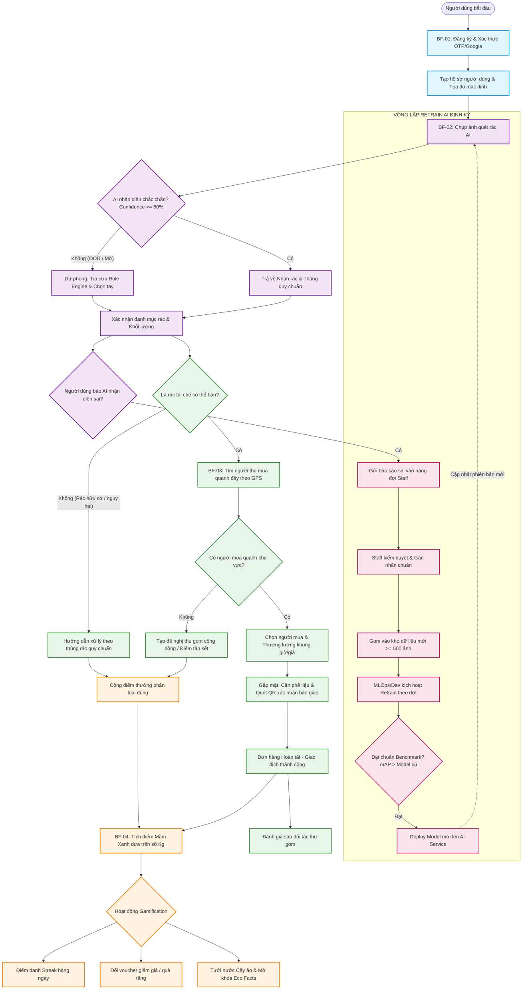

# BÁO CÁO ĐÁNH GIÁ VÀ CHUẨN HÓA SƠ ĐỒ LUỒNG NGHIỆP VỤ (BUSINESS FLOW EVALUATION & CONTINUITY SPECIFICATION)

**Dự án:** EcoLink – Nền tảng Phân loại Rác Thông minh & Kết nối Thu mua Phế liệu  
*(Intelligent Recyclable Waste Classification and Trade Matching Platform)*  
**Mã tài liệu:** ECO-DOC-BF-EVAL-01  
**Phiên bản:** 2.0  
**Ngày lập:** 26/10/2026  
**Căn cứ tham chiếu:**
* Giáo trình chuẩn quốc tế: *Software Requirements (3rd Edition) – Karl Wiegers & Joy Beatty* (Chương 5: Business Requirements, Chương 11: Business Process & User Requirements).
* Biên bản góp ý của Hội đồng thẩm định: [`documents/Note Hội Đồng.md`](file:///c:/Projects/EcoLink/intelligent-waste-sorting-trading/documents/Note%20H%E1%BB%99i%20%C4%90%E1%BB%93ng.md).
* Biên bản phản biện chi tiết: [`documents/Note Review.md`](file:///c:/Projects/EcoLink/intelligent-waste-sorting-trading/documents/Note%20Review.md) (Góp ý của Thầy Kiên, Thầy Giang và Cô Lan).
* Đặc tả quy tắc nghiệp vụ hệ thống: [`documents/business_rule_&_system_message.md`](file:///c:/Projects/EcoLink/intelligent-waste-sorting-trading/documents/business_rule_&_system_message.md).

---

## 📌 MỤC LỤC
1. [TỔNG QUAN VÀ CƠ SỞ LÝ LUẬN](#1-tổng-quan-và-cơ-sở-lý-luận)
2. [ĐÁNH GIÁ CHI TIẾT 5 SƠ ĐỒ LUỒNG NGHIỆP VỤ HIỆN TẠI (GAP ANALYSIS)](#2-đánh-giá-chi-tiết-5-sơ-đồ-luồng-nghiệp-vụ-hiện-tại-gap-analysis)
   - [2.1. Sơ đồ 1: Giao dịch & Bàn giao phế liệu (Trading & Handover Flow)](#21-sơ-đồ-1-giao-dịch--bàn-giao-phế-liệu-trading--handover-flow)
   - [2.2. Sơ đồ 2: Phân loại rác bằng AI & Vòng lặp dữ liệu (AI Scan & Data Loop)](#22-sơ-đồ-2-phân-loại-rác-bằng-ai--vòng-lặp-dữ-liệu-ai-scan--data-loop)
   - [2.3. Sơ đồ 3: Đăng ký & Xét duyệt Cơ sở thu gom (Recycler Onboarding)](#23-sơ-đồ-3-đăng-ký--xét-duyệt-cơ-sở-thu-gom-recycler-onboarding)
   - [2.4. Sơ đồ 4: Phân hệ Điểm thưởng & Gamification](#24-sơ-đồ-4-phân-hệ-điểm-thưởng--gamification)
   - [2.5. Sơ đồ 5: Đăng ký người dùng thường qua OTP Email](#25-sơ-đồ-5-đăng-ký-người-dùng-thường-qua-otp-email)
3. [GIẢI PHÁP CHO 3 BÀI TOÁN HÓC BÚA TỪ HỘI ĐỒNG PHẢN BIỆN](#3-giải-pháp-cho-3-bài-toán-hóc-búa-từ-hội-đồng-phản-biện)
   - [Bài toán 1: Rác phân loại xong không có ai mua thì xử lý thế nào? (Thầy Kiên)](#bài-toán-1-rác-phân-loại-xong-không-có-ai-mua-thì-xử-lý-thế-nào-thầy-kiên)
   - [Bài toán 2: Kịch bản dự phòng khi AI nhận diện không rõ / OOD (Thầy Giang)](#bài-toán-2-kịch-bản-dự-phòng-khi-ai-nhận-diện-không-rõ--ood-thầy-giang)
   - [Bài toán 3: Quy trình Retrain AI khép kín theo đợt (Thầy Giang & Hội đồng)](#bài-toán-3-quy-trình-retrain-ai-khép-kín-theo-đợt-thầy-giang--hội-đồng)
4. [MA TRẬN LIÊN KẾT DỮ LIỆU INPUT - OUTPUT GIỮA CÁC LUỒNG](#4-ma-trận-liên-kết-dữ-liệu-input---output-giữa-các-luồng)
5. [SƠ ĐỒ CHUỖI GIÁ TRỊ TỔNG THỂ KHÉP KÍN (END-TO-END VALUE CHAIN)](#5-sơ-đồ-chuỗi-giá-trị-tổng-thể-khép-kín-end-to-end-value-chain)
6. [HƯỚNG DẪN CẢI TIẾN TRỰC TIẾP TRÊN CÁC SƠ ĐỒ ĐÃ VẼ & SLIDE BẢO VỆ](#6-hướng-dẫn-cải-tiến-trực-tiếp-trên-các-sơ-đồ-đã-vẽ--slide-bảo-vệ)

---

## 1. TỔNG QUAN VÀ CƠ SỞ LÝ LUẬN

### 1.1. Nguyên lý phân tích Business Process theo Karl Wiegers
Theo giáo trình *Software Requirements (3rd Edition - Karl Wiegers & Joy Beatty)*, các luồng nghiệp vụ ở mức **Yêu cầu Người dùng (User Requirements)** đóng vai trò là "xương sống" kết nối giữa **Mục tiêu Doanh nghiệp (Business Requirements)** và **Đặc tả Chức năng Kỹ thuật (Functional Requirements / System Use Cases)**:
1. **Tính liền mạch của Chuỗi giá trị (Value Stream Continuity):** Một hệ sinh thái ứng dụng không được phép tồn tại dưới dạng các "ốc đảo chức năng" (Functional Silos). Người dùng sử dụng phần mềm để hoàn thành một mục tiêu xuyên suốt. Do đó, **Đầu ra (Output / Postcondition / Generated Data)** của quy trình nghiệp vụ trước phải là **Đầu vào (Input / Precondition / Trigger Event)** của quy trình nghiệp vụ tiếp theo.
2. **Khắc phục lỗi đứt gãy luồng dữ liệu:** Nếu một quy trình kết thúc mà dữ liệu sinh ra bị triệt tiêu (dead-end), hoặc một quy trình bắt đầu mà không có ngữ cảnh dữ liệu trước đó, hệ thống sẽ bị đánh giá là **thiết kế rời rạc, thiếu tư duy kiến trúc hướng nghiệp vụ**.

### 1.2. Tổng kết các vấn đề Thầy Kiên và Thầy Giang đã chỉ ra
Căn cứ vào [`Note Hội Đồng.md`](file:///c:/Projects/EcoLink/intelligent-waste-sorting-trading/documents/Note%20H%E1%BB%99i%20%C4%90%E1%BB%93ng.md) và [`Note Review.md`](file:///c:/Projects/EcoLink/intelligent-waste-sorting-trading/documents/Note%20Review.md):
* **Thầy Kiên:** 
  - Các luồng chính đang bị rời rạc, cần đổi tên bám sát chức năng thực tế, tránh lạm dụng từ khóa "AI".
  - Bắt buộc phải nối Input và Output của các luồng nghiệp vụ với nhau, mô tả rõ sự luân chuyển dữ liệu.
  - Phải xử lý rủi ro nghiệp vụ: *"Nếu phân loại rác xong mà không có ai mua thì xử lý thế nào?"*. Luồng nghiệp vụ cốt lõi phải thông suốt: **Phân loại rác $\rightarrow$ Bán $\rightarrow$ Tạo đề nghị bán $\rightarrow$ Tích điểm thưởng bảo vệ môi trường**.
* **Thầy Giang:** 
  - Phải chuyển hóa các tài liệu mô tả thành sơ đồ quy trình trực quan (Workflow).
  - Phải thể hiện được Use Case / Luồng Retrain AI theo vòng lặp dữ liệu (Data Loop): *Người dùng cung cấp ảnh $\rightarrow$ Staff sơ chế và gán nhãn $\rightarrow$ Bàn giao cho Developer/MLOps train lại theo đợt (batch)*.
  - Phải có Kịch bản dự phòng (Backup Plan) khi ảnh mờ, tối, vật thể lạ ngoài tập dữ liệu (Out-of-Distribution - OOD, độ tin cậy $< 60\%$).

---

## 2. ĐÁNH GIÁ CHI TIẾT 5 SƠ ĐỒ LUỒNG NGHIỆP VỤ HIỆN TẠI (GAP ANALYSIS)

Dưới đây là phân tích chi tiết về ưu điểm, hạn chế và các điểm đứt gãy dữ liệu của 5 sơ đồ luồng nghiệp vụ hiện tại:

### 2.1. Sơ đồ 1: Giao dịch & Bàn giao phế liệu (Trading & Handover Flow)
* **Tác nhân tham gia (Lanes):** `USER` | `ECOLINK SYSTEM` | `RECYCLER / BUYER`

#### ❌ Điểm đứt gãy & Thiếu sót nghiêm trọng:
1. **Khởi đầu "từ trên trời rơi xuống" (Missing Input Context):**  
   Luồng bắt đầu bằng hành động: *User $\rightarrow$ Tap page "Find nearby recyclers"*.  
   *Vấn đề:* Tại sao người dùng lại đi tìm cơ sở thu gom? Họ bán cái gì, số lượng bao nhiêu? Đáng lẽ người dùng vừa quét ảnh phân loại ở Sơ đồ 2 xong, có danh mục phế liệu đã xác nhận (`CategoryCode: Plastic, Paper,...`) thì hệ thống phải truyền trực tiếp thông tin này làm **Input** cho màn hình tìm kiếm để tự động lọc ra các cơ sở có thu mua loại phế liệu đó!
2. **Chưa xử lý bài toán rủi ro cốt lõi (Edge Case Thầy Kiên):**  
   Tại khối quyết định `has recyclers?`: Nếu `No`, hệ thống báo *"Recyclers not found nearby, please select a different range"* và hỏi `select again?`. Nếu người dùng chọn `No` $\rightarrow$ Kết thúc luồng (End).  
   *Hậu quả nghiệp vụ:* Nếu người dân gom rác mà không ai mua (hoặc ở vùng sâu vùng xa), họ sẽ vứt bỏ rác ra môi trường. Sơ đồ hoàn toàn thiếu nhánh giải pháp cho người dùng khi không tìm được cơ sở thu gom.
3. **Kết thúc cụt, không nối sang Gamification (Missing Output Link):**  
   Khi bàn giao thành công và đánh giá sao xong $\rightarrow$ Luồng đi thẳng vào nút Kết thúc (End).  
   *Hậu quả nghiệp vụ:* Theo quy tắc `BR-GAM-01`, sự kiện **Bàn giao Hoàn tất (Completed Handover)** là căn cứ pháp lý quan trọng nhất để **cộng điểm Mầm Xanh (Green Sprout Points)** dựa trên số kg phế liệu thực tế cho cả Citizen và Recycler. Việc luồng dừng lại ở Rating làm đứt gãy hoàn toàn mối liên kết với Sơ đồ 4 (Gamification).
4. **Nhầm lẫn logic tại nhánh từ chối xác nhận bàn giao:**  
   Mũi tên từ `Handover confirmed? = No` lại trỏ sang khối `Auto-cancel after 30 minutes if the appointment is missed`.  
   *Sai lệch:* "Quá giờ 30 phút đối tác không đến" là việc hủy hẹn do trễ giờ; còn nếu người dùng chủ động bấm "Không xác nhận bàn giao" do sai lệch khối lượng/đơn giá, đây là **Tranh chấp giao dịch (Dispute - Module DSP)** và cần chuyển sang luồng giải quyết khiếu nại của Staff.

---

### 2.2. Sơ đồ 2: Phân loại rác bằng AI & Vòng lặp dữ liệu (AI Scan & Data Loop)
* **Tác nhân tham gia (Lanes):** `USER` | `ECOLINK SYSTEM` | `STAFF`

#### ❌ Điểm đứt gãy & Thiếu sót nghiêm trọng:
1. **Hoàn toàn thiếu Kịch bản dự phòng khi AI không chắc chắn (Backup Plan - Góp ý Thầy Giang & `BR-CLS-03`):**  
   Luồng xử lý diễn ra một đường thẳng: *AI detects $\rightarrow$ AI processes $\rightarrow$ AI returns labels $\rightarrow$ Map label $\rightarrow$ Receive result*.  
   *Lỗ hổng kỹ thuật:* Nếu ảnh chụp bị mờ, góc chụp tối, hoặc người dùng chụp vật thể lạ không phải rác (Out-of-Distribution - OOD, độ tin cậy $< 60\%$), sơ đồ không hề có nhánh rẽ xử lý ngoại lệ. Hệ thống bắt buộc phải có khối kiểm tra: Nếu độ tin cậy $< 60\%$, hiển thị cảnh báo và mở bảng **Rule Engine tra cứu tĩnh** để người dùng **tự chọn loại rác bằng tay (Manual Selection)**.
2. **"Tử huyệt" đứt gãy luồng nghiệp vụ (Dead-end Flow):**  
   Sau khi người dùng nhận kết quả và lưu lịch sử $\rightarrow$ Luồng dừng lại (End).  
   *Câu hỏi của Thầy Kiên:* Quét rác xong rồi để đó sao? Luồng không hề có nút chuyển tiếp: *"Bạn có muốn tìm vựa phế liệu gần nhất để bán lượng rác này không?"* để dẫn người dùng sang Sơ đồ 1.
3. **Quy trình Retrain AI bị cụt ở giữa chừng (Ý kiến Thầy Giang & Note Hội đồng):**  
   Sau khi Staff duyệt và thêm ảnh vào tập dữ liệu chuẩn $\rightarrow$ Hệ thống lưu phiên bản dataset mới $\rightarrow$ Kết thúc luồng (End).  
   *Hội đồng chất vấn:* *"Lưu dataset xong thì ai huấn luyện lại? Train tự động hay theo đợt? Kiểm thử độ chính xác ở đâu và deploy thế nào?"*. Luồng hiện tại chỉ dừng ở bước chuẩn bị dữ liệu (Data Annotation) chứ chưa hề có các bước của **Chu trình Huấn luyện & Triển khai AI (AI Retraining & Deployment Lifecycle)**.

---

### 2.3. Sơ đồ 3: Đăng ký & Xét duyệt Cơ sở thu gom (Recycler Onboarding)
* **Tác nhân tham gia (Lanes):** `User` | `Ecolink System` | `External Service` | `Staff`

#### ❌ Điểm đứt gãy:
1. **Thiếu bước cấu hình hồ sơ thu gom (Precondition cho Sơ đồ 1):**  
   Sau khi Staff phê duyệt $\rightarrow$ Hệ thống cấp vai trò `RECYCLER` $\rightarrow$ Kết thúc luồng.  
   *Hậu quả:* Cơ sở thu gom chưa hề cung cấp: Vị trí tọa độ GPS/kho bãi, Bán kính nhận thu gom, Danh mục rác chấp nhận mua và Bảng giá niêm yết theo từng loại phế liệu (`BR-MTH-03`). Nếu thiếu bước này, khi người dân tìm kiếm ở Sơ đồ 1, cơ sở này sẽ không thể hiển thị trên bản đồ OpenStreetMap!
2. **Khắc phục:** Sau khi được cấp quyền `RECYCLER`, luồng phải điều hướng cơ sở thu gom vào trang: **Thiết lập Hồ sơ Kho bãi & Bảng giá phế liệu (Setup Scrap Depot Profile & Pricing Table)**. Khi hoàn tất cấu hình, trạng thái cơ sở mới chuyển thành `ACTIVE` trên bản đồ tìm kiếm.

---

### 2.4. Sơ đồ 4: Phân hệ Điểm thưởng & Gamification
* **Tác nhân tham gia (Lanes):** `User` | `EcoLink System`

#### ❌ Điểm đứt gãy:
1. **Nền kinh tế điểm bị cô lập (Isolated Gamification Economy):**  
   Sơ đồ chỉ thể hiện 3 hành động: Điểm danh (Check-in), Đổi voucher (Redeem), Tưới cây ảo (Upgrade).  
   *Nghịch lý nghiệp vụ:* Điểm thưởng Mầm Xanh ở đâu ra? Người dùng không thể chỉ "điểm danh" mỗi ngày để tích lũy hàng nghìn điểm đổi voucher. Nguồn điểm cốt lõi của EcoLink bắt buộc phải được kích hoạt từ:  
   - **Sự kiện 1 (Từ Sơ đồ 2):** Phân loại rác đúng quy chuẩn mỗi ngày $\rightarrow$ Thưởng điểm hành vi xanh.  
   - **Sự kiện 2 (Từ Sơ đồ 1):** Bàn giao rác tái chế thành công cho cơ sở thu mua $\rightarrow$ Thưởng điểm theo số lượng kg phế liệu thực tế (`BR-GAM-01`).
2. **Lỗi chính tả / Logic hiển thị (Typo):**  
   Tại nhánh `Redeem $\rightarrow$ Enough points & item in stock? = Yes`: Khối hành động ghi là: **"Deduct points & stock, display error message"** *(Trừ điểm, trừ tồn kho và hiển thị thông báo lỗi?!)*. Đây là lỗi đánh máy nghiêm trọng, phải sửa thành: *"Deduct points & stock, issue voucher code & display success message"*.

---

### 2.5. Sơ đồ 5: Đăng ký người dùng thường qua OTP Email
* **Tác nhân tham gia (Lanes):** `Guest` | `Ecolink system` | `External service`

#### ❌ Đánh giá tính liền mạch:
* Luồng logic xác thực mã OTP nội bộ hoạt động đúng chuẩn.
* **Tính kết nối:** Sau khi cấp JWT và tạo hồ sơ, sơ đồ dừng ở `navigate to the homepage`. Để tạo hành trình trải nghiệm người dùng liền mạch (User Onboarding Journey), hệ thống cần kích hoạt sự kiện chào mừng: Gợi ý người dùng thực hiện lượt quét rác đầu tiên để nhận ngay điểm thưởng chào đón thành viên mới $\rightarrow$ Nối trực tiếp vào Sơ đồ 2.

---

## 3. GIẢI PHÁP CHO 3 BÀI TOÁN HÓC BÚA TỪ HỘI ĐỒNG PHẢN BIỆN

Để bảo vệ thành công trước Hội đồng và trả lời thuyết phục các câu hỏi của Thầy Kiên và Thầy Giang, tài liệu này chuẩn hóa giải pháp cho 3 bài toán lớn như sau:

---

### Bài toán 1: Rác phân loại xong không có ai mua thì xử lý thế nào? (Thầy Kiên)
*Ngữ cảnh:* Người dùng phân loại rác ra kết quả là rác tái chế (giấy, nhựa), nhưng khi tìm kiếm trên bản đồ thì trong bán kính 5km - 10km không có cơ sở thu gom nào hoạt động, hoặc loại rác đó là rác không có giá trị thương mại (rác hữu cơ, pin cũ, bóng đèn).

####  Giải pháp xử lý nghiệp vụ 3 tầng:
1. **Tầng 1 - Hướng dẫn tự xử lý theo Rule Engine tĩnh (Eco-Disposal Guide):**  
   Hệ thống tự động hiển thị hướng dẫn: Bỏ vào thùng rác công cộng có màu quy chuẩn (ví dụ: thùng màu vàng cho rác tái chế, thùng màu cam cho rác nguy hại) kèm vị trí các điểm tập kết rác công cộng gần nhất do chính quyền địa phương quy định.
2. **Tầng 2 - Đăng tin "Đề nghị gom phế liệu cộng đồng" (Community Pickup Request):**  
   Cho phép người dùng tạo một bài đăng công khai trên bản đồ gom rác (không cần đặt cọc, không cần thỏa thuận giá khắt khe). Những người thu gom ve chai dạo, tổ chức tình nguyện hoặc đơn vị môi trường đô thị khi đi qua khu vực có thể nhận gom miễn phí hoặc trả tiền tùy tâm.
3. **Tầng 3 - Cơ chế bù đắp điểm thưởng Mầm Xanh (Eco-Contribution Points):**  
   Dù không bán được phế liệu thành tiền, người dùng chỉ cần chụp ảnh minh chứng đã bỏ rác đúng thùng quy định, hệ thống **vẫn cộng điểm Mầm Xanh khuyến khích ý thức bảo vệ môi trường**. Điểm này dùng để tưới cây ảo hoặc đổi voucher tại Sơ đồ 4.

---

### Bài toán 2: Kịch bản dự phòng khi AI nhận diện không rõ / OOD (Thầy Giang)
*Ngữ cảnh:* Ảnh chụp bị nhòe, thiếu sáng, vật thể lạ nằm ngoài danh mục huấn luyện (Out-of-Distribution - OOD), hoặc mô hình AI trả về độ tin cậy $< 60\%$.

####  Kịch bản Fallback 2 giai đoạn (Two-Stage Backup Plan):
1. **Giai đoạn 1 - Nhận diện ngoại lai & Cảnh báo minh bạch (`BR-CLS-03`):**  
   Khi `Confidence < 0.60` hoặc cờ `is_out_of_distribution = true`, hệ thống **tuyệt đối không áp đặt nhãn đoán mò**. Màn hình hiển thị thông báo thân thiện:  
   *"Hệ thống nhận diện không chắc chắn (>60%) do ảnh mờ hoặc góc chụp chưa rõ. Bạn vui lòng chụp lại hoặc chọn danh mục thủ công."*
2. **Giai đoạn 2 - Hỗ trợ Tra cứu Quy tắc tĩnh (Manual Rule Engine Selection):**  
   Hiển thị danh mục 6 nhóm rác lớn với hình ảnh minh họa trực quan. Người dùng chỉ cần nhấp chọn nhóm rác thực tế. Kết quả phân loại được xác nhận hợp lệ để tiếp tục luồng bán phế liệu hoặc tích điểm mà không bị gián đoạn.

---

### Bài toán 3: Quy trình Retrain AI khép kín theo đợt (Thầy Giang & Hội đồng)
*Ngữ cảnh:* Khi người dùng báo cáo AI nhận diện sai, hệ thống cần một quy trình khép kín (Data Loop) để tái huấn luyện mô hình nhằm nâng cao độ chính xác liên tục.

####  Quy trình Retrain AI 6 bước khép kín (Batch Retraining Pipeline):

```
[Báo sai từ User] ──> [Staff duyệt & Gán nhãn] ──> [Kho dữ liệu >= 500 ảnh]
                                                               │
[Deploy bản Model mới] <── [Đánh giá Benchmark] <── [MLOps Retrain theo đợt]
```

1. **Bước 1 - Tiếp nhận báo cáo:** Người dùng gửi báo cáo nhãn sai kèm nhãn đề xuất. Dữ liệu gồm: Ảnh gốc, Bounding box, Nhãn AI đoán, Nhãn người dùng sửa, Timestamp.
2. **Bước 2 - Kiểm duyệt dữ liệu (Human-in-the-loop by Staff - `BR-CLS-06`):** Staff đăng nhập trang quản trị, kiểm tra ảnh báo sai. Nếu ảnh rõ nét và nhãn người dùng đúng $\rightarrow$ Staff xác nhận gán nhãn chuẩn và duyệt đưa vào kho dữ liệu Retrain. Nếu ảnh rác/spam $\rightarrow$ Từ chối.
3. **Bước 3 - Điều kiện kích hoạt Huấn luyện lại theo đợt (Batch Trigger Condition):**  
   *Hệ thống áp dụng cơ chế huấn luyện theo đợt (Batch Retraining), không train tự động theo từng ảnh đơn lẻ để tránh overfitting và lãng phí tài nguyên GPU.*  
   *Điều kiện kích hoạt:* Định kỳ vào ngày cuối cùng của tháng HOẶC khi kho dữ liệu ảnh mới duyệt đạt tối thiểu **500 mẫu**.
4. **Bước 4 - Huấn luyện mô hình (MLOps / Developer Pipeline):**  
   Script tự động chia tập dữ liệu theo tỷ lệ 80% Train / 20% Validation (đảm bảo không trùng lặp ảnh giữa 2 tập theo `BR-CLS-07`). Chạy huấn luyện mô hình YOLOv8 trên GPU.
5. **Bước 5 - Đánh giá Benchmark độc lập:**  
   So sánh mô hình mới với mô hình đang chạy trên production dựa trên các chỉ số: $mAP@0.5$, $mAP@0.5:0.95$, $Accuracy$, $F1\text{-score}$. Chỉ khi mô hình mới đạt độ chính xác cao hơn mô hình cũ ($mAP$ cải thiện $\ge 1.5\%$) thì mới được đóng gói thành artifact `weights_vX.Y.pt`.
6. **Bước 6 - Triển khai mô hình mới (Zero-Downtime Deployment):**  
   Cập nhật trọng số mới vào thư mục `models/` của AI Microservice. Khởi động lại dịch vụ hoặc hot-reload. Người dùng lập tức được hưởng phiên bản AI có độ chính xác cao hơn.

---

## 4. MA TRẬN LIÊN KẾT DỮ LIỆU INPUT - OUTPUT GIỮA CÁC LUỒNG

Bảng dưới đây quy định "hợp đồng giao tiếp dữ liệu" (Data Contract) giữa các luồng nghiệp vụ nhằm đảm bảo tính liền mạch tuyệt đối:

| Luồng nguồn (Upstream Flow) | Đầu ra được tạo ra (Output Artifacts) | Luồng đích (Downstream Flow) | Đầu vào tiếp nhận (Input Parameters) | Giá trị nghiệp vụ mang lại |
| :--- | :--- | :--- | :--- | :--- |
| **BF-01: Đăng ký & Onboarding** | Tài khoản kích hoạt, JWT Token, Tọa độ GPS mặc định | **BF-02: Phân loại rác AI** | `UserId`, Session hợp lệ | Người dùng bắt đầu trải nghiệm quét rác có định danh để lưu lịch sử cá nhân |
| **BF-02: Phân loại rác AI** | Danh mục rác xác nhận (`CategoryCode`), Khối lượng ước tính (`EstWeight`), Ảnh chụp | **BF-03: Tìm kiếm & Thu mua** | `WasteCategory`, `Quantity`, `UserLocation` | Người dùng không phải nhập lại tay loại rác muốn bán; bản đồ tự động lọc vựa thu mua phù hợp |
| **BF-02: Phân loại rác AI** | Báo cáo nhận diện sai kèm ảnh gốc và nhãn người dùng sửa | **BF-05: Vòng lặp Retrain AI** | `RawImage`, `PredictedLabel`, `UserLabel` | Tạo nguồn dữ liệu huấn luyện thực tế cho đội ngũ kỹ thuật AI |
| **BF-03: Tìm kiếm & Thu mua** | Đơn giao dịch hoàn tất (`CompletedOrder`), Khối lượng thực tế (`ActualKg`) | **BF-04: Gamification & Điểm** | `CompletedOrderId`, `KgRecycled`, `ActorRole` | Tự động quy đổi kg rác tái chế thành Điểm Mầm Xanh cho cả người dân và người thu mua |
| **BF-03: Tìm kiếm & Thu mua** | Đơn giao dịch hoàn tất | **BF-06: Đánh giá & Xếp hạng** | `TransactionId`, `PartnerId` | Kích hoạt form chấm sao, chống đánh giá ảo |
| **BF-07: Đăng ký Cơ sở thu gom** | Tài khoản Recycler được Staff duyệt, Tọa độ kho, Bảng giá thu mua | **BF-03: Tìm kiếm & Thu mua** | `RecyclerProfile`, `GeoPoint`, `AcceptedCategories` | Cơ sở thu gom chính thức hiển thị trên bản đồ tìm kiếm |
| **BF-05: Vòng lặp Retrain AI** | Mô hình YOLOv8 mới đã nghiệm thu benchmark ($mAP > \text{cũ}$) | **BF-02: Phân loại rác AI** | `ModelWeights_vX.Y.pt` | Nâng cao độ chính xác nhận diện cho người dùng |

---

## 5. SƠ ĐỒ CHUỖI GIÁ TRỊ TỔNG THỂ KHÉP KÍN (END-TO-END VALUE CHAIN)

Dưới đây là sơ đồ tổng thể cấp cao (Macro Business Flow) thể hiện sự kết nối hoàn hảo giữa tất cả các phân hệ, loại bỏ hoàn toàn các "ốc đảo":



---

## 6. HƯỚNG DẪN CẢI TIẾN TRỰC TIẾP TRÊN CÁC SƠ ĐỒ ĐÃ VẼ & SLIDE BẢO VỆ

Để chuẩn bị slide thuyết trình và cập nhật lại các file thiết kế sơ đồ, nhóm thực hiện các bước điều chỉnh cụ thể sau:

### 6.1. Điều chỉnh Sơ đồ 1 (Trading & Handover):
1. **Sửa điểm bắt đầu (Start Event):** Không bắt đầu bằng việc bấm nút tìm kiếm vu vơ, mà bắt đầu bằng: *"Tiếp nhận danh mục rác và khối lượng từ kết quả quét AI (Sơ đồ 2)"*.
2. **Bổ sung nhánh xử lý khi không có người mua (Edge Case):** Tại khối `has recyclers? = No`, thêm lựa chọn:  
   * Hướng 1: *Xem vị trí thùng rác công cộng quy chuẩn*.  
   * Hướng 2: *Đăng đề nghị gom phế liệu cộng đồng*.  
   * Cả 2 hướng đều dẫn đến khối: *Cộng điểm khuyến khích ý thức xanh cho công dân*.
3. **Sửa điểm kết thúc (End Event):** Sau khi lưu đánh giá sao, thêm khối: *Hệ thống tự động cộng Điểm Mầm Xanh theo số kg phế liệu đã hoàn tất* $\rightarrow$ **Mũi tên chỉ rõ chuyển sang Sơ đồ 4**.

### 6.2. Điều chỉnh Sơ đồ 2 (AI Classification & Retraining):
1. **Bổ sung khối Decision:** Sau khi AI trả về kết quả, thêm hình thoi: `Độ tin cậy >= 60%?`.  
   * Nếu `No`: Rẽ sang *Hiển thị bảng Rule Engine cho người dùng tự chọn loại rác thủ công (Fallback Plan)*.
2. **Bổ sung cổng ra (Outflow):** Sau bước lưu lịch sử quét rác, vẽ mũi tên chuyển tiếp: *Người dùng bấm "Tìm cơ sở thu gom để bán"* $\rightarrow$ **Nối trực tiếp sang Sơ đồ 1**.
3. **Mở rộng chu trình Retrain:** Sau bước `Staff: Add to verified dataset`, không kết thúc ngay mà vẽ tiếp các bước:  
   * `Kiểm tra điều kiện: Kho ảnh mới đạt >= 500 mẫu?`  
   * `MLOps: Huấn luyện lại mô hình theo đợt (Batch Retrain)`  
   * `Kiểm định Benchmark đạt yêu cầu?`  
   * `Deploy mô hình mới lên server AI`.

### 6.3. Điều chỉnh Sơ đồ 3 (Recycler Registration):
* Sau bước `Grant Role: RECYCLER`, vẽ thêm bước: *Chuyển sang màn hình Cấu hình Tọa độ Kho bãi GPS, Bán kính thu gom & Bảng giá phế liệu*. Khi hoàn tất mới kích hoạt cơ sở hiển thị trên bản đồ tìm kiếm của Sơ đồ 1.

### 6.4. Điều chỉnh Sơ đồ 4 (Gamification):
* **Sửa lỗi chính tả:** Sửa chữ `display error message` tại nhánh đổi thưởng thành `display success message & voucher code`.
* **Thêm luồng Input:** Thêm một sự kiện đầu vào: *Tiếp nhận sự kiện cộng điểm từ Giao dịch Bán rác thành công (từ Sơ đồ 1)*.

---

### 💡 LỜI KHUYÊN KHI THUYẾT TRÌNH TRƯỚC HỘI ĐỒNG (SLIDE STRATEGY)
Khi bảo vệ đồ án trước Thầy Kiên và Thầy Giang, nhóm hãy trình bày theo công thức dẫn dắt 3 bước:
1. **Bước 1 - Khẳng định tính thực tế của Mô hình kinh doanh:** *"EcoLink không chỉ là đồ án nhận diện ảnh AI thông thường, mà là một nền tảng kinh tế tuần hoàn khép kín: Phân loại rác $\rightarrow$ Kết nối mua bán $\rightarrow$ Tích điểm đổi quà $\rightarrow$ Dữ liệu thực tế nuôi ngược lại AI."*
2. **Bước 2 - Chứng minh tính liền mạch của các luồng nghiệp vụ:** Trình chiếu sơ đồ Macro ở Mục 5 để khẳng định: *"Mọi phân hệ trong hệ thống đều được kết nối chặt chẽ theo nguyên lý Input của luồng này là Output của luồng kia, không có tính năng nào bị cô lập."*
3. **Bước 3 - Chủ động trả lời các điểm phản biện hóc búa:** Trình bày rõ ràng giải pháp cho tình huống không có người mua và kịch bản dự phòng khi AI nhận diện dưới 60%, chứng minh nhóm đã lường trước toàn bộ các trường hợp ngoại lệ trong thực tế.
