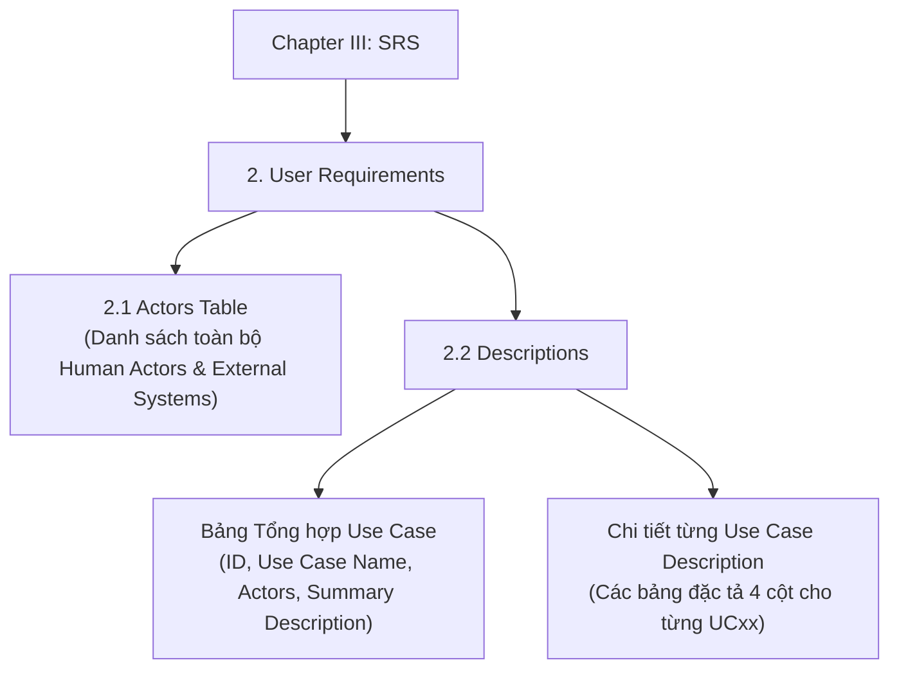

# TÀI LIỆU QUY CHUẨN VÀ HƯỚNG DẪN VIẾT USE CASE DESCRIPTION
**Dự án:** EcoLink – Intelligent Waste Sorting & Trading Platform  
**Chuẩn tham chiếu:** Đồ án tốt nghiệp Capstone Project (SEP490 - FPT University)  
**Tài liệu quy tắc đối chiếu:** [BR & MSG.md](file:///c:/Projects/EcoLink/intelligent-waste-sorting-trading/documents/BR%20&%20MSG.md)

---

## MỤC LỤC
1. [Mục đích và Phạm vi tài liệu](#1-mục-đích-và-phạm-vi-tài-liệu)
2. [Vị trí và Bối cảnh trong Báo cáo SRS (Chapter III)](#2-vị-trí-và-bối-cảnh-trong-báo-cáo-srs-chapter-iii)
3. [Bộ quy luật đặc tả Use Case (Standard Rule Set)](#3-bộ-quy-luật-đặc-tả-use-case-standard-rule-set)
   - [3.1 Quy tắc định danh và Đặt tên (ID & Name)](#31-quy-tắc-định-danh-và-đặt-tên-id--name)
   - [3.2 Quy tắc xác định Actors](#32-quy-tắc-xác-định-actors)
   - [3.3 Quy tắc viết Description](#33-quy-tắc-viết-description)
   - [3.4 Quy tắc viết Preconditions (Tiền điều kiện)](#34-quy-tắc-viết-preconditions-tiền-điều-kiện)
   - [3.5 Quy tắc viết Postconditions (Hậu điều kiện)](#35-quy-tắc-viết-postconditions-hậu-điều-kiện)
   - [3.6 Quy tắc viết Normal Flow (Luồng chính)](#36-quy-tắc-viết-normal-flow-luồng-chính)
   - [3.7 Quy tắc phân biệt AF vs ETF vs EF & Dẫn chiếu System Message](#37-quy-tắc-phân-biệt-af-vs-etf-vs-ef--dẫn-chiếu-system-message)
   - [3.8 Quy tắc viết Business Rules chuẩn BR-[Module]-ID](#38-quy-tắc-viết-business-rules-chuẩn-br-module-id)
4. [Bộ khung Template Markdown chuẩn](#4-bộ-khung-template-markdown-chuẩn)
   - [Template 1: Use Case Đơn / Nghiệp vụ tác vụ](#template-1-use-case-đơn--nghiệp-vụ-tác-vụ)
   - [Template 2: Use Case Gom nhóm Quản trị (CRUD)](#template-2-use-case-gom-nhóm-quản-trị-crud)
5. [Ví dụ minh họa thực chiến cho EcoLink](#5-ví-dụ-minh-họa-thực-chiến-cho-ecolink)
   - [Ví dụ 1: UC Tác vụ AI – Identify Waste via Photo](#ví-dụ-1-uc-tác-vụ-ai--identify-waste-via-photo)
   - [Ví dụ 2: UC Nghiệp vụ Gom nhóm CRUD – Manage Master Waste Categories](#ví-dụ-2-uc-nghiệp-vụ-gom-nhóm-crud--manage-master-waste-categories)
6. [Bảng kiểm tra chất lượng (Quality Checklist)](#6-bảng-kiểm-tra-chất-lượng-quality-checklist)

---

## 1. MỤC ĐÍCH VÀ PHẠM VI TÀI LIỆU
* **Mục đích:** Chuẩn hóa toàn bộ cấu trúc, ngôn ngữ, quy ước mã hóa và phương pháp tư duy khi viết bảng đặc tả Use Case (Use Case Description) cho dự án EcoLink.
* **Phạm vi:** Áp dụng cho toàn bộ các thành viên trong nhóm dự án khi xây dựng phần **Chapter III: Software Requirement Specification (SRS)** của báo cáo Capstone Project.
* **Yêu cầu cốt lõi:** 
  * Đảm bảo tính đồng nhất về mặt thẩm mỹ trình bày, tính chặt chẽ trong luồng nghiệp vụ và tính khả thi để làm căn cứ cho việc thiết kế Database, Sequence Diagram và viết Test Case.
  * **Định vị nghiệp vụ thanh toán:** Tuyệt đối không đưa các yếu tố gợi đến PayOS hoặc luồng sàn thương mại điện tử giải ngân tiền phế liệu giữa User và Recycler. Việc mua bán phế liệu diễn ra trực tiếp ngoài hệ thống. Cổng **VietQR** chỉ phục vụ thanh toán các gói dịch vụ nội bộ của hệ thống (mua gói tắt quảng cáo, huy hiệu Tích xanh xác minh cơ sở uy tín, gói đẩy vị trí hiển thị nổi bật).

---

## 2. VỊ TRÍ VÀ BỐI CẢNH TRONG BÁO CÁO SRS (CHAPTER III)

Trong tài liệu báo cáo cuối kỳ, Use Case Description thuộc **Chapter III (Software Requirement Specification) $\rightarrow$ Mục 2 (User Requirements)**. Cấu trúc gồm 2 phần liên kết chặt chẽ:



### 2.1 Bảng định nghĩa Actors (Mục 2.1)
Trước khi viết bất kỳ UC nào, bảng Actors phải được định nghĩa đầy đủ để làm nguồn tham chiếu:
* **Human Actors:** `Guest`, `User` (Người phân loại & kết nối bán rác), `Recycler` (Cơ sở thu gom/Đối tác tái chế), `Staff` (Nhân viên vận hành back-office), `Admin` (Quản trị viên hệ thống).
* **Secondary / External Systems:** `Google Authentication Service`, `Cloudflare R2 Cloud Storage`, `VietQR Service` (Thanh toán các gói dịch vụ nội bộ), `OpenStreetMap / Google Maps API`, `Dịch vụ Email (SMTP)`.

### 2.2 Bảng tổng hợp Use Case (Đầu mục 2.2)
Cung cấp bức tranh toàn cảnh về toàn bộ chức năng của hệ thống theo cấu trúc:
| ID | Use Case | Actors | Use Case Description |
| :--- | :--- | :--- | :--- |
| UC01 | Register as User | Guest | Allows a guest to create a standard user account by providing required personal credentials. |
| ... | ... | ... | ... |

---

## 3. BỘ QUY LUẬT ĐẶC TẢ USE CASE (STANDARD RULE SET)

### 3.1 Quy tắc định danh và Đặt tên (ID & Name)
* **Quy tắc mã hóa (ID):** Sử dụng tiền tố cố định `UC` kèm 2 chữ số (ví dụ: `UC01`, `UC02`, ..., `UC46`) hoặc tiền tố phân hệ theo nhóm (ví dụ: `UC-R01`, `UC-S01`).
* **Quy tắc đặt tên (Name):**
  * Bắt buộc cấu trúc: **[Động từ hành động] + [Danh từ/Đối tượng nghiệp vụ]**.
  * Ngôn ngữ: Tiếng Anh chuẩn chuyên ngành công nghệ phần mềm kèm tên tiếng Việt giải nghĩa.
  * *Đúng:* `Identify Waste via Photo`, `Create Handover Request`, `Verify Recycler Application`, `Purchase In-System Services via VietQR`.
  * *Sai:* `Waste Scanning`, `Recycler Feature`, `Payment System`.

---

### 3.2 Quy tắc xác định Actors
* **Primary Actor(s):** 
  * Là đối tượng **chủ động** khởi tạo và thực hiện hành động để đạt được mục tiêu của UC.
  * Bắt buộc phải trùng khớp chính xác 100% với tên gọi trong bảng *2.1 Actors*.
  * Nếu một UC có thể thực hiện bởi nhiều Roles, ngăn cách bằng dấu phẩy: `User, Recycler` hoặc chỉ rõ vai trò theo ngữ cảnh: `User (Account Owner)`.
* **Secondary Actor(s):**
  * Các dịch vụ/hệ thống bên thứ ba tương tác trong quá trình thực thi: `AI Classification Service`, `Cloudflare R2 Cloud Storage`, `VietQR Service` (khi thanh toán gói dịch vụ), `Dịch vụ Email`.
  * Hoặc Actor nhận thông báo thụ động từ hành vi của Primary Actor (ví dụ: User gửi yêu cầu bàn giao thì Recycler là Secondary Actor nhận thông báo).
  * Nếu không có tương tác bên ngoài hoặc đối tượng thứ hai, **để trống ô này** (không ghi N/A hay gạch ngang).

---

### 3.3 Quy tắc viết Description
* Cú pháp chuẩn hóa:
  > *"Allows [Primary Actor] to [hành động nghiệp vụ chính] [trên đối tượng dữ liệu] in order to / for the purpose of [mục đích / giá trị mang lại]."*
* **Độ dài:** Từ 1 đến 3 câu hoàn chỉnh. Nêu bật chức năng làm gì và đem lại lợi ích gì cho người dùng.

---

### 3.4 Quy tắc viết Preconditions (Tiền điều kiện)
Tiền điều kiện là trạng thái **bắt buộc phải có sẵn** trước khi Use Case bắt đầu. Luôn tuân thủ **Quy tắc 3 Lớp**:

1. **Lớp Xác thực & Phiên (Authentication & Session):**
   * Đối với người dùng đã đăng nhập: *"The user is authenticated and has an active session with role [Role Name]."*
   * Đối với Guest: *"The guest has navigated to the system and is not authenticated."*
2. **Lớp Dữ liệu sẵn có (Data State):**
   * Đối tượng cần thao tác phải tồn tại với trạng thái hợp lệ.
   * Ví dụ: *"The handover request exists with status 'Pending'.", "The recycler profile is in 'Verified' status."*
3. **Lớp Ngữ cảnh giao diện (UI Context):**
   * Vị trí người dùng trước khi bắt đầu bước đầu tiên.
   * Ví dụ: *"The user is on the Handover Request Management screen."*

---

### 3.5 Quy tắc viết Postconditions (Hậu điều kiện)
Hậu điều kiện mô tả trạng thái của hệ thống sau khi Use Case kết thúc. **Bắt buộc phải mô tả cả 2 kịch bản**:

* **Kịch bản thành công (Success):**
  * Bản ghi dữ liệu nào được tạo mới, cập nhật hoặc xóa trong cơ sở dữ liệu.
  * Trạng thái thực thể thay đổi ra sao (ví dụ: chuyển từ `Pending` sang `Accepted`).
  * Phản hồi người dùng nhận được (thông báo nổi toast, điều hướng trang).
  * Các tác vụ ngầm được kích hoạt (email thông báo, tích điểm thưởng Gamification, ghi nhật ký kiểm toán).
* **Kịch bản thất bại (Failure):**
  * Luôn có câu chốt chặn an toàn dữ liệu:
  > *"If any operation fails, the system data remains unchanged, any uploaded temporary files are discarded, and an informative error message is displayed to the user."*

---

### 3.6 Quy tắc viết Normal Flow (Luồng chính)
Normal Flow là kịch bản "con đường màu xanh" (Happy Path) khi mọi việc diễn ra hoàn hảo không có lỗi:

1. **Mã hóa bước:** Bắt buộc dùng `NF-01`, `NF-02`, `NF-03`,...
2. **Tương tác 2 chiều (Actor $\leftrightarrow$ System):** 
   * Bước của Actor: Người dùng thao tác giao diện (bấm nút, điền biểu mẫu, quét mã, chọn tệp).
   * Bước của System: Hệ thống tiếp nhận, kiểm tra tính hợp lệ, cập nhật trạng thái hoặc hiển thị phản hồi.
3. **Không dùng ký tự mũi tên (`→`), sử dụng từ ngữ nối liên kết:**
   * Để tránh bị hiểu lầm mỗi mũi tên là một bước thao tác riêng biệt, **tuyệt đối không dùng ký tự mũi tên (`→`)**. Thay vào đó, sử dụng các từ ngữ nối câu tự nhiên như: *sau đó, đồng thời, tiếp tục, và*.
   * *Ví dụ chuẩn:*
   > `NF-04: Hệ thống kiểm tra tính hợp lệ của dữ liệu, sau đó lưu bản ghi danh mục rác mới vào cơ sở dữ liệu, đồng thời hiển thị thông báo thành công và chuyển hướng người dùng về trang danh sách.`
4. **Quy tắc gom nhóm cho Use Case dạng CRUD (Manage ...):**
   * Nếu gom chung CRUD vào 1 Use Case, phần Normal Flow phải chia tiêu đề con in đậm rõ ràng:
     * `**View List & Details**` (Bắt đầu từ NF-01)
     * `**Create [Entity]**` (Bắt đầu từ NF-03)
     * `**Update [Entity]**` (Tham chiếu: `NF-03 (from NF-02 View Detail)...`)
     * `**Delete / Deactivate [Entity]**` (Tham chiếu: `NF-03 (from NF-02 View Detail)...`)

---

### 3.7 Quy tắc phân biệt AF vs ETF vs EF & Dẫn chiếu System Message

Đây là điểm mấu chốt để phân định rạch ròi bản chất các luồng rẽ nhánh:

| Tiêu chí | Alternative Flow (AF) | Extension Flow (ETF) | Exceptions Flow (EF) |
| :--- | :--- | :--- | :--- |
| **Bản chất** | **Cách làm khác** vẫn đạt mục tiêu. | **Người dùng hủy ngang** thao tác. | **Lỗi hệ thống / Vi phạm quy tắc**. |
| **Mã hóa** | `AF-01`, `AF-02`... | `ETF-01`, `ETF-02`... | `EF-01`, `EF-02`... |
| **Tình huống áp dụng** | - Tìm kiếm, lọc danh mục, sắp xếp.<br>- Phân trang danh sách.<br>- Chọn phương án thay thế hợp lệ (chọn gợi ý AI khác, gửi đề nghị điều chỉnh qua chatbox). | - Bấm nút "Cancel" / "Quay lại".<br>- Click icon X đóng Dialog/Modal.<br>- Click ra ngoài vùng Modal để thoát.<br>- Chọn "Hủy" khi popup xác nhận hỏi. | - Biểu mẫu bỏ trống trường bắt buộc.<br>- Sai định dạng dữ liệu (email, số điện thoại, file > 10MB).<br>- Trùng lặp dữ liệu (Unique constraint).<br>- Xung đột trạng thái nghiệp vụ (đơn đã bị hủy, hết hàng trong kho).<br>- Hết hạn phiên làm việc, lỗi kết nối dịch vụ ngoài. |
| **Cú pháp chuẩn** | *At NF-xx, if the user [chọn cách khác], the system [thực hiện] and proceeds to NF-yy.* | *At NF-xx, if the user clicks Cancel, the system discards all entered data and returns to [Màn hình].* | *At NF-xx, if [điều kiện lỗi], the system displays MSG-[Module]-[ID] and halts submission.* |

> [!IMPORTANT]
> **Quy tắc dẫn chiếu System Message:**
> Tại các luồng rẽ nhánh, luồng ngoại lệ hoặc các phản hồi hệ thống, **chỉ cần dẫn chiếu tên mã ID của System Message (ví dụ: `MSG-AUTH-02`, `MSG-CLS-01`, `MSG-PAY-03`, `MSG-HND-05`...)** theo đúng danh mục trong tài liệu [BR & MSG.md](file:///c:/Projects/EcoLink/intelligent-waste-sorting-trading/documents/BR%20&%20MSG.md), không cần viết đầy đủ chuỗi văn bản thông báo.

---

### 3.8 Quy tắc viết Business Rules chuẩn BR-[Module]-ID
* **Mã hóa chuẩn:** Bắt buộc tuân theo cấu trúc **`BR-[Module]-[ID]`** (ví dụ: `BR-AUTH-06`, `BR-CLS-01`, `BR-SRT-02`, `BR-MTH-03`, `BR-HND-04`, `BR-PAY-01`, `BR-DSP-04`, `BR-GAM-09`, `BR-ADM-08`...).
* **Quy chuẩn nội dung:** 
  * Trích dẫn hoặc tuân thủ nguyên văn nội dung quy tắc đã được tài liệu hóa trong [BR & MSG.md](file:///c:/Projects/EcoLink/intelligent-waste-sorting-trading/documents/BR%20&%20MSG.md).
  * Business Rules là các **luật bất biến (Business Invariants)** của hệ thống, không mô tả thao tác giao diện đơn thuần (như bấm nút, đổi màu chữ).
  * *Nghiệp vụ tài chính & giao dịch rác thải:*
    * **Thanh toán dịch vụ nội bộ (`PAY`):** Khoản thanh toán dịch vụ nội bộ (như mua gói tắt quảng cáo, huy hiệu Tích xanh xác minh, tính năng nâng cao) của User/Recycler được thực hiện qua mã VietQR động gắn với mã đơn hàng riêng (`BR-PAY-01`).
    * **Thanh toán phế liệu giữa User và Recycler:** Việc thanh toán tiền thu mua phế liệu được thực hiện trực tiếp ngoài hệ thống giữa hai bên (tiền mặt hoặc chuyển khoản cá nhân). Hệ thống không can thiệp giữ tiền hay trích phí từ giao dịch rác tái chế (`BR-DSP-04`).

---

## 4. BỘ KHUNG TEMPLATE MARKDOWN CHUẨN

### Template 1: Use Case Đơn / Nghiệp vụ tác vụ

```markdown
##### **UC[Mã Số] - [Tên Use Case Tiếng Anh] ([Tên Tiếng Việt])**

| Primary Actor(s): | [Tên Role chính] | Secondary Actor(s): | [External System / Role phụ nếu có] |
| :---- | :---- | :---- | :---- |
| **Description:** | Allows [Primary Actor] to [hành động] in order to [mục đích/kết quả mang lại]. | | |
| **Preconditions:** | 1. The user is authenticated and has an active session with role [Role].<br>2. [Điều kiện dữ liệu tiên quyết].<br>3. The user is on the [Tên màn hình] page. | | |
| **Postconditions:** | - **Success:** The system creates/updates [Entity], transitions to [Trạng thái mới], sends notification to [Actor liên quan nếu có], and redirects to [Màn hình đích].<br>- **Failure:** If any operation fails, the system data remains unchanged, and an error message is displayed. | | |
| **Normal Flow:** | NF-01: The [Actor] navigates to [Tên màn hình] and selects [Tên chức năng].<br>NF-02: The system displays the [Form/Giao diện thao tác].<br>NF-03: The [Actor] inputs required information [Trường A, B, C], sau đó nhấn nút [Nút thực hiện].<br>NF-04: The system validates the submitted data, sau đó performs [nghiệp vụ chính], đồng thời hiển thị thông báo MSG-[Module]-[ID] và điều hướng người dùng tới [Trang kết quả]. | | |
| **Alternative Flow:** | AF-01: At NF-02, if the [Actor] chooses [Phương án thay thế / Bộ lọc], the system cập nhật kết quả tương ứng và tiếp tục luồng thao tác. | | |
| **Extension Flow:** | ETF-01: At NF-03, if the [Actor] clicks the "Cancel" button or closes the modal, the system discards all entered data and returns to [Tên màn hình trước]. | | |
| **Exceptions Flow:** | EF-01: At NF-04, if any required field is left empty or invalid format, the system displays MSG-AUTH-02.<br>EF-02: At NF-04, if [Ràng buộc nghiệp vụ bị vi phạm], the system displays MSG-[Module]-[ID] and keeps the current form state.<br>EF-03: At any point, if the user session expires, the system displays MSG-NTF-01 and redirects to the Login page. | | |
| **Business Rule** | BR-[Module]-[ID]: [Nội dung quy tắc nghiệp vụ theo BR & MSG].<br>BR-[Module]-[ID]: [Nội dung quy tắc nghiệp vụ theo BR & MSG]. | | |
```

---

### Template 2: Use Case Gom nhóm Quản trị (CRUD)

```markdown
##### **UC[Mã Số] - Manage [Tên Thực thể] (View / Create / Update / Delete)**

| Primary Actor(s): | [Tên Role Quản trị] | Secondary Actor(s): |  |
| :---- | :---- | :---- | :---- |
| **Description:** | Allows an authorized [Actor] to manage [Entities] within the system. The actor can view the entity list/details, create a new record, update existing information, and deactivate or delete records when necessary. | | |
| **Preconditions:** | 1. The user is authenticated and has an active session with role [Admin/Staff].<br>2. The user has been granted management permissions for [Module]. | | |
| **Postconditions:** | - **View:** The system displays the list and details accurately based on the latest records.<br>- **Create:** A new [Entity] record is created and immediately available in the system.<br>- **Update:** The selected [Entity] reflects the updated attributes.<br>- **Delete:** The selected [Entity] is deactivated or removed from active listings.<br>- **Failure:** If any operation fails, the system data remains unchanged. | | |
| **Normal Flow:** | **View List & Details**<br>NF-01: The user navigates to the [Tên Quản lý] section from the sidebar menu.<br>NF-02: The system retrieves and displays the list of [Entities], including [Các cột dữ liệu chính: Code, Name, Status, Actions].<br><br>**Create [Entity]**<br>NF-03: The user selects the "Add New [Entity]" button.<br>NF-04: The system displays the creation form dialog.<br>NF-05: The user fills in required fields [Field 1, Field 2], sau đó nhấn nút "Save".<br>NF-06: The system validates the input data, sau đó saves the new record, đồng thời đóng hộp thoại, hiển thị thông báo MSG-[Module]-[ID] và làm mới bảng dữ liệu.<br><br>**Update [Entity]**<br>NF-03 (from NF-02): The user selects the "Edit" action on a specific record.<br>NF-04: The system displays the update dialog populated with current entity details.<br>NF-05: The user modifies the desired fields, sau đó nhấn "Save Changes".<br>NF-06: The system validates the modified data, sau đó updates the database record, đồng thời hiển thị thông báo MSG-[Module]-[ID], đóng hộp thoại và làm mới dữ liệu dòng.<br><br>**Delete / Deactivate [Entity]**<br>NF-03 (from NF-02): The user selects the "Delete" / "Deactivate" action on a specific record.<br>NF-04: The system displays a confirmation dialog asking for user confirmation.<br>NF-05: The user confirms the action.<br>NF-06: The system soft-deletes or marks the record as inactive, sau đó hiển thị thông báo MSG-[Module]-[ID] và làm mới bảng dữ liệu. | | |
| **Alternative Flow:** | AF-01: At NF-02, the user applies search keywords, category filters, or status filters, and the system dynamically updates the displayed records. | | |
| **Extension Flow:** | ETF-01: At NF-05 (Create), if the user clicks "Cancel" or closes the modal, the system discards input and closes the dialog.<br>ETF-02: At NF-05 (Update), if the user clicks "Cancel", the system discards changes and closes the dialog.<br>ETF-03: At NF-05 (Delete), if the user selects "Cancel" on the confirmation modal, the dialog is dismissed and no record is modified. | | |
| **Exceptions Flow:** | EF-01: At NF-06 (Create/Update), if required fields are missing or in an invalid format, the system displays MSG-AUTH-02 and halts submission.<br>EF-02: At NF-06 (Create/Update), if the code or name already exists in the system, the system displays MSG-[Module]-[ID].<br>EF-03: At NF-06 (Delete), if the record is currently referenced by active transactions, the system prevents deletion and displays MSG-[Module]-[ID]. | | |
| **Business Rule** | BR-[Module]-[ID]: [Nội dung quy tắc phân quyền/toàn vẹn dữ liệu].<br>BR-[Module]-[ID]: [Nội dung quy tắc bảo toàn lịch sử giao dịch]. | | |
```

---

## 5. VÍ DỤ MINH HỌA THỰC CHIẾN CHO ECOLINK

### Ví dụ 1: UC Tác vụ AI – Identify Waste via Photo

##### **UC05 - Identify Waste via Photo (Nhận diện rác qua ảnh AI)**

| Primary Actor(s): | User | Secondary Actor(s): | AI Classification Service, Cloudflare R2 Cloud Storage |
| :---- | :---- | :---- | :---- |
| **Description:** | Allows an authenticated user to capture or upload a photograph of waste items. The system leverages an AI model to classify the waste type, retrieve corresponding sorting guidance, and provide estimated scrap values. | | |
| **Preconditions:** | 1. The user is authenticated and has an active session.<br>2. The AI Classification Service is healthy and responsive.<br>3. The user has navigated to the Waste Sorting / AI Scan screen. | | |
| **Postconditions:** | - **Success:** The waste category, confidence percentage, and handling instructions are displayed, and a scan query log is recorded for the user's history and AI retraining.<br>- **Failure:** If inference fails, no scan transaction is stored, and an informative error message is displayed to the user. | | |
| **Normal Flow:** | NF-01: The user selects the "Scan Waste via AI" option on the home dashboard.<br>NF-02: The system opens the camera viewfinder interface with an option to select from the photo gallery.<br>NF-03: The user captures a photo or selects an existing image, sau đó nhấn nút "Analyze".<br>NF-04: The system securely uploads the image to Cloudflare R2 Cloud Storage, sau đó gửi đường dẫn ảnh sang AI Classification Service để xử lý nhận diện.<br>NF-05: The AI Classification Service phân tích hình ảnh và trả về danh mục dự đoán kèm độ tin cậy tương ứng.<br>NF-06: The system đối chiếu kết quả với danh mục rác chuẩn và Rule Engine, sau đó hiển thị thông tin loại rác, hướng dẫn xử lý từng bước và thông báo MSG-CLS-03. | | |
| **Alternative Flow:** | AF-01: Tại NF-06, nếu kết quả AI có độ tin cậy thấp hơn ngưỡng quy định, hệ thống gắn cờ không chắc chắn, hiển thị thông báo MSG-CLS-04 và cho phép người dùng chọn danh mục thủ công. | | |
| **Extension Flow:** | ETF-01: Tại NF-03, nếu người dùng hủy chụp ảnh hoặc đóng cửa sổ chọn tệp, hệ thống quay về màn hình Phân loại rác mà không gửi ảnh đi xử lý. | | |
| **Exceptions Flow:** | EF-01: Tại NF-03, nếu tệp tải lên không đúng định dạng JPG/PNG được hỗ trợ, hệ thống hiển thị thông báo MSG-CLS-01.<br>EF-02: Tại NF-03, nếu tệp ảnh vượt quá dung lượng tối đa cho phép, hệ thống hiển thị thông báo MSG-CLS-02.<br>EF-03: Tại NF-05, nếu hệ thống không thể xử lý bức ảnh do chất lượng kém hoặc lỗi kết nối, hệ thống trả về thông báo MSG-CLS-05. | | |
| **Business Rule** | BR-CLS-01: Chỉ chấp nhận ảnh định dạng được hỗ trợ (JPG/PNG) và dung lượng không quá {X} MB. File không hợp lệ bị từ chối trước khi AI xử lý.<br>BR-CLS-02: Kết quả dự đoán của AI chỉ được hiển thị nếu ánh xạ được tới một danh mục đang hoạt động trong danh mục rác.<br>BR-CLS-03: Nếu độ tin cậy của mô hình thấp hơn ngưỡng do Admin cấu hình, kết quả bị gắn cờ "không chắc chắn" và người dùng phải xác nhận hoặc chọn danh mục thủ công.<br>BR-CLS-08: Ảnh rác chỉ được truy cập bởi chủ sở hữu, Recycler trong giao dịch liên quan đang hoạt động, Staff đang duyệt phản hồi, và Admin. | | |

---

### Ví dụ 2: UC Nghiệp vụ Gom nhóm CRUD – Manage Master Waste Categories

##### **UC30 - Manage Master Waste Categories (Quản lý Danh mục rác hệ thống)**

| Primary Actor(s): | Admin | Secondary Actor(s): | Cloudflare R2 Cloud Storage |
| :---- | :---- | :---- | :---- |
| **Description:** | Allows an administrator to manage the master list of waste categories recognized by the platform. The administrator can browse categories, add new waste types, modify classification metadata, and deactivate categories no longer in use. | | |
| **Preconditions:** | 1. The administrator is authenticated with an active session and has `Admin` privileges.<br>2. The administrator is on the Admin Control Panel. | | |
| **Postconditions:** | - **View:** The system accurately renders the list of master waste categories.<br>- **Create:** A new master waste category record is created and indexed in the classification database.<br>- **Update:** The modified category metadata is saved and updated in the system.<br>- **Delete:** The selected category is deactivated and hidden from regular user views.<br>- **Failure:** If any operation fails, the database remains in its previous state. | | |
| **Normal Flow:** | **View Waste Categories**<br>NF-01: The Admin selects "Master Waste Categories" from the navigation sidebar.<br>NF-02: The system retrieves and displays the category table, showing Category Code, Name, Material Type, Base Price Range, Status, and Action buttons.<br><br>**Create Category**<br>NF-03: The Admin clicks the "Add New Category" button.<br>NF-04: The system displays the Create Category modal form.<br>NF-05: The Admin enters the Category Code, Name, Description, uploads an illustrative icon, và thiết lập hướng dẫn phân loại ban đầu, sau đó nhấn "Save".<br>NF-06: The system tải ảnh biểu tượng lên Cloudflare R2 Cloud Storage, sau đó kiểm tra tính hợp lệ của dữ liệu, tạo bản ghi danh mục mới, đồng thời đóng hộp thoại, hiển thị thông báo MSG-SRT-03 và làm mới bảng dữ liệu.<br><br>**Update Category**<br>NF-03 (from NF-02): The Admin clicks the "Edit" icon on a specific category row.<br>NF-04: The system displays the Edit Category modal pre-filled with existing data.<br>NF-05: The Admin updates the necessary fields, sau đó nhấn "Save Changes".<br>NF-06: The system kiểm tra tính hợp lệ của dữ liệu, sau đó lưu các thay đổi vào cơ sở dữ liệu, đồng thời hiển thị thông báo MSG-SRT-03, đóng hộp thoại và làm mới dữ liệu hiển thị.<br><br>**Deactivate Category**<br>NF-03 (from NF-02): The Admin clicks the "Deactivate" icon on a selected category.<br>NF-04: The system displays a confirmation dialog asking for user confirmation.<br>NF-05: The Admin confirms the deactivation.<br>NF-06: The system chuyển trạng thái danh mục sang ngưng sử dụng, sau đó hiển thị thông báo cập nhật thành công và làm mới bảng hiển thị. | | |
| **Alternative Flow:** | AF-01: Tại NF-02, Admin nhập từ khóa tìm kiếm hoặc lọc danh mục theo nhóm chất liệu; hệ thống tự động lọc các dòng tương ứng. | | |
| **Extension Flow:** | ETF-01: Tại NF-05 (Create), nếu Admin nhấn "Cancel" hoặc nhấp ngoài hộp thoại, hệ thống hủy thao tác và đóng biểu mẫu.<br>ETF-02: Tại NF-05 (Update), nếu Admin nhấn "Cancel", mọi thay đổi chưa lưu sẽ bị hủy bỏ.<br>ETF-03: Tại NF-05 (Deactivate), nếu Admin chọn "Cancel" tại hộp thoại xác nhận, trạng thái danh mục giữ nguyên. | | |
| **Exceptions Flow:** | EF-01: Tại NF-06 (Create/Update), nếu các trường bắt buộc bị để trống, hệ thống hiển thị thông báo MSG-AUTH-02.<br>EF-02: Tại NF-06 (Deactivate), nếu danh mục đã được tham chiếu bởi kết quả phân loại, hồ sơ Recycler hoặc giao dịch, hệ thống chỉ cho phép ngừng sử dụng và ngăn chặn việc xóa theo quy định BR-SRT-04. | | |
| **Business Rule** | BR-SRT-02: Chỉ Admin được tạo, sửa hoặc ngừng sử dụng danh mục và chính sách phân loại. Thay đổi chỉ áp dụng cho lần tra cứu mới.<br>BR-SRT-04: Danh mục đã được tham chiếu bởi kết quả phân loại, hồ sơ Recycler hoặc giao dịch chỉ được ngừng sử dụng, không được xóa.<br>BR-ADM-02: Phân tách vai trò: Admin phụ trách chính sách, danh mục, cấu hình bảng xếp hạng, tài khoản Staff, báo cáo. Staff phụ trách khiếu nại, gán nhãn, xác minh, kho phần thưởng, cấu hình khảo sát, trạng thái tài khoản. | | |

---

## 6. BẢNG KIỂM TRA CHẤT LƯỢNG (QUALITY CHECKLIST)

Trước khi nghiệm thu một bản Use Case Description để đưa vào báo cáo chính thức, thành viên phụ trách phải tự kiểm tra theo Checklist sau:

- [ ] **1. Định vị thanh toán & nghiệp vụ đúng chuẩn:** 
  - Đã loại bỏ hoàn toàn PayOS, phí sàn chiết khấu và tự động giải ngân chưa?
  - Thanh toán phế liệu giữa User và Recycler đã thể hiện là giao dịch trực tiếp ngoài hệ thống chưa?
  - Cổng VietQR đã định vị chỉ dùng cho thanh toán các gói dịch vụ nội bộ (tắt quảng cáo, mua tích xanh...) chưa?
- [ ] **2. Tính nhất quán của Actor:** Primary Actor và Secondary Actor có đúng 100% với tên gọi trong bảng mục *2.1 Actors* không?
- [ ] **3. Quy tắc 3 lớp của Preconditions:** Đã nêu đủ (1) Trạng thái phiên đăng nhập & Role, (2) Trạng thái dữ liệu sẵn có, và (3) Vị trí trên giao diện chưa?
- [ ] **4. Tính an toàn của Postconditions:** Đã mô tả rõ kết quả khi thành công và có câu chốt toàn vẹn dữ liệu khi thất bại (*"If any operation fails, the system data remains unchanged..."*) chưa?
- [ ] **5. Tính tương tác của Normal Flow:** 
  - Các bước có đánh mã `NF-xx` không? 
  - Có thể hiện sự tương tác luân phiên giữa Actor và System không? 
  - Đã loại bỏ toàn bộ ký tự mũi tên (`→`), thay bằng từ nối tự nhiên (*sau đó, đồng thời, và...*) chưa?
- [ ] **6. Phân biệt rạch ròi 3 luồng phụ & Dẫn chiếu System Message:**
  - `Alternative Flow (AF-xx)`: Chỉ dùng cho cách làm khác vẫn thành công (lọc, tìm kiếm, phân trang, chọn phương thức phụ).
  - `Extension Flow (ETF-xx)`: Chỉ dùng cho hành vi bấm Cancel / Hủy / Đóng popup.
  - `Exceptions Flow (EF-xx)`: Đã dẫn chiếu đúng mã ID `MSG-[Module]-[ID]` chưa?
- [ ] **7. Giá trị của Business Rules:** 
  - Có đánh mã chuẩn định dạng `BR-[Module]-[ID]` không? 
  - Nội dung quy tắc có trích xuất chuẩn xác từ tài liệu `BR & MSG.md` không?
