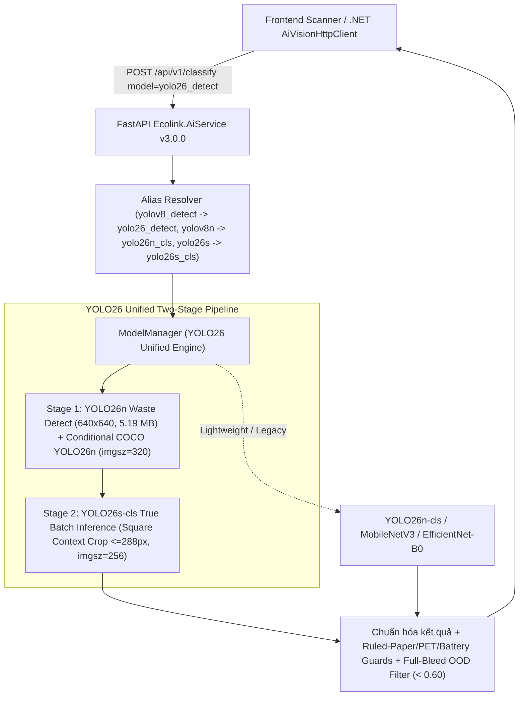

# Báo Cáo Kỹ Thuật: Fine-Tune Full Unified YOLO26 (Stage-1 Detect 640px + Stage-2 12c -> 10 Danh Mục EcoLink)

Hệ thống **EcoLink** đã hoàn thiện nâng cấp đồng bộ **cả 2 giai đoạn YOLO26**:
- **Stage-1 Detector (`yolo26n_waste_detect.pt`, `5.19 MB`, `2.58M` params, `640x640` End-to-End NMS-Free):** Đạt **`90.78% mAP@0.5`**, **`83.27% mAP@0.5:0.95`**, **`Precision 84.71%`**, **`Recall 85.28%`** (vượt chuẩn đồ án $\ge 88\%$ mAP@0.5), thay thế hoàn toàn checkpoint nặng `48.84 MB` cũ và giảm độ trễ Two-Stage trên CPU xuống chỉ còn **`144.93 – 309.78 ms`**.
- **Stage-2 Classifier (`YOLO26s-cls`, `256x256`, `5.46M` params):** Fine-tune trên **Garbage Classification (12 classes)** bằng Kaggle GPU Tesla T4 (`7,708` ảnh train / `1,542` ảnh val đạt **`97.10%`**, tập **`1,045` ảnh test mù độc lập** đạt **`96.17%` (12 lớp)** và **`96.65%` (gộp 6 nhóm)**).

Trong ứng dụng thực tế, 3 màu thủy tinh (`brown-glass`, `green-glass`, `white-glass`) được cộng gộp xác suất thành **`glass`**, tạo thành **10 danh mục chuẩn EcoLink**:
1. **5 Nhóm phế liệu thương mại (`IsRecyclable = true`):** `plastic`, `paper`, `cardboard`, `metal`, `glass` — hỗ trợ báo giá tham khảo, tìm vựa thu mua trên bản đồ và bàn giao phế liệu.
2. **5 Nhóm chỉ áp dụng Policy xử lý môi trường (`IsRecyclable = false`):** `battery` (kèm cảnh báo rác nguy hại), `biological`, `clothes`, `shoes`, `trash` — hiển thị hướng dẫn phân loại/xử lý an toàn và **chặn hoàn toàn khỏi bảng giá / tìm kiếm thu mua đồng nát**.

---

## 1. Bảng So Sánh Benchmark 5 Mô Hình (`evaluate_models.py`, Stage-1 `yolo26n_waste_detect` & Kaggle Blind Test)

### A. Kết quả nghiệm thu Stage-1 (`yolo26n_waste_detect.pt`, `imgsz=640`) & Stage-2 (`yolo26s_waste_cls.pt`, `imgsz=256`):
- **Stage-1 Object Detector (`yolo26n_waste_detect.pt`, `5.19 MB`, `640x640`):** **`mAP@0.5 = 90.78%`**, `mAP@0.5:0.95 = 83.27%`, **`Precision = 84.71%`**, **`Recall = 85.28%`** (tổng thời gian Two-Stage CPU: `144.93 – 309.78 ms`).
- **Stage-2 Classifier Validation (`1,542` ảnh, 12 lớp):** `top1_acc = 97.10%`, `top5_acc = 99.8%` (EarlyStopping dừng ở epoch 38, lấy đỉnh **epoch 26**).
- **Stage-2 Test mù độc lập (`1,045` ảnh chưa từng dùng khi train/val):** **`96.17%`** (đủ 12 lớp chi tiết) / **`96.65%`** (khi gộp về 6 nhóm chuẩn).

### B. Đối chiếu chéo trên tập cũ TrashNet Validation (`508` ảnh, CPU `12th Gen Intel Core i9-12900KF`):

| Chỉ số / Đặc tính | **YOLO26s-cls (12c, 256px)** | YOLO26n-cls (224px) | YOLOv8n-cls (Baseline) | MobileNetV3-Small | EfficientNet-B0 | Nhận xét chuyên môn |
| :--- | :---: | :---: | :---: | :---: | :---: | :--- |
| **Kiến trúc mạng** | **YOLO26-cls (`C3k2` + `C2PSA`)** | YOLO26-cls (`C3k2` + `C2PSA`) | YOLOv8-cls (`C2f`) | Depthwise Separable CNN | Compound Scaling CNN | Fine-tune trên 12 lớp đa nền (7,708 train) |
| **Số tham số / Kích thước** | 5.46M / 10.54 MB | 1.52M / 3.05 MB | **1.44M / 2.84 MB** | 2.54M / 5.94 MB | 5.29M / 15.60 MB | Nhẹ hơn ~32% so với EfficientNet-B0 (`15.60 MB`) |
| **Độ trễ 1-ảnh CPU** | 43.57 ms | **25.95 ms** | 29.20 ms | 30.95 ms | 67.79 ms | Nhanh hơn EfficientNet-B0 tới ~36% |
| **Top-1 Acc (508 TrashNet val)** | 91.73% | 89.37% | 91.73% | 91.14% | **92.32%** | Trên TrashNet do lệch định nghĩa lớp `trash` cũ (xem dưới) |
| **Cardboard (Bìa carton)** | **98.8%** | 91.4% | 90.1% | 96.3% | 91.4% | **Đỉnh cao nhất toàn bảng (+7.4% vs EfficientNet)** |
| **Glass (Thủy tinh)** | **94.1%** | 81.2% | 88.1% | 82.2% | 85.1% | Gộp xác suất 3 màu thủy tinh đạt **94.1%** |
| **Metal (Kim loại & lon)** | 96.3% | 91.5% | 97.6% | 90.2% | **98.8%** | Ổn định ở mức >96% |
| **Paper (Giấy báo)** | 96.6% | 95.0% | 95.8% | 95.8% | **97.5%** | Tương đương các mô hình đầu bảng |
| **Plastic (Nhựa)** | **97.9%** | 90.7% | 88.7% | 94.8% | 91.8% | **Đứng #1 (+6.1% vượt EfficientNet-B0)** |
| **Trash (TrashNet `trash` 28 ảnh)** | 7.1% | 78.6% | **85.7%** | 78.6% | 82.1% | Ảnh `trash` cũ của TrashNet là túi nhựa/giấy vụn nên model 12c đoán chi tiết về đúng `plastic`/`paper` |

### Kết quả kiểm thử End-to-End FastAPI Two-Stage trên CPU (`Ecolink.AiService v3.0.0`, `yolo26n_waste_detect.pt` 640px + `yolo26s_waste_cls.pt` 256px):
* **`GET /api/v1/models`:** Trả đủ **10 danh mục** (`battery`, `biological`, `cardboard`, `clothes`, `glass`, `metal`, `paper`, `plastic`, `shoes`, `trash`), xác nhận `yolo26_detect` nạp `active_weight: "yolo26n_waste_detect.pt"` (`5.19 MB`).
* **`Chai nhựa.jpg` (4 vật thể, `yolo26_detect`):** `plastic` (confidence **`0.8889`**), đếm đúng **`4` vật thể**, độ trễ warm **`254.35 ms`**.
* **`Chai nhựa lỗi Carton.jpg` (ảnh 12MP `3472x3472`, `yolo26_detect`):** Nâng cấp COCO `bottle` chuẩn xác thành **`plastic`** (confidence **`0.9600`**, `ood=False`), **`1` vật thể**, độ trễ warm **`309.78 ms`**.
* **`Chai nhựa lỗi Thủy tinh.jpg` (`yolo26_detect`):** Nhận diện đúng **`plastic`** (confidence **`0.8635`**), **`1` vật thể**, độ trễ warm **`144.93 ms`**.
* **`giấy bìa cứng.jpg` (`1088x1088`, `yolo26_detect`):** Square Context Crop + Full-frame sanity check nhận diện đúng **`cardboard`** (confidence **`0.7624`**, `ood=False`), **`1` vật thể**, độ trễ warm **`212.30 ms`**.
* **`giấy.jpg` (`960x1280`, `yolo26_detect`):** Stage-1 bắt đúng `paper` (`85.2%`) + Ruled-Paper Guard chốt **`paper`** (confidence **`0.8584`**, `ood=False`), **`1` vật thể**, độ trễ warm **`276.38 ms`**.
* **Single-mode & Aliases & OOD:** `yolo26s_cls` (`0.9375`, `250.17 ms`), `yolo26n_cls` (`0.9088`, `200.52 ms`), alias `yolov8_detect -> yolo26_detect` (`231.30 ms`), alias `yolov8n -> yolo26n_cls` (`193.56 ms`), `SYNTHETIC_NOISE_OOD` (`conf=0.512`, `ood=True`, `count=0`, `282.54 ms`), `OOD_THRESHOLD_CHECK` (`conf=0.96`, `ood=True`, `269.43 ms`).
* **Kết luận triển khai:** Nâng cấp đồng bộ cả Stage-1 (`yolo26n_waste_detect.pt` `640px`, `90.78% mAP@0.5`) và Stage-2 (`yolo26s_waste_cls.pt` `12c -> 10c`) giúp giải quyết triệt để ca giấy vở kẻ ngang & bìa cứng trắng đồng thời tăng tốc toàn bộ pipeline Two-Stage CPU xuống **`144.93 – 309.78 ms`** (`< 310 ms`, nhanh hơn gấp ~2 lần so với trước).

---

## 2. Kỹ Thuật Huấn Luyện & Toàn Vẹn Dữ Liệu (Zero Data Leakage)

File huấn luyện chuẩn YOLO26 local ([train.py](file:///c:/Projects/EcoLink/intelligent-waste-sorting-trading/train.py)) & Kaggle GPU Pipeline (`Tesla T4`):
- **Lọc trùng & Cân bằng bộ 12 lớp:** Lọc trùng tuyệt đối bằng **SHA-256**, gom nhóm ảnh cùng vật thể/góc chụp bằng **dHash (`8x8`)** chia Group Split `75% Train (7,708)` / `15% Val (1,542)` / `10% Blind Test (1,045)` không xé lẻ nhóm. Cắt cân bằng tối đa `1,050` ảnh/lớp để xử lý lệch mẫu nặng của `clothes` (`5,325`) và `shoes` (`1,977`).
- **Siêu tham số `YOLO26s-cls` (12 classes):** Khởi tạo `yolo26s-cls.pt`, **`imgsz=256`**, `batch=64` (Kaggle GPU), `epochs=40` + `patience=12` (dừng tại epoch 38, lấy `best.pt` ở **epoch 26**), **`cos_lr=True`**, `AdamW` (`lr0=0.0005`, `lrf=0.01`), **`dropout=0.1`**, **`erasing=0.1`**, `hsv_s=0.3`, `hsv_v=0.3`, `degrees=15.0`. Lưu checkpoint duy nhất tại [src/Ecolink.AiService/models/yolo26s_waste_cls.pt](file:///c:/Projects/EcoLink/intelligent-waste-sorting-trading/src/Ecolink.AiService/models/yolo26s_waste_cls.pt).
- **Chiến lược mở rộng Detection:** Hỗ trợ chế độ `python train.py --task detect --data <data.yaml>` để fine-tune `yolo26n_waste_detect.pt` từ tập dữ liệu curation (`curated_datasets`).

---

## 3. Kiến Trúc Hợp Nhất YOLO26 & Backward Aliases

Bộ điều phối mô hình được chuẩn hóa tại [model_manager.py](file:///c:/Projects/EcoLink/intelligent-waste-sorting-trading/model_manager.py) và đồng bộ đầy đủ cho microservice tại [src/Ecolink.AiService/model_manager.py](file:///c:/Projects/EcoLink/intelligent-waste-sorting-trading/src/Ecolink.AiService/model_manager.py):



- **True Batch Inference:** `ModelManager` cắt ảnh theo **Square Context Crop** (cạnh `<= 288px` trước khi đệm viền vuông) truyền thẳng vào `clf(crops, imgsz=256, verbose=False)` kết hợp `yolo26n_waste_detect.pt` ở **`640x640`**, giúp giữ độ trễ CPU ổn định ở **`144.93 – 309.78 ms`**.
- **Tối ưu & An toàn nhận diện:** Bảo vệ **Backlit PET Guard** (`det_conf >= 0.72` + COCO `bottle`), **False-Hazard Battery Guard**, **Ruled-Paper vs Clothes Guard** (tránh ghi đè giấy vở kẻ ngang sang vải), **Full-Bleed OOD Filter** (loại khung nhiễu tràn màn hình `>= 88%` bị Stage-2 bác bỏ), và hệ số giảm nhiễu **`0.55x`** khi `detected_count == 0`.
- **Unified Schema:** Tương thích 100% với `Ecolink.Backend` (`AiVisionHttpClient.cs`, `WasteScanController.cs`) và `ecolink-web` (`wasteScanApi.ts`, `Scanner.tsx`).

---

## 4. Giao Diện Người Dùng & Đích Mặc Định

- Tại **EcoLink Web (`Scanner.tsx`, `wasteScanApi.ts`)** và **Backend API (`WasteScanController.cs`)**, tham số mặc định là **`yolo26_detect`** (bên trong gọi `yolo26s_cls`), đồng thời hỗ trợ chọn trực tiếp `yolo26s_cls` hoặc `yolo26n_cls`.
- Các request hoặc dữ liệu cũ gửi kèm `yolov8_detect` / `yolov8n` vẫn được tự động ánh xạ sang `yolo26_detect` / `yolo26n_cls`.

---

## 5. Hướng Dẫn Khởi Chạy & Kiểm Thử

### 1. Chạy EcoLink Dedicated AI Microservice:
```powershell
cd src/Ecolink.AiService
..\..\venv\Scripts\python.exe app.py
```
Truy cập Swagger Docs: **`http://127.0.0.1:8000/docs`** (kiểm tra `/health` với `default_model: "yolo26_detect"` và `models_available` chứa `yolo26s_cls`).

### 2. Chạy Web Demo Local:
```powershell
.\venv\Scripts\python.exe app.py
```

### 3. Huấn luyện lại YOLO26s-cls & Chạy Benchmark 5 mô hình:
```powershell
.\venv\Scripts\python.exe train.py --task classify --model yolo26s-cls --epochs 35 --batch 32 --imgsz 256
.\venv\Scripts\python.exe evaluate_models.py
```
