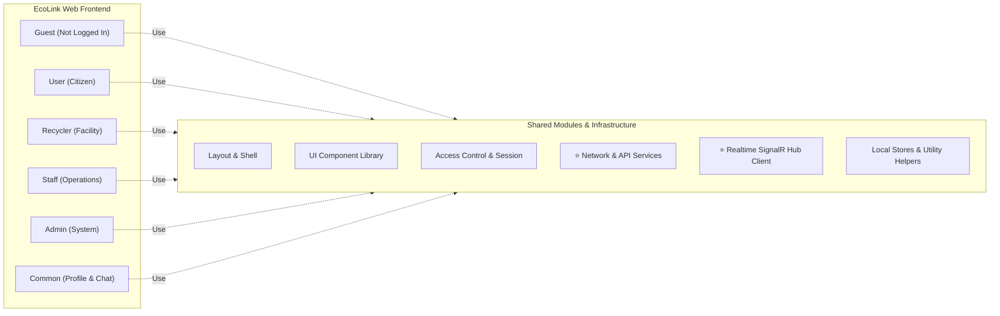

# TÀI LIỆU ĐẶC TẢ SƠ ĐỒ GÓI FRONTEND (FRONTEND PACKAGE DIAGRAM SPECIFICATION)
## HỆ THỐNG PHÂN LOẠI RÁC THÔNG MINH & KẾT NỐI THU GOM PHẾ LIỆU ECOLINK

- **Dự án:** EcoLink – Intelligent Waste Sorting & Trading Platform  
- **Mã dự án:** SEP490-G141  
- **Thư mục tài liệu:** `documents/diagram/package diagram/`  
- **Tệp sơ đồ Draw.io gốc:** [ecolink_frontend_package_diagram.drawio](file:///c:/Projects/EcoLink/intelligent-waste-sorting-trading/documents/diagram/package%20diagram/ecolink_frontend_package_diagram.drawio)

---

## MỤC LỤC
1. [1. Giới thiệu & Mục tiêu thiết kế Frontend Package Diagram](#1-giới-thiệu--mục-tiêu-thiết-kế-frontend-package-diagram)
2. [2. Phân rã cấu trúc các khối trong Sơ đồ](#2-phân-rã-cấu-trúc-các-khối-trong-sơ-đồ)
   - [2.1 Khối EcoLink Web Frontend (6 Phân hệ người dùng)](#21-khối-ecolink-web-frontend-6-phân-hệ-người-dùng)
     - [2.1.1 Guest (Not Logged In)](#211-guest-not-logged-in)
     - [2.1.2 User (Citizen)](#212-user-citizen)
     - [2.1.3 Recycler (Buying Facility)](#213-recycler-buying-facility)
     - [2.1.4 Staff (Operations & Moderation)](#214-staff-operations--moderation)
     - [2.1.5 Admin (System Administration)](#215-admin-system-administration)
     - [2.1.6 Common (User & Recycler after Login)](#216-common-user--recycler-after-login)
   - [2.2 Khối Shared Modules (Các Module cốt lõi & Tầng API mới bổ sung)](#22-khối-shared-modules-các-module-cốt-lõi--tầng-api-mới-bổ-sung)
     - [2.2.1 Layout & Shell](#221-layout--shell)
     - [2.2.2 UI Components](#222-ui-components)
     - [2.2.3 Access Control & Session](#223-access-control--session)
     - [2.2.4 Network & API Services (TẦNG MỚI TỐI ƯU)](#224-network--api-services-tầng-mới-tối-ưu)
     - [2.2.5 Realtime SignalR Hub Client (TẦNG MỚI TỐI ƯU)](#225-realtime-signalr-hub-client-tầng-mới-tối-ưu)
     - [2.2.6 Local Data Store & Utility Helpers](#226-local-data-store--utility-helpers)
3. [3. Bảng ánh xạ Package vào mã nguồn React 19 Frontend (`ecolink-web`)](#3-bảng-ánh-xạ-package-vào-mã-nguồn-react-19-frontend-ecolink-web)
4. [4. Toàn bộ mã nguồn XML Draw.io cho Frontend Package Diagram](#4-toàn-bộ-mã-nguồn-xml-drawio-cho-frontend-package-diagram)
5. [5. Hướng dẫn mở và xuất hình ảnh báo cáo](#5-hướng-dẫn-mở-và-xuất-hình-ảnh-báo-cáo)

---

## 1. GIỚI THIỆU & MỤC TIÊU THIẾT KẾ FRONTEND PACKAGE DIAGRAM

Sơ đồ gói Frontend (**Frontend Package Diagram**) mô tả kiến trúc phân rã module của ứng dụng Web Single Page Application (SPA) xây dựng trên nền tảng **React 19 + TypeScript + Vite + TailwindCSS**.

Mục tiêu chính của sơ đồ:
- **Phân rã theo vai trò người dùng (Role-Based Segregation):** Tách bạch rõ các màn hình công khai (`Guest`), khu vực người dân (`User`), khu vực vựa ve chai (`Recycler`), bảng điều khiển nhân viên (`Staff`) và trang quản trị hệ thống (`Admin`).
- **Khắc phục triệt để nhược điểm thiếu tầng giao tiếp:** Bổ sung **Tầng Network & API Services** và **Tầng Realtime SignalR Socket**, làm sáng tỏ cách thức Frontend gọi REST API và nhận thông báo thời gian thực từ Backend .NET 8.
- **Tối ưu hóa các thành phần dùng chung:** Khối `Shared Modules` cung cấp đầy đủ Layout Shell, Design System, kiểm soát truy cập (Access Control) và các hàm tiện ích hỗ trợ.



---

## 2. PHÂN RÃ CẤU TRÚC CÁC KHỐI TRONG SƠ ĐỒ

### 2.1 Khối EcoLink Web Frontend (6 Phân hệ người dùng)

#### 2.1.1 Guest (Not Logged In)
Khu vực dành cho khách vãng lai và người dùng chưa đăng nhập, sử dụng khung `Layout` công khai (Navbar chung, MobileNav, Footer):
- **`Home`:** Trang chủ giới thiệu sứ mệnh dự án, số liệu thống kê thu gom rác cộng đồng.
- **`Blog`:** Danh sách bài viết tuyên truyền phân loại rác và tin tức môi trường.
- **`Rewards`:** Xem danh mục quà tặng, voucher giảm giá để kích thích người dùng tham gia.
- **`Leaderboard`:** Bảng xếp hạng vinh danh các cá nhân phân loại rác tích cực trong tuần/tháng.
- **`AI Scanner`:** Tiện ích mở camera chụp ảnh rác để mô hình AI nhận diện loại rác ngay lập tức.
- **`Collection Map`:** Bản đồ số Leaflet hiển thị các trạm thu mua phế liệu lân cận.
- **`Recycling Partners`:** Danh bạ các đối tác thu mua đã được thẩm định kèm giá niêm yết.
- **`Feedback & Complaints`:** Kênh tiếp nhận ý kiến đóng góp hoặc phản ánh dịch vụ.
- **`Sorting Guidance`:** Cẩm nang hướng dẫn nhận diện các loại rác tái chế và màu thùng rác.
- **`Waste Lookup`:** Công cụ tra cứu nhanh danh mục phế liệu chấp nhận thu gom.
- **`Join as Recycler`:** Form đăng ký mở cơ sở thu gom phế liệu mới trong hệ sinh thái.
- **`Login / Register / Reset Password`:** Màn hình xác thực tài khoản chiếm toàn màn hình (không thanh điều hướng).

#### 2.1.2 User (Citizen)
Phân hệ dành riêng cho Người dân bán rác, được bảo vệ bởi `<RequireRole roles={['user']}>` và hiển thị trong khung `<Portal role="user">` (Sidebar cá nhân):
- **`Overview`:** Bảng điều khiển tóm tắt số kg rác đã gom, số điểm thưởng tích lũy và đơn hẹn sắp tới.
- **`Handover Requests`:** Tạo và theo dõi các yêu cầu đối tác thu gom đến lấy phế liệu tận nơi.
- **`Confirm Receipt`:** Kiểm tra và xác nhận biên lai bàn giao phế liệu thực tế từ đối tác thu gom.
- **`Payout Account`:** Cài đặt tài khoản ngân hàng để đối tác chuyển khoản trực tiếp khi thanh toán phế liệu.
- **`Transaction History`:** Lịch sử chi tiết các lần bán phế liệu và điểm thưởng nhận được.
- **`Rewards & Check-in`:** Tiện ích điểm danh hàng ngày nhận điểm (Daily Streak) và đổi voucher quà tặng.

#### 2.1.3 Recycler (Buying Facility)
Phân hệ dành cho Đối tác thu gom phế liệu, chạy trong khung `<Portal role="recycler">`:
- **`Overview`:** Thống kê lượng phế liệu thu gom trong ngày, số lịch hẹn đang chờ xử lý.
- **`Handover Requests`:** Tiếp nhận, xem xét hoặc từ chối các yêu cầu thu gom từ người dân xung quanh.
- **`Catalog & Price List`:** Quản lý danh mục các loại phế liệu tiếp nhận và cập nhật bảng giá thu mua theo ngày.
- **`Collection Receipts`:** Lập biên nhận điện tử tại chỗ khi đến thu mua rác thành công.

#### 2.1.4 Staff (Operations & Moderation)
Phân hệ Back-office dành cho Nhân viên vận hành, chạy độc lập trong khung `<AdminShell role="staff">`:
- **`Overview`:** Giám sát các chỉ số vận hành hệ thống trong ca trực.
- **`AI Misrecognition Review`:** Thẩm định danh sách ảnh người dùng phản hồi AI phân loại sai (`UC-S01`).
- **`Validation Dataset`:** Gán nhãn dữ liệu hình ảnh và cập nhật tập kiểm chứng AI (`UC-S02`, `UC-S03`).
- **`Recycler Applications`:** Thẩm định giấy tờ pháp lý của cơ sở thu gom xin tham gia mạng lưới (`UC-S04`).
- **`Transaction Complaints`:** Thụ lý và giải quyết khiếu nại tranh chấp đơn hàng (`UC-S05`).
- **`User/Buyer Accounts`:** Quản lý hồ sơ, lịch sử vi phạm và khóa/mở khóa tài khoản người dùng (`UC-S06`).
- **`Blog Editor`:** Soạn thảo bài viết truyền thông môi trường trước khi gửi Admin duyệt (`UC-S07`).
- **`Eco Fact Content`:** Quản lý nội dung kiến thức phân loại rác Eco Fact (`UC-S08`).
- **`Gift Inventory`:** Quản lý kho quà tặng, cập nhật số lượng tồn kho voucher (`UC-S09`).
- **`Staff Check-In`:** Điểm danh đầu ca và kết thúc ca làm việc của nhân viên (`UC-S10`).

#### 2.1.5 Admin (System Administration)
Phân hệ dành cho Quản trị viên cấp cao, chạy trong khung `<AdminShell role="admin">`:
- **`Statistics Dashboard`:** Báo cáo biểu đồ tổng thể lượng rác, lưu lượng đơn hàng và doanh thu gói tiện ích.
- **`Export Reports`:** Xuất báo cáo dữ liệu định dạng Excel/PDF.
- **`Staff Accounts & Permissions`:** Tạo tài khoản nhân viên và phân quyền chi tiết (RBAC).
- **`Blog Review`:** Phê duyệt hoặc từ chối các bài viết do Staff biên soạn trước khi xuất bản.
- **`Waste Categories & Policy`:** Thiết lập danh mục rác thải chuẩn và chính sách phân loại rác của nền tảng.
- **`Points Configuration & Ranking Cycle`:** Cấu hình hệ số quy đổi điểm thưởng rác và chu kỳ bảng xếp hạng.
- **`Transaction Fees & Cash Flow Reconciliation`:** Cấu hình biểu phí dịch vụ nội bộ (tích xanh, vị trí ưu tiên) và đối soát giao dịch VietQR.

#### 2.1.6 Common (User & Recycler after Login)
Các tính năng chung sau khi đăng nhập:
- **`Profile`:** Xem và chỉnh sửa thông tin cá nhân, ảnh đại diện, số điện thoại.
- **`Change Password`:** Đổi mật khẩu tài khoản an toàn.
- **`Negotiation Chat`:** Khung chat thời gian thực kết nối Người dân và Đối tác thu gom để thương lượng giá cả và thời gian lấy rác qua SignalR.

---

### 2.2 Khối Shared Modules (Các Module cốt lõi & Tầng API mới bổ sung)

Khối này giải quyết toàn bộ các yêu cầu chia sẻ mã nguồn và kết nối mạng của hệ thống:

#### 2.2.1 Layout & Shell
- Quản lý các khung bao bọc giao diện theo từng đối tượng:
  - `Navbar`, `Footer`, `MobileNav`: Khung điều hướng công khai.
  - `Portal`: Khung làm việc có thanh sidebar điều hướng dành riêng cho Citizen và Recycler.
  - `AdminShell`: Khung làm việc chuyên nghiệp, không vướng navbar công khai dành riêng cho Staff và Admin.

#### 2.2.2 UI Components
- Thư viện thành phần UI tái sử dụng cao xây dựng trên nền **TailwindCSS**:
  - `AuthForm`, `Button`, `Modal`, `Input`, `Badge`, `Card`.
  - Các widget chuyên biệt: `CheckIn` widget, `Leaderboard` widget, `Admin UI Kit` (DataGrid, StatsCard) và `Admin Assistant` (AI hỗ trợ thao tác nhanh).

#### 2.2.3 Access Control & Session
- **`RequireRole`:** Component bảo vệ route theo chuẩn Higher-Order / Outlet wrapper, tự động kiểm tra `role` của người dùng; nếu không hợp lệ sẽ chuyển hướng về `/login` hoặc hiển thị cảnh báo không có quyền.
- **`Session` (`src/lib/session.ts`):** Quản lý lưu trữ thông tin đăng nhập, token JWT vào `localStorage` và đồng bộ trạng thái đăng nhập trên toàn ứng dụng.

#### 2.2.4 Network & API Services (TẦNG MỚI ĐƯỢC TỐI ƯU ⭐)
Đây là tầng cốt lõi giúp Frontend kết nối liền mạch với Backend .NET 8 Web API:
- **`HttpClient (Axios Instance)`:** Cấu hình `baseURL`, `timeout` và Interceptor tự động đính kèm `Authorization: Bearer <token>` vào mọi HTTP Request.
- **`AuthApi`:** Gọi các endpoint `/api/v1/auth/login`, `/register`, `/google-sso`, `/refresh-token`.
- **`WasteApi`:** Gửi `multipart/form-data` ảnh chụp lên endpoint `/api/v1/waste/scan`, tra cứu quy chuẩn phân loại `/api/v1/waste/rules`.
- **`TradeApi`:** Gọi tạo đơn thu gom `/api/v1/trade/requests`, tìm đối tác gần nhất `/api/v1/partners/nearest`, xác nhận biên lai `/api/v1/trade/receipts`.
- **`PaymentApi`:** Gọi sinh mã QR VietQR `/api/v1/payments/generate-qr`, kiểm tra trạng thái thanh toán gói dịch vụ.
- **`GamificationApi`:** Gọi điểm danh hàng ngày `/api/v1/gamification/checkin`, xem số dư điểm và danh sách voucher đổi quà.
- **`OpsApi`:** Phục vụ các thao tác của Staff/Admin (phê duyệt hồ sơ đối tác, xử lý tranh chấp khiếu nại, duyệt bài viết).

#### 2.2.5 Realtime SignalR Hub Client (TẦNG MỚI ĐƯỢC TỐI ƯU ⭐)
Quản lý kết nối WebSocket hai chiều theo thời gian thực:
- **`HubConnectionManager`:** Quản lý kết nối tới URL `wss://.../hubs/chat` và `notificationHub`.
- **`ChatHub Listener`:** Lắng nghe và bắn các sự kiện tin nhắn chat đàm phán giữa người dân và cơ sở thu mua (`SendMessage`, `ReceiveMessage`, `UserTyping`).
- **`NotificationHub Listener`:** Lắng nghe trạng thái cập nhật đơn hẹn thu gom theo thời gian thực (được chấp nhận, bị từ chối, đã hoàn thành).
- **`Auto Reconnection`:** Tự động kết nối lại khi mạng gián đoạn mà không làm mất phiên người dùng.

#### 2.2.6 Local Data Store & Utility Helpers
- **`Mock Datasets` (`src/data/*`):** Chứa các dữ liệu khởi tạo ban đầu phục vụ phát triển giao diện (`ops.ts`, `rewards.ts`, `waste.ts`, `partners.ts`).
- **`Leaflet & Geo Helpers`:** Xử lý tọa độ kinh độ/vĩ độ, tính toán khoảng cách và vẽ điểm Marker trạm thu mua lên bản đồ số.
- **`Formatters`:** Định dạng tiền tệ Việt Nam (`xxx.xxx ₫`), định dạng khối lượng (`kg`), định dạng ngày giờ Việt Nam.

---

## 3. BẢNG ÁNH XẠ PACKAGE VÀO MÃ NGUỒN REACT 19 FRONTEND (`ecolink-web`)

| Package trên Sơ đồ | Thư mục / Tệp mã nguồn cụ thể | Trách nhiệm chính |
| :--- | :--- | :--- |
| **Home, Blog, Scanner, Map...** | `src/pages/*.tsx` | Màn hình công khai cho khách (`Scanner.tsx`, `MapPage.tsx`...) |
| **User (Citizen)** | `src/pages/user/*.tsx` | Phân hệ người dân (`Handover.tsx`, `Receipt.tsx`, `Payout.tsx`...) |
| **Recycler** | `src/pages/recycler/*.tsx` | Phân hệ cơ sở thu mua (`Requests.tsx`, `Catalog.tsx`...) |
| **Staff** | `src/pages/staff/*.tsx` | Màn hình nghiệp vụ nhân viên (`AiReview.tsx`, `Complaints.tsx`...) |
| **Admin** | `src/pages/admin/*.tsx` | Màn hình quản trị (`Reports.tsx`, `Permissions.tsx`, `Fees.tsx`...) |
| **Common (Profile, Chat)** | `src/pages/account/*.tsx`, `Chat.tsx` | Quản lý tài khoản cá nhân và khung chat đàm phán |
| **Layout & Shell** | `src/components/{Layout, Navbar, Footer, Portal}.tsx`, `components/admin/Shell.tsx` | Khung điều hướng và khung chứa trang |
| **UI Components** | `src/components/{AuthForm, CheckIn, Leaderboard}.tsx`, `components/admin/{ui, Assistant}.tsx` | Bộ linh kiện giao diện tái sử dụng |
| **Access Control** | `src/components/RequireRole.tsx`, `src/lib/session.ts` | Bảo vệ tuyến đường theo phân quyền vai trò |
| **Network & API Services** | `src/lib/api.ts` / Axios Services *(Bổ sung)* | Gọi HTTP REST API có đính kèm JWT Bearer Token |
| **Realtime SignalR Hub** | `@microsoft/signalr` Hub Services *(Bổ sung)* | Kết nối WebSocket hai chiều cho chat và thông báo |
| **Data & Helpers** | `src/data/*.ts`, `src/lib/*.ts` | Dữ liệu mẫu, helper định dạng ngày tháng, tiền tệ, tọa độ GIS |

---

## 4. TOÀN BỘ MÃ NGUỒN XML DRAW.IO CHO FRONTEND PACKAGE DIAGRAM

Bạn có thể copy trực tiếp đoạn mã XML dưới đây và dán vào menu **Arrange $\rightarrow$ Insert $\rightarrow$ Advanced $\rightarrow$ XML** trên trang [draw.io](https://app.diagrams.net/):

```xml
<mxfile host="app.diagrams.net" modified="2026-10-14T14:50:00.000Z" agent="EcoLink Frontend Architecture Generator" version="24.7.5">
  <diagram id="ecolink-frontend-package-diagram" name="Frontend Package Diagram">
    <mxGraphModel dx="1600" dy="1100" grid="1" gridSize="10" guides="1" tooltips="1" connect="1" arrows="1" fold="1" page="1" pageScale="1" pageWidth="1654" pageHeight="1169" background="#ffffff" math="0" shadow="0">
      <root>
        <mxCell id="0" />
        <mxCell id="1" parent="0" />

        <!-- 1. MAIN CONTAINER: ECOLINK WEB FRONTEND -->
        <mxCell id="pkg_fe_main" parent="1" value="EcoLink Web Frontend" style="shape=folder;fontStyle=1;tabWidth=170;tabHeight=24;tabPosition=left;html=1;whiteSpace=wrap;fillColor=#ffffff;strokeColor=#212121;strokeWidth=1.5;verticalAlign=top;align=center;spacingTop=4;fontSize=13;fontColor=#212121;" vertex="1">
          <mxGeometry x="40" y="40" width="980" height="970" as="geometry" />
        </mxCell>

        <!-- 1.1 GUEST (NOT LOGGED IN / PUBLIC) -->
        <mxCell id="pkg_guest" parent="1" value="Guest (Not Logged In)" style="shape=folder;fontStyle=1;tabWidth=160;tabHeight=22;tabPosition=left;html=1;whiteSpace=wrap;fillColor=#ffffff;strokeColor=#212121;strokeWidth=1.2;verticalAlign=top;align=center;spacingTop=3;fontSize=12;fontColor=#212121;" vertex="1">
          <mxGeometry x="60" y="75" width="940" height="205" as="geometry" />
        </mxCell>

        <!-- Guest Row 1 -->
        <mxCell id="g_home" parent="1" value="Home" style="shape=folder;fontStyle=0;tabWidth=38;tabHeight=14;tabPosition=left;html=1;whiteSpace=wrap;fillColor=#ffffff;strokeColor=#212121;strokeWidth=1.1;verticalAlign=middle;align=center;fontSize=11;" vertex="1">
          <mxGeometry x="75" y="110" width="165" height="46" as="geometry" />
        </mxCell>
        <mxCell id="g_blog" parent="1" value="Blog" style="shape=folder;fontStyle=0;tabWidth=38;tabHeight=14;tabPosition=left;html=1;whiteSpace=wrap;fillColor=#ffffff;strokeColor=#212121;strokeWidth=1.1;verticalAlign=middle;align=center;fontSize=11;" vertex="1">
          <mxGeometry x="255" y="110" width="165" height="46" as="geometry" />
        </mxCell>
        <mxCell id="g_rewards" parent="1" value="Rewards" style="shape=folder;fontStyle=0;tabWidth=38;tabHeight=14;tabPosition=left;html=1;whiteSpace=wrap;fillColor=#ffffff;strokeColor=#212121;strokeWidth=1.1;verticalAlign=middle;align=center;fontSize=11;" vertex="1">
          <mxGeometry x="435" y="110" width="165" height="46" as="geometry" />
        </mxCell>
        <mxCell id="g_leaderboard" parent="1" value="Leaderboard" style="shape=folder;fontStyle=0;tabWidth=38;tabHeight=14;tabPosition=left;html=1;whiteSpace=wrap;fillColor=#ffffff;strokeColor=#212121;strokeWidth=1.1;verticalAlign=middle;align=center;fontSize=11;" vertex="1">
          <mxGeometry x="615" y="110" width="165" height="46" as="geometry" />
        </mxCell>
        <mxCell id="g_scanner" parent="1" value="AI Scanner" style="shape=folder;fontStyle=0;tabWidth=38;tabHeight=14;tabPosition=left;html=1;whiteSpace=wrap;fillColor=#ffffff;strokeColor=#212121;strokeWidth=1.1;verticalAlign=middle;align=center;fontSize=11;" vertex="1">
          <mxGeometry x="795" y="110" width="190" height="46" as="geometry" />
        </mxCell>

        <!-- Guest Row 2 -->
        <mxCell id="g_map" parent="1" value="Collection Map" style="shape=folder;fontStyle=0;tabWidth=38;tabHeight=14;tabPosition=left;html=1;whiteSpace=wrap;fillColor=#ffffff;strokeColor=#212121;strokeWidth=1.1;verticalAlign=middle;align=center;fontSize=11;" vertex="1">
          <mxGeometry x="75" y="165" width="165" height="46" as="geometry" />
        </mxCell>
        <mxCell id="g_partners" parent="1" value="Recycling Partners" style="shape=folder;fontStyle=0;tabWidth=38;tabHeight=14;tabPosition=left;html=1;whiteSpace=wrap;fillColor=#ffffff;strokeColor=#212121;strokeWidth=1.1;verticalAlign=middle;align=center;fontSize=11;" vertex="1">
          <mxGeometry x="255" y="165" width="165" height="46" as="geometry" />
        </mxCell>
        <mxCell id="g_feedback" parent="1" value="Feedback &amp;amp; Complaints" style="shape=folder;fontStyle=0;tabWidth=38;tabHeight=14;tabPosition=left;html=1;whiteSpace=wrap;fillColor=#ffffff;strokeColor=#212121;strokeWidth=1.1;verticalAlign=middle;align=center;fontSize=11;" vertex="1">
          <mxGeometry x="435" y="165" width="165" height="46" as="geometry" />
        </mxCell>
        <mxCell id="g_guidance" parent="1" value="Sorting Guidance" style="shape=folder;fontStyle=0;tabWidth=38;tabHeight=14;tabPosition=left;html=1;whiteSpace=wrap;fillColor=#ffffff;strokeColor=#212121;strokeWidth=1.1;verticalAlign=middle;align=center;fontSize=11;" vertex="1">
          <mxGeometry x="615" y="165" width="165" height="46" as="geometry" />
        </mxCell>
        <mxCell id="g_waste" parent="1" value="Waste Lookup" style="shape=folder;fontStyle=0;tabWidth=38;tabHeight=14;tabPosition=left;html=1;whiteSpace=wrap;fillColor=#ffffff;strokeColor=#212121;strokeWidth=1.1;verticalAlign=middle;align=center;fontSize=11;" vertex="1">
          <mxGeometry x="795" y="165" width="190" height="46" as="geometry" />
        </mxCell>

        <!-- Guest Row 3 -->
        <mxCell id="g_join" parent="1" value="Join as Recycler" style="shape=folder;fontStyle=0;tabWidth=38;tabHeight=14;tabPosition=left;html=1;whiteSpace=wrap;fillColor=#ffffff;strokeColor=#212121;strokeWidth=1.1;verticalAlign=middle;align=center;fontSize=11;" vertex="1">
          <mxGeometry x="75" y="220" width="210" height="46" as="geometry" />
        </mxCell>
        <mxCell id="g_login" parent="1" value="Login" style="shape=folder;fontStyle=0;tabWidth=38;tabHeight=14;tabPosition=left;html=1;whiteSpace=wrap;fillColor=#ffffff;strokeColor=#212121;strokeWidth=1.1;verticalAlign=middle;align=center;fontSize=11;" vertex="1">
          <mxGeometry x="305" y="220" width="210" height="46" as="geometry" />
        </mxCell>
        <mxCell id="g_register" parent="1" value="Register" style="shape=folder;fontStyle=0;tabWidth=38;tabHeight=14;tabPosition=left;html=1;whiteSpace=wrap;fillColor=#ffffff;strokeColor=#212121;strokeWidth=1.1;verticalAlign=middle;align=center;fontSize=11;" vertex="1">
          <mxGeometry x="535" y="220" width="210" height="46" as="geometry" />
        </mxCell>
        <mxCell id="g_reset" parent="1" value="Reset Password" style="shape=folder;fontStyle=0;tabWidth=38;tabHeight=14;tabPosition=left;html=1;whiteSpace=wrap;fillColor=#ffffff;strokeColor=#212121;strokeWidth=1.1;verticalAlign=middle;align=center;fontSize=11;" vertex="1">
          <mxGeometry x="765" y="220" width="220" height="46" as="geometry" />
        </mxCell>

        <!-- 1.2 USER (CITIZEN) -->
        <mxCell id="pkg_user" parent="1" value="User (Citizen)" style="shape=folder;fontStyle=1;tabWidth=130;tabHeight=22;tabPosition=left;html=1;whiteSpace=wrap;fillColor=#ffffff;strokeColor=#212121;strokeWidth=1.2;verticalAlign=top;align=center;spacingTop=3;fontSize=12;fontColor=#212121;" vertex="1">
          <mxGeometry x="60" y="295" width="940" height="120" as="geometry" />
        </mxCell>

        <mxCell id="u_overview" parent="1" value="Overview" style="shape=folder;fontStyle=0;tabWidth=38;tabHeight=14;tabPosition=left;html=1;whiteSpace=wrap;fillColor=#ffffff;strokeColor=#212121;strokeWidth=1.1;verticalAlign=middle;align=center;fontSize=11;" vertex="1">
          <mxGeometry x="80" y="330" width="205" height="40" as="geometry" />
        </mxCell>
        <mxCell id="u_handover" parent="1" value="Handover Requests" style="shape=folder;fontStyle=0;tabWidth=38;tabHeight=14;tabPosition=left;html=1;whiteSpace=wrap;fillColor=#ffffff;strokeColor=#212121;strokeWidth=1.1;verticalAlign=middle;align=center;fontSize=11;" vertex="1">
          <mxGeometry x="305" y="330" width="205" height="40" as="geometry" />
        </mxCell>
        <mxCell id="u_receipt" parent="1" value="Confirm Receipt" style="shape=folder;fontStyle=0;tabWidth=38;tabHeight=14;tabPosition=left;html=1;whiteSpace=wrap;fillColor=#ffffff;strokeColor=#212121;strokeWidth=1.1;verticalAlign=middle;align=center;fontSize=11;" vertex="1">
          <mxGeometry x="530" y="330" width="205" height="40" as="geometry" />
        </mxCell>
        <mxCell id="u_payout" parent="1" value="Payout Account" style="shape=folder;fontStyle=0;tabWidth=38;tabHeight=14;tabPosition=left;html=1;whiteSpace=wrap;fillColor=#ffffff;strokeColor=#212121;strokeWidth=1.1;verticalAlign=middle;align=center;fontSize=11;" vertex="1">
          <mxGeometry x="755" y="330" width="230" height="40" as="geometry" />
        </mxCell>

        <mxCell id="u_transactions" parent="1" value="Transaction History" style="shape=folder;fontStyle=0;tabWidth=38;tabHeight=14;tabPosition=left;html=1;whiteSpace=wrap;fillColor=#ffffff;strokeColor=#212121;strokeWidth=1.1;verticalAlign=middle;align=center;fontSize=11;" vertex="1">
          <mxGeometry x="80" y="375" width="205" height="35" as="geometry" />
        </mxCell>
        <mxCell id="u_rewards" parent="1" value="Rewards &amp;amp; Check-in" style="shape=folder;fontStyle=0;tabWidth=38;tabHeight=14;tabPosition=left;html=1;whiteSpace=wrap;fillColor=#ffffff;strokeColor=#212121;strokeWidth=1.1;verticalAlign=middle;align=center;fontSize=11;" vertex="1">
          <mxGeometry x="305" y="375" width="205" height="35" as="geometry" />
        </mxCell>

        <!-- 1.3 RECYCLER (BUYING FACILITY) -->
        <mxCell id="pkg_recycler" parent="1" value="Recycler (Buying Facility)" style="shape=folder;fontStyle=1;tabWidth=175;tabHeight=22;tabPosition=left;html=1;whiteSpace=wrap;fillColor=#ffffff;strokeColor=#212121;strokeWidth=1.2;verticalAlign=top;align=center;spacingTop=3;fontSize=12;fontColor=#212121;" vertex="1">
          <mxGeometry x="60" y="425" width="940" height="75" as="geometry" />
        </mxCell>

        <mxCell id="r_overview" parent="1" value="Overview" style="shape=folder;fontStyle=0;tabWidth=38;tabHeight=14;tabPosition=left;html=1;whiteSpace=wrap;fillColor=#ffffff;strokeColor=#212121;strokeWidth=1.1;verticalAlign=middle;align=center;fontSize=11;" vertex="1">
          <mxGeometry x="80" y="455" width="210" height="38" as="geometry" />
        </mxCell>
        <mxCell id="r_requests" parent="1" value="Handover Requests" style="shape=folder;fontStyle=0;tabWidth=38;tabHeight=14;tabPosition=left;html=1;whiteSpace=wrap;fillColor=#ffffff;strokeColor=#212121;strokeWidth=1.1;verticalAlign=middle;align=center;fontSize=11;" vertex="1">
          <mxGeometry x="310" y="455" width="210" height="38" as="geometry" />
        </mxCell>
        <mxCell id="r_catalog" parent="1" value="Catalog &amp;amp; Price List" style="shape=folder;fontStyle=0;tabWidth=38;tabHeight=14;tabPosition=left;html=1;whiteSpace=wrap;fillColor=#ffffff;strokeColor=#212121;strokeWidth=1.1;verticalAlign=middle;align=center;fontSize=11;" vertex="1">
          <mxGeometry x="540" y="455" width="210" height="38" as="geometry" />
        </mxCell>
        <mxCell id="r_receipts" parent="1" value="Collection Receipts" style="shape=folder;fontStyle=0;tabWidth=38;tabHeight=14;tabPosition=left;html=1;whiteSpace=wrap;fillColor=#ffffff;strokeColor=#212121;strokeWidth=1.1;verticalAlign=middle;align=center;fontSize=11;" vertex="1">
          <mxGeometry x="770" y="455" width="215" height="38" as="geometry" />
        </mxCell>

        <!-- 1.4 STAFF -->
        <mxCell id="pkg_staff" parent="1" value="Staff" style="shape=folder;fontStyle=1;tabWidth=80;tabHeight=22;tabPosition=left;html=1;whiteSpace=wrap;fillColor=#ffffff;strokeColor=#212121;strokeWidth=1.2;verticalAlign=top;align=center;spacingTop=3;fontSize=12;fontColor=#212121;" vertex="1">
          <mxGeometry x="60" y="510" width="940" height="150" as="geometry" />
        </mxCell>

        <mxCell id="s_overview" parent="1" value="Overview" style="shape=folder;fontStyle=0;tabWidth=38;tabHeight=14;tabPosition=left;html=1;whiteSpace=wrap;fillColor=#ffffff;strokeColor=#212121;strokeWidth=1.1;verticalAlign=middle;align=center;fontSize=11;" vertex="1">
          <mxGeometry x="80" y="540" width="210" height="38" as="geometry" />
        </mxCell>
        <mxCell id="s_aireview" parent="1" value="AI Misrecognition Review" style="shape=folder;fontStyle=0;tabWidth=38;tabHeight=14;tabPosition=left;html=1;whiteSpace=wrap;fillColor=#ffffff;strokeColor=#212121;strokeWidth=1.1;verticalAlign=middle;align=center;fontSize=11;" vertex="1">
          <mxGeometry x="310" y="540" width="210" height="38" as="geometry" />
        </mxCell>
        <mxCell id="s_dataset" parent="1" value="Validation Dataset" style="shape=folder;fontStyle=0;tabWidth=38;tabHeight=14;tabPosition=left;html=1;whiteSpace=wrap;fillColor=#ffffff;strokeColor=#212121;strokeWidth=1.1;verticalAlign=middle;align=center;fontSize=11;" vertex="1">
          <mxGeometry x="540" y="540" width="210" height="38" as="geometry" />
        </mxCell>
        <mxCell id="s_applications" parent="1" value="Recycler Applications" style="shape=folder;fontStyle=0;tabWidth=38;tabHeight=14;tabPosition=left;html=1;whiteSpace=wrap;fillColor=#ffffff;strokeColor=#212121;strokeWidth=1.1;verticalAlign=middle;align=center;fontSize=11;" vertex="1">
          <mxGeometry x="770" y="540" width="215" height="38" as="geometry" />
        </mxCell>

        <mxCell id="s_complaints" parent="1" value="Transaction Complaints" style="shape=folder;fontStyle=0;tabWidth=38;tabHeight=14;tabPosition=left;html=1;whiteSpace=wrap;fillColor=#ffffff;strokeColor=#212121;strokeWidth=1.1;verticalAlign=middle;align=center;fontSize=11;" vertex="1">
          <mxGeometry x="80" y="583" width="210" height="38" as="geometry" />
        </mxCell>
        <mxCell id="s_accounts" parent="1" value="User/Buyer Accounts" style="shape=folder;fontStyle=0;tabWidth=38;tabHeight=14;tabPosition=left;html=1;whiteSpace=wrap;fillColor=#ffffff;strokeColor=#212121;strokeWidth=1.1;verticalAlign=middle;align=center;fontSize=11;" vertex="1">
          <mxGeometry x="310" y="583" width="210" height="38" as="geometry" />
        </mxCell>
        <mxCell id="s_blog" parent="1" value="Blog Editor" style="shape=folder;fontStyle=0;tabWidth=38;tabHeight=14;tabPosition=left;html=1;whiteSpace=wrap;fillColor=#ffffff;strokeColor=#212121;strokeWidth=1.1;verticalAlign=middle;align=center;fontSize=11;" vertex="1">
          <mxGeometry x="540" y="583" width="210" height="38" as="geometry" />
        </mxCell>
        <mxCell id="s_ecofacts" parent="1" value="Eco Fact Content" style="shape=folder;fontStyle=0;tabWidth=38;tabHeight=14;tabPosition=left;html=1;whiteSpace=wrap;fillColor=#ffffff;strokeColor=#212121;strokeWidth=1.1;verticalAlign=middle;align=center;fontSize=11;" vertex="1">
          <mxGeometry x="770" y="583" width="215" height="38" as="geometry" />
        </mxCell>

        <mxCell id="s_gift" parent="1" value="Gift Inventory" style="shape=folder;fontStyle=0;tabWidth=38;tabHeight=14;tabPosition=left;html=1;whiteSpace=wrap;fillColor=#ffffff;strokeColor=#212121;strokeWidth=1.1;verticalAlign=middle;align=center;fontSize=11;" vertex="1">
          <mxGeometry x="80" y="625" width="210" height="30" as="geometry" />
        </mxCell>
        <mxCell id="s_checkin" parent="1" value="Staff Check-In" style="shape=folder;fontStyle=0;tabWidth=38;tabHeight=14;tabPosition=left;html=1;whiteSpace=wrap;fillColor=#ffffff;strokeColor=#212121;strokeWidth=1.1;verticalAlign=middle;align=center;fontSize=11;" vertex="1">
          <mxGeometry x="310" y="625" width="210" height="30" as="geometry" />
        </mxCell>

        <!-- 1.5 ADMIN -->
        <mxCell id="pkg_admin" parent="1" value="Admin" style="shape=folder;fontStyle=1;tabWidth=90;tabHeight=22;tabPosition=left;html=1;whiteSpace=wrap;fillColor=#ffffff;strokeColor=#212121;strokeWidth=1.2;verticalAlign=top;align=center;spacingTop=3;fontSize=12;fontColor=#212121;" vertex="1">
          <mxGeometry x="60" y="670" width="940" height="210" as="geometry" />
        </mxCell>

        <mxCell id="a_stats" parent="1" value="Statistics Dashboard" style="shape=folder;fontStyle=0;tabWidth=38;tabHeight=14;tabPosition=left;html=1;whiteSpace=wrap;fillColor=#ffffff;strokeColor=#212121;strokeWidth=1.1;verticalAlign=middle;align=center;fontSize=11;" vertex="1">
          <mxGeometry x="80" y="700" width="210" height="38" as="geometry" />
        </mxCell>
        <mxCell id="a_reports" parent="1" value="Export Reports" style="shape=folder;fontStyle=0;tabWidth=38;tabHeight=14;tabPosition=left;html=1;whiteSpace=wrap;fillColor=#ffffff;strokeColor=#212121;strokeWidth=1.1;verticalAlign=middle;align=center;fontSize=11;" vertex="1">
          <mxGeometry x="310" y="700" width="210" height="38" as="geometry" />
        </mxCell>
        <mxCell id="a_staff" parent="1" value="Staff Accounts" style="shape=folder;fontStyle=0;tabWidth=38;tabHeight=14;tabPosition=left;html=1;whiteSpace=wrap;fillColor=#ffffff;strokeColor=#212121;strokeWidth=1.1;verticalAlign=middle;align=center;fontSize=11;" vertex="1">
          <mxGeometry x="540" y="700" width="210" height="38" as="geometry" />
        </mxCell>
        <mxCell id="a_perm" parent="1" value="Staff Permissions" style="shape=folder;fontStyle=0;tabWidth=38;tabHeight=14;tabPosition=left;html=1;whiteSpace=wrap;fillColor=#ffffff;strokeColor=#212121;strokeWidth=1.1;verticalAlign=middle;align=center;fontSize=11;" vertex="1">
          <mxGeometry x="770" y="700" width="215" height="38" as="geometry" />
        </mxCell>

        <mxCell id="a_blogreview" parent="1" value="Blog Review" style="shape=folder;fontStyle=0;tabWidth=38;tabHeight=14;tabPosition=left;html=1;whiteSpace=wrap;fillColor=#ffffff;strokeColor=#212121;strokeWidth=1.1;verticalAlign=middle;align=center;fontSize=11;" vertex="1">
          <mxGeometry x="80" y="745" width="210" height="38" as="geometry" />
        </mxCell>
        <mxCell id="a_categories" parent="1" value="Waste Categories" style="shape=folder;fontStyle=0;tabWidth=38;tabHeight=14;tabPosition=left;html=1;whiteSpace=wrap;fillColor=#ffffff;strokeColor=#212121;strokeWidth=1.1;verticalAlign=middle;align=center;fontSize=11;" vertex="1">
          <mxGeometry x="310" y="745" width="210" height="38" as="geometry" />
        </mxCell>
        <mxCell id="a_policy" parent="1" value="Sorting Policy" style="shape=folder;fontStyle=0;tabWidth=38;tabHeight=14;tabPosition=left;html=1;whiteSpace=wrap;fillColor=#ffffff;strokeColor=#212121;strokeWidth=1.1;verticalAlign=middle;align=center;fontSize=11;" vertex="1">
          <mxGeometry x="540" y="745" width="210" height="38" as="geometry" />
        </mxCell>
        <mxCell id="a_points" parent="1" value="Points Configuration" style="shape=folder;fontStyle=0;tabWidth=38;tabHeight=14;tabPosition=left;html=1;whiteSpace=wrap;fillColor=#ffffff;strokeColor=#212121;strokeWidth=1.1;verticalAlign=middle;align=center;fontSize=11;" vertex="1">
          <mxGeometry x="770" y="745" width="215" height="38" as="geometry" />
        </mxCell>

        <mxCell id="a_ranking" parent="1" value="Ranking Cycle" style="shape=folder;fontStyle=0;tabWidth=38;tabHeight=14;tabPosition=left;html=1;whiteSpace=wrap;fillColor=#ffffff;strokeColor=#212121;strokeWidth=1.1;verticalAlign=middle;align=center;fontSize=11;" vertex="1">
          <mxGeometry x="80" y="790" width="210" height="38" as="geometry" />
        </mxCell>
        <mxCell id="a_fees" parent="1" value="Transaction Fees" style="shape=folder;fontStyle=0;tabWidth=38;tabHeight=14;tabPosition=left;html=1;whiteSpace=wrap;fillColor=#ffffff;strokeColor=#212121;strokeWidth=1.1;verticalAlign=middle;align=center;fontSize=11;" vertex="1">
          <mxGeometry x="310" y="790" width="210" height="38" as="geometry" />
        </mxCell>
        <mxCell id="a_reconcile" parent="1" value="Cash Flow Reconciliation" style="shape=folder;fontStyle=0;tabWidth=38;tabHeight=14;tabPosition=left;html=1;whiteSpace=wrap;fillColor=#ffffff;strokeColor=#212121;strokeWidth=1.1;verticalAlign=middle;align=center;fontSize=11;" vertex="1">
          <mxGeometry x="540" y="790" width="210" height="38" as="geometry" />
        </mxCell>

        <!-- 1.6 COMMON (USER & RECYCLER AFTER LOGIN) -->
        <mxCell id="pkg_common" parent="1" value="Common (User &amp;amp; Recycler after Login)" style="shape=folder;fontStyle=1;tabWidth=240;tabHeight=22;tabPosition=left;html=1;whiteSpace=wrap;fillColor=#ffffff;strokeColor=#212121;strokeWidth=1.2;verticalAlign=top;align=center;spacingTop=3;fontSize=12;fontColor=#212121;" vertex="1">
          <mxGeometry x="60" y="890" width="940" height="100" as="geometry" />
        </mxCell>

        <mxCell id="c_profile" parent="1" value="Profile" style="shape=folder;fontStyle=0;tabWidth=38;tabHeight=14;tabPosition=left;html=1;whiteSpace=wrap;fillColor=#ffffff;strokeColor=#212121;strokeWidth=1.1;verticalAlign=middle;align=center;fontSize=11;" vertex="1">
          <mxGeometry x="80" y="930" width="270" height="45" as="geometry" />
        </mxCell>
        <mxCell id="c_password" parent="1" value="Change Password" style="shape=folder;fontStyle=0;tabWidth=38;tabHeight=14;tabPosition=left;html=1;whiteSpace=wrap;fillColor=#ffffff;strokeColor=#212121;strokeWidth=1.1;verticalAlign=middle;align=center;fontSize=11;" vertex="1">
          <mxGeometry x="395" y="930" width="270" height="45" as="geometry" />
        </mxCell>
        <mxCell id="c_chat" parent="1" value="Negotiation Chat" style="shape=folder;fontStyle=0;tabWidth=38;tabHeight=14;tabPosition=left;html=1;whiteSpace=wrap;fillColor=#ffffff;strokeColor=#212121;strokeWidth=1.1;verticalAlign=middle;align=center;fontSize=11;" vertex="1">
          <mxGeometry x="710" y="930" width="270" height="45" as="geometry" />
        </mxCell>

        <!-- ============================================================ -->
        <!-- 2. SHARED MODULES (RIGHT COLUMN)                             -->
        <!-- ============================================================ -->
        <mxCell id="pkg_shared_main" parent="1" value="Shared Modules" style="shape=folder;fontStyle=1;tabWidth=140;tabHeight=24;tabPosition=left;html=1;whiteSpace=wrap;fillColor=#ffffff;strokeColor=#212121;strokeWidth=1.5;verticalAlign=top;align=center;spacingTop=4;fontSize=13;fontColor=#212121;" vertex="1">
          <mxGeometry x="1080" y="40" width="370" height="970" as="geometry" />
        </mxCell>

        <!-- 2.1 LAYOUT & SHELL -->
        <mxCell id="s_layout" parent="1" value="Layout &amp;amp; Shell&lt;br&gt;&lt;span style='font-size: 10px; font-weight: normal; color: #555;'&gt;Layout (Navbar, Footer, MobileNav)&lt;br&gt;Portal (User / Recycler sidebar)&lt;br&gt;Admin Shell (Staff / Admin frame)&lt;/span&gt;" style="shape=folder;fontStyle=1;tabWidth=110;tabHeight=20;tabPosition=left;html=1;whiteSpace=wrap;fillColor=#ffffff;strokeColor=#212121;strokeWidth=1.2;verticalAlign=middle;align=center;fontSize=11;" vertex="1">
          <mxGeometry x="1100" y="80" width="330" height="100" as="geometry" />
        </mxCell>

        <!-- 2.2 UI COMPONENTS -->
        <mxCell id="s_uikit" parent="1" value="UI Components&lt;br&gt;&lt;span style='font-size: 10px; font-weight: normal; color: #555;'&gt;AuthForm, Button, Modal, Input&lt;br&gt;CheckIn, Leaderboard&lt;br&gt;Admin UI Kit, Admin Assistant&lt;/span&gt;" style="shape=folder;fontStyle=1;tabWidth=120;tabHeight=20;tabPosition=left;html=1;whiteSpace=wrap;fillColor=#ffffff;strokeColor=#212121;strokeWidth=1.2;verticalAlign=middle;align=center;fontSize=11;" vertex="1">
          <mxGeometry x="1100" y="200" width="330" height="110" as="geometry" />
        </mxCell>

        <!-- 2.3 ACCESS CONTROL -->
        <mxCell id="s_access" parent="1" value="Access Control&lt;br&gt;&lt;span style='font-size: 10px; font-weight: normal; color: #555;'&gt;RequireRole (role-based guard)&lt;br&gt;Session (Role, localStorage)&lt;br&gt;JWT Expiry &amp;amp; Route Protection&lt;/span&gt;" style="shape=folder;fontStyle=1;tabWidth=110;tabHeight=20;tabPosition=left;html=1;whiteSpace=wrap;fillColor=#ffffff;strokeColor=#212121;strokeWidth=1.2;verticalAlign=middle;align=center;fontSize=11;" vertex="1">
          <mxGeometry x="1100" y="330" width="330" height="100" as="geometry" />
        </mxCell>

        <!-- 2.4 NETWORK & API SERVICES (NEW LAYER - BLUE ACCENT) -->
        <mxCell id="s_api_layer" parent="1" value="&lt;b style='color:#0d47a1;'&gt;Network &amp;amp; API Services&lt;/b&gt;&lt;br&gt;&lt;span style='font-size: 9.5px; font-weight: normal; color: #263238;'&gt;• &lt;b&gt;HttpClient (Axios):&lt;/b&gt; JWT Bearer Interceptor&lt;br&gt;• &lt;b&gt;AuthApi:&lt;/b&gt; Login, Register, Google OAuth, Refresh&lt;br&gt;• &lt;b&gt;WasteApi:&lt;/b&gt; Scan Image, Rules, Feedback&lt;br&gt;• &lt;b&gt;TradeApi:&lt;/b&gt; Handover Requests, Pricing, Receipts&lt;br&gt;• &lt;b&gt;PaymentApi:&lt;/b&gt; VietQR Generate &amp;amp; PayOS Webhook&lt;br&gt;• &lt;b&gt;GamificationApi:&lt;/b&gt; Check-in, Tree, Vouchers&lt;br&gt;• &lt;b&gt;OpsApi:&lt;/b&gt; KYC Review, AI Validation, Complaints&lt;/span&gt;" style="shape=folder;fontStyle=1;tabWidth=160;tabHeight=20;tabPosition=left;html=1;whiteSpace=wrap;fillColor=#e3f2fd;strokeColor=#1565c0;strokeWidth=1.5;verticalAlign=middle;align=center;fontSize=11;" vertex="1">
          <mxGeometry x="1100" y="450" width="330" height="180" as="geometry" />
        </mxCell>

        <!-- 2.5 REALTIME SIGNALR HUB CLIENT (NEW LAYER - GREEN ACCENT) -->
        <mxCell id="s_signalr_layer" parent="1" value="&lt;b style='color:#1b5e20;'&gt;Realtime SignalR Hub Client&lt;/b&gt;&lt;br&gt;&lt;span style='font-size: 9.5px; font-weight: normal; color: #1b5e20;'&gt;• &lt;b&gt;HubConnectionManager:&lt;/b&gt; WSS WebSockets&lt;br&gt;• &lt;b&gt;ChatHub Listener:&lt;/b&gt; Negotiation Chat 2 chiều&lt;br&gt;• &lt;b&gt;NotificationHub:&lt;/b&gt; Đơn gom &amp;amp; Tranh chấp tức thời&lt;br&gt;• Auto Reconnect &amp;amp; Connection Status Handler&lt;/span&gt;" style="shape=folder;fontStyle=1;tabWidth=180;tabHeight=20;tabPosition=left;html=1;whiteSpace=wrap;fillColor=#e8f5e9;strokeColor=#2e7d32;strokeWidth=1.5;verticalAlign=middle;align=center;fontSize=11;" vertex="1">
          <mxGeometry x="1100" y="650" width="330" height="110" as="geometry" />
        </mxCell>

        <!-- 2.6 LOCAL DATA STORE & HELPERS (NEW LAYER) -->
        <mxCell id="s_helpers_layer" parent="1" value="Local Store &amp;amp; Utility Helpers&lt;br&gt;&lt;span style='font-size: 9.5px; font-weight: normal; color: #555;'&gt;• Mock Datasets &amp;amp; Constants (src/data/*)&lt;br&gt;• Map &amp;amp; Leaflet Geolocation Helpers&lt;br&gt;• Currency (VND), Date &amp;amp; Weight Formatters&lt;br&gt;• Image Compression &amp;amp; Camera Utilities&lt;/span&gt;" style="shape=folder;fontStyle=1;tabWidth=160;tabHeight=20;tabPosition=left;html=1;whiteSpace=wrap;fillColor=#ffffff;strokeColor=#212121;strokeWidth=1.2;verticalAlign=middle;align=center;fontSize=11;" vertex="1">
          <mxGeometry x="1100" y="780" width="330" height="110" as="geometry" />
        </mxCell>

        <!-- ============================================================ -->
        <!-- CONNECTORS (DASHED ARROWS FROM SECTIONS TO SHARED MODULES)  -->
        <!-- ============================================================ -->
        <mxCell id="edge_guest_shared" parent="1" source="pkg_guest" target="s_layout" style="edgeStyle=orthogonalEdgeStyle;rounded=0;orthogonalLoop=1;jettySize=auto;html=1;dashed=1;strokeColor=#212121;strokeWidth=1.2;endArrow=open;endFill=0;" edge="1">
          <mxGeometry relative="1" as="geometry">
            <Array as="points">
              <mxPoint x="1050" y="130" />
              <mxPoint x="1050" y="130" />
            </Array>
          </mxGeometry>
        </mxCell>

        <mxCell id="edge_user_shared" parent="1" source="pkg_user" target="s_uikit" style="edgeStyle=orthogonalEdgeStyle;rounded=0;orthogonalLoop=1;jettySize=auto;html=1;dashed=1;strokeColor=#212121;strokeWidth=1.2;endArrow=open;endFill=0;" edge="1">
          <mxGeometry relative="1" as="geometry">
            <Array as="points">
              <mxPoint x="1050" y="255" />
              <mxPoint x="1050" y="255" />
            </Array>
          </mxGeometry>
        </mxCell>

        <mxCell id="edge_recycler_shared" parent="1" source="pkg_recycler" target="s_access" style="edgeStyle=orthogonalEdgeStyle;rounded=0;orthogonalLoop=1;jettySize=auto;html=1;dashed=1;strokeColor=#212121;strokeWidth=1.2;endArrow=open;endFill=0;" edge="1">
          <mxGeometry relative="1" as="geometry">
            <Array as="points">
              <mxPoint x="1050" y="380" />
              <mxPoint x="1050" y="380" />
            </Array>
          </mxGeometry>
        </mxCell>

        <mxCell id="edge_staff_shared" parent="1" source="pkg_staff" target="s_api_layer" style="edgeStyle=orthogonalEdgeStyle;rounded=0;orthogonalLoop=1;jettySize=auto;html=1;dashed=1;strokeColor=#1565c0;strokeWidth=1.5;endArrow=open;endFill=0;" edge="1">
          <mxGeometry relative="1" as="geometry">
            <Array as="points">
              <mxPoint x="1050" y="540" />
              <mxPoint x="1050" y="540" />
            </Array>
          </mxGeometry>
        </mxCell>

        <mxCell id="edge_admin_shared" parent="1" source="pkg_admin" target="s_signalr_layer" style="edgeStyle=orthogonalEdgeStyle;rounded=0;orthogonalLoop=1;jettySize=auto;html=1;dashed=1;strokeColor=#2e7d32;strokeWidth=1.5;endArrow=open;endFill=0;" edge="1">
          <mxGeometry relative="1" as="geometry">
            <Array as="points">
              <mxPoint x="1050" y="705" />
              <mxPoint x="1050" y="705" />
            </Array>
          </mxGeometry>
        </mxCell>

        <mxCell id="edge_common_shared" parent="1" source="pkg_common" target="s_helpers_layer" style="edgeStyle=orthogonalEdgeStyle;rounded=0;orthogonalLoop=1;jettySize=auto;html=1;dashed=1;strokeColor=#212121;strokeWidth=1.2;endArrow=open;endFill=0;" edge="1">
          <mxGeometry relative="1" as="geometry">
            <Array as="points">
              <mxPoint x="1050" y="835" />
              <mxPoint x="1050" y="835" />
            </Array>
          </mxGeometry>
        </mxCell>

      </root>
    </mxGraphModel>
  </diagram>
</mxfile>
