# TÀI LIỆU ĐẶC TẢ SƠ ĐỒ GÓI BACKEND (BACKEND PACKAGE DIAGRAM SPECIFICATION)
## HỆ THỐNG PHÂN LOẠI RÁC THÔNG MINH & KẾT NỐI THU GOM PHẾ LIỆU ECOLINK

- **Dự án:** EcoLink – Intelligent Waste Sorting & Trading Platform  
- **Mã dự án:** SEP490-G141  
- **Thư mục tài liệu:** `documents/diagram/package diagram/`  
- **Tệp sơ đồ Draw.io gốc:** [ecolink_backend_package_diagram.drawio](file:///c:/Projects/EcoLink/intelligent-waste-sorting-trading/documents/diagram/package%20diagram/ecolink_backend_package_diagram.drawio)

---

## MỤC LỤC
1. [1. Giới thiệu & Mục tiêu thiết kế Package Diagram](#1-giới-thiệu--mục-tiêu-thiết-kế-package-diagram)
2. [2. Phân rã chi tiết các tầng trong Package Diagram](#2-phân-rã-chi-tiết-các-tầng-trong-package-diagram)
   - [2.1 Khối System Users](#21-khối-system-users)
   - [2.2 Khối EcoLink System (4 Tầng kiến trúc)](#22-khối-ecolink-system-4-tầng-kiến-trúc)
     - [2.2.1 Presentation Layer](#221-presentation-layer)
     - [2.2.2 Services Layer](#222-services-layer)
     - [2.2.3 Business Layer](#223-business-layer)
     - [2.2.4 Data Layer](#224-data-layer)
   - [2.3 Khối Cross-Cutting Concerns](#23-khối-cross-cutting-concerns)
   - [2.4 Khối External Systems (Hệ thống ngoại vi)](#24-khối-external-systems-hệ-thống-ngoại-vi)
3. [3. Bảng ánh xạ Package vào mã nguồn .NET 8 Backend (`Ecolink.Backend`)](#3-bảng-ánh-xạ-package-vào-mã-nguồn-net-8-backend-ecolinkbackend)
4. [4. Toàn bộ mã nguồn XML Draw.io cho Package Diagram](#4-toàn-bộ-mã-nguồn-xml-drawio-cho-package-diagram)
5. [5. Hướng dẫn mở và chỉnh sửa sơ đồ](#5-hướng-dẫn-mở-và-chỉnh-sửa-sơ-đồ)

---

## 1. GIỚI THIỆU & MỤC TIÊU THIẾT KẾ PACKAGE DIAGRAM

**Sơ đồ Gói (Package Diagram)** là một loại sơ đồ cấu trúc tĩnh trong chuẩn UML 2.5, được sử dụng để tổ chức, nhóm các phần tử phần mềm liên quan lại với nhau thành các gói (packages) và thể hiện sự phụ thuộc (dependencies) giữa các tầng kiến trúc.

Trong hệ thống **EcoLink Backend (.NET 8 Web API)**:
- Sơ đồ phân chia rõ ràng các trách nhiệm theo kiến trúc phân tầng chuẩn mực: **Presentation $\rightarrow$ Services $\rightarrow$ Business $\rightarrow$ Data**.
- Tách biệt các mối quan tâm xuyên suốt (**Cross-Cutting Concerns**) như bảo mật JWT, ghi nhật ký kiểm toán (Audit Logging), xử lý lỗi toàn cục và các tác vụ ngầm (Background Jobs).
- Thể hiện rõ các cổng tích hợp với hệ thống bên ngoài (**External Systems**) như Google OAuth, AI Vision Model (YOLOv8), Cloudflare R2 và Cổng VietQR.

```mermaid
graph TD
    Users["📦 System Users<br/>(Citizens, Recyclers, Staff, Admin)"] -.-> System

    subgraph System ["📦 EcoLink System (Backend Core)"]
        direction TB
        subgraph L1 ["1. Presentation Layer"]
            P1["Guest & Auth"]
            P2["User Services"]
            P3["Waste Services"]
            P4["Recycling Services"]
            P5["Gamification"]
            P6["Recycler Services"]
            P7["Staff Services"]
            P8["Admin Services"]
        end

        subgraph L2 ["2. Services Layer"]
            S1["Authentication Service"]
            S2["AI Service"]
            S3["Transaction Service"]
            S4["Notification Service"]
            S5["Payment Service"]
        end

        subgraph L3 ["3. Business Layer"]
            B1["User Management"]
            B2["Waste Management"]
            B3["Trade Management"]
            B4["Payment & Financial"]
        end

        subgraph L4 ["4. Data Layer"]
            D1["User Data"]
            D2["Waste Data"]
            D3["Transaction Data"]
            D4["Payment Data"]
            D5["Gamification Data"]
            D6["Spatial PostGIS Data"]
            D7["Redis Cache Store"]
        end

        L1 -.-> L2
        L2 -.-> L3
        L3 -.-> L4
    end

    subgraph CrossCutting ["📦 Cross-Cutting"]
        C1["Security (JWT/RBAC)"]
        C2["Communication (SignalR)"]
        C3["Notification (SMTP/FCM)"]
        C4["Audit Logging"]
        C5["Global Exception Handling"]
        C6["Background Jobs (Hangfire)"]
    end

    subgraph ExternalSystems ["📦 External Systems"]
        E1["Google OAuth"]
        E2["Email / OTP"]
        E3["AI Vision Model"]
        E4["GPS / Map Service"]
        E5["VietQR"]
        E6["R2Cloud Storage"]
        E7["Firebase FCM"]
    end

    System <-.-> CrossCutting
    CrossCutting <-.-> ExternalSystems
```



---

## 2. PHÂN RÃ CHI TIẾT CÁC TẦNG TRONG PACKAGE DIAGRAM

### 2.1 Khối System Users
- Đại diện cho các nhóm tác nhân ngoài hệ thống tương tác với Backend qua các giao thức mạng bảo mật (HTTPS REST API & WebSocket WSS):
  - **Citizen:** Người dân bán rác, nhận diện phân loại rác qua camera, tích điểm xanh.
  - **Recycler:** Cơ sở thu mua phế liệu, tiếp nhận đơn gom, đàm phán chat và tạo biên nhận.
  - **Staff:** Nhân viên kiểm duyệt ảnh AI, giải quyết tranh chấp khiếu nại, điểm danh ca làm.
  - **Admin:** Quản trị viên hệ thống giám sát toàn quyền.

---

### 2.2 Khối EcoLink System (4 Tầng kiến trúc)

#### 2.2.1 Presentation Layer (Tầng Trình diễn / Giao diện API)
Là cổng đón nhận toàn bộ các HTTP Request từ Client, chuyển tiếp yêu cầu đến các Service tương ứng và định dạng kết quả trả về dạng `ApiResponse<T>`:
- **`Guest & Auth`:** Tiếp nhận đăng ký, đăng nhập tài khoản thường, đăng nhập SSO Google OAuth, xác thực OTP và cấp phát JWT Token.
- **`User Services`:** Xem và cập nhật hồ sơ cá nhân, đổi mật khẩu, lịch sử bán rác.
- **`Waste Services`:** Tiếp nhận ảnh chụp camera gửi quét AI, tra cứu quy chuẩn thùng rác 6 nhóm rác TrashNet.
- **`Recycling Services`:** Tra cứu danh sách đối tác thu gom gần nhất theo bán kính GIS PostGIS, hiển thị bảng giá phế liệu thu mua tham khảo.
- **`Gamification`:** Điểm danh nhận thưởng hàng ngày (Daily Check-in Streak), xem số dư điểm Eco-Point, cấp độ phát triển Cây xanh và đổi Voucher/Quà tặng.
- **`Recycler Services`:** Bật/tắt trạng thái hoạt động trực tuyến trên bản đồ số, cập nhật bảng giá phế liệu riêng, quản lý biên nhận thu gom phế liệu.
- **`Staff Services`:** Phân hệ Back-office dành cho nhân viên vận hành: kiểm duyệt ảnh AI phân loại sai, gán nhãn dữ liệu, thụ lý hồ sơ đối tác và giải quyết khiếu nại giao dịch.
- **`Admin Services`:** Quản lý tài khoản toàn hệ thống, cấu hình biểu phí dịch vụ nội bộ, theo dõi báo cáo doanh thu và nhật ký kiểm toán.

#### 2.2.2 Services Layer (Tầng Dịch vụ ứng dụng / Application Services)
Điều phối các luồng nghiệp vụ phức tạp, kết nối các thực thể và giao tiếp với bên ngoài:
- **`Authentication Service`:** Kiểm tra mật khẩu (băm PBKDF2/BCrypt), sinh Access Token & Refresh Token, xác thực token Google.
- **`AI Service`:** Đóng vai trò Client gọi HTTP REST sang `ecolink-ai-service` (FastAPI + YOLOv8) để nhận diện vật thể rác và gán nhãn phân loại.
- **`Transaction Service`:** Quản lý vòng đời đơn thu gom phế liệu theo cỗ máy trạng thái: `Pending` $\rightarrow$ `Negotiating` $\rightarrow$ `Accepted` $\rightarrow$ `Scheduled` $\rightarrow$ `Completed` (hoặc `Cancelled`, `Rejected`, `Disputed`).
- **`Notification Service`:** Soạn thảo và điều phối gửi thông báo tức thời (SignalR WebSockets, Push Notifications qua Firebase FCM và Email OTP qua SMTP).
- **`Payment Service`:** Tích hợp với PayOS / VietQR Open API để tự động sinh mã QR chuyển khoản ngân hàng động cho các gói dịch vụ nội bộ và kiểm tra trạng thái Webhook thanh toán.

#### 2.2.3 Business Layer (Tầng Logic thực thể / Domain Core)
Chứa các quy tắc nghiệp vụ bất biến (Business Rules) của dự án EcoLink:
- **`User Management`:** Quy định về vai trò tài khoản (`UserRole: Citizen, Recycler, Staff, Admin`), trạng thái tài khoản (`Active`, `Locked`, `Pending_Verification`).
- **`Waste Management`:** Định nghĩa 6 nhóm rác chuẩn (Plastic, Paper, Cardboard, Metal, Glass, Trash), bộ quy tắc xử lý màu thùng rác và cơ chế kiểm soát ảnh nhiễu (OOD flag).
- **`Trade Management`:** Quy tắc thỏa thuận giá cả trực tiếp, nguyên tắc bàn giao biên nhận thực tế (tiền mặt/chuyển khoản ngoài hệ thống), quy định hủy lịch hẹn trong vòng 24 giờ.
- **`Payment & Financial`:** Quản lý biểu phí mua gói tiện ích nội bộ (tắt quảng cáo, tích xanh uy tín, vị trí ưu tiên trên bản đồ).

#### 2.2.4 Data Layer (Tầng Dữ liệu / Persistence & Storage)
Tầng quản lý các Entity, CSDL quan hệ và bộ nhớ đệm:
- **`User Data`:** Lưu trữ bảng `Users`, `Profiles`, `RefreshTokens`, `Roles`.
- **`Waste Data`:** Lưu trữ bảng `WasteCategories`, `WasteSortingGuides`, `WasteScanLogs`.
- **`Transaction Data`:** Lưu trữ bảng `HandoverRequests`, `TradeOrders`, `HandoverReceipts`, `DisputeClaims`.
- **`Payment Data`:** Lưu trữ bảng `ServicePaymentOrders`, `PaymentTransactions`, `SystemTariffs`.
- **`Gamification & Reward Data`:** Lưu trữ bảng `EcoPoints`, `DailyCheckins`, `Gifts`, `Vouchers`, `UserVouchers`.
- **`Spatial PostGIS Data Store`:** Cột tọa độ không gian `Point` kiểu `geometry(Point, 4326)` hỗ trợ hàm không gian `ST_DWithin` và `ST_Distance`.
- **`Redis Cache & Leaderboard Store`:** Lưu trữ bộ nhớ đệm bảng xếp hạng (Leaderboard Sorted Sets) và cache quy tắc phân loại tĩnh.

---

### 2.3 Khối Cross-Cutting Concerns
Các thành phần dùng chung phục vụ toàn bộ các tầng trong hệ thống:
1. **`Security`:** Xác thực và phân quyền dựa trên JWT Bearer Token, chính sách RBAC (Role-Based Access Control) bảo vệ các endpoint theo Claim vai trò.
2. **`Communication`:** Kênh giao tiếp thời gian thực SignalR Hub hỗ trợ đàm phán chat 2 chiều giữa Người dân và Đối tác thu mua.
3. **`Notification`:** Hàng đợi xử lý thông báo tập trung, tự động dispatch tin nhắn đến người nhận.
4. **`Audit Logging`:** Tự động ghi lại dấu vết mọi thao tác nhạy cảm (thay đổi giá, duyệt hồ sơ đối tác, khóa tài khoản, phán quyết khiếu nại) vào bảng `AuditLogs`.
5. **`Global Exception Handling`:** Middleware bắt toàn bộ ngoại lệ chưa được xử lý, chuẩn hóa phản hồi về mã lỗi `MSG-xxx` và mã trạng thái HTTP chuẩn (400, 401, 403, 404, 500).
6. **`Background Jobs (Hangfire)`:** Tác vụ chạy ngầm định kỳ (quét các yêu cầu thu gom quá 24h để chuyển trạng thái `Expired`, reset chuỗi điểm danh đứt đoạn lúc 00:00).

---

### 2.4 Khối External Systems (Hệ thống ngoại vi)
Các dịch vụ bên thứ ba mà EcoLink Backend giao tiếp:
1. **`Google OAuth`:** Đăng nhập một chạm (SSO) qua Google Identity Platform.
2. **`Email / OTP`:** Máy chủ SMTP gửi mã xác thực 6 số khi đăng ký hoặc quên mật khẩu.
3. **`AI Vision Model`:** Dịch vụ AI cục bộ hoặc đám mây (YOLOv8) tiếp nhận ảnh rác và phân loại.
4. **`GPS / Map Service`:** Dịch vụ bản đồ cung cấp lớp bản đồ (OpenStreetMap Tiles) và hỗ trợ trích xuất tọa độ Geocoding.
5. **`VietQR`:** Cổng thanh toán chuyển khoản nhanh Napas 247 qua mã QR động.
6. **`R2Cloud Storage`:** Kho lưu trữ đối tượng đám mây Cloudflare R2 tương thích S3 API lưu trữ ảnh chụp.
7. **`Firebase FCM`:** Dịch vụ Firebase Cloud Messaging đẩy thông báo về trình duyệt người dùng.

---

## 3. BẢNG ÁNH XẠ PACKAGE VÀO MÃ NGUỒN .NET 8 BACKEND (`Ecolink.Backend`)

Để người đọc dễ dàng đối chiếu giữa mô hình phân tích thiết kế và mã nguồn thực tế, dưới đây là bảng mapping chi tiết:

| Package trên Sơ đồ | Dự án C# (`.csproj`) | Thư mục mã nguồn / Lớp hiện thực cụ thể |
| :--- | :--- | :--- |
| **Guest & Auth** | `Ecolink.WebApi` | `Controllers/AuthController.cs` |
| **Waste Services** | `Ecolink.WebApi` | `Controllers/WasteScanController.cs` |
| **Recycling Services** | `Ecolink.WebApi` | `Controllers/TradeController.cs` (`/api/v1/partners/nearest`) |
| **Gamification** | `Ecolink.WebApi` | `Controllers/GamificationController.cs` |
| **Payment Services** | `Ecolink.WebApi` | `Controllers/ServicePaymentController.cs` |
| **Authentication Service** | `Ecolink.Infrastructure` | `Services/AuthService.cs`, `Interfaces/IAuthService.cs` |
| **AI Service** | `Ecolink.Infrastructure` | `Services/AiVisionHttpClient.cs`, `Interfaces/IAiVisionClient.cs` |
| **Transaction Service** | `Ecolink.Infrastructure` | `Services/TradeAndGamificationServices.cs`, `ITradeTransactionService.cs` |
| **Payment Service** | `Ecolink.Infrastructure` | `Services/PaymentService.cs`, `Services/PayOsService.cs` |
| **Geo-Matching (Spatial)** | `Ecolink.Infrastructure` | `Services/GeoMatchingService.cs`, `IGeoMatchingService.cs` |
| **Waste Management** | `Ecolink.Domain` | `Entities/WasteEntities.cs` (`WasteCategory`, `WasteSortingGuide`) |
| **Trade Management** | `Ecolink.Domain` | `Entities/TradeEntities.cs` (`TradeOrder`, `CollectionPartner`) |
| **Gamification Management** | `Ecolink.Domain` | `Entities/GamificationAndFeedbackEntities.cs` (`EcoProfile`, `DailyCheckin`) |
| **User & Profile Data** | `Ecolink.Infrastructure` | `Data/ApplicationDbContext.cs` $\rightarrow$ `DbSet<User>` |
| **Spatial PostGIS Store** | `Ecolink.Infrastructure` | `Npgsql.EntityFrameworkCore.PostgreSQL.NetTopologySuite` |
| **Redis Cache Store** | `Ecolink.Infrastructure` | `StackExchange.Redis` Multiplexer Connection |
| **Security** | `Ecolink.WebApi` | `Program.cs` (`AddJwtBearer`, `AddAuthorization`) |
| **Global Exception** | `Ecolink.WebApi` | `Middlewares/GlobalExceptionMiddleware.cs` |

---

## 4. TOÀN BỘ MÃ NGUỒN XML DRAW.IO CHO PACKAGE DIAGRAM

Bạn có thể copy trực tiếp đoạn mã XML dưới đây và dán vào menu **Arrange $\rightarrow$ Insert $\rightarrow$ Advanced $\rightarrow$ XML** trên trang [draw.io](https://app.diagrams.net/):

```xml
<mxfile host="app.diagrams.net" modified="2026-10-14T10:00:00.000Z" agent="EcoLink Package Diagram Generator" version="24.7.5">
  <diagram id="ecolink-backend-package-diagram" name="Backend Package Diagram">
    <mxGraphModel dx="1600" dy="1000" grid="1" gridSize="10" guides="1" tooltips="1" connect="1" arrows="1" fold="1" page="1" pageScale="1" pageWidth="1654" pageHeight="1169" background="#ffffff" math="0" shadow="0">
      <root>
        <mxCell id="0" />
        <mxCell id="1" parent="0" />

        <!-- 1. SYSTEM USERS (Left Package) -->
        <mxCell id="pkg_system_users" parent="1" value="System Users" style="shape=folder;fontStyle=1;tabWidth=95;tabHeight=22;tabPosition=left;html=1;whiteSpace=wrap;fillColor=#ffffff;strokeColor=#212121;strokeWidth=1.5;verticalAlign=top;align=center;spacingTop=3;fontSize=12;fontColor=#212121;" vertex="1">
          <mxGeometry x="40" y="160" width="130" height="95" as="geometry" />
        </mxCell>

        <!-- Connector: System Users to EcoLink System -->
        <mxCell id="edge_users_to_system" parent="1" source="pkg_system_users" target="pkg_ecolink_system" style="edgeStyle=orthogonalEdgeStyle;rounded=0;orthogonalLoop=1;jettySize=auto;html=1;dashed=1;strokeColor=#212121;strokeWidth=1.5;endArrow=open;endFill=0;" edge="1">
          <mxGeometry relative="1" as="geometry">
            <mxPoint x="170" y="207" as="sourcePoint" />
            <mxPoint x="220" y="207" as="targetPoint" />
          </mxGeometry>
        </mxCell>

        <!-- 2. ECOLINK SYSTEM (Main Outer Package) -->
        <mxCell id="pkg_ecolink_system" parent="1" value="EcoLink System" style="shape=folder;fontStyle=1;tabWidth=140;tabHeight=24;tabPosition=left;html=1;whiteSpace=wrap;fillColor=#ffffff;strokeColor=#212121;strokeWidth=1.5;verticalAlign=top;align=center;spacingTop=4;fontSize=13;fontColor=#212121;" vertex="1">
          <mxGeometry x="220" y="40" width="790" height="880" as="geometry" />
        </mxCell>

        <!-- 2.1 PRESENTATION LAYER -->
        <mxCell id="pkg_presentation_layer" parent="1" value="Presentation Layer" style="shape=folder;fontStyle=1;tabWidth=140;tabHeight=22;tabPosition=left;html=1;whiteSpace=wrap;fillColor=#ffffff;strokeColor=#212121;strokeWidth=1.2;verticalAlign=top;align=center;spacingTop=3;fontSize=12;fontColor=#212121;" vertex="1">
          <mxGeometry x="240" y="80" width="750" height="170" as="geometry" />
        </mxCell>

        <!-- Row 1 of Presentation Layer -->
        <mxCell id="p_pkg_auth" parent="1" value="Guest &amp;amp; Auth" style="shape=folder;fontStyle=0;tabWidth=45;tabHeight=14;tabPosition=left;html=1;whiteSpace=wrap;fillColor=#ffffff;strokeColor=#212121;strokeWidth=1.2;verticalAlign=middle;align=center;fontSize=11;" vertex="1">
          <mxGeometry x="260" y="115" width="165" height="55" as="geometry" />
        </mxCell>

        <mxCell id="p_pkg_user" parent="1" value="User Services" style="shape=folder;fontStyle=0;tabWidth=45;tabHeight=14;tabPosition=left;html=1;whiteSpace=wrap;fillColor=#ffffff;strokeColor=#212121;strokeWidth=1.2;verticalAlign=middle;align=center;fontSize=11;" vertex="1">
          <mxGeometry x="445" y="115" width="165" height="55" as="geometry" />
        </mxCell>

        <mxCell id="p_pkg_waste" parent="1" value="Waste Services" style="shape=folder;fontStyle=0;tabWidth=45;tabHeight=14;tabPosition=left;html=1;whiteSpace=wrap;fillColor=#ffffff;strokeColor=#212121;strokeWidth=1.2;verticalAlign=middle;align=center;fontSize=11;" vertex="1">
          <mxGeometry x="630" y="115" width="165" height="55" as="geometry" />
        </mxCell>

        <mxCell id="p_pkg_recycling" parent="1" value="Recycling Services" style="shape=folder;fontStyle=0;tabWidth=45;tabHeight=14;tabPosition=left;html=1;whiteSpace=wrap;fillColor=#ffffff;strokeColor=#212121;strokeWidth=1.2;verticalAlign=middle;align=center;fontSize=11;" vertex="1">
          <mxGeometry x="815" y="115" width="155" height="55" as="geometry" />
        </mxCell>

        <!-- Row 2 of Presentation Layer -->
        <mxCell id="p_pkg_gamification" parent="1" value="Gamification" style="shape=folder;fontStyle=0;tabWidth=45;tabHeight=14;tabPosition=left;html=1;whiteSpace=wrap;fillColor=#ffffff;strokeColor=#212121;strokeWidth=1.2;verticalAlign=middle;align=center;fontSize=11;" vertex="1">
          <mxGeometry x="260" y="180" width="165" height="55" as="geometry" />
        </mxCell>

        <mxCell id="p_pkg_recycler" parent="1" value="Recycler Services" style="shape=folder;fontStyle=0;tabWidth=45;tabHeight=14;tabPosition=left;html=1;whiteSpace=wrap;fillColor=#ffffff;strokeColor=#212121;strokeWidth=1.2;verticalAlign=middle;align=center;fontSize=11;" vertex="1">
          <mxGeometry x="445" y="180" width="165" height="55" as="geometry" />
        </mxCell>

        <mxCell id="p_pkg_staff" parent="1" value="Staff Services" style="shape=folder;fontStyle=0;tabWidth=45;tabHeight=14;tabPosition=left;html=1;whiteSpace=wrap;fillColor=#ffffff;strokeColor=#212121;strokeWidth=1.2;verticalAlign=middle;align=center;fontSize=11;" vertex="1">
          <mxGeometry x="630" y="180" width="165" height="55" as="geometry" />
        </mxCell>

        <mxCell id="p_pkg_admin" parent="1" value="Admin Services" style="shape=folder;fontStyle=0;tabWidth=45;tabHeight=14;tabPosition=left;html=1;whiteSpace=wrap;fillColor=#ffffff;strokeColor=#212121;strokeWidth=1.2;verticalAlign=middle;align=center;fontSize=11;" vertex="1">
          <mxGeometry x="815" y="180" width="155" height="55" as="geometry" />
        </mxCell>

        <!-- Connector: Presentation Layer down to Services Layer -->
        <mxCell id="edge_pres_to_serv" parent="1" source="pkg_presentation_layer" target="pkg_services_layer" style="edgeStyle=orthogonalEdgeStyle;rounded=0;orthogonalLoop=1;jettySize=auto;html=1;dashed=1;strokeColor=#212121;strokeWidth=1.5;endArrow=open;endFill=0;" edge="1">
          <mxGeometry relative="1" as="geometry">
            <mxPoint x="615" y="250" as="sourcePoint" />
            <mxPoint x="615" y="280" as="targetPoint" />
          </mxGeometry>
        </mxCell>

        <!-- 2.2 SERVICES LAYER -->
        <mxCell id="pkg_services_layer" parent="1" value="Services Layer" style="shape=folder;fontStyle=1;tabWidth=120;tabHeight=22;tabPosition=left;html=1;whiteSpace=wrap;fillColor=#ffffff;strokeColor=#212121;strokeWidth=1.2;verticalAlign=top;align=center;spacingTop=3;fontSize=12;fontColor=#212121;" vertex="1">
          <mxGeometry x="240" y="280" width="750" height="150" as="geometry" />
        </mxCell>

        <mxCell id="s_pkg_auth" parent="1" value="Authentication&lt;br&gt;Service" style="shape=folder;fontStyle=0;tabWidth=38;tabHeight=14;tabPosition=left;html=1;whiteSpace=wrap;fillColor=#ffffff;strokeColor=#212121;strokeWidth=1.2;verticalAlign=middle;align=center;fontSize=11;" vertex="1">
          <mxGeometry x="255" y="320" width="135" height="60" as="geometry" />
        </mxCell>

        <mxCell id="s_pkg_ai" parent="1" value="AI Service" style="shape=folder;fontStyle=0;tabWidth=38;tabHeight=14;tabPosition=left;html=1;whiteSpace=wrap;fillColor=#ffffff;strokeColor=#212121;strokeWidth=1.2;verticalAlign=middle;align=center;fontSize=11;" vertex="1">
          <mxGeometry x="405" y="320" width="135" height="60" as="geometry" />
        </mxCell>

        <mxCell id="s_pkg_transaction" parent="1" value="Transaction&lt;br&gt;Service" style="shape=folder;fontStyle=0;tabWidth=38;tabHeight=14;tabPosition=left;html=1;whiteSpace=wrap;fillColor=#ffffff;strokeColor=#212121;strokeWidth=1.2;verticalAlign=middle;align=center;fontSize=11;" vertex="1">
          <mxGeometry x="555" y="320" width="135" height="60" as="geometry" />
        </mxCell>

        <mxCell id="s_pkg_notification" parent="1" value="Notification&lt;br&gt;Service" style="shape=folder;fontStyle=0;tabWidth=38;tabHeight=14;tabPosition=left;html=1;whiteSpace=wrap;fillColor=#ffffff;strokeColor=#212121;strokeWidth=1.2;verticalAlign=middle;align=center;fontSize=11;" vertex="1">
          <mxGeometry x="705" y="320" width="135" height="60" as="geometry" />
        </mxCell>

        <mxCell id="s_pkg_payment" parent="1" value="Payment&lt;br&gt;Service" style="shape=folder;fontStyle=0;tabWidth=38;tabHeight=14;tabPosition=left;html=1;whiteSpace=wrap;fillColor=#ffffff;strokeColor=#212121;strokeWidth=1.2;verticalAlign=middle;align=center;fontSize=11;" vertex="1">
          <mxGeometry x="850" y="320" width="125" height="60" as="geometry" />
        </mxCell>

        <!-- Connector: Services Layer down to Business Layer -->
        <mxCell id="edge_serv_to_biz" parent="1" source="pkg_services_layer" target="pkg_business_layer" style="edgeStyle=orthogonalEdgeStyle;rounded=0;orthogonalLoop=1;jettySize=auto;html=1;dashed=1;strokeColor=#212121;strokeWidth=1.5;endArrow=open;endFill=0;" edge="1">
          <mxGeometry relative="1" as="geometry">
            <mxPoint x="615" y="430" as="sourcePoint" />
            <mxPoint x="615" y="460" as="targetPoint" />
          </mxGeometry>
        </mxCell>

        <!-- 2.3 BUSINESS LAYER -->
        <mxCell id="pkg_business_layer" parent="1" value="Business Layer" style="shape=folder;fontStyle=1;tabWidth=120;tabHeight=22;tabPosition=left;html=1;whiteSpace=wrap;fillColor=#ffffff;strokeColor=#212121;strokeWidth=1.2;verticalAlign=top;align=center;spacingTop=3;fontSize=12;fontColor=#212121;" vertex="1">
          <mxGeometry x="240" y="460" width="750" height="150" as="geometry" />
        </mxCell>

        <mxCell id="b_pkg_user" parent="1" value="User&lt;br&gt;Management" style="shape=folder;fontStyle=0;tabWidth=45;tabHeight=14;tabPosition=left;html=1;whiteSpace=wrap;fillColor=#ffffff;strokeColor=#212121;strokeWidth=1.2;verticalAlign=middle;align=center;fontSize=11;" vertex="1">
          <mxGeometry x="260" y="505" width="165" height="60" as="geometry" />
        </mxCell>

        <mxCell id="b_pkg_waste" parent="1" value="Waste&lt;br&gt;Management" style="shape=folder;fontStyle=0;tabWidth=45;tabHeight=14;tabPosition=left;html=1;whiteSpace=wrap;fillColor=#ffffff;strokeColor=#212121;strokeWidth=1.2;verticalAlign=middle;align=center;fontSize=11;" vertex="1">
          <mxGeometry x="445" y="505" width="165" height="60" as="geometry" />
        </mxCell>

        <mxCell id="b_pkg_trade" parent="1" value="Trade&lt;br&gt;Management" style="shape=folder;fontStyle=0;tabWidth=45;tabHeight=14;tabPosition=left;html=1;whiteSpace=wrap;fillColor=#ffffff;strokeColor=#212121;strokeWidth=1.2;verticalAlign=middle;align=center;fontSize=11;" vertex="1">
          <mxGeometry x="630" y="505" width="165" height="60" as="geometry" />
        </mxCell>

        <mxCell id="b_pkg_payment" parent="1" value="Payment &amp;amp;&lt;br&gt;Financial" style="shape=folder;fontStyle=0;tabWidth=45;tabHeight=14;tabPosition=left;html=1;whiteSpace=wrap;fillColor=#ffffff;strokeColor=#212121;strokeWidth=1.2;verticalAlign=middle;align=center;fontSize=11;" vertex="1">
          <mxGeometry x="815" y="505" width="155" height="60" as="geometry" />
        </mxCell>

        <!-- Connector: Business Layer down to Data Layer -->
        <mxCell id="edge_biz_to_data" parent="1" source="pkg_business_layer" target="pkg_data_layer" style="edgeStyle=orthogonalEdgeStyle;rounded=0;orthogonalLoop=1;jettySize=auto;html=1;dashed=1;strokeColor=#212121;strokeWidth=1.5;endArrow=open;endFill=0;" edge="1">
          <mxGeometry relative="1" as="geometry">
            <mxPoint x="615" y="610" as="sourcePoint" />
            <mxPoint x="615" y="640" as="targetPoint" />
          </mxGeometry>
        </mxCell>

        <!-- 2.4 DATA LAYER -->
        <mxCell id="pkg_data_layer" parent="1" value="Data Layer" style="shape=folder;fontStyle=1;tabWidth=100;tabHeight=22;tabPosition=left;html=1;whiteSpace=wrap;fillColor=#ffffff;strokeColor=#212121;strokeWidth=1.2;verticalAlign=top;align=center;spacingTop=3;fontSize=12;fontColor=#212121;" vertex="1">
          <mxGeometry x="240" y="640" width="750" height="255" as="geometry" />
        </mxCell>

        <mxCell id="d_pkg_user" parent="1" value="User Data" style="shape=folder;fontStyle=0;tabWidth=45;tabHeight=14;tabPosition=left;html=1;whiteSpace=wrap;fillColor=#ffffff;strokeColor=#212121;strokeWidth=1.2;verticalAlign=middle;align=center;fontSize=11;" vertex="1">
          <mxGeometry x="260" y="690" width="165" height="60" as="geometry" />
        </mxCell>

        <mxCell id="d_pkg_waste" parent="1" value="Waste Data" style="shape=folder;fontStyle=0;tabWidth=45;tabHeight=14;tabPosition=left;html=1;whiteSpace=wrap;fillColor=#ffffff;strokeColor=#212121;strokeWidth=1.2;verticalAlign=middle;align=center;fontSize=11;" vertex="1">
          <mxGeometry x="445" y="690" width="165" height="60" as="geometry" />
        </mxCell>

        <mxCell id="d_pkg_transaction" parent="1" value="Transaction Data" style="shape=folder;fontStyle=0;tabWidth=45;tabHeight=14;tabPosition=left;html=1;whiteSpace=wrap;fillColor=#ffffff;strokeColor=#212121;strokeWidth=1.2;verticalAlign=middle;align=center;fontSize=11;" vertex="1">
          <mxGeometry x="630" y="690" width="165" height="60" as="geometry" />
        </mxCell>

        <mxCell id="d_pkg_payment" parent="1" value="Payment Data" style="shape=folder;fontStyle=0;tabWidth=45;tabHeight=14;tabPosition=left;html=1;whiteSpace=wrap;fillColor=#ffffff;strokeColor=#212121;strokeWidth=1.2;verticalAlign=middle;align=center;fontSize=11;" vertex="1">
          <mxGeometry x="815" y="690" width="155" height="60" as="geometry" />
        </mxCell>

        <!-- Extra rows for EcoLink specific persistence -->
        <mxCell id="d_pkg_gamification" parent="1" value="Gamification &amp;amp;&lt;br&gt;Reward Data" style="shape=folder;fontStyle=0;tabWidth=45;tabHeight=14;tabPosition=left;html=1;whiteSpace=wrap;fillColor=#ffffff;strokeColor=#212121;strokeWidth=1.2;verticalAlign=middle;align=center;fontSize=11;" vertex="1">
          <mxGeometry x="260" y="770" width="165" height="60" as="geometry" />
        </mxCell>

        <mxCell id="d_pkg_spatial" parent="1" value="Spatial PostGIS&lt;br&gt;Data Store" style="shape=folder;fontStyle=0;tabWidth=45;tabHeight=14;tabPosition=left;html=1;whiteSpace=wrap;fillColor=#ffffff;strokeColor=#212121;strokeWidth=1.2;verticalAlign=middle;align=center;fontSize=11;" vertex="1">
          <mxGeometry x="445" y="770" width="165" height="60" as="geometry" />
        </mxCell>

        <mxCell id="d_pkg_chat" parent="1" value="Chat History &amp;amp;&lt;br&gt;Negotiation Data" style="shape=folder;fontStyle=0;tabWidth=45;tabHeight=14;tabPosition=left;html=1;whiteSpace=wrap;fillColor=#ffffff;strokeColor=#212121;strokeWidth=1.2;verticalAlign=middle;align=center;fontSize=11;" vertex="1">
          <mxGeometry x="630" y="770" width="165" height="60" as="geometry" />
        </mxCell>

        <mxCell id="d_pkg_redis" parent="1" value="Redis Cache &amp;amp;&lt;br&gt;Leaderboard Store" style="shape=folder;fontStyle=0;tabWidth=45;tabHeight=14;tabPosition=left;html=1;whiteSpace=wrap;fillColor=#ffffff;strokeColor=#212121;strokeWidth=1.2;verticalAlign=middle;align=center;fontSize=11;" vertex="1">
          <mxGeometry x="815" y="770" width="155" height="60" as="geometry" />
        </mxCell>

        <!-- 3. CROSS-CUTTING (Right Package) -->
        <mxCell id="pkg_cross_cutting" parent="1" value="Cross-Cutting" style="shape=folder;fontStyle=1;tabWidth=110;tabHeight=24;tabPosition=left;html=1;whiteSpace=wrap;fillColor=#ffffff;strokeColor=#212121;strokeWidth=1.5;verticalAlign=top;align=center;spacingTop=4;fontSize=12;fontColor=#212121;" vertex="1">
          <mxGeometry x="1060" y="55" width="160" height="420" as="geometry" />
        </mxCell>

        <mxCell id="c_pkg_security" parent="1" value="Security" style="shape=folder;fontStyle=0;tabWidth=40;tabHeight=14;tabPosition=left;html=1;whiteSpace=wrap;fillColor=#ffffff;strokeColor=#212121;strokeWidth=1.2;verticalAlign=middle;align=center;fontSize=11;" vertex="1">
          <mxGeometry x="1075" y="95" width="130" height="50" as="geometry" />
        </mxCell>

        <mxCell id="c_pkg_communication" parent="1" value="Communication" style="shape=folder;fontStyle=0;tabWidth=40;tabHeight=14;tabPosition=left;html=1;whiteSpace=wrap;fillColor=#ffffff;strokeColor=#212121;strokeWidth=1.2;verticalAlign=middle;align=center;fontSize=11;" vertex="1">
          <mxGeometry x="1075" y="155" width="130" height="50" as="geometry" />
        </mxCell>

        <mxCell id="c_pkg_notification" parent="1" value="Notification" style="shape=folder;fontStyle=0;tabWidth=40;tabHeight=14;tabPosition=left;html=1;whiteSpace=wrap;fillColor=#ffffff;strokeColor=#212121;strokeWidth=1.2;verticalAlign=middle;align=center;fontSize=11;" vertex="1">
          <mxGeometry x="1075" y="215" width="130" height="50" as="geometry" />
        </mxCell>

        <mxCell id="c_pkg_audit" parent="1" value="Audit Logging" style="shape=folder;fontStyle=0;tabWidth=40;tabHeight=14;tabPosition=left;html=1;whiteSpace=wrap;fillColor=#ffffff;strokeColor=#212121;strokeWidth=1.2;verticalAlign=middle;align=center;fontSize=11;" vertex="1">
          <mxGeometry x="1075" y="275" width="130" height="50" as="geometry" />
        </mxCell>

        <mxCell id="c_pkg_exception" parent="1" value="Global Exception&lt;br&gt;Handling" style="shape=folder;fontStyle=0;tabWidth=40;tabHeight=14;tabPosition=left;html=1;whiteSpace=wrap;fillColor=#ffffff;strokeColor=#212121;strokeWidth=1.2;verticalAlign=middle;align=center;fontSize=10.5;" vertex="1">
          <mxGeometry x="1075" y="335" width="130" height="55" as="geometry" />
        </mxCell>

        <mxCell id="c_pkg_schedulers" parent="1" value="Background Jobs&lt;br&gt;(Hangfire)" style="shape=folder;fontStyle=0;tabWidth=40;tabHeight=14;tabPosition=left;html=1;whiteSpace=wrap;fillColor=#ffffff;strokeColor=#212121;strokeWidth=1.2;verticalAlign=middle;align=center;fontSize=10.5;" vertex="1">
          <mxGeometry x="1075" y="400" width="130" height="55" as="geometry" />
        </mxCell>

        <!-- Connector: EcoLink System to Cross-Cutting -->
        <mxCell id="edge_system_to_cross" parent="1" source="pkg_ecolink_system" target="pkg_cross_cutting" style="edgeStyle=orthogonalEdgeStyle;rounded=0;orthogonalLoop=1;jettySize=auto;html=1;dashed=1;strokeColor=#212121;strokeWidth=1.5;startArrow=open;endArrow=open;startFill=0;endFill=0;" edge="1">
          <mxGeometry relative="1" as="geometry">
            <mxPoint x="1010" y="260" as="sourcePoint" />
            <mxPoint x="1060" y="260" as="targetPoint" />
          </mxGeometry>
        </mxCell>

        <!-- 4. EXTERNAL SYSTEMS (Rightmost Package) -->
        <mxCell id="pkg_external_systems" parent="1" value="External Systems" style="shape=folder;fontStyle=1;tabWidth=130;tabHeight=24;tabPosition=left;html=1;whiteSpace=wrap;fillColor=#ffffff;strokeColor=#212121;strokeWidth=1.5;verticalAlign=top;align=center;spacingTop=4;fontSize=12;fontColor=#212121;" vertex="1">
          <mxGeometry x="1270" y="55" width="165" height="520" as="geometry" />
        </mxCell>

        <mxCell id="e_pkg_oauth" parent="1" value="Google OAuth" style="shape=folder;fontStyle=0;tabWidth=40;tabHeight=14;tabPosition=left;html=1;whiteSpace=wrap;fillColor=#ffffff;strokeColor=#212121;strokeWidth=1.2;verticalAlign=middle;align=center;fontSize=11;" vertex="1">
          <mxGeometry x="1285" y="95" width="135" height="50" as="geometry" />
        </mxCell>

        <mxCell id="e_pkg_email" parent="1" value="Email / OTP" style="shape=folder;fontStyle=0;tabWidth=40;tabHeight=14;tabPosition=left;html=1;whiteSpace=wrap;fillColor=#ffffff;strokeColor=#212121;strokeWidth=1.2;verticalAlign=middle;align=center;fontSize=11;" vertex="1">
          <mxGeometry x="1285" y="155" width="135" height="50" as="geometry" />
        </mxCell>

        <mxCell id="e_pkg_ai" parent="1" value="AI Vision Model" style="shape=folder;fontStyle=0;tabWidth=40;tabHeight=14;tabPosition=left;html=1;whiteSpace=wrap;fillColor=#ffffff;strokeColor=#212121;strokeWidth=1.2;verticalAlign=middle;align=center;fontSize=11;" vertex="1">
          <mxGeometry x="1285" y="215" width="135" height="50" as="geometry" />
        </mxCell>

        <mxCell id="e_pkg_gps" parent="1" value="GPS / Map Service" style="shape=folder;fontStyle=0;tabWidth=40;tabHeight=14;tabPosition=left;html=1;whiteSpace=wrap;fillColor=#ffffff;strokeColor=#212121;strokeWidth=1.2;verticalAlign=middle;align=center;fontSize=11;" vertex="1">
          <mxGeometry x="1285" y="275" width="135" height="50" as="geometry" />
        </mxCell>

        <mxCell id="e_pkg_vietqr" parent="1" value="VietQR" style="shape=folder;fontStyle=0;tabWidth=40;tabHeight=14;tabPosition=left;html=1;whiteSpace=wrap;fillColor=#ffffff;strokeColor=#212121;strokeWidth=1.2;verticalAlign=middle;align=center;fontSize=11;" vertex="1">
          <mxGeometry x="1285" y="335" width="135" height="50" as="geometry" />
        </mxCell>

        <mxCell id="e_pkg_r2" parent="1" value="R2Cloud Storage" style="shape=folder;fontStyle=0;tabWidth=40;tabHeight=14;tabPosition=left;html=1;whiteSpace=wrap;fillColor=#ffffff;strokeColor=#212121;strokeWidth=1.2;verticalAlign=middle;align=center;fontSize=11;" vertex="1">
          <mxGeometry x="1285" y="395" width="135" height="50" as="geometry" />
        </mxCell>

        <mxCell id="e_pkg_fcm" parent="1" value="Firebase FCM&lt;br&gt;(Push Service)" style="shape=folder;fontStyle=0;tabWidth=40;tabHeight=14;tabPosition=left;html=1;whiteSpace=wrap;fillColor=#ffffff;strokeColor=#212121;strokeWidth=1.2;verticalAlign=middle;align=center;fontSize=10.5;" vertex="1">
          <mxGeometry x="1285" y="455" width="135" height="55" as="geometry" />
        </mxCell>

        <!-- Connector: Cross-Cutting to External Systems -->
        <mxCell id="edge_cross_to_ext" parent="1" source="pkg_cross_cutting" target="pkg_external_systems" style="edgeStyle=orthogonalEdgeStyle;rounded=0;orthogonalLoop=1;jettySize=auto;html=1;dashed=1;strokeColor=#212121;strokeWidth=1.5;startArrow=open;endArrow=open;startFill=0;endFill=0;" edge="1">
          <mxGeometry relative="1" as="geometry">
            <mxPoint x="1220" y="260" as="sourcePoint" />
            <mxPoint x="1270" y="260" as="targetPoint" />
          </mxGeometry>
        </mxCell>

      </root>
    </mxGraphModel>
  </diagram>
</mxfile>
```

---

## 5. HƯỚNG DẪN MỞ VÀ CHỈNH SỬA SƠ ĐỒ

1. **Mở trực tiếp trên Visual Studio Code / Antigravity IDE:**
   - Mở tệp [ecolink_backend_package_diagram.drawio](file:///c:/Projects/EcoLink/intelligent-waste-sorting-trading/documents/diagram/package%20diagram/ecolink_backend_package_diagram.drawio) trực tiếp trên thanh duyệt file của IDE nếu đã cài tiện ích *Draw.io Integration*.
2. **Mở trên trình duyệt:**
   - Truy cập [app.diagrams.net](https://app.diagrams.net/) $\rightarrow$ Chọn **Open Existing Diagram** $\rightarrow$ Trỏ tới đường dẫn file trên.
3. **Xuất ảnh báo cáo Capstone:**
   - Chọn **File $\rightarrow$ Export as $\rightarrow$ PNG / PDF** (chọn độ phân giải 200% - 300% và nền trong suốt hoặc trắng).
