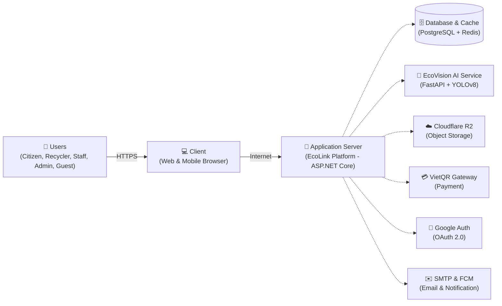
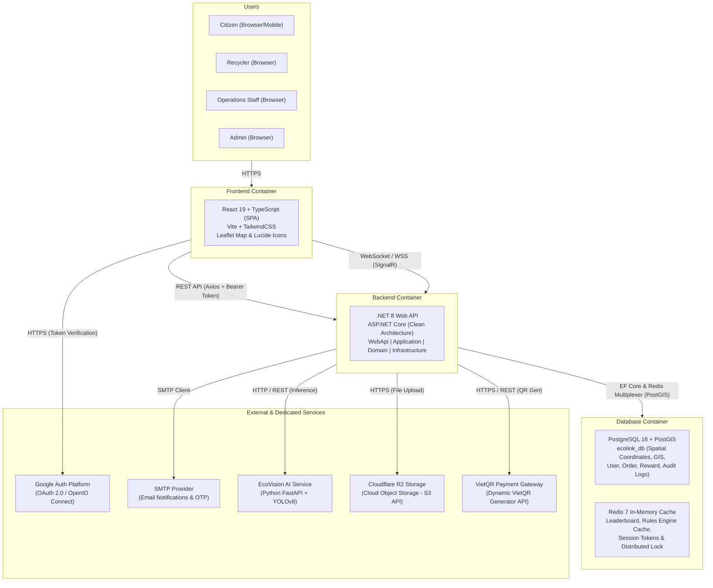

# TÀI LIỆU ĐẶC TẢ THIẾT KẾ PHẦN MỀM (SOFTWARE DESIGN DESCRIPTION)
## HỆ THỐNG PHÂN LOẠI RÁC THÔNG MINH & KẾT NỐI THU GOM PHẾ LIỆU ECOLINK

- **Dự án:** EcoLink – Intelligent Waste Sorting & Trading Platform  
- **Mã dự án:** SEP490-G141  
- **Thư mục tài liệu:** `documents/diagram/software architecture/`  
- **Các file sơ đồ Draw.io đi kèm:**
  - [ecolink_software_overview.drawio](file:///c:/Projects/EcoLink/intelligent-waste-sorting-trading/documents/diagram/software%20architecture/ecolink_software_overview.drawio) (Sơ đồ Software Overview)
  - [ecolink_software_architecture.drawio](file:///c:/Projects/EcoLink/intelligent-waste-sorting-trading/documents/diagram/software%20architecture/ecolink_software_architecture.drawio) (Sơ đồ System Architecture)
  - [ecolink_system_design_all_diagrams.drawio](file:///c:/Projects/EcoLink/intelligent-waste-sorting-trading/documents/diagram/software%20architecture/ecolink_system_design_all_diagrams.drawio) (Sơ đồ đa tab gồm cả 2 trang)

---

## MỤC LỤC
1. [IV. Software Design Description - 1. Software Overview](#1-software-overview)
   - [1.1 Góc nhìn sản phẩm & Bối cảnh hệ thống (Product Perspective)](#11-góc-nhìn-sản-phẩm--bối-cảnh-hệ-thống-product-perspective)
   - [1.2 Phân rã các thành phần trong sơ đồ Software Overview](#12-phân-rã-các-thành-phần-trong-sơ-đồ-software-overview)
   - [1.3 Bảng chú giải màu sắc (Legend)](#13-bảng-chú-giải-màu-sắc-legend)
   - [1.4 Mã nguồn XML Draw.io cho Software Overview](#14-mã-nguồn-xml-drawio-cho-software-overview)
2. [2. System Design - 2.1 Software Architecture](#2-system-design---21-software-architecture)
   - [2.1 Tổng quan kiến trúc hệ thống (C4 Container Diagram)](#21-tổng-quan-kiến-trúc-hệ-thống-c4-container-diagram)
   - [2.2 Chi tiết các tầng và Container công nghệ](#22-chi-tiết-các-tầng-và-container-công-nghệ)
   - [2.3 Luồng giao tiếp và Giao thức mạng (Protocols & Data Flow)](#23-luồng-giao-tiếp-và-giao-thức-mạng-protocols--data-flow)
   - [2.4 Mã nguồn XML Draw.io cho Software Architecture](#24-mã-nguồn-xml-drawio-cho-software-architecture)
3. [3. Hướng dẫn mở và chỉnh sửa sơ đồ trên Draw.io](#3-hướng-dẫn-mở-và-chỉnh-sửa-sơ-đồ-trên-drawio)

---

# 1. SOFTWARE OVERVIEW

## 1.1 Góc nhìn sản phẩm & Bối cảnh hệ thống (Product Perspective)

**EcoLink** là nền tảng số hóa hỗ trợ phân loại rác thải tại nguồn bằng trí tuệ nhân tạo (AI Computer Vision) kết hợp mạng lưới kết nối giao dịch thu mua phế liệu tái chế giữa Người dân (Citizen) và Đối tác thu gom (Recycler), được giám sát bởi Đội ngũ vận hành (Staff) và Quản trị viên (Admin).

Sơ đồ **Software Overview** mô tả góc nhìn mức cao (High-level Overview) về sự tương tác giữa các nhóm người dùng (Actors), thiết bị đầu cuối (Client), môi trường mạng (Internet), máy chủ xử lý ứng dụng (Application Server), cùng các kho lưu trữ dữ liệu (Database) và dịch vụ ngoại vi (External Services).



## 1.2 Phân rã các thành phần trong sơ đồ Software Overview

### 1.2.1 Khối Tác nhân người dùng (`«actor» Users`)
- **Citizens (Người dân / Người bán rác):** Chụp ảnh phân loại rác qua AI, tra cứu quy chuẩn phân loại, định vị điểm thu mua gần nhất, tạo yêu cầu thu gom phế liệu tận nơi, thương lượng qua chat và đổi điểm thưởng (Gamification).
- **Recyclers (Đối tác thu gom / Vựa phế liệu):** Quản lý danh mục và bảng giá phế liệu thu mua, bật/tắt trạng thái hoạt động trên bản đồ số, tiếp nhận/từ chối lịch hẹn, chốt biên nhận bàn giao trực tiếp và mua gói dịch vụ nội bộ (VietQR).
- **Operations Staff (Nhân viên vận hành):** Thẩm định hồ sơ đối tác thu gom, giải quyết khiếu nại tranh chấp giao dịch, kiểm duyệt nhãn ảnh AI nhận diện sai, quản lý kho quà voucher và kiểm tra điểm danh ca trực.
- **System Admin (Quản trị viên hệ thống):** Quản trị tài khoản, phân quyền RBAC, giám sát nhật ký kiểm toán (Audit Logs), theo dõi doanh thu gói dịch vụ và vận hành toàn hệ thống.
- **Guests (Khách vãng lai):** Khám phá thông tin dự án, xem quy tắc phân loại rác cộng đồng và vị trí các trạm thu mua công khai trước khi đăng ký.

### 1.2.2 Khối Ứng dụng đầu cuối (`«client» Web & Mobile Browser`)
- Đại diện cho trình duyệt web hiện đại (Google Chrome, Safari, Microsoft Edge) chạy trên cả máy tính (Desktop/Laptop) và thiết bị di động (Smartphone/Tablet).
- Cung cấp giao diện Single Page Application (SPA) thích ứng (Responsive Web Design), tích hợp trực tiếp Camera HTML5 để chụp ảnh rác thải theo thời gian thực.

### 1.2.3 Môi trường mạng (`Internet`)
- Mạng Internet công cộng kết nối Client đến Gateway máy chủ thông qua kênh bảo mật mã hóa **HTTPS / TLS 1.3** và giao thức thời gian thực **WebSocket (WSS)**.

### 1.2.4 Máy chủ ứng dụng (`«server» Application Server`)
- **EcoLink Platform (`«application»`):** Triển khai ứng dụng backend chính xây dựng trên nền tảng **ASP.NET Core 8 Web API** theo chuẩn Clean Architecture, chịu trách nhiệm thực thi toàn bộ logic nghiệp vụ, điều phối xác thực JWT, định vị GIS PostGIS, xử lý sự kiện Event-Driven và quản lý tác vụ ngầm Hangfire.

### 1.2.5 Cơ sở dữ liệu và Các dịch vụ phụ trợ (Right Column)
1. **`«database»` Database & Cache:**
   - **PostgreSQL 16 + PostGIS:** CSDL quan hệ lưu trữ dữ liệu người dùng, đơn giao dịch, tọa độ địa lý trạm thu gom và lịch sử kiểm toán.
   - **Redis 7 In-Memory:** Lưu trữ bộ nhớ đệm bảng xếp hạng (Leaderboard), các quy tắc phân loại tĩnh và khóa phân tán (Distributed Locks).
2. **`«internal service»` EcoVision AI Service:**
   - Dịch vụ Microservice AI xây dựng bằng **Python FastAPI + Ultralytics YOLOv8**, chạy trên quy trình Two-Stage (Detection $\rightarrow$ Crop $\rightarrow$ Classification) với độ chính xác $>91\%$.
3. **`«external service»` Cloudflare R2 Storage:**
   - Dịch vụ lưu trữ đám mây tương thích AWS S3 API, tối ưu chi phí băng thông (Zero Egress Fees), dùng để lưu trữ ảnh chụp rác thải, ảnh biên nhận giao dịch và tài liệu hồ sơ thẩm định đối tác.
4. **`«external service»` VietQR Payment Gateway:**
   - Cổng tạo mã QR động ngân hàng thông qua VietQR Open API, phục vụ thanh toán các gói dịch vụ nội bộ (huy hiệu Tích xanh, gói nâng hạng hiển thị).
5. **`«external service»` Google Auth Platform:**
   - Hệ thống xác thực danh tính SSO thông qua giao thức **OAuth 2.0 / OpenID Connect**, giúp người dùng đăng nhập nhanh bằng tài khoản Google.
6. **`«external service»` SMTP Provider & Firebase FCM:**
   - Dịch vụ gửi email thông báo tự động (OTP reset mật khẩu, thông báo phê duyệt hồ sơ) và máy chủ Firebase Cloud Messaging gửi thông báo đẩy (Push Notifications) về trình duyệt.

## 1.3 Bảng chú giải màu sắc (Legend)

| Nhóm thành phần | Mã màu Fill | Mã màu Stroke | Định nghĩa |
| :--- | :--- | :--- | :--- |
| **Actors (Tác nhân)** | `#f3e5f5` (Tím nhạt) | `#8e24aa` (Tím đậm) | Người dùng, đối tác thu mua, nhân viên và quản trị viên |
| **Client (Đầu cuối)** | `#e8f5e9` (Xanh lá nhạt) | `#43a047` (Xanh lá đậm) | Trình duyệt Web và Mobile Web của người dùng |
| **Server (Máy chủ)** | `#e3f2fd` (Xanh dương nhạt) | `#1e88e5` (Xanh dương đậm) | Máy chủ ứng dụng trung tâm và lõi ứng dụng EcoLink |
| **DB & External** | `#fff9c4` (Vàng kem) / Soft Colors | `#fbc02d` (Vàng đậm) / Accents | CSDL PostgreSQL, Redis và các dịch vụ tích hợp bên thứ ba |

---

## 1.4 Mã nguồn XML Draw.io cho Software Overview

Tệp nguồn đã được lưu tại [ecolink_software_overview.drawio](file:///c:/Projects/EcoLink/intelligent-waste-sorting-trading/documents/diagram/software%20architecture/ecolink_software_overview.drawio).

```xml
<mxfile host="app.diagrams.net" modified="2026-10-13T16:00:00.000Z" agent="EcoLink Architecture Generator" version="24.7.5">
  <diagram id="ecolink-software-overview" name="Software Overview">
    <mxGraphModel dx="1600" dy="1000" grid="1" gridSize="10" guides="1" tooltips="1" connect="1" arrows="1" fold="1" page="1" pageScale="1" pageWidth="1654" pageHeight="1169" background="#ffffff" math="0" shadow="0">
      <root>
        <mxCell id="0" />
        <mxCell id="1" parent="0" />

        <!-- Title Block -->
        <mxCell id="doc_header" parent="1" value="&lt;b style='font-size: 20px; color: #b71c1c;'&gt;IV. Software Design Description&lt;/b&gt;&lt;br&gt;&lt;b style='font-size: 16px; color: #212121;'&gt;1. Software Overview&lt;/b&gt;" style="text;html=1;align=left;verticalAlign=middle;resizable=0;points=[];autosize=1;strokeColor=none;fillColor=none;" vertex="1">
          <mxGeometry x="60" y="30" width="300" height="40" as="geometry" />
        </mxCell>
        <mxCell id="main_title" parent="1" value="&lt;b style='font-size: 18px; color: #1a237e;'&gt;EcoLink System Overview&lt;/b&gt;" style="text;html=1;align=center;verticalAlign=middle;resizable=0;points=[];autosize=1;strokeColor=none;fillColor=none;" vertex="1">
          <mxGeometry x="460" y="90" width="280" height="30" as="geometry" />
        </mxCell>

        <!-- 1. ACTORS CONTAINER (3D Extruded Block) -->
        <mxCell id="actor_box" parent="1" value="&amp;laquo;actor&amp;raquo;&lt;br&gt;&lt;b style='font-size: 13px;'&gt;Users&lt;/b&gt;" style="shape=cube;whiteSpace=wrap;html=1;boundedLbl=1;backgroundOutline=1;darkOpacity=0.08;darkOpacity2=0.14;size=16;fillColor=#f3e5f5;strokeColor=#8e24aa;strokeWidth=1.5;verticalAlign=top;align=center;fontSize=12;fontColor=#4a148c;spacingTop=8;" vertex="1">
          <mxGeometry x="60" y="160" width="170" height="430" as="geometry" />
        </mxCell>

        <!-- Actors list inside container -->
        <mxCell id="act_citizen_icon" parent="1" value="" style="shape=umlActor;verticalLabelPosition=bottom;verticalAlign=top;html=1;outlineConnect=0;fillColor=#e1bee7;strokeColor=#8e24aa;" vertex="1">
          <mxGeometry x="75" y="215" width="25" height="50" as="geometry" />
        </mxCell>
        <mxCell id="act_citizen_lbl" parent="1" value="&lt;b style='font-size: 11px;'&gt;Citizens&lt;/b&gt;&lt;br&gt;&lt;span style='font-size: 9px; color: #555;'&gt;Waste Sellers&lt;/span&gt;" style="text;html=1;align=left;verticalAlign=middle;strokeColor=none;fillColor=none;" vertex="1">
          <mxGeometry x="110" y="222" width="105" height="35" as="geometry" />
        </mxCell>

        <mxCell id="act_recycler_icon" parent="1" value="" style="shape=umlActor;verticalLabelPosition=bottom;verticalAlign=top;html=1;outlineConnect=0;fillColor=#e1bee7;strokeColor=#8e24aa;" vertex="1">
          <mxGeometry x="75" y="290" width="25" height="50" as="geometry" />
        </mxCell>
        <mxCell id="act_recycler_lbl" parent="1" value="&lt;b style='font-size: 11px;'&gt;Recyclers&lt;/b&gt;&lt;br&gt;&lt;span style='font-size: 9px; color: #555;'&gt;Scrap Collectors&lt;/span&gt;" style="text;html=1;align=left;verticalAlign=middle;strokeColor=none;fillColor=none;" vertex="1">
          <mxGeometry x="110" y="297" width="105" height="35" as="geometry" />
        </mxCell>

        <mxCell id="act_staff_icon" parent="1" value="" style="shape=umlActor;verticalLabelPosition=bottom;verticalAlign=top;html=1;outlineConnect=0;fillColor=#e1bee7;strokeColor=#8e24aa;" vertex="1">
          <mxGeometry x="75" y="365" width="25" height="50" as="geometry" />
        </mxCell>
        <mxCell id="act_staff_lbl" parent="1" value="&lt;b style='font-size: 11px;'&gt;Operations Staff&lt;/b&gt;&lt;br&gt;&lt;span style='font-size: 9px; color: #555;'&gt;Data &amp;amp; Disputes&lt;/span&gt;" style="text;html=1;align=left;verticalAlign=middle;strokeColor=none;fillColor=none;" vertex="1">
          <mxGeometry x="110" y="372" width="105" height="35" as="geometry" />
        </mxCell>

        <mxCell id="act_admin_icon" parent="1" value="" style="shape=umlActor;verticalLabelPosition=bottom;verticalAlign=top;html=1;outlineConnect=0;fillColor=#e1bee7;strokeColor=#8e24aa;" vertex="1">
          <mxGeometry x="75" y="440" width="25" height="50" as="geometry" />
        </mxCell>
        <mxCell id="act_admin_lbl" parent="1" value="&lt;b style='font-size: 11px;'&gt;System Admin&lt;/b&gt;&lt;br&gt;&lt;span style='font-size: 9px; color: #555;'&gt;System Manager&lt;/span&gt;" style="text;html=1;align=left;verticalAlign=middle;strokeColor=none;fillColor=none;" vertex="1">
          <mxGeometry x="110" y="447" width="105" height="35" as="geometry" />
        </mxCell>

        <mxCell id="act_guest_icon" parent="1" value="" style="shape=umlActor;verticalLabelPosition=bottom;verticalAlign=top;html=1;outlineConnect=0;fillColor=#e1bee7;strokeColor=#8e24aa;" vertex="1">
          <mxGeometry x="75" y="515" width="25" height="50" as="geometry" />
        </mxCell>
        <mxCell id="act_guest_lbl" parent="1" value="&lt;b style='font-size: 11px;'&gt;Guests&lt;/b&gt;&lt;br&gt;&lt;span style='font-size: 9px; color: #555;'&gt;Public Visitors&lt;/span&gt;" style="text;html=1;align=left;verticalAlign=middle;strokeColor=none;fillColor=none;" vertex="1">
          <mxGeometry x="110" y="522" width="105" height="35" as="geometry" />
        </mxCell>

        <!-- Connector 1: Users to Client -->
        <mxCell id="edge_users_to_client" parent="1" source="actor_box" target="client_box" style="edgeStyle=orthogonalEdgeStyle;rounded=0;orthogonalLoop=1;jettySize=auto;html=1;strokeColor=#37474f;strokeWidth=1.5;endArrow=classic;" edge="1">
          <mxGeometry relative="1" as="geometry" />
        </mxCell>

        <!-- 2. CLIENT (3D Extruded Block) -->
        <mxCell id="client_box" parent="1" value="&amp;laquo;client&amp;raquo;&lt;br&gt;&lt;b style='font-size: 13px;'&gt;Web &amp;amp; Mobile&lt;br&gt;Browser&lt;/b&gt;" style="shape=cube;whiteSpace=wrap;html=1;boundedLbl=1;backgroundOutline=1;darkOpacity=0.08;darkOpacity2=0.14;size=16;fillColor=#e8f5e9;strokeColor=#43a047;strokeWidth=1.5;verticalAlign=top;align=center;fontSize=12;fontColor=#1b5e20;spacingTop=10;" vertex="1">
          <mxGeometry x="290" y="270" width="135" height="210" as="geometry" />
        </mxCell>

        <!-- Client Browser/Globe Icon -->
        <mxCell id="client_globe" parent="1" value="" style="ellipse;whiteSpace=wrap;html=1;aspect=fixed;fillColor=#c8e6c9;strokeColor=#2e7d32;strokeWidth=2;" vertex="1">
          <mxGeometry x="327" y="370" width="60" height="60" as="geometry" />
        </mxCell>
        <mxCell id="client_globe_meridian" parent="1" value="" style="ellipse;whiteSpace=wrap;html=1;aspect=fixed;fillColor=none;strokeColor=#2e7d32;strokeWidth=1.5;" vertex="1">
          <mxGeometry x="342" y="370" width="30" height="60" as="geometry" />
        </mxCell>
        <mxCell id="client_globe_equator" parent="1" value="" style="line;strokeWidth=1.5;html=1;strokeColor=#2e7d32;" vertex="1">
          <mxGeometry x="327" y="399" width="60" height="2" as="geometry" />
        </mxCell>

        <!-- Connector 2: Client to Internet -->
        <mxCell id="edge_client_to_internet" parent="1" source="client_box" target="internet_cloud" style="edgeStyle=orthogonalEdgeStyle;rounded=0;orthogonalLoop=1;jettySize=auto;html=1;strokeColor=#37474f;strokeWidth=1.5;endArrow=classic;" edge="1">
          <mxGeometry relative="1" as="geometry" />
        </mxCell>

        <!-- 3. INTERNET CLOUD -->
        <mxCell id="internet_cloud" parent="1" value="&lt;b style='font-size: 13px;'&gt;Internet&lt;/b&gt;" style="shape=cloud;whiteSpace=wrap;html=1;fillColor=#e1f5fe;strokeColor=#0288d1;strokeWidth=1.5;fontColor=#01579b;" vertex="1">
          <mxGeometry x="480" y="335" width="120" height="80" as="geometry" />
        </mxCell>

        <!-- Connector 3: Internet to Application Server -->
        <mxCell id="edge_internet_to_server" parent="1" source="internet_cloud" target="server_box" style="edgeStyle=orthogonalEdgeStyle;rounded=0;orthogonalLoop=1;jettySize=auto;html=1;strokeColor=#37474f;strokeWidth=1.5;endArrow=classic;" edge="1">
          <mxGeometry relative="1" as="geometry" />
        </mxCell>

        <!-- 4. APPLICATION SERVER (Outer 3D Block) -->
        <mxCell id="server_box" parent="1" value="&amp;laquo;server&amp;raquo;&lt;br&gt;&lt;b style='font-size: 13px;'&gt;Application Server&lt;/b&gt;" style="shape=cube;whiteSpace=wrap;html=1;boundedLbl=1;backgroundOutline=1;darkOpacity=0.08;darkOpacity2=0.14;size=18;fillColor=#e3f2fd;strokeColor=#1e88e5;strokeWidth=1.5;verticalAlign=top;align=center;fontSize=12;fontColor=#0d47a1;spacingTop=10;" vertex="1">
          <mxGeometry x="660" y="200" width="240" height="350" as="geometry" />
        </mxCell>

        <!-- Inner Application Box (3D Cube) -->
        <mxCell id="app_box" parent="1" value="&amp;laquo;application&amp;raquo;&lt;br&gt;&lt;b style='font-size: 14px;'&gt;EcoLink Platform&lt;/b&gt;&lt;br&gt;&lt;span style='font-size: 10px; color: #1565c0;'&gt;ASP.NET Core Web API&lt;/span&gt;" style="shape=cube;whiteSpace=wrap;html=1;boundedLbl=1;backgroundOutline=1;darkOpacity=0.08;darkOpacity2=0.14;size=14;fillColor=#bbdefb;strokeColor=#1565c0;strokeWidth=1.5;verticalAlign=top;align=center;fontSize=11;fontColor=#0d47a1;spacingTop=10;" vertex="1">
          <mxGeometry x="685" y="280" width="180" height="235" as="geometry" />
        </mxCell>

        <!-- Eco Emblem inside Application -->
        <mxCell id="app_logo" parent="1" value="♻&lt;br&gt;&lt;b style='font-size: 11px;'&gt;EcoLink&lt;/b&gt;" style="shape=hexagon;perimeter=hexagonPerimeter2;whiteSpace=wrap;html=1;fixedSize=1;fillColor=#2e7d32;strokeColor=#1b5e20;strokeWidth=2;fontColor=#ffffff;fontSize=20;" vertex="1">
          <mxGeometry x="735" y="380" width="80" height="75" as="geometry" />
        </mxCell>

        <!-- 5. RIGHT SIDE COMPONENTS -->
        <!-- Database -->
        <mxCell id="db_box" parent="1" value="&amp;laquo;database&amp;raquo;&lt;br&gt;&lt;b style='font-size: 12px;'&gt;Database &amp;amp; Cache&lt;/b&gt;&lt;br&gt;&lt;span style='font-size: 9.5px; color: #555;'&gt;PostgreSQL 16 (PostGIS)&lt;br&gt;&amp;amp; Redis 7 In-Memory&lt;/span&gt;" style="shape=cylinder3;whiteSpace=wrap;html=1;boundedLbl=1;backgroundOutline=1;size=12;fillColor=#fff9c4;strokeColor=#fbc02d;strokeWidth=1.5;fontColor=#e65100;align=center;" vertex="1">
          <mxGeometry x="1010" y="110" width="170" height="85" as="geometry" />
        </mxCell>

        <!-- AI Vision Service -->
        <mxCell id="ai_box" parent="1" value="&amp;laquo;internal service&amp;raquo;&lt;br&gt;&lt;b style='font-size: 12px;'&gt;EcoVision AI Service&lt;/b&gt;&lt;br&gt;&lt;span style='font-size: 9.5px; color: #4a148c;'&gt;FastAPI + YOLOv8&lt;br&gt;(Two-Stage Classification)&lt;/span&gt;" style="rounded=1;whiteSpace=wrap;html=1;arcSize=16;fillColor=#ede7f6;strokeColor=#7e57c2;strokeWidth=1.5;fontColor=#311b92;align=center;" vertex="1">
          <mxGeometry x="1010" y="215" width="170" height="75" as="geometry" />
        </mxCell>

        <!-- Cloudflare R2 Storage -->
        <mxCell id="storage_box" parent="1" value="&amp;laquo;external service&amp;raquo;&lt;br&gt;&lt;b style='font-size: 12px;'&gt;Cloudflare R2 Storage&lt;/b&gt;&lt;br&gt;&lt;span style='font-size: 9.5px; color: #006064;'&gt;Cloud Object Storage (S3 API)&lt;br&gt;Waste Images &amp;amp; KYC Files&lt;/span&gt;" style="rounded=1;whiteSpace=wrap;html=1;arcSize=16;fillColor=#e0f7fa;strokeColor=#00acc1;strokeWidth=1.5;fontColor=#006064;align=center;" vertex="1">
          <mxGeometry x="1010" y="310" width="170" height="75" as="geometry" />
        </mxCell>

        <!-- VietQR Gateway -->
        <mxCell id="vietqr_box" parent="1" value="&amp;laquo;external service&amp;raquo;&lt;br&gt;&lt;b style='font-size: 12px;'&gt;VietQR Payment Gateway&lt;/b&gt;&lt;br&gt;&lt;span style='font-size: 9.5px; color: #1b5e20;'&gt;VietQR Open API&lt;br&gt;In-App Service Fee / Packages&lt;/span&gt;" style="rounded=1;whiteSpace=wrap;html=1;arcSize=16;fillColor=#e8f5e9;strokeColor=#43a047;strokeWidth=1.5;fontColor=#1b5e20;align=center;" vertex="1">
          <mxGeometry x="1010" y="405" width="170" height="75" as="geometry" />
        </mxCell>

        <!-- Google Auth Platform -->
        <mxCell id="oauth_box" parent="1" value="&amp;laquo;external service&amp;raquo;&lt;br&gt;&lt;b style='font-size: 12px;'&gt;Google Auth Platform&lt;/b&gt;&lt;br&gt;&lt;span style='font-size: 9.5px; color: #bf360c;'&gt;OAuth 2.0 / OpenID Connect&lt;br&gt;Citizen &amp;amp; Recycler SSO&lt;/span&gt;" style="rounded=1;whiteSpace=wrap;html=1;arcSize=16;fillColor=#fff3e0;strokeColor=#fb8c00;strokeWidth=1.5;fontColor=#bf360c;align=center;" vertex="1">
          <mxGeometry x="1010" y="500" width="170" height="75" as="geometry" />
        </mxCell>

        <!-- SMTP & FCM -->
        <mxCell id="smtp_box" parent="1" value="&amp;laquo;external service&amp;raquo;&lt;br&gt;&lt;b style='font-size: 12px;'&gt;SMTP &amp;amp; Firebase FCM&lt;/b&gt;&lt;br&gt;&lt;span style='font-size: 9.5px; color: #b71c1c;'&gt;Email Service (Gmail/SES)&lt;br&gt;&amp;amp; Push Notifications&lt;/span&gt;" style="rounded=1;whiteSpace=wrap;html=1;arcSize=16;fillColor=#ffebee;strokeColor=#e53935;strokeWidth=1.5;fontColor=#b71c1c;align=center;" vertex="1">
          <mxGeometry x="1010" y="595" width="170" height="75" as="geometry" />
        </mxCell>

        <!-- Connectors Server to Right side -->
        <mxCell id="edge_server_to_db" parent="1" source="server_box" target="db_box" style="edgeStyle=orthogonalEdgeStyle;rounded=0;orthogonalLoop=1;jettySize=auto;html=1;dashed=1;strokeColor=#546e7a;strokeWidth=1.5;endArrow=classic;" edge="1">
          <mxGeometry relative="1" as="geometry" />
        </mxCell>
        <mxCell id="edge_server_to_ai" parent="1" source="server_box" target="ai_box" style="edgeStyle=orthogonalEdgeStyle;rounded=0;orthogonalLoop=1;jettySize=auto;html=1;dashed=1;strokeColor=#546e7a;strokeWidth=1.5;endArrow=classic;" edge="1">
          <mxGeometry relative="1" as="geometry" />
        </mxCell>
        <mxCell id="edge_server_to_storage" parent="1" source="server_box" target="storage_box" style="edgeStyle=orthogonalEdgeStyle;rounded=0;orthogonalLoop=1;jettySize=auto;html=1;dashed=1;strokeColor=#546e7a;strokeWidth=1.5;endArrow=classic;" edge="1">
          <mxGeometry relative="1" as="geometry" />
        </mxCell>
        <mxCell id="edge_server_to_vietqr" parent="1" source="server_box" target="vietqr_box" style="edgeStyle=orthogonalEdgeStyle;rounded=0;orthogonalLoop=1;jettySize=auto;html=1;dashed=1;strokeColor=#546e7a;strokeWidth=1.5;endArrow=classic;" edge="1">
          <mxGeometry relative="1" as="geometry" />
        </mxCell>
        <mxCell id="edge_server_to_oauth" parent="1" source="server_box" target="oauth_box" style="edgeStyle=orthogonalEdgeStyle;rounded=0;orthogonalLoop=1;jettySize=auto;html=1;dashed=1;strokeColor=#546e7a;strokeWidth=1.5;endArrow=classic;" edge="1">
          <mxGeometry relative="1" as="geometry" />
        </mxCell>
        <mxCell id="edge_server_to_smtp" parent="1" source="server_box" target="smtp_box" style="edgeStyle=orthogonalEdgeStyle;rounded=0;orthogonalLoop=1;jettySize=auto;html=1;dashed=1;strokeColor=#546e7a;strokeWidth=1.5;endArrow=classic;" edge="1">
          <mxGeometry relative="1" as="geometry" />
        </mxCell>

        <!-- Legend -->
        <mxCell id="legend_container" parent="1" value="&lt;b style='font-size: 11px;'&gt;Legend&lt;/b&gt;" style="rounded=1;whiteSpace=wrap;html=1;arcSize=8;fillColor=#fafafa;strokeColor=#b0bec5;strokeWidth=1.2;verticalAlign=top;align=left;spacingLeft=12;spacingTop=6;fontColor=#37474f;" vertex="1">
          <mxGeometry x="60" y="625" width="480" height="70" as="geometry" />
        </mxCell>
        <mxCell id="leg_act_swatch" parent="1" value="" style="rounded=0;whiteSpace=wrap;html=1;fillColor=#f3e5f5;strokeColor=#8e24aa;strokeWidth=1.5;" vertex="1">
          <mxGeometry x="75" y="655" width="22" height="22" as="geometry" />
        </mxCell>
        <mxCell id="leg_act_lbl" parent="1" value="Actors" style="text;html=1;align=left;verticalAlign=middle;strokeColor=none;fillColor=none;fontSize=11;fontColor=#37474f;" vertex="1">
          <mxGeometry x="105" y="655" width="55" height="22" as="geometry" />
        </mxCell>
        <mxCell id="leg_cli_swatch" parent="1" value="" style="rounded=0;whiteSpace=wrap;html=1;fillColor=#e8f5e9;strokeColor=#43a047;strokeWidth=1.5;" vertex="1">
          <mxGeometry x="170" y="655" width="22" height="22" as="geometry" />
        </mxCell>
        <mxCell id="leg_cli_lbl" parent="1" value="Client" style="text;html=1;align=left;verticalAlign=middle;strokeColor=none;fillColor=none;fontSize=11;fontColor=#37474f;" vertex="1">
          <mxGeometry x="200" y="655" width="50" height="22" as="geometry" />
        </mxCell>
        <mxCell id="leg_srv_swatch" parent="1" value="" style="rounded=0;whiteSpace=wrap;html=1;fillColor=#e3f2fd;strokeColor=#1e88e5;strokeWidth=1.5;" vertex="1">
          <mxGeometry x="260" y="655" width="22" height="22" as="geometry" />
        </mxCell>
        <mxCell id="leg_srv_lbl" parent="1" value="Server" style="text;html=1;align=left;verticalAlign=middle;strokeColor=none;fillColor=none;fontSize=11;fontColor=#37474f;" vertex="1">
          <mxGeometry x="290" y="655" width="50" height="22" as="geometry" />
        </mxCell>
        <mxCell id="leg_ext_swatch" parent="1" value="" style="rounded=0;whiteSpace=wrap;html=1;fillColor=#fff9c4;strokeColor=#fbc02d;strokeWidth=1.5;" vertex="1">
          <mxGeometry x="350" y="655" width="22" height="22" as="geometry" />
        </mxCell>
        <mxCell id="leg_ext_lbl" parent="1" value="DB &amp;amp; External Systems" style="text;html=1;align=left;verticalAlign=middle;strokeColor=none;fillColor=none;fontSize=11;fontColor=#37474f;" vertex="1">
          <mxGeometry x="380" y="655" width="145" height="22" as="geometry" />
        </mxCell>
      </root>
    </mxGraphModel>
  </diagram>
</mxfile>
```

---

# 2. SYSTEM DESIGN - 2.1 SOFTWARE ARCHITECTURE

## 2.1 Tổng quan kiến trúc hệ thống (C4 Container Diagram)

Sơ đồ **Software Architecture (System Architecture)** được thiết kế theo phong cách **C4 Model - Container Level**, chuẩn hóa các ranh giới container thực thi (Execution Containers), các giao thức trao đổi dữ liệu (Protocols) và chiều phụ thuộc phần mềm.



## 2.2 Chi tiết các tầng và Container công nghệ

### 2.2.1 Tầng Người dùng (`Users Container`)
Bao gồm 4 đối tượng tương tác trực tiếp với hệ thống thông qua trình duyệt web:
1. **Citizen (Browser / Mobile):** Người dân dùng điện thoại hoặc máy tính để phân loại rác và đặt lịch hẹn bán ve chai.
2. **Recycler (Browser):** Cơ sở thu mua dùng giao diện chuyên biệt để quản lý giá phế liệu, tiếp nhận lịch hẹn và tạo biên nhận.
3. **Operations Staff (Browser):** Nhân viên dùng trang Back-office duyệt hồ sơ đối tác, xử lý tranh chấp và gán nhãn ảnh AI lỗi.
4. **Admin (Browser):** Quản trị viên theo dõi dashboard hệ thống, phân quyền và cấu hình dịch vụ nội bộ.

### 2.2.2 Tầng Giao diện người dùng (`Frontend Container`)
- **Công nghệ cốt lõi:** **React 19 + TypeScript**, xây dựng bằng công cụ đóng gói siêu tốc **Vite 8**, kết hợp **TailwindCSS v4** cho hệ thống giao diện tinh gọn, responsive.
- **Thư viện chuyên dụng:**
  - **Leaflet / React-Leaflet:** Hiển thị bản đồ số định vị các cơ sở thu mua gần nhất theo tọa độ PostGIS.
  - **Lucide React:** Bộ icon giao diện hiện đại, trực quan.
  - **Axios:** Thực hiện các HTTP Requests đính kèm JWT Bearer Token tại Request Header.
  - **@microsoft/signalr:** Kết nối WebSocket hai chiều phục vụ hộp thoại đàm phán (Chatbox) và thông báo đẩy thời gian thực.

### 2.2.3 Tầng Máy chủ trung tâm (`Backend Container`)
- **Công nghệ cốt lõi:** **.NET 8 / ASP.NET Core Web API**, tuân thủ nguyên tắc **Clean Architecture 4 tầng**:
  - `Ecolink.Domain`: Chứa các thực thể cốt lõi (`User`, `TradeOrder`, `WasteCategory`, `RecyclerProfile`), Enums và Domain Exceptions (không phụ thuộc bất kỳ thư viện bên ngoài nào).
  - `Ecolink.Application`: Chứa Use Cases, DTOs, Event Contracts, FluentValidation và Interfaces (`IAiVisionClient`, `ITradeOrderService`).
  - `Ecolink.Infrastructure`: Hiện thực hóa EF Core `ApplicationDbContext`, PostGIS spatial queries, kết nối Redis Multiplexer, dịch vụ gửi mail, và các Background Jobs (Hangfire).
  - `Ecolink.WebApi`: Controllers siêu mỏng (Thin Controllers), Global Exception Middleware, JWT Authentication Filter và OpenAPI Swagger Documentation.

### 2.2.4 Tầng Cơ sở dữ liệu (`Database Container`)
- **PostgreSQL 16 với phần mở rộng PostGIS:**
  - Lưu trữ toàn bộ dữ liệu quan hệ ACID.
  - Cột không gian địa lý `geometry(Point, 4326)` hỗ trợ hàm tính khoảng cách `ST_DWithin` và `ST_Distance` để tìm nhanh đối tác thu gom trong bán kính $R$ km của người dân.
- **Redis 7 In-Memory Cache:**
  - Caching danh mục rác thải và quy tắc phân loại tĩnh.
  - Sorted Sets (`ZSET`) hỗ trợ Bảng xếp hạng thi đua phân loại rác (Eco Leaderboard) theo thời gian thực mà không gây tải cho PostgreSQL.
  - Quản lý phiên làm việc, Distributed Lock khi thực hiện đổi điểm thưởng (Gamification).

### 2.2.5 Khối AI Service & Dịch vụ ngoại vi
1. **EcoVision AI Service:**
   - Đóng gói dạng microservice Python FastAPI riêng biệt (port 8000).
   - Mô hình YOLOv8n Two-Stage: Stage 1 phát hiện và cắt BBox vật thể rác + 5% padding, Stage 2 phân loại chi tiết 6 nhóm rác TrashNet (Plastic, Glass, Metal, Paper, Cardboard, Trash) kèm cơ chế nhận diện ảnh nhiễu ngoại lai (OOD flag khi Confidence $< 0.5$).
2. **Google Auth Platform:** Xác thực token OAuth 2.0 cấp quyền đăng nhập nhanh.
3. **SMTP Provider:** Gửi email giao dịch và mã OTP qua Gmail SMTP / Amazon SES.
4. **Cloudflare R2:** Lưu trữ ảnh dung lượng lớn, cung cấp link CDN an toàn.
5. **VietQR Payment Gateway:** Sinh mã QR chuyển khoản VietQR chuẩn Napas 247 để thu phí các gói tiện ích mở rộng.

---

## 2.3 Luồng giao tiếp và Giao thức mạng (Protocols & Data Flow)

| Kênh kết nối | Từ | Tới | Giao thức / Thư viện | Nội dung truyền tải |
| :--- | :--- | :--- | :--- | :--- |
| **HTTPS (UI Entry)** | Users | Frontend | HTTPS (Port 443/5173) | Tải tài nguyên HTML/CSS/JS, Assets giao diện |
| **REST API** | Frontend | Backend | HTTP/1.1 & HTTP/2 (Port 5000) | JSON API payload kèm Header `Authorization: Bearer <JWT>` |
| **WebSocket** | Frontend | Backend | WSS (SignalR Hub) | Tin nhắn đàm phán thu gom, cập nhật trạng thái đơn hàng |
| **OAuth Verify** | Frontend/Backend | Google Auth | HTTPS REST | Gửi Google Credential Token để verify thông tin định danh |
| **DB Connection** | Backend | PostgreSQL | TCP (Port 5432) / Npgsql EF Core | Truy vấn dữ liệu quan hệ và hàm GIS không gian |
| **Cache Multiplexer** | Backend | Redis | TCP (Port 6379) / StackExchange.Redis | Đọc ghi cache, xếp hạng Leaderboard, khóa phân tán |
| **AI Inference** | Backend | AI Service | HTTP REST (Port 8000) | `multipart/form-data` gửi ảnh rác và nhận JSON kết quả phân loại |
| **File Storage** | Backend | Cloudflare R2 | HTTPS S3 API (Port 443) | Upload ảnh chụp từ camera, nhận URL công khai |
| **Payment API** | Backend | VietQR | HTTPS REST (Port 443) | Tạo link/mã QR động Napas theo đơn giá dịch vụ nội bộ |
| **Email SMTP** | Backend | SMTP Server | SMTP/TLS (Port 587) | Gửi email kích hoạt tài khoản, OTP và biên lai |

---

## 2.4 Mã nguồn XML Draw.io cho Software Architecture

Tệp nguồn đã được lưu tại [ecolink_software_architecture.drawio](file:///c:/Projects/EcoLink/intelligent-waste-sorting-trading/documents/diagram/software%20architecture/ecolink_software_architecture.drawio).

```xml
<mxfile host="app.diagrams.net" modified="2026-10-13T16:00:00.000Z" agent="EcoLink Architecture Generator" version="24.7.5">
  <diagram id="ecolink-software-architecture" name="Software Architecture">
    <mxGraphModel dx="1600" dy="1000" grid="1" gridSize="10" guides="1" tooltips="1" connect="1" arrows="1" fold="1" page="1" pageScale="1" pageWidth="1654" pageHeight="1169" background="#ffffff" math="0" shadow="0">
      <root>
        <mxCell id="0" />
        <mxCell id="1" parent="0" />

        <!-- Header Section -->
        <mxCell id="arch_doc_header" parent="1" value="&lt;b style='font-size: 18px; color: #212121;'&gt;2. System Design&lt;/b&gt;&lt;br&gt;&lt;b style='font-size: 15px; color: #37474f;'&gt;2.1 Software Architecture&lt;/b&gt;&lt;br&gt;&lt;b style='font-size: 13px; color: #455a64;'&gt;2.1.1 System Architecture&lt;/b&gt;" style="text;html=1;align=left;verticalAlign=middle;resizable=0;points=[];autosize=1;strokeColor=none;fillColor=none;" vertex="1">
          <mxGeometry x="60" y="25" width="220" height="50" as="geometry" />
        </mxCell>

        <!-- 1. USERS CONTAINER (Top yellow tabbed folder) -->
        <mxCell id="cont_users" parent="1" value="Users" style="shape=folder;fontStyle=1;tabWidth=90;tabHeight=22;tabPosition=left;html=1;whiteSpace=wrap;fillColor=#fffde7;strokeColor=#fbc02d;strokeWidth=1.5;verticalAlign=top;align=center;spacingTop=3;fontSize=12;fontColor=#f57f17;" vertex="1">
          <mxGeometry x="60" y="85" width="670" height="85" as="geometry" />
        </mxCell>

        <!-- User Actor Boxes -->
        <mxCell id="user_citizen" parent="1" value="&lt;b&gt;Citizen&lt;/b&gt;&lt;br&gt;&lt;span style='font-size: 9.5px; font-weight: normal; color: #616161;'&gt;(Browser / Mobile)&lt;/span&gt;" style="rounded=1;whiteSpace=wrap;html=1;arcSize=18;fillColor=#ffffff;strokeColor=#bdbdbd;strokeWidth=1.2;fontColor=#212121;fontSize=11;" vertex="1">
          <mxGeometry x="78" y="115" width="145" height="42" as="geometry" />
        </mxCell>

        <mxCell id="user_recycler" parent="1" value="&lt;b&gt;Recycler&lt;/b&gt;&lt;br&gt;&lt;span style='font-size: 9.5px; font-weight: normal; color: #616161;'&gt;(Browser)&lt;/span&gt;" style="rounded=1;whiteSpace=wrap;html=1;arcSize=18;fillColor=#ffffff;strokeColor=#bdbdbd;strokeWidth=1.2;fontColor=#212121;fontSize=11;" vertex="1">
          <mxGeometry x="240" y="115" width="145" height="42" as="geometry" />
        </mxCell>

        <mxCell id="user_staff" parent="1" value="&lt;b&gt;Operations Staff&lt;/b&gt;&lt;br&gt;&lt;span style='font-size: 9.5px; font-weight: normal; color: #616161;'&gt;(Browser)&lt;/span&gt;" style="rounded=1;whiteSpace=wrap;html=1;arcSize=18;fillColor=#ffffff;strokeColor=#bdbdbd;strokeWidth=1.2;fontColor=#212121;fontSize=11;" vertex="1">
          <mxGeometry x="402" y="115" width="145" height="42" as="geometry" />
        </mxCell>

        <mxCell id="user_admin" parent="1" value="&lt;b&gt;Admin&lt;/b&gt;&lt;br&gt;&lt;span style='font-size: 9.5px; font-weight: normal; color: #616161;'&gt;(Browser)&lt;/span&gt;" style="rounded=1;whiteSpace=wrap;html=1;arcSize=18;fillColor=#ffffff;strokeColor=#bdbdbd;strokeWidth=1.2;fontColor=#212121;fontSize=11;" vertex="1">
          <mxGeometry x="565" y="115" width="145" height="42" as="geometry" />
        </mxCell>

        <!-- Connector: Users down to Frontend Container -->
        <mxCell id="edge_users_to_fe" parent="1" source="cont_users" target="cont_frontend" value="&lt;b&gt;HTTPS&lt;/b&gt;" style="edgeStyle=orthogonalEdgeStyle;rounded=0;orthogonalLoop=1;jettySize=auto;html=1;strokeColor=#37474f;strokeWidth=1.5;endArrow=classic;fontStyle=1;fontSize=10.5;fontColor=#37474f;align=center;" edge="1">
          <mxGeometry relative="1" as="geometry">
            <mxPoint x="395" y="170" as="sourcePoint" />
            <mxPoint x="395" y="225" as="targetPoint" />
          </mxGeometry>
        </mxCell>

        <!-- 2. FRONTEND CONTAINER -->
        <mxCell id="cont_frontend" parent="1" value="Frontend Container" style="shape=folder;fontStyle=1;tabWidth=140;tabHeight=22;tabPosition=left;html=1;whiteSpace=wrap;fillColor=#fffde7;strokeColor=#fbc02d;strokeWidth=1.5;verticalAlign=top;align=center;spacingTop=3;fontSize=12;fontColor=#f57f17;" vertex="1">
          <mxGeometry x="240" y="225" width="310" height="85" as="geometry" />
        </mxCell>

        <!-- Frontend Inner Component Box -->
        <mxCell id="fe_tech_box" parent="1" value="&lt;b style='font-size: 11.5px; color: #0d47a1;'&gt;React 19 + TypeScript&lt;/b&gt;&lt;br&gt;&lt;span style='font-size: 9.5px; color: #37474f;'&gt;Vite + TailwindCSS (SPA)&lt;br&gt;Leaflet Map &amp;amp; Lucide Icons&lt;/span&gt;" style="rounded=1;whiteSpace=wrap;html=1;arcSize=16;fillColor=#e3f2fd;strokeColor=#42a5f5;strokeWidth=1.5;align=center;" vertex="1">
          <mxGeometry x="265" y="252" width="260" height="48" as="geometry" />
        </mxCell>

        <!-- Connector: Frontend to Google Auth Platform -->
        <mxCell id="edge_fe_to_oauth" parent="1" source="cont_frontend" target="cont_ext_oauth" value="&lt;b&gt;HTTPS&lt;/b&gt;&lt;br&gt;&lt;span style='font-size: 9px; font-weight: normal; color: #bf360c;'&gt;(Token Verification)&lt;/span&gt;" style="edgeStyle=orthogonalEdgeStyle;rounded=0;orthogonalLoop=1;jettySize=auto;html=1;strokeColor=#e65100;strokeWidth=1.5;endArrow=classic;fontStyle=1;fontSize=10;fontColor=#bf360c;align=center;" edge="1">
          <mxGeometry relative="1" as="geometry">
            <Array as="points">
              <mxPoint x="670" y="260" />
              <mxPoint x="670" y="260" />
            </Array>
          </mxGeometry>
        </mxCell>

        <!-- Connector: Frontend down to Backend (REST API) -->
        <mxCell id="edge_fe_to_be_rest" parent="1" source="cont_frontend" target="cont_backend" value="&lt;b&gt;REST API&lt;/b&gt;&lt;br&gt;&lt;span style='font-size: 9px; font-weight: normal; color: #0d47a1;'&gt;Axios + Bearer Token&lt;/span&gt;" style="edgeStyle=orthogonalEdgeStyle;rounded=0;orthogonalLoop=1;jettySize=auto;html=1;strokeColor=#1565c0;strokeWidth=1.8;endArrow=classic;fontStyle=1;fontSize=10;fontColor=#0d47a1;align=center;" edge="1">
          <mxGeometry relative="1" as="geometry">
            <mxPoint x="320" y="310" as="sourcePoint" />
            <mxPoint x="320" y="390" as="targetPoint" />
            <Array as="points">
              <mxPoint x="320" y="330" />
              <mxPoint x="320" y="390" />
            </Array>
          </mxGeometry>
        </mxCell>

        <!-- Connector: Frontend down to Backend (WebSocket SignalR) -->
        <mxCell id="edge_fe_to_be_ws" parent="1" source="cont_frontend" target="cont_backend" value="&lt;b&gt;WebSocket / WSS&lt;/b&gt;&lt;br&gt;&lt;span style='font-size: 9px; font-weight: normal; color: #1b5e20;'&gt;SignalR (Chat &amp;amp; Alerts)&lt;/span&gt;" style="edgeStyle=orthogonalEdgeStyle;rounded=0;orthogonalLoop=1;jettySize=auto;html=1;dashed=1;strokeColor=#2e7d32;strokeWidth=1.8;endArrow=classic;fontStyle=1;fontSize=10;fontColor=#1b5e20;align=center;" edge="1">
          <mxGeometry relative="1" as="geometry">
            <mxPoint x="470" y="310" as="sourcePoint" />
            <mxPoint x="470" y="390" as="targetPoint" />
            <Array as="points">
              <mxPoint x="470" y="330" />
              <mxPoint x="470" y="390" />
            </Array>
          </mxGeometry>
        </mxCell>

        <!-- 3. BACKEND CONTAINER -->
        <mxCell id="cont_backend" parent="1" value="Backend Container" style="shape=folder;fontStyle=1;tabWidth=140;tabHeight=22;tabPosition=left;html=1;whiteSpace=wrap;fillColor=#fffde7;strokeColor=#fbc02d;strokeWidth=1.5;verticalAlign=top;align=center;spacingTop=3;fontSize=12;fontColor=#f57f17;" vertex="1">
          <mxGeometry x="120" y="390" width="550" height="95" as="geometry" />
        </mxCell>

        <!-- Backend Inner Component Box -->
        <mxCell id="be_tech_box" parent="1" value="&lt;b style='font-size: 12px; color: #1b5e20;'&gt;.NET 8 Web API&lt;/b&gt;&lt;br&gt;&lt;span style='font-size: 10px; color: #2e7d32;'&gt;ASP.NET Core (Clean Architecture)&lt;br&gt;WebApi | Application | Domain | Infrastructure&lt;/span&gt;" style="rounded=1;whiteSpace=wrap;html=1;arcSize=16;fillColor=#e8f5e9;strokeColor=#66bb6a;strokeWidth=1.5;align=center;" vertex="1">
          <mxGeometry x="250" y="420" width="290" height="52" as="geometry" />
        </mxCell>

        <!-- Connector: Backend down to Database Container -->
        <mxCell id="edge_be_to_db" parent="1" source="cont_backend" target="cont_database" value="&lt;b&gt;EF Core &amp;amp; Redis Multiplexer&lt;/b&gt;&lt;br&gt;&lt;span style='font-size: 9px; font-weight: normal; color: #4a148c;'&gt;Connection Strings (Npgsql / PostGIS)&lt;/span&gt;" style="edgeStyle=orthogonalEdgeStyle;rounded=0;orthogonalLoop=1;jettySize=auto;html=1;strokeColor=#7b1fa2;strokeWidth=1.5;endArrow=classic;fontStyle=1;fontSize=9.5;fontColor=#4a148c;align=center;" edge="1">
          <mxGeometry relative="1" as="geometry">
            <mxPoint x="395" y="485" as="sourcePoint" />
            <mxPoint x="395" y="555" as="targetPoint" />
          </mxGeometry>
        </mxCell>

        <!-- 4. DATABASE CONTAINER -->
        <mxCell id="cont_database" parent="1" value="Database" style="shape=folder;fontStyle=1;tabWidth=90;tabHeight=22;tabPosition=left;html=1;whiteSpace=wrap;fillColor=#fffde7;strokeColor=#fbc02d;strokeWidth=1.5;verticalAlign=top;align=center;spacingTop=3;fontSize=12;fontColor=#f57f17;" vertex="1">
          <mxGeometry x="120" y="555" width="550" height="95" as="geometry" />
        </mxCell>

        <!-- Database Inner Components -->
        <mxCell id="db_pg" parent="1" value="&lt;b style='font-size: 11px; color: #4a148c;'&gt;PostgreSQL 16 + PostGIS&lt;/b&gt;&lt;br&gt;&lt;span style='font-size: 9.5px; color: #6a1b9a;'&gt;ecolink_db (Spatial Coordinates, GIS,&lt;br&gt;User, Order, Reward, Audit Logs)&lt;/span&gt;" style="rounded=1;whiteSpace=wrap;html=1;arcSize=16;fillColor=#f3e5f5;strokeColor=#ab47bc;strokeWidth=1.5;align=center;" vertex="1">
          <mxGeometry x="145" y="585" width="240" height="52" as="geometry" />
        </mxCell>

        <mxCell id="db_redis" parent="1" value="&lt;b style='font-size: 11px; color: #b71c1c;'&gt;Redis 7 In-Memory Cache&lt;/b&gt;&lt;br&gt;&lt;span style='font-size: 9.5px; color: #c62828;'&gt;Leaderboard, Rules Engine Cache,&lt;br&gt;Session Tokens &amp;amp; Distributed Lock&lt;/span&gt;" style="rounded=1;whiteSpace=wrap;html=1;arcSize=16;fillColor=#ffebee;strokeColor=#ef5350;strokeWidth=1.5;align=center;" vertex="1">
          <mxGeometry x="405" y="585" width="240" height="52" as="geometry" />
        </mxCell>

        <!-- 5. EXTERNAL SERVICES CONTAINERS -->
        <mxCell id="cont_ext_oauth" parent="1" value="External Services" style="shape=folder;fontStyle=1;tabWidth=120;tabHeight=20;tabPosition=left;html=1;whiteSpace=wrap;fillColor=#fffde7;strokeColor=#fbc02d;strokeWidth=1.5;verticalAlign=top;align=center;spacingTop=2;fontSize=11;fontColor=#f57f17;" vertex="1">
          <mxGeometry x="780" y="225" width="230" height="75" as="geometry" />
        </mxCell>
        <mxCell id="ext_oauth_box" parent="1" value="&lt;b style='font-size: 11px; color: #bf360c;'&gt;Google Auth Platform&lt;/b&gt;&lt;br&gt;&lt;span style='font-size: 9.5px; color: #555;'&gt;(OAuth 2.0 / OpenID Connect)&lt;/span&gt;" style="rounded=1;whiteSpace=wrap;html=1;arcSize=16;fillColor=#fff3e0;strokeColor=#fb8c00;strokeWidth=1.2;align=center;" vertex="1">
          <mxGeometry x="795" y="248" width="200" height="42" as="geometry" />
        </mxCell>

        <mxCell id="cont_ext_smtp" parent="1" value="External Services" style="shape=folder;fontStyle=1;tabWidth=120;tabHeight=20;tabPosition=left;html=1;whiteSpace=wrap;fillColor=#fffde7;strokeColor=#fbc02d;strokeWidth=1.5;verticalAlign=top;align=center;spacingTop=2;fontSize=11;fontColor=#f57f17;" vertex="1">
          <mxGeometry x="780" y="320" width="230" height="75" as="geometry" />
        </mxCell>
        <mxCell id="ext_smtp_box" parent="1" value="&lt;b style='font-size: 11px; color: #b71c1c;'&gt;SMTP Provider&lt;/b&gt;&lt;br&gt;&lt;span style='font-size: 9.5px; color: #555;'&gt;(Email Notifications &amp;amp; OTP)&lt;/span&gt;" style="rounded=1;whiteSpace=wrap;html=1;arcSize=16;fillColor=#ffebee;strokeColor=#ef5350;strokeWidth=1.2;align=center;" vertex="1">
          <mxGeometry x="795" y="343" width="200" height="42" as="geometry" />
        </mxCell>

        <mxCell id="cont_ext_ai" parent="1" value="AI Microservice" style="shape=folder;fontStyle=1;tabWidth=120;tabHeight=20;tabPosition=left;html=1;whiteSpace=wrap;fillColor=#fffde7;strokeColor=#fbc02d;strokeWidth=1.5;verticalAlign=top;align=center;spacingTop=2;fontSize=11;fontColor=#f57f17;" vertex="1">
          <mxGeometry x="780" y="415" width="230" height="75" as="geometry" />
        </mxCell>
        <mxCell id="ext_ai_box" parent="1" value="&lt;b style='font-size: 11px; color: #311b92;'&gt;EcoVision AI Service&lt;/b&gt;&lt;br&gt;&lt;span style='font-size: 9.5px; color: #555;'&gt;(Python FastAPI + YOLOv8)&lt;/span&gt;" style="rounded=1;whiteSpace=wrap;html=1;arcSize=16;fillColor=#ede7f6;strokeColor=#7e57c2;strokeWidth=1.2;align=center;" vertex="1">
          <mxGeometry x="795" y="438" width="200" height="42" as="geometry" />
        </mxCell>

        <mxCell id="cont_ext_r2" parent="1" value="External Services" style="shape=folder;fontStyle=1;tabWidth=120;tabHeight=20;tabPosition=left;html=1;whiteSpace=wrap;fillColor=#fffde7;strokeColor=#fbc02d;strokeWidth=1.5;verticalAlign=top;align=center;spacingTop=2;fontSize=11;fontColor=#f57f17;" vertex="1">
          <mxGeometry x="780" y="510" width="230" height="75" as="geometry" />
        </mxCell>
        <mxCell id="ext_r2_box" parent="1" value="&lt;b style='font-size: 11px; color: #006064;'&gt;Cloudflare R2 Storage&lt;/b&gt;&lt;br&gt;&lt;span style='font-size: 9.5px; color: #555;'&gt;(Cloud Object Storage - S3 API)&lt;/span&gt;" style="rounded=1;whiteSpace=wrap;html=1;arcSize=16;fillColor=#e0f7fa;strokeColor=#00acc1;strokeWidth=1.2;align=center;" vertex="1">
          <mxGeometry x="795" y="533" width="200" height="42" as="geometry" />
        </mxCell>

        <mxCell id="cont_ext_vietqr" parent="1" value="External Services" style="shape=folder;fontStyle=1;tabWidth=120;tabHeight=20;tabPosition=left;html=1;whiteSpace=wrap;fillColor=#fffde7;strokeColor=#fbc02d;strokeWidth=1.5;verticalAlign=top;align=center;spacingTop=2;fontSize=11;fontColor=#f57f17;" vertex="1">
          <mxGeometry x="780" y="605" width="230" height="75" as="geometry" />
        </mxCell>
        <mxCell id="ext_vietqr_box" parent="1" value="&lt;b style='font-size: 11px; color: #1b5e20;'&gt;VietQR Payment Gateway&lt;/b&gt;&lt;br&gt;&lt;span style='font-size: 9.5px; color: #555;'&gt;(Dynamic VietQR Generator API)&lt;/span&gt;" style="rounded=1;whiteSpace=wrap;html=1;arcSize=16;fillColor=#e8f5e9;strokeColor=#43a047;strokeWidth=1.2;align=center;" vertex="1">
          <mxGeometry x="795" y="628" width="200" height="42" as="geometry" />
        </mxCell>

        <!-- Connectors from Backend to External Services -->
        <mxCell id="edge_be_to_smtp" parent="1" source="cont_backend" target="cont_ext_smtp" value="&lt;b&gt;SMTP Client&lt;/b&gt;" style="edgeStyle=orthogonalEdgeStyle;rounded=0;orthogonalLoop=1;jettySize=auto;html=1;strokeColor=#c62828;strokeWidth=1.5;endArrow=classic;fontStyle=1;fontSize=9.5;fontColor=#b71c1c;align=center;" edge="1">
          <mxGeometry relative="1" as="geometry">
            <Array as="points">
              <mxPoint x="720" y="420" />
              <mxPoint x="720" y="358" />
            </Array>
          </mxGeometry>
        </mxCell>

        <mxCell id="edge_be_to_ai" parent="1" source="cont_backend" target="cont_ext_ai" value="&lt;b&gt;HTTP / REST (Inference)&lt;/b&gt;" style="edgeStyle=orthogonalEdgeStyle;rounded=0;orthogonalLoop=1;jettySize=auto;html=1;strokeColor=#1565c0;strokeWidth=1.8;endArrow=classic;fontStyle=1;fontSize=9.5;fontColor=#0d47a1;align=center;" edge="1">
          <mxGeometry relative="1" as="geometry">
            <Array as="points">
              <mxPoint x="730" y="445" />
              <mxPoint x="730" y="452" />
            </Array>
          </mxGeometry>
        </mxCell>

        <mxCell id="edge_be_to_r2" parent="1" source="cont_backend" target="cont_ext_r2" value="&lt;b&gt;HTTPS (File Upload)&lt;/b&gt;" style="edgeStyle=orthogonalEdgeStyle;rounded=0;orthogonalLoop=1;jettySize=auto;html=1;strokeColor=#00838f;strokeWidth=1.5;endArrow=classic;fontStyle=1;fontSize=9.5;fontColor=#006064;align=center;" edge="1">
          <mxGeometry relative="1" as="geometry">
            <Array as="points">
              <mxPoint x="720" y="465" />
              <mxPoint x="720" y="548" />
            </Array>
          </mxGeometry>
        </mxCell>

        <mxCell id="edge_be_to_vietqr" parent="1" source="cont_backend" target="cont_ext_vietqr" value="&lt;b&gt;HTTPS / REST (QR Gen)&lt;/b&gt;" style="edgeStyle=orthogonalEdgeStyle;rounded=0;orthogonalLoop=1;jettySize=auto;html=1;strokeColor=#2e7d32;strokeWidth=1.5;endArrow=classic;fontStyle=1;fontSize=9.5;fontColor=#1b5e20;align=center;" edge="1">
          <mxGeometry relative="1" as="geometry">
            <Array as="points">
              <mxPoint x="705" y="480" />
              <mxPoint x="705" y="642" />
            </Array>
          </mxGeometry>
        </mxCell>

        <!-- Bottom Caption -->
        <mxCell id="arch_caption" parent="1" value="&lt;b style='font-size: 15px; color: #212121;'&gt;System Architecture for EcoLink system&lt;/b&gt;" style="text;html=1;align=center;verticalAlign=middle;resizable=0;points=[];autosize=1;strokeColor=none;fillColor=none;" vertex="1">
          <mxGeometry x="270" y="700" width="300" height="30" as="geometry" />
        </mxCell>

      </root>
    </mxGraphModel>
  </diagram>
</mxfile>
```

---

# 3. HƯỚNG DẪN MỞ VÀ CHỈNH SỬA SƠ ĐỒ TRÊN DRAW.IO

Người dùng và giảng viên có thể xem và chỉnh sửa 2 sơ đồ trên theo các cách sau:

### Cách 1: Sử dụng Extension Draw.io trên VS Code / Antigravity IDE
1. Cài đặt tiện ích mở rộng **Draw.io Integration** (tác giả *Henning Dieterichs*) trên IDE.
2. Nhấp chuột trực tiếp vào một trong các tệp:
   - [ecolink_software_overview.drawio](file:///c:/Projects/EcoLink/intelligent-waste-sorting-trading/documents/diagram/software%20architecture/ecolink_software_overview.drawio)
   - [ecolink_software_architecture.drawio](file:///c:/Projects/EcoLink/intelligent-waste-sorting-trading/documents/diagram/software%20architecture/ecolink_software_architecture.drawio)
   - [ecolink_system_design_all_diagrams.drawio](file:///c:/Projects/EcoLink/intelligent-waste-sorting-trading/documents/diagram/software%20architecture/ecolink_system_design_all_diagrams.drawio) (Bấm tab ở chân trang để chuyển giữa Software Overview và Software Architecture).
3. Giao diện thiết kế đồ họa của Draw.io sẽ mở ngay trong IDE để chỉnh sửa trực quan.

### Cách 2: Mở trực tuyến trên Diagrams.net (Draw.io Web)
1. Truy cập [https://app.diagrams.net/](https://app.diagrams.net/).
2. Chọn **Open Existing Diagram** $\rightarrow$ Chọn tệp `.drawio` từ thư mục `documents/diagram/software architecture/`.
3. Hoặc vào menu **Arrange** $\rightarrow$ **Insert** $\rightarrow$ **Advanced** $\rightarrow$ **XML** $\rightarrow$ Dán toàn bộ mã XML ở Mục 1.4 hoặc 2.4 vào rồi nhấn **Apply**.

### Cách 3: Xuất hình ảnh độ phân giải cao cho Báo cáo Capstone
1. Trong Draw.io, chọn **File** $\rightarrow$ **Export as** $\rightarrow$ Chọn **PNG** hoặc **PDF**.
2. Thiết lập **Zoom: 200% - 300%** và tick chọn **Transparent Background** (hoặc White Background) để hình ảnh chèn vào Word/LaTeX đạt chất lượng in ấn sắc nét nhất.
