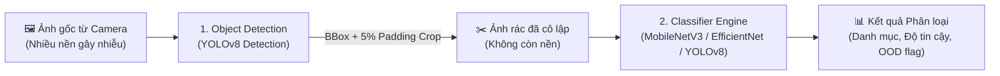

# QUY CHUẨN PHÁT TRIỂN VÀ ĐÁNH GIÁ MÔ HÌNH AI (AI SERVICE & BENCHMARK GUIDELINES)
**Dự án:** EcoLink – Intelligent Waste Sorting & Trading Platform  
**Phân hệ:** `Ecolink.AiService` (Python FastAPI + Ultralytics YOLOv8 + PyTorch)  
**Phạm vi áp dụng:** Huấn luyện mô hình, kiểm thử đánh giá độ chính xác (Benchmark) và triển khai dịch vụ API nhận diện rác.  

---

## 1. MỤC ĐÍCH VÀ KIẾN TRÚC MÔ HÌNH AI

Phân hệ AI của EcoLink giải quyết bài toán cốt lõi: **Tự động nhận diện và phân loại rác thải tái chế từ ảnh chụp thực tế của người dùng**, loại bỏ nhiễu nền môi trường và hỗ trợ gợi ý quy chuẩn phân loại chính xác.

### 1.1. Kiến trúc Xử lý Hai Giai đoạn (Two-Stage AI Pipeline)
Để giải quyết triệt để lỗi phân loại sai do nền ảnh phức tạp (bàn làm việc, màn hình máy tính, sàn gạch...), EcoLink áp dụng kiến trúc chuẩn SOTA 2 giai đoạn:



* **Giai đoạn 1 (Localization & Bounding Box):** Mô hình YOLOv8n Detection quét toàn bộ ảnh, xác định chính xác vị trí vật thể rác và tự động mở rộng viền tọa độ thêm **5% Padding** để không làm mất góc cạnh của vật thể.
* **Giai đoạn 2 (Fine-grained Classification):** Cắt riêng phần ảnh rác sạch đưa vào bộ phân loại chuyên sâu để chốt nhãn danh mục (Plastic, Cardboard, Metal, Paper, Glass, Organic...).

---

## 2. QUY CHUẨN ĐỊNH DẠNG API PHÂN HỆ AI (FASTAPI REST CONTRACT)

### 2.1. Endpoint Phân loại tổng hợp: `POST /api/v1/classify`
* **Content-Type:** `multipart/form-data` (trường `file` chứa file ảnh định dạng JPG/PNG).
* **Query Parameters (Tùy chọn):** `model` (`yolov8_detect`, `mobilenet_v3`, `efficientnet_b0`).
* **Định dạng JSON trả về chuẩn:**
```json
{
  "success": true,
  "predictedClass": "plastic",
  "confidence": 0.947,
  "isOutOfDistribution": false,
  "inferenceTimeMs": 285.4,
  "modelUsed": "yolov8_detect_twostage",
  "detectionSummary": {
    "totalObjects": 1,
    "primaryObject": "plastic_bottle",
    "bbox": [120, 85, 450, 680]
  }
}
```

### 2.2. Xử lý trường hợp ảnh không phải rác (Out-of-Distribution - OOD)
* Nếu độ tin cậy cao nhất của mô hình rơi vào ngưỡng **Confidence $< 0.50$**, hệ thống bắt buộc kích hoạt cờ OOD:
```json
{
  "success": false,
  "predictedClass": "unknown",
  "confidence": 0.32,
  "isOutOfDistribution": true,
  "inferenceTimeMs": 140.2,
  "modelUsed": "yolov8_detect_twostage"
}
```

---

## 3. TIÊU CHÍ NGHIỆM THU VÀ ĐÁNH GIÁ ĐỘ CHÍNH XÁC (AI BENCHMARK METRICS)

Để đạt điểm xuất sắc trong Báo cáo Đồ án Capstone (Mục Khảo nghiệm AI), các mô hình khi huấn luyện và bàn giao phải đạt các chỉ số tối thiểu:

| Chỉ số Đánh giá | Công thức / Ý nghĩa | Ngưỡng Nghiệm thu Tối thiểu | Mục tiêu Khuyến nghị |
| :--- | :--- | :---: | :---: |
| **mAP@0.5** (Mean Average Precision) | Độ chính xác trung bình trên ngưỡng IoU 50% | **$\ge 80.0\%$** | **$\ge 88.0\%$** |
| **Precision** (Độ chuẩn xác) | Tỷ lệ vật thể dự đoán đúng trên tổng số dự đoán | **$\ge 75.0\%$** | **$\ge 85.0\%$** |
| **Recall** (Độ bao phủ) | Tỷ lệ vật thể rác phát hiện được trên tổng số rác thật | **$\ge 75.0\%$** | **$\ge 82.0\%$** |
| **Inference Time (CPU)** | Thời gian phân tích 1 ảnh trên chip Intel Core i5/i7 | **$< 1500\text{ ms}$** | **$< 600\text{ ms}$** |
| **Inference Time (GPU)** | Thời gian phân tích 1 ảnh trên GPU T4 / RTX | **$< 300\text{ ms}$** | **$< 80\text{ ms}$** |

---

## 4. QUY CHUẨN BỘ DỮ LIỆU HUẤN LUYỆN (DATASET INTEGRITY)

1. **Tỷ lệ Phân chia Dữ liệu Bắt buộc:**
   * **Tập Huấn luyện (Train Set):** $70\%$ (Dùng để tối ưu trọng số mô hình).
   * **Tập Xác thực (Validation Set):** $20\%$ (Dùng để tinh chỉnh siêu tham số và early stopping).
   * **Tập Kiểm thử Độc lập (Test Set):** $10\%$ (Tập dữ liệu "mù", tuyệt đối không dùng trong quá trình train để đánh giá trung thực).
2. **Ngăn chặn Rò rỉ Dữ liệu (No Data Leakage):**
   * Nếu có nhiều góc chụp của cùng một chai nhựa, **tất cả các ảnh của chai nhựa đó phải nằm chung trong cùng 1 tập** (hoặc cùng Train, hoặc cùng Test). Tuyệt đối không để ảnh cùng 1 vật thể xuất hiện ở cả Train và Test.
3. **Cân bằng Danh mục (Class Balance):**
   * Số lượng mẫu giữa các danh mục rác chính (`plastic`, `cardboard`, `paper`, `metal`, `glass`) không được chênh lệch vượt quá tỷ lệ $1 : 2.5$.

---

## 5. BỘ KIỂM THỬ NGOẠI LỆ BẮT BUỘC (EDGE CASES & ROBUSTNESS TEST SUITE)

Mỗi phiên bản mô hình trước khi đóng gói Release phải vượt qua bộ ảnh kiểm thử đặc biệt:

| Kịch bản Kiểm thử | Loại ảnh thử nghiệm | Kết quả Kỳ vọng |
| :--- | :--- | :--- |
| **1. Vật thể rác có nền phức tạp** | Chai nhựa đặt trước màn hình laptop hiển thị hình ảnh phức tạp | Bounding box crop chính xác chai nhựa, phân loại đúng `Plastic` $\ge 85\%$. |
| **2. Nhiều vật thể trong 1 ảnh** | 4 chai nhựa nằm cạnh nhau | Báo đúng số lượng 4 vật thể, không bị sót. |
| **3. Ảnh Out-Of-Distribution (OOD)** | Bàn phím máy tính, cốc cà phê gốm, mặt người | Trả về `isOutOfDistribution: true`, từ chối phân loại sai. |
| **4. Ảnh điều kiện ánh sáng yếu** | Rác chụp trong phòng tối, ngược sáng đèn flash | Confidence score suy giảm nhưng nhãn dự đoán chính không bị đảo lộn danh mục. |

---

## 6. QUY TẮC QUẢN LÝ TỆP TRỌNG SỐ (MODEL ARTIFACT MANAGEMENT)

1. **Quy ước đặt tên tệp trọng số (`.pt`):**  
   `[architecture]_[task]_[version].pt`  
   *Ví dụ chuẩn:*
   * `yolov8n_waste_detect_v1.0.pt`
   * `mobilenet_v3_waste_cls_v1.0.pt`
   * `efficientnet_b0_waste_cls_v1.0.pt`
2. **Không commit trọng số thử nghiệm:**  
   Thư mục `runs/` (chứa hàng trăm file epoch nặng hàng GB) bắt buộc nằm trong `.gitignore`. Chỉ đưa các file trọng số `best.pt` chính thức vào thư mục `models/`.
