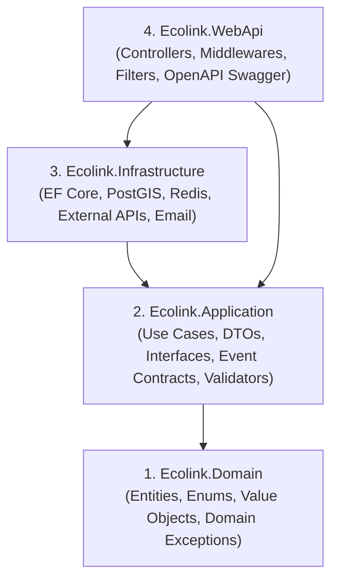

# QUY CHUẨN LẬP TRÌNH C# / .NET CLEAN ARCHITECTURE
**Dự án:** EcoLink – Intelligent Waste Sorting & Trading Platform  
**Chuẩn tham chiếu:** Microsoft .NET 10 Best Practices & Clean Architecture (Robert C. Martin)  
**Phạm vi áp dụng:** Toàn bộ Solution Backend (`Ecolink.Backend`)  

---

## 1. NGUYÊN TẮC PHÂN TẦNG VÀ BIÊN GIỚI DỰ ÁN (LAYER BOUNDARIES)

Hệ thống Backend được tổ chức theo mô hình **Clean Architecture 4 tầng**. Quy tắc bất di bất dịch: **Chiều phụ thuộc chỉ đi từ ngoài vào trong, tầng bên trong tuyệt đối không phụ thuộc tầng bên ngoài.**



### 1.1. Tầng Domain (`Ecolink.Domain`)
* **Trách nhiệm:** Chứa đựng các quy tắc nghiệp vụ cốt lõi của doanh nghiệp.
* **Nguyên tắc:** **Zero Dependencies!** Không được cài bất kỳ NuGet package nào liên quan đến Database (EF Core), HTTP, hoặc Web Framework.
* **Thành phần:**
  * `Entities`: Lớp thực thể kế thừa `BaseEntity` hoặc `BaseAuditableEntity`.
  * `Enums`: Các tập giá trị trạng thái (`OrderStatus`, `UserRole`, `PaymentStatus`).
  * `Exceptions`: Các ngoại lệ thuần nghiệp vụ (`DomainException`, `InvalidWasteWeightException`).

### 1.2. Tầng Application (`Ecolink.Application`)
* **Trách nhiệm:** Điều phối luồng nghiệp vụ cho các Use Case cụ thể.
* **Nguyên tắc:** Độc lập với công nghệ lưu trữ và giao diện.
* **Thành phần:**
  * `Dtos`: Request/Response Data Transfer Objects (ví dụ: `CreateTradeOrderRequest`, `TransactionReceiptDto`).
  * `Interfaces`: Hợp đồng dịch vụ (`ITradeTransactionService`, `IAiVisionClient`, `IEventBus`, `IRepository<T>`).
  * `Events`: Định nghĩa các sự kiện nghiệp vụ (`TradeOrderCompletedEvent`).
  * `Validators`: Quy tắc xác thực dữ liệu đầu vào (sử dụng FluentValidation).

### 1.3. Tầng Infrastructure (`Ecolink.Infrastructure`)
* **Trách nhiệm:** Hiện thực hóa các interface từ tầng Application bằng công nghệ cụ thể.
* **Thành phần:**
  * `Data / Persistence`: EF Core `ApplicationDbContext`, cấu hình Fluent API, PostGIS mapping.
  * `Services`: `PayOsService`, `AiVisionHttpClient`, `GeoMatchingService`.
  * `Messaging`: Triển khai hàng đợi sự kiện (`InMemoryChannelEventBus`, `RedisStreamEventBus`).
  * `BackgroundJobs`: Các tác vụ nền `BackgroundService` chạy ngầm.

### 1.4. Tầng WebApi (`Ecolink.WebApi`)
* **Trách nhiệm:** Cổng giao tiếp với thế giới bên ngoài (REST API).
* **Nguyên tắc:** **"Thin Controllers" (Controller siêu mỏng).** Controller chỉ làm 3 việc: Nhận Request $\rightarrow$ Gọi Service/Handler ở Application $\rightarrow$ Trả về `ApiResponse<T>`. Tuyệt đối không viết câu lệnh truy vấn CSDL (`_dbContext.Users.Where(...)`) hoặc tính toán nghiệp vụ trong Controller.

---

## 2. QUY CHUẨN XỬ LÝ LỖI TẬP TRUNG (GLOBAL EXCEPTION HANDLING)

Tuyệt đối **không dùng khối `try-catch` bừa bãi** tại từng Action của Controller. Toàn bộ lỗi được xử lý tự động thông qua **Custom Exception Middleware**:

### 2.1. Phân loại Ngoại lệ Nghiệp vụ (Business Exceptions)
Tạo lớp ngoại lệ cơ sở chứa sẵn mã quy tắc nghiệp vụ `BR-[MODULE]-ID` và mã thông điệp `MSG-[MODULE]-ID`:

```csharp
namespace Ecolink.Domain.Exceptions;

public class BusinessRuleException : Exception
{
    public string RuleCode { get; }
    public string MessageCode { get; }

    public BusinessRuleException(string ruleCode, string messageCode, string message) 
        : base(message)
    {
        RuleCode = ruleCode;
        MessageCode = messageCode;
    }
}

public class NotFoundException : Exception
{
    public NotFoundException(string message) : base(message) { }
}
```

### 2.2. Global Exception Middleware
Middleware tự động bắt toàn bộ Exception chưa được xử lý và chuyển đổi thành `ApiResponse<T>` với HTTP Status Code chuẩn:

| Loại Ngoại lệ | HTTP Status Code | Cấu trúc phản hồi |
| :--- | :---: | :--- |
| `ValidationException` | `400 Bad Request` | Trả về danh sách chi tiết các trường bị lỗi format |
| `BusinessRuleException` | `400 Bad Request` | Trả về `MessageCode` và `RuleCode` vi phạm |
| `NotFoundException` | `404 Not Found` | Báo không tìm thấy tài nguyên |
| `UnauthorizedAccessException` | `401 Unauthorized` | Yêu cầu đăng nhập |
| Mọi `Exception` còn lại | `500 Internal Error` | Ghi log hệ thống đầy đủ, trả về thông báo lỗi chung |

---

## 3. QUY CHUẨN QUẢN LÝ VÒNG ĐỜI DEPENDENCY INJECTION (DI LIFETIME)

Tránh lỗi rò rỉ bộ nhớ (Memory Leak) hoặc lỗi **"Captive Dependency"** (Service Scoped bị tiêm vào Service Singleton):

| Vòng đời (Lifetime) | Khi nào sử dụng? | Ví dụ trong EcoLink |
| :--- | :--- | :--- |
| **`Scoped`**<br>*(Mặc định cho hầu hết dịch vụ)* | Tạo mới cho mỗi HTTP Request. Sử dụng cho các dịch vụ làm việc với CSDL hoặc giữ trạng thái phiên làm việc. | `ApplicationDbContext`, `ITradeTransactionService`, `IAuthService`. |
| **`Transient`** | Tạo mới mỗi khi được gọi tiêm (Inject). Dành cho các tác vụ tính toán nhẹ, phi trạng thái (Stateless). | Các lớp Converter, Calculator. |
| **`Singleton`** | Tạo duy nhất một lần và sống suốt vòng đời ứng dụng. Chỉ dùng cho các tài nguyên chia sẻ an toàn luồng (Thread-safe). | `InMemoryChannelEventBus`, `ConnectionMultiplexer` (Redis), `HttpClient` (thông qua `AddHttpClient`). |

>  **Cảnh báo nghiêm ngặt:** Không bao giờ Inject `DbContext` (Scoped) trực tiếp vào một dịch vụ `Singleton` hoặc `BackgroundService`. Bắt buộc phải tạo Scope riêng:
> ```csharp
> using var scope = _serviceProvider.CreateScope();
> var dbContext = scope.ServiceProvider.GetRequiredService<ApplicationDbContext>();
> ```

---

## 4. QUY CHUẨN LẬP TRÌNH BẤT ĐỒNG BỘ (ASYNC / AWAIT BEST PRACTICES)

1. **Async từ đầu đến cuối (Async All The Way):**  
   Mọi hàm thực hiện I/O (Database, Network, File) bắt buộc dùng `async Task<T>` hoặc `async Task`.
2. **Tuyệt đối không chặn luồng (No Blocking Calls):**  
   ❌ **Cấm tuyệt đối:** `.Result`, `.Wait()`, `.GetAwaiter().GetResult()` $\rightarrow$ Gây nghẽn ThreadPool và chết ứng dụng (Deadlock).
3. **Luôn truyền `CancellationToken`:**  
   Giúp hệ thống tự động hủy các truy vấn CSDL nặng nề nếu người dùng hủy request hoặc đóng trình duyệt giữa chừng:
   ```csharp
   public async Task<TradeOrderDto> GetOrderByIdAsync(Guid id, CancellationToken cancellationToken = default);
   ```

---

## 5. QUY ƯỚC ĐẶT TÊN VÀ ĐỊNH DẠNG MÃ NGUỒN C# (NAMING & CODING STYLES)

| Đối tượng | Quy tắc | Ví dụ chuẩn | Ví dụ sai |
| :--- | :--- | :--- | :--- |
| **Class, Struct, Record** | `PascalCase` | `TradeOrderService`, `WasteCategory` | `tradeOrderService`, `waste_category` |
| **Interface** | `IPascalCase` | `ITradeTransactionService`, `IEventBus` | `TradeService`, `TradeInterface` |
| **Method (Hàm)** | `PascalCase` + `Async` | `ConfirmReceiptByQrAsync`, `CalculateCashAsync` | `confirmReceipt`, `ConfirmReceipt` |
| **Public Property** | `PascalCase` | `ActualWeightKg`, `UnitPrice` | `actualWeightKg`, `actual_weight_kg` |
| **Biến cục bộ & Tham số** | `camelCase` | `orderId`, `request`, `cancellationToken` | `OrderId`, `actual_weight` |
| **Private Field (Readonly)** | `_camelCase` | `_logger`, `_dbContext`, `_eventBus` | `logger`, `m_logger`, `_Logger` |
| **Hằng số (Constant)** | `PascalCase` | `MaxImageSizeBytes`, `DefaultPageSize` | `MAX_IMAGE_SIZE`, `maxSize` |
| **DTO Requests** | `[Verb][Noun]Request` | `CreateTradeOrderRequest`, `ConfirmQrReceiptRequest` | `TradeOrderReq`, `ReceiptBody` |
| **DTO Responses** | `[Noun]Dto` | `TradeOrderDto`, `TransactionReceiptDto` | `TradeOrderResponseData` |

---

## 6. MẪU CONTROLLER VÀ USE CASE ĐẠT CHUẨN

```csharp
namespace Ecolink.WebApi.Controllers;

[ApiController]
[Route("api/v1/trade-orders")]
public class TradeOrderController : ControllerBase
{
    private readonly ITradeTransactionService _tradeService;
    private readonly ILogger<TradeOrderController> _logger;

    public TradeOrderController(
        ITradeTransactionService tradeService, 
        ILogger<TradeOrderController> logger)
    {
        _tradeService = tradeService;
        _logger = logger;
    }

    /// <summary>
    /// Xác nhận biên nhận bàn giao rác bằng cách quét mã QR (UC-HND-01)
    /// </summary>
    [HttpPost("{id:guid}/confirm-receipt")]
    [ProducesResponseType(typeof(ApiResponse<TransactionReceiptDto>), StatusCodes.Status200OK)]
    [ProducesResponseType(typeof(ApiResponse<object>), StatusCodes.Status400BadRequest)]
    [ProducesResponseType(typeof(ApiResponse<object>), StatusCodes.Status404NotFound)]
    public async Task<IActionResult> ConfirmReceipt(
        Guid id, 
        [FromBody] ConfirmQrReceiptRequest request, 
        CancellationToken cancellationToken)
    {
        request.TradeOrderId = id;
        var receipt = await _tradeService.ConfirmReceiptByQrAsync(request, cancellationToken);

        return Ok(ApiResponse<TransactionReceiptDto>.Ok(
            data: receipt,
            message: "Xác nhận biên nhận bàn giao thành công.",
            messageCode: "MSG-HND-01"
        ));
    }
}
```
