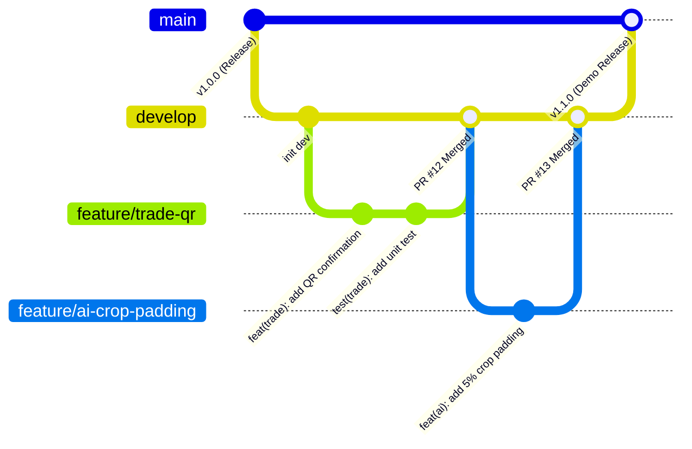

# QUY CHUẨN QUẢN TRỊ MÃ NGUỒN GIT VÀ VIẾT COMMIT (GIT WORKFLOW & CONVENTIONAL COMMITS)
**Dự án:** EcoLink – Intelligent Waste Sorting & Trading Platform  
**Chuẩn tham chiếu:** Conventional Commits v1.0.0 & GitFlow for Agile Teams  
**Phạm vi áp dụng:** Toàn bộ thành viên phát triển dự án (Frontend, Backend, AI)  

---

## 1. MỤC ĐÍCH VÀ NGUYÊN TẮC CỐT LÕI

* **Tính chuyên nghiệp:** Lịch sử commit là một trong những tiêu chí quan trọng được Hội đồng phản biện và doanh nghiệp soi xét khi đánh giá đồ án tốt nghiệp. Lịch sử commit sạch, nhất quán thể hiện tư duy làm việc chuyên nghiệp chuẩn quốc tế.
* **Dễ truy vết và Tự động hóa:** Giúp nhóm dễ dàng tạo Release Notes tự động, truy vết lỗi (git bisect) và đối soát trực tiếp với các Use Case / Task trong Jira / Trello.

---

## 2. CHIẾN LƯỢC PHÂN NHÁNH (GIT BRANCHING STRATEGY)

Nhóm áp dụng mô hình **Trunk-based kết hợp Feature Branching (GitFlow rút gọn)**:



### 2.1. Các nhánh chính cố định:
* `main`: Nhánh production, chứa mã nguồn ổn định nhất, luôn sẵn sàng để deploy hoặc trình chiếu demo trước hội đồng. **Tuyệt đối cấm commit hoặc push trực tiếp lên `main`**.
* `develop`: Nhánh tích hợp chính. Toàn bộ tính năng mới từ các nhánh con sẽ được gộp vào đây sau khi code review thành công.

### 2.2. Các nhánh làm việc tạm thời:
* **Nhánh tính năng (Feature):** `feature/[module]-[tên-ngắn-gọn]`  
  *Ví dụ:* `feature/hnd-qr-confirm`, `feature/ai-crop-padding`, `feature/pay-vietqr-link`.
* **Nhánh sửa lỗi (Bugfix):** `bugfix/[tên-lỗi]`  
  *Ví dụ:* `bugfix/fix-jwt-expiry-token`, `bugfix/fix-postgis-query-distance`.
* **Nhánh sửa lỗi khẩn cấp (Hotfix):** `hotfix/v[x.x.x]` (Tách trực tiếp từ `main` khi demo bị lỗi).

---

## 3. QUY CHUẨN VIẾT COMMIT (CONVENTIONAL COMMITS v1.0.0)

Mọi commit bắt buộc phải viết bằng **Tiếng Anh** và tuân thủ cấu trúc 3 phần:

```text
<type>(<scope>): <short description in imperative mood>

[optional body: mô tả chi tiết lý do và ngữ cảnh thay đổi]

[optional footer: mã Use Case / Task liên kết]
```

### 3.1. Danh mục Loại Commit (Type)
| Type | Ý nghĩa và Trường hợp áp dụng |
| :--- | :--- |
| **`feat`** | Thêm một tính năng mới cho người dùng hoặc API mới |
| **`fix`** | Sửa một lỗi trong hệ thống |
| **`docs`** | Chỉ thay đổi tài liệu (README, Markdown trong `documents/`) |
| **`refactor`** | Tái cấu trúc code (không thêm tính năng, không sửa lỗi) |
| **`perf`** | Cải thiện hiệu năng xử lý (tối ưu truy vấn SQL, giảm RAM model AI) |
| **`test`** | Thêm hoặc sửa Unit Test / Integration Test |
| **`chore`** | Các công việc bảo trì (cập nhật thư viện, docker-compose, config) |
| **`style`** | Định dạng code (khoảng trắng, dấu chấm phẩy, format) |

### 3.2. Danh mục Phạm vi (Scope) đặc thù cho EcoLink
* `auth`: Xác thực, JWT, Google OAuth.
* `ai`: Mô hình YOLOv8, FastAPI, xử lý ảnh.
* `trade`: Giao dịch, đơn hẹn, quét mã QR.
* `pay`: Thanh toán VietQR, PayOS, Webhook.
* `gam`: Gamification, điểm thưởng, cây ảo, bảng xếp hạng.
* `db`: PostgreSQL, PostGIS, EF Core Migrations.
* `infra`: Docker, Redis, Cấu hình môi trường.

### 3.3. Các quy tắc vàng khi viết Description
* Viết bằng **tiếng Anh**, dùng **thì hiện tại mệnh lệnh** (Imperative mood):
  *  `add QR verification endpoint` (Thêm endpoint xác thực QR).
  * ❌ `added QR verification` hoặc `adds QR verification`.
* Không viết hoa chữ cái đầu tiên và **không kết thúc bằng dấu chấm**.
* Giới hạn độ dài dòng đầu tiên tối đa **72 ký tự**.

### 3.4. Ví dụ Commit chuẩn mẫu cho EcoLink

#### Ví dụ 1: Tính năng mới liên kết Use Case
```text
feat(trade): implement QR code receipt confirmation

Add ConfirmReceiptByQrAsync service and REST API endpoint to validate 
trade orders and dispatch completion events to the message bus.

Refs: UC-HND-01, BR-HND-01
```

#### Ví dụ 2: Sửa lỗi mô hình AI
```text
fix(ai): eliminate keyboard background noise with 5% bbox crop padding

Expand bounding box coordinates by 5% padding before feeding crop into 
the secondary classifier to prevent false positives on monitor/keyboard.

Fixes: #42
Refs: UC-CLS-01, BR-CLS-03
```

#### Ví dụ 3: Cập nhật CSDL
```text
feat(db): add spatial PostGIS GIST index to recycler profiles

Add NetTopologySuite Point geography column and GIST index for fast 
radius-based nearby recycler queries.

Refs: BR-MTH-04
```

---

## 4. QUY TRÌNH PULL REQUEST (PR) VÀ CODE REVIEW

1. **Tuyệt đối không tự ý Merge:** Mọi Pull Request vào nhánh `develop` hoặc `main` phải được ít nhất **1 thành viên khác review và Approve**.
2. **Tiêu chuẩn Pull Request Title:** Đặt theo chuẩn Conventional Commit:  
   *Ví dụ:* `PR: feat(trade): add QR code confirmation logic (#15)`
3. **Mẫu mô tả PR (Pull Request Template):**
   ```markdown
   ### 🎯 Mục đích thay đổi
   - Triển khai chức năng xác nhận biên nhận bàn giao bằng quét QR (`UC-HND-01`).

   ### 🛠️ Các thay đổi kỹ thuật chính
   - Thêm `TradeOrderController.ConfirmReceipt`.
   - Bổ sung `AuditableEntityInterceptor` ghi nhận thời gian tự động.

   ### 🧪 Kết quả kiểm thử
   - Đã chạy qua các test cases: `TC-HND-01-01_P`, `TC-HND-01-02_B`.
   - Kết quả: PASS 100%.

   ### 📋 Checklist
   - [x] Đã format code chuẩn sạch sẽ.
   - [x] Không còn file cấu hình mật (.env, credentials) trong commit.
   - [x] Đã kiểm tra build không có warning/error.
   ```
4. **Phương thức Merge:** Ưu tiên chọn **Squash and Merge** khi gộp từ `feature` vào `develop` để giữ cho lịch sử nhánh chính luôn tinh gọn và dễ đọc.

---

## 5. QUY CHUẨN AN TOÀN BẢO MẬT KHI DÙNG GIT (.GITIGNORE)

* **Tuyệt đối không commit các tệp chứa thông tin nhạy cảm:**
  * File mật khẩu môi trường: `.env`, `appsettings.Development.json` có chứa mật khẩu thật.
  * Khóa API bí mật: PayOS Checksum Key, Google Service Account Private Key.
* **Không commit các tệp nhị phân và trọng số quá nặng (> 50MB):**
  * Thư mục ảo: `venv/`, `bin/`, `obj/`.
  * Trọng số mô hình thử nghiệm: Thư mục `runs/detect/train/weights/`. Chỉ commit tệp mô hình đã tinh chỉnh chính thức (`models/*.pt`) hoặc quản lý qua Git LFS / Google Drive link.
