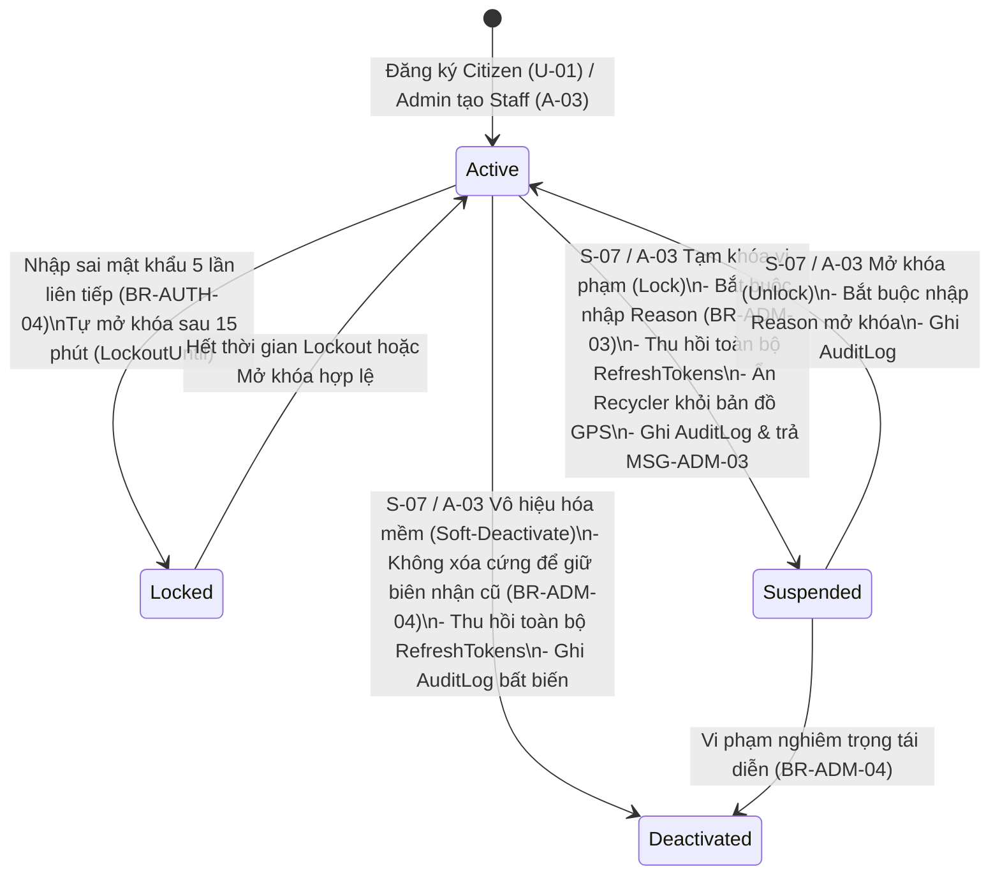
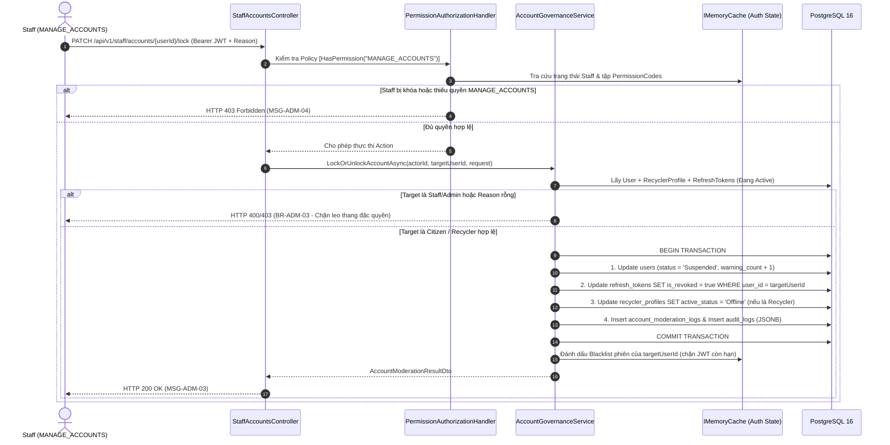

# KẾ HOẠCH THIẾT KẾ & TRIỂN KHAI (IMPLEMENTATION PLAN) - MODULE: ACCOUNT, STAFF & SYSTEM GOVERNANCE / ANALYTICS (`FE-17`, `FE-18` / `M-15`)

**Dự án:** EcoLink – Intelligent Waste Sorting & Trading Platform  
**Phân hệ:** `ADM` / `AUTH` / `GAM` (Phân hệ API `M-15`: Governance, Staff, Attendance & System Analytics)  
**Mã tính năng (Features):** `FE-17` (Account & Staff Governance) & `FE-18` (System Governance, Analytics & Audit Trail)  
**Use Cases trọng tâm (7 Use Cases):**
- **`A-01`**: *View Dashboard & Analytics* (Xem bảng điều khiển KPI điều hành, sản lượng tái chế, độ chính xác AI & doanh thu VietQR)
- **`A-02`**: *Export Data Reports & Audit Log* (Trích xuất báo cáo CSV/XLSX ẩn danh hóa PII & tra cứu nhật ký kiểm toán bất biến)
- **`S-06`**: *View User & Recycler Accounts* (Nhân viên tra cứu hồ sơ, lịch sử hoạt động và số lần cảnh cáo của Người dân / Cơ sở thu mua)
- **`S-07`**: *Lock / Delete Accounts* (Tạm khóa / mở khóa hoặc vô hiệu hóa mềm tài khoản vi phạm chính sách kèm lý do bắt buộc)
- **`A-03`**: *Manage Staff Accounts* (Quản trị viên khởi tạo, cập nhật và đình chỉ tài khoản Nhân viên vận hành nội bộ)
- **`A-04`**: *Manage Staff Permissions* (Quản trị viên cấu hình ma trận phân quyền RBAC chi tiết theo tác vụ cho từng Nhân viên)
- **`S-11`**: *Staff Daily Check-in* (Điểm danh ca trực hàng ngày, theo dõi chuỗi chuyên cần và nhật ký ca làm việc của Nhân viên)

**Độ phức tạp / Ưu tiên:** High (Core Control Plane & Security Compliance)  
**Công nghệ:** .NET 10 Web API, PostgreSQL 16 (`jsonb` + PostGIS 3.4), Entity Framework Core 10, ASP.NET Core Policy-based Authorization, `IMemoryCache`, FluentValidation, ClosedXML / UTF-8 CSV Streaming, React + TypeScript (`ecolink-web`)  
**Tài liệu tham chiếu:**
- Danh mục Tổng thể API: [`00_api_inventory_and_endpoint_statistics.md`](file:///c:/Projects/EcoLink/intelligent-waste-sorting-trading/documents/api%20document/00_api_inventory_and_endpoint_statistics.md#L421-L451) (`STT 150` – `STT 168`)
- Quy chuẩn Khung Phản hồi API: [`00_api_overview_and_response_contract.md`](file:///c:/Projects/EcoLink/intelligent-waste-sorting-trading/documents/api%20document/00_api_overview_and_response_contract.md)
- Thiết kế CSDL gốc (DBML): [`01_auth_account_module.dbml`](file:///c:/Projects/EcoLink/intelligent-waste-sorting-trading/documents/diagram/database%20design/01_auth_account_module.dbml) & [`07_content_admin_audit_module.dbml`](file:///c:/Projects/EcoLink/intelligent-waste-sorting-trading/documents/diagram/database%20design/07_content_admin_audit_module.dbml#L56-L73)
- Quy chuẩn CSDL & Kiểm toán: [`database_design_and_audit_guidelines.md`](file:///c:/Projects/EcoLink/intelligent-waste-sorting-trading/documents/guideline/database_design_and_audit_guidelines.md)
- Quy tắc Nghiệp vụ & Thông báo: [`business_rule_&_system_message.md`](file:///c:/Projects/EcoLink/intelligent-waste-sorting-trading/documents/business_rule_&_system_message.md)

---

## 1. MỤC TIÊU PHẠM VI & ĐÁNH GIÁ HIỆN TRẠNG (SCOPE & GAP ANALYSIS)

### 1.1. Mục tiêu kiến trúc cốt lõi
Xây dựng **Lớp Quản trị & Kiểm soát Trung tâm (Platform Control Plane)** đảm bảo an ninh vận hành, phân tách nhiệm vụ (`Separation of Duties`) và minh bạch dữ liệu trên toàn hệ thống EcoLink:
1. **Kiểm soát tài khoản bên ngoài an toàn (`S-06`, `S-07`):** Cung cấp công cụ cho `Staff` và `Admin` giám sát hành vi của `Citizen` và `Recycler`, khóa tạm thời hoặc vô hiệu hóa mềm tài khoản vi phạm kèm biên bản lý do bắt buộc, hủy phiên đăng nhập tức thời mà **không làm đứt gãy khóa ngoại của biên nhận lịch sử**.
2. **Quản trị nhân sự nội bộ & RBAC hai tầng (`A-03`, `A-04`, `S-11`):** Ngăn chặn đăng ký trái phép tài khoản đặc quyền (`BR-ADM-01`), thực thi phân quyền hạt mịn (`Fine-grained Permission Claims` — `BR-ADM-02`) cho từng nhân viên và ghi nhận chuyên cần ca trực độc lập với hệ thống điểm thưởng công dân (`BR-GAM-09`).
3. **Điều hành dựa trên dữ liệu xác thực & Nhật ký bất biến (`A-01`, `A-02`):** Tổng hợp KPI chuẩn xác chỉ từ giao dịch hoàn tất (`BR-ADM-07`), che dấu dữ liệu định danh cá nhân (PII Masking) khi xuất báo cáo (`BR-ADM-06`) và bảo vệ tuyệt đối bảng `audit_logs` ở chế độ chỉ ghi thêm (`Append-Only` — `BR-ADM-05`).

---

### 1.2. Đánh giá mức độ sẵn sàng của Codebase hiện tại (Feasibility & Gap Matrix)

| Hạng mục kỹ thuật | Độ sẵn sàng | Hiện trạng thực tế trong Codebase (`Backend` & `Frontend`) | Khoảng trống cần triển khai (Technical Gaps) |
| :--- | :---: | :--- | :--- |
| **1. Bảng `users`, `staff_profiles`, `staff_permission_assignments`** | **90%** | Đã có Entity & Fluent Configuration tại [`User.cs`](file:///c:/Projects/EcoLink/intelligent-waste-sorting-trading/src/Ecolink.Backend/Ecolink.Domain/Entities/User.cs), [`AuthEntities.cs`](file:///c:/Projects/EcoLink/intelligent-waste-sorting-trading/src/Ecolink.Backend/Ecolink.Domain/Entities/AuthEntities.cs#L47-L74), [`StaffProfileConfiguration.cs`](file:///c:/Projects/EcoLink/intelligent-waste-sorting-trading/src/Ecolink.Backend/Ecolink.Infrastructure/Data/Configurations/StaffProfileConfiguration.cs). | Bổ sung giá trị `Deactivated = 5` vào `UserStatus`; thêm các cột theo dõi kiểm duyệt nhanh (`warning_count`, `moderation_reason`, `moderated_at`, `moderated_by`) trên bảng `users`. |
| **2. Bảng `audit_logs`, `account_moderation_logs`, `staff_attendances`** | **15%** | Mới có thiết kế sơ bộ `AuditLog` trong [`07_content_admin_audit_module.dbml`](file:///c:/Projects/EcoLink/intelligent-waste-sorting-trading/documents/diagram/database%20design/07_content_admin_audit_module.dbml#L56-L73). Chưa có Entity C# và Migration. | Thiết kế mới 3 bảng chuẩn `snake_case` PostgreSQL 16 (`audit_logs` dùng `jsonb`, `account_moderation_logs`, `staff_attendances`) và tạo EF Core Migration. |
| **3. Cơ chế phân quyền chi tiết (`Permission Policy`)** | **30%** | Hiện tại các Controller chỉ kiểm tra thô `[Authorize(Roles = "Staff,Admin")]`. Chưa kiểm tra từng `PermissionCode` trong `staff_permission_assignments`. | Xây dựng `StaffPermissions` catalog, `[HasPermission(...)]`, `PermissionAuthorizationHandler` (kết hợp `IMemoryCache` + kiểm tra tài khoản chưa bị khóa). |
| **4. Tầng Service & REST API (`M-15`)** | **0%** | Chưa triển khai 19 REST endpoints (`STT 150` – `STT 168`) thuộc 4 Controller của phân hệ `M-15`. | Xây dựng đầy đủ DTOs, FluentValidators, 5 Application Services và 4 WebApi Controllers. |
| **5. Giao diện Frontend (`ecolink-web`)** | **70%** | Đã có sẵn 6 màn hình mẫu dùng dữ liệu tĩnh [`ops.ts`](file:///c:/Projects/EcoLink/ecolink-web/src/data/ops.ts): [`admin/Home.tsx`](file:///c:/Projects/EcoLink/ecolink-web/src/pages/admin/Home.tsx), [`admin/Reports.tsx`](file:///c:/Projects/EcoLink/ecolink-web/src/pages/admin/Reports.tsx), [`staff/Accounts.tsx`](file:///c:/Projects/EcoLink/ecolink-web/src/pages/staff/Accounts.tsx), [`admin/StaffAccounts.tsx`](file:///c:/Projects/EcoLink/ecolink-web/src/pages/admin/StaffAccounts.tsx), [`admin/Permissions.tsx`](file:///c:/Projects/EcoLink/ecolink-web/src/pages/admin/Permissions.tsx), [`staff/CheckIn.tsx`](file:///c:/Projects/EcoLink/ecolink-web/src/pages/staff/CheckIn.tsx). | (1) Thêm Modal bắt buộc nhập lý do khóa tại `staff/Accounts.tsx` (`BR-ADM-03`); (2) Bổ sung Tab **Nhật ký kiểm toán (`Audit Trail`)** & che PII tại `admin/Reports.tsx` (`BR-ADM-05`, `BR-ADM-06`); (3) Đồng bộ mã quyền giữa `ops.ts` và Backend; (4) Thêm nút `Check-out` ca trực tại `staff/CheckIn.tsx`. |

---

## 2. PHÂN TÍCH CHI TIẾT CÁC CHỨC NĂNG / USE CASES & LUỒNG NGHIỆP VỤ

### 2.1. Tổng hợp Phân tích 7 Use Cases

#### UC 1 — `A-01`: View Dashboard & Analytics (*Actor: `Admin`*)
* **Mục tiêu:** Cung cấp số liệu điều hành thời gian thực và biểu đồ xu hướng để Quản trị viên đánh giá tăng trưởng người dùng, sản lượng phế liệu tái chế, doanh thu gói dịch vụ VietQR và chất lượng mô hình nhận diện AI.
* **Tiền điều kiện:** Người dùng đăng nhập với vai trò `Role == Admin` và `Status == Active`.
* **Luồng xử lý chính:**
  1. Admin mở trang Tổng quan điều hành (`/admin`), chọn kỳ thống kê (`7d`, `30d`, `90d`, `6m`, hoặc khoảng ngày tùy chỉnh).
  2. Backend thực thi truy vấn tổng hợp chỉ đọc (`AsNoTracking`) trên các tập dữ liệu **đã xác thực & hoàn tất (`BR-ADM-07`)**:
     - **Người dùng & Đối tác:** Tổng số `Citizen` đang `Active` và tổng số `Recycler` có `VerificationStatus == Verified` & `User.Status == Active`.
     - **Sản lượng & Thương mại:** Đếm số biên nhận hoàn tất (`HandoverRequests.Status == Completed` / `HandoverReceipts`), tính tổng khối lượng cân thực tế (`SUM(actual_weight_kg)`) quy đổi kg/tấn và tổng giá trị giao dịch phế liệu (`GMV`).
     - **Doanh thu nền tảng (VietQR):** Tổng tiền các hóa đơn mua gói dịch vụ nội bộ đã đối soát thành công (`Paid` / `Verified`), tách biệt hoàn toàn với dòng tiền thu mua phế liệu trực tiếp giữa vựa và người dân.
     - **Chất lượng AI & Hàng đợi vận hành (Live Operational Backlog):** Kết hợp số liệu từ bảng `ai_feedback_logs` và endpoint nội bộ `GET /api/stats` của FastAPI AI Service để tính tổng lượt quét, độ chính xác theo từng nhóm vật liệu, tỷ lệ ngoài phạm vi (`OOD`), tỷ lệ báo sai nhầm (`falseReports`), đồng thời trả về số lượng tác vụ đang chờ `Staff` xử lý (hồ sơ KYB `Pending`, ảnh AI chờ duyệt, khiếu nại mở, bài Blog chờ duyệt).
* **Xử lý ngoại lệ:** Nếu AI Microservice tạm ngưng phản hồi, API vẫn trả về `200 OK` với dữ liệu từ PostgreSQL và gắn cờ `aiServiceOnline = false` để Dashboard không bị sập toàn trang.

---

#### UC 2 — `A-02`: Export Data Reports & Audit Log (*Actor: `Admin`*)
* **Mục tiêu:** Cho phép Admin trích xuất báo cáo vận hành ra tệp `CSV` (UTF-8 BOM) / `XLSX` đảm bảo quyền riêng tư dữ liệu và tra cứu lịch sử kiểm toán bất biến.
* **Luồng xử lý chính — Nhánh A (Trích xuất Báo cáo `ExportSystemReport`):**
  1. Admin chọn loại báo cáo (`accounts`, `handovers`, `vietqr_revenues`, `ai_quality`, `blogs`), định dạng (`csv` hoặc `xlsx`) và khoảng thời gian (`fromDate`, `toDate`).
  2. Hệ thống truy vấn các bản ghi thỏa điều kiện, áp dụng bộ lọc **`PiiMaskingHelper` (`BR-ADM-06`)**:
     - `Email`: `duc.nguyen@email.vn` → `du***@email.vn`
     - `PhoneNumber`: `0901234567` → `090****567`
  3. Hệ thống ghi ngay 1 bản ghi `EXPORT_REPORT` vào bảng `audit_logs` (lưu loại báo cáo, bộ lọc ngày, số dòng trích xuất, IP của Admin), sau đó stream tệp về trình duyệt kèm thông điệp `MSG-ADM-02`.
* **Luồng xử lý chính — Nhánh B (Tra cứu Nhật ký Kiểm toán `GetSystemAuditLogs`):**
  1. Admin chuyển sang tab **Nhật ký kiểm toán (`Audit Trail`)**, lọc theo từ khóa, `action`, `entityType`, `actorUserId`, hoặc khoảng thời gian.
  2. Hệ thống trả về danh sách phân trang `PagedResult<AuditLogDto>` sắp xếp mới nhất trước (`created_at DESC`), cho phép mở xem chi tiết JSON `oldValues` và `newValues` để đối chiếu trước – sau.
* **Quy tắc bất biến (`BR-ADM-05`):** Không tồn tại API sửa hoặc xóa `AuditLog`; tầng EF Core Interceptor chủ động ném ngoại lệ nếu có bất kỳ câu lệnh code nào cố tình cập nhật/xóa bản ghi trong `audit_logs`.

---

#### UC 3 — `S-06`: View User & Recycler Accounts (*Actor: `Staff` có quyền `MANAGE_ACCOUNTS` hoặc `Admin`*)
* **Mục tiêu:** Tra cứu toàn diện danh sách và hồ sơ hoạt động của `Citizen` và `Recycler` để hỗ trợ vận hành và đánh giá mức độ tuân thủ.
* **Luồng xử lý chính:**
  1. Nhân viên tìm kiếm theo từ khóa (`FullName`, `Email`, `PhoneNumber`, `Username`, `FacilityName`), lọc theo vai trò (`User` / `Recycler`), trạng thái (`Active`, `Suspended`, `Locked`, `Deactivated`) hoặc lọc các tài khoản có cảnh cáo (`minWarnings >= 1`).
  2. Khi chọn xem chi tiết một tài khoản (`GetAccountDetail`), hệ thống trả về:
     - Thông tin định danh & trạng thái hiện tại, lý do khóa gần nhất (nếu đang `Suspended` / `Deactivated`).
     - Thông tin cơ sở thu gom & trạng thái duyệt KYB (nếu là `Recycler`), điểm xanh & cấp Cây ảo (nếu là `Citizen`).
     - Thống kê giao dịch: tổng đơn tạo/nhận, số đơn hoàn tất (`completedDealsCount`), số đơn hủy sát giờ, tổng khối lượng tái chế (`kg`), số lần bị cảnh cáo (`warningCount`).
     - Danh sách 20 bản ghi lịch sử kiểm duyệt gần nhất từ `account_moderation_logs` (ai khóa, lúc nào, vì sao).
* **Ngoại lệ phân quyền:** Nếu `Staff` không có mã quyền `MANAGE_ACCOUNTS`, hệ thống chặn ngay ở Policy Handler và trả `403 Forbidden` (`MSG-ADM-04`). Danh sách này tự động loại trừ các tài khoản nội bộ (`Role IN ('Staff', 'Admin')`).

---

#### UC 4 — `S-07`: Lock / Delete (Deactivate) Accounts (*Actor: `Staff` có quyền `MANAGE_ACCOUNTS` hoặc `Admin`*)
* **Mục tiêu:** Đình chỉ tạm thời hoặc vô hiệu hóa vĩnh viễn các tài khoản `Citizen` / `Recycler` vi phạm quy chế mà vẫn bảo toàn tuyệt đối dữ liệu giao dịch lịch sử.
* **Luồng xử lý chính — Tạm khóa / Mở khóa (`LockOrUnlockAccount`):**
  1. Nhân viên chọn hành động `Lock` (hoặc `Unlock`) và nhập **Lý do bắt buộc (`reason`, tối thiểu 10 ký tự — `BR-ADM-03`)** kèm tùy chọn `incrementWarning = true` và `relatedComplaintId`.
  2. Hệ thống kiểm tra bảo mật:
     - Chặn tự tác động lên chính mình (`actorId != targetUserId`).
     - Chặn leo thang đặc quyền (`BR-ADM-03`): Chỉ cho phép tác động lên tài khoản có `Role` là `User` hoặc `Recycler` (tài khoản `Staff`/`Admin` chỉ được quản lý qua `A-03` bởi `Admin`).
  3. Trong một **Database Transaction nguyên tử**:
     - Cập nhật `User.Status = Suspended` (hoặc `Active` khi mở khóa), lưu `ModerationReason`, `ModeratedAt`, `ModeratedBy`, cộng `WarningCount` nếu có.
     - Nếu khóa tài khoản: **Thu hồi toàn bộ Refresh Token chưa hết hạn** (`RefreshTokens.IsRevoked = true`), xóa cache phiên hợp lệ của user đó để chặn ngay cả Access Token hiện hành; nếu là `Recycler`, hạ `RecyclerProfile.ActiveStatus = Offline` để ẩn ngay khỏi bản đồ tìm kiếm GPS.
     - Ghi lịch sử vào `account_moderation_logs` **VÀ** ghi vết bất biến vào `audit_logs`.
  4. Trả về `200 OK` kèm `MSG-ADM-03` và gửi Email/In-App Notification thông báo lý do cho chủ tài khoản.
* **Luồng xử lý chính — Vô hiệu hóa / Xóa mềm (`DeactivateAccount`):**
  1. Khi thực hiện lệnh `DELETE /api/v1/staff/accounts/{userId}`, hệ thống kiểm tra lịch sử phát sinh dữ liệu (`HandoverRequests`, `HandoverReceipts`, `TradeOrders`, `TransactionReceipts`).
  2. Theo **`BR-ADM-04`**:
     - **Tuyệt đối không chạy lệnh `DELETE` vật lý** trong PostgreSQL.
     - Nếu tài khoản đã có giao dịch (`deals > 0`) và chưa xác nhận cờ `forceSoftDeactivate`, hoặc dù xác nhận thì hệ thống luôn chuyển trạng thái sang **`UserStatus.Deactivated`** (kèm `IsDeleted = false` hoặc soft-deactivate có kiểm soát để giữ nguyên toàn bộ Foreign Key đối soát cho biên nhận cũ), thu hồi toàn bộ Refresh Token, ẩn vựa khỏi bản đồ và ghi `DEACTIVATE_ACCOUNT` vào `audit_logs`.

---

#### UC 5 — `A-03`: Manage Staff Accounts (*Actor: `Admin`*)
* **Mục tiêu:** Quản lý tập trung toàn bộ tài khoản nhân viên vận hành nội bộ (`Staff`).
* **Luồng xử lý chính:**
  1. **Khởi tạo Nhân viên (`CreateStaffAccount` — `BR-ADM-01`):** Admin nhập `FullName`, `Email`, `Username`, `PhoneNumber`, `Department`, `Position`, mật khẩu khởi tạo (hoặc hệ thống tự sinh mật khẩu mạnh gửi qua SMTP). Hệ thống kiểm tra trùng `Email`/`Username`, tự động sinh mã nhân viên tuần tự `NV-001`, `NV-002`... (hoặc nhận `StaffCode` hợp lệ), tạo đồng thời `User` (`Role = Staff`, `Status = Active`) + `StaffProfile` (`Status = "ACTIVE"`) với **0 quyền ban đầu (Least Privilege)** và ghi `CREATE_STAFF` vào `audit_logs`.
  2. **Cập nhật (`UpdateStaffAccount`):** Sửa phòng ban, chức danh, thông tin liên hệ hoặc cấp lại mật khẩu tạm thời (thu hồi các Refresh Token cũ của Staff đó khi đổi mật khẩu).
  3. **Đình chỉ / Kích hoạt lại (`UpdateStaffStatus`):** Khi nhân viên nghỉ việc hoặc chuyển bộ phận, Admin chuyển `User.Status = Suspended` / `Deactivated` và `StaffProfile.Status = "INACTIVE"` kèm lý do bắt buộc (`BR-ADM-03`), hủy ngay mọi phiên đăng nhập. Hệ thống chặn cứng trường hợp Admin tự khóa chính tài khoản đang đăng nhập (`Self-Lock Guard`).

---

#### UC 6 — `A-04`: Manage Staff Permissions (*Actor: `Admin`*)
* **Mục tiêu:** Cấp phát và thu hồi linh hoạt các quyền nghiệp vụ hạt mịn (`RBAC Permissions`) cho từng nhân viên theo nguyên tắc phân tách nhiệm vụ (`BR-ADM-02`).
* **Danh mục 7 Mã Quyền Chuẩn Hóa (`StaffPermissions` Catalog — Đồng bộ FE & BE):**

| Mã quyền chuẩn (Backend / DB) | Alias tương thích FE cũ (`ops.ts`) | Tên hiển thị tiếng Việt | Phạm vi Use Case được phép truy cập |
| :--- | :--- | :--- | :--- |
| **`REVIEW_AI`** | `ai.review` | Đánh giá & Gán nhãn ảnh AI | `S-01`, `S-02` (Duyệt báo lỗi AI, gán nhãn Ground-Truth) |
| **`CURATE_DATASET`** | `ai.dataset` | Quản trị tập dữ liệu chuẩn | `S-03` (Đóng gói & xuất Dataset huấn luyện AI) |
| **`VERIFY_RECYCLER`** | `partner.verify` | Thẩm định hồ sơ đối tác | `S-04` (Duyệt / Từ chối hồ sơ pháp lý KYB của Recycler) |
| **`HANDLE_COMPLAINT`** | `complaint.handle` | Xử lý tranh chấp & khiếu nại | `S-05` (Phân xử khiếu nại biên nhận, cân đo, trễ hẹn) |
| **`MANAGE_ACCOUNTS`** | `account.manage` | Quản lý tài khoản người dùng | `S-06`, `S-07` (Tra cứu, khóa/mở khóa Citizen & Recycler) |
| **`MANAGE_BLOG`** | `blog.write` | Biên tập bài viết Blog | `S-08` (Soạn thảo & gửi duyệt bài Blog truyền thông) |
| **`MANAGE_INVENTORY`** | `gift.manage` | Quản lý Eco Fact & Kho quà | `S-09`, `S-10` (Quản lý nội dung Eco Fact & tồn kho quà/voucher) |

* **Luồng cập nhật quyền nguyên tử (`UpdateStaffPermissions`):**
  1. Admin gửi mảng `permissions` mới cho `staffId`.
  2. Hệ thống đối chiếu tập quyền hiện tại trong `staff_permission_assignments`, tính toán tập quyền **Thêm mới (`Added`)** và **Thu hồi (`Removed`)**.
  3. Cập nhật bảng `staff_permission_assignments`, xóa ngay cache quyền của `staffId` trong `IMemoryCache` để **có hiệu lực tức thời ở request kế tiếp**, ghi `UPDATE_STAFF_PERMISSIONS` (kèm `old_values` và `new_values`) vào `audit_logs`, và trả về `MSG-ADM-01`.

---

#### UC 7 — `S-11`: Staff Daily Check-in (*Actor: `Staff` thực hiện, `Admin` giám sát*)
* **Mục tiêu:** Theo dõi chuyên cần ca trực hàng ngày, duy trì chuỗi làm việc liên tiếp (`Attendance Streak`) và ghi nhận nhật ký bàn giao ca cho nhân viên vận hành.
* **Luồng xử lý chính:**
  1. Đầu ca làm việc, Staff gọi `POST /api/v1/staff/attendance/check-in` (kèm ghi chú đầu ca tùy chọn).
  2. Hệ thống quy đổi thời gian hiện tại sang ngày làm việc theo múi giờ chuẩn Việt Nam (`Asia/Ho_Chi_Minh`, `UTC+7`):
     - Nếu trong ngày `work_date` đã có bản ghi của `staff_id`: ném `BusinessRuleException` (`BR-GAM-09`) báo đã điểm danh hôm nay.
     - Kiểm tra bản ghi gần nhất: nếu `last_work_date == work_date.AddDays(-1)` thì tăng `streak_day = (prev.streak_day % 7) + 1`, ngược lại reset `streak_day = 1` (`BR-GAM-09`).
     - Tính **Điểm nhận việc nội bộ (`work_points_earned`)**: ngày 1–6 cộng `10` điểm công, ngày thứ 7 của chuỗi thưởng gấp rưỡi (`15` điểm công). **Lưu ý cứng (`BR-GAM-08`, `BR-GAM-09`):** Điểm này lưu riêng tại `staff_attendances`, **không bao giờ cộng vào `UserEcoProfile.CurrentGreenPoints`**, không đổi quà/voucher công dân.
  3. Cuối ca, Staff gọi `POST /api/v1/staff/attendance/check-out` để ghi nhận `check_out_at`, tổng thời lượng trực (phút), số tác vụ đã xử lý trong ca (`tasks_completed_snapshot` đếm từ `audit_logs` trong khoảng `check_in_at` → `check_out_at`) và ghi chú bàn giao ca (`shift_note`).

---

### 2.2. Sơ đồ Máy trạng thái Vòng đời & Kiểm duyệt Tài khoản (`S-06`, `S-07`, `A-03`)



---

### 2.3. Sơ đồ Tuần tự (Sequence Diagrams) cho các Luồng Trọng tâm

#### Luồng 1: Kiểm duyệt Khóa tài khoản tức thời (`S-07`) & Thực thi Dynamic RBAC (`A-04`)



---

### 2.4. Bảng Đối chiếu Đầy đủ Quy tắc Nghiệp vụ (`BR-*`) & Mã Thông báo (`MSG-*`)

| Mã quy tắc / Thông báo | Phân loại | Nội dung quy định chuẩn | Cơ chế cưỡng chế kỹ thuật trong Hệ thống |
| :--- | :---: | :--- | :--- |
| **`BR-ADM-01`** | Business Rule | Vai trò `Staff` và `Admin` chỉ được tạo/gán bởi Quản trị viên, cấm tự đăng ký công khai. | Endpoint đăng ký công khai chỉ gán `UserRole.User`. Chỉ `POST /api/v1/admin/staff` (`[Authorize(Roles = "Admin")]`) mới được tạo `Role = Staff`. |
| **`BR-ADM-02`** | Business Rule | Phân tách nhiệm vụ giữa `Staff` (xử lý vận hành theo mã quyền) và `Admin` (cấu hình, nhân sự, phê duyệt chiến lược). | Áp dụng `PermissionAuthorizationHandler` kiểm tra bảng `staff_permission_assignments` cho từng đầu việc của `Staff`. |
| **`BR-ADM-03`** | Business Rule | Mọi thao tác khóa/đình chỉ tài khoản bắt buộc phải ghi nhận lý do; `Staff` không được khóa `Staff`/`Admin`. | `LockAccountValidator` bắt buộc `Reason` (10–500 ký tự). Service kiểm tra `target.Role` và chặn tự khóa `actorId == targetId`. |
| **`BR-ADM-04`** | Business Rule | Không xóa vật lý các tài khoản hoặc danh mục đã gắn với giao dịch lịch sử; chỉ được vô hiệu hóa mềm. | Chuyển sang `UserStatus.Deactivated`, giữ nguyên dòng trong bảng `users` (`is_deleted = false` hoặc khóa đăng nhập vĩnh viễn) để bảo toàn FK của `handover_requests` & `handover_receipts`. |
| **`BR-ADM-05`** | Business Rule | Mọi thao tác quản trị nhạy cảm phải lưu vào Nhật ký kiểm toán bất biến (`Immutable Audit Log`), không ai được sửa/xóa. | Bảng `audit_logs` không có API sửa/xóa; `AuditLogImmutabilityInterceptor` chặn mọi trạng thái `Modified`/`Deleted` của `AuditLog` trong EF Core. |
| **`BR-ADM-06`** | Business Rule | Báo cáo trích xuất mặc định sử dụng dữ liệu tổng hợp hoặc ẩn danh, không làm lộ PII nhạy cảm. | `PiiMaskingHelper` tự động che Email (`ab***@domain.com`), SĐT (`090****123`) trước khi ghi ra luồng CSV/XLSX, đồng thời ghi vết hành động xuất báo cáo vào `audit_logs`. |
| **`BR-ADM-07`** | Business Rule | Chỉ số KPI trên Dashboard chỉ được tính từ các giao dịch đã hoàn tất và tài khoản đã xác thực. | Các câu lệnh LINQ trong `AdminAnalyticsService` luôn lọc cứng `Status == OrderStatus.Completed` và `VerificationStatus == VerificationStatus.Verified`. |
| **`BR-GAM-09`** | Business Rule | Chấm công hàng ngày chỉ tính tối đa 1 lần/ngày dương lịch; đứt chuỗi sẽ tính lại từ Ngày 1; điểm Staff không đổi quà. | Ràng buộc Unique Index `uq_staff_attendances_staff_work_date` trên `(staff_id, work_date)` và lưu tách biệt hoàn toàn khỏi `user_eco_profiles`. |
| **`MSG-ADM-01`** | System Message | *"Cập nhật quyền nhân viên thành công."* | Trả về tại `PUT /api/v1/admin/staff/{staffId}/permissions`. |
| **`MSG-ADM-02`** | System Message | *"Báo cáo của bạn đã sẵn sàng để tải xuống."* | Ghi trong Header `X-EcoLink-Message-Code: MSG-ADM-02` / phản hồi metadata khi xuất CSV/XLSX thành công. |
| **`MSG-ADM-03`** | System Message | *"Trạng thái tài khoản đã được cập nhật và người dùng đã được thông báo."* | Trả về tại `PATCH /api/v1/staff/accounts/{userId}/lock`, `DELETE .../accounts/{userId}` và `PATCH /api/v1/admin/staff/{staffId}/status`. |
| **`MSG-ADM-04`** | System Message | *"Bạn không có quyền thực hiện thao tác này."* | Trả về kèm HTTP `403 Forbidden` từ `PermissionAuthorizationHandler` / `ForbiddenAccessException`. |

---

## 3. THIẾT KẾ CƠ SỞ DỮ LIỆU CHI TIẾT (DATABASE SCHEMA DESIGN)

Tuân thủ nghiêm ngặt quy chuẩn `snake_case` của PostgreSQL 16 tại [`database_design_and_audit_guidelines.md`](file:///c:/Projects/EcoLink/intelligent-waste-sorting-trading/documents/guideline/database_design_and_audit_guidelines.md).

### 3.1. Sơ đồ Quan hệ Thực thể (`ER Diagram`)

```mermaid
erDiagram
    users ||--o| staff_profiles : "1-1 shared PK (user_id)"
    users ||--o| recycler_profiles : "1-1 shared PK (user_id)"
    users ||--o{ refresh_tokens : "has sessions"
    users ||--o{ account_moderation_logs : "target_user_id"
    users ||--o{ account_moderation_logs : "performed_by"
    users ||--o{ audit_logs : "actor_user_id"
    staff_profiles ||--o{ staff_permission_assignments : "staff_id"
    staff_profiles ||--o{ staff_attendances : "staff_id"

    users {
        uuid id PK
        varchar username UQ
        varchar email UQ
        varchar full_name
        varchar phone_number
        varchar role "User | Recycler | Staff | Admin"
        varchar status "Active | Locked | Suspended | PendingVerification | Deactivated"
        int warning_count "NEW - Số lần cảnh cáo vi phạm"
        varchar moderation_reason "NEW - Lý do khóa/vô hiệu hóa gần nhất"
        timestamptz moderated_at "NEW - Thời điểm kiểm duyệt gần nhất"
        uuid moderated_by "NEW - Staff/Admin thực hiện gần nhất"
        timestamptz created_at
        boolean is_deleted
    }

    staff_profiles {
        uuid user_id PK, FK
        varchar staff_code UQ "VD: NV-001"
        varchar department
        varchar position
        varchar status "ACTIVE | INACTIVE"
        timestamptz created_at
        boolean is_deleted
    }

    staff_permission_assignments {
        uuid id PK
        uuid staff_id FK
        varchar permission_code "UQ(staff_id, permission_code)"
        uuid granted_by
        timestamptz granted_at
    }

    audit_logs {
        uuid id PK
        uuid actor_user_id FK "Nullable cho System Job"
        varchar actor_role
        varchar action "LOCK_ACCOUNT | GRANT_PERM | EXPORT_REPORT..."
        varchar entity_type "User | StaffProfile | Report..."
        varchar entity_id
        jsonb old_values "Trạng thái trước khi đổi"
        jsonb new_values "Trạng thái sau khi đổi"
        varchar reason
        varchar ip_address
        text user_agent
        timestamptz created_at "Immutable Append-Only"
    }

    account_moderation_logs {
        uuid id PK
        uuid target_user_id FK
        uuid performed_by FK
        varchar action_type "LOCK | UNLOCK | DEACTIVATE | WARN"
        varchar previous_status
        varchar new_status
        varchar reason "NOT NULL (BR-ADM-03)"
        uuid related_complaint_id "Nullable"
        int revoked_tokens_count
        timestamptz created_at
    }

    staff_attendances {
        uuid id PK
        uuid staff_id FK "Ref staff_profiles.user_id"
        date work_date "UQ(staff_id, work_date) theo UTC+7"
        timestamptz check_in_at
        timestamptz check_out_at "Nullable"
        int streak_day "1..7 (BR-GAM-09)"
        int work_points_earned "Điểm chuyên cần nội bộ"
        int tasks_completed_snapshot "Số việc xử lý trong ca"
        varchar shift_note
        timestamptz created_at
    }
```

---

### 3.2. Thiết kế DDL PostgreSQL 16 (Migration Changes)

#### 1. Mở rộng bảng `users` hiện hữu & Enum `UserStatus`
* Bổ sung giá trị `Deactivated = 5` vào [`DomainEnums.cs`](file:///c:/Projects/EcoLink/intelligent-waste-sorting-trading/src/Ecolink.Backend/Ecolink.Domain/Enums/DomainEnums.cs#L13-L19).
* Thêm 4 cột phục vụ truy vấn nhanh cho `S-06` và `S-07` mà không cần `JOIN` nặng trên danh sách hàng chục nghìn tài khoản:

```sql
ALTER TABLE users
    ADD COLUMN warning_count INTEGER NOT NULL DEFAULT 0,
    ADD COLUMN moderation_reason VARCHAR(500) NULL,
    ADD COLUMN moderated_at TIMESTAMPTZ NULL,
    ADD COLUMN moderated_by UUID NULL;

CREATE INDEX idx_users_role_status_created_at ON users (role, status, created_at DESC);
```

#### 2. Bảng mới `audit_logs` (Nhật ký Kiểm toán Bất biến — `A-02`, `BR-ADM-05`)
> **Quyết định thiết kế quan trọng:** `AuditLog` **KHÔNG** kế thừa `BaseAuditableEntity` (không có `updated_at`, `is_deleted`, `deleted_at`) vì bản ghi kiểm toán là bất biến tuyệt đối (`Append-Only`). Kiểu `jsonb` của PostgreSQL được sử dụng cho `old_values` và `new_values` để tiết kiệm dung lượng và hỗ trợ truy vấn sâu khi điều tra sự cố.

```sql
CREATE TABLE audit_logs (
    id UUID CONSTRAINT pk_audit_logs PRIMARY KEY DEFAULT gen_random_uuid(),
    actor_user_id UUID NULL CONSTRAINT fk_audit_logs_users REFERENCES users(id) ON DELETE SET NULL,
    actor_email VARCHAR(255) NULL,
    actor_role VARCHAR(30) NULL,
    action VARCHAR(100) NOT NULL,
    entity_type VARCHAR(100) NOT NULL,
    entity_id VARCHAR(100) NULL,
    old_values JSONB NULL,
    new_values JSONB NULL,
    reason VARCHAR(500) NULL,
    ip_address VARCHAR(45) NULL,
    user_agent VARCHAR(512) NULL,
    created_at TIMESTAMPTZ NOT NULL DEFAULT NOW()
);

CREATE INDEX idx_audit_logs_created_at ON audit_logs (created_at DESC);
CREATE INDEX idx_audit_logs_actor_action ON audit_logs (actor_user_id, action, created_at DESC);
CREATE INDEX idx_audit_logs_entity ON audit_logs (entity_type, entity_id);
```

#### 3. Bảng mới `account_moderation_logs` (Lịch sử Cảnh cáo / Khóa / Mở khóa — `S-06`, `S-07`)

```sql
CREATE TABLE account_moderation_logs (
    id UUID CONSTRAINT pk_account_moderation_logs PRIMARY KEY DEFAULT gen_random_uuid(),
    target_user_id UUID NOT NULL CONSTRAINT fk_account_moderation_logs_target_users REFERENCES users(id) ON DELETE RESTRICT,
    performed_by UUID NOT NULL CONSTRAINT fk_account_moderation_logs_actor_users REFERENCES users(id) ON DELETE RESTRICT,
    action_type VARCHAR(30) NOT NULL, -- 'LOCK', 'UNLOCK', 'DEACTIVATE', 'WARN'
    previous_status VARCHAR(30) NOT NULL,
    new_status VARCHAR(30) NOT NULL,
    reason VARCHAR(500) NOT NULL,
    related_complaint_id UUID NULL,
    revoked_tokens_count INTEGER NOT NULL DEFAULT 0,
    created_at TIMESTAMPTZ NOT NULL DEFAULT NOW()
);

CREATE INDEX idx_account_moderation_logs_target_created_at
    ON account_moderation_logs (target_user_id, created_at DESC);
```

#### 4. Bảng mới `staff_attendances` (Chấm công Ca trực Nhân viên — `S-11`, `BR-GAM-09`)

```sql
CREATE TABLE staff_attendances (
    id UUID CONSTRAINT pk_staff_attendances PRIMARY KEY DEFAULT gen_random_uuid(),
    staff_id UUID NOT NULL CONSTRAINT fk_staff_attendances_staff_profiles REFERENCES staff_profiles(user_id) ON DELETE CASCADE,
    work_date DATE NOT NULL,
    check_in_at TIMESTAMPTZ NOT NULL DEFAULT NOW(),
    check_out_at TIMESTAMPTZ NULL,
    worked_minutes INTEGER NULL,
    streak_day INTEGER NOT NULL DEFAULT 1,
    work_points_earned INTEGER NOT NULL DEFAULT 10,
    tasks_completed_snapshot INTEGER NOT NULL DEFAULT 0,
    shift_note VARCHAR(500) NULL,
    created_at TIMESTAMPTZ NOT NULL DEFAULT NOW(),
    created_by VARCHAR(100) NULL,
    updated_at TIMESTAMPTZ NULL,
    updated_by VARCHAR(100) NULL,
    is_deleted BOOLEAN NOT NULL DEFAULT FALSE,
    deleted_at TIMESTAMPTZ NULL,

    CONSTRAINT uq_staff_attendances_staff_work_date UNIQUE (staff_id, work_date)
);

CREATE INDEX idx_staff_attendances_work_date ON staff_attendances (work_date DESC);
```

---

### 3.3. Thiết kế Domain Entities (`Ecolink.Domain/Entities/GovernanceEntities.cs`)

```csharp
using Ecolink.Domain.Common;

namespace Ecolink.Domain.Entities;

/// <summary>
/// Nhật ký kiểm toán hệ thống bất biến (Append-Only Audit Trail - UC A-02, BR-ADM-05).
/// Không kế thừa BaseAuditableEntity để cấm Soft-Delete và Update.
/// </summary>
public class AuditLog
{
    public Guid Id { get; set; } = Guid.NewGuid();
    public Guid? ActorUserId { get; set; }
    public User? ActorUser { get; set; }
    public string? ActorEmail { get; set; }
    public string? ActorRole { get; set; }

    /// <summary>Mã hành động chuẩn: LOCK_ACCOUNT, UNLOCK_ACCOUNT, DEACTIVATE_ACCOUNT, CREATE_STAFF, UPDATE_STAFF_PERMISSIONS, EXPORT_REPORT...</summary>
    public string Action { get; set; } = string.Empty;
    public string EntityType { get; set; } = string.Empty;
    public string? EntityId { get; set; }

    /// <summary>Chuỗi JSON ánh xạ vào cột jsonb của PostgreSQL.</summary>
    public string? OldValues { get; set; }
    public string? NewValues { get; set; }
    public string? Reason { get; set; }

    public string? IpAddress { get; set; }
    public string? UserAgent { get; set; }
    public DateTime CreatedAt { get; set; } = DateTime.UtcNow;
}

/// <summary>
/// Lịch sử xử lý vi phạm tài khoản Citizen / Recycler / Staff (UC S-06, S-07, A-03 - BR-ADM-03, BR-ADM-04).
/// </summary>
public class AccountModerationLog
{
    public Guid Id { get; set; } = Guid.NewGuid();
    public Guid TargetUserId { get; set; }
    public User TargetUser { get; set; } = null!;

    public Guid PerformedBy { get; set; }
    public User PerformedByUser { get; set; } = null!;

    public string ActionType { get; set; } = string.Empty; // LOCK, UNLOCK, DEACTIVATE, WARN
    public string PreviousStatus { get; set; } = string.Empty;
    public string NewStatus { get; set; } = string.Empty;
    public string Reason { get; set; } = string.Empty;
    public Guid? RelatedComplaintId { get; set; }
    public int RevokedTokensCount { get; set; } = 0;
    public DateTime CreatedAt { get; set; } = DateTime.UtcNow;
}

/// <summary>
/// Bảng chấm công ca trực hàng ngày của Nhân viên vận hành (UC S-11 - BR-GAM-09).
/// Hoàn toàn độc lập với điểm thưởng Green Sprout của Người dân (BR-GAM-08).
/// </summary>
public class StaffAttendance : BaseAuditableEntity
{
    public Guid StaffId { get; set; }
    public StaffProfile StaffProfile { get; set; } = null!;

    public DateOnly WorkDate { get; set; }
    public DateTime CheckInAt { get; set; } = DateTime.UtcNow;
    public DateTime? CheckOutAt { get; set; }
    public int? WorkedMinutes { get; set; }

    public int StreakDay { get; set; } = 1;
    public int WorkPointsEarned { get; set; } = 10;
    public int TasksCompletedSnapshot { get; set; } = 0;
    public string? ShiftNote { get; set; }
}
```


---

## 4. THIẾT KẾ KIẾN TRÚC BẢO MẬT, DYNAMIC RBAC & TẦNG APPLICATION / INFRASTRUCTURE

### 4.1. Bộ Hằng số Quyền RBAC Chuẩn hóa (`Ecolink.Domain/Constants/StaffPermissions.cs`)

Hỗ trợ chuẩn hóa mã quyền ở Backend đồng thời có bộ chuyển đổi tương thích ngược (`NormalizeCode`) với các mã quyền cũ trên Frontend (`ops.ts` như `ai.review` → `REVIEW_AI`):

```csharp
namespace Ecolink.Domain.Constants;

public static class StaffPermissions
{
    public const string ReviewAi = "REVIEW_AI";
    public const string CurateDataset = "CURATE_DATASET";
    public const string VerifyRecycler = "VERIFY_RECYCLER";
    public const string HandleComplaint = "HANDLE_COMPLAINT";
    public const string ManageAccounts = "MANAGE_ACCOUNTS";
    public const string ManageBlog = "MANAGE_BLOG";
    public const string ManageInventory = "MANAGE_INVENTORY";

    public static readonly IReadOnlyList<(string Code, string LegacyAlias, string Label, string Description)> Catalog =
    [
        (ReviewAi, "ai.review", "Đánh giá ảnh AI", "Thẩm định báo cáo nhận diện sai và gán nhãn Ground-Truth (S-01, S-02)"),
        (CurateDataset, "ai.dataset", "Cập nhật tập dữ liệu", "Tuyển chọn và đóng gói phiên bản Dataset huấn luyện AI (S-03)"),
        (VerifyRecycler, "partner.verify", "Thẩm định hồ sơ đối tác", "Xét duyệt giấy phép pháp lý và tọa độ cơ sở thu mua (S-04)"),
        (HandleComplaint, "complaint.handle", "Xử lý khiếu nại", "Phân xử tranh chấp cân đo, trễ hẹn và biên nhận giao dịch (S-05)"),
        (ManageAccounts, "account.manage", "Quản lý tài khoản", "Tra cứu hồ sơ, cảnh cáo, khóa hoặc vô hiệu hóa tài khoản vi phạm (S-06, S-07)"),
        (ManageBlog, "blog.write", "Soạn bài Blog", "Biên tập bài viết truyền thông kinh tế tuần hoàn gửi Admin duyệt (S-08)"),
        (ManageInventory, "gift.manage", "Quản lý kho quà", "Quản lý nội dung Eco Fact và tồn kho quà tặng / mã voucher (S-09, S-10)")
    ];

    public static string Normalize(string rawCode)
    {
        var trimmed = rawCode.Trim();
        var hit = Catalog.FirstOrDefault(x =>
            x.Code.Equals(trimmed, StringComparison.OrdinalIgnoreCase) ||
            x.LegacyAlias.Equals(trimmed, StringComparison.OrdinalIgnoreCase));
        return hit == default ? trimmed.ToUpperInvariant() : hit.Code;
    }

    public static bool IsValid(string code) =>
        Catalog.Any(x => x.Code.Equals(Normalize(code), StringComparison.OrdinalIgnoreCase));
}
```

---

### 4.2. Cơ chế Cưỡng chế Phân quyền Tức thời & Chặn Tài khoản Khóa (`PermissionAuthorizationHandler`)

Giải quyết triệt để **2 lỗ hổng bảo mật kinh điển của JWT Stateless**:
1. Khi tài khoản bị khóa ở `S-07` hoặc `A-03`, Access Token cũ vẫn còn hạn tối đa 30 phút.
2. Khi Admin thu hồi quyền của một `Staff` ở `A-04`, claim trong JWT cũ không tự biến mất.

**Giải pháp kiến trúc:** Sử dụng `PermissionAuthorizationHandler` kết hợp bộ đệm trong RAM `IMemoryCache` (TTL 5 phút, **xóa cache tức thời** ngay tại hàm `LockOrUnlockAccountAsync`, `DeactivateAccountAsync`, `UpdateStaffStatusAsync` và `UpdateStaffPermissionsAsync`):

```csharp
using System.Security.Claims;
using Ecolink.Domain.Enums;
using Ecolink.Domain.Exceptions;
using Ecolink.Infrastructure.Data;
using Microsoft.AspNetCore.Authorization;
using Microsoft.EntityFrameworkCore;
using Microsoft.Extensions.Caching.Memory;

namespace Ecolink.WebApi.Security;

public record PermissionRequirement(string PermissionCode) : IAuthorizationRequirement;

public class PermissionAuthorizationHandler : AuthorizationHandler<PermissionRequirement>
{
    private readonly ApplicationDbContext _dbContext;
    private readonly IMemoryCache _cache;

    public PermissionAuthorizationHandler(ApplicationDbContext dbContext, IMemoryCache cache)
    {
        _dbContext = dbContext;
        _cache = cache;
    }

    protected override async Task HandleRequirementAsync(
        AuthorizationHandlerContext context,
        PermissionRequirement requirement)
    {
        var sub = context.User.FindFirstValue(ClaimTypes.NameIdentifier) ?? context.User.FindFirstValue("sub");
        if (!Guid.TryParse(sub, out var userId))
        {
            return;
        }

        var cacheKey = $"auth_snapshot:{userId}";
        if (!_cache.TryGetValue(cacheKey, out UserAuthSnapshot? snapshot) || snapshot == null)
        {
            var user = await _dbContext.Users
                .AsNoTracking()
                .Where(u => u.Id == userId)
                .Select(u => new
                {
                    u.Role,
                    u.Status,
                    StaffStatus = u.StaffProfile != null ? u.StaffProfile.Status : null,
                    Permissions = u.StaffProfile != null
                        ? u.StaffProfile.Permissions.Select(p => p.PermissionCode).ToList()
                        : new List<string>()
                })
                .FirstOrDefaultAsync();

            if (user == null) return;

            snapshot = new UserAuthSnapshot(
                user.Role,
                user.Status,
                user.StaffStatus,
                user.Permissions.ToHashSet(StringComparer.OrdinalIgnoreCase));

            _cache.Set(cacheKey, snapshot, TimeSpan.FromMinutes(5));
        }

        // 1. Chặn tức thời tài khoản đang bị khóa / đình chỉ / vô hiệu hóa (BR-ADM-03, BR-AUTH-05)
        if (snapshot.Status != UserStatus.Active)
        {
            throw new ForbiddenAccessException("MSG-AUTH-04",
                "Tài khoản của bạn đã bị tạm khóa hoặc ngừng kích hoạt.");
        }

        // 2. Admin có toàn quyền quản trị (Bypass mã quyền lẻ của Staff)
        if (snapshot.Role == UserRole.Admin)
        {
            context.Succeed(requirement);
            return;
        }

        // 3. Staff phải đang ACTIVE và sở hữu đúng mã quyền yêu cầu (BR-ADM-02)
        if (snapshot.Role == UserRole.Staff &&
            string.Equals(snapshot.StaffStatus, "ACTIVE", StringComparison.OrdinalIgnoreCase) &&
            snapshot.Permissions.Contains(requirement.PermissionCode))
        {
            context.Succeed(requirement);
            return;
        }

        // Trả về đúng mã thông báo chuẩn MSG-ADM-04 qua GlobalExceptionMiddleware
        throw new ForbiddenAccessException("MSG-ADM-04", "Bạn không có quyền thực hiện thao tác này.");
    }

    public record UserAuthSnapshot(
        UserRole Role,
        UserStatus Status,
        string? StaffStatus,
        HashSet<string> Permissions);
}
```

---

### 4.3. Bảo vệ Bất biến Nhật ký Kiểm toán (`AuditLogImmutabilityInterceptor` — `BR-ADM-05`) & Ẩn danh PII (`PiiMaskingHelper` — `BR-ADM-06`)

```csharp
// 1. Chặn cứng mọi thao tác UPDATE / DELETE trên bảng audit_logs ở tầng EF Core SaveChangesInterceptor
public sealed class AuditLogImmutabilityInterceptor : SaveChangesInterceptor
{
    public override ValueTask<InterceptionResult<int>> SavingChangesAsync(
        DbContextEventData eventData,
        InterceptionResult<int> result,
        CancellationToken cancellationToken = default)
    {
        var illegalEntries = eventData.Context?.ChangeTracker.Entries<AuditLog>()
            .Where(e => e.State is EntityState.Modified or EntityState.Deleted)
            .ToList();

        if (illegalEntries is { Count: > 0 })
        {
            throw new InvalidOperationException(
                "Vi phạm quy tắc bảo mật BR-ADM-05: Nhật ký kiểm toán (AuditLog) là bất biến, cấm chỉnh sửa hoặc xóa.");
        }

        return base.SavingChangesAsync(eventData, result, cancellationToken);
    }
}

// 2. Che dấu thông tin định danh cá nhân (PII) khi trích xuất báo cáo CSV/XLSX (BR-ADM-06)
public static class PiiMaskingHelper
{
    public static string MaskEmail(string? email)
    {
        if (string.IsNullOrWhiteSpace(email) || !email.Contains('@')) return "***";
        var parts = email.Split('@');
        var local = parts[0];
        var prefix = local.Length <= 2 ? local[..1] : local[..2];
        return $"{prefix}***@{parts[1]}";
    }

    public static string MaskPhone(string? phone)
    {
        if (string.IsNullOrWhiteSpace(phone) || phone.Length < 7) return "***";
        return $"{phone[..3]}****{phone[^3..]}";
    }
}
```

---

### 4.4. Thiết kế Interfaces Dịch vụ Tầng Application (`Ecolink.Application/Interfaces`)

| Interface | File cài đặt (`Ecolink.Infrastructure/Services`) | Trách nhiệm chính |
| :--- | :--- | :--- |
| **`IAuditLogService`** | `AuditLogService.cs` | Ghi bản ghi `AuditLog` (tự động trích xuất `ActorUserId`, `ActorEmail`, `ActorRole`, `IpAddress`, `UserAgent` từ `IHttpContextAccessor`) và truy vấn phân trang cho `A-02`. |
| **`IAdminAnalyticsService`** | `AdminAnalyticsService.cs` | Tổng hợp KPI điều hành (`A-01`), dữ liệu biểu đồ theo kỳ, hàng đợi tồn đọng vận hành và sinh luồng tệp báo cáo CSV/XLSX đã che PII (`A-02`). |
| **`IAccountGovernanceService`** | `AccountGovernanceService.cs` | Tra cứu danh sách/chi tiết `Citizen` & `Recycler` (`S-06`), tạm khóa/mở khóa và vô hiệu hóa mềm kèm hủy `RefreshTokens` + xóa cache phiên (`S-07`). |
| **`IStaffManagementService`** | `StaffManagementService.cs` | CRUD tài khoản `Staff` nội bộ (`A-03`), trả danh mục quyền chuẩn và cập nhật ma trận quyền RBAC tức thời (`A-04`). |
| **`IStaffAttendanceService`** | `StaffAttendanceService.cs` | Xử lý `Check-in` đầu ca, tính chuỗi 7 ngày theo múi giờ Việt Nam (`UTC+7`), `Check-out` cuối ca và xuất bảng công cho `Staff` / `Admin` (`S-11`). |

---

## 5. THIẾT KẾ API CONTRACT CHI TIẾT (`M-15` — 19 REST ENDPOINTS)

Toàn bộ **19 REST Endpoints** dưới đây khớp chính xác 100% đường dẫn, phương thức và số thứ tự (`STT 150` – `STT 168`) trong [`00_api_inventory_and_endpoint_statistics.md`](file:///c:/Projects/EcoLink/intelligent-waste-sorting-trading/documents/api%20document/00_api_inventory_and_endpoint_statistics.md#L428-L446) và sử dụng khung phản hồi chuẩn `ApiResponse<T>` / `PagedResult<T>`.

### 5.1. Bảng Tổng hợp Danh mục 19 Endpoints

| STT Inv | Method | Endpoint Route | Use Case | Phân quyền (Policy / Role) | Action | Mã thông báo chuẩn |
| :---: | :---: | :--- | :---: | :--- | :--- | :--- |
| **150** | `GET` | `/api/v1/admin/analytics/kpi-summary` | `A-01` | `[Authorize(Roles = "Admin")]` | `GetExecutiveKpiSummary` | `MSG-GEN-01` |
| **151** | `GET` | `/api/v1/admin/analytics/charts` | `A-01` | `[Authorize(Roles = "Admin")]` | `GetAnalyticsCharts` | `MSG-GEN-01` |
| **152** | `GET` | `/api/v1/admin/reports/export` | `A-02` | `[Authorize(Roles = "Admin")]` | `ExportSystemReport` | `MSG-ADM-02` (File Stream) |
| **153** | `GET` | `/api/v1/admin/audit-logs` | `A-02` | `[Authorize(Roles = "Admin")]` | `GetSystemAuditLogs` | `MSG-GEN-01` |
| **154** | `GET` | `/api/v1/staff/accounts` | `S-06` | `[HasPermission("MANAGE_ACCOUNTS")]` | `GetAccounts` | `MSG-GEN-01` |
| **155** | `GET` | `/api/v1/staff/accounts/{userId:guid}` | `S-06` | `[HasPermission("MANAGE_ACCOUNTS")]` | `GetAccountDetail` | `MSG-GEN-01` / `MSG-NOT-FOUND` |
| **156** | `PATCH` | `/api/v1/staff/accounts/{userId:guid}/lock` | `S-07` | `[HasPermission("MANAGE_ACCOUNTS")]` | `LockOrUnlockAccount` | `MSG-ADM-03` |
| **157** | `DELETE` | `/api/v1/staff/accounts/{userId:guid}` | `S-07` | `[HasPermission("MANAGE_ACCOUNTS")]` | `DeactivateAccount` | `MSG-ADM-03` |
| **158** | `GET` | `/api/v1/admin/staff` | `A-03` | `[Authorize(Roles = "Admin")]` | `GetStaffAccounts` | `MSG-GEN-01` |
| **159** | `POST` | `/api/v1/admin/staff` | `A-03` | `[Authorize(Roles = "Admin")]` | `CreateStaffAccount` | `MSG-GEN-01` |
| **160** | `PUT` | `/api/v1/admin/staff/{staffId:guid}` | `A-03` | `[Authorize(Roles = "Admin")]` | `UpdateStaffAccount` | `MSG-GEN-01` |
| **161** | `PATCH` | `/api/v1/admin/staff/{staffId:guid}/status` | `A-03` | `[Authorize(Roles = "Admin")]` | `UpdateStaffStatus` | `MSG-ADM-03` |
| **162** | `GET` | `/api/v1/admin/permissions/catalog` | `A-04` | `[Authorize(Roles = "Admin")]` | `GetPermissionCatalog` | `MSG-GEN-01` |
| **163** | `GET` | `/api/v1/admin/staff/{staffId:guid}/permissions` | `A-04` | `[Authorize(Roles = "Admin")]` | `GetStaffPermissions` | `MSG-GEN-01` |
| **164** | `PUT` | `/api/v1/admin/staff/{staffId:guid}/permissions` | `A-04` | `[Authorize(Roles = "Admin")]` | `UpdateStaffPermissions` | `MSG-ADM-01` |
| **165** | `POST` | `/api/v1/staff/attendance/check-in` | `S-11` | `[Authorize(Roles = "Staff,Admin")]` | `CheckInShift` | `MSG-GEN-01` |
| **166** | `POST` | `/api/v1/staff/attendance/check-out` | `S-11` | `[Authorize(Roles = "Staff,Admin")]` | `CheckOutShift` | `MSG-GEN-01` |
| **167** | `GET` | `/api/v1/staff/attendance/me` | `S-11` | `[Authorize(Roles = "Staff,Admin")]` | `GetMyAttendanceLogs` | `MSG-GEN-01` |
| **168** | `GET` | `/api/v1/admin/staff/attendance` | `S-11` | `[Authorize(Roles = "Admin")]` | `GetAllStaffAttendance` | `MSG-GEN-01` |

---

### 5.2. Đặc tả Chi tiết Từng Nhóm Controller & JSON Contract

---

#### NHÓM 1: `AdminAnalyticsController` (`A-01` & `A-02`)
* **Base Route:** `/api/v1/admin`
* **Phân quyền:** `[Authorize(Roles = "Admin")]`

##### 1) `[STT 150]` `GET /api/v1/admin/analytics/kpi-summary`
* **Query Parameters:**
  * `period` (`string`, optional, default `"30d"`): `"7d"` | `"30d"` | `"90d"` | `"all"`
  * `fromDate` (`DateOnly?`, optional), `toDate` (`DateOnly?`, optional) — ghi đè `period` nếu truyền cả hai.
* **Response `200 OK` (`ApiResponse<ExecutiveKpiSummaryDto>`):**
```json
{
  "success": true,
  "messageCode": "MSG-GEN-01",
  "message": "Tải chỉ số điều hành thành công.",
  "data": {
    "periodLabel": "30 ngày gần nhất",
    "fromDate": "2026-10-16",
    "toDate": "2026-11-15",
    "activeCitizensCount": 48210,
    "verifiedRecyclersCount": 1284,
    "completedHandoversCount": 3640,
    "totalRecycledWeightKg": 214500.0,
    "totalRecycledTonnage": 214.5,
    "grossTradeValueVnd": 1842000000,
    "vietQrServiceRevenueVnd": 147360000,
    "aiBenchmark": {
      "aiServiceOnline": true,
      "totalScans": 111800,
      "overallAccuracyPercent": 93.7,
      "oodRatePercent": 5.4,
      "falseReportCount": 1687
    },
    "operationalBacklog": {
      "pendingAiFeedbackCount": 18,
      "pendingRecyclerKybCount": 7,
      "openComplaintsCount": 4,
      "pendingBlogPostsCount": 3
    }
  },
  "errors": null,
  "timestamp": "2026-11-15T08:05:00Z"
}
```

##### 2) `[STT 151]` `GET /api/v1/admin/analytics/charts`
* **Query Parameters:** `months` (`int`, default `6`, min `1`, max `12`)
* **Response `200 OK` (`ApiResponse<AnalyticsChartsDto>`):**
```json
{
  "success": true,
  "messageCode": "MSG-GEN-01",
  "message": "Tải dữ liệu biểu đồ phân tích thành công.",
  "data": {
    "monthlyHandoverTrend": [
      { "month": "2026-06", "label": "T6", "completedHandovers": 2950, "recycledWeightKg": 171000.0, "grossValueVnd": 1410000000 },
      { "month": "2026-07", "label": "T7", "completedHandovers": 3210, "recycledWeightKg": 189000.0, "grossValueVnd": 1590000000 }
    ],
    "wasteCategoryBreakdown": [
      { "categoryCode": "PLASTIC", "categoryName": "Nhựa tái chế", "weightKg": 84200.0, "sharePercent": 39.25 },
      { "categoryCode": "PAPER", "categoryName": "Giấy & Bìa carton", "weightKg": 62100.0, "sharePercent": 28.95 }
    ],
    "aiQualityByGroup": [
      { "groupName": "Nhựa", "scans": 48200, "correct": 45140, "falseReports": 512, "accuracyPercent": 93.65 },
      { "groupName": "Điện tử", "scans": 6100, "correct": 5429, "falseReports": 407, "accuracyPercent": 89.0 }
    ]
  },
  "errors": null,
  "timestamp": "2026-11-15T08:05:10Z"
}
```

##### 3) `[STT 152]` `GET /api/v1/admin/reports/export`
* **Query Parameters:**
  * `dataset` (`string`, required): `"accounts"` | `"handovers"` | `"vietqr_revenues"` | `"ai_feedback"` | `"blogs"`
  * `format` (`string`, default `"csv"`): `"csv"` | `"xlsx"`
  * `fromDate` (`DateOnly?`, optional), `toDate` (`DateOnly?`, optional)
* **Quy tắc xử lý (`BR-ADM-06` & `BR-ADM-05`):**
  * Che PII (`Email`, `PhoneNumber`) qua `PiiMaskingHelper`.
  * Ghi bản ghi `Action = "EXPORT_REPORT"` vào `audit_logs`.
  * Nếu `format = csv`: Trả `FileContentResult` kiểu `text/csv; charset=utf-8` có byte đầu `\uFEFF` (UTF-8 BOM) để mở trực tiếp bằng Microsoft Excel tiếng Việt không lỗi dấu.
  * Nếu `format = xlsx`: Trả `application/vnd.openxmlformats-officedocument.spreadsheetml.sheet`.
  * Đính kèm Response Header: `X-EcoLink-Message-Code: MSG-ADM-02` và `Content-Disposition: attachment; filename="ecolink-handovers-2026-11-15.csv"`.

##### 4) `[STT 153]` `GET /api/v1/admin/audit-logs`
* **Query Parameters (`AuditLogFilterRequest`):**
  * `keyword` (`string?`): tìm theo `actorEmail`, `entityId`, `reason`
  * `action` (`string?`): VD `LOCK_ACCOUNT`, `UPDATE_STAFF_PERMISSIONS`, `EXPORT_REPORT`
  * `entityType` (`string?`): `User`, `StaffProfile`, `RecyclerProfile`, `Report`
  * `actorUserId` (`Guid?`)
  * `fromDate` (`DateTime?`), `toDate` (`DateTime?`)
  * `pageNumber` (`int = 1`), `pageSize` (`int = 20`, max `100`)
* **Response `200 OK` (`ApiResponse<PagedResult<AuditLogItemDto>>`):**
```json
{
  "success": true,
  "messageCode": "MSG-GEN-01",
  "message": "Lấy nhật ký kiểm toán thành công.",
  "data": {
    "items": [
      {
        "id": "9b1deb4d-3b7d-4bad-9bdd-2b0d7b3dcb6d",
        "actorUserId": "11111111-1111-1111-1111-111111111111",
        "actorEmail": "admin@ecolink.vn",
        "actorRole": "Admin",
        "action": "UPDATE_STAFF_PERMISSIONS",
        "entityType": "StaffProfile",
        "entityId": "22222222-2222-2222-2222-222222222222",
        "oldValues": "{\"permissions\":[\"REVIEW_AI\"]}",
        "newValues": "{\"permissions\":[\"REVIEW_AI\",\"MANAGE_ACCOUNTS\"]}",
        "reason": "Bổ sung quyền hỗ trợ kiểm duyệt tài khoản ca tối",
        "ipAddress": "127.0.0.1",
        "createdAt": "2026-11-15T07:50:00Z"
      }
    ],
    "pageNumber": 1,
    "pageSize": 20,
    "totalRecords": 1,
    "totalPages": 1,
    "hasPreviousPage": false,
    "hasNextPage": false
  },
  "errors": null,
  "timestamp": "2026-11-15T08:06:00Z"
}
```

---

#### NHÓM 2: `StaffAccountsController` (`S-06` & `S-07`)
* **Base Route:** `/api/v1/staff/accounts`
* **Phân quyền:** `[Authorize(Policy = StaffPermissions.ManageAccounts)]` (Cho phép `Admin` hoặc `Staff` có quyền `MANAGE_ACCOUNTS`; trả `403 MSG-ADM-04` nếu thiếu quyền).

##### 5) `[STT 154]` `GET /api/v1/staff/accounts`
* **Query Parameters (`AccountGovernanceFilterRequest`):**
  * `keyword` (`string?`): tìm theo `FullName`, `Email`, `PhoneNumber`, `Username`, `FacilityName`
  * `role` (`string?`): `"User"` | `"Recycler"` (mặc định lấy cả hai, luôn loại trừ `Staff` & `Admin`)
  * `status` (`string?`): `"Active"` | `"Suspended"` | `"Locked"` | `"Deactivated"`
  * `minWarnings` (`int?`)
  * `pageNumber` (`int = 1`), `pageSize` (`int = 15`)
* **Response `200 OK` (`ApiResponse<PagedResult<ManagedAccountSummaryDto>>`):**
```json
{
  "success": true,
  "messageCode": "MSG-GEN-01",
  "message": "Lấy danh sách tài khoản thành công.",
  "data": {
    "items": [
      {
        "userId": "3fa85f64-5717-4562-b3fc-2c963f66afa6",
        "username": "minhkhai_recycler",
        "fullName": "Vựa Minh Khai",
        "email": "minhkhai@thugom.vn",
        "phoneNumber": "0908112233",
        "role": "Recycler",
        "area": "512 Hai Bà Trưng, Quận 5",
        "status": "Suspended",
        "verificationStatus": "Verified",
        "completedDealsCount": 86,
        "warningCount": 2,
        "moderationReason": "Cân thiếu khối lượng > 20% hai lần liên tiếp theo đơn KN-260927-1B3C",
        "createdAt": "2026-02-25T03:00:00Z"
      }
    ],
    "pageNumber": 1,
    "pageSize": 15,
    "totalRecords": 1,
    "totalPages": 1,
    "hasPreviousPage": false,
    "hasNextPage": false
  },
  "errors": null,
  "timestamp": "2026-11-15T08:10:00Z"
}
```

##### 6) `[STT 155]` `GET /api/v1/staff/accounts/{userId:guid}`
* **Response `200 OK` (`ApiResponse<ManagedAccountDetailDto>`):** Trả về toàn bộ trường của `ManagedAccountSummaryDto` cộng thêm:
  * `activityStats`: `{ totalHandoverRequests, completedDealsCount, cancelledLateCount, totalRecycledKg, greenPoints, treeLevel }`
  * `moderationHistory`: mảng `AccountModerationLogDto[]` (`actionType`, `previousStatus`, `newStatus`, `reason`, `performedByName`, `createdAt`).

##### 7) `[STT 156]` `PATCH /api/v1/staff/accounts/{userId:guid}/lock`
* **Request Body (`LockOrUnlockAccountRequest`):**
```json
{
  "isLocked": true,
  "reason": "Vi phạm quy chuẩn cân đo thực tế tại đơn KN-260927-1B3C, đình chỉ 7 ngày để xác minh.",
  "incrementWarning": true,
  "relatedComplaintId": null
}
```
* **FluentValidation Rules:**
  * `Reason`: `NotEmpty()`, `MinimumLength(10)`, `MaximumLength(500)` (`BR-ADM-03` — bắt buộc cho cả khóa và mở khóa để có căn cứ kiểm toán).
* **Response `200 OK`:** `messageCode = "MSG-ADM-03"`, trả về `ManagedAccountSummaryDto` mới nhất kèm `revokedSessionsCount`.
* **Error Codes:**
  * `400 Bad Request` (`MSG-GEN-01`): Thiếu lý do hoặc lý do dưới 10 ký tự.
  * `403 Forbidden` (`MSG-ADM-04`): Cố tình khóa tài khoản `Staff` / `Admin` hoặc tự khóa chính mình (`BR-ADM-03`).
  * `404 Not Found` (`MSG-NOT-FOUND`): Không tìm thấy `userId`.

##### 8) `[STT 157]` `DELETE /api/v1/staff/accounts/{userId:guid}`
* **Request Body (`DeactivateAccountRequest`):**
```json
{
  "reason": "Tài khoản giả mạo giấy phép kinh doanh của doanh nghiệp khác, chấm dứt vĩnh viễn quyền hoạt động."
}
```
* **Quy tắc thực thi (`BR-ADM-04`):**
  * Chuyển `User.Status = UserStatus.Deactivated` (vô hiệu hóa mềm vĩnh viễn, không xóa vật lý dòng trong `users` để bảo toàn toàn bộ biên nhận `handover_receipts` và đơn `handover_requests` cũ).
  * Hủy toàn bộ `RefreshTokens`, chuyển `RecyclerProfile.ActiveStatus = Offline`, xóa cache phiên, ghi `DEACTIVATE_ACCOUNT` vào `account_moderation_logs` và `audit_logs`.
* **Response `200 OK`:** `messageCode = "MSG-ADM-03"`.

---

#### NHÓM 3: `AdminStaffController` (`A-03` & `A-04`)
* **Base Route:** `/api/v1/admin`
* **Phân quyền:** `[Authorize(Roles = "Admin")]`

##### 9) `[STT 158]` `GET /api/v1/admin/staff`
* **Query Parameters:** `keyword` (`string?`), `status` (`"Active"` | `"Suspended"` | `"Deactivated"`), `department` (`string?`), `permissionCode` (`string?`).
* **Response `200 OK` (`ApiResponse<IReadOnlyList<StaffAccountDto>>`):**
```json
{
  "success": true,
  "messageCode": "MSG-GEN-01",
  "message": "Lấy danh sách nhân viên thành công.",
  "data": [
    {
      "staffId": "22222222-2222-2222-2222-222222222222",
      "staffCode": "NV-002",
      "username": "khoa.tran",
      "fullName": "Trần Đình Khoa",
      "email": "khoa.tran@ecolink.vn",
      "phoneNumber": "0912345678",
      "department": "AI & Kiểm soát chất lượng",
      "position": "Chuyên viên vận hành",
      "userStatus": "Active",
      "staffStatus": "ACTIVE",
      "permissions": ["REVIEW_AI", "CURATE_DATASET", "HANDLE_COMPLAINT"],
      "createdAt": "2026-03-01T02:00:00Z"
    }
  ],
  "errors": null,
  "timestamp": "2026-11-15T08:15:00Z"
}
```

##### 10) `[STT 159]` `POST /api/v1/admin/staff`
* **Request Body (`CreateStaffAccountRequest`):**
```json
{
  "fullName": "Nguyễn Minh Quân",
  "email": "quan.nguyen@ecolink.vn",
  "username": "quan.nguyen",
  "phoneNumber": "0987654321",
  "initialPassword": "Staff@2026!Temp",
  "staffCode": null,
  "department": "Thẩm định đối tác",
  "position": "Nhân viên thẩm định KYB",
  "initialPermissions": []
}
```
* **Quy tắc (`BR-ADM-01`):** Nếu `staffCode` để `null`, hệ thống tự sinh mã tiếp theo `NV-004`. Mật khẩu băm bằng BCrypt chuẩn như Module 1. Mặc định `initialPermissions = []` (0 quyền). Ghi `CREATE_STAFF` vào `audit_logs`.
* **Response `201 Created`:** Trả về `ApiResponse<StaffAccountDto>`.

##### 11) `[STT 160]` `PUT /api/v1/admin/staff/{staffId:guid}`
* **Request Body (`UpdateStaffAccountRequest`):** Cập nhật `fullName`, `phoneNumber`, `department`, `position` và tùy chọn `resetTemporaryPassword` (nếu có truyền mật khẩu tạm mới thì tự động thu hồi toàn bộ `RefreshTokens` hiện hành của nhân viên đó).

##### 12) `[STT 161]` `PATCH /api/v1/admin/staff/{staffId:guid}/status`
* **Request Body (`UpdateStaffStatusRequest`):**
```json
{
  "status": "Suspended",
  "reason": "Nhân viên nghỉ phép dài hạn 30 ngày, tạm đóng quyền truy cập Back-office."
}
```
* **Quy tắc (`BR-ADM-03`):** Bắt buộc `reason` tối thiểu 10 ký tự; chặn `adminUserId == staffId` (không cho tự khóa chính mình); hủy ngay `RefreshTokens` + xóa cache `auth_snapshot:{staffId}`; trả `MSG-ADM-03`.

##### 13) `[STT 162]` `GET /api/v1/admin/permissions/catalog`
* **Response `200 OK`:** Trả về danh sách 7 mã quyền chuẩn từ `StaffPermissions.Catalog` (`code`, `legacyAlias`, `label`, `description`).

##### 14) `[STT 163]` `GET /api/v1/admin/staff/{staffId:guid}/permissions`
* **Response `200 OK`:** Trả về thông tin nhân viên kèm danh sách quyền chi tiết (`permissionCode`, `grantedBy`, `grantedAt`).

##### 15) `[STT 164]` `PUT /api/v1/admin/staff/{staffId:guid}/permissions`
* **Request Body (`UpdateStaffPermissionsRequest`):**
```json
{
  "permissions": ["VERIFY_RECYCLER", "MANAGE_BLOG"],
  "reason": "Phân công phụ trách thẩm định đối tác khu vực TP.HCM và biên tập chuyên mục tuần hoàn."
}
```
* **Quy tắc (`BR-ADM-02`, `BR-ADM-05`):** Chuẩn hóa mã quyền qua `StaffPermissions.Normalize(...)`, từ chối nếu có mã quyền lạ ngoài Catalog; ghi `old_values` & `new_values` vào `audit_logs`; xóa cache `auth_snapshot:{staffId}` ngay lập tức; trả `200 OK` với `messageCode = "MSG-ADM-01"` (*"Cập nhật quyền nhân viên thành công."*).

---

#### NHÓM 4: `StaffAttendanceController` (`S-11`)
* **Routes:** `/api/v1/staff/attendance/*` & `/api/v1/admin/staff/attendance`

##### 16) `[STT 165]` `POST /api/v1/staff/attendance/check-in`
* **Phân quyền:** `[Authorize(Roles = "Staff,Admin")]`
* **Request Body (`StaffCheckInRequest`):**
```json
{
  "shiftNote": "Bắt đầu ca sáng, ưu tiên xử lý hàng đợi thẩm định vựa thu gom."
}
```
* **Quy tắc (`BR-GAM-09`):**
  * Tính `workDate = DateOnly.FromDateTime(DateTime.UtcNow.AddHours(7))`.
  * Nếu đã tồn tại `(staffId, workDate)`: ném `BusinessRuleException("BR-GAM-09", "MSG-GEN-01", "Bạn đã điểm danh ca làm việc hôm nay rồi.")`.
  * Tính `streakDay` (`1..7`) và `workPointsEarned` (`10` điểm cho ngày 1–6, `15` điểm cho ngày thứ 7).
* **Response `201 Created` (`ApiResponse<StaffAttendanceStatusDto>`):**
```json
{
  "success": true,
  "messageCode": "MSG-GEN-01",
  "message": "Điểm danh đầu ca thành công! Bạn đang ở ngày thứ 3 của chuỗi chuyên cần.",
  "data": {
    "attendanceId": "7c9e6679-7425-40de-944b-e07fc1f90ae7",
    "workDate": "2026-11-15",
    "checkedInToday": true,
    "checkInAt": "2026-11-15T01:05:00Z",
    "checkOutAt": null,
    "currentStreakDay": 3,
    "pointsEarnedToday": 10,
    "monthlyWorkPoints": 145,
    "monthlyTasksCompleted": 42
  },
  "errors": null,
  "timestamp": "2026-11-15T01:05:00Z"
}
```

##### 17) `[STT 166]` `POST /api/v1/staff/attendance/check-out`
* **Request Body (`StaffCheckOutRequest`):** `{ "shiftNote": "Hoàn tất duyệt 8 hồ sơ KYB và 12 ảnh AI lỗi." }`
* **Xử lý:** Cập nhật `checkOutAt = DateTime.UtcNow`, tính `workedMinutes`, tự động đếm số bản ghi `audit_logs` mà `actor_user_id == staffId` thực hiện từ `checkInAt` đến `checkOutAt` để gán vào `tasksCompletedSnapshot`.

##### 18) `[STT 167]` `GET /api/v1/staff/attendance/me`
* **Query Parameters:** `month` (`int?`, 1–12), `year` (`int?`, VD `2026`).
* **Response `200 OK`:** Trả về trạng thái điểm danh hôm nay (`checkedInToday`, `currentStreakDay`, `monthlyWorkPoints`, `monthlyTasksCompleted`) + danh sách lịch sử các ngày đã chấm công trong tháng để tô sáng thanh chuỗi 7 ngày trên UI.

##### 19) `[STT 168]` `GET /api/v1/admin/staff/attendance`
* **Phân quyền:** `[Authorize(Roles = "Admin")]`
* **Query Parameters:** `fromDate` (`DateOnly?`), `toDate` (`DateOnly?`), `staffId` (`Guid?`), `pageNumber` (`int = 1`), `pageSize` (`int = 20`).
* **Response `200 OK` (`ApiResponse<PagedResult<AdminStaffAttendanceItemDto>>`):** Bảng tổng hợp chuyên cần của toàn bộ đội ngũ nhân viên vận hành.

---

## 6. KẾ HOẠCH ĐỒNG BỘ & NÂNG CẤP GIAO DIỆN FRONTEND (`ecolink-web`)

Để nối khít 100% với 19 API trên và khắc phục 4 điểm lệch quy tắc nghiệp vụ hiện có trên UI mẫu:

| Màn hình Frontend (`ecolink-web`) | Trạng thái hiện tại | Nâng cấp cần thực hiện khi tích hợp API |
| :--- | :--- | :--- |
| **1. [`src/lib/api/governance.ts`](file:///c:/Projects/EcoLink/ecolink-web/src/lib) *(Tạo mới)*** | Đang đọc hằng số tĩnh từ [`ops.ts`](file:///c:/Projects/EcoLink/ecolink-web/src/data/ops.ts). | Tạo typed API client cho 4 nhóm route (`/admin/analytics`, `/staff/accounts`, `/admin/staff`, `/staff/attendance`), tự động đính kèm Bearer JWT và xử lý tải Blob CSV/XLSX. |
| **2. [`src/pages/staff/Accounts.tsx`](file:///c:/Projects/EcoLink/ecolink-web/src/pages/staff/Accounts.tsx) (`S-06`, `S-07`)** | Nút `Khoá` đổi state ngay mà không hỏi lý do; chưa hiện số cảnh cáo. | - Bổ sung **Modal bắt buộc nhập lý do (`reason >= 10 ký tự`)** cho cả `Khoá`, `Mở khoá` và `Vô hiệu hóa` (`BR-ADM-03`).<br>- Hiển thị cột/nhãn `Số lần cảnh cáo (warningCount)` và danh sách lịch sử kiểm duyệt ở khung chi tiết bên phải. |
| **3. [`src/pages/admin/Reports.tsx`](file:///c:/Projects/EcoLink/ecolink-web/src/pages/admin/Reports.tsx) (`A-02`)** | Chỉ có xuất CSV tĩnh (lộ Email gốc), chưa có nơi xem Audit Log. | - Chia thành **2 Tab rõ ràng**: **Tab 1: Xuất báo cáo dữ liệu** (gọi `GET /api/v1/admin/reports/export` theo khoảng ngày, hỗ trợ chọn `CSV` / `XLSX`, PII đã được Backend mask theo `BR-ADM-06`) và **Tab 2: Nhật ký kiểm toán (`Audit Trail`)** (bảng phân trang chỉ đọc gọi `GET /api/v1/admin/audit-logs`, có Drawer/Modal xem JSON `oldValues` ↔ `newValues` theo `BR-ADM-05`). |
| **4. [`src/pages/admin/StaffAccounts.tsx`](file:///c:/Projects/EcoLink/ecolink-web/src/pages/admin/StaffAccounts.tsx) (`A-03`)** | Mới có thêm tên + email và khóa nhanh. | Bổ sung trường `Department`, `Position`, `InitialPassword`, nút sửa thông tin / cấp lại mật khẩu tạm và yêu cầu nhập lý do khi đình chỉ nhân viên. |
| **5. [`src/pages/admin/Permissions.tsx`](file:///c:/Projects/EcoLink/ecolink-web/src/pages/admin/Permissions.tsx) (`A-04`)** | Dùng mã quyền cục bộ `ai.review`, `partner.verify`... | Tải danh mục từ `GET /api/v1/admin/permissions/catalog` (`REVIEW_AI`, `VERIFY_RECYCLER`...), thêm nút lưu thay đổi gọi `PUT .../permissions` và hiển thị Toast `MSG-ADM-01`. |
| **6. [`src/pages/staff/CheckIn.tsx`](file:///c:/Projects/EcoLink/ecolink-web/src/pages/staff/CheckIn.tsx) (`S-11`)** | Dùng `useState(0)` mất dữ liệu khi F5, chưa có `Check-out`. | Tải dữ liệu thật từ `GET /api/v1/staff/attendance/me`, nối nút điểm danh đầu ca (`check-in`), bổ sung khu vực **Kết thúc ca trực & Ghi chú bàn giao (`check-out`)** cùng bảng lịch sử ca trực trong tháng. |
| **7. [`src/pages/admin/Home.tsx`](file:///c:/Projects/EcoLink/ecolink-web/src/pages/admin/Home.tsx) (`A-01`)** | Hiển thị hằng số `STATS` cố định. | Nối `GET /api/v1/admin/analytics/kpi-summary` và `GET /api/v1/admin/analytics/charts` kèm bộ chọn kỳ (`7 ngày` / `30 ngày` / `90 ngày`). |

---

## 7. KẾ HOẠCH KIỂM THỬ (IEEE 829 TEST PLAN) & LỘ TRÌNH TRIỂN KHAI

### 7.1. Ma trận Truy xuất Kịch bản Kiểm thử Trọng tâm (RTM)

| Test Case ID | Use Case | BR / MSG Ref | Mục tiêu kiểm thử (Test Objective) | Dữ liệu & Các bước thực hiện | Kết quả kỳ vọng (Expected Result) | Mức ưu tiên |
| :--- | :---: | :--- | :--- | :--- | :--- | :---: |
| **`TC-ADM-01-01_P`** | `A-01` | `BR-ADM-07` | Kiểm tra Dashboard KPI chỉ tính đơn `Completed` và Recycler `Verified` | Tạo 2 đơn `Completed` (10kg) + 1 đơn `Cancelled` (50kg) + 1 Recycler `Pending`. Gọi `GET /api/v1/admin/analytics/kpi-summary`. | `totalRecycledWeightKg` chỉ cộng đúng `10kg`, không cộng `50kg` đơn hủy; `verifiedRecyclersCount` không đếm cơ sở `Pending`. | **Critical** |
| **`TC-ADM-02-01_S`** | `A-02` | `BR-ADM-06`<br>`BR-ADM-05`<br>`MSG-ADM-02` | Xuất báo cáo CSV ẩn danh PII và tự động ghi Audit Log | Admin gọi `GET /api/v1/admin/reports/export?dataset=accounts&format=csv`. | File CSV tải về có BOM `\uFEFF`, cột Email bị che dạng `du***@email.vn`; bảng `audit_logs` sinh mới 1 dòng `EXPORT_REPORT`. | **Critical** |
| **`TC-ADM-02-02_S`** | `A-02` | `BR-ADM-05` | Đảm bảo tính bất biến của bảng `audit_logs` | Thử gọi cập nhật/xóa thực thể `AuditLog` qua DbContext trong Integration Test. | `AuditLogImmutabilityInterceptor` ném `InvalidOperationException`, dữ liệu gốc trong PostgreSQL nguyên vẹn 100%. | **Critical** |
| **`TC-STF-06-01_S`** | `S-06` | `BR-ADM-02`<br>`MSG-ADM-04` | Chặn `Staff` không có quyền `MANAGE_ACCOUNTS` xem danh sách tài khoản | Đăng nhập `Staff` chỉ có quyền `REVIEW_AI`, gọi `GET /api/v1/staff/accounts`. | HTTP `403 Forbidden`, `messageCode = "MSG-ADM-04"`. | **High** |
| **`TC-STF-07-01_N`** | `S-07` | `BR-ADM-03` | Chặn khóa tài khoản khi bỏ trống hoặc nhập lý do quá ngắn | Gọi `PATCH /api/v1/staff/accounts/{id}/lock` với `{"isLocked": true, "reason": ""}`. | HTTP `400 Bad Request`, `messageCode = "MSG-GEN-01"`, trạng thái tài khoản không đổi. | **Critical** |
| **`TC-STF-07-02_P`** | `S-07` | `BR-ADM-03`<br>`BR-ADM-05`<br>`MSG-ADM-03` | Khóa tài khoản `Recycler` vi phạm, hủy RefreshToken và ẩn khỏi bản đồ | Staff (`MANAGE_ACCOUNTS`) khóa `Recycler` kèm lý do hợp lệ; sau đó dùng JWT cũ và RefreshToken cũ của Recycler gọi API. | HTTP `200 OK` (`MSG-ADM-03`), `users.status = Suspended`, `refresh_tokens.is_revoked = true`, `recycler_profiles.active_status = Offline`, JWT cũ bị chặn ngay (`403 MSG-AUTH-04`). | **Critical** |
| **`TC-STF-07-03_S`** | `S-07` | `BR-ADM-03`<br>`MSG-ADM-04` | Chặn `Staff` leo thang đặc quyền khóa tài khoản `Admin` hoặc `Staff` khác | Staff (`MANAGE_ACCOUNTS`) truyền `userId` của `Admin` vào `PATCH /api/v1/staff/accounts/{adminId}/lock`. | HTTP `403 Forbidden` (`MSG-ADM-04`), không cho phép tác động tài khoản nội bộ. | **Critical** |
| **`TC-STF-07-04_P`** | `S-07` | `BR-ADM-04`<br>`MSG-ADM-03` | Vô hiệu hóa mềm tài khoản đã có biên nhận lịch sử mà không mất dữ liệu đối soát | Gọi `DELETE /api/v1/staff/accounts/{userId}` với tài khoản đã có 5 biên nhận. | `users.status = Deactivated`, bản ghi `users` và toàn bộ 5 `handover_receipts` vẫn truy vấn đối soát bình thường. | **Critical** |
| **`TC-ADM-03-01_P`** | `A-03` | `BR-ADM-01` | Admin tạo mới tài khoản `Staff` với nguyên tắc quyền tối thiểu (0 quyền) | Admin gọi `POST /api/v1/admin/staff`; kiểm tra Citizen gọi cùng endpoint. | Admin nhận `201 Created` (`Role = Staff`, `permissions = []`); Citizen nhận `403 Forbidden`. | **High** |
| **`TC-ADM-04-01_P`** | `A-04` | `BR-ADM-02`<br>`MSG-ADM-01` | Cấp và thu hồi quyền `Staff` có hiệu lực tức thời không cần đợi hết hạn JWT | Admin gỡ quyền `MANAGE_ACCOUNTS` của Staff qua `PUT .../permissions`; Staff dùng ngay JWT hiện tại gọi lại `GET /api/v1/staff/accounts`. | Khi lưu trả `200 OK` (`MSG-ADM-01`); request kế tiếp của Staff nhận ngay `403 Forbidden` (`MSG-ADM-04`) nhờ xóa cache `IMemoryCache`. | **Critical** |
| **`TC-STF-11-01_P`** | `S-11` | `BR-GAM-09`<br>`BR-GAM-08` | Staff điểm danh ca trực thành công và tách biệt hoàn toàn với ví điểm công dân | Staff gọi `POST /api/v1/staff/attendance/check-in`, kiểm tra `staff_attendances` và `user_eco_profiles`. | HTTP `201 Created`, cộng `10` điểm công tại `staff_attendances`; `CurrentGreenPoints` của công dân không bị cộng lẫn. | **High** |
| **`TC-STF-11-02_N`** | `S-11` | `BR-GAM-09` | Chặn Staff điểm danh 2 lần trong cùng một ngày làm việc (`UTC+7`) | Gọi tiếp `POST /api/v1/staff/attendance/check-in` lần thứ 2 trong ngày. | HTTP `400 Bad Request`, báo đã điểm danh hôm nay. | **Medium** |

---

### 7.2. Lộ trình Triển khai Từng bước (Step-by-Step Implementation Checklist)

- [x] **Giai đoạn 1 — Domain, Database Schema & EF Core Migration (Nền tảng CSDL):**
  - [x] Cập nhật `UserStatus` (`Deactivated = 5`) tại `DomainEnums.cs` và mở rộng 4 cột kiểm duyệt trên `User.cs` + `UserConfiguration.cs`.
  - [x] Tạo `GovernanceEntities.cs` (`AuditLog`, `AccountModerationLog`, `StaffAttendance`) và `StaffPermissions.cs` tại tầng `Ecolink.Domain`.
  - [x] Tạo `GovernanceConfigurations.cs` ánh xạ chuẩn `snake_case` + `jsonb`, đăng ký `DbSet<>` vào `ApplicationDbContext.cs` và chạy lệnh tạo + cập nhật Migration (`20261115084605_AddGovernanceStaffAnalyticsModule`) vào PostgreSQL.
- [x] **Giai đoạn 2 — Hạ tầng Bảo mật RBAC Động & Audit Bất biến (`Infrastructure` & `WebApi`):**
  - [x] Cài đặt `AuditLogImmutabilityInterceptor` và `AuditLogService` (`IAuditLogService`).
  - [x] Cài đặt `PermissionRequirement`, `PermissionAuthorizationHandler`, `[HasPermission]` attribute, `AccountStatusGuardMiddleware` và đăng ký 7 Policy chuẩn trong `Program.cs` kèm `AddMemoryCache()`.
- [x] **Giai đoạn 3 — Triển khai Nghiệp vụ Nhân sự, Kiểm duyệt Tài khoản & Chấm công (`FE-17`):**
  - [x] Xây dựng `StaffManagementService` + `AdminStaffController` (`STT 158` – `164` cho `A-03`, `A-04`).
  - [x] Xây dựng `AccountGovernanceService` + `StaffAccountsController` (`STT 154` – `157` cho `S-06`, `S-07`).
  - [x] Xây dựng `StaffAttendanceService` + `StaffAttendanceController` (`STT 165` – `168` cho `S-11`).
- [x] **Giai đoạn 4 — Triển khai Dashboard Analytics, Xuất Báo cáo Ẩn danh & Audit Viewer (`FE-18`):**
  - [x] Xây dựng `PiiMaskingHelper`, `AdminAnalyticsService` (CSV UTF-8 BOM + OpenXML `.xlsx`) và `AdminAnalyticsController` (`STT 150` – `153` cho `A-01`, `A-02`).
- [x] **Giai đoạn 5 — Đồng bộ Giao diện `ecolink-web` & Kiểm thử Tích hợp:**
  - [x] Nối API (`src/lib/governanceApi.ts`) và nâng cấp 6 màn hình quản trị trên `ecolink-web` (Modal nhập lý do khóa, Tab Audit Trail, đồng bộ mã quyền, Check-out ca trực; vượt qua 62/62 trang `npm run check` & `npm run build`).
  - [x] Viết Unit Tests (`GovernanceModuleTests.cs` — pass `179/179`) & Integration Tests (`GovernanceTests.cs`) cho các kịch bản `TC-ADM-*` / `TC-STF-*` và cập nhật trạng thái `Đã triển khai` trong `00_api_inventory_and_endpoint_statistics.md`.
