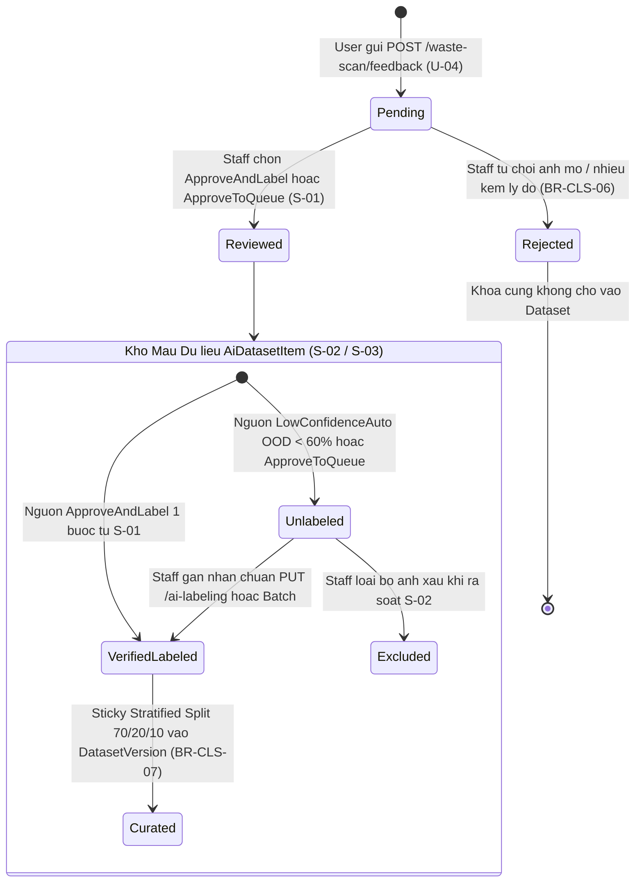
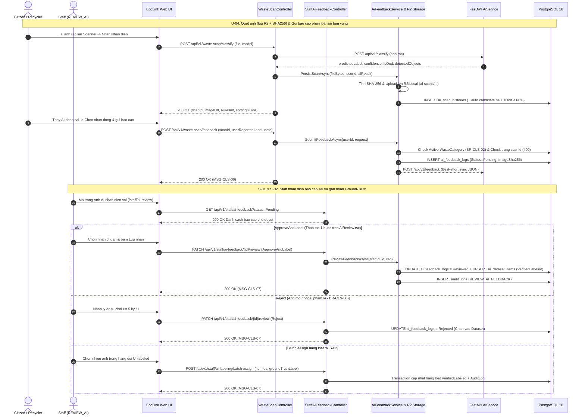
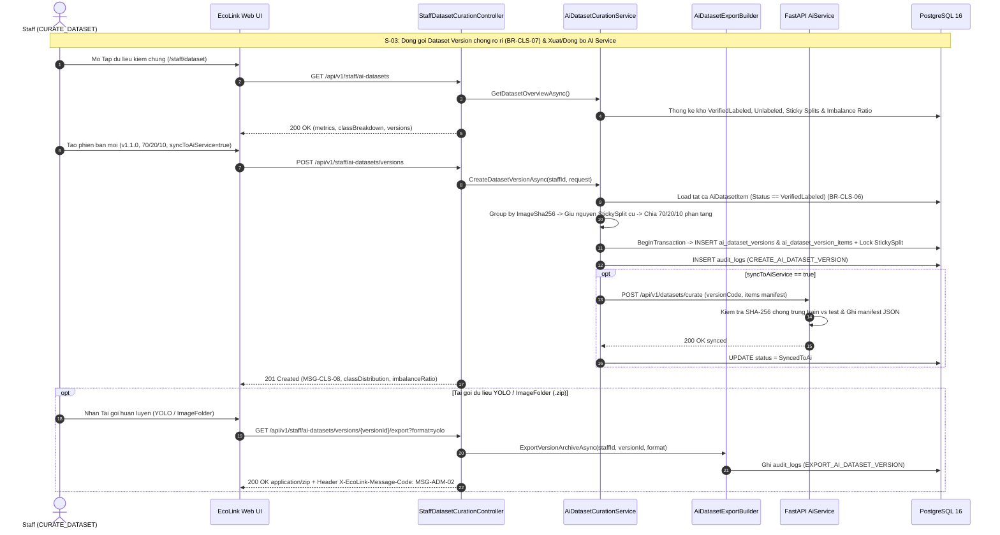
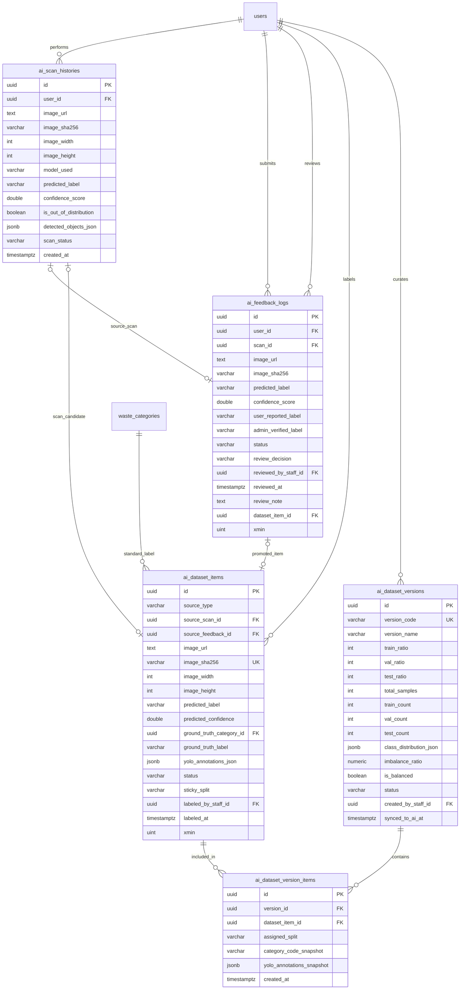

# KẾ HOẠCH THIẾT KẾ & TRIỂN KHAI (IMPLEMENTATION PLAN) - MODULE: AI MISCLASSIFICATION FEEDBACK & DATASET CURATION (`FE-15` / `M-13`)

**Dự án:** EcoLink – Intelligent Waste Sorting & Trading Platform (`SEP490_G141`)  
**Phân hệ:** `CLS` / `ADM` (Phân hệ API `M-13` phối hợp `M-03` & `AIS`: AI Misclassification Feedback & Dataset Curation)  
**Mã tính năng (Feature):** `FE-15` (AI Misclassification Feedback & Dataset Curation)  
**Use Cases trọng tâm (4 Use Cases):**
- **`U-04`**: *Report Incorrect AI Classification* (Người dùng báo cáo khi mô hình AI nhận diện sai hoặc cảnh báo OOD `< 60%`, đính kèm ảnh gốc phiên quét `scanId`, đề xuất nhãn vật liệu đúng và theo dõi kết quả thẩm định từ Staff)
- **`S-01`**: *Review Misclassified Images* (Nhân viên có quyền `REVIEW_AI` / Admin duyệt hàng đợi báo cáo sai, đối chiếu ảnh gốc và phân phối xác suất mô hình để **Chấp nhận kèm gán nhãn 1 bước**, **Chuyển kho gán nhãn chi tiết** hoặc **Bác bỏ ảnh nhiễu/độc hại**)
- **`S-02`**: *Label Image Data* (Nhân viên gán nhãn danh mục chuẩn `MasterWasteCategory` và tọa độ vùng vật thể YOLO Bounding Box đơn lẻ hoặc hàng loạt cho ảnh báo lỗi và ảnh thô thực địa/OOD)
- **`S-03`**: *Update Verified Dataset* (Nhân viên có quyền `CURATE_DATASET` / Admin đóng gói phiên bản Dataset chính thức `Train 70% / Val 20% / Test 10%` chống rò rỉ dữ liệu bằng thuật toán **Sticky Stratified Split**, kiểm tra cân bằng lớp, xuất gói `.zip` chuẩn `YOLO`/`ImageFolder` và đồng bộ nạp nóng sang `Ecolink.AiService`)

**Độ phức tạp / Ưu tiên:** High (Human-in-the-Loop Active Learning, Data Integrity & Safe AI Retraining Loop)  
**Công nghệ:** .NET 10 Web API, PostgreSQL 16 (`jsonb` + `xmin` Optimistic Concurrency), Entity Framework Core 10, Cloudflare R2 / Local Fallback Storage (`SHA-256` Content Deduplication), FluentValidation, ZIP Archive Streaming (`System.IO.Compression`), Python 3.11 FastAPI (`YOLOv8` + `MobileNetV3` + `EfficientNet-B0`), React 19 + TypeScript (`ecolink-web`)  
**Tài liệu tham chiếu:**
- Danh mục Tổng thể API: [`00_api_inventory_and_endpoint_statistics.md`](file:///c:/Projects/EcoLink/intelligent-waste-sorting-trading/documents/api%20contact/00_api_inventory_and_endpoint_statistics.md#L381-L398) (`STT 021, 024, 130–139, 183–184`)
- Quy chuẩn Khung Phản hồi API: [`00_api_overview_and_response_contract.md`](file:///c:/Projects/EcoLink/intelligent-waste-sorting-trading/documents/api%20contact/00_api_overview_and_response_contract.md)
- Thiết kế CSDL gốc (DBML): [`02_ai_waste_classification_module.dbml`](file:///c:/Projects/EcoLink/intelligent-waste-sorting-trading/documents/diagram/database%20design/02_ai_waste_classification_module.dbml#L1-L146)
- Quy chuẩn Phát triển AI & Dataset: [`ai_service_and_benchmark_guidelines.md`](file:///c:/Projects/EcoLink/intelligent-waste-sorting-trading/documents/guideline/ai_service_and_benchmark_guidelines.md#L65-L89)
- Quy chuẩn CSDL & Kiểm toán: [`database_design_and_audit_guidelines.md`](file:///c:/Projects/EcoLink/intelligent-waste-sorting-trading/documents/guideline/database_design_and_audit_guidelines.md)
- Quy tắc Nghiệp vụ & Thông báo: [`business_rule_&_system_message.md`](file:///c:/Projects/EcoLink/intelligent-waste-sorting-trading/documents/business_rule_&_system_message.md#L38-L50)

---

## 1. MỤC TIÊU PHẠM VI & ĐÁNH GIÁ HIỆN TRẠNG (SCOPE & GAP ANALYSIS)

### 1.1. Kiến trúc Active Learning & Quản trị Dữ liệu Huấn luyện Khép kín (Human-in-the-Loop AI Architecture)

Trong phân hệ `M-03`, người dùng có thể quét ảnh rác thông qua 4 mô hình thị giác máy tính (`yolov8_detect`, `mobilenet_v3`, `efficientnet_b0`, `yolov8n`). Tuy nhiên, nếu kết quả nhận diện bị sai lệch do góc chụp ngược sáng, nền ảnh phức tạp hoặc vật liệu chưa có trong tập mẫu ban đầu, mô hình sẽ không thể tự tiến hóa nếu thiếu một vòng phản hồi và sàng lọc dữ liệu chuẩn hóa (*Human-in-the-Loop Data Pipeline*). Phân hệ `M-13` (`FE-15`) thiết lập vòng lặp khép kín dựa trên **3 trụ cột kỹ thuật**:

1. **Lưu vết Ảnh Gốc Bền vững & Chống trùng từ Gốc bằng `SHA-256` (`U-04`, `BR-CLS-05`, `BR-CLS-08`):**
   * Khi gọi `POST /api/v1/waste-scan/classify` (`STT 021`), Core Backend tính mã băm **`SHA-256`** của nội dung byte ảnh, tải ảnh lên kho lưu trữ đối tượng qua `IFileStorageService` (`ai-scans/{yyyy/MM}/{sha256_or_guid}`), ghi nhận lịch sử phiên quét vào bảng **`ai_scan_histories`** (gồm kích thước ảnh gốc, mô hình, nhãn dự đoán, điểm tin cậy, cờ OOD và JSON tọa độ `detected_objects_json`), đồng thời trả thêm `scanId` và `imageUrl` về cho Frontend.
   * Các ca quét rơi vào vùng **OOD / Độ tin cậy thấp (`< 60%`)** được hệ thống tự động nạp làm ứng viên (`LowConfidenceAuto`, trạng thái `Unlabeled`) vào kho chờ gán nhãn `S-02` (*Active Learning Uncertainty Sampling*) ngay cả khi người dùng không bấm báo lỗi.
   * Khi người dùng gửi `POST /api/v1/waste-scan/feedback` (`STT 024`), hệ thống bắt buộc liên kết với `scanId` (hoặc `imageUrl` nếu đã tải trước), kiểm tra nhãn gợi ý thuộc `waste_categories` đang `Active` (`BR-CLS-02`), chặn spam báo trùng lặp nhiều lần cho cùng 1 `scanId`, lưu bền vững vào bảng **`ai_feedback_logs`** (`PostgreSQL`) kèm `UserId` người báo, và trả về cho người dùng theo dõi lịch sử qua `GET /api/v1/waste-scan/feedback/me` (`STT 130`).

2. **Quy trình Thẩm định & Gán nhãn Kép 2 Chế độ (`S-01` & `S-02` — `BR-CLS-06`):**
   * **Thẩm định & Xác thực 1 chạm (`PATCH /api/v1/staff/ai-feedback/{reportId}/review` — `STT 133`):** Hỗ trợ 3 quyết định nghiệp vụ rõ ràng:
     * `ApproveAndLabel`: Staff xem ảnh gốc và xác nhận ngay nhãn chuẩn cuối cùng (`AdminVerifiedLabel`) -> hệ thống đồng thời đóng báo cáo `Reviewed` và tạo/cập nhật ngay mục `ai_dataset_items` ở trạng thái **`VerifiedLabeled`** (khớp với UX gộp thông minh trên `staff/AiReview.tsx`).
     * `ApproveToQueue`: Staff duyệt ảnh đủ chất lượng sáng/nét và đẩy vào hàng đợi **`Unlabeled`** của `S-02` để chuyên viên gán nhãn vẽ kỹ vùng chọn YOLO Bounding Box.
     * `Reject`: Staff bác bỏ báo cáo (ảnh mờ, đen tối, chứa thông tin nhạy cảm hoặc cố tình báo sai) kèm `reviewNote` bắt buộc -> đánh dấu `Rejected` và **khóa cứng không cho đưa vào bất kỳ tập dữ liệu huấn luyện/kiểm thử nào (`BR-CLS-06`)**.
   * **Kho Gán nhãn Ground-Truth (`STT 134–136`):** Hỗ trợ nạp thêm ảnh thô từ hiện trường/upload R2, xem lại nhãn AI dự đoán, lưu danh sách hộp bao chuẩn hóa YOLO (`[categoryCode, xCenter, yCenter, width, height]` với giá trị nằm trong `[0.0, 1.0]`) qua `PUT /api/v1/staff/ai-labeling/{itemId}` (`STT 135`), và gán nhãn hàng loạt nguyên tử cho nhiều ảnh đồng nhất qua `POST /api/v1/staff/ai-labeling/batch-assign` (`STT 136`).

3. **Đóng gói Phiên bản Dataset "Sticky Stratified Split 70/20/10" Chống Rò rỉ Dữ liệu (`S-03` — `BR-CLS-07`):**
   * Tuân thủ [`ai_service_and_benchmark_guidelines.md`](file:///c:/Projects/EcoLink/intelligent-waste-sorting-trading/documents/guideline/ai_service_and_benchmark_guidelines.md#L79-L89) và `BR-CLS-07`, khi Staff tạo phiên bản mới (`POST /api/v1/staff/ai-datasets/versions` — `STT 138`), thuật toán phân chia thực hiện 3 tầng bảo vệ:
     1. **Nhóm theo chữ ký nội dung (`image_sha256`):** Toàn bộ các bản ghi hoặc khung ảnh có chung mã băm `image_sha256` luôn nằm trọn trong **cùng một tập** (`Train`, `Validation` hoặc `Test`).
     2. **Sticky Split Lịch sử (Cố định tập kiểm chứng & kiểm thử):** Nếu một mẫu (`ai_dataset_items`) đã từng được phân vào `Test` hoặc `Validation` (hoặc `Train`) ở phiên bản trước (`sticky_split IS NOT NULL`), mọi phiên bản Dataset sau **bắt buộc giữ nguyên mẫu đó ở đúng tập cũ** — tuyệt đối triệt tiêu hiện tượng rò rỉ dữ liệu giữa `Train` và `Test` (*Data Leakage*).
     3. **Stratified Split & Giám sát Lệch lớp:** Các mẫu `VerifiedLabeled` mới chưa có `sticky_split` được chia phân tầng theo từng danh mục rác đúng tỷ lệ chuẩn **`70% Train / 20% Val / 10% Test`**, tính toán tỷ lệ chênh lệch giữa lớp nhiều nhất và ít nhất (`imbalanceRatio = MaxCount / MinCount`, cảnh báo khi `> 2.5`), đóng gói xuất tệp `.zip` (`STT 139`) theo chuẩn **`YOLO`** hoặc **`ImageFolder`**, và gọi sang `Ecolink.AiService` (`STT 183`, `STT 184`) để chuẩn bị dữ liệu và nạp nóng mô hình không gián đoạn.

---

### 1.2. Đánh giá Mức độ Sẵn sàng của Codebase Hiện tại (Feasibility & Gap Matrix)

| Hạng mục kỹ thuật | Độ sẵn sàng | Hiện trạng thực tế trong Codebase (`Backend`, `AIS` & `Frontend`) | Khoảng trống cần triển khai (Technical Gaps) |
|:---|:---:|:---|:---|
| **1. Cơ sở dữ liệu PostgreSQL 16 (`ai_scan_histories`, `ai_feedback_logs`, `ai_dataset_items`, `ai_dataset_versions`)** | **25%** | Đã có bản thiết kế DBML 4 bảng chuẩn ở [`02_ai_waste_classification_module.dbml`](file:///c:/Projects/EcoLink/intelligent-waste-sorting-trading/documents/diagram/database%20design/02_ai_waste_classification_module.dbml#L65-L123). EF Core hiện tại mới chỉ có bảng `ai_feedback_logs` (`AIFeedbackLog` trong [`GamificationAndFeedbackEntities.cs`](file:///c:/Projects/EcoLink/intelligent-waste-sorting-trading/src/Ecolink.Backend/Ecolink.Domain/Entities/GamificationAndFeedbackEntities.cs#L18-L30)), chưa có bảng lịch sử quét, kho gán nhãn và phiên bản Dataset. | Tạo mới `AiScanHistory`, `AiDatasetItem`, `AiDatasetVersion`, `AiDatasetVersionItem` dùng `UUID` (`Guid`), `image_sha256`, `JSONB` (detected objects, YOLO boxes, phân phối lớp), `xmin` concurrency token; nâng cấp `AIFeedbackLog` thêm `ScanId`, `ImageSha256`, `ModelUsed`, `ReviewedByStaffId`, `ReviewDecision`, `ReviewedAt`, `ReviewNote`, `DatasetItemId`; sinh Migration EF Core. |
| **2. Tầng Quét & Báo lỗi `U-04` (`WasteScanController`, `AiVisionHttpClient`)** | **35%** | [`WasteScanController.cs`](file:///c:/Projects/EcoLink/intelligent-waste-sorting-trading/src/Ecolink.Backend/Ecolink.WebApi/Controllers/WasteScanController.cs#L31-L167) đã có `POST /classify` (`STT 021`) và `POST /feedback` (`STT 024`), nhưng `SubmitFeedback` **chỉ forward sang file JSON của Python** mà chưa lưu vào bảng `ai_feedback_logs` trong PostgreSQL, và `ClassifyImage` chưa lưu ảnh qua R2 nên `imageUrl` bị rỗng. | Nâng cấp `ClassifyImage` để lưu ảnh lên R2/Local kèm `SHA-256` & ghi `AiScanHistory` (tự tạo ứng viên `Unlabeled` nếu OOD `< 60%`), trả về `scanId` + `imageUrl`; nâng cấp `SubmitFeedback` lưu bền vững vào PostgreSQL (`AIFeedbackLog` liên kết `ScanId` + `UserId`), kiểm tra `WasteCategory.IsActive`, rồi mới sync sang Python AI Service dạng fire-and-resilient. |
| **3. Tầng Nghiệp vụ Staff Review, Labeling & Dataset Versioning (`STT 130–139`)** | **10%** | Toàn bộ **10 Core Endpoints của `M-13` (`STT 130–139`)** chưa triển khai. Điểm thuận lợi là [`StaffPermissions.cs`](file:///c:/Projects/EcoLink/intelligent-waste-sorting-trading/src/Ecolink.Backend/Ecolink.Domain/Constants/StaffPermissions.cs#L9-L21) **đã định nghĩa sẵn `ReviewAi = "REVIEW_AI"` (`ai.review`) và `CurateDataset = "CURATE_DATASET"` (`ai.dataset`)**, cùng `AuditLogService` và `CloudflareR2StorageService` (`10 MB`) sẵn sàng dùng lại. | Tạo `AiCurationDtos.cs`, FluentValidation validators, `IAiFeedbackService` / `AiFeedbackService`, `IAiDatasetCurationService` / `AiDatasetCurationService`, `AiDatasetExportBuilder` (sinh file `.zip` chuẩn `YOLO` & `ImageFolder`), và 2 Controllers: `StaffAiFeedbackController` + `StaffDatasetCurationController` gắn chặt `[HasPermission]`. |
| **4. Dịch vụ AI Vision Python (`src/Ecolink.AiService/app.py` — `STT 183–184`)** | **50%** | [`app.py`](file:///c:/Projects/EcoLink/intelligent-waste-sorting-trading/src/Ecolink.AiService/app.py#L528-L584) đang vận hành tốt 4 mô hình nhận diện, đọc thống kê và nhận `POST /api/v1/feedback` lưu vào `data/feedback.json`. Chưa có endpoint nhận gói dataset chuẩn hóa và nạp nóng trọng số mô hình. | Bổ sung `POST /api/v1/datasets/curate` (`STT 183`: tiếp nhận manifest & cấu trúc tập `train/val/test` lưu tại `data/curated_datasets/{version_code}/` với kiểm tra chống trùng SHA-256 giữa `train` và `test`) và `POST /api/v1/models/reload` (`STT 184`: gọi `model_manager` nạp lại trọng số `.pt`/`.pth` trên RAM và trả trạng thái sẵn sàng). |
| **5. Tích hợp Liên phân hệ (`AdminAnalyticsService` & Bảo mật Ảnh `BR-CLS-08`)** | **65%** | [`AdminAnalyticsService.cs`](file:///c:/Projects/EcoLink/intelligent-waste-sorting-trading/src/Ecolink.Backend/Ecolink.Infrastructure/Services/AdminAnalyticsService.cs#L99-L101) đã đếm `PendingAiFeedbackCount` trực tiếp từ `AIFeedbackLogs` và tính thống kê chất lượng AI. `StaffHome` cần đếm tác vụ AI chờ xử lý. | Ngay khi `SubmitFeedback` và `ReviewFeedback` ghi PostgreSQL, số liệu tồn đọng `PendingAiFeedbackCount` & biểu đồ chất lượng AI theo nhóm rác trên Dashboard Admin sẽ tự động cập nhật dữ liệu thật; đồng thời cô lập quyền truy cập `feedback/me` chỉ theo `UserId` (`BR-CLS-08`). |
| **6. Giao diện Frontend (`ecolink-web`)** | **30%** | [`Scanner.tsx`](file:///c:/Projects/EcoLink/ecolink-web/src/pages/Scanner.tsx#L1369-L1400) đã có form `InlineFeedbackReport` gọi `/waste-scan/feedback` nhưng thiếu `scanId`/`imageUrl` và lịch sử báo cáo. [`staff/AiReview.tsx`](file:///c:/Projects/EcoLink/ecolink-web/src/pages/staff/AiReview.tsx) và [`staff/Dataset.tsx`](file:///c:/Projects/EcoLink/ecolink-web/src/pages/staff/Dataset.tsx) đang dùng hoàn toàn dữ liệu tĩnh (`AI_CASES`, `DATASET` từ `@/data/ops`). | Tạo `src/lib/aiCurationApi.ts`; nâng cấp `wasteScanApi.ts` & `Scanner.tsx` truyền `scanId`/`imageUrl` và xem lịch sử báo sai; nâng cấp `staff/AiReview.tsx` (duyệt `ApproveAndLabel`, bác bỏ `Reject`, gán nhãn hàng loạt/ảnh thô) và `staff/Dataset.tsx` (tạo phiên bản `70/20/10`, xem cảnh báo lệch lớp, xuất ZIP, đồng bộ AI Service) **đồng thời giữ nguyên các chuỗi kiểm định SSR trong `check.tsx` và `check-routes.tsx`**. |

---

## 2. PHÂN TÍCH CHI TIẾT CÁC CHỨC NĂNG / USE CASES, QUY TẮC NGHIỆP VỤ & SƠ ĐỒ LUỒNG

### 2.1. Chiến lược Vòng đời Mẫu Dữ liệu & Thuật toán "Sticky Stratified Split 70/20/10"

Để giải quyết bài toán cốt lõi của đồ án AI (làm sao mô hình học được từ các ca sai thực tế mà không làm sai lệch thước đo kiểm thử), dữ liệu hình ảnh đi qua **3 tầng trạng thái nghiêm ngặt**:

| Tầng dữ liệu | Bảng quản lý | Trạng thái (`Status`) | Điều kiện chuyển tiếp & Kiểm soát Chất lượng |
|:---|:---|:---|:---|
| **1. Tầng Quét & Phản hồi thô (`U-04`)** | `ai_scan_histories`<br>`ai_feedback_logs` | `Pending` -> `Reviewed` / `Rejected` | Bất kỳ ảnh rác nào từ `Citizen`/`Recycler` phải qua bộ lọc kích thước `<= 10 MB` & định dạng `.jpg/.jpeg/.png/.webp` (`BR-CLS-01`), được tính `image_sha256` trước khi lưu kho ảnh. |
| **2. Tầng Kho Gán nhãn Chuẩn (`S-01` -> `S-02`)** | `ai_dataset_items` | `Unlabeled` -> `VerifiedLabeled` / `Excluded` | Chỉ ảnh báo sai đã được Staff duyệt (`Reviewed`) hoặc ảnh OOD/ảnh thô do Staff nạp lên mới nằm trong kho này. Bắt buộc gán `GroundTruthCategoryId` trỏ tới danh mục `WasteCategory.Status == "Active"` (`BR-CLS-02`, `BR-CLS-06`). Ảnh lỗi/nhiễu bị đánh dấu `Excluded`. |
| **3. Tầng Đóng gói Tập Huấn luyện (`S-03`)** | `ai_dataset_versions`<br>`ai_dataset_version_items` | `Published` -> `SyncedToAi` / `Archived` | Chỉ thu nhận các bản ghi `ai_dataset_items` có `Status == VerifiedLabeled`. Khi ấn định phân tập (`Train` / `Validation` / `Test`), giá trị `sticky_split` được **khóa vĩnh viễn** lên từng `ai_dataset_items` có cùng `image_sha256` (`BR-CLS-07`). |

#### Quy trình 4 Bước của Thuật toán "Sticky Stratified Split" (`BR-CLS-07`):
1. **Lọc hợp lệ:** Truy vấn toàn bộ `ai_dataset_items` ở trạng thái `VerifiedLabeled` (có thể lọc tùy chọn theo `includeSources` hoặc `categoryCodes`).
2. **Khử trùng nội dung (`SHA-256 Grouping`):** Nhóm theo `image_sha256` (bảo đảm cùng 1 ảnh gốc hoặc ảnh chụp từ cùng một tệp không bao giờ tách thành hai nhánh phân bổ khác nhau).
3. **Bảo toàn Phân tập Lịch sử (*Sticky Assignment*):** Mọi nhóm đã có `sticky_split != null` từ các lần phát hành Dataset Version trước giữ nguyên tuyệt đối vào `Train`, `Validation` hoặc `Test` tương ứng (`Test` không bao giờ tụt về `Train`).
4. **Phân tầng Bù tỷ lệ (*Stratified 70/20/10 Remainder Fill*):** Với các nhóm mới (`sticky_split == null`) trong từng danh mục rác $c$, sắp xếp ngẫu nhiên có hạt giống cố định (*Deterministic Seed* theo `version_code`) và chia bổ sung sao cho tổng số mẫu của từng lớp $c$ tiệm cận sát nhất tỷ lệ **`70% Train / 20% Validation / 10% Test`**, sau đó ghi cố định `sticky_split` vào CSDL trong cùng một Transaction. Cuối cùng tính chỉ số cân bằng lớp `imbalanceRatio = maxClassCount / minClassCount` và đánh dấu `isBalanced = (imbalanceRatio <= 2.5m)`.

---

### 2.2. Phân tích Chuyên sâu 4 Use Cases

#### UC 1 — `U-04`: Report Incorrect AI Classification (*Actor: `Citizen` / `Recycler` / `Authenticated User`*)
* **Mục tiêu:** Cho phép người dùng báo cáo khi kết quả phân loại của AI bị sai nhãn hoặc rơi vào trạng thái không chắc chắn (`isOutOfDistribution = true`, độ tin cậy `< 60%`), giúp ghi nhận lỗi thực địa và theo dõi kết quả duyệt của Staff.
* **Tiền điều kiện:** Người dùng đã thực hiện quét ảnh (`POST /api/v1/waste-scan/classify`) và nhận `scanId` (hoặc có `imageUrl` hợp lệ trên R2); khi tra cứu `GET /api/v1/waste-scan/feedback/me` (`STT 130`), bắt buộc đã đăng nhập (`[Authorize]`).
* **Luồng xử lý chính:**
  1. Tại màn hình `Scanner.tsx`, `ClassifyImage` (`STT 021`) tự động lưu ảnh lên R2 (`ai-scans/...`), tạo bản ghi `AiScanHistory` kèm `ImageSha256`, `ImageWidth`, `ImageHeight`, `DetectedObjectsJson` và trả về `scanId` + `imageUrl`.
  2. Người dùng nhấn *"Báo AI nhận diện sai"*, chọn `userReportedLabel` từ danh mục phế liệu đang `Active` (`plastic`, `paper`, `cardboard`, `metal`, `glass`, `trash`) và nhập ghi chú mô tả tình huống (VD: *"Chai nhựa PET trong bị lóa sáng nên AI nhầm sang Thủy tinh"*).
  3. Frontend gọi `POST /api/v1/waste-scan/feedback` (`STT 024`) truyền `scanId`, `imageUrl`, `predictedLabel`, `confidenceScore`, `userReportedLabel`, `note`.
  4. Backend kiểm tra `userReportedLabel` tồn tại và đang `Active` trong `waste_categories` (`BR-CLS-02`); nếu có `scanId`, kiểm tra trùng lặp báo cáo trên cùng `scanId` (`ConflictException` `409` nếu đã gửi trước đó); lưu bản ghi `AIFeedbackLog` (`Status = Pending`) vào PostgreSQL và đồng bộ song song sang `POST /api/v1/feedback` của FastAPI. Trả về `200 OK` kèm **`MSG-CLS-06`**.
  5. Người dùng đã đăng nhập có thể gọi `GET /api/v1/waste-scan/feedback/me` (`STT 130`) để xem trạng thái (`Pending`, `Reviewed`, `Rejected`), nhãn Staff xác nhận cuối cùng và lý do phản hồi.

#### UC 2 — `S-01`: Review Misclassified Images (*Actor: `Staff [REVIEW_AI]` / `Admin`*)
* **Mục tiêu:** Cung cấp hàng đợi thẩm định tập trung giúp Nhân viên kiểm tra ảnh thực tế do người dùng báo sai, đối chiếu với nhãn AI dự đoán, loại bỏ ảnh nhiễu/spam và xác nhận nhãn chuẩn.
* **Tiền điều kiện:** Tài khoản `Staff` được cấp quyền `REVIEW_AI` (`ai.review`) hoặc `Admin` (`[HasPermission(StaffPermissions.ReviewAi)]`).
* **Luồng xử lý chính:**
  1. Staff mở trang **Ảnh AI nhận diện sai** (`/staff/ai-review`) -> gọi `GET /api/v1/staff/ai-feedback` (`STT 131`) có lọc `status` (`Pending|Reviewed|Rejected`), `predictedLabel`, `userReportedLabel`, `maxConfidence`, phân trang.
  2. Staff chọn một bản ghi -> gọi `GET /api/v1/staff/ai-feedback/{reportId:guid}` (`STT 132`) để xem ảnh gốc độ phân giải đầy đủ (`imageUrl`), danh sách xác suất & tọa độ Bounding Box lúc quét (`detectedObjectsSnapshot`), so sánh `predictedLabel` vs `userReportedLabel` và thông tin người báo cáo (chỉ hiển thị cho Staff có quyền theo `BR-CLS-08`).
  3. Staff ra quyết định qua `PATCH /api/v1/staff/ai-feedback/{reportId:guid}/review` (`STT 133`):
     * **`ApproveAndLabel` (Khuyên dùng — Thao tác 1 bước):** Bắt buộc truyền `verifiedLabel` (chọn đồng ý theo user hoặc chọn nhãn đúng khác). Hệ thống cập nhật `AIFeedbackLog` thành `Reviewed`, `AdminVerifiedLabel = verifiedLabel`, tự động tạo/chuyển `AiDatasetItem` sang trạng thái **`VerifiedLabeled`** và ghi nhận luôn hộp bao nếu Staff có chỉnh sửa.
     * **`ApproveToQueue`:** Duyệt ảnh hợp lệ nhưng chuyển sang kho `S-02` (`AiDatasetItem.Status = Unlabeled`) để vẽ hộp bao chi tiết sau.
     * **`Reject`:** Bác bỏ ảnh mờ, quá tối, ảnh không phải rác hoặc người dùng báo sai ác ý. Bắt buộc nhập `reviewNote >= 5` ký tự; hệ thống gán `FeedbackStatus.Rejected`, không tạo `VerifiedLabeled` (`BR-CLS-06`).
  4. Ghi `REVIEW_AI_FEEDBACK` vào bảng bất biến `audit_logs` (`BR-ADM-05`).

#### UC 3 — `S-02`: Label Image Data (*Actor: `Staff [REVIEW_AI]` / `Admin`*)
* **Mục tiêu:** Cho phép Staff gán nhãn danh mục rác chuẩn (`MasterWasteCategory`) và tọa độ vùng vật thể YOLO Bounding Box cho các ảnh thô (`LowConfidenceAuto`, `StaffUpload`) hoặc ảnh báo lỗi đã duyệt chờ gán nhãn.
* **Tiền điều kiện:** Tài khoản `Staff` có quyền `REVIEW_AI` hoặc `Admin`.
* **Luồng xử lý chính:**
  1. Staff truy cập hàng đợi chờ gán nhãn qua `GET /api/v1/staff/ai-labeling/queue` (`STT 134`), hỗ trợ lọc theo `status` (`Unlabeled` mặc định / `VerifiedLabeled` / `Excluded`), `sourceType` (`UserFeedback` / `LowConfidenceAuto` / `StaffUpload`), `predictedLabel`, `unlabeledOnly`.
  2. Staff chọn 1 ảnh -> gán `groundTruthLabel` (bắt buộc thuộc `waste_categories` `Active`), `qualityNote` và danh sách `yoloAnnotations` (tùy chọn; mỗi hộp bao gồm `categoryCode`, `xCenter`, `yCenter`, `width`, `height` $\in (0, 1]$) qua `PUT /api/v1/staff/ai-labeling/{itemId:guid}` (`STT 135`). Có thể đánh dấu `excludeFromDataset = true` nếu kiểm tra lại thấy ảnh không đạt chất lượng.
  3. Khi có nhiều ảnh chụp đồng nhất cùng loại phế liệu (VD 15 ảnh chai PET hoặc bìa carton chưa gán nhãn), Staff chọn nhiều `itemIds` và gọi `POST /api/v1/staff/ai-labeling/batch-assign` (`STT 136`) để gán đồng loạt `groundTruthLabel` trong **1 giao dịch nguyên tử (`Database Transaction`)** — toàn bộ thành công hoặc rollback hoàn toàn nếu có 1 ID không hợp lệ.
  4. Mọi thao tác gán nhãn đơn lẻ/hàng loạt đều ghi vào `audit_logs` (`ASSIGN_GROUND_TRUTH_LABEL` / `BATCH_ASSIGN_AI_LABELS`).

#### UC 4 — `S-03`: Update Verified Dataset (*Actor: `Staff [CURATE_DATASET]` / `Admin`*)
* **Mục tiêu:** Đóng gói các ảnh đã xác thực nhãn (`VerifiedLabeled`) thành các phiên bản Dataset chuẩn hóa (`Train / Val / Test`), bảo đảm tuyệt đối không rò rỉ dữ liệu, theo dõi phân bố cân bằng từng lớp, xuất tệp huấn luyện và đẩy sang AI Service để Retrain & Hot-Reload.
* **Tiền điều kiện:** Tài khoản `Staff` được cấp quyền `CURATE_DATASET` (`ai.dataset`) hoặc `Admin`. Tồn tại tối thiểu các mẫu `VerifiedLabeled` trong kho.
* **Luồng xử lý chính:**
  1. Staff mở trang **Tập dữ liệu kiểm chứng** (`/staff/dataset`) -> gọi `GET /api/v1/staff/ai-datasets` (`STT 137`) để xem:
     * Tổng quan kho dữ liệu sạch theo từng danh mục rác & từng tập (`Train / Val / Test`), chỉ số cân bằng lớp `imbalanceRatio` (cảnh báo lớp yếu nhất cần ưu tiên thu thập) và độ chính xác theo nhóm rác từ lịch sử thẩm định thực tế.
     * Lịch sử các phiên bản `AiDatasetVersion` đã phát hành (`v1.0.0`, `v1.1.0`...).
  2. Staff nhấn **"Đóng gói phiên bản Dataset mới"** -> gọi `POST /api/v1/staff/ai-datasets/versions` (`STT 138`) truyền `versionCode`, `versionName`, tỷ lệ `trainRatio/valRatio/testRatio` (mặc định `70/20/10`, tổng bắt buộc `= 100`) và tùy chọn `syncToAiService = true`.
  3. Backend thực thi thuật toán **Sticky Stratified Split (`BR-CLS-07`)**, lưu `AiDatasetVersion` + các bản ghi chụp nhanh `AiDatasetVersionItem`, kiểm tra cân bằng lớp, ghi `CREATE_AI_DATASET_VERSION` vào `audit_logs`, và nếu bật `syncToAiService` thì gọi `POST /api/v1/datasets/curate` (`STT 183`) sang `Ecolink.AiService`.
  4. Staff hoặc kỹ sư ML có thể gọi `GET /api/v1/staff/ai-datasets/versions/{versionId:guid}/export?format=yolo` (`STT 139`, hỗ trợ `yolo` hoặc `imagefolder`) để tải trực tiếp gói `.zip` chứa đầy đủ ảnh, tệp `.txt` nhãn YOLO, `data.yaml` và `manifest.json` (`image_sha256`, `split`, `category`).
  5. Sau khi huấn luyện cập nhật tệp trọng số `.pt` vào `models/`, hệ thống/Admin gọi `POST /api/v1/models/reload` (`STT 184`) trên `Ecolink.AiService` để nạp nóng mô hình mới không downtime.

---

### 2.3. Bảng Truy vết Quy tắc Nghiệp vụ (`BR-*`) & Thông điệp Hệ thống (`MSG-*`)

#### Bảng A — Quy tắc Nghiệp vụ (Business Rules)

| BR-ID | Nguồn quy chuẩn | Nội dung quy tắc thực thi trên `M-13` | Áp dụng cho Endpoint / Service |
|:---|:---|:---|:---|
| **`BR-CLS-01`** | [`business_rule_&_system_message.md`](file:///c:/Projects/EcoLink/intelligent-waste-sorting-trading/documents/business_rule_&_system_message.md#L42) | Chỉ chấp nhận tệp ảnh hợp lệ (`.jpg`, `.jpeg`, `.png`, `.webp`) dung lượng `<= 10 MB`; kiểm tra trước khi chuyển sang AI xử lý hoặc lưu R2. | `STT 021`, `AiFeedbackService` |
| **`BR-CLS-02`** | [`business_rule_&_system_message.md`](file:///c:/Projects/EcoLink/intelligent-waste-sorting-trading/documents/business_rule_&_system_message.md#L43) | Mọi nhãn dự đoán hiển thị, nhãn người dùng đề xuất (`U-04`) hoặc nhãn Staff gán (`S-01`, `S-02`) bắt buộc ánh xạ tới một `WasteCategory` có `Status == "Active"`. | `STT 021`, `STT 024`, `STT 133`, `STT 135`, `STT 136` |
| **`BR-CLS-03`** | [`business_rule_&_system_message.md`](file:///c:/Projects/EcoLink/intelligent-waste-sorting-trading/documents/business_rule_&_system_message.md#L44) | Nếu độ tin cậy `< 0.60` (`ConfidenceThreshold`), kích hoạt cờ `IsOutOfDistribution` (`MSG-CLS-02`), yêu cầu người dùng xác nhận thủ công và tự động đưa mẫu vào hàng đợi `LowConfidenceAuto` cho Staff. | `STT 021`, `WasteScanController` |
| **`BR-CLS-05`** | [`business_rule_&_system_message.md`](file:///c:/Projects/EcoLink/intelligent-waste-sorting-trading/documents/business_rule_&_system_message.md#L46) | Mỗi báo cáo phân loại sai (`AIFeedbackLog`) phải liên kết chặt với ảnh gốc (`ImageUrl`, `ImageSha256`), `ScanId`, nhãn AI đoán và nhãn người dùng đề xuất, đi thẳng vào hàng đợi `Pending` của Staff; chặn báo cáo trùng trên cùng `ScanId`. | `STT 024`, `STT 130–132` |
| **`BR-CLS-06`** | [`business_rule_&_system_message.md`](file:///c:/Projects/EcoLink/intelligent-waste-sorting-trading/documents/business_rule_&_system_message.md#L47) | **Chỉ ảnh đã được Staff duyệt và gán nhãn chuẩn (`VerifiedLabeled`) mới được phép đưa vào `AiDatasetVersion`**. Ảnh bị `Rejected` hoặc chưa gán nhãn (`Unlabeled`) tuyệt đối bị loại trừ. | `STT 133`, `STT 135`, `STT 138` |
| **`BR-CLS-07`** | [`business_rule_&_system_message.md`](file:///c:/Projects/EcoLink/intelligent-waste-sorting-trading/documents/business_rule_&_system_message.md#L48) | **Không rò rỉ dữ liệu (`No Data Leakage`):** Cùng 1 ảnh (`ImageSha256`) không bao giờ xuất hiện đồng thời ở `Train` và `Test/Validation`; phân tập cũ (`sticky_split`) được giữ cố định qua các phiên bản; chỉ Staff có quyền `CURATE_DATASET` (hoặc `Admin`) mới được đóng gói Dataset Version. | `STT 138`, `STT 139`, `STT 183` |
| **`BR-CLS-08`** | [`business_rule_&_system_message.md`](file:///c:/Projects/EcoLink/intelligent-waste-sorting-trading/documents/business_rule_&_system_message.md#L49) | Ảnh và báo cáo phân loại của người dân chỉ cho phép chủ sở hữu (`feedback/me`) hoặc Staff có quyền `REVIEW_AI`/`CURATE_DATASET` và `Admin` truy cập. | `STT 130–139` |
| **`BR-ADM-02`** | [`StaffPermissions.cs`](file:///c:/Projects/EcoLink/intelligent-waste-sorting-trading/src/Ecolink.Backend/Ecolink.Domain/Constants/StaffPermissions.cs#L19-L20) | Tách bạch quyền hạt mịn: **`REVIEW_AI`** phụ trách `S-01` & `S-02` (`STT 131–136`); **`CURATE_DATASET`** phụ trách `S-03` (`STT 137–139`); `Admin` đi qua mặc định. | `[HasPermission]` Policy |
| **`BR-ADM-05`** | [`business_rule_&_system_message.md`](file:///c:/Projects/EcoLink/intelligent-waste-sorting-trading/documents/business_rule_&_system_message.md#L175) | Toàn bộ thao tác duyệt lỗi AI, gán nhãn đơn/hàng loạt, đóng gói phiên bản Dataset và xuất gói huấn luyện đều ghi dấu vết bất biến vào `audit_logs`. | `STT 133`, `STT 135–139` |

#### Bảng B — Mã Thông báo Hệ thống (System Messages)

| Mã thông báo | Ngữ cảnh hiển thị | Nội dung chuẩn hóa tiếng Việt |
|:---|:---|:---|
| **`MSG-CLS-01`** | Phân loại AI thành công (`STT 021`) | *Nhận diện thành công loại rác: {displayName} với độ tin cậy {percent}%.* |
| **`MSG-CLS-02`** | Độ tin cậy thấp / OOD `< 60%` (`STT 021`) | *Hệ thống không nhận diện chắc chắn (> 60%) hoặc vật thể không thuộc nhóm rác hỗ trợ. Vui lòng chụp lại hình ảnh ở góc rõ hơn.* |
| **`MSG-CLS-03`** | Lỗi từ dịch vụ AI Vision (`STT 021`) | *Không thể xử lý ảnh này. Vui lòng thử lại với ảnh rõ hơn.* |
| **`MSG-CLS-04`** | Không có tệp ảnh tải lên (`STT 021`) | *Vui lòng tải lên file ảnh hợp lệ.* |
| **`MSG-CLS-05`** | Định dạng file sai hoặc quá 10 MB (`BR-CLS-01`) | *Tập tin tải lên phải là hình ảnh hợp lệ (.jpg, .jpeg, .png, .webp) và không vượt quá 10 MB.* |
| **`MSG-CLS-06`** | Gửi báo cáo phân loại sai thành công (`STT 024`) | *Cảm ơn bạn đã phản hồi! Dữ liệu đã được chuyển tới Nhân viên vận hành để kiểm chứng và cải thiện mô hình AI.* |
| **`MSG-CLS-07`** | Staff thẩm định/gán nhãn xong (`STT 133, 135, 136`) | *Đã cập nhật kết quả thẩm định và chuẩn hóa nhãn Ground-Truth cho mẫu ảnh AI.* |
| **`MSG-CLS-08`** | Đóng gói phiên bản Dataset thành công (`STT 138`) | *Đã đóng gói phiên bản Dataset '{versionCode}' ({totalSamples} ảnh chuẩn hóa: Train/Val/Test).* |
| **`MSG-ADM-02`** | Header xuất gói Dataset ZIP (`STT 139`) | *Xuất gói dữ liệu huấn luyện thành công.* (kèm Header `X-EcoLink-Message-Code: MSG-ADM-02`) |
| **`MSG-ADM-04`** | Không có quyền Staff `REVIEW_AI` / `CURATE_DATASET` | *Bạn không có quyền thực hiện thao tác này.* (`403 Forbidden`) |

---

### 2.4. Sơ đồ Máy Trạng thái & Sơ đồ Tuần tự (Mermaid Diagrams)

#### 1) Vòng đời Trạng thái Phản hồi (`FeedbackStatus`) & Mẫu Dữ liệu (`DatasetItemStatus`)


#### 2) Sơ đồ Tuần tự: Quét & Báo sai (`U-04`) -> Thẩm định (`S-01`) -> Gán nhãn (`S-02`)


#### 3) Sơ đồ Tuần tự: Đóng gói Phiên bản Dataset `70/20/10` (`S-03`) & Đồng bộ AI Service


---

## 3. THIẾT KẾ CƠ SỞ DỮ LIỆU POSTGRESQL 16 CHI TIẾT (DATABASE SCHEMA & DOMAIN ENTITIES)

### 3.1. Sơ đồ Thực thể Liên kết (`erDiagram`)



---

### 3.2. Đặc tả DDL SQL PostgreSQL 16 Chi tiết

#### 1) Bảng `ai_scan_histories` (Lưu vết Phiên Quét Ảnh Gốc & Phục vụ Heatmap / OOD — `U-01`, `U-04`)
```sql
CREATE TABLE ai_scan_histories (
    id                      UUID PRIMARY KEY DEFAULT gen_random_uuid(),
    user_id                 UUID,
    image_url               TEXT         NOT NULL,
    image_storage_key       TEXT,
    image_sha256            VARCHAR(64)  NOT NULL,
    image_width             INTEGER      NOT NULL DEFAULT 0,
    image_height            INTEGER      NOT NULL DEFAULT 0,
    model_used              VARCHAR(50)  NOT NULL DEFAULT 'yolov8_detect',
    predicted_label         VARCHAR(50)  NOT NULL DEFAULT 'unknown',
    confidence_score        DOUBLE PRECISION NOT NULL DEFAULT 0,
    is_out_of_distribution  BOOLEAN      NOT NULL DEFAULT FALSE,
    detected_objects_json   JSONB        NOT NULL DEFAULT '[]'::jsonb,
    scan_status             VARCHAR(30)  NOT NULL DEFAULT 'Completed', -- Completed | LowConfidence | Failed
    created_at              TIMESTAMPTZ  NOT NULL DEFAULT NOW(),
    created_by              VARCHAR(100) NOT NULL DEFAULT 'System',
    updated_at              TIMESTAMPTZ,
    updated_by              VARCHAR(100),
    is_deleted              BOOLEAN      NOT NULL DEFAULT FALSE,
    deleted_at              TIMESTAMPTZ,

    CONSTRAINT fk_ai_scan_histories_users FOREIGN KEY (user_id) REFERENCES users (id) ON DELETE SET NULL
);

CREATE INDEX idx_ai_scan_histories_user ON ai_scan_histories (user_id, created_at DESC) WHERE is_deleted = FALSE;
CREATE INDEX idx_ai_scan_histories_sha256 ON ai_scan_histories (image_sha256);
CREATE INDEX idx_ai_scan_histories_ood ON ai_scan_histories (is_out_of_distribution, created_at DESC);
```

#### 2) Nâng cấp Bảng `ai_feedback_logs` (Kết nối Phiên quét & Hậu kiểm Staff `S-01` — `BR-CLS-05`)
```sql
ALTER TABLE ai_feedback_logs
    ADD COLUMN IF NOT EXISTS scan_id                  UUID,
    ADD COLUMN IF NOT EXISTS image_sha256             VARCHAR(64),
    ADD COLUMN IF NOT EXISTS model_used               VARCHAR(50)  NOT NULL DEFAULT 'yolov8_detect',
    ADD COLUMN IF NOT EXISTS detected_objects_snapshot JSONB       NOT NULL DEFAULT '[]'::jsonb,
    ADD COLUMN IF NOT EXISTS review_decision          VARCHAR(30), -- ApproveAndLabel | ApproveToQueue | Reject
    ADD COLUMN IF NOT EXISTS reviewed_by_staff_id     UUID,
    ADD COLUMN IF NOT EXISTS reviewed_at              TIMESTAMPTZ,
    ADD COLUMN IF NOT EXISTS review_note              TEXT,
    ADD COLUMN IF NOT EXISTS dataset_item_id          UUID;

ALTER TABLE ai_feedback_logs
    ADD CONSTRAINT fk_ai_feedback_logs_scan FOREIGN KEY (scan_id) REFERENCES ai_scan_histories (id) ON DELETE SET NULL,
    ADD CONSTRAINT fk_ai_feedback_logs_reviewer FOREIGN KEY (reviewed_by_staff_id) REFERENCES users (id) ON DELETE RESTRICT,
    ADD CONSTRAINT uq_ai_feedback_logs_scan_id UNIQUE (scan_id);

CREATE INDEX idx_ai_feedback_logs_status_created ON ai_feedback_logs (status, created_at DESC);
```

#### 3) Bảng `ai_dataset_items` (Kho Ảnh Chờ Gán Nhãn & Đã Chuẩn Hóa Ground-Truth — `S-02`)
```sql
CREATE TABLE ai_dataset_items (
    id                        UUID PRIMARY KEY DEFAULT gen_random_uuid(),
    source_type               VARCHAR(30)  NOT NULL DEFAULT 'UserFeedback', -- UserFeedback | LowConfidenceAuto | StaffUpload | BenchmarkSeed
    source_scan_id            UUID,
    source_feedback_id        UUID,
    image_url                 TEXT         NOT NULL,
    image_sha256              VARCHAR(64)  NOT NULL,
    image_width               INTEGER      NOT NULL DEFAULT 0,
    image_height              INTEGER      NOT NULL DEFAULT 0,
    predicted_label           VARCHAR(50),
    predicted_confidence      DOUBLE PRECISION,
    ground_truth_category_id  UUID,
    ground_truth_label        VARCHAR(50),
    yolo_annotations_json     JSONB        NOT NULL DEFAULT '[]'::jsonb,
    status                    VARCHAR(30)  NOT NULL DEFAULT 'Unlabeled', -- Unlabeled | VerifiedLabeled | Excluded
    sticky_split              VARCHAR(20), -- NULL | Train | Validation | Test (Khoa vinh vien khi da chia)
    labeled_by_staff_id       UUID,
    labeled_at                TIMESTAMPTZ,
    quality_note              TEXT,

    -- BaseAuditableEntity
    created_at                TIMESTAMPTZ  NOT NULL DEFAULT NOW(),
    created_by                VARCHAR(100) NOT NULL DEFAULT 'System',
    updated_at                TIMESTAMPTZ,
    updated_by                VARCHAR(100),
    is_deleted                BOOLEAN      NOT NULL DEFAULT FALSE,
    deleted_at                TIMESTAMPTZ,

    CONSTRAINT fk_ai_dataset_items_category FOREIGN KEY (ground_truth_category_id) REFERENCES waste_categories (id) ON DELETE RESTRICT,
    CONSTRAINT fk_ai_dataset_items_scan FOREIGN KEY (source_scan_id) REFERENCES ai_scan_histories (id) ON DELETE SET NULL,
    CONSTRAINT fk_ai_dataset_items_feedback FOREIGN KEY (source_feedback_id) REFERENCES ai_feedback_logs (id) ON DELETE SET NULL,
    CONSTRAINT fk_ai_dataset_items_staff FOREIGN KEY (labeled_by_staff_id) REFERENCES users (id) ON DELETE RESTRICT,
    CONSTRAINT uq_ai_dataset_items_sha256 UNIQUE (image_sha256),
    CONSTRAINT chk_ai_dataset_items_verified_label CHECK (
        status <> 'VerifiedLabeled' OR (ground_truth_category_id IS NOT NULL AND ground_truth_label IS NOT NULL)
    )
);

CREATE INDEX idx_ai_dataset_items_queue ON ai_dataset_items (status, ground_truth_label, created_at DESC) WHERE is_deleted = FALSE;
CREATE INDEX idx_ai_dataset_items_split ON ai_dataset_items (sticky_split, ground_truth_label) WHERE is_deleted = FALSE;
```

#### 4) Bảng `ai_dataset_versions` & `ai_dataset_version_items` (Quản lý Phiên bản Tập Huấn luyện & Kiểm thử — `S-03`)
```sql
CREATE TABLE ai_dataset_versions (
    id                       UUID PRIMARY KEY DEFAULT gen_random_uuid(),
    version_code             VARCHAR(30)  NOT NULL, -- VD: v1.0.0, v1.1.0
    version_name             VARCHAR(150) NOT NULL,
    description              TEXT,
    train_ratio              INTEGER      NOT NULL DEFAULT 70,
    val_ratio                INTEGER      NOT NULL DEFAULT 20,
    test_ratio               INTEGER      NOT NULL DEFAULT 10,
    total_samples            INTEGER      NOT NULL DEFAULT 0,
    train_count              INTEGER      NOT NULL DEFAULT 0,
    val_count                INTEGER      NOT NULL DEFAULT 0,
    test_count               INTEGER      NOT NULL DEFAULT 0,
    class_distribution_json  JSONB        NOT NULL DEFAULT '{}'::jsonb,
    imbalance_ratio          NUMERIC(6,2) NOT NULL DEFAULT 1.00,
    is_balanced              BOOLEAN      NOT NULL DEFAULT TRUE,
    status                   VARCHAR(30)  NOT NULL DEFAULT 'Published', -- Published | SyncedToAi | Archived
    synced_to_ai_at          TIMESTAMPTZ,
    created_by_staff_id      UUID         NOT NULL,

    -- BaseAuditableEntity
    created_at               TIMESTAMPTZ  NOT NULL DEFAULT NOW(),
    created_by               VARCHAR(100) NOT NULL DEFAULT 'System',
    updated_at               TIMESTAMPTZ,
    updated_by               VARCHAR(100),
    is_deleted               BOOLEAN      NOT NULL DEFAULT FALSE,
    deleted_at               TIMESTAMPTZ,

    CONSTRAINT fk_ai_dataset_versions_staff FOREIGN KEY (created_by_staff_id) REFERENCES users (id) ON DELETE RESTRICT,
    CONSTRAINT uq_ai_dataset_versions_code UNIQUE (version_code),
    CONSTRAINT chk_ai_dataset_versions_ratios CHECK (
        train_ratio > 0 AND val_ratio >= 0 AND test_ratio >= 0
        AND (train_ratio + val_ratio + test_ratio = 100)
    )
);

CREATE TABLE ai_dataset_version_items (
    id                         UUID PRIMARY KEY DEFAULT gen_random_uuid(),
    version_id                 UUID        NOT NULL,
    dataset_item_id            UUID        NOT NULL,
    assigned_split             VARCHAR(20) NOT NULL, -- Train | Validation | Test
    category_code_snapshot     VARCHAR(50) NOT NULL,
    yolo_annotations_snapshot  JSONB       NOT NULL DEFAULT '[]'::jsonb,
    created_at                 TIMESTAMPTZ NOT NULL DEFAULT NOW(),

    CONSTRAINT fk_ai_dataset_version_items_ver FOREIGN KEY (version_id) REFERENCES ai_dataset_versions (id) ON DELETE CASCADE,
    CONSTRAINT fk_ai_dataset_version_items_item FOREIGN KEY (dataset_item_id) REFERENCES ai_dataset_items (id) ON DELETE RESTRICT,
    CONSTRAINT uq_ai_dataset_version_items_pair UNIQUE (version_id, dataset_item_id)
);

CREATE INDEX idx_ai_dataset_version_items_split ON ai_dataset_version_items (version_id, assigned_split, category_code_snapshot);
```

---

### 3.3. Thiết kế C# Domain Enums & Entities (`Ecolink.Domain`)

#### Bổ sung Enums tại `src/Ecolink.Backend/Ecolink.Domain/Enums/DomainEnums.cs`
```csharp
public enum AiFeedbackReviewDecision
{
    ApproveAndLabel = 1, // Duyệt báo lỗi và chốt luôn nhãn chuẩn + đưa vào VerifiedLabeled
    ApproveToQueue = 2,  // Duyệt ảnh hợp lệ, chuyển sang hàng đợi gán nhãn S-02
    Reject = 3           // Bác bỏ ảnh mờ/nhiễu/không hợp lệ (cấm vào Dataset BR-CLS-06)
}

public enum DatasetItemSourceType
{
    UserFeedback = 1,
    LowConfidenceAuto = 2,
    StaffUpload = 3,
    BenchmarkSeed = 4
}

public enum DatasetItemStatus
{
    Unlabeled = 1,
    VerifiedLabeled = 2,
    Excluded = 3
}

public enum DatasetSplitType
{
    Train = 1,
    Validation = 2,
    Test = 3
}

public enum DatasetVersionStatus
{
    Published = 1,
    SyncedToAi = 2,
    Archived = 3
}
```

#### Mở rộng `AIFeedbackLog` & Tạo mới `AiCurationEntities.cs` (`Ecolink.Domain/Entities/`)
* **Mở rộng `AIFeedbackLog`** trong [`GamificationAndFeedbackEntities.cs`](file:///c:/Projects/EcoLink/intelligent-waste-sorting-trading/src/Ecolink.Backend/Ecolink.Domain/Entities/GamificationAndFeedbackEntities.cs#L18-L30): Bổ sung `ScanId`, `ImageSha256`, `ModelUsed`, `DetectedObjectsSnapshot`, `ReviewDecision`, `ReviewedByStaffId`, `ReviewedAt`, `ReviewNote`, `DatasetItemId`, plus `public uint Version { get; private set; }` (`UseXminAsConcurrencyToken()` chống 2 Staff duyệt trùng 1 báo lỗi cùng lúc).
* **Tạo mới `AiCurationEntities.cs`:**
  * `AiScanHistory : BaseAuditableEntity`
  * `AiDatasetItem : BaseAuditableEntity` (có `uint Version` ánh xạ `xmin`)
  * `AiDatasetVersion : BaseAuditableEntity`
  * `AiDatasetVersionItem : BaseEntity`
* **Cấu hình EF Core tại `AiCurationConfigurations.cs`:** Khớp tên bảng `snake_case`, Enum convert `.HasConversion<string>().HasMaxLength(30)`, `JSONB` cho các mảng/thống kê, `HasQueryFilter(x => !x.IsDeleted)` cho các bảng kế thừa `BaseAuditableEntity`, và `DbSet<>` đăng ký trong [`ApplicationDbContext.cs`](file:///c:/Projects/EcoLink/intelligent-waste-sorting-trading/src/Ecolink.Backend/Ecolink.Infrastructure/Data/ApplicationDbContext.cs).

---

## 4. KIẾN TRÚC TẦNG DỊCH VỤ, BẢO MẬT `[HasPermission]` & ĐỒNG BỘ FASTAPI AI SERVICE

### 4.1. Cấu trúc Services & Validators (`Ecolink.Application` & `Ecolink.Infrastructure`)

| Thành phần | Trách nhiệm cốt lõi |
|:---|:---|
| **`IAiFeedbackService`** / **`AiFeedbackService`** | Lưu phiên quét (`RecordScanHistoryAsync`) kèm tính `SHA-256` + tải ảnh R2/Local; tiếp nhận phản hồi `SubmitFeedbackAsync` (`U-04`: validate danh mục `Active`, chặn trùng `ScanId`, lưu PostgreSQL + best-effort sync FastAPI); truy vấn `GetMyFeedbackReportsAsync` (`STT 130`); lấy hàng đợi & chi tiết (`STT 131–132`); thực thi `ReviewFeedbackAsync` (`STT 133`: `ApproveAndLabel` / `ApproveToQueue` / `Reject`) và ghi `AuditLog`. |
| **`IAiDatasetCurationService`** / **`AiDatasetCurationService`** | Quản lý hàng đợi `GetLabelingQueueAsync` (`STT 134`); gán nhãn & tọa độ YOLO Bounding Box (`AssignGroundTruthLabelAsync` — `STT 135`); gán hàng loạt nguyên tử (`BatchAssignLabelsAsync` — `STT 136`); truy vấn tổng quan & danh sách phiên bản (`GetDatasetOverviewAsync` — `STT 137`); đóng gói phiên bản bằng thuật toán **Sticky Stratified Split `70/20/10`** (`CreateDatasetVersionAsync` — `STT 138`); xuất gói `.zip` (`ExportDatasetVersionAsync` — `STT 139`). |
| **`AiDatasetExportBuilder`** *(Helper nội bộ)* | Tạo luồng `.zip` chuẩn hóa không lưu rác đĩa: hỗ trợ format **`yolo`** (`data.yaml` khai báo `names` theo danh mục rác chuẩn, `images/{train,val,test}/{itemId}.{ext}`, `labels/{train,val,test}/{itemId}.txt`, `manifest.json`) và **`imagefolder`** (`{train,val,test}/{category_code}/{itemId}.{ext}`, `manifest.json`). Tự động đọc ảnh hoặc ghi tham chiếu URL khi ảnh ở xa/offline. |
| **FluentValidation (`AiCurationValidators.cs`)** | Gồm 5 bộ kiểm tra: `SubmitFeedbackRequestValidator`, `ReviewAiFeedbackRequestValidator` (yêu cầu `verifiedLabel` khi `ApproveAndLabel`, yêu cầu `reviewNote >= 5` ký tự khi `Reject`), `AssignGroundTruthLabelRequestValidator` (mỗi YOLO box phải có `xCenter, yCenter, width, height` $\in (0, 1]$), `BatchAssignLabelsRequestValidator` (`itemIds` `1..200` phần tử), `CreateDatasetVersionRequestValidator` (`versionCode` `^v\d+\.\d+\.\d+$`, `train + val + test == 100`). |
| **`IAiVisionClient`** / **`AiVisionHttpClient`** | Mở rộng 2 phương thức gọi sang Python FastAPI: `CurateDatasetAsync(CurateDatasetSyncRequest)` (`POST /api/v1/datasets/curate`) và `ReloadModelsAsync()` (`POST /api/v1/models/reload`). Lỗi mạng sang Python không làm hỏng giao dịch CSDL đã chốt, mà trả trạng thái `Published` kèm cờ cảnh báo `aiSyncWarning` để đồng bộ lại. |

### 4.2. Ma trận Phân quyền RBAC & Dấu vết Kiểm toán (`AuditLogService`)

| Tuyến đường / Controller | Attribute Bảo vệ (`PermissionAuthorization`) | Nhật ký Kiểm toán (`audit_logs`) |
|:---|:---|:---|
| `POST /api/v1/waste-scan/classify`, `/feedback` | `[AllowAnonymous]` (nếu có JWT thì gắn `UserId`) | Không cần (lưu trực tiếp bảng `ai_scan_histories` / `ai_feedback_logs`) |
| `GET /api/v1/waste-scan/feedback/me` | `[Authorize]` (lọc cứng `UserId == currentUserId`) | — |
| `StaffAiFeedbackController` (`STT 131–136`) | `[Authorize(Roles = "Staff,Admin")]`<br>`[HasPermission(StaffPermissions.ReviewAi)]` | `REVIEW_AI_FEEDBACK`<br>`ASSIGN_GROUND_TRUTH_LABEL`<br>`BATCH_ASSIGN_AI_LABELS` |
| `StaffDatasetCurationController` (`STT 137–139`) | `[Authorize(Roles = "Staff,Admin")]`<br>`[HasPermission(StaffPermissions.CurateDataset)]` | `CREATE_AI_DATASET_VERSION`<br>`EXPORT_AI_DATASET_VERSION`<br>`SYNC_AI_DATASET` / `RELOAD_AI_MODELS` |

### 4.3. Đồng bộ Liên phân hệ (`AdminAnalyticsService` & `src/Ecolink.AiService/app.py`)
1. **`AdminAnalyticsService` (`A-01` & `A-02`):** Dữ liệu `OperationalBacklog.PendingAiFeedbackCount` đọc trực tiếp số bản ghi `AIFeedbackLog.Status == FeedbackStatus.Pending`; đồng thời có thể tính tỷ lệ dự đoán chính xác thực tế từ các ca đã được Staff kiểm định (`AdminVerifiedLabel == PredictedLabel`).
2. **Nâng cấp [`src/Ecolink.AiService/app.py`](file:///c:/Projects/EcoLink/intelligent-waste-sorting-trading/src/Ecolink.AiService/app.py):**
   * Bổ sung `POST /api/v1/datasets/curate`: nhận danh sách item đã gán phân tập (`train`, `validation`, `test`) kèm `image_sha256`, kiểm tra rò rỉ (`assert len(train_hashes & test_hashes) == 0`), lưu bản manifest chính thức tại `data/curated_datasets/{version_code}/manifest.json` để script huấn luyện `train.py` / `train_torch_models.py` sử dụng trực tiếp.
   * Bổ sung `POST /api/v1/models/reload`: gọi `model_manager.reload_models()` để tải lại danh sách trọng số mới trong `models/` và trả về `models_available` mới nhất.

---

## 5. ĐẶC TẢ CHI TIẾT HỢP ĐỒNG API (12 ENDPOINTS MỚI `STT 130–139`, `183–184` & NÂNG CẤP `STT 021, 024`)

### 5.1. Nhóm `WasteScanController` (`U-04` — Mở rộng & `STT 130`)

#### 1) `[Nâng cấp STT 021]` `POST /api/v1/waste-scan/classify`
* **Cải tiến giữ tương thích ngược:** Vẫn giữ nguyên cấu trúc `ApiResponse<WasteScanResponseDto>` cho các test hiện hữu, đồng thời **bổ sung thêm 2 trường không bắt buộc phá vỡ** vào `WasteScanResponseDto`:
  * `scanId` (`Guid?`): Định danh phiên quét trong `ai_scan_histories`.
  * `imageUrl` (`string?`): Đường dẫn ảnh rác đã lưu trên Cloudflare R2 / Local fallback.

#### 2) `[Nâng cấp STT 024]` `POST /api/v1/waste-scan/feedback`
* **Request Body (`SubmitFeedbackDto`):**
  ```json
  {
    "scanId": "a7b12c34-1111-4222-9333-445566778899",
    "imageUrl": "https://cdn.ecolink.test/ai-scans/2026/11/abc123.jpg",
    "predictedLabel": "glass",
    "confidenceScore": 0.54,
    "userReportedLabel": "plastic",
    "note": "Chai nhựa PET trong bị chói đèn flash nên AI nhầm sang thủy tinh."
  }
  ```
* **Response `200 OK` (`MSG-CLS-06`):** Trả về `{ reportId, scanId, status: "Pending", syncedToAi }` kèm thông điệp chuẩn `MSG-CLS-06`. Trả `400` nếu `userReportedLabel` không thuộc danh mục `Active` (`BR-CLS-02`); trả `409 Conflict` nếu `scanId` đã có báo cáo (`BR-CLS-05`).

#### 3) `[STT 130]` `GET /api/v1/waste-scan/feedback/me`
* **RBAC:** `[Authorize]` (`Citizen`, `Recycler` — mọi user đã đăng nhập).
* **Query Parameters:** `status` (`Pending|Reviewed|Rejected`), `pageNumber` (`int = 1`), `pageSize` (`int = 20`).
* **Response `200 OK` (`MSG-GEN-01`):** `ApiResponse<PagedResult<MyAiFeedbackReportDto>>` hiển thị các báo cáo do chính `currentUserId` gửi (`id`, `imageUrl`, `predictedLabel`, `userReportedLabel`, `adminVerifiedLabel`, `status`, `reviewNote`, `createdAt`, `reviewedAt`).

---

### 5.2. Nhóm `StaffAiFeedbackController` (`S-01` & `S-02` — `STT 131–136`, Base Route `/api/v1/staff`)

#### 4) `[STT 131]` `GET /api/v1/staff/ai-feedback`
* **RBAC:** `[HasPermission(StaffPermissions.ReviewAi)]` (`REVIEW_AI` hoặc `Admin`).
* **Query Parameters:** `status` (`Pending|Reviewed|Rejected`), `predictedLabel`, `userReportedLabel`, `maxConfidence` (`double?`, lọc các ca tự tin thấp), `search` (ghi chú/tên người gửi), `pageNumber`, `pageSize`.
* **Response `200 OK` (`MSG-GEN-01`):** `ApiResponse<PagedResult<StaffAiFeedbackSummaryDto>>` kèm bộ đếm tồn đọng (`pendingCount`, `reviewedCount`, `rejectedCount`).

#### 5) `[STT 132]` `GET /api/v1/staff/ai-feedback/{reportId:guid}`
* **RBAC:** `[HasPermission(StaffPermissions.ReviewAi)]`.
* **Response `200 OK` (`MSG-GEN-01`):** Chi tiết đầy đủ `StaffAiFeedbackDetailDto`: ảnh gốc (`imageUrl`), kích thước `(imageWidth, imageHeight)`, `imageSha256`, mô hình đã dùng, mảng `detectedObjectsSnapshot`, nhãn người báo cáo gợi ý, thông tin người báo cáo (tên, vai trò — tuân thủ `BR-CLS-08`) và kết quả thẩm định nếu đã xử lý.

#### 6) `[STT 133]` `PATCH /api/v1/staff/ai-feedback/{reportId:guid}/review`
* **RBAC:** `[HasPermission(StaffPermissions.ReviewAi)]`.
* **Request Body (`ReviewAiFeedbackRequest`):**
  ```json
  {
    "decision": "ApproveAndLabel",
    "verifiedLabel": "plastic",
    "reviewNote": "Xác nhận chai nhựa PET có nhãn bị mờ do ánh sáng ngược.",
    "yoloAnnotations": [
      {
        "categoryCode": "plastic",
        "xCenter": 0.512,
        "yCenter": 0.488,
        "width": 0.340,
        "height": 0.620
      }
    ]
  }
  ```
* **Luồng xử lý:** Kiểm tra báo cáo đang ở trạng thái `Pending` (nếu đã `Reviewed`/`Rejected` trả `409 Conflict`). Nếu `ApproveAndLabel`, bắt buộc `verifiedLabel` thuộc danh mục `Active` (`BR-CLS-02`) và tự tạo `AiDatasetItem` trạng thái `VerifiedLabeled`. Nếu `Reject`, bắt buộc `reviewNote` tối thiểu `5` ký tự (`BR-CLS-06`). Ghi `AuditLog` (`REVIEW_AI_FEEDBACK`) và trả `200 OK` (`MSG-CLS-07`).

#### 7) `[STT 134]` `GET /api/v1/staff/ai-labeling/queue`
* **RBAC:** `[HasPermission(StaffPermissions.ReviewAi)]`.
* **Query Parameters:** `status` (`Unlabeled|VerifiedLabeled|Excluded`), `sourceType` (`UserFeedback|LowConfidenceAuto|StaffUpload|BenchmarkSeed`), `groundTruthLabel`, `pageNumber`, `pageSize`.
* **Response `200 OK` (`MSG-GEN-01`):** `ApiResponse<PagedResult<AiDatasetItemDto>>`.

#### 8) `[STT 135]` `PUT /api/v1/staff/ai-labeling/{itemId:guid}`
* **RBAC:** `[HasPermission(StaffPermissions.ReviewAi)]`.
* **Request Body (`AssignGroundTruthLabelRequest`):**
  ```json
  {
    "groundTruthLabel": "cardboard",
    "excludeFromDataset": false,
    "qualityNote": "Thùng carton gập phẳng chụp rõ nét.",
    "yoloAnnotations": [
      {
        "categoryCode": "cardboard",
        "xCenter": 0.500,
        "yCenter": 0.500,
        "width": 0.780,
        "height": 0.650
      }
    ]
  }
  ```
* **Response `200 OK` (`MSG-CLS-07`):** Cập nhật nhãn chuẩn `VerifiedLabeled` (hoặc `Excluded` nếu đánh dấu loại bỏ), ghi `AuditLog` (`ASSIGN_GROUND_TRUTH_LABEL`).

#### 9) `[STT 136]` `POST /api/v1/staff/ai-labeling/batch-assign`
* **RBAC:** `[HasPermission(StaffPermissions.ReviewAi)]`.
* **Request Body (`BatchAssignLabelsRequest`):** `{ "itemIds": ["guid-1", "guid-2"], "groundTruthLabel": "metal", "qualityNote": "Lô ảnh vỏ lon nhôm đồng nhất" }`.
* **Response `200 OK` (`MSG-CLS-07`):** Giao dịch nguyên tử (rollback nếu bất kỳ `itemId` nào không tồn tại), cập nhật đồng loạt thành `VerifiedLabeled` và ghi `AuditLog` (`BATCH_ASSIGN_AI_LABELS`).

---

### 5.3. Nhóm `StaffDatasetCurationController` (`S-03` — `STT 137–139`) & FastAPI (`STT 183–184`)

#### 10) `[STT 137]` `GET /api/v1/staff/ai-datasets`
* **RBAC:** `[HasPermission(StaffPermissions.CurateDataset)]` (`CURATE_DATASET` hoặc `Admin`).
* **Response `200 OK` (`MSG-GEN-01`):** Trả về `AiDatasetDashboardDto`:
  * `summary`: `totalPoolItems`, `verifiedLabeledCount`, `unlabeledCount`, `excludedCount`, `imbalanceRatio`, `isBalanced`, `weakestCategory`.
  * `byCategory`: Mảng thống kê từng lớp (`categoryCode`, `categoryName`, `totalVerified`, `trainCount`, `valCount`, `testCount`, `needsMoreSamples`).
  * `versions`: Danh sách các `AiDatasetVersionDto` đã đóng gói.

#### 11) `[STT 138]` `POST /api/v1/staff/ai-datasets/versions`
* **RBAC:** `[HasPermission(StaffPermissions.CurateDataset)]`.
* **Request Body (`CreateDatasetVersionRequest`):**
  ```json
  {
    "versionCode": "v1.1.0",
    "versionName": "Dataset T11/2026 bổ sung ảnh OOD Thực địa",
    "description": "Tổng hợp ảnh phản hồi User và mẫu LowConfidence đã gán nhãn chuẩn.",
    "trainRatio": 70,
    "valRatio": 20,
    "testRatio": 10,
    "syncToAiService": true
  }
  ```
* **Response `201 Created` (`MSG-CLS-08`):** Thực thi Sticky Stratified Split, tạo bản ghi phiên bản, trả `AiDatasetVersionDto` kèm phân bố từng tập và cảnh báo nếu `imbalanceRatio > 2.5`. Trả `409 Conflict` nếu `versionCode` đã tồn tại; trả `400 Bad Request` nếu chưa có mẫu `VerifiedLabeled` nào hoặc tổng tỷ lệ `!= 100`.

#### 12) `[STT 139]` `GET /api/v1/staff/ai-datasets/versions/{versionId:guid}/export`
* **RBAC:** `[HasPermission(StaffPermissions.CurateDataset)]`.
* **Query Parameters:** `format` (`"yolo"` mặc định | `"imagefolder"`).
* **Response `200 OK` (`application/zip`):** Tệp `.zip` tên `ecolink-dataset-{versionCode}-{format}.zip` kèm header `X-EcoLink-Message-Code: MSG-ADM-02` và `X-EcoLink-Sample-Count`. Bên trong gồm `manifest.json`, `data.yaml` (nếu `yolo`), và phân mục `train/`, `val/`, `test/` (kèm các tệp `.txt` nhãn YOLO nếu có bounding box).

#### 13) `[STT 183 & 184]` Nội bộ `Ecolink.AiService` (Python FastAPI — `/api/v1/datasets/curate` & `/api/v1/models/reload`)
* `POST /api/v1/datasets/curate`: Nhận JSON manifest phiên bản từ `.NET Core`, kiểm tra giao tập `train_sha256 & test_sha256 == ∅` (trả `400` nếu phát hiện trùng băm giữa tập huấn luyện và tập kiểm thử), lưu vào `data/curated_datasets/{version_code}/manifest.json`.
* `POST /api/v1/models/reload`: Nạp nóng lại toàn bộ trọng số trong `models/` lên `ModelManager` và trả danh sách model đang `is_ready: true`.

---

## 6. KẾ HOẠCH ĐỒNG BỘ GIAO DIỆN FRONTEND (`ecolink-web`)

| Tệp / Màn hình (`ecolink-web`) | Hiện trạng cần nâng cấp | Thiết kế đồng bộ & Ràng buộc kiểm thử SSR |
|:---|:---|:---|
| **1. `src/lib/aiCurationApi.ts` *(Tạo mới)*** | Chưa có API client cho 10 endpoints `M-13` (`STT 130–139`). | Xây dựng tập DTO TypeScript khớp chuẩn `StaffAiFeedbackDetailDto`, `AiDatasetItemDto`, `AiDatasetDashboardDto`, `AiDatasetVersionDto`; dùng `apiRequest` (JWT Bearer + Auto-Refresh) và hàm tải Blob `.zip`. |
| **2. [`src/lib/wasteScanApi.ts`](file:///c:/Projects/EcoLink/ecolink-web/src/lib/wasteScanApi.ts) & [`src/pages/Scanner.tsx`](file:///c:/Projects/EcoLink/ecolink-web/src/pages/Scanner.tsx)** | `InlineFeedbackReport` gửi `imageUrl = ""`, thiếu `scanId` và không có chỗ xem lịch sử báo sai đã gửi (`U-04`). | Bổ sung `scanId` & `imageUrl` vào `WasteScanResponseDto` và truyền vào `submitAiFeedback`; thêm mục **"Lịch sử báo sai của tôi"** gọn bên dưới/drawer khi user đã đăng nhập (`GET /waste-scan/feedback/me`). **Giữ nguyên chuỗi `"Dùng trang này thế nào"`** để đạt kiểm định SSR tại [`check.tsx`](file:///c:/Projects/EcoLink/ecolink-web/src/check.tsx#L87). |
| **3. [`src/pages/staff/AiReview.tsx`](file:///c:/Projects/EcoLink/ecolink-web/src/pages/staff/AiReview.tsx) (`S-01` & `S-02`)** | Đang đọc mảng cứng `AI_CASES` từ `@/data/ops`, thiếu thao tác Bác bỏ (`Reject`), thiếu bộ lọc & gán nhãn hàng loạt `S-02`. | Kết nối thật tới `STT 131–136` có fallback tĩnh an toàn khi chưa có API: hỗ trợ tab **Hàng đợi Báo sai (`S-01`)** (gửi `ApproveAndLabel` 1 chạm hoặc `Reject` có lý do) và tab **Kho Gán nhãn / Gán hàng loạt (`S-02`)** hiển thị bounding box trực quan trên ảnh. **Giữ nguyên tiêu đề `"Ảnh AI nhận diện sai"`** theo [`check.tsx`](file:///c:/Projects/EcoLink/ecolink-web/src/check.tsx#L128) và [`check-routes.tsx`](file:///c:/Projects/EcoLink/ecolink-web/src/check-routes.tsx#L49). |
| **4. [`src/pages/staff/Dataset.tsx`](file:///c:/Projects/EcoLink/ecolink-web/src/pages/staff/Dataset.tsx) (`S-03`)** | Đang hiển thị số liệu tĩnh `DATASET` từ `@/data/ops`, chưa có nút tạo phiên bản `70/20/10` hay tải ZIP. | Nối `GET /api/v1/staff/ai-datasets` (`STT 137`): hiển thị bảng phân tầng `Train / Val / Test` theo từng danh mục rác, thẻ cảnh báo tỷ lệ lệch lớp `> 2.5x`, Form/Modal **"Đóng gói phiên bản mới (`70/20/10`)"** (`STT 138`) và nút **Tải gói `.zip` (`YOLO` / `ImageFolder`)** (`STT 139`). **Giữ nguyên tiêu đề `"Tập dữ liệu kiểm chứng"`** theo [`check.tsx`](file:///c:/Projects/EcoLink/ecolink-web/src/check.tsx#L129) và [`check-routes.tsx`](file:///c:/Projects/EcoLink/ecolink-web/src/check-routes.tsx#L50). |
| **5. [`src/pages/staff/Home.tsx`](file:///c:/Projects/EcoLink/ecolink-web/src/pages/staff/Home.tsx)** | Thẻ tổng quan đang hiển thị số liệu tĩnh. | Đồng bộ bộ đếm ảnh AI chờ duyệt (`Pending`) & mẫu chưa gán nhãn (`Unlabeled`) cho Staff có quyền `REVIEW_AI`. **Giữ nguyên chuỗi `"Việc đang chờ bạn xử lý"`**. |

> [!NOTE]
> Khi hoàn tất phần Frontend trên `ecolink-web`, bắt buộc cập nhật nhật ký `docs/YYYY-MM-DD.md` và vượt qua đủ 4 lệnh kiểm tra: `npm run typecheck`, `npm run check`, `npm run check:routes`, `npm run build`.

---

## 7. KẾ HOẠCH KIỂM THỬ CHUẨN IEEE 829 & LỘ TRÌNH TRIỂN KHAI

### 7.1. Ma trận Truy vết Kịch bản Kiểm thử Trọng tâm (RTM — 16 Test Cases)

| Test Case ID | Use Case | BR / MSG Ref | Mục tiêu kiểm thử (Test Objective) | Dữ liệu & Các bước thực hiện | Kết quả kỳ vọng (Expected Result) | Mức ưu tiên |
|:---|:---:|:---|:---|:---|:---|:---:|
| **`TC-CLS-04-01_P`** | `U-04` | `BR-CLS-05`<br>`MSG-CLS-06` | Quét ảnh & lưu bền vững `AiScanHistory` + báo sai vào PostgreSQL | Citizen gửi ảnh tới `POST /waste-scan/classify`, lấy `scanId` & gửi `POST /waste-scan/feedback` (`userReportedLabel="plastic"`). | `classify` tạo `AiScanHistory` có `ImageSha256` & `ImageUrl`; `feedback` tạo `AIFeedbackLog` (`Status=Pending`), trả `200 MSG-CLS-06`. | **Critical** |
| **`TC-CLS-04-02_P`** | `U-04` | `BR-CLS-03` | Tự động thu thập ứng viên OOD `< 60%` vào kho `Unlabeled` | Quét 1 ảnh độ tin cậy `0.42` (`isOutOfDistribution = true`). | Hệ thống tự sinh `AiDatasetItem` (`SourceType=LowConfidenceAuto`, `Status=Unlabeled`) trong hàng đợi `S-02`. | **High** |
| **`TC-CLS-04-03_N`** | `U-04` | `BR-CLS-02` | Chặn báo lỗi với nhãn rác không tồn tại hoặc đang `Inactive` | Gửi `POST /waste-scan/feedback` với `userReportedLabel="nuclear_waste"` hoặc danh mục `Inactive`. | HTTP `400 Bad Request`, không ghi nhận vào `ai_feedback_logs`. | **High** |
| **`TC-CLS-04-04_N`** | `U-04` | `BR-CLS-05` | Chặn gửi báo sai trùng lặp trên cùng một `scanId` | Dùng cùng `scanId` gửi `POST /waste-scan/feedback` 2 lần liên tiếp. | Lần 1 `200 OK`; lần 2 trả `409 Conflict`, chỉ tồn tại 1 `AIFeedbackLog`. | **Medium** |
| **`TC-CLS-01-01_S`** | `S-01`<br>`S-02`<br>`S-03` | `BR-ADM-02`<br>`MSG-ADM-04` | Kiểm soát phân quyền hạt mịn `REVIEW_AI` vs `CURATE_DATASET` | Citizen gọi API Staff; Staff chỉ có `MANAGE_BLOG` gọi `/staff/ai-feedback`; Staff chỉ có `REVIEW_AI` gọi `POST /staff/ai-datasets/versions`. | Citizen & Staff thiếu quyền đều nhận `403 Forbidden` (`MSG-ADM-04`); đúng quyền/Admin mới được đi qua. | **Critical** |
| **`TC-CLS-01-02_P`** | `S-01` | `BR-CLS-06`<br>`BR-ADM-05`<br>`MSG-CLS-07` | Thẩm định 1 chạm `ApproveAndLabel` tạo mẫu sạch `VerifiedLabeled` | Staff gọi `PATCH /staff/ai-feedback/{id}/review` (`decision="ApproveAndLabel"`, `verifiedLabel="paper"`). | Báo cáo thành `Reviewed`, tạo `AiDatasetItem` (`Status=VerifiedLabeled`, `GroundTruthLabel="paper"`), ghi `AuditLog`. | **Critical** |
| **`TC-CLS-01-03_N`** | `S-01` | `BR-CLS-06` | Bác bỏ (`Reject`) ảnh nhiễu bắt buộc lý do & chặn đưa vào Dataset | Staff gọi `Reject` với lý do `< 5` ký tự (`"Mờ"`), sau đó gửi `Reject` hợp lệ (`"Ảnh bị nhòe hoàn toàn không thấy vật thể"`). | Lý do ngắn trả `400`; lý do hợp lệ cập nhật `Rejected`, **không** tạo `VerifiedLabeled` trong kho `S-03`. | **Critical** |
| **`TC-CLS-01-04_N`** | `S-01` | `BR-CLS-08` | Chặn duyệt lại báo cáo đã thẩm định (`Conflict`) & cô lập `/feedback/me` | Citizen B xem `/feedback/me` của Citizen A; Staff duyệt lần 2 một báo cáo đã `Reviewed`. | Citizen B không thấy báo cáo của A; duyệt lần 2 trả `409 Conflict`. | **High** |
| **`TC-CLS-02-01_P`** | `S-02` | `BR-CLS-02`<br>`BR-ADM-05` | Gán nhãn Ground-Truth & tọa độ YOLO Bounding Box hợp lệ | Staff gọi `PUT /staff/ai-labeling/{itemId}` với `groundTruthLabel="metal"` và 1 box `[0.5, 0.5, 0.3, 0.4]`. | Lưu JSON `yolo_annotations_json`, chuyển `Status = VerifiedLabeled`, ghi `ASSIGN_GROUND_TRUTH_LABEL`. | **High** |
| **`TC-CLS-02-02_N`** | `S-02` | `BR-CLS-02` | Chặn tọa độ YOLO Bounding Box vượt ngoài biên `[0.0, 1.0]` | Gửi box có `xCenter = 1.25` hoặc `width = 0` tới `PUT /staff/ai-labeling/{itemId}`. | FluentValidation trả `400 Bad Request`. | **Medium** |
| **`TC-CLS-02-03_P`** | `S-02` | `BR-CLS-06` | Gán nhãn hàng loạt nguyên tử (`POST /batch-assign`) & rollback khi lỗi | Gọi `/batch-assign` cho 3 `Unlabeled` items hợp lệ; sau đó gọi kèm 1 `Guid` không tồn tại. | Ca hợp lệ cập nhật đủ 3 items; ca có 1 ID lỗi trả `404` và rollback toàn bộ, không gán dở dang. | **High** |
| **`TC-CLS-03-01_P`** | `S-03` | `BR-CLS-07`<br>`MSG-CLS-08` | Đóng gói `v1.0.0` chia chuẩn phân tầng `70/20/10` | Có 30 mẫu `VerifiedLabeled` (10 `plastic`, 10 `paper`, 10 `metal`); Staff gọi `POST /versions` (`70/20/10`). | Tạo `v1.0.0` với `trainCount=21, valCount=6, testCount=3` (mỗi lớp đúng `7/2/1`), ghi `sticky_split`. | **Critical** |
| **`TC-CLS-03-02_S`** | `S-03` | `BR-CLS-07` | Kiểm định **Sticky Split Zero Data Leakage** qua nhiều phiên bản | Sau `v1.0.0`, thêm 10 mẫu mới và tạo `v1.1.0`; thử kiểm tra giao tập `Train(v1.1.0)` và `Test(v1.0.0)`. | Mọi ảnh đã ở `Test`/`Validation` của `v1.0.0` **giữ nguyên 100%** ở tập cũ; giao `Train ∩ Test == ∅`. | **Critical** |
| **`TC-CLS-03-03_B`** | `S-03` | AI Guideline `1:2.5` | Phát hiện cảnh báo mất cân bằng lớp (`ImbalanceRatio > 2.5`) | Đóng gói phiên bản gồm 12 ảnh `plastic` và 2 ảnh `glass` (`tỷ lệ 6.0x`). | Phiên bản vẫn đóng gói thành công (`201 Created`) nhưng `imbalanceRatio = 6.0`, `isBalanced = false`. | **Medium** |
| **`TC-CLS-03-04_P`** | `S-03` | `BR-ADM-05`<br>`MSG-ADM-02` | Xuất gói `.zip` chuẩn YOLO (`data.yaml` + `manifest.json`) | Staff gọi `GET /staff/ai-datasets/versions/{id}/export?format=yolo`. | HTTP `200`, `Content-Type: application/zip`, header `MSG-ADM-02`, file `.zip` giải nén hợp lệ có `data.yaml` & `manifest.json`. | **High** |
| **`TC-CLS-03-05_S`** | `S-03` | `AIS STT 183–184` | Đồng bộ Dataset sang FastAPI (`curate`) & xử lý fallback khi AI Service offline | Gửi manifest tới `/api/v1/datasets/curate` (khi AI online vs giả lập AI timeout). | Khi online chuyển `SyncedToAi`; khi AI timeout, Core DB vẫn lưu an toàn `Published` kèm cờ `aiSyncWarning` (không mất dữ liệu). | **High** |

---

### 7.2. Lộ trình Triển khai 5 Pha (Step-by-Step Implementation Checklist)

- [x] **Giai đoạn 1 — Domain Entities, PostgreSQL 16 Schema & EF Core Migration:**
  - [x] Bổ sung 5 Enums (`AiFeedbackReviewDecision`, `DatasetItemSourceType`, `DatasetItemStatus`, `DatasetSplitType`, `DatasetVersionStatus`) vào [`DomainEnums.cs`](file:///c:/Projects/EcoLink/intelligent-waste-sorting-trading/src/Ecolink.Backend/Ecolink.Domain/Enums/DomainEnums.cs).
  - [x] Mở rộng `AIFeedbackLog` trong [`GamificationAndFeedbackEntities.cs`](file:///c:/Projects/EcoLink/intelligent-waste-sorting-trading/src/Ecolink.Backend/Ecolink.Domain/Entities/GamificationAndFeedbackEntities.cs) và tạo mới `AiCurationEntities.cs` (`AiScanHistory`, `AiDatasetItem`, `AiDatasetVersion`, `AiDatasetVersionItem`).
  - [x] Tạo `AiCurationConfigurations.cs`, cập nhật [`WasteAndAiConfigurations.cs`](file:///c:/Projects/EcoLink/intelligent-waste-sorting-trading/src/Ecolink.Backend/Ecolink.Infrastructure/Data/Configurations/WasteAndAiConfigurations.cs) và [`ApplicationDbContext.cs`](file:///c:/Projects/EcoLink/intelligent-waste-sorting-trading/src/Ecolink.Backend/Ecolink.Infrastructure/Data/ApplicationDbContext.cs).
  - [x] Sinh EF Core Migration `AddAiFeedbackAndDatasetCurationModule` và kiểm tra áp dụng trên PostgreSQL 16.
- [x] **Giai đoạn 2 — Tầng Application Services, Sticky Stratified Split & Đồng bộ FastAPI:**
  - [x] Tạo `AiCurationDtos.cs`, cập nhật `WasteScanResponseDto` / `SubmitFeedbackDto` (`scanId`, `imageUrl`), tạo `IAiFeedbackService` & `IAiDatasetCurationService`, cùng 5 FluentValidation validators (`AiCurationValidators.cs`).
  - [x] Cài đặt `AiFeedbackService.cs` (lưu ảnh `ai-scans` + `SHA-256`, tự thu thập ca OOD `< 60%`, validate `BR-CLS-02/05`, duyệt 1 chạm `S-01` & AuditLog) và `AiDatasetCurationService.cs` + `AiDatasetExportBuilder.cs` (gán nhãn `S-02`, thuật toán Sticky Stratified Split `70/20/10` chống rò rỉ `BR-CLS-07`, xuất ZIP `YOLO`/`ImageFolder`).
  - [x] Nâng cấp [`AiVisionHttpClient.cs`](file:///c:/Projects/EcoLink/intelligent-waste-sorting-trading/src/Ecolink.Backend/Ecolink.Infrastructure/Services/AiVisionHttpClient.cs) (thêm `CurateDatasetAsync`, `ReloadModelsAsync`), đăng ký DI trong [`DependencyInjection.cs`](file:///c:/Projects/EcoLink/intelligent-waste-sorting-trading/src/Ecolink.Backend/Ecolink.Infrastructure/DependencyInjection.cs), và bổ sung 2 endpoints `/api/v1/datasets/curate` + `/api/v1/models/reload` trên [`src/Ecolink.AiService/app.py`](file:///c:/Projects/EcoLink/intelligent-waste-sorting-trading/src/Ecolink.AiService/app.py).
- [x] **Giai đoạn 3 — WebApi Controllers (10 Endpoints `STT 130–139` & Nâng cấp `021, 024`) & API Inventory:**
  - [x] Nâng cấp [`WasteScanController.cs`](file:///c:/Projects/EcoLink/intelligent-waste-sorting-trading/src/Ecolink.Backend/Ecolink.WebApi/Controllers/WasteScanController.cs) (`STT 021`, `024`, `130`).
  - [x] Tạo `StaffAiFeedbackController.cs` (`STT 131–136`) và `StaffDatasetCurationController.cs` (`STT 137–139`) áp dụng `[HasPermission(StaffPermissions.ReviewAi)]` & `[HasPermission(StaffPermissions.CurateDataset)]`.
  - [x] Cập nhật trạng thái `Đã triển khai` trong [`00_api_inventory_and_endpoint_statistics.md`](file:///c:/Projects/EcoLink/intelligent-waste-sorting-trading/documents/api%20contact/00_api_inventory_and_endpoint_statistics.md) và [`00_api_overview_and_response_contract.md`](file:///c:/Projects/EcoLink/intelligent-waste-sorting-trading/documents/api%20contact/00_api_overview_and_response_contract.md).
- [x] **Giai đoạn 4 — Bộ Kiểm thử Tự động xUnit (`Ecolink.UnitTests` & `EcoLink.ApiTests`) & Tài liệu Thiết kế:**
  - [x] Viết Unit Tests (`Module13_AiFeedbackCuration`) & E2E HTTP Integration Tests (`AiCurationTests.cs`) bao phủ đủ **16 kịch bản `TC-CLS-*`**, vượt qua `100%`.
  - [x] Bổ sung đặc tả API (`11_...`), Class Diagram, Sequence Diagrams, `11_unit_test_...`, `11_integration_test_...` và cập nhật `Report-5.1` + `Report-5.2`.
- [x] **Giai đoạn 5 — Đồng bộ Giao diện Frontend (`ecolink-web`):**
  - [x] Tạo `src/lib/aiCurationApi.ts`, nâng cấp [`src/lib/wasteScanApi.ts`](file:///c:/Projects/EcoLink/ecolink-web/src/lib/wasteScanApi.ts) và [`src/pages/Scanner.tsx`](file:///c:/Projects/EcoLink/ecolink-web/src/pages/Scanner.tsx) (`U-04` kèm lịch sử báo sai).
  - [x] Thay dữ liệu mock bằng API thật trên [`src/pages/staff/AiReview.tsx`](file:///c:/Projects/EcoLink/ecolink-web/src/pages/staff/AiReview.tsx) (`S-01` + `S-02`), [`src/pages/staff/Dataset.tsx`](file:///c:/Projects/EcoLink/ecolink-web/src/pages/staff/Dataset.tsx) (`S-03`), và [`src/pages/staff/Home.tsx`](file:///c:/Projects/EcoLink/ecolink-web/src/pages/staff/Home.tsx), bảo toàn chuỗi SSR kiểm định của [`check.tsx`](file:///c:/Projects/EcoLink/ecolink-web/src/check.tsx) và [`check-routes.tsx`](file:///c:/Projects/EcoLink/ecolink-web/src/check-routes.tsx).
  - [x] Ghi nhật ký thay đổi và chạy đạt cả 4 lệnh: `npm run typecheck`, `npm run check`, `npm run check:routes`, `npm run build`.
