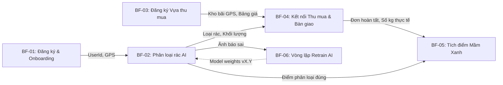
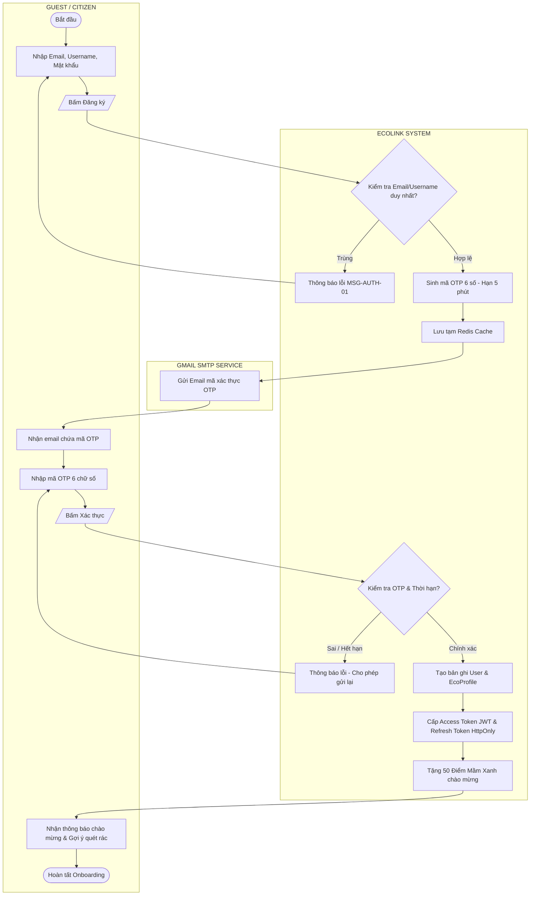
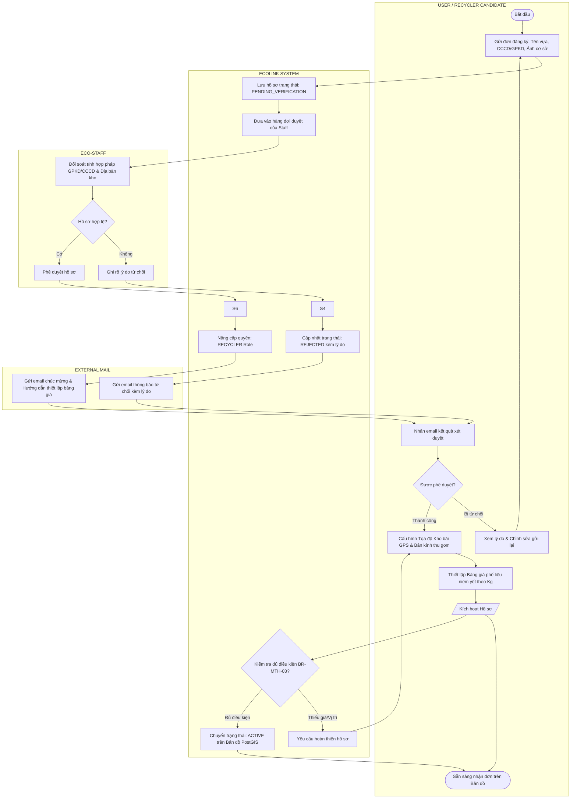
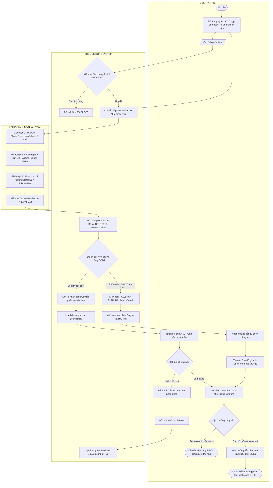
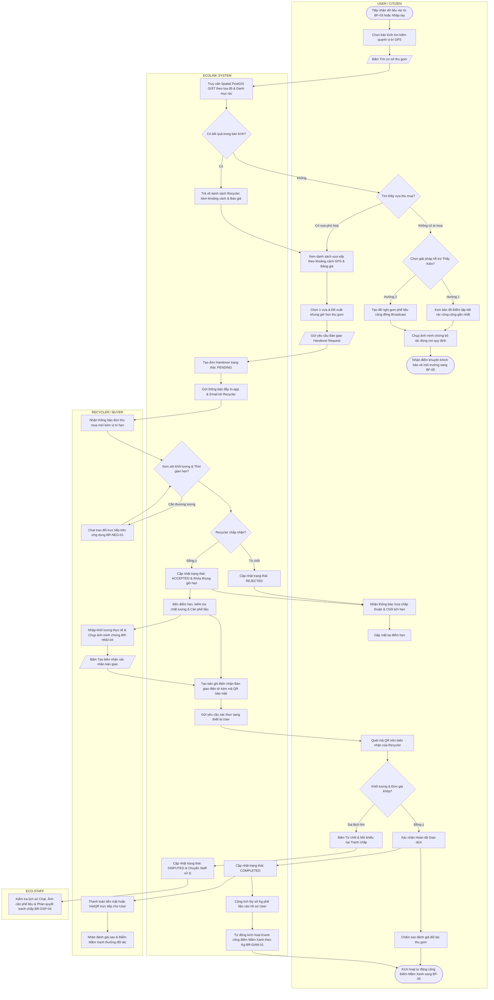
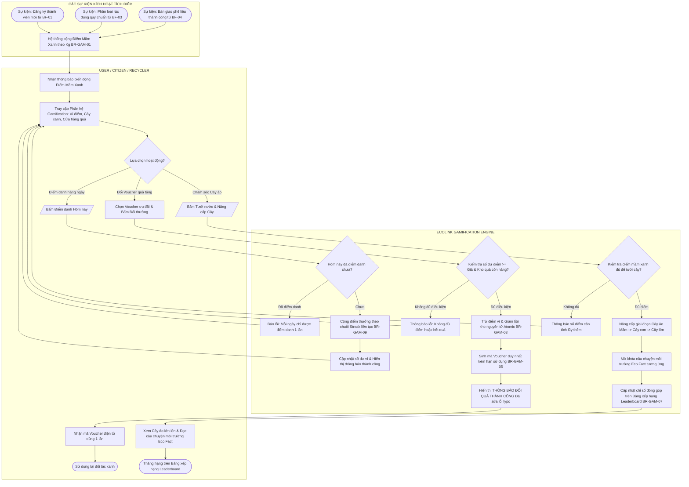

# KẾ HOẠCH TRIỂN KHAI CHUẨN HÓA SƠ ĐỒ LUỒNG NGHIỆP VỤ (BUSINESS FLOW IMPLEMENTATION PLAN)

**Dự án:** EcoLink – Nền tảng Phân loại Rác Thông minh & Kết nối Thu mua Phế liệu  
*(Intelligent Recyclable Waste Classification and Trade Matching Platform)*  
**Mã tài liệu:** ECO-PLAN-BF-01  
**Phiên bản:** 1.0.0  
**Thư mục lưu trữ đích:** [`documents/diagram/swimlane diagram - business flow/`](file:///c:/Projects/EcoLink/intelligent-waste-sorting-trading/documents/diagram/swimlane%20diagram%20-%20business%20flow)  
**Căn cứ thiết kế:**
* Báo cáo đánh giá nghiệp vụ: [`documents/Báo cáo Đánh giá và Chuẩn hóa Luồng Nghiệp vụ Business Flow.md`](file:///c:/Projects/EcoLink/intelligent-waste-sorting-trading/documents/B%C3%A1o%20c%C3%A1o%20%C4%90%C3%A1nh%20gi%C3%A1%20v%C3%A0%20Chu%E1%BA%A9n%20h%C3%B3a%20Lu%E1%BB%93ng%20Nghi%E1%BB%87p%20v%E1%BB%A5%20Business%20Flow.md).
* Biên bản phản biện: [`documents/Note Hội Đồng.md`](file:///c:/Projects/EcoLink/intelligent-waste-sorting-trading/documents/Note%20H%E1%BB%99i%20%C4%90%E1%BB%93ng.md) và [`documents/Note Review.md`](file:///c:/Projects/EcoLink/intelligent-waste-sorting-trading/documents/Note%20Review.md) (Thầy Kiên & Thầy Giang).
* Giáo trình chuẩn: *Software Requirements (3rd Edition) – Karl Wiegers & Joy Beatty*.

---

## 📌 MỤC TIÊU CỐT LÕI (OBJECTIVES)

1. **Xóa bỏ các "ốc đảo chức năng" (Functional Silos):** Biến 5 sơ đồ rời rạc hiện tại thành một **Chuỗi giá trị khép kín (End-to-End Value Stream)**, trong đó **Đầu ra (Output) của luồng này là Đầu vào (Input) của luồng kia**.
2. **Giải quyết triệt để 3 bài toán lớn của Hội đồng:**
   * *Bài toán 1 (Thầy Kiên):* Xử lý trọn vẹn rủi ro khi rác phân loại xong không có ai mua (Hướng dẫn thùng rác công cộng + Đăng bài gom cộng đồng + Thưởng điểm ý thức xanh).
   * *Bài toán 2 (Thầy Giang):* Bổ sung Kịch bản dự phòng khi AI không chắc chắn (OOD / mờ / $<60\%$) $\rightarrow$ Chuyển tiếp sang Rule Engine tĩnh cho người dùng tự chọn bằng tay.
   * *Bài toán 3 (Thầy Giang & Hội đồng):* Xây dựng vòng lặp Retrain AI hoàn chỉnh 6 bước từ Báo sai $\rightarrow$ Staff duyệt $\rightarrow$ Batch $\ge 500$ ảnh $\rightarrow$ MLOps train $\rightarrow$ Benchmark $mAP \ge 1.5\%$ $\rightarrow$ Zero-Downtime Deploy.
3. **Định dạng bàn giao đồng bộ:** Mỗi quy trình trong thư mục [`documents/diagram/swimlane diagram - business flow/`](file:///c:/Projects/EcoLink/intelligent-waste-sorting-trading/documents/diagram/swimlane%20diagram%20-%20business%20flow) sẽ gồm:
   * Mã nguồn sơ đồ phân làn **Mermaid (`.mmd`)** trực quan, hỗ trợ xem trực tiếp trên GitHub/VS Code/Markdown.
   * Bảng mô tả chi tiết từng bước (Step-by-step Swimlane Table) gồm: Số thứ tự, Tác nhân (Lane), Hành động (Step), và Mô tả chi tiết (Description).

---

## 1. DANH MỤC CÁC SƠ ĐỒ CẦN TRIỂN KHAI (DIAGRAM CATALOG)

Hệ thống sẽ được chuẩn hóa thành bộ **7 sơ đồ nghiệp vụ chuẩn mực**, bao gồm 1 sơ đồ Macro tổng thể và 6 sơ đồ phân làn chi tiết:

| Mã sơ đồ | Tên file lưu trữ | Tên luồng nghiệp vụ chuẩn hóa | Tác nhân phân làn (Lanes) | Vai trò trong chuỗi giá trị EcoLink |
| :---: | :--- | :--- | :--- | :--- |
| **BF-00** | `00_macro_e2e_business_value_chain.mmd` | **Chuỗi Giá Trị Nghiệp Vụ Tổng Thể Khép Kín (Macro E2E)** | Toàn bộ các Actor | Bản đồ định vị kết nối tất cả các phân hệ, dùng mở đầu slide thuyết trình |
| **BF-01** | `01_user_registration_and_onboarding_flow.mmd` | **Đăng ký Tài khoản Công dân & Welcome Onboarding** | Guest, EcoLink System, Gmail SMTP | Tạo danh tính, cấp JWT, định vị GPS mặc định & kích hoạt quà chào mừng |
| **BF-02** | `02_recycler_registration_and_depot_setup_flow.mmd` | **Đăng ký, Kiểm duyệt & Cấu hình Hồ sơ Kho bãi Recycler** | User/Recycler, EcoLink System, Staff, External Mail | Xác minh cơ sở hợp pháp, cấu hình GPS, bán kính thu gom & Bảng giá phế liệu |
| **BF-03** | `03_ai_waste_classification_and_sorting_guide_flow.mmd` | **Phân loại Rác Hai Giai đoạn (Two-Stage AI) & Tra cứu Quy tắc** | User, EcoLink System, AI Service | Nhận diện YOLOv8, Kịch bản dự phòng OOD $<60\%$, xuất dữ liệu sang Bán rác/Bỏ thùng |
| **BF-04** | `04_recycler_matching_negotiation_and_handover_flow.mmd` | **Kết nối Vựa phế liệu, Xử lý Không người mua & Bàn giao QR** | User, EcoLink System, Recycler, Staff | Tìm vựa theo GPS, Xử lý rác không ai mua, thương lượng, xác nhận biên nhận QR & khiếu nại |
| **BF-05** | `05_gamification_green_points_and_reward_redemption_flow.mmd` | **Kinh tế Mầm Xanh: Tích điểm, Nâng cấp Cây ảo & Đổi Voucher** | User, Recycler, EcoLink System | Tiếp nhận điểm từ Bán rác/Quét rác, Điểm danh Streak, Tưới cây, Mở Eco Facts, Đổi Voucher |
| **BF-06** | `06_ai_active_learning_and_batch_retraining_flow.mmd` | **Vòng lặp Dữ liệu & Tái Huấn luyện Mô hình AI theo Đợt** | User, Staff, EcoLink System, MLOps/Dev | Báo sai $\rightarrow$ Staff gán nhãn $\rightarrow$ Batch $\ge 500$ ảnh $\rightarrow$ Train GPU $\rightarrow$ Benchmark $\rightarrow$ Deploy |

---

## 2. DEMO LUỒNG VẼ & MÔ TẢ CHI TIẾT TỪNG BƯỚC

Dưới đây là thiết kế cấu trúc chi tiết, demo luồng vẽ và mô tả từng bước của cả 7 sơ đồ:

---

### SƠ ĐỒ 0: Chuỗi Giá Trị Nghiệp Vụ Tổng Thể Khép Kín (`BF-00`)
* **Mục tiêu:** Thể hiện bức tranh toàn cảnh (Big Picture) cho Hội đồng thấy tính kết nối Input - Output của toàn bộ dự án.

#### Demo luồng vẽ (Mermaid Architecture):


#### Mô tả luồng xử lý:
1. Người dùng đăng ký tài khoản (BF-01), nhận JWT và vị trí GPS mặc định.
2. Người dùng chụp ảnh phân loại rác (BF-02). Đầu ra là danh mục rác và khối lượng ước tính.
3. Nếu rác có thể bán, dữ liệu tự động chuyển sang luồng Kết nối thu mua (BF-04) để ghép nối với cơ sở thu gom gần nhất đã được kiểm duyệt (BF-03).
4. Khi giao dịch thu mua hoàn tất, số kg thực tế được chuyển sang Phân hệ Điểm thưởng (BF-05) để cộng Điểm Mầm Xanh cho cả hai bên.
5. Nếu AI nhận diện sai, ảnh được đưa vào Vòng lặp Retrain (BF-06) để huấn luyện lại và cập nhật phiên bản AI mới cho BF-02.

---

### SƠ ĐỒ 1: Đăng ký Tài khoản Công dân & Welcome Onboarding (`BF-01`)
* **Tác nhân:** `GUEST / CITIZEN` | `ECOLINK SYSTEM` | `GMAIL SMTP SERVICE`

#### Demo luồng vẽ (Swimlane Flow):


#### Mô tả từng bước (Step-by-Step):
1. **Bước 1 (Guest):** Khách truy cập màn hình Đăng ký, nhập Email, Username, Mật khẩu và tùy chọn Số điện thoại.
2. **Bước 2 (System):** Hệ thống kiểm tra quy tắc `BR-AUTH-01` (Email duy nhất). Nếu trùng, báo lỗi. Nếu hợp lệ, sinh mã OTP 6 chữ số ngẫu nhiên có hiệu lực trong 5 phút, lưu vào Redis Cache.
3. **Bước 3 (Mail Service):** Gửi email chứa mã OTP qua Gmail SMTP bảo mật (`BR-NTF-03`).
4. **Bước 4 (Guest):** Người dùng nhận mã OTP từ hộp thư đến và nhập vào giao diện xác thực.
5. **Bước 5 (System):** Xác minh mã OTP. Nếu hợp lệ: Kích hoạt tài khoản, tạo bản ghi `User` và `UserEcoProfile`, sinh cặp JWT Tokens, cộng 50 điểm thưởng chào mừng (`BR-GAM-01`), và chuyển tiếp sang màn hình chính.

---

### SƠ ĐỒ 2: Đăng ký, Kiểm duyệt & Cấu hình Hồ sơ Kho bãi Recycler (`BF-02`)
* **Tác nhân:** `USER / RECYCLER CANDIDATE` | `ECOLINK SYSTEM` | `STAFF` | `EXTERNAL MAIL`

#### Demo luồng vẽ (Swimlane Flow):


#### Mô tả từng bước (Step-by-Step):
1. **Bước 1 (User):** Người dùng có tài khoản gửi yêu cầu trở thành Cơ sở thu gom, tải lên: Tên cơ sở, Giấy phép kinh doanh / CCCD chủ vựa, Địa chỉ thực tế, và ảnh chụp kho bãi.
2. **Bước 2 (System):** Lưu bản ghi với trạng thái `PENDING_VERIFICATION`, đưa vào hàng đợi quản trị.
3. **Bước 3 (Staff):** Nhân viên kiểm duyệt kiểm tra tính xác thực và pháp lý của cơ sở.
   * *Nếu từ chối:* Ghi rõ nguyên nhân (ví dụ: ảnh giấy phép mờ, địa chỉ không rõ ràng) $\rightarrow$ Gửi email thông báo để cơ sở bổ sung nộp lại (`BR-MTH-02`).
   * *Nếu chấp thuận:* Bấm Phê duyệt.
4. **Bước 4 (System & Mail):** Cấp quyền `RECYCLER` và gửi email chúc mừng kèm hướng dẫn cấu hình.
5. **Bước 5 (Recycler - Khắc phục điểm đứt gãy):** Cơ sở thu mua đăng nhập, chọn vị trí kho bãi trên bản đồ (lưu tọa độ NetTopologySuite Point 4326), thiết lập bán kính nhận thu gom lưu động và nhập bảng giá niêm yết theo từng danh mục (Nhựa, Giấy, Kim loại, Carton) theo quy tắc `BR-MTH-03`.
6. **Bước 6 (System):** Kích hoạt trạng thái `ACTIVE`. Cơ sở chính thức xuất hiện trên bản đồ tìm kiếm của công dân.

---

### SƠ ĐỒ 3: Phân loại Rác Hai Giai đoạn (Two-Stage AI) & Tra cứu Quy tắc (`BF-03`)
* **Tác nhân:** `USER / CITIZEN` | `ECOLINK CORE SYSTEM` | `FASTAPI AI VISION SERVICE`

#### Demo luồng vẽ (Swimlane Flow):


#### Mô tả từng bước (Step-by-Step):
1. **Bước 1 (User):** Người dùng mở chức năng Quét rác, chụp ảnh hoặc tải ảnh rác thải lên.
2. **Bước 2 (Core System):** Kiểm tra tính hợp lệ của ảnh (JPG, PNG, WebP $\le 10$ MB theo `BR-CLS-01`).
3. **Bước 3 (AI Service):** Thực thi kiến trúc Hai Giai đoạn (Two-Stage Pipeline):
   * Giai đoạn 1: YOLOv8 phát hiện tọa độ vật thể rác.
   * Giai đoạn 2: Mở rộng 5% biên padding để lọc sạch phông nền (bàn phím, sàn nhà), sau đó đưa vào mạng phân loại chuyên sâu. Kiểm tra ngưỡng tin cậy OOD (mặc định 0.60).
4. **Bước 4 (Kịch bản dự phòng - Giải quyết ý kiến Thầy Giang):**  
   * *Nếu Confidence $< 60\%$ hoặc ảnh OOD:* Hệ thống kích hoạt **Fallback Manual Selection**, không áp đặt kết quả mò mà hiển thị bảng Rule Engine cho người dùng tự chọn loại rác bằng tay.
   * *Nếu Confidence $\ge 60\%$:* Hệ thống ánh xạ nhãn rác sang màu thùng quy chuẩn (thùng xanh, vàng, cam) và hướng dẫn chuẩn bị (rửa sạch, ép bẹp).
5. **Bước 5 (Cửa ngõ luân chuyển dữ liệu - Giải quyết ý kiến Thầy Kiên):**  
   * Người dùng xác nhận kết quả. Nếu là rác tái chế có giá trị (Nhựa, Giấy, Kim loại) $\rightarrow$ Hệ thống cung cấp nút chuyển tiếp sang **BF-04 (Tìm người thu mua)**.
   * Nếu là rác thải sinh hoạt thông thường/nguy hại $\rightarrow$ Hướng dẫn bỏ thùng quy định và kích hoạt cộng điểm ý thức xanh sang **BF-05 (Gamification)**.
6. **Bước 6 (Phản hồi dữ liệu):** Nếu người dùng thấy AI đoán sai $\rightarrow$ Bấm Báo sai và chọn nhãn đúng $\rightarrow$ Đẩy bản ghi vào hàng đợi Retrain (BF-06).

---

### SƠ ĐỒ 4: Kết nối Vựa phế liệu, Xử lý Không người mua & Bàn giao QR (`BF-04`)
* **Tác nhân:** `USER / CITIZEN` | `ECOLINK SYSTEM` | `RECYCLER` | `STAFF`

#### Demo luồng vẽ (Swimlane Flow):


#### Mô tả từng bước (Step-by-Step):
1. **Bước 1 (User):** Tiếp nhận danh mục rác và khối lượng ước tính từ BF-03. Người dùng chọn bán kính quét (ví dụ: 5 km) và bấm tìm kiếm.
2. **Bước 2 (System):** Thực thi truy vấn không gian PostGIS ST_DWithin (`BR-MTH-04`), lọc các cơ sở đang hoạt động nhận mua đúng loại rác đó.
3. **Bước 3 (Xử lý tình huống không ai mua - Giải quyết câu hỏi Thầy Kiên):**  
   * Nếu không tìm thấy vựa thu mua, hệ thống cung cấp giải pháp 3 tầng: (1) Hiển thị điểm tập kết rác công cộng; (2) Đăng bài gom cộng đồng; (3) Vẫn cộng điểm thưởng ý thức xanh cho người dân khi hoàn tất xử lý rác đúng nơi quy định.
4. **Bước 4 (User & Recycler):** Nếu có vựa, người dùng chọn đối tác phù hợp, gửi yêu cầu thu gom kèm khung giờ hẹn mong muốn (`BR-NEG-04`). Hai bên có thể chat thương lượng nhanh (`BR-NEG-01`). Khi Recycler bấm "Chấp thuận", lịch hẹn được chốt chính thức (`BR-NEG-05`).
5. **Bước 5 (Gặp mặt & Xác nhận QR - `BR-HND-04`):** Đến giờ hẹn, Recycler đến nơi, cân rác thực tế, chụp ảnh đính kèm và bấm tạo biên nhận bàn giao điện tử.
6. **Bước 6 (User Xác nhận & Chống tranh chấp):**  
   * Người dùng quét mã QR trên màn hình của Recycler để đối soát. Nếu đúng $\rightarrow$ Bấm Xác nhận hoàn tất.
   * Nếu có sai lệch khối lượng bất thường $\rightarrow$ Bấm khiếu nại để Staff giải quyết (`BR-DSP-01`).
7. **Bước 7 (Cửa ngõ luân chuyển dữ liệu sang Gamification):** Đơn hàng chuyển sang `COMPLETED`. Hệ thống tự động tính số kg phế liệu thực tế và kích hoạt Event cộng điểm thưởng Mầm Xanh (`BR-GAM-01`) sang **BF-05**.

---

### SƠ ĐỒ 5: Kinh tế Mầm Xanh: Tích điểm, Nâng cấp Cây ảo & Đổi Voucher (`BF-05`)
* **Tác nhân:** `USER / CITIZEN` | `RECYCLER` | `ECOLINK GAMIFICATION ENGINE`

#### Demo luồng vẽ (Swimlane Flow):


#### Mô tả từng bước (Step-by-Step):
1. **Bước 1 (Tiếp nhận điểm - Khắc phục điểm đứt gãy):** Hệ thống không để điểm thưởng "tự sinh ra vô căn cứ", mà tự động cộng điểm từ các luồng nghiệp vụ thực tế:
   * 1 kg nhựa tái chế hoàn tất ở BF-04 = 10 Điểm Mầm Xanh.
   * 1 lượt quét rác đúng ở BF-03 = 5 Điểm Mầm Xanh.
2. **Bước 2 (Điểm danh Streak - `BR-GAM-09`):** Mỗi ngày công dân đăng nhập điểm danh được cộng điểm tịnh tiến theo chuỗi ngày liên tiếp (Ngày 1: 5 điểm, Ngày 2: 10 điểm, Ngày 7: 50 điểm). Bỏ lỡ một ngày sẽ bị reset về Ngày 1.
3. **Bước 3 (Đổi Voucher - Đã sửa lỗi Typo):** Người dùng chọn voucher của đối tác xanh. Hệ thống kiểm tra số dư và tồn kho một cách nguyên tử (`BR-GAM-03`, `BR-GAM-04`). Nếu hợp lệ $\rightarrow$ Trừ điểm và **hiển thị thông báo thành công kèm mã voucher dùng 1 lần** (đã loại bỏ lỗi ghi "display error message" ở bản cũ).
4. **Bước 4 (Cây ảo & Eco Facts - `BR-GAM-06`):** Người dân dùng điểm để tưới cây ảo. Khi cây đạt mốc phát triển mới, hệ thống mở khóa một mẩu kiến thức sinh thái (Eco Fact) và cập nhật thứ hạng đóng góp bảo vệ môi trường trên Bảng xếp hạng vinh danh cộng đồng.

---

### SƠ ĐỒ 6: Vòng lặp Dữ liệu & Tái Huấn luyện Mô hình AI theo Đợt (`BF-06`)
* **Tác nhân:** `USER` | `ECO-STAFF` | `ECOLINK SYSTEM` | `MLOPS / DEVELOPER`

#### Demo luồng vẽ (Swimlane Flow):
```mermaid
flowchart TD
    subgraph USER [USER / CITIZEN]
        U1([Gửi phản hồi báo AI đoán sai từ BF-03]) --> S1
        U6[Nhận thông báo: Cảm ơn đóng góp cải thiện AI] --> U7([Nhận điểm thưởng đóng góp dữ liệu])
    end

    subgraph SYSTEM [ECOLINK CORE SYSTEM]
        S1[Tiếp nhận: Ảnh gốc, BBox, Nhãn AI đoán, Nhãn User sửa] --> S2[Lưu vào hàng đợi kiểm duyệt AIFeedbackQueue]
        S2 --> ST1
        
        ST3 --> S3[Lưu bản ghi vào Kho ảnh Retrain đã duyệt]
        S3 --> S4[Cộng điểm thưởng Contributor cho User] --> U6
        
        S4 --> S5{Kho ảnh mới đạt >= 500 mẫu hoặc Cuối tháng?}
        S5 -- Chưa đủ --> S6[Tiếp tục tích lũy dữ liệu]
        S5 -- Đủ điều kiện --> S7[Tự động đóng gói Batch Data & Kích hoạt Webhook Retrain] --> M1
        
        M5 --> S8[Hot-reload / Cập nhật mô hình mới vào AI Microservice]
        S8 --> S9([Người dùng BF-03 lập tức được dùng AI phiên bản mới Acc cao hơn])
    end

    subgraph STAFF [ECO-STAFF (HUMAN-IN-THE-LOOP)]
        ST1 --> ST2[Đăng nhập Portal xem ảnh báo sai & Nhãn đề xuất]
        ST2 --> ST3{Ảnh có rõ nét và nhãn chuẩn xác?}
        ST3 -- Ảnh spam/mờ/sai --> ST4[Từ chối và loại bỏ khỏi tập dữ liệu]
        ST3 -- Hợp lệ --> ST5[Xác nhận gán nhãn chuẩn hóa BR-CLS-06] --> S3
    end

    subgraph MLOPS [MLOPS / AI DEVELOPER PIPELINE]
        M1 --> M2[Tự động phân chia 80% Train / 20% Validation không trùng lặp BR-CLS-07]
        M2 --> M3[Chạy huấn luyện Transfer Learning mô hình YOLOv8 trên GPU]
        M3 --> M4[Kiểm thử độc lập trên tập Test Benchmark]
        M4 --> M5{Chỉ số mAP cải thiện >= 1.5% so với mô hình cũ?}
        M5 -- Không đạt --> M6[Hủy bỏ bản build, tinh chỉnh Hyperparameters]
        M5 -- Đạt chuẩn --> M7[Đóng gói Artifact: weights_vX.Y.pt] --> S8
    end
```

#### Mô tả từng bước (Step-by-Step - Giải quyết trọn vẹn yêu cầu Thầy Giang):
1. **Bước 1 (Tiếp nhận phản hồi - User):** Khi quét rác bị sai ở BF-03, người dùng gửi báo cáo. Dữ liệu gồm: Ảnh gốc, BBox, Nhãn AI đoán, và Nhãn người dùng đề xuất (`BR-CLS-05`).
2. **Bước 2 (Kiểm duyệt chuyên gia - Staff Human-in-the-loop):** Staff đăng nhập trang quản trị để kiểm tra. Chỉ các ảnh chụp rõ nét và nhãn được xác thực mới được duyệt đưa vào tập dữ liệu huấn luyện (`BR-CLS-06`). Người dùng được cộng điểm thưởng vì đã đóng góp dữ liệu.
3. **Bước 3 (Cơ chế kích hoạt theo đợt - Batch Trigger):** Hệ thống không train tự động từng ảnh đơn lẻ để tránh lãng phí tài nguyên và hiện tượng Catastrophic Forgetting. Thay vào đó, quy trình Retrain được kích hoạt khi: Kho ảnh mới duyệt đạt tối thiểu **500 mẫu** HOẶC định kỳ vào **ngày cuối cùng hàng tháng**.
4. **Bước 4 (Huấn luyện MLOps Pipeline):** Script tự động phân bổ 80% Train / 20% Validation không trùng lặp (`BR-CLS-07`). Kích hoạt tiến trình huấn luyện Transfer Learning cho YOLOv8 trên GPU.
5. **Bước 5 (Kiểm định Benchmark nghiêm ngặt):** Đánh giá mô hình mới trên bộ kiểm thử độc lập. Chỉ khi chỉ số $mAP@0.5$ hoặc $Accuracy$ **cao hơn mô hình production hiện tại ít nhất 1.5%** thì mô hình mới được chấp thuận phát hành.
6. **Bước 6 (Triển khai không gián đoạn - Zero-Downtime Deploy):** Đóng gói file trọng số mới (`weights_vX.Y.pt`) và cập nhật lên AI Vision Service. Người dùng lập tức được hưởng phiên bản AI có độ chính xác cao hơn.

---

## 3. KẾ HOẠCH TRIỂN KHAI VÀ BÀN GIAO (EXECUTION PHASES)

| Giai đoạn | Nhiệm vụ cụ thể | Đầu ra bàn giao (Deliverables) |
| :---: | :--- | :--- |
| **Giai đoạn 1** | Khởi tạo cấu trúc thư mục & Tạo các sơ đồ Khung nền tảng (BF-00, BF-01, BF-02) | - File `00_macro_e2e_business_value_chain.mmd`<br>- File `01_user_registration_and_onboarding_flow.mmd`<br>- File `02_recycler_registration_and_depot_setup_flow.mmd` |
| **Giai đoạn 2** | Triển khai 2 sơ đồ Nghiệp vụ Cốt lõi (BF-03, BF-04) giải quyết câu hỏi Thầy Kiên & Thầy Giang | - File `03_ai_waste_classification_and_sorting_guide_flow.mmd` (có Fallback Plan)<br>- File `04_recycler_matching_negotiation_and_handover_flow.mmd` (có Edge Case rác không ai mua) |
| **Giai đoạn 3** | Triển khai phân hệ Gamification & Vòng lặp Retrain AI (BF-05, BF-06) | - File `05_gamification_green_points_and_reward_redemption_flow.mmd` (sửa typo)<br>- File `06_ai_active_learning_and_batch_retraining_flow.mmd` (chu trình 6 bước) |
| **Giai đoạn 4** | Tạo file `README.md` hướng dẫn quản lý, đối soát và xuất ảnh sơ đồ sang Draw.io / PNG | - File `README.md` trong thư mục `documents/diagram/swimlane diagram - business flow/` |

---

## 4. CHECKLIST NGHIỆM THU CHO NHÓM ĐỒ ÁN

- [ ] Toàn bộ 7 sơ đồ đều sử dụng chuẩn Mermaid Swimlane / Flowchart phân làn rõ ràng.
- [ ] Mọi sơ đồ đều có điểm bắt đầu (Start) và điểm kết thúc (End) chuẩn xác, không còn nút cụt.
- [ ] Đầu ra của BF-03 truyền trọn vẹn vào BF-04; Đầu ra của BF-04 truyền trọn vẹn vào BF-05.
- [ ] Đã có nhánh rẽ xử lý cho trường hợp không có vựa thu mua phế liệu (Thầy Kiên).
- [ ] Đã có nhánh kịch bản dự phòng khi AI nhận diện dưới 60% (Thầy Giang).
- [ ] Đã mô hình hóa đầy đủ 6 bước của vòng lặp Retrain AI kèm điều kiện kích hoạt theo đợt (Thầy Giang).
- [ ] Đã sửa lỗi typo tại nhánh đổi thưởng của Gamification.
