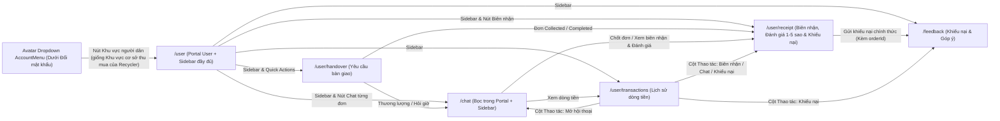
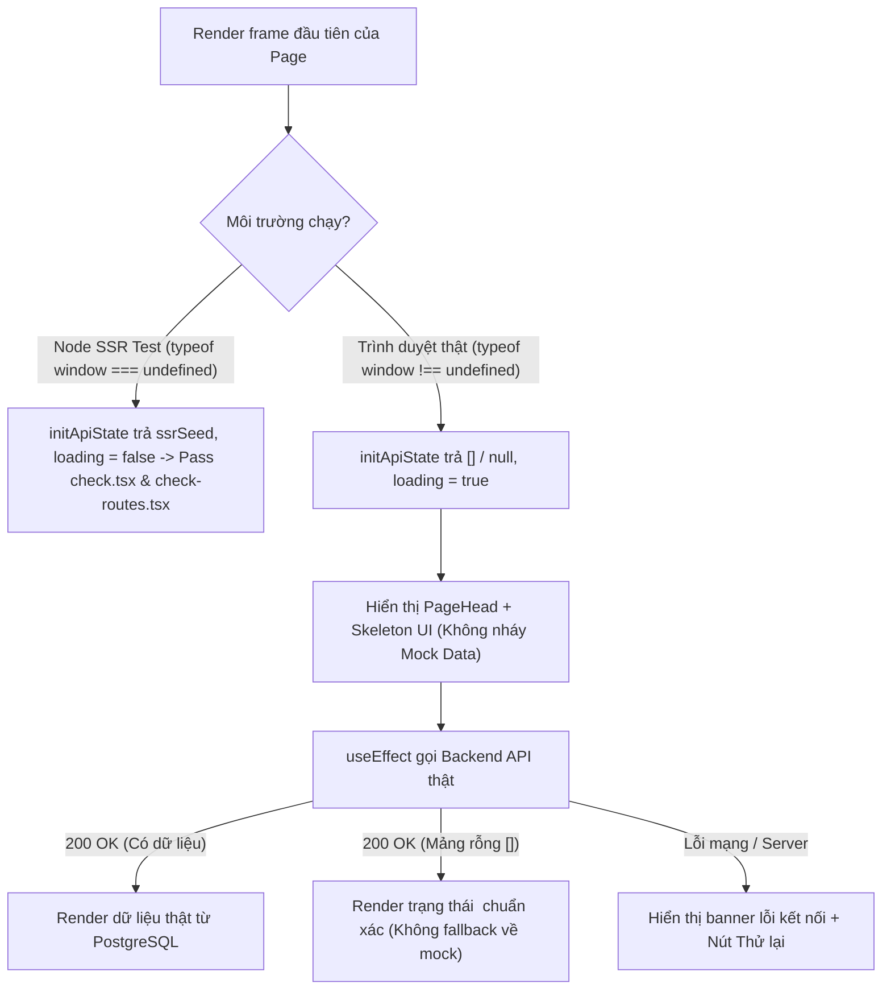

# Kế hoạch Phân tích Lỗi & Giải pháp Clean-Coding Frontend (`ecolink-web`) — 5 Trường hợp UX, Điều hướng, Form, Chat, AI Confidence & Hydration API

**Phiên bản kế hoạch:** `v1.0.0`
**Phạm vi:** Frontend [ecolink-web](file:///c:/Projects/EcoLink/ecolink-web/src) (React + TypeScript + Tailwind CSS + Vite)
**Mục tiêu:** Giải quyết dứt điểm 5 nhóm vấn đề người dùng phản ánh về trải nghiệm sử dụng (UX), luồng điều hướng `User`, chuẩn hóa biểu mẫu (`*`), lỗi cuộn trang Chat (`/chat`), minh bạch chỉ số `Confidence Score %` trên `/scanner`, và triệt tiêu hiện tượng nháy dữ liệu giả (`Flash of Mock Data`) mà vẫn đảm bảo `100%` kiểm thử SSR tĩnh (`check.tsx`, `check-routes.tsx`) hoạt động ổn định.

---

## 1. Tổng quan & Bảng ma trận chẩn đoán 5 vấn đề (Root-Cause Matrix)

| Trường hợp | Mô tả hiện tượng | File & Vị trí gây lỗi (Root Cause) | Giải pháp Clean Architecture & UX |
|---|---|---|---|
| **Trường hợp 1** | Thiếu đường dẫn điều hướng của `User` tới khu vực người dân (`/user`) chứa Chat (`/chat`), Biên nhận & Đánh giá sao (`/user/receipt`), Yêu cầu bàn giao (`/user/handover`), Khiếu nại & Góp ý (`/feedback`) | [Navbar.tsx](file:///c:/Projects/EcoLink/ecolink-web/src/components/Navbar.tsx#L232-L244), [portal.ts](file:///c:/Projects/EcoLink/ecolink-web/src/data/portal.ts#L19-L48), [App.tsx](file:///c:/Projects/EcoLink/ecolink-web/src/App.tsx#L73-L103), [user/Home.tsx](file:///c:/Projects/EcoLink/ecolink-web/src/pages/user/Home.tsx#L172-L215), [user/Handover.tsx](file:///c:/Projects/EcoLink/ecolink-web/src/pages/user/Handover.tsx#L345-L349), [user/Transactions.tsx](file:///c:/Projects/EcoLink/ecolink-web/src/pages/user/Transactions.tsx#L129-L158), [Chat.tsx](file:///c:/Projects/EcoLink/ecolink-web/src/pages/Chat.tsx#L909-L913) | **Không thêm nút lên thanh ngang `Navbar` / `MobileNav`.** Bỏ điều kiện chặn `session!.role !== "user"` trong `AccountMenu` của `Navbar.tsx` để hiển thị duy nhất nút `Khu vực người dân >` (`/user`) dưới mục *Trang cá nhân* — **đồng nhất 100% với cách `Recycler` đang dùng** (`Khu vực cơ sở thu mua >`); đồng thời bọc `/chat` trong `<Portal>` theo vai trò và hoàn thiện liên kết chéo (`?orderId=...`) bên trong khu vực Portal. |
| **Trường hợp 2** | Thiếu dấu `*` biểu thị trường bắt buộc trên các biểu mẫu điền thông tin (loại trừ Login / Register) | [Portal.tsx](file:///c:/Projects/EcoLink/ecolink-web/src/components/Portal.tsx#L327-L343), [admin/ui.tsx](file:///c:/Projects/EcoLink/ecolink-web/src/components/admin/ui.tsx#L169-L187) và các trang biểu mẫu dùng `<Field>` hoặc `<label>` thủ công | Mở rộng component `<Field required>` dùng chung ở cả 2 UI kit (`Portal.tsx` và `admin/ui.tsx`), bổ sung `<RequiredMark />` cho các `<label>` tùy chỉnh trên 25 file biểu mẫu nghiệp vụ; loại trừ Login/Register ([AuthForm.tsx](file:///c:/Projects/EcoLink/ecolink-web/src/components/AuthForm.tsx), [Login.tsx](file:///c:/Projects/EcoLink/ecolink-web/src/pages/Login.tsx), [Register.tsx](file:///c:/Projects/EcoLink/ecolink-web/src/pages/Register.tsx)) và ô tìm kiếm. |
| **Trường hợp 3** | Trang Chat thương lượng (`/chat`) bị trôi cả cửa sổ trang (`window`) xuống đáy mỗi khi load lại hoặc vào mới | [Chat.tsx](file:///c:/Projects/EcoLink/ecolink-web/src/pages/Chat.tsx#L319-L321) (`messagesEndRef.current?.scrollIntoView({ behavior: "smooth" })`) và [Chat.tsx](file:///c:/Projects/EcoLink/ecolink-web/src/pages/Chat.tsx#L1140-L1427) | Thay `scrollIntoView()` (cuộn mọi container cha bao gồm `window`) bằng `messagesContainerRef.current.scrollTo({ top: scrollHeight })` cô lập hoàn toàn bên trong khung tin nhắn `h-[480px] overflow-y-auto`, kết hợp khóa key chống cuộn lại khi polling `4000ms`. |
| **Trường hợp 4** | Thiếu hiển thị chỉ số Độ tin cậy AI (`Confidence Score %`) cho kết quả chắc chắn nhất sau khi quét | [Scanner.tsx](file:///c:/Projects/EcoLink/ecolink-web/src/pages/Scanner.tsx#L1241-L1409) (`ScanResult` và `OodResult` đã có `result.rawConfidence` nhưng chỉ truyền ngầm vào feedback) | Hiển thị tường minh huy hiệu & thanh đo `Confidence Score %` cho kết quả chắc chắn nhất (`topPrediction` / vật thể đang chọn) tại `ScanResult`, chip Bounding Box và `OodResult`, không hiển thị lại bảng xác suất các nhãn phụ gây nhiễu. |
| **Trường hợp 5** | Nhiều trang vẫn khởi tạo bằng mock data hoặc bị nháy dữ liệu giả (`Flash of Mock Data`) rồi mới load dữ liệu thật từ API | Các trang trong `src/pages/**` và [Leaderboard.tsx](file:///c:/Projects/EcoLink/ecolink-web/src/components/Leaderboard.tsx) khởi tạo `useState(MOCK_DATA)` hoặc phụ thuộc `hasLiveBackendAuth()` để phục vụ SSR smoke-test ([check.tsx](file:///c:/Projects/EcoLink/ecolink-web/src/check.tsx), [check-routes.tsx](file:///c:/Projects/EcoLink/ecolink-web/src/check-routes.tsx)) | Tách bạch môi trường chạy bằng module `src/lib/hydration.ts` *(tệp mới đề xuất tạo)* với `isSsrSmokeTest()`, `initApiState()`, `initApiLoading()`, kết hợp `<TableSkeleton />` / `<CardSkeleton />` trên trình duyệt thật để triệt tiêu 100% nháy mock data mà vẫn giữ pass toàn bộ SSR test. |

---

## 2. Phân tích Chuyên sâu & Giải pháp Clean-Coding cho từng Trường hợp

### 2.1. Trường hợp 1 — Đồng bộ Đường dẫn vào Khu vực `User` giống hệt `Recycler` & Khai thông Luồng Chat / Biên nhận / Đánh giá / Khiếu nại

#### A. Phân tích nguyên nhân gốc rễ (3 điểm nghẽn kiến trúc)

1. **Điểm nghẽn 1A — `AccountMenu` trong `Navbar.tsx` cố tình ẩn nút `"Khu vực người dân >"` đối với `user` (khác biệt vô lý so với `recycler`):**
   - Trong [portal.ts](file:///c:/Projects/EcoLink/ecolink-web/src/data/portal.ts#L19-L48) và [App.tsx](file:///c:/Projects/EcoLink/ecolink-web/src/App.tsx#L84-L93), hệ thống **đã xây dựng sẵn** toàn bộ khung Portal `/user` với thanh Sidebar trái chứa đầy đủ: `Tổng quan` (`/user`), `Yêu cầu bàn giao` (`/user/handover`), `Xác nhận biên nhận` (`/user/receipt`), `Tài khoản nhận tiền` (`/user/payout`), `Lịch sử dòng tiền` (`/user/transactions`), `Chatbox thương lượng` (`/chat`), và `Khiếu nại và góp ý` (`/feedback`).
   - Tuy nhiên, tại `AccountMenu` (menu thả xuống khi bấm vào Avatar góc phải) ở [Navbar.tsx](file:///c:/Projects/EcoLink/ecolink-web/src/components/Navbar.tsx#L232-L244):
     ```tsx
     {/* Nút vào khu vực theo vai trò (chỉ hiện cho các vai trò vận hành, không hiện cho user) */}
     {session!.role !== "user" && (
       <Link
         to={ROLE_HOME[session!.role]}
         onClick={() => setOpen(false)}
         className="flex items-center justify-between rounded-xl bg-brand/10 px-3.5 py-2.5 text-sm font-semibold text-brand-deep transition-colors hover:bg-brand/16"
       >
         Khu vực {ROLE_LABEL[session!.role].toLowerCase()}
         ...
       </Link>
     )}
     ```
   - Đối với `recycler` (hoặc `staff`, `admin`), ngay dưới mục *Trang cá nhân* (`Hồ sơ cá nhân`, `Thông báo`, `Đổi mật khẩu`) có một nút màu xanh nổi bật **"Khu vực cơ sở thu mua >"** trỏ tới `/recycler` — nơi có sẵn Sidebar trái chứa toàn bộ màn hình nghiệp vụ, giữ thanh ngang `Navbar` (`NAV_LINKS`) hoàn toàn gọn sạch (như quy ước ở [nav.ts](file:///c:/Projects/EcoLink/ecolink-web/src/data/nav.ts#L44-L46) tránh làm tràn thanh Navbar ngang).
   - Đối với `user`, điều kiện `session!.role !== "user"` đã ẩn nút **"Khu vực người dân >"** (`/user`), khiến người dân khi bấm Avatar chỉ thấy 3 mục tài khoản cá nhân mà **không có đường dẫn vào Portal `/user`** (cũng như toàn bộ Chat, Biên nhận, Dòng tiền, Đánh giá, Khiếu nại bên trong đó).
2. **Điểm nghẽn 1B — Trang `/chat` bị tách khỏi khung Sidebar `<Portal>` trong `App.tsx`:**
   - Trong [App.tsx](file:///c:/Projects/EcoLink/ecolink-web/src/App.tsx#L73-L81), route `path="chat"` đặt trực tiếp dưới `<Layout />` (không bọc trong `<Portal role="user" | "recycler" />`). Do đó khi cả Người dân lẫn Cơ sở thu mua bấm vào `"Chatbox thương lượng"` từ Sidebar, thanh Sidebar bên trái biến mất khiến người dùng không chuyển nhanh sang `"Yêu cầu bàn giao"` hay `"Xác nhận biên nhận"` được.
3. **Điểm nghẽn 1C — Đứt gãy liên kết chéo (`Cross-linking`) bên trong các trang Portal của `User`:**
   - Tại [Chat.tsx](file:///c:/Projects/EcoLink/ecolink-web/src/pages/Chat.tsx#L909-L913), khi giao dịch đạt trạng thái `Completed`, nút hành động chính ghi `"Xem lịch sử & Đánh giá sao"` nhưng `to` lại trỏ sang `"/user/transactions"`.
   - Trong khi đó, [user/Transactions.tsx](file:///c:/Projects/EcoLink/ecolink-web/src/pages/user/Transactions.tsx#L129-L158) chỉ render bảng chỉ số đọc (`Ngày | Mã đơn | Đối tác | Khối lượng | Số tiền nhận | Điểm xanh`), không có cột thao tác hay liên kết sang form Đánh giá 1–5 sao & Biên nhận (`/user/receipt?orderId=...`) hoặc Khiếu nại (`/feedback?orderId=...`).
   - Tại [user/Home.tsx](file:///c:/Projects/EcoLink/ecolink-web/src/pages/user/Home.tsx#L172-L187), bảng `"Yêu cầu đang mở"` thiếu nút thao tác trực tiếp theo từng dòng đơn (`/chat?orderId=...`, `/user/receipt?orderId=...`), và trang Tổng quan `/user` cũng chưa có cụm thẻ lối tắt (Quick Actions) dẫn nhanh sang Chat, Biên nhận & Đánh giá, Khiếu nại.
   - Tại [user/Handover.tsx](file:///c:/Projects/EcoLink/ecolink-web/src/pages/user/Handover.tsx#L345-L349), khi đơn chuyển sang `"done"` (`Completed`), giao diện chỉ hiện nút `"Xem tiền đã nhận"` (`/user/transactions`), thiếu nút `"Xem biên nhận & Đánh giá sao"` (`/user/receipt?orderId=...`) và `"Xem lại Chat"` (`/chat?orderId=...`).

#### B. Sơ đồ luồng điều hướng mục tiêu (Giữ sạch Navbar, đồng bộ UX giữa `User` & `Recycler`)



#### C. Giải pháp Clean-Coding chi tiết theo từng file

1. **[Navbar.tsx](file:///c:/Projects/EcoLink/ecolink-web/src/components/Navbar.tsx) *(Giữ nguyên thanh Navbar ngang & MobileNav, đồng bộ 100% với Recycler)*:**
   - **Không thêm bất kỳ liên kết nào lên thanh `NAV_LINKS` ngang hay `MobileNav`**, bảo toàn bố cục sạch và tránh tràn chiều ngang ở màn `1024px`.
   - Tại `AccountMenu` (dòng `232-244`), **chỉ cần bỏ điều kiện `{session!.role !== "user" && (...)}`** để hiển thị nút pill xanh **"Khu vực người dân >"** (`to={ROLE_HOME["user"]}` = `/user`) ngay bên dưới *Đổi mật khẩu* trong nhóm *Trang cá nhân* — **giống hệt cấu trúc và giao diện của `recycler` (`Khu vực cơ sở thu mua >` → `/recycler`)**.
   - *(Ghi chú về điều hướng sau đăng nhập tại `Navbar.tsx#L165` và `AuthForm.tsx#L71`):* Có thể giữ `user` ở `"/"` khi vừa đăng nhập (vì người dân thường quét AI hoặc xem bản đồ ở trang công khai, rồi bấm Avatar → `Khu vực người dân >` khi cần vào trang thông tin giao dịch giống Recycler) hoặc cân nhắc đưa thẳng vào `/user` tùy UX mong muốn; quan trọng nhất là nút `Khu vực người dân >` luôn hiện rõ trong menu Avatar.
2. **[App.tsx](file:///c:/Projects/EcoLink/ecolink-web/src/App.tsx) & [portal.ts](file:///c:/Projects/EcoLink/ecolink-web/src/data/portal.ts) & [Chat.tsx](file:///c:/Projects/EcoLink/ecolink-web/src/pages/Chat.tsx):**
   - Trong [App.tsx](file:///c:/Projects/EcoLink/ecolink-web/src/App.tsx#L73-L81), bọc route `path="chat"` bằng một wrapper nhỏ `<RolePortalShell />` (đọc `useSession()?.role` để render `<Portal role={role === "recycler" ? "recycler" : "user"} />`), giúp **cả `user` và `recycler` đều giữ nguyên Sidebar Portal** khi mở `/chat` mà không cần tự chế thanh menu phụ lên `Navbar` hay lặp lại code của `PORTAL_NAV`. (Trong `Chat.tsx` dòng `921`, bỏ class `page` thừa khi nằm trong `<main>` của `<Portal>` nếu không chạy standalone trong `check.tsx`, hoặc thay padding linh hoạt để không bị lồng 2 lớp `max-w`.)
   - Trong [portal.ts](file:///c:/Projects/EcoLink/ecolink-web/src/data/portal.ts#L19-L65):
     - Đổi nhãn `{ to: "/user/receipt", label: "Xác nhận biên nhận" }` thành `{ to: "/user/receipt", label: "Biên nhận & Đánh giá" }` để người dân nhận biết ngay nơi đánh giá sao.
     - Bổ sung `{ to: "/feedback", label: "Khiếu nại và góp ý" }` vào nhóm `"Khác"` của `PORTAL_NAV.recycler` tương tự `PORTAL_NAV.user`.
   - Trong [Chat.tsx](file:///c:/Projects/EcoLink/ecolink-web/src/pages/Chat.tsx#L909-L913): Khi `statusLower === "completed"`, sửa `nextStepAction` của `user` trỏ thẳng tới `` `/user/receipt?orderId=${encodeURIComponent(currentOrderId)}` `` với nhãn **"Xem biên nhận & Đánh giá sao"** (kèm link phụ tới `/user/transactions`).
3. **[user/Home.tsx](file:///c:/Projects/EcoLink/ecolink-web/src/pages/user/Home.tsx):**
   - Thêm dải **Lối tắt nhanh (Quick Actions 4 thẻ)** bên trong nội dung trang `/user` (không đụng `Navbar`): `Yêu cầu bàn giao (/user/handover)`, `Chat thương lượng (/chat)`, `Biên nhận & Đánh giá sao (/user/receipt)`, `Khiếu nại & Góp ý (/feedback)`.
   - Thêm cột **"Thao tác"** ở bảng `"Yêu cầu đang mở"` với nút ngữ cảnh tới `/chat?orderId=...` và `/user/receipt?orderId=...`.
4. **[user/Handover.tsx](file:///c:/Projects/EcoLink/ecolink-web/src/pages/user/Handover.tsx):**
   - Ở trạng thái `"done"` (`Completed`, dòng `345-349`), bổ sung nút **"Biên nhận & Đánh giá sao"** (`/user/receipt?orderId=${encodeURIComponent(h.id)}`) và nút **"Xem lại Chat"** (`/chat?orderId=${encodeURIComponent(h.id)}`) bên cạnh nút `"Xem tiền đã nhận"`.
5. **[user/Transactions.tsx](file:///c:/Projects/EcoLink/ecolink-web/src/pages/user/Transactions.tsx):**
   - Thêm cột **"Thao tác"** vào cuối mỗi dòng giao dịch trong bảng với 3 liên kết có gắn `?orderId=${encodeURIComponent(f.handoverId)}`: `Biên nhận & Đánh giá`, `Mở Chat`, `Khiếu nại`.
6. **[Feedback.tsx](file:///c:/Projects/EcoLink/ecolink-web/src/pages/Feedback.tsx):**
   - Sử dụng `useSearchParams()` để đọc `?orderId=...`, tự động set `cat = "complaint"` và chọn sẵn `selectedOrderId` khớp với mã đơn bàn giao từ trang `Transactions`, `Handover` hoặc `Receipt`.

---

### 2.2. Trường hợp 2 — Chuẩn hóa Dấu `*` cho các Trường Bắt buộc trên Toàn bộ Biểu mẫu (Loại trừ Login / Register)

#### A. Phân tích nguyên nhân gốc rễ

- Toàn dự án dùng 2 component `<Field>` tại [Portal.tsx](file:///c:/Projects/EcoLink/ecolink-web/src/components/Portal.tsx#L327-L343) và [admin/ui.tsx](file:///c:/Projects/EcoLink/ecolink-web/src/components/admin/ui.tsx#L169-L187); cả hai hiện chỉ nhận `{ label, hint, children }` và **chưa hỗ trợ prop `required?: boolean`**.
- Nhiều form viết `<label>` thủ công trong JSX (`Chat.tsx`, `user/Handover.tsx`, `user/Receipt.tsx`, `Scanner.tsx`, `Feedback.tsx`, `JoinRecycler.tsx`, `user/Payout.tsx`, `recycler/Receipt.tsx`, v.v.) cũng chưa hiển thị dấu `*` đỏ cho các trường bắt buộc khiến người dùng khó phân biệt trường bắt buộc và trường tùy chọn.

#### B. Giải pháp Clean-Coding (DRY & Tương thích 100% SSR Test)

1. **Mở rộng `<Field>` và export `<RequiredMark />` tại 2 UI kit gốc ([Portal.tsx](file:///c:/Projects/EcoLink/ecolink-web/src/components/Portal.tsx#L327-L343) & [admin/ui.tsx](file:///c:/Projects/EcoLink/ecolink-web/src/components/admin/ui.tsx#L169-L187)):**

```tsx
export function RequiredMark() {
  return (
    <span
      className="ml-1 font-bold text-red-600"
      aria-hidden="true"
      title="Trường bắt buộc"
    >
      *
    </span>
  )
}

export function FormRequiredLegend({ className = "" }: { className?: string }) {
  return (
    <p className={`text-xs text-muted ${className}`}>
      Các trường có dấu <span className="font-bold text-red-600">*</span> là thông tin bắt buộc.
    </p>
  )
}

export function Field({
  label,
  hint,
  required,
  children,
}: {
  label: string
  hint?: string
  required?: boolean
  children: ReactNode
}) {
  return (
    <label className="flex flex-col gap-1.5 text-[13px] font-semibold text-ink">
      <span>
        {label}
        {required && <RequiredMark />}
      </span>
      {children}
      {hint && <span className="text-xs font-normal text-muted">{hint}</span>}
    </label>
  )
}
```

- **Đảm bảo tương thích SSR test (`check.tsx` & `check-routes.tsx`):** Chuỗi HTML sau khi strip tag của `<Field label="Tên hiển thị" required>` là `"Tên hiển thị *"`, vẫn chứa nguyên chuỗi gốc `"Tên hiển thị"` nên không làm hỏng bất kỳ assertion `text.includes(mustInclude)` nào.
- **Đặt `aria-hidden="true"` trên `*` và `required` HTML trên `<input>`/`<select>`/`<textarea>`:** Giúp trình đọc màn hình (Screen Reader) không đọc lặp chữ `"sao"` mà đọc đúng trạng thái `required`.

2. **Phạm vi áp dụng & Loại trừ:**
   - **Loại trừ (giữ nguyên không thêm `*` theo đúng yêu cầu):** [AuthForm.tsx](file:///c:/Projects/EcoLink/ecolink-web/src/components/AuthForm.tsx), [Login.tsx](file:///c:/Projects/EcoLink/ecolink-web/src/pages/Login.tsx), [Register.tsx](file:///c:/Projects/EcoLink/ecolink-web/src/pages/Register.tsx), và các thanh tìm kiếm/lọc (`SearchFilterBar`, ô search trong danh sách).
   - **Danh sách các biểu mẫu nghiệp vụ cần bổ sung `required` / `<RequiredMark />` & `<FormRequiredLegend />`:**

| Nhóm trang | File | Các trường bắt buộc cần gắn `*` | Trường tùy chọn (Không gắn `*`) |
|---|---|---|---|
| **Citizen (User)** | [user/Handover.tsx](file:///c:/Projects/EcoLink/ecolink-web/src/pages/user/Handover.tsx) | Cơ sở thu mua, Loại rác & Khối lượng ước tính (kg), Địa chỉ thu gom & Ghim bản đồ, Ngày hẹn, Khung giờ, Lý do hủy đơn (khi mở form hủy) | Ghi chú thêm cho người thu gom |
| | [user/Receipt.tsx](file:///c:/Projects/EcoLink/ecolink-web/src/pages/user/Receipt.tsx) | Chọn số sao đánh giá (`1–5`), Lý do khiếu nại biên nhận (`>= 15 ký tự` khi mở form khiếu nại) | Nhận xét văn bản khi đánh giá sao |
| | [user/Payout.tsx](file:///c:/Projects/EcoLink/ecolink-web/src/pages/user/Payout.tsx) | Ngân hàng nhận tiền, Số tài khoản, Tên chủ tài khoản | — |
| **Chat & AI** | [Chat.tsx](file:///c:/Projects/EcoLink/ecolink-web/src/pages/Chat.tsx) | Modal Đề xuất điều khoản: Loại phế liệu, Đơn giá (`VNĐ/kg`), Khối lượng (`kg`), Khung giờ; Modal Hủy đơn: Lý do hủy | Ngày thu gom nếu giữ mặc định, Ghi chú thương lượng |
| | [Scanner.tsx](file:///c:/Projects/EcoLink/ecolink-web/src/pages/Scanner.tsx), [Guidance.tsx](file:///c:/Projects/EcoLink/ecolink-web/src/pages/Guidance.tsx) | Form Báo AI nhận diện sai: Loại vật liệu đúng theo bạn | Nhóm mô tả/ghi chú phụ (nếu có) |
| **Công khai & Tài khoản** | [Feedback.tsx](file:///c:/Projects/EcoLink/ecolink-web/src/pages/Feedback.tsx) | Loại phản hồi, Nhóm vấn đề / Nhóm vi phạm, Mô tả chi tiết, Thông tin liên hệ | Đơn bàn giao liên kết (tùy chọn khi góp ý), Ảnh minh chứng |
| | [JoinRecycler.tsx](file:///c:/Projects/EcoLink/ecolink-web/src/pages/JoinRecycler.tsx) | Tên cơ sở, Người đại diện, SĐT, Email, Địa chỉ & Tọa độ ghim, Vật liệu thu mua, Giấy phép ĐKKD, Ảnh kho bãi | Mô tả thêm |
| | [account/Profile.tsx](file:///c:/Projects/EcoLink/ecolink-web/src/pages/account/Profile.tsx), [admin/AccountProfile.tsx](file:///c:/Projects/EcoLink/ecolink-web/src/pages/admin/AccountProfile.tsx) | Tên hiển thị, Số điện thoại | Email (read-only), Khu vực |
| | [account/Password.tsx](file:///c:/Projects/EcoLink/ecolink-web/src/pages/account/Password.tsx), [admin/AccountPassword.tsx](file:///c:/Projects/EcoLink/ecolink-web/src/pages/admin/AccountPassword.tsx), [ResetPassword.tsx](file:///c:/Projects/EcoLink/ecolink-web/src/pages/ResetPassword.tsx) | Mật khẩu hiện tại, Mật khẩu mới, Nhập lại mật khẩu mới | — |
| **Recycler** | [recycler/Receipt.tsx](file:///c:/Projects/EcoLink/ecolink-web/src/pages/recycler/Receipt.tsx), [recycler/Requests.tsx](file:///c:/Projects/EcoLink/ecolink-web/src/pages/recycler/Requests.tsx) | Khối lượng cân thực tế (`kg`), Ảnh bằng chứng cân đo, Lý do từ chối / khiếu nại | Ảnh bổ sung thêm |
| **Staff** | [staff/BlogEditor.tsx](file:///c:/Projects/EcoLink/ecolink-web/src/pages/staff/BlogEditor.tsx) | Tiêu đề, Tóm tắt, Nội dung bài viết, URL ảnh bìa (bắt buộc khi gửi duyệt) | Thẻ phân loại |
| | [staff/EcoFacts.tsx](file:///c:/Projects/EcoLink/ecolink-web/src/pages/staff/EcoFacts.tsx) | Tiêu đề kiến thức, Nội dung, Mốc cấp Cây Ảo mở khóa, Điểm cần để mở | URL nguồn tham khảo |
| | [staff/Gifts.tsx](file:///c:/Projects/EcoLink/ecolink-web/src/pages/staff/Gifts.tsx) | Tên quà, Điểm đổi, Tồn kho, Loại quà, Nguồn ảnh | Mô tả ngắn |
| | [staff/Applications.tsx](file:///c:/Projects/EcoLink/ecolink-web/src/pages/staff/Applications.tsx), [staff/Complaints.tsx](file:///c:/Projects/EcoLink/ecolink-web/src/pages/staff/Complaints.tsx), [staff/Accounts.tsx](file:///c:/Projects/EcoLink/ecolink-web/src/pages/staff/Accounts.tsx), [staff/Dataset.tsx](file:///c:/Projects/EcoLink/ecolink-web/src/pages/staff/Dataset.tsx) | Lý do từ chối hồ sơ, Phán quyết khiếu nại & Lý do cảnh cáo, Lý do khóa/mở tài khoản, Mã & Tên phiên bản Dataset | Ghi chú ca trực (`staff/CheckIn.tsx`) |
| **Admin** | [admin/Categories.tsx](file:///c:/Projects/EcoLink/ecolink-web/src/pages/admin/Categories.tsx), [admin/Policy.tsx](file:///c:/Projects/EcoLink/ecolink-web/src/pages/admin/Policy.tsx), [admin/StaffAccounts.tsx](file:///c:/Projects/EcoLink/ecolink-web/src/pages/admin/StaffAccounts.tsx), [admin/Leaderboard.tsx](file:///c:/Projects/EcoLink/ecolink-web/src/pages/admin/Leaderboard.tsx), [admin/Fees.tsx](file:///c:/Projects/EcoLink/ecolink-web/src/pages/admin/Fees.tsx), [admin/Reconciliation.tsx](file:///c:/Projects/EcoLink/ecolink-web/src/pages/admin/Reconciliation.tsx), [admin/BlogReview.tsx](file:///c:/Projects/EcoLink/ecolink-web/src/pages/admin/BlogReview.tsx), [admin/Gamification.tsx](file:///c:/Projects/EcoLink/ecolink-web/src/pages/admin/Gamification.tsx) | Các trường tạo/sửa danh mục, rule phân loại, tạo/khóa tài khoản Staff, tạo chu kỳ BXH, cấu hình gói & đơn giá, quyết định đối soát & mã đơn khớp, lý do trả bài Blog, tham số điểm thưởng | Mật khẩu khởi tạo (tùy chọn), Cảnh báo an toàn (nếu có), Mô tả quyền lợi, Mã tra soát ngân hàng (tùy chọn) |

---

### 2.3. Trường hợp 3 — Xử lý dứt điểm Lỗi Trôi cả trang (`window` scroll jump) tại Trang Chat thương lượng (`/chat`)

#### A. Phân tích nguyên nhân gốc rễ

Tại [Chat.tsx](file:///c:/Projects/EcoLink/ecolink-web/src/pages/Chat.tsx#L319-L321):
```tsx
useEffect(() => {
  messagesEndRef.current?.scrollIntoView({ behavior: "smooth" })
}, [thread?.messages.items, partnerTyping])
```
Và phần tử neo `<div ref={messagesEndRef} />` đặt ở cuối danh sách tin nhắn ([Chat.tsx](file:///c:/Projects/EcoLink/ecolink-web/src/pages/Chat.tsx#L1427)) bên trong khung `<div className="flex h-[480px] flex-col gap-3 overflow-y-auto p-5 bg-surface-1">` ([Chat.tsx](file:///c:/Projects/EcoLink/ecolink-web/src/pages/Chat.tsx#L1140)).

**Vì sao cả trang bị kéo xuống đáy (mất header/thông tin đơn, lộ Footer như ảnh chụp màn hình)?**
1. Theo đặc tả CSSOM View, `element.scrollIntoView()` sẽ cuộn **tất cả các tổ tiên có thanh cuộn (từ container `overflow-y-auto` ra tới `document.scrollingElement` / `window`)** sao cho phần tử `messagesEndRef` nằm gọn trong viewport. Vì khung chat nằm ở nửa dưới của trang `/chat`, `scrollIntoView()` đẩy luôn `window.scrollY` xuống cuối trang.
2. Dependency `[thread?.messages.items, partnerTyping]` chứa mảng `items` luôn là tham chiếu object mới sau mỗi vòng polling `4000ms`, khiến trình duyệt bị kéo giật liên tục nếu danh sách cập nhật.

#### B. Giải pháp Clean-Coding (Container-Scoped Scrolling)

1. Thay thế hoàn toàn `messagesEndRef.current?.scrollIntoView(...)` bằng `messagesContainerRef` gắn trực tiếp vào container `overflow-y-auto` (dòng `1140`):
   ```tsx
   const messagesContainerRef = useRef<HTMLDivElement>(null)
   const lastScrollSignatureRef = useRef<string>("")

   // Giữ viewport trình duyệt ở đầu trang khi người dùng mới điều hướng tới /chat
   useEffect(() => {
     if (typeof window !== "undefined") {
       window.scrollTo({ top: 0, behavior: "auto" })
     }
   }, [])

   // Chỉ cuộn BÊN TRONG khung tin nhắn (không tác động tới window scrollY)
   useEffect(() => {
     const container = messagesContainerRef.current
     if (!container) return

     const items = thread?.messages.items ?? []
     const lastMsgId = items[items.length - 1]?.id ?? ""
     const nextSig = `${currentOrderId ?? "offline"}|${items.length}|${lastMsgId}|${partnerTyping ? "1" : "0"}`

     if (lastScrollSignatureRef.current === nextSig) return
     const switchedOrder = !lastScrollSignatureRef.current.startsWith(
       `${currentOrderId ?? "offline"}|`,
     )
     lastScrollSignatureRef.current = nextSig

     container.scrollTo({
       top: container.scrollHeight,
       behavior: switchedOrder ? "auto" : "smooth",
     })
   }, [currentOrderId, thread?.messages.items, partnerTyping])
   ```
2. Gắn `ref={messagesContainerRef}` vào thẻ container tại dòng `1140`:
   ```tsx
   <div
     ref={messagesContainerRef}
     className="flex h-[480px] flex-col gap-3 overflow-y-auto bg-surface-1 p-5"
   >
   ```
3. **Kết quả:** Khung hội thoại `480px` tự động cuộn mượt tới tin nhắn mới nhất khi mở phòng chat hoặc có tin mới, trong khi **trang web giữ nguyên vị trí đầu trang (`window.scrollY === 0`)** — hiển thị trọn vẹn `Navbar`, `ChatPortalQuickNav`, `PageHead` và thẻ đối tác thu gom.

---

### 2.4. Trường hợp 4 — Hiển thị tường minh Chỉ số Độ tin cậy AI (`Confidence Score %`) cho Kết quả chắc chắn nhất trên `/scanner`

#### A. Phân tích nguyên nhân gốc rễ

- Trong [Scanner.tsx](file:///c:/Projects/EcoLink/ecolink-web/src/pages/Scanner.tsx#L533-L635), `ViewModelResult` đã lưu chính xác trường `rawConfidence` (`0.0..1.0`) cho vật thể đang chọn / dự đoán cao nhất (`chosen.rawConfidence` hoặc `aiResult.topPrediction.confidence`).
- Tuy nhiên, trong hai component hiển thị kết quả `ScanResult` (dòng `1241-1355`) và `OodResult` (dòng `1359-1409`), `result.rawConfidence` hiện chỉ được truyền ngầm vào `<InlineFeedbackReport confidenceScore={result.rawConfidence} />` mà **chưa render ra giao diện người dùng**.

#### B. Giải pháp Clean-Coding & Thiết kế UI Minh bạch

Không hiển thị lại danh sách xác suất của các nhãn phụ gây rối; chỉ tách một helper & badge sạch dùng chung để hiển thị tường minh **Độ tin cậy AI của kết quả chắc chắn nhất**:

1. **Helper chuẩn hóa hiển thị độ tin cậy trong [Scanner.tsx](file:///c:/Projects/EcoLink/ecolink-web/src/pages/Scanner.tsx):**
   ```tsx
   function formatConfidencePercent(rawConfidence: number): string {
     const clamped = Math.max(0, Math.min(1, rawConfidence))
     return `${(clamped * 100).toFixed(1)}%`
   }

   function getConfidenceMeta(rawConfidence: number, threshold = 0.6) {
     const pct = Math.max(0, Math.min(100, rawConfidence * 100))
     if (rawConfidence < threshold) {
       return {
         pctText: `${pct.toFixed(1)}%`,
         pctWidth: `${Math.round(pct)}%`,
         tierLabel: "Dưới ngưỡng tin cậy",
         badgeCls: "border-amber-300 bg-amber-50 text-amber-900",
         barCls: "bg-amber-500",
       }
     }
     if (rawConfidence >= 0.85) {
       return {
         pctText: `${pct.toFixed(1)}%`,
         pctWidth: `${Math.round(pct)}%`,
         tierLabel: "Độ tin cậy rất cao",
         badgeCls: "border-brand/30 bg-brand/12 text-brand-deep",
         barCls: "bg-brand",
       }
     }
     return {
       pctText: `${pct.toFixed(1)}%`,
       pctWidth: `${Math.round(pct)}%`,
       tierLabel: "Độ tin cậy khá",
       badgeCls: "border-emerald-300 bg-emerald-50 text-emerald-900",
       barCls: "bg-emerald-500",
     }
   }
   ```
2. **Hiển thị tại 3 điểm UI trọng tâm:**
   - **Điểm 1 — Thẻ `ScanResult` (Khối kết luận phân loại chính, dòng `1262-1335`):** Đặt hộp **Độ tin cậy AI (Kết quả chắc chắn nhất)** ngay phía trên hoặc bên cạnh nhóm/tên loại rác:
     - Huy hiệu số `%` lớn rõ ràng: `Độ tin cậy AI: 94.5% · Độ tin cậy rất cao`.
     - Thanh tiến trình mảnh (`h-1.5 w-full rounded-full`) kèm chú thích ngắn `"Kết quả nhận diện chắc chắn nhất từ AI (vượt ngưỡng an toàn 60%)"`.
   - **Điểm 2 — Thẻ `OodResult` (Khi `< 60%`, dòng `1359-1409`):** Hiển thị minh bạch chỉ số lớn nhất mô hình đạt được: `"Độ tin cậy cao nhất AI đo được: 48.2% (thấp hơn ngưỡng an toàn 60% nên hệ thống không tự gán nhãn)"` để người dùng hiểu lý do cần chụp lại.
   - **Điểm 3 — Nhãn chip vật thể & khung Bounding Box (dòng `1085-1195`):** Hiển thị thêm `%` trên chip/nhãn của vật thể đang chọn (ví dụ: `Chai nhựa PET · 94.5%`), đồng bộ với bảng lịch sử quét (`item.confidenceScore`).

---

### 2.5. Trường hợp 5 — Triệt tiêu Hiện tượng Nháy Mock Data (`Flash of Mock Data`) & Chuẩn hóa Kiến trúc Hydration API

#### A. Phân tích nguyên nhân gốc rễ (3 Anti-Patterns trong codebase)

Qua rà soát toàn bộ các trang trong `src/pages/**`, nguyên nhân gây hiện tượng *nháy dữ liệu giả trước khi tải xong dữ liệu thật từ API* (hoặc vẫn dùng mock data) chia làm 3 nhóm:

1. **Anti-pattern 5A — Khởi tạo `useState(MOCK_DATA)` vô điều kiện ở trang đã nối API:**
   - [account/Notifications.tsx](file:///c:/Projects/EcoLink/ecolink-web/src/pages/account/Notifications.tsx#L75): `useState(INITIAL_NOTES)` → luôn nháy 3 thông báo giả của *"Cô Ba Thu Gom"* trước khi `fetchMyNotifications()` trả về.
   - [admin/Categories.tsx](file:///c:/Projects/EcoLink/ecolink-web/src/pages/admin/Categories.tsx#L69): `useState(FALLBACK_ROWS)` từ `WASTES` → nháy bảng mock trước khi `fetchWasteCategories()` hoàn tất.
   - [admin/Policy.tsx](file:///c:/Projects/EcoLink/ecolink-web/src/pages/admin/Policy.tsx#L68): `useState(FALLBACK_POLICIES)` → nháy danh sách luật phân loại mock trước khi `fetchDetailedSortingRules()` hoàn tất.
   - [recycler/Catalog.tsx](file:///c:/Projects/EcoLink/ecolink-web/src/pages/recycler/Catalog.tsx#L40): `useState(() => WASTES...)` → nháy bảng giá mặc định trước khi `fetchWasteCategories()` & `fetchRecyclerPrices()` trả về.
   - [Waste.tsx](file:///c:/Projects/EcoLink/ecolink-web/src/pages/Waste.tsx#L34) & [Guidance.tsx](file:///c:/Projects/EcoLink/ecolink-web/src/pages/Guidance.tsx#L22-L43): render mảng `WASTES` tĩnh ở frame đầu trước khi `fetchSortingRules()` trả về.
   - [Partners.tsx](file:///c:/Projects/EcoLink/ecolink-web/src/pages/Partners.tsx#L27-L69): luôn hiển thị cố định mảng `PARTNERS` giả lập song song dưới dữ liệu thật từ `searchNearbyRecyclers()`.
   - [account/Profile.tsx](file:///c:/Projects/EcoLink/ecolink-web/src/pages/account/Profile.tsx#L20) & [admin/AccountProfile.tsx](file:///c:/Projects/EcoLink/ecolink-web/src/pages/admin/AccountProfile.tsx#L17-L20): khởi tạo `useState(session?.phoneNumber ?? "0901 234 567")` khiến số điện thoại giả nháy lên trước khi `fetchCurrentUserProfile()` trả về; đồng thời cột thống kê bên phải của cả 2 trang vẫn đếm từ dữ liệu tĩnh (`MY_HANDOVERS`, `FLOWS`, `AI_CASES`, `APPLICATIONS`, `COMPLAINTS`).
   - [user/Payout.tsx](file:///c:/Projects/EcoLink/ecolink-web/src/pages/user/Payout.tsx#L91-L92): khởi tạo cứng `useState("007012345678")`, `useState("Nguyễn Đức")` và `CANONICAL_FALLBACK_PACKAGES`.
   - [recycler/Home.tsx](file:///c:/Projects/EcoLink/ecolink-web/src/pages/recycler/Home.tsx#L86-L88): khởi tạo `packages` bằng `CANONICAL_FALLBACK_PACKAGES` trước khi `getAvailableServicePackages()` trả về.
   - [Rewards.tsx](file:///c:/Projects/EcoLink/ecolink-web/src/pages/Rewards.tsx#L218): khởi tạo state `gifts`, `redemptions`, `spend` từ `REWARDS` / `REDEEMED` / `getSpendPoints()` khi `!liveRewardsUser` hoặc trong frame đầu.

2. **Anti-pattern 5B — Dùng `hasLiveBackendAuth()` để quyết định `loading` cho Public API (không cần đăng nhập):**
   - Trong [Blog.tsx](file:///c:/Projects/EcoLink/ecolink-web/src/pages/Blog.tsx#L22-L24) và [components/Leaderboard.tsx](file:///c:/Projects/EcoLink/ecolink-web/src/components/Leaderboard.tsx#L56-L67):
     ```tsx
     const [liveMode] = useState(() => hasLiveBackendAuth())
     const [loading, setLoading] = useState(liveMode)
     ```
   - Khi người dùng truy cập `/blog` hoặc `/leaderboard` ở trạng thái chưa đăng nhập (`Guest`), `hasLiveBackendAuth()` trả về `false`! Vì vậy `loading` ban đầu bằng `false`, giao diện vẽ ngay bài viết giả (`ARTICLES`) / bảng xếp hạng giả (`LEADERBOARD`), rồi sau vài trăm mili-giây mới giật sang dữ liệu thật từ Public API!

3. **Anti-pattern 5C — Các trang Staff / Admin và Authenticated Portal khởi tạo bằng `src/data/ops.ts` hoặc `DEMO_*`:**
   - Khi vừa vào trang hoặc nếu session chưa có cờ `fromBackend`, các trang sau lập tức render dữ liệu giả từ `@/data/ops`, `@/data/cashflow`, `@/data/handover` ở frame đầu tiên:
     - [admin/Home.tsx](file:///c:/Projects/EcoLink/ecolink-web/src/pages/admin/Home.tsx#L17-L33), [admin/Reports.tsx](file:///c:/Projects/EcoLink/ecolink-web/src/pages/admin/Reports.tsx#L160), [admin/StaffAccounts.tsx](file:///c:/Projects/EcoLink/ecolink-web/src/pages/admin/StaffAccounts.tsx), [admin/Permissions.tsx](file:///c:/Projects/EcoLink/ecolink-web/src/pages/admin/Permissions.tsx), [admin/Fees.tsx](file:///c:/Projects/EcoLink/ecolink-web/src/pages/admin/Fees.tsx#L98), [admin/Reconciliation.tsx](file:///c:/Projects/EcoLink/ecolink-web/src/pages/admin/Reconciliation.tsx#L262), [admin/Gamification.tsx](file:///c:/Projects/EcoLink/ecolink-web/src/pages/admin/Gamification.tsx#L23-L30), [admin/BlogReview.tsx](file:///c:/Projects/EcoLink/ecolink-web/src/pages/admin/BlogReview.tsx#L36-L54), [admin/Leaderboard.tsx](file:///c:/Projects/EcoLink/ecolink-web/src/pages/admin/Leaderboard.tsx#L60-L69).
     - [staff/Home.tsx](file:///c:/Projects/EcoLink/ecolink-web/src/pages/staff/Home.tsx#L16), [staff/AiReview.tsx](file:///c:/Projects/EcoLink/ecolink-web/src/pages/staff/AiReview.tsx), [staff/Dataset.tsx](file:///c:/Projects/EcoLink/ecolink-web/src/pages/staff/Dataset.tsx), [staff/Applications.tsx](file:///c:/Projects/EcoLink/ecolink-web/src/pages/staff/Applications.tsx), [staff/Complaints.tsx](file:///c:/Projects/EcoLink/ecolink-web/src/pages/staff/Complaints.tsx), [staff/Accounts.tsx](file:///c:/Projects/EcoLink/ecolink-web/src/pages/staff/Accounts.tsx), [staff/BlogEditor.tsx](file:///c:/Projects/EcoLink/ecolink-web/src/pages/staff/BlogEditor.tsx), [staff/EcoFacts.tsx](file:///c:/Projects/EcoLink/ecolink-web/src/pages/staff/EcoFacts.tsx), [staff/Gifts.tsx](file:///c:/Projects/EcoLink/ecolink-web/src/pages/staff/Gifts.tsx), [staff/CheckIn.tsx](file:///c:/Projects/EcoLink/ecolink-web/src/pages/staff/CheckIn.tsx#L25).
     - [user/Transactions.tsx](file:///c:/Projects/EcoLink/ecolink-web/src/pages/user/Transactions.tsx#L19), [user/Gamification.tsx](file:///c:/Projects/EcoLink/ecolink-web/src/pages/user/Gamification.tsx#L42), [recycler/Requests.tsx](file:///c:/Projects/EcoLink/ecolink-web/src/pages/recycler/Requests.tsx#L61-L64), [recycler/Receipt.tsx](file:///c:/Projects/EcoLink/ecolink-web/src/pages/recycler/Receipt.tsx#L46-L67).

**Tại sao trước đây dự án lại nhúng `MOCK_DATA` vào initial state?**
Để vượt qua 2 script kiểm thử SSR tĩnh là [check.tsx](file:///c:/Projects/EcoLink/ecolink-web/src/check.tsx) và [check-routes.tsx](file:///c:/Projects/EcoLink/ecolink-web/src/check-routes.tsx) (chạy bằng `renderToStaticMarkup` trong Node.js, nơi `window` không tồn tại và `useEffect` không chạy). Tuy nhiên, `check.tsx` và `check-routes.tsx` chủ yếu kiểm tra tiêu đề `<PageHead />` và nhãn tĩnh (chỉ riêng `Partners` kiểm tra chuỗi `"Duy Tân"`), chứ **không yêu cầu trình duyệt thật (`typeof window !== "undefined"`) phải nháy mock data ở frame đầu tiên**.

#### B. Giải pháp Kiến trúc Clean-Coding (`hydration.ts` + Skeleton Loading + Strictly Real API State)

1. **Tạo module chuẩn [src/lib/hydration.ts](file:///c:/Projects/EcoLink/ecolink-web/src/lib/hydration.ts) *(tệp mới đề xuất tạo khi triển khai)*:**

```ts
/**
 * Nhận diện môi trường SSR smoke-test (`npm run check`, `npm run check:routes`)
 * chạy bằng Node `renderToStaticMarkup` (không có `window` và không chạy `useEffect`).
 * Trên trình duyệt thật của người dùng, hàm luôn trả về `false`.
 */
export function isSsrSmokeTest(): boolean {
  return typeof window === "undefined"
}

/**
 * Khởi tạo state cho dữ liệu tải từ Backend API:
 * - Trên trình duyệt thật: trả về `browserEmptyValue` (ví dụ `[]` hoặc `null`),
 *   tuyệt đối KHÔNG render mock data để tránh nháy dữ liệu giả (Flash of Mock Data).
 * - Khi chạy SSR smoke-test: trả về `ssrSeedValue` để các script `check` kiểm tra DOM tĩnh.
 */
export function initApiState<T>(browserEmptyValue: T, ssrSeedValue: T): T {
  return isSsrSmokeTest() ? ssrSeedValue : browserEmptyValue
}

/**
 * Trạng thái `loading` khởi tạo cho dữ liệu cần nạp từ API:
 * - Trên trình duyệt thật: `true` ngay từ frame đầu tiên để hiển thị Skeleton.
 * - Khi chạy SSR smoke-test: `false` để `renderToStaticMarkup` in ra khung trang chuẩn.
 */
export function initApiLoading(fetchEnabledOnBrowser = true): boolean {
  return isSsrSmokeTest() ? false : fetchEnabledOnBrowser
}
```

2. **Bổ sung bộ Skeleton UI dùng chung trong [Portal.tsx](file:///c:/Projects/EcoLink/ecolink-web/src/components/Portal.tsx) và [admin/ui.tsx](file:///c:/Projects/EcoLink/ecolink-web/src/components/admin/ui.tsx):**
   - `<TableSkeleton rows={5} cols={5} />` — khung xương bảng giữ nguyên chiều cao tránh giật trang (`CLS = 0`).
   - `<CardListSkeleton count={4} />` — khung xương danh sách thẻ (cho `Blog`, `Partners`, `Notifications`, `Waste`, `Guidance`, `Rewards`).
   - `<StatGridSkeleton count={4} />` — khung xương các ô KPI (`Home`, `Profile`, `Transactions`).
   - `<ApiLoadErrorBanner message={...} onRetry={...} />` — chỉ hiển thị khi gọi API lỗi mạng hoặc lỗi server thật, không tự ý âm thầm thay thế dữ liệu thật bằng mock data.

3. **Sơ đồ vòng đời dữ liệu chuẩn mới trên trình duyệt vs SSR:**



4. **Chỉnh sửa trọng điểm cho nhóm Anti-pattern 5A / 5B / 5C:**
   - **Public API pages** ([Blog.tsx](file:///c:/Projects/EcoLink/ecolink-web/src/pages/Blog.tsx), [components/Leaderboard.tsx](file:///c:/Projects/EcoLink/ecolink-web/src/components/Leaderboard.tsx), [Waste.tsx](file:///c:/Projects/EcoLink/ecolink-web/src/pages/Waste.tsx), [Guidance.tsx](file:///c:/Projects/EcoLink/ecolink-web/src/pages/Guidance.tsx), [Partners.tsx](file:///c:/Projects/EcoLink/ecolink-web/src/pages/Partners.tsx), [Rewards.tsx](file:///c:/Projects/EcoLink/ecolink-web/src/pages/Rewards.tsx), [MapPage.tsx](file:///c:/Projects/EcoLink/ecolink-web/src/pages/MapPage.tsx)):
     - Bỏ phụ thuộc vào `hasLiveBackendAuth()` khi khởi tạo `loading`; thay bằng `initApiLoading(true)` và `initApiState([], ...)` để cả **Khách (Guest)** lẫn **Người dùng đã đăng nhập** đều nhận dữ liệu thật từ API ngay sau Skeleton, không bị nháy dữ liệu giả.
     - Trên `Partners.tsx`, chỉ hiển thị danh sách cơ sở thu mua thật trả về từ `searchNearbyRecyclers()` (và giữ phần SSR seed chỉ cho `isSsrSmokeTest()` để `check.tsx` kiểm tra `"Duy Tân"`).
   - **Account & Profile pages** ([account/Notifications.tsx](file:///c:/Projects/EcoLink/ecolink-web/src/pages/account/Notifications.tsx), [account/Profile.tsx](file:///c:/Projects/EcoLink/ecolink-web/src/pages/account/Profile.tsx), [admin/AccountProfile.tsx](file:///c:/Projects/EcoLink/ecolink-web/src/pages/admin/AccountProfile.tsx)):
     - `Notifications.tsx`: khởi tạo `notes = initApiState([], INITIAL_NOTES)` và `loading = initApiLoading(true)`.
     - `Profile.tsx` & `AccountProfile.tsx`: khởi tạo `phone = session?.phoneNumber ?? ""` (bỏ `"0901 234 567"`), đồng thời nạp KPI thật bên cột phải từ API thay vì đếm từ `MY_HANDOVERS` / `FLOWS` / `AI_CASES` / `APPLICATIONS`.
   - **User / Recycler / Staff / Admin Portal pages:** Chuyển đồng bộ sang `initApiState` + `initApiLoading(Boolean(getAccessToken()))` kết hợp `<TableSkeleton />` / `<StatGridSkeleton />` / `<Empty />`. Trên `user/Payout.tsx`, bỏ giá trị giả `"007012345678"` và `"Nguyễn Đức"` khỏi state khởi tạo mặc định.

---

## 3. Bảng Lộ trình Triển khai theo 5 Pha (Implementation Roadmap)

| Pha | Nội dung thực hiện | File bị tác động chính |
|---|---|---|
| **Pha 1: Quick Wins Chat & Scanner** *(Trường hợp 3 & 4)* | Cô lập cuộn khung chat (`messagesContainerRef.scrollTo`), giữ `window.scrollY = 0` khi vào `/chat`; hiển thị `Confidence Score %` cho kết quả chắc chắn nhất trong `ScanResult`, `OodResult`, chip Bounding Box. | [Chat.tsx](file:///c:/Projects/EcoLink/ecolink-web/src/pages/Chat.tsx), [Scanner.tsx](file:///c:/Projects/EcoLink/ecolink-web/src/pages/Scanner.tsx) |
| **Pha 2: Khai thông Luồng Điều hướng User giống Recycler** *(Trường hợp 1)* | Giữ nguyên thanh ngang `Navbar` & `MobileNav`; bỏ chặn `session!.role !== "user"` trong `AccountMenu` để hiện `Khu vực người dân >` (`/user`) giống hệt `Recycler`; bọc `/chat` trong `<RolePortalShell>` (`<Portal>`); cập nhật nhãn `portal.ts`; sửa nút `Completed` ở `Chat.tsx` trỏ sang `/user/receipt?orderId=...`; thêm Quick Actions & cột Thao tác cho `user/Home`, `user/Handover`, `user/Transactions`, `Feedback` (`?orderId=`). | [Navbar.tsx](file:///c:/Projects/EcoLink/ecolink-web/src/components/Navbar.tsx), [App.tsx](file:///c:/Projects/EcoLink/ecolink-web/src/App.tsx), [portal.ts](file:///c:/Projects/EcoLink/ecolink-web/src/data/portal.ts), [Chat.tsx](file:///c:/Projects/EcoLink/ecolink-web/src/pages/Chat.tsx), [user/Home.tsx](file:///c:/Projects/EcoLink/ecolink-web/src/pages/user/Home.tsx), [user/Handover.tsx](file:///c:/Projects/EcoLink/ecolink-web/src/pages/user/Handover.tsx), [user/Transactions.tsx](file:///c:/Projects/EcoLink/ecolink-web/src/pages/user/Transactions.tsx), [Feedback.tsx](file:///c:/Projects/EcoLink/ecolink-web/src/pages/Feedback.tsx) |
| **Pha 3: Chuẩn hóa Dấu `*` Trường Bắt buộc** *(Trường hợp 2)* | Thêm `required?: boolean`, `<RequiredMark />`, `<FormRequiredLegend />` vào `Portal.tsx` và `admin/ui.tsx`; gắn `required` lên toàn bộ form nghiệp vụ (User, Recycler, Staff, Admin, Chat, Scanner, Feedback, JoinRecycler, Account), giữ nguyên `AuthForm.tsx` (`/login`, `/register`). | [Portal.tsx](file:///c:/Projects/EcoLink/ecolink-web/src/components/Portal.tsx), [admin/ui.tsx](file:///c:/Projects/EcoLink/ecolink-web/src/components/admin/ui.tsx) và các trang form đã liệt kê ở Mục 2.2 |
| **Pha 4: Kiến trúc Hydration & Xóa Nháy Mock Data** *(Trường hợp 5)* | Tạo `src/lib/hydration.ts` + Skeleton components trong `Portal.tsx` & `admin/ui.tsx`; chuyển đổi lần lượt Public pages (`Blog`, `Leaderboard`, `Waste`, `Guidance`, `Partners`, `Rewards`, `MapPage`), Account pages (`Notifications`, `Profile`, `AccountProfile`), User/Recycler pages và Staff/Admin pages sang `initApiState` + `initApiLoading` + Skeleton. | [src/lib/hydration.ts](file:///c:/Projects/EcoLink/ecolink-web/src/lib/hydration.ts) *(mới)*, [Portal.tsx](file:///c:/Projects/EcoLink/ecolink-web/src/components/Portal.tsx), [admin/ui.tsx](file:///c:/Projects/EcoLink/ecolink-web/src/components/admin/ui.tsx) và toàn bộ các trang API ở Mục 2.5 |
| **Pha 5: Kiểm định Toàn diện** | Chạy toàn bộ test tĩnh & build trên `ecolink-web`, kết hợp kiểm thử E2E thủ công trên trình duyệt cho cả 5 trường hợp. | [package.json](file:///c:/Projects/EcoLink/ecolink-web/package.json), [check.tsx](file:///c:/Projects/EcoLink/ecolink-web/src/check.tsx), [check-routes.tsx](file:///c:/Projects/EcoLink/ecolink-web/src/check-routes.tsx) |

---

## 4. Kế hoạch Kiểm định Chất lượng & Checklist Triển khai (`[ ]`)

### 4.1. Bộ lệnh kiểm thử tự động bắt buộc (sau khi hoàn tất chỉnh sửa code)
Chạy tại thư mục `c:\Projects\EcoLink\ecolink-web`:
- [x] `npm run typecheck` (`tsc --noEmit`) — `0` lỗi TypeScript.
- [x] `npm run check` — Toàn bộ các component trang trong [check.tsx](file:///c:/Projects/EcoLink/ecolink-web/src/check.tsx) render HTML tĩnh thành công (`all pages render`, exit code `0`).
- [x] `npm run check:routes` — Toàn bộ `36` route theo vai trò (`7 user + 4 recycler + 12 staff + 13 admin`) cùng `session` trong [check-routes.tsx](file:///c:/Projects/EcoLink/ecolink-web/src/check-routes.tsx) pass (`all routes render`, exit code `0`).
- [x] `npm run build` (`tsc --noEmit && vite build`) — Production build thành công (`2207 modules transformed`, exit code `0`).

### 4.2. Kịch bản kiểm thử UI/UX thủ công (Verification Checklist)

- [ ] **Case 1 (User Navigation):** Đăng nhập tài khoản `User`, mở trang `/` và `/scanner`, xác nhận thanh ngang `Navbar` giữ nguyên gọn gàng như cũ; bấm vào Avatar góc phải xác nhận thấy nút **`Khu vực người dân >`** (`/user`) nằm ngay dưới `Đổi mật khẩu` (giống hệt `Khu vực cơ sở thu mua >` của `Recycler`). Bấm vào để vào Portal `/user` có đầy đủ Sidebar (`Yêu cầu bàn giao`, `Biên nhận & Đánh giá`, `Lịch sử dòng tiền`, `Chatbox thương lượng`, `Khiếu nại và góp ý`), đồng thời tại `/chat` vẫn giữ nguyên Sidebar Portal và từ `/user/handover`, `/user/transactions`, `/chat` có thể đi thẳng sang đánh giá sao (`/user/receipt?orderId=...`) và khiếu nại (`/feedback?orderId=...`).
- [ ] **Case 2 (Required `*` Indicator):** Kiểm tra các form tạo yêu cầu bàn giao, đề xuất giá chat, báo AI sai, đăng ký cơ sở thu mua, hồ sơ/đổi mật khẩu, khiếu nại, quản trị danh mục/luật phân loại/giảm giá/tài khoản Staff đều hiển thị dấu `*` đỏ ở trường bắt buộc; riêng `/login` và `/register` giữ nguyên không thêm `*`.
- [ ] **Case 3 (Chat Scroll Isolation):** Vào `/chat?orderId=...` hoặc bấm F5 reload ngay khi có nhiều tin nhắn: cửa sổ trình duyệt giữ nguyên vị trí đầu trang (`Navbar`, `PageHead` hiển thị trọn vẹn, không lộ `Footer`), trong khi khung danh sách tin nhắn `480px` vẫn tự cuộn xuống tin nhắn mới nhất.
- [ ] **Case 4 (AI Confidence Score %):** Quét ảnh tại `/scanner`: khi độ tin cậy `>= 60%`, hiển thị rõ `%` độ tin cậy cho kết quả chắc chắn nhất kèm thanh mức độ tin cậy; khi `< 60%`, hiển thị `%` cao nhất AI đạt được kèm lý do dưới ngưỡng an toàn `60%`.
- [ ] **Case 5 (Zero Flash of Mock Data):** Mở Network Throttling `Slow 3G` trên DevTools, truy cập `/blog`, `/leaderboard`, `/account/notifications`, `/admin/categories`, `/admin/policy`, `/staff/complaints`, `/user/transactions`: hiển thị Skeleton mượt mà trong lúc chờ API và nạp thẳng dữ liệu thật từ Backend, tuyệt đối không xuất hiện hiện tượng nháy dữ liệu giả trước khi tải xong.
