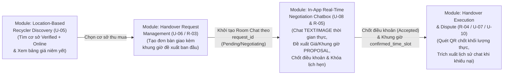
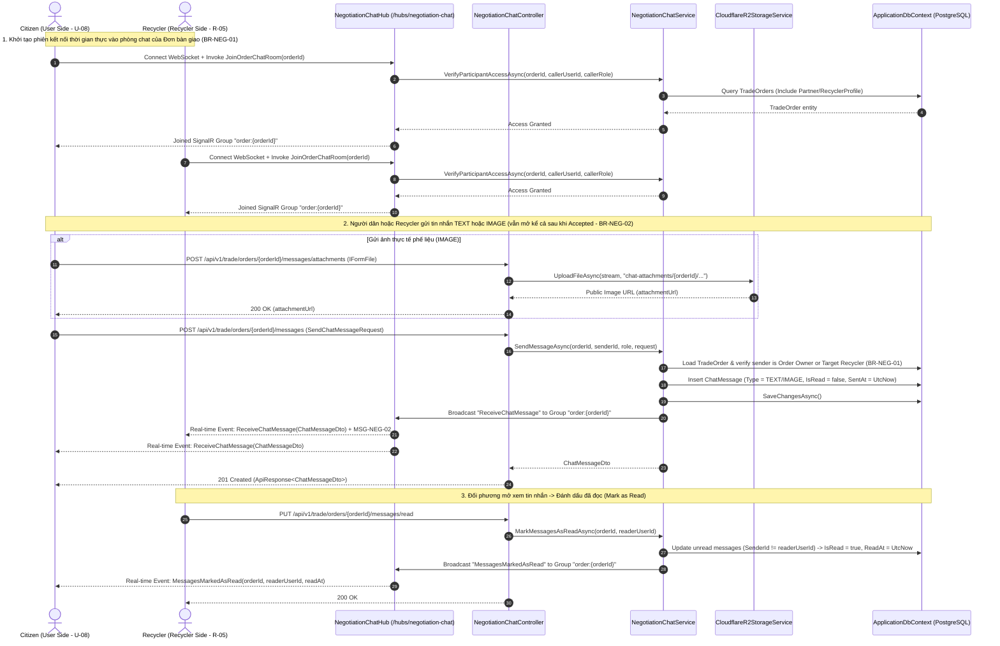
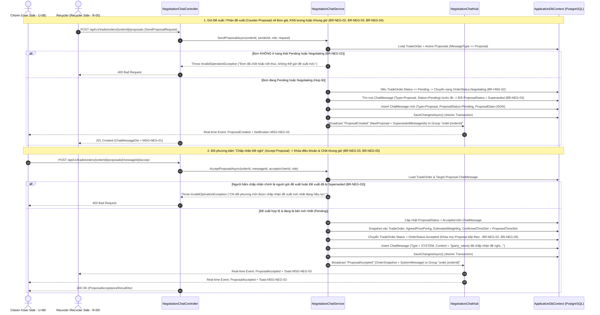

# KẾ HOẠCH TRIỂN KHAI (IMPLEMENTATION PLAN)
## MODULE: IN-APP REAL-TIME NEGOTIATION CHATBOX (`U-08` & `R-05`)

**Dự án:** EcoLink – Nền tảng Phân loại Rác Thông minh & Kết nối Thu mua Phế liệu  
**Phân hệ (Sub-system):** Thương lượng & Khung giờ thu gom (`NEG` – *Negotiation & Time-slot Alignment*) kết hợp Bàn giao (`HND`)  
**Use Cases trọng tâm:**
- **`U-08`**: *Negotiate via Chatbox (User side)* – Người dân trao đổi trực tiếp thời gian thực với Cơ sở thu gom, gửi ảnh thực tế của phế liệu, gửi đề xuất/phản đề xuất (*Counter-proposal*) về đơn giá, khối lượng hoặc khung giờ thu gom và chấp nhận đề xuất trong phạm vi đơn bàn giao.
- **`R-05`**: *Negotiate via Chatbox (Recycler side)* – Cơ sở thu gom tiếp nhận yêu cầu trao đổi, nhắn tin thời gian thực với Người dân, gửi đề xuất điều chỉnh đơn giá/khung giờ thu gom phù hợp với lịch vận hành kho bãi hoặc bấm chấp nhận để khóa điều khoản & chốt lịch hẹn thu gom chính thức.

**Trạng thái:** In progress | **Độ ưu tiên:** Medium | **Hạn hoàn thành:** 11/08/2026  
**Nhóm phụ trách (Assignees):** Hoàng Thắng Nguyễn, Nguyen Thanh Luan (K18 HL), Giang Nguyễn Đức  
**Tài liệu tham chiếu nền tảng:**
- Đặc tả quy tắc nghiệp vụ & thông điệp: [`documents/business_rule_&_system_message.md`](file:///c:/Projects/EcoLink/intelligent-waste-sorting-trading/documents/business_rule_&_system_message.md) (`BR-NEG-01` $\rightarrow$ `BR-NEG-05`, `BR-HND-02`, `BR-DSP-06`, `MSG-NEG-01` $\rightarrow$ `MSG-NEG-04`)
- Thiết kế CSDL Phân hệ Thu gom & Giao dịch: [`documents/diagram/database design/03_collection_trading_module.dbml`](file:///c:/Projects/EcoLink/intelligent-waste-sorting-trading/documents/diagram/database%20design/03_collection_trading_module.dbml) (Bảng `ChatMessage`, `HandoverRequest`, `HandoverRequestItem`)
- Mô tả luồng nghiệp vụ chuẩn hóa: [`documents/business_flow_step_description.md`](file:///c:/Projects/EcoLink/intelligent-waste-sorting-trading/documents/business_flow_step_description.md) & [`04_recycler_matching_negotiation_and_handover_flow.xml`](file:///c:/Projects/EcoLink/intelligent-waste-sorting-trading/documents/diagram/swimlane%20diagram%20-%20business%20flow/04_recycler_matching_negotiation_and_handover_flow.xml)

---

## 1. PHÂN TÍCH NGHIỆP VỤ, RANH GIỚI MODULE & TÍNH KHẢ THI (SCOPE & FEASIBILITY ANALYSIS)

### 1.1. Ranh giới Nghiệp vụ Liên Phân hệ (Module Boundaries)
Để đảm bảo tính đóng gói (Modularity) và không chồng lấn trách nhiệm với các module lân cận trong luồng **BF-04 (Tìm kiếm, Thương lượng & Bàn giao Phế liệu)**, ranh giới của **Module: In-App Real-Time Negotiation Chatbox (`U-08` & `R-05`)** được xác định rõ như sau:



| Khía cạnh | Thuộc phạm vi Module `In-App Real-Time Negotiation Chatbox` (`U-08` & `R-05`) | Thuộc Module Liên quan (Phối hợp qua DB / Service) |
| :--- | :--- | :--- |
| **Quản lý Phiên Chat theo Đơn (`BR-NEG-01`)** | - Mỗi phòng chat (*Chat Room*) gắn chặt 1-1 với một yêu cầu bàn giao (`TradeOrder` / `HandoverRequest`).<br/>- Chỉ cho phép đúng **Người dân (`Citizen`) sở hữu đơn**, **Cơ sở thu gom (`Recycler`) nhận đơn**, và **Nhân viên (`Staff`) khi đơn ở trạng thái tranh chấp (`Disputed` - `BR-DSP-06`)** truy cập lịch sử tin nhắn.<br/>- **Lưu trữ bất biến (Immutable Audit Trail):** Toàn bộ tin nhắn không được phép xóa hoặc chỉnh sửa nội dung sau khi gửi để làm bằng chứng đối soát. | Module `Dispute Resolution` (`S-05` / `U-10`) đọc lịch sử chat từ bảng `chat_messages` ở chế độ Read-only khi xử lý khiếu nại. |
| **Gửi Tin nhắn Thời gian thực (`TEXT` & `IMAGE`)** | - Hỗ trợ gửi tin nhắn văn bản (`TEXT`) và đính kèm ảnh chụp thực tế tình trạng phế liệu (`IMAGE` tải lên Cloudflare R2) qua kết nối thời gian thực **ASP.NET Core SignalR WebSocket** kết hợp REST API.<br/>- Hỗ trợ đánh dấu đã đọc (`is_read`, `read_at`) và thông báo đẩy trong ứng dụng (`MSG-NEG-02`).<br/>- **Giữ mở kênh liên lạc (`BR-NEG-02`):** Tin nhắn `TEXT`/`IMAGE` vẫn được phép gửi sau khi đơn đã chuyển sang `Accepted`, `Scheduled` hoặc `Completed` để hai bên hỏi đường hoặc trao đổi sau bàn giao. | Module `Cloudflare R2 Storage` (`IFileStorageService`) cung cấp hạ tầng lưu trữ ảnh đính kèm trong chat. |
| **Thương lượng Điều khoản & Khung giờ (`PROPOSAL`)** | - Cho phép cả Người dân (`U-08`) và Cơ sở thu gom (`R-05`) gửi bản đề xuất (`message_type = PROPOSAL`) điều chỉnh: **Đơn giá thu mua (`ProposedPricePerKg`)**, **Khối lượng ước tính (`ProposedWeightKg`)**, và **Khung giờ thu gom (`ProposedTimeSlot`)** (`BR-NEG-04`).<br/>- **Ghi đè đề xuất cũ (`BR-NEG-03`):** Khi một `PROPOSAL` mới được gửi, mọi `PROPOSAL` đang `Pending` trước đó trong cùng đơn tự động chuyển sang trạng thái `Superseded` (chỉ đề xuất mới nhất có hiệu lực).<br/>- **Khóa thương lượng (`BR-NEG-02`):** Chỉ cho phép gửi hoặc chấp nhận `PROPOSAL` khi đơn ở trạng thái `Pending` hoặc `Negotiating`. Khóa hoàn toàn tính năng gửi `PROPOSAL` khi đơn đã sang `Accepted`, `Scheduled`, `Completed`, `Rejected`, `Cancelled`. | Module `Recycler Profile & Pricing` (`R-01`) cung cấp đơn giá niêm yết ban đầu làm mốc tham chiếu khi bắt đầu thương lượng. |
| **Chấp nhận Đề xuất & Chốt Lịch hẹn (`BR-NEG-05`)** | - Khi một bên bấm **"Chấp nhận đề nghị"** (*Accept Proposal*) hoặc khi `Recycler` bấm **"Chấp nhận yêu cầu"** (*Accept Request*), hệ thống lưu cứng (*Snapshot*) đơn giá thỏa thuận (`AgreedPricePerKg`), khối lượng ước tính (`EstimatedWeightKg`) và khóa khung giờ thu gom chính thức (`ConfirmedTimeSlot`) trực tiếp vào đơn bàn giao (`BR-NEG-03`, `BR-NEG-05`).<br/>- Tự động phát sinh tin nhắn hệ thống (`message_type = SYSTEM`) ghi nhận sự kiện chốt điều khoản và hiển thị thông báo `MSG-NEG-03`. | Module `Handover Execution` (`R-04` / `U-07`) sử dụng `AgreedPricePerKg` và `ConfirmedTimeSlot` đã chốt để thực hiện bàn giao & quét mã QR. |

---

### 1.2. Đánh giá Hiện trạng Codebase & Điểm Khớp nối Kỹ thuật

Qua rà soát trực tiếp mã nguồn tại `src/Ecolink.Backend`, hiện trạng các thành phần liên quan như sau:

1. **Tầng Domain (`Ecolink.Domain`)**:
   - Đã có thực thể [`TradeOrder`](file:///c:/Projects/EcoLink/intelligent-waste-sorting-trading/src/Ecolink.Backend/Ecolink.Domain/Entities/TradeEntities.cs#L36-L51) và enum [`OrderStatus`](file:///c:/Projects/EcoLink/intelligent-waste-sorting-trading/src/Ecolink.Backend/Ecolink.Domain/Enums/DomainEnums.cs#L34-L41) (`Pending`, `Accepted`, `Rejected`, `Completed`, `Cancelled`).
   - **Cần bổ sung & nâng cấp:**
     - Mở rộng enum [`OrderStatus`](file:///c:/Projects/EcoLink/intelligent-waste-sorting-trading/src/Ecolink.Backend/Ecolink.Domain/Enums/DomainEnums.cs#L34-L41) thêm trạng thái `Negotiating` (Đang thương lượng), `Scheduled` (Đã chốt lịch hẹn), `Expired` (Quá hạn) và `Disputed` (Đang khiếu nại) để khớp 100% với đặc tả [`03_collection_trading_module.dbml`](file:///c:/Projects/EcoLink/intelligent-waste-sorting-trading/documents/diagram/database%20design/03_collection_trading_module.dbml) và quy tắc `BR-HND-02`.
     - Bổ sung các thuộc tính phục vụ thương lượng và chốt điều khoản trên [`TradeOrder`](file:///c:/Projects/EcoLink/intelligent-waste-sorting-trading/src/Ecolink.Backend/Ecolink.Domain/Entities/TradeEntities.cs#L36-L51): `CategoryCode`, `ProposedTimeSlot`, `ConfirmedTimeSlot`, `AgreedPricePerKg`, `PickupAddress`, `PickupLatitude`, `PickupLongitude`, cùng tập hợp navigation `Messages` (`ICollection<ChatMessage>`).
     - Tạo mới thực thể **`ChatMessage`** ánh xạ vào bảng `chat_messages` theo đúng thiết kế [`03_collection_trading_module.dbml`](file:///c:/Projects/EcoLink/intelligent-waste-sorting-trading/documents/diagram/database%20design/03_collection_trading_module.dbml#L81-L97) kèm enum **`ChatMessageType`** (`Text`, `Image`, `Proposal`, `System`) và **`ProposalStatus`** (`Pending`, `Accepted`, `Superseded`, `Rejected`).
2. **Tầng Application (`Ecolink.Application`)**:
   - Đã có [`IFileStorageService`](file:///c:/Projects/EcoLink/intelligent-waste-sorting-trading/src/Ecolink.Backend/Ecolink.Application/Interfaces/IRecyclerOnboardingInterfaces.cs) tích hợp Cloudflare R2 và [`ICurrentUserService`](file:///c:/Projects/EcoLink/intelligent-waste-sorting-trading/src/Ecolink.Backend/Ecolink.Application/Interfaces/IAuthInterfaces.cs) trích xuất định danh JWT.
   - **Cần bổ sung:**
     - Interface **`INegotiationChatService`** và **`INegotiationChatNotifier`** (Outbound Port phát sự kiện thời gian thực qua SignalR để giữ tầng Application/Infrastructure tách biệt chuẩn Clean Architecture).
     - Bộ DTOs trong **`NegotiationChatDtos.cs`** và bộ kiểm tra hợp lệ **`NegotiationChatValidators.cs`** (FluentValidation).
3. **Tầng Infrastructure & WebApi (`Ecolink.Infrastructure` & `Ecolink.WebApi`)**:
   - **Cần bổ sung:**
     - Cấu hình Fluent API **`ChatMessageConfiguration.cs`** với chỉ mục kép `ix_chat_messages_order_id_sent_at` và cột `proposal_data` kiểu `jsonb`.
     - Service nghiệp vụ **`NegotiationChatService.cs`** xử lý toàn bộ quy tắc `BR-NEG-01` $\rightarrow$ `BR-NEG-05`.
     - SignalR Hub **`NegotiationChatHub.cs`** định tuyến tại `/hubs/negotiation-chat` hỗ trợ xác thực JWT qua Query String (`access_token`) và quản lý Room theo `order:{orderId}`.
     - REST Controller **`NegotiationChatController.cs`** định tuyến tại `/api/v1/trade/orders/{orderId:guid}/messages` hỗ trợ cả hai vai trò `Citizen` (`U-08`) và `Recycler` (`R-05`).

---

### 1.3. Ma trận Đánh giá Tính khả thi & So sánh Kiến trúc Kỹ thuật

| Phương án Kỹ thuật | Cơ chế Hoạt động | Ưu điểm | Nhược điểm | Đánh giá & Lựa chọn |
| :--- | :--- | :--- | :--- | :--- |
| **Phương án A (Khuyên dùng):** **ASP.NET Core SignalR WebSocket Hub + REST API + PostgreSQL (`jsonb`)** | Client mở kết nối WebSocket tới `/hubs/negotiation-chat` và join group `order:{orderId}`. Mọi thao tác gửi tin nhắn, gửi `PROPOSAL`, chấp nhận `PROPOSAL` đều được lưu bền vững vào PostgreSQL (`chat_messages`) trước khi phát (`Broadcast`) tức thời tới đối phương qua SignalR. | - Độ trễ thời gian thực cực thấp ($< 50\text{ms}$).<br/>- Tích hợp sẵn trong `.NET 8 SDK`, không phát sinh chi phí thuê dịch vụ ngoài.<br/>- Tự động fallback sang Server-Sent Events / Long Polling nếu mạng di động chặn WebSocket.<br/>- Dữ liệu nằm 100% trong PostgreSQL của EcoLink, đảm bảo tính toàn vẹn khóa ngoại và phục vụ đối soát tranh chấp (`BR-NEG-01`, `BR-DSP-06`). | Cần cấu hình đọc JWT từ `access_token` query parameter cho WebSocket handshake trong `Program.cs`. | **LỰA CHỌN CHÍNH THỨC** |
| **Phương án B:** HTTP Polling định kỳ (3–5 giây/lần) | Client gọi `GET /messages` mỗi 3 giây để kiểm tra tin nhắn mới. | Dễ cài đặt ban đầu. | - Độ trễ cao, trải nghiệm thương lượng giật cục.<br/>- Gây tải truy vấn DB không cần thiết khi 2 bên đang mở màn hình chờ. | Không chọn (Chỉ dùng REST GET khi tải lịch sử chat ban đầu hoặc khi mất kết nối). |
| **Phương án C:** Dịch vụ Chat bên thứ ba (Firebase Realtime DB / Sendbird) | Đẩy toàn bộ tin nhắn sang hạ tầng đám mây bên thứ ba. | Có sẵn SDK giao diện chat. | - Dữ liệu tách rời khỏi PostgreSQL, khó thực thi giao dịch nguyên tử (*Atomic Transaction*) khi chốt `PROPOSAL` cập nhật bảng `trade_orders` (`BR-NEG-03`, `BR-NEG-05`). | Không chọn. |

---

## 2. THIẾT KẾ LUỒNG NGHIỆP VỤ & QUY TẮC HỆ THỐNG (BUSINESS FLOW & RULES)

### 2.1. Sơ đồ Tuần tự Nghiệp vụ Trọng tâm (Sequence Diagrams)

#### Luồng 1 (`U-08` & `R-05`): Kết nối Phòng Chat, Gửi Tin nhắn Văn bản (`TEXT`) / Hình ảnh (`IMAGE`) & Đánh dấu Đã đọc


#### Luồng 2 (`U-08` & `R-05`): Thương lượng Đề xuất Giá/Khối lượng/Khung giờ (`PROPOSAL`), Ghi đè Đề xuất cũ (`BR-NEG-03`) & Chốt Lịch hẹn (`BR-NEG-05`)


---

### 2.2. Bảng Ánh xạ Quy tắc Nghiệp vụ (`BR-NEG-*`) & Thông điệp Hệ thống (`MSG-NEG-*`)

| Mã Quy tắc / Msg | Nội dung Đặc tả gốc ([`business_rule_&_system_message.md`](file:///c:/Projects/EcoLink/intelligent-waste-sorting-trading/documents/business_rule_&_system_message.md)) | Thiết kế Thực thi trong Codebase (`NegotiationChatService`) |
| :---: | :--- | :--- |
| **`BR-NEG-01`** | Tin nhắn thương lượng chỉ tồn tại trong phạm vi một yêu cầu bàn giao cụ thể và chỉ hiển thị cho `User` và `Recycler` của yêu cầu đó. **Toàn bộ lịch sử chat được lưu trữ vĩnh viễn và không thể xóa**, nhằm làm bằng chứng nếu phát sinh khiếu nại. | - Mọi truy vấn/gửi tin nhắn đều kiểm tra `order.UserId == callerId \|\| order.Partner.UserId == callerId` (hoặc `callerRole == Staff/Admin` khi `order.Status == OrderStatus.Disputed` theo `BR-DSP-06`).<br/>- Không cung cấp bất kỳ API `DELETE` hay `PUT` sửa nội dung tin nhắn nào. Bảng `chat_messages` là bảng chỉ ghi thêm (*Append-only Audit Log*) cho nội dung tin nhắn. |
| **`BR-NEG-02`** | Việc đưa ra hoặc sửa đổi đề xuất giá/khung giờ chỉ được phép khi yêu cầu ở trạng thái `Pending` hoặc `Negotiating`, và sẽ bị khóa khi yêu cầu chuyển sang `Accepted`. **Tuy nhiên, kênh chat thông thường vẫn được giữ mở sau khi đã `Accepted` hoặc `Completed`** để hai bên trao đổi thêm (ví dụ: hỏi đường). | - Trong `SendProposalAsync()` và `AcceptProposalAsync()`: Kiểm tra nghiêm ngặt `order.Status is OrderStatus.Pending or OrderStatus.Negotiating`. Nếu đơn đã `Accepted`, `Scheduled`, `Completed`, `Rejected`, `Cancelled`, `Expired` $\rightarrow$ ném `InvalidOperationException` (`400 Bad Request`).<br/>- Trong `SendMessageAsync()` (`TEXT`/`IMAGE`): Cho phép gửi khi đơn ở `Pending`, `Negotiating`, `Accepted`, `Scheduled`, `Completed`, `Disputed` (chỉ chặn khi đơn đã hủy `Cancelled`/`Rejected`/`Expired`). |
| **`BR-NEG-03`** | Chỉ đề xuất mới nhất có hiệu lực; mỗi đề xuất phản hồi mới sẽ ghi đè đề xuất trước đó. Khi được chấp nhận, các điều khoản đã thống nhất sẽ được lưu cứng vào yêu cầu bàn giao. | - Khi tạo `ChatMessage` có `MessageType = ChatMessageType.Proposal`, truy vấn toàn bộ `ChatMessage` của `orderId` có `ProposalStatus == ProposalStatus.Pending` và cập nhật thành `ProposalStatus.Superseded` trong cùng một Transaction.<br/>- Khi `AcceptProposalAsync()` được gọi bởi đối phương (`senderId != acceptorUserId`), ghi cứng `AgreedPricePerKg`, `EstimatedWeightKg`, `ConfirmedTimeSlot` vào `TradeOrder`. |
| **`BR-NEG-04`** | `User` đề xuất khung giờ thu gom mong muốn ngay khi tạo yêu cầu bàn giao. Nếu khung giờ này chưa phù hợp với `Recycler`, hai bên sẽ thương lượng lại khung giờ trực tiếp qua Chatbox cho đến khi thống nhất. | - `TradeOrder` lưu `ProposedTimeSlot` ban đầu của `Citizen`.<br/>- Trong `SendProposalRequest`, cả `Citizen` (`U-08`) và `Recycler` (`R-05`) đều có thể gửi `ProposedTimeSlot` mới kèm `ProposedPricePerKg` và `ProposedWeightKg`. |
| **`BR-NEG-05`** | Khung giờ thu gom chính thức được chốt tại thời điểm `Recycler` bấm "Chấp nhận" yêu cầu bàn giao, không cần một phân hệ đặt lịch hẹn độc lập riêng biệt. | - Khi đề xuất được chấp nhận (hoặc khi `Recycler` gọi endpoint chốt đơn `POST /api/v1/trade/orders/{orderId}/accept-terms`), hệ thống gán `order.ConfirmedTimeSlot = latestAgreedTimeSlot`, `order.ScheduledAt = confirmedStartUtc`, và chuyển `order.Status = OrderStatus.Accepted`. |
| **`MSG-NEG-01`** | *"Yêu cầu trao đổi của bạn đã được gửi đến {facility_name}."* (Toast) | Trả về trong `ApiResponse.Message` khi `Citizen` (`U-08`) khởi tạo phiên trao đổi / gửi đề xuất tới cơ sở thu gom. |
| **`MSG-NEG-02`** | *"Bạn có tin nhắn mới từ {sender_name}."* (In-app notification) | Đính kèm trong payload sự kiện SignalR `ReceiveChatMessage` và `ProposalCreated` gửi tới người nhận. |
| **`MSG-NEG-03`** | *"{party_name} đã chấp nhận đề nghị của bạn."* (Toast) | Trả về trong `ApiResponse.Message` và nội dung tin nhắn `SYSTEM` khi một bên bấm chấp nhận `PROPOSAL`. |
| **`MSG-NEG-04`** | *"Bạn có yêu cầu bàn giao mới kèm khung giờ đề xuất từ {user_name}."* (Toast) | Phát qua SignalR / Notification khi đơn bàn giao mới kèm `ProposedTimeSlot` được gửi tới `Recycler` (`R-05`). |

---

## 3. THIẾT KẾ TẦNG DOMAIN & CƠ SỞ DỮ LIỆU (DOMAIN & DATABASE SCHEMA DESIGN)

### 3.1. Mở rộng Enums trong [`DomainEnums.cs`](file:///c:/Projects/EcoLink/intelligent-waste-sorting-trading/src/Ecolink.Backend/Ecolink.Domain/Enums/DomainEnums.cs)

Cập nhật `OrderStatus` và bổ sung `ChatMessageType`, `ProposalStatus` khớp với thiết kế CSDL [`03_collection_trading_module.dbml`](file:///c:/Projects/EcoLink/intelligent-waste-sorting-trading/documents/diagram/database%20design/03_collection_trading_module.dbml):

```csharp
public enum OrderStatus
{
    Pending = 1,        // Mới tạo, chờ Recycler phản hồi hoặc thương lượng
    Negotiating = 2,    // Hai bên đang thương lượng giá / khối lượng / khung giờ (BR-NEG-02)
    Accepted = 3,       // Đã chốt điều khoản & khóa khung giờ thu gom (BR-NEG-02, BR-NEG-05)
    Scheduled = 4,      // Đã lên lịch chuẩn bị bàn giao thực tế
    Completed = 5,      // Đã quét mã QR hoàn tất bàn giao
    Rejected = 6,       // Recycler từ chối yêu cầu
    Cancelled = 7,      // Người dùng hủy trước khi hoàn tất
    Expired = 8,        // Tự động hết hạn sau 48h không có phản hồi (BR-HND-03)
    Disputed = 9        // Đang có khiếu nại chờ Staff phân xử (BR-DSP-06)
}

public enum ChatMessageType
{
    Text = 1,           // Tin nhắn văn bản thông thường (mở cả sau khi Accepted - BR-NEG-02)
    Image = 2,          // Tin nhắn đính kèm ảnh chụp phế liệu thực tế trên Cloudflare R2
    Proposal = 3,       // Bản đề xuất / phản đề xuất Giá, Khối lượng, Khung giờ (BR-NEG-02, BR-NEG-03)
    System = 4          // Tin nhắn tự động của hệ thống ghi nhận sự kiện chốt/từ chối đề xuất
}

public enum ProposalStatus
{
    Pending = 1,        // Đề xuất mới nhất đang chờ đối phương phản hồi
    Accepted = 2,       // Đã được đối phương chấp nhận và lưu cứng vào đơn (BR-NEG-03)
    Superseded = 3,     // Đã bị ghi đè bởi một đề xuất mới hơn (BR-NEG-03)
    Rejected = 4        // Bị đối phương từ chối
}
```

### 3.2. Thiết kế Thực thể `ChatMessage` & Mở rộng `TradeOrder` trong [`TradeEntities.cs`](file:///c:/Projects/EcoLink/intelligent-waste-sorting-trading/src/Ecolink.Backend/Ecolink.Domain/Entities/TradeEntities.cs)

#### Bảng tham chiếu cấu trúc bảng `chat_messages` (Theo [`03_collection_trading_module.dbml`](file:///c:/Projects/EcoLink/intelligent-waste-sorting-trading/documents/diagram/database%20design/03_collection_trading_module.dbml#L81-L97)):

| Cột CSDL (`snake_case`) | Thuộc tính C# (`ChatMessage`) | Kiểu dữ liệu | Ràng buộc & Ý nghĩa Nghiệp vụ |
| :--- | :--- | :--- | :--- |
| `id` | `Id` | `uuid` (`Guid`) | Khóa chính (`PK`), kế thừa từ `BaseEntity`. |
| `trade_order_id` (`request_id`) | `TradeOrderId` | `uuid` (`Guid`) | Khóa ngoại (`FK`) tham chiếu tới `trade_orders.id` (`BR-NEG-01`). |
| `sender_user_id` | `SenderUserId` | `uuid` (`Guid`) | Khóa ngoại (`FK`) tham chiếu tới `users.id` (Người dân hoặc Recycler gửi). |
| `sender_role` | `SenderRole` | `varchar(30)` | Vai trò người gửi tại thời điểm nhắn (`Citizen` hoặc `Recycler` hoặc `System`). |
| `message_type` | `MessageType` | `ChatMessageType` | Loại tin nhắn: `Text`, `Image`, `Proposal`, `System`. |
| `message_content` | `MessageContent` | `text` (Nullable) | Nội dung văn bản hoặc ghi chú đi kèm đề xuất (`MaxLength(2000)`). |
| `attachment_url` | `AttachmentUrl` | `text` (Nullable) | Đường dẫn ảnh đính kèm trên Cloudflare R2 (khi `MessageType == Image`). |
| `proposal_status` | `ProposalStatus` | `ProposalStatus?` | Trạng thái đề xuất: `Pending`, `Accepted`, `Superseded`, `Rejected` (`BR-NEG-03`). |
| `proposed_price_per_kg` | `ProposedPricePerKg` | `numeric(12,2)?` | Đơn giá đề xuất (`VNĐ/kg`) khi `MessageType == Proposal`. |
| `proposed_weight_kg` | `ProposedWeightKg` | `numeric(10,2)?` | Khối lượng ước tính đề xuất (`kg`) khi `MessageType == Proposal`. |
| `proposed_time_slot` | `ProposedTimeSlot` | `varchar(150)?` | Khung giờ thu gom đề xuất (VD: `"2026-11-05 09:00 - 11:00"`, `BR-NEG-04`). |
| `proposal_data` | `ProposalDataJson` | `jsonb` (Nullable) | Snapshot JSON đầy đủ của đề xuất (`NegotiationProposalPayload`) để truy vết. |
| `is_read` | `IsRead` | `boolean` | Trạng thái đã xem của đối phương (mặc định `false`). |
| `sent_at` | `SentAt` | `timestamptz` | Thời điểm gửi bất biến (`DateTime.UtcNow`, `BR-NEG-01`). |
| `read_at` | `ReadAt` | `timestamptz?` | Thời điểm đối phương đọc tin nhắn. |

#### Mở rộng Thực thể `TradeOrder` (`trade_orders`):
Bổ sung các trường phục vụ thương lượng và khóa điều khoản:
- `RecyclerProfileId` (`Guid?`): Liên kết trực tiếp tới `RecyclerProfile.Id` (bên cạnh `PartnerId` để tương thích ngược).
- `CategoryCode` (`string`): Mã danh mục phế liệu giao dịch (VD: `"plastic"`, `"cardboard"`, `"metal"`).
- `InitialPricePerKg` (`decimal`): Đơn giá niêm yết gốc tại thời điểm tạo đơn.
- `AgreedPricePerKg` (`decimal?`): Đơn giá đã thống nhất sau thương lượng (`BR-NEG-03`).
- `ProposedTimeSlot` (`string?`): Khung giờ thu gom mong muốn ban đầu do `Citizen` đề xuất (`BR-NEG-04`).
- `ConfirmedTimeSlot` (`string?`): Khung giờ thu gom chính thức được khóa khi chốt đơn (`BR-NEG-05`).
- `AcceptedAt` (`DateTime?`): Thời điểm khóa điều khoản thương lượng.
- `Messages` (`ICollection<ChatMessage>`): Danh sách lịch sử tin nhắn bất biến của đơn bàn giao (`BR-NEG-01`).

---

## 4. THIẾT KẾ TẦNG APPLICATION & INFRASTRUCTURE (CLEAN ARCHITECTURE LAYERS)

### 4.1. Hợp đồng Giao diện `INegotiationChatService` & `INegotiationChatNotifier`

Tạo file `src/Ecolink.Backend/Ecolink.Application/Interfaces/INegotiationChatInterfaces.cs`:

```csharp
using Ecolink.Application.Dtos;

namespace Ecolink.Application.Interfaces;

public interface INegotiationChatService
{
    /// <summary>
    /// Lấy thông tin tổng quan phòng chat (trạng thái đơn, điều khoản hiện tại, đề xuất đang hiệu lực)
    /// và lịch sử tin nhắn phân trang theo thời gian (U-08, R-05, BR-NEG-01).
    /// </summary>
    Task<OrderChatThreadDto> GetOrderChatThreadAsync(
        Guid orderId,
        Guid callerUserId,
        string callerRole,
        int page = 1,
        int pageSize = 50,
        CancellationToken ct = default);

    /// <summary>
    /// Gửi tin nhắn văn bản (TEXT) hoặc hình ảnh (IMAGE) trong phạm vi đơn bàn giao.
    /// Kênh chat TEXT/IMAGE vẫn mở kể cả sau khi đơn đã Accepted hoặc Completed (BR-NEG-02).
    /// </summary>
    Task<ChatMessageDto> SendMessageAsync(
        Guid orderId,
        Guid senderUserId,
        string senderRole,
        SendChatMessageRequest request,
        CancellationToken ct = default);

    /// <summary>
    /// Gửi đề xuất / phản đề xuất (PROPOSAL) về đơn giá, khối lượng hoặc khung giờ thu gom (U-08, R-05).
    /// Tự động ghi đè (Superseded) các đề xuất Pending trước đó (BR-NEG-03) và chuyển đơn sang Negotiating.
    /// Bị khóa nếu đơn đã ở trạng thái Accepted/Scheduled/Completed/Rejected/Cancelled (BR-NEG-02).
    /// </summary>
    Task<ChatMessageDto> SendProposalAsync(
        Guid orderId,
        Guid senderUserId,
        string senderRole,
        SendProposalRequest request,
        CancellationToken ct = default);

    /// <summary>
    /// Đối phương chấp nhận đề xuất mới nhất đang hiệu lực (BR-NEG-03) hoặc Recycler chấp nhận điều khoản đơn (BR-NEG-05).
    /// Lưu cứng AgreedPricePerKg, EstimatedWeightKg, ConfirmedTimeSlot vào TradeOrder và chuyển trạng thái sang Accepted.
    /// </summary>
    Task<ProposalAcceptanceResultDto> RespondToProposalAsync(
        Guid orderId,
        Guid proposalMessageId,
        Guid responderUserId,
        string responderRole,
        RespondProposalRequest request,
        CancellationToken ct = default);

    /// <summary>
    /// Đánh dấu toàn bộ tin nhắn của đối phương trong đơn bàn giao là đã đọc.
    /// </summary>
    Task<int> MarkMessagesAsReadAsync(
        Guid orderId,
        Guid readerUserId,
        string readerRole,
        CancellationToken ct = default);

    /// <summary>
    /// Kiểm tra quyền tham gia phòng chat SignalR của người dùng hiện tại đối với orderId (BR-NEG-01, BR-DSP-06).
    /// </summary>
    Task<bool> VerifyChatRoomAccessAsync(
        Guid orderId,
        Guid callerUserId,
        string callerRole,
        CancellationToken ct = default);
}

public interface INegotiationChatNotifier
{
    Task NotifyMessageReceivedAsync(Guid orderId, ChatMessageDto message, string notificationText, CancellationToken ct = default);
    Task NotifyProposalUpdatedAsync(Guid orderId, ChatMessageDto proposalMessage, IReadOnlyList<Guid> supersededIds, string notificationText, CancellationToken ct = default);
    Task NotifyProposalAcceptedAsync(Guid orderId, ProposalAcceptanceResultDto result, CancellationToken ct = default);
    Task NotifyMessagesReadAsync(Guid orderId, Guid readerUserId, DateTime readAtUtc, CancellationToken ct = default);
}
```

---

### 4.2. Thiết kế SignalR Hub `NegotiationChatHub.cs` (`/hubs/negotiation-chat`)

SignalR Hub đóng vai trò cổng kết nối thời gian thực hai chiều giữa ứng dụng của Người dân (`U-08`) và ứng dụng của Cơ sở thu gom (`R-05`):
- **Endpoint WebSocket:** `/hubs/negotiation-chat`
- **Cơ chế Xác thực:** `[Authorize]` sử dụng JWT Bearer Token truyền qua Header `Authorization` hoặc Query String `?access_token=...` khi khởi tạo kết nối WebSocket.
- **Các phương thức Client gọi lên Hub (Hub Methods):**
  1. `JoinOrderChatRoom(Guid orderId)`: Kiểm tra quyền qua `INegotiationChatService.VerifyChatRoomAccessAsync()` (`BR-NEG-01`). Nếu hợp lệ, đưa `Context.ConnectionId` vào SignalR Group `"order:{orderId}"`. Nếu không phải chủ đơn / Recycler của đơn (hoặc Staff khi đơn `Disputed`) $\rightarrow$ ném `HubException("FORBIDDEN_CHAT_ROOM")`.
  2. `LeaveOrderChatRoom(Guid orderId)`: Rời khỏi SignalR Group `"order:{orderId}"`.
  3. `SendTypingIndicator(Guid orderId, bool isTyping)`: Phát sự kiện `"UserTypingChanged"` tới đối phương trong phòng chat để tăng trải nghiệm thời gian thực.
- **Các sự kiện Server phát xuống Client (Client Events):**
  1. `ReceiveChatMessage`: Khi có tin nhắn `TEXT`, `IMAGE` hoặc `SYSTEM` mới kèm thông báo `MSG-NEG-02`.
  2. `ProposalCreated`: Khi có bản đề xuất `PROPOSAL` mới được gửi, kèm danh sách `supersededMessageIds` để UI tự động làm mờ đề xuất cũ (`BR-NEG-03`).
  3. `ProposalAccepted`: Khi đề xuất được chấp nhận, kèm trạng thái đơn mới (`Accepted`), điều khoản đã khóa (`AgreedPricePerKg`, `ConfirmedTimeSlot`) và thông báo `MSG-NEG-03` (`BR-NEG-02`, `BR-NEG-05`).
  4. `MessagesMarkedAsRead`: Khi đối phương đã đọc tin nhắn.

---

## 5. ĐẶC TẢ RESTFUL API & SIGNALR EVENTS (`NegotiationChatController`)

Toàn bộ các REST API của Module được đặt tại tiền tố `/api/v1/trade/orders/{orderId:guid}` và yêu cầu xác thực `[Authorize(Roles = "Citizen,User,Recycler,Collector,Staff,Admin")]`:

| STT | HTTP Method & Route | Use Case | Vai trò được phép | Mô tả Chức năng & Quy tắc áp dụng |
| :-: | :--- | :---: | :---: | :--- |
| **1** | `GET /api/v1/trade/orders/{orderId:guid}/messages` | `U-08`, `R-05` | `Citizen` (Chủ đơn), `Recycler` (Nhận đơn), `Staff` (Khi `Disputed`) | Lấy thông tin phòng chat (trạng thái khóa `IsProposalLocked` theo `BR-NEG-02`, điều khoản hiện tại, đề xuất `Pending` mới nhất theo `BR-NEG-03`) và danh sách tin nhắn bất biến (`BR-NEG-01`). |
| **2** | `POST /api/v1/trade/orders/{orderId:guid}/messages` | `U-08`, `R-05` | `Citizen` (Chủ đơn), `Recycler` (Nhận đơn) | Gửi tin nhắn văn bản (`TEXT`) hoặc ảnh đính kèm (`IMAGE`). Vẫn cho phép gửi sau khi đơn đã `Accepted`, `Scheduled` hoặc `Completed` (`BR-NEG-02`). Phát sự kiện SignalR `ReceiveChatMessage` (`MSG-NEG-02`). |
| **3** | `POST /api/v1/trade/orders/{orderId:guid}/messages/attachments` | `U-08`, `R-05` | `Citizen` (Chủ đơn), `Recycler` (Nhận đơn) | Tải ảnh chụp thực tế phế liệu hoặc điểm hẹn lên **Cloudflare R2** (`chat-attachments/{orderId}/...`), kiểm tra định dạng `.jpg/.png/.webp` $\le 5\text{MB}$ và trả về `AttachmentUrl`. |
| **4** | `POST /api/v1/trade/orders/{orderId:guid}/proposals` | `U-08`, `R-05` | `Citizen` (Chủ đơn), `Recycler` (Nhận đơn) | Gửi đề xuất / phản đề xuất (`PROPOSAL`) về đơn giá (`ProposedPricePerKg`), khối lượng (`ProposedWeightKg`) hoặc khung giờ thu gom (`ProposedTimeSlot` - `BR-NEG-04`). Tự động chuyển đề xuất trước đó sang `Superseded` (`BR-NEG-03`) và chuyển đơn sang `Negotiating`. Trả về `400` nếu đơn đã `Accepted` (`BR-NEG-02`). |
| **5** | `POST /api/v1/trade/orders/{orderId:guid}/proposals/{messageId:guid}/respond` | `U-08`, `R-05` | Đối phương của người tạo `PROPOSAL` | Chấp nhận (`IsAccepted = true`) hoặc Từ chối (`IsAccepted = false`) đề xuất đang hiệu lực. Khi chấp nhận: lưu cứng `AgreedPricePerKg`, `EstimatedWeightKg`, `ConfirmedTimeSlot` vào đơn, chuyển trạng thái đơn sang `Accepted`, khóa tính năng `PROPOSAL` (`BR-NEG-02`, `BR-NEG-03`, `BR-NEG-05`) và trả về `MSG-NEG-03`. |
| **6** | `PUT /api/v1/trade/orders/{orderId:guid}/messages/read` | `U-08`, `R-05` | `Citizen` (Chủ đơn), `Recycler` (Nhận đơn) | Đánh dấu toàn bộ tin nhắn chưa đọc của đối phương trong đơn là `IsRead = true`, `ReadAt = UtcNow` và phát sự kiện SignalR `MessagesMarkedAsRead`. |

---

## 6. KẾ HOẠCH KIỂM THỬ PHẦN MỀM (IEEE 829 UNIT & INTEGRATION TEST PLAN)

Bộ kịch bản kiểm thử đơn vị (Unit Test) và tích hợp (Integration Test) cho Module **In-App Real-Time Negotiation Chatbox (`U-08` & `R-05`)** gồm **12 Test Cases** chuẩn hóa, truy vết trực tiếp tới từng quy tắc nghiệp vụ:

| Mã Test Case | Phân loại | Kịch bản Kiểm thử (Test Scenario) | Quy tắc / Msg Kiểm chứng | Kết quả Mong đợi (Expected Output) |
| :---: | :---: | :--- | :---: | :--- |
| **`TC-NEG-08-01_P`** | Positive (`U-08`) | `Citizen` gửi tin nhắn văn bản (`TEXT`) hợp lệ trong đơn đang `Pending` | `BR-NEG-01`, `MSG-NEG-02` | Lưu `ChatMessage` (`Type=Text`, `IsRead=false`), phát sự kiện SignalR `ReceiveChatMessage` tới `Recycler`. |
| **`TC-NEG-08-02_P`** | Positive (`R-05`) | `Recycler` gửi tin nhắn đính kèm ảnh (`IMAGE`) hợp lệ trong đơn | `BR-NEG-01`, `MSG-NEG-02` | Lưu `ChatMessage` (`Type=Image`, `AttachmentUrl != null`), phát sự kiện SignalR tới `Citizen`. |
| **`TC-NEG-08-03_P`** | Positive (`U-08`/`R-05`) | Gửi đề xuất (`PROPOSAL`) đầu tiên về đơn giá và khung giờ thu gom khi đơn đang `Pending` | `BR-NEG-02`, `BR-NEG-04`, `MSG-NEG-01` | Đơn tự động chuyển từ `Pending` $\rightarrow$ `Negotiating` (`BR-HND-02`), tạo `ChatMessage` (`Type=Proposal`, `ProposalStatus=Pending`). |
| **`TC-NEG-08-04_P`** | Positive (`R-05`/`U-08`) | Gửi phản đề xuất (`Counter-Proposal`) mới ghi đè đề xuất đang `Pending` trước đó | `BR-NEG-03` | Đề xuất cũ chuyển `ProposalStatus = Superseded`, chỉ đề xuất mới nhất có `ProposalStatus = Pending`. |
| **`TC-NEG-08-05_P`** | Positive (`U-08`/`R-05`) | Đối phương bấm **Chấp nhận** (`Accept`) bản đề xuất `Pending` mới nhất | `BR-NEG-03`, `BR-NEG-05`, `MSG-NEG-03` | Cập nhật `ProposalStatus = Accepted`; lưu cứng `AgreedPricePerKg`, `EstimatedWeightKg`, `ConfirmedTimeSlot` vào `TradeOrder`; chuyển đơn sang `OrderStatus.Accepted`; sinh tin nhắn `SYSTEM` kèm `MSG-NEG-03`. |
| **`TC-NEG-08-06_P`** | Positive (`BR-NEG-02`) | Gửi tin nhắn văn bản (`TEXT`) hỏi đường sau khi đơn đã chuyển sang `Accepted` hoặc `Completed` | `BR-NEG-02` | **Thành công (`201 Created`)**: Kênh chat thông thường vẫn giữ mở sau khi đã chốt đơn `Accepted` hoặc `Completed`. |
| **`TC-NEG-08-07_N`** | Negative (`BR-NEG-02`) | Cố tình gửi đề xuất giá/khung giờ mới (`PROPOSAL`) khi đơn đã ở trạng thái `Accepted` hoặc `Completed` | `BR-NEG-02` | Ném `InvalidOperationException` (`400 Bad Request`): Tính năng thương lượng đề xuất đã bị khóa sau khi chốt đơn. |
| **`TC-NEG-08-08_N`** | Negative (`BR-NEG-03`) | Cố tình bấm chấp nhận một đề xuất cũ đã bị ghi đè (`ProposalStatus == Superseded`) | `BR-NEG-03` | Ném `InvalidOperationException` (`400 Bad Request`): Chỉ đề xuất mới nhất mới có hiệu lực. |
| **`TC-NEG-08-09_N`** | Negative (`BR-NEG-03`) | Người gửi đề xuất tự bấm chấp nhận đề xuất do chính mình tạo ra (`SenderUserId == ResponderUserId`) | `BR-NEG-03` | Ném `InvalidOperationException` (`400 Bad Request`): Chỉ đối phương mới được quyền chấp nhận đề xuất. |
| **`TC-NEG-08-10_N`** | Negative (`BR-NEG-01`) | Người dùng thứ ba (không phải chủ đơn và không phải `Recycler` của đơn) cố tình xem hoặc gửi tin nhắn | `BR-NEG-01` | Ném `UnauthorizedAccessException` (`403 Forbidden`): Bảo mật quyền riêng tư phòng chat theo đơn. |
| **`TC-NEG-08-11_P`** | Positive (`BR-DSP-06`) | Nhân viên `Staff` truy cập xem lịch sử chat bất biến khi đơn ở trạng thái tranh chấp (`Disputed`) | `BR-NEG-01`, `BR-DSP-06` | **Thành công (`200 OK`)**: `Staff` đọc được toàn bộ lịch sử tin nhắn & đề xuất để phân xử khiếu nại. |
| **`TC-NEG-08-12_P`** | Boundary (`U-08`/`R-05`) | Đánh dấu đã đọc (`MarkMessagesAsReadAsync`) chỉ cập nhật các tin nhắn do đối phương gửi | `BR-NEG-01` | Các tin nhắn của đối phương chuyển `IsRead = true`, `ReadAt != null`; tin nhắn do chính mình gửi giữ nguyên. |

---

## 7. PHÂN CÔNG CÔNG VIỆC (WBS) & CHECKLIST TRIỂN KHAI (ACTION ITEMS)

### 7.1. Phân công Công việc cho Nhóm 3 Thành viên (Work Breakdown Structure)

| Thành viên | Vai trò Phụ trách | Hạng mục Công việc Cụ thể |
| :--- | :--- | :--- |
| **1. Hoàng Thắng Nguyễn** | **Backend Lead & Real-Time Architecture (`U-08` & `R-05`)** | - Thiết kế Entity `ChatMessage`, mở rộng `TradeOrder` & `OrderStatus`, cấu hình EF Core `ChatMessageConfiguration.cs`.<br/>- Xây dựng `NegotiationChatService.cs` thực thi trọn vẹn `BR-NEG-01` $\rightarrow$ `BR-NEG-05` và tích hợp SignalR Hub `NegotiationChatHub.cs`.<br/>- Xây dựng `NegotiationChatController.cs` phục vụ cả `U-08 (User side)` và `R-05 (Recycler side)`. |
| **2. Nguyen Thanh Luan (K18 HL)** | **System Design & Documentation (`Class & Sequence Diagrams`)** | - Thiết kế **Class Diagram** chuẩn Clean Architecture cho Module `In-App Real-Time Negotiation Chatbox`.<br/>- Thiết kế **3 Sequence Diagrams** chi tiết (`U-08` User side, `R-05` Recycler side, và Luồng khóa điều khoản/truy xuất bằng chứng tranh chấp).<br/>- Soạn thảo tài liệu đặc tả API (`09_module_in_app_realtime_negotiation_chatbox_api.md`). |
| **3. Giang Nguyễn Đức** | **Quality Assurance & Automated Testing (`Unit & Integration Test`)** | - Xây dựng bộ **Unit Test** & **Integration Test** kiểm chứng 12 kịch bản (`TC-NEG-08-01_P` $\rightarrow$ `TC-NEG-08-12_P`).<br/>- Soạn thảo tài liệu Unit Test (`08_unit_test_in_app_realtime_negotiation_chatbox.md`) và cập nhật vào bảng tổng hợp `Report-5.1_Unit Test.xls`. |

### 7.2. Checklist Triển khai theo Action Items trên Notion

- [ ] **Action Item 1: Class Diagram**
  - Thiết kế sơ đồ lớp Clean Architecture tại `documents/diagram/class diagram/module in-app real-time negotiation chatbox/`.
- [ ] **Action Item 2: Sequence Diagram**
  - Thiết kế bộ sơ đồ tuần tự cho `U-08` & `R-05` tại `documents/diagram/sequence diagram/module in-app real-time negotiation chatbox/`.
- [ ] **Action Item 3: `U-08: Negotiate via Chatbox (User side)`**
  - Triển khai luồng Người dân xem phòng chat, gửi tin nhắn `TEXT`/`IMAGE` (kể cả sau khi `Accepted` - `BR-NEG-02`), gửi `PROPOSAL` đề xuất giá/khối lượng/khung giờ (`BR-NEG-04`) và chấp nhận phản đề xuất từ `Recycler`.
- [ ] **Action Item 4: `R-05: Negotiate via Chatbox (Recycler side)`**
  - Triển khai luồng Cơ sở thu gom nhận thông báo yêu cầu mới (`MSG-NEG-04`), trao đổi thời gian thực qua SignalR, gửi phản đề xuất (`BR-NEG-03`) và bấm chấp nhận chốt khung giờ thu gom chính thức (`BR-NEG-05`).
- [ ] **Action Item 5: Unit Test**
  - Triển khai bộ kịch bản Unit Test `TC-NEG-08-01_P` $\rightarrow$ `TC-NEG-08-12_P` và cập nhật tài liệu `Report-5.1`.
- [ ] **Action Item 6: Integration Test**
  - Kiểm thử tích hợp End-to-End luồng tạo đơn bàn giao $\rightarrow$ mở phòng chat SignalR $\rightarrow$ thương lượng qua lại (`Superseded`) $\rightarrow$ chấp nhận đề xuất (`Accepted`) $\rightarrow$ khóa `PROPOSAL` nhưng vẫn nhắn tin `TEXT` thành công.

