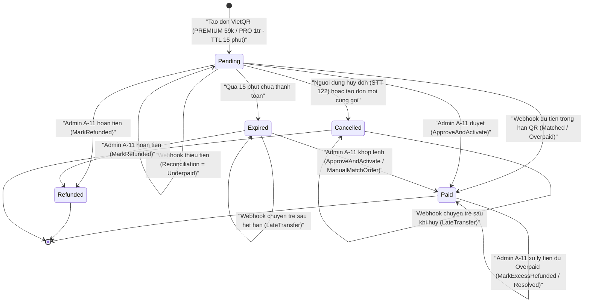
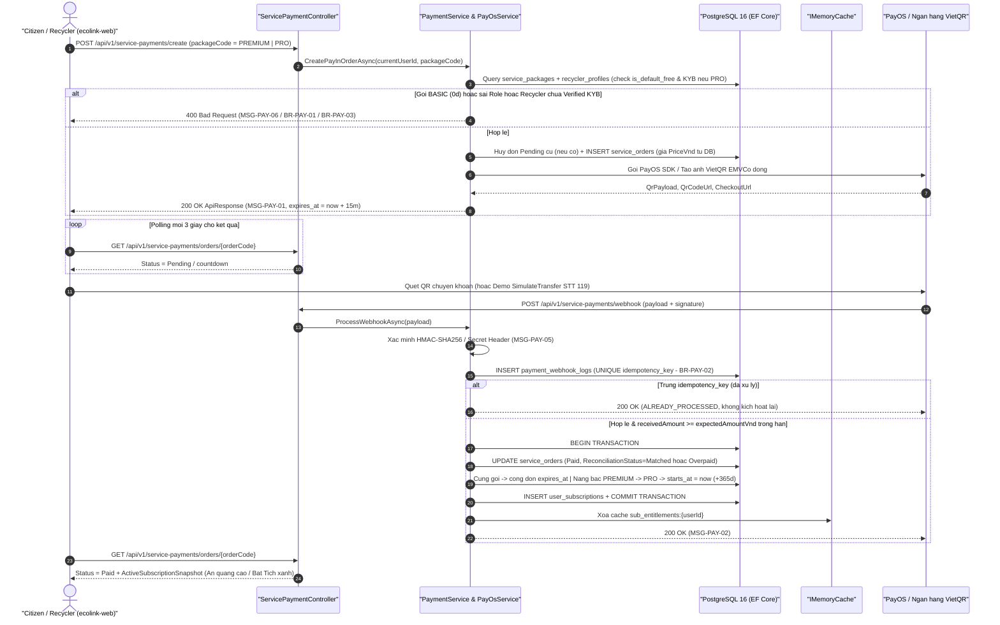
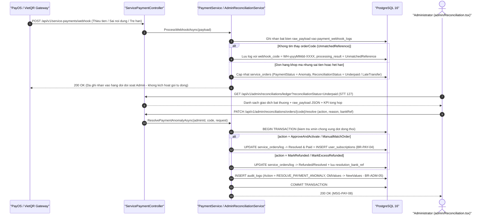
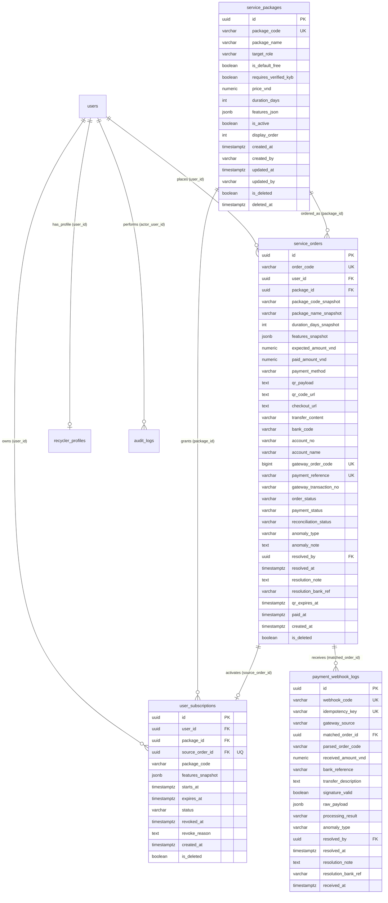

# KẾ HOẠCH THIẾT KẾ & TRIỂN KHAI (IMPLEMENTATION PLAN) - MODULE: IN-SYSTEM SERVICE PACKAGES & VIETQR INTEGRATION (`FE-14` / `M-12`)

**Dự án:** EcoLink – Intelligent Waste Sorting & Trading Platform  
**Phân hệ:** `PAY` / `ADM` (Phân hệ API `M-12`: In-System Service Packages & VietQR Integration)  
**Mã tính năng (Feature):** `FE-14` (In-System Service Packages – VietQR Integration)  
**Use Cases trọng tâm (4 Use Cases):**
- **`U-16`**: *Purchase In-System Services via VietQR* (Người dân nâng cấp từ gói mặc định `Basic - Free` lên **`Premium - 59.000đ / 30 ngày`** để tắt quảng cáo & mở khóa đặc quyền `EcoPlus` qua mã VietQR động)
- **`R-07`**: *Purchase In-System Services via VietQR* (Cơ sở thu mua nâng cấp lên **`Premium - 59.000đ / 30 ngày`** hoặc **`Pro - 1.000.000đ / 365 ngày`** gồm Tắt quảng cáo, Huy hiệu Tích xanh Uy tín & Ghim Nổi bật Bản đồ qua mã VietQR động)
- **`A-10`**: *Configure In-System Service Fees* (Quản trị viên quản trị danh mục gói dịch vụ, mức phí đăng ký và chu kỳ hiệu lực)
- **`A-11`**: *Manage Financial Reconciliation* (Quản trị viên giám sát sổ cái dòng tiền VietQR vào hệ thống và đối soát xử lý giao dịch bất thường)

**Độ phức tạp / Ưu tiên:** High (Core Platform Monetization & Financial Audit Compliance)  
**Công nghệ:** .NET 10 Web API, PostgreSQL 16 (`jsonb` + `xmin` Optimistic Concurrency), Entity Framework Core 10, PayOS SDK v2.1.0 & Chuẩn EMVCo Napas 24/7 Dynamic VietQR, FluentValidation, `IMemoryCache`, ClosedXML / UTF-8 BOM CSV Streaming, React 19 + TypeScript (`ecolink-web`)  
**Tài liệu tham chiếu:**
- Danh mục Tổng thể API: [`00_api_inventory_and_endpoint_statistics.md`](file:///c:/Projects/EcoLink/intelligent-waste-sorting-trading/documents/api%20document/00_api_inventory_and_endpoint_statistics.md#L356-L378) (`STT 115` – `STT 129`)
- Quy chuẩn Khung Phản hồi API: [`00_api_overview_and_response_contract.md`](file:///c:/Projects/EcoLink/intelligent-waste-sorting-trading/documents/api%20document/00_api_overview_and_response_contract.md)
- Thiết kế CSDL gốc (DBML): [`04_payment_service_module.dbml`](file:///c:/Projects/EcoLink/intelligent-waste-sorting-trading/documents/diagram/database%20design/04_payment_service_module.dbml#L1-L87) & [`07_content_admin_audit_module.dbml`](file:///c:/Projects/EcoLink/intelligent-waste-sorting-trading/documents/diagram/database%20design/07_content_admin_audit_module.dbml#L56-L73)
- Quy chuẩn CSDL & Kiểm toán: [`database_design_and_audit_guidelines.md`](file:///c:/Projects/EcoLink/intelligent-waste-sorting-trading/documents/guideline/database_design_and_audit_guidelines.md)
- Quy tắc Nghiệp vụ & Thông báo: [`business_rule_&_system_message.md`](file:///c:/Projects/EcoLink/intelligent-waste-sorting-trading/documents/business_rule_&_system_message.md#L104-L110)

---

## 1. MỤC TIÊU PHẠM VI & ĐÁNH GIÁ HIỆN TRẠNG (SCOPE & GAP ANALYSIS)

### 1.1. Kiến trúc Thương mại hóa Cốt lõi (Platform Monetization Architecture)

Trong hệ sinh thái EcoLink, hoạt động thu mua phế liệu giữa Người dân (`Citizen`) và Cơ sở thu mua (`Recycler`) được thanh toán trực tiếp khi bàn giao thực tế (`BR-DSP-04`) nhằm tránh rủi ro giữ tiền hộ (`Escrow`) và giảm ma sát giao dịch ngoài đời thực. Do đó, nguồn doanh thu bền vững của nền tảng đến từ **mô hình Thuê bao Dịch vụ Nội bộ 3 Cấp bậc (*Good – Better – Best*: `Basic` → `Premium` → `Pro`)** thanh toán hoàn toàn bằng **Mã VietQR Động chuẩn EMVCo Napas 24/7** kết nối cổng PayOS (`BR-PAY-01`, `BR-PAY-02`).

Phạm vi triển khai phân hệ `M-12` (`FE-14`) xoay quanh **3 trụ cột kiến trúc**:
1. **Thanh toán VietQR Động, Phân tầng & Kích hoạt Quyền lợi Tức thì (`U-16`, `R-07`):** Sinh mã QR gắn định danh đơn hàng duy nhất (`ECO-yyyyMMdd-XXXX` / PayOS `orderCode`), luôn lấy đơn giá gốc từ CSDL `service_packages` phía máy chủ (chống giả mạo số tiền từ client và chặn tạo mã QR cho gói miễn phí `Basic - 0đ`), xử lý webhook thanh toán bất đồng bộ theo tính lũy đẳng (`Idempotency` — `BR-PAY-02`), kích hoạt gói thuê bao vào `user_subscriptions` theo cơ chế **cộng dồn khi gia hạn cùng bậc hoặc nâng bậc tức thì từ `Premium` lên `Pro`** (`BR-PAY-04`).
2. **Quản trị Danh mục & Biểu phí Cô lập Giá cũ (`A-10`):** Cho phép Quản trị viên (`Admin`) quản lý cấu hình bảng giá gói dịch vụ, bảo vệ gói mặc định `BASIC` không bị tắt nhầm và tuân thủ mức sàn `>= 2.000 VNĐ` của cổng PayOS/VietQR cho gói trả phí. Mọi thay đổi giá chỉ áp dụng cho đơn mới, **bảo toàn tuyệt đối quyền lợi và giá chụp (`Snapshot`)** của các thuê bao đang chạy (`Grandfathering` — `BR-PAY-05`), đồng thời ghi vết vào nhật ký kiểm toán bất biến `audit_logs` (`BR-ADM-05`).
3. **Sổ cái Dòng tiền, Phân loại Bất thường 5 Kịch bản & Đối soát Kiểm toán (`A-11`):** Ghi nhận 100% giao dịch và log webhook thô (`payment_webhook_logs` không cho phép xóa) làm bằng chứng kế toán; tự động phát hiện và cô lập các giao dịch lệch tiền (`Underpaid`, `Overpaid`), chuyển khoản trễ (`LateTransfer`), hoặc sai mã đơn (`UnmatchedReference`) để Admin kiểm tra JSON ngân hàng, khớp lệnh/hoàn tiền thủ công kèm lý do bắt buộc và xuất bảng kê CSV/XLSX ẩn danh PII (`BR-ADM-06`).

---

### 1.2. Đánh giá mức độ sẵn sàng của Codebase hiện tại (Feasibility & Gap Matrix)

| Hạng mục kỹ thuật | Độ sẵn sàng | Hiện trạng thực tế trong Codebase (`Backend` & `Frontend`) | Khoảng trống cần triển khai (Technical Gaps) |
| :--- | :---: | :--- | :--- |
| **1. Thiết kế CSDL PostgreSQL (`service_packages`, `service_orders`, `user_subscriptions`, `payment_webhook_logs`)** | **15%** | Mới có bản phác thảo DBML 2 bảng dùng khóa `bigint` tại [`04_payment_service_module.dbml`](file:///c:/Projects/EcoLink/intelligent-waste-sorting-trading/documents/diagram/database%20design/04_payment_service_module.dbml#L31-L72). [`ApplicationDbContext.cs`](file:///c:/Projects/EcoLink/intelligent-waste-sorting-trading/src/Ecolink.Backend/Ecolink.Infrastructure/Data/ApplicationDbContext.cs) hoàn toàn chưa có thực thể thanh toán nào. | Chuẩn hóa 4 bảng `snake_case` dùng khóa chính `UUID` (`Guid`), tiền tệ `NUMERIC(14, 0)`, ràng buộc CHECK phân tách gói mặc định miễn phí (`is_default_free = true`, `price_vnd = 0`) với gói trả phí (`price_vnd >= 2000`), khóa lạc quan `xmin` trên `service_orders`, bảng `user_subscriptions` và bảng `payment_webhook_logs`; sinh Migration EF Core kèm Seed 3 gói chuẩn `BASIC`, `PREMIUM`, `PRO`. |
| **2. Tầng Service Thanh toán VietQR & PayOS (`PaymentService`, `PayOsService`)** | **30%** | Đã có [`ServicePaymentController.cs`](file:///c:/Projects/EcoLink/intelligent-waste-sorting-trading/src/Ecolink.Backend/Ecolink.WebApi/Controllers/ServicePaymentController.cs) (5 routes `STT 115–119`), [`PaymentService.cs`](file:///c:/Projects/EcoLink/intelligent-waste-sorting-trading/src/Ecolink.Backend/Ecolink.Infrastructure/Services/PaymentService.cs) (sinh QR `img.vietqr.io`), và [`PayOsService.cs`](file:///c:/Projects/EcoLink/intelligent-waste-sorting-trading/src/Ecolink.Backend/Ecolink.Infrastructure/Services/PayOsService.cs) (PayOS SDK v2.1.0 + fallback VietQR). Cả hai đang đăng ký `Singleton` tại [`DependencyInjection.cs`](file:///c:/Projects/EcoLink/intelligent-waste-sorting-trading/src/Ecolink.Backend/Ecolink.Infrastructure/DependencyInjection.cs#L82-L85) và **lưu đơn trong RAM (`ConcurrentDictionary`)**. | Chuyển `IPaymentService` sang `Scoped` truy xuất PostgreSQL; khắc phục **6 lỗ hổng**: (1) Bổ sung `[Authorize]` & cô lập đơn theo `ICurrentUserService.UserId` tại `GET /orders`; (2) Bỏ tin tưởng `Amount` từ client, ép lấy `PriceVnd` từ DB và chặn sinh QR cho gói `Basic (0đ)`; (3) Kiểm tra `ReceivedAmount` vs `ExpectedAmountVnd` và `QrExpiresAt` (15 phút) trong Webhook; (4) Xác thực chữ ký PayOS ChecksumKey / `X-VietQr-Webhook-Secret`; (5) Kiểm tra điều kiện KYB trước khi mua `Pro`; (6) Giới hạn endpoint `simulate-transfer` theo môi trường Dev/Demo. |
| **3. Danh mục Gói, Thuê bao & Đối soát (`STT 120` – `129`)** | **0%** | Chưa có `ServicePackagesController`, `AdminReconciliationController`, cũng như hành động hủy đơn `POST /orders/{orderCode}/cancel` (`STT 122`). | Xây dựng đầy đủ 10 endpoint còn lại của phân hệ `M-12`, FluentValidation validators, `ISubscriptionEntitlementService` có cache (`currentTier`, `isAdFree`, `hasVerifiedBadge`, `isFeatured`) và luồng đối soát 5 trạng thái bất thường cho Admin. |
| **4. Tích hợp Liên phân hệ (`AdminAnalyticsService`, `GeoMatchingService`, `Gamification`)** | **40%** | [`AdminAnalyticsService.cs`](file:///c:/Projects/EcoLink/intelligent-waste-sorting-trading/src/Ecolink.Backend/Ecolink.Infrastructure/Services/AdminAnalyticsService.cs#L78-L83) đang đọc `_paymentService.GetAllOrdersAsync(ct)` từ RAM cho KPI `A-01` & báo cáo `vietqr_revenues` (`A-02`); [`GeoMatchingService.cs`](file:///c:/Projects/EcoLink/intelligent-waste-sorting-trading/src/Ecolink.Backend/Ecolink.Infrastructure/Services/GeoMatchingService.cs#L19-L120) chưa đọc gói `PRO`. | Kết nối `AdminAnalyticsService` trực tiếp tới bảng `service_orders` (đã `Paid`) trong PostgreSQL. Trong `GeoMatchingService`, **tách bạch thẩm định KYB bắt buộc (miễn phí — `BR-MTH-01` để xuất hiện trên bản đồ)** với **gói thương mại `PRO` (có phí — cấp `hasVerifiedBadge = true` và `isFeatured = true` ưu tiên đầu danh sách tìm kiếm)**. |
| **5. Giao diện Quản trị Frontend (`admin/Fees.tsx`, `admin/Reconciliation.tsx`)** | **25%** | Hai trang mẫu [`Fees.tsx`](file:///c:/Projects/EcoLink/ecolink-web/src/pages/admin/Fees.tsx#L15-L80) và [`Reconciliation.tsx`](file:///c:/Projects/EcoLink/ecolink-web/src/pages/admin/Reconciliation.tsx#L14-L80) đang mô phỏng sai nghiệp vụ: tính `% hoa hồng` trên 500k tiền phế liệu và đối soát 3 dòng `payin - fee = payout`. | Viết lại toàn bộ hai màn hình theo đúng bảng giá 3 cấp bậc & sổ cái đối soát VietQR. **Lưu ý ràng buộc kiểm thử SSR:** [`check.tsx`](file:///c:/Projects/EcoLink/ecolink-web/src/check.tsx#L150-L151) và [`check-routes.tsx`](file:///c:/Projects/EcoLink/ecolink-web/src/check-routes.tsx#L71-L72) kiểm tra chính xác hai chuỗi `"Cấu hình phí giao dịch"` (`/admin/fees`) và `"Đối soát và dòng tiền"` (`/admin/reconciliation`), nên bắt buộc giữ nguyên hai tiêu đề này khi nâng cấp UI. |
| **6. Giao diện Cửa hàng, Quảng cáo & Tích xanh Bản đồ (`ecolink-web`)** | **15%** | [`Payout.tsx`](file:///c:/Projects/EcoLink/ecolink-web/src/pages/user/Payout.tsx) đang là form mock STK ngân hàng; [`Home.tsx`](file:///c:/Projects/EcoLink/ecolink-web/src/pages/recycler/Home.tsx) chưa có khu vực nâng cấp gói. **Phát hiện quan trọng:** toàn hệ thống **chưa có component Banner quảng cáo**, còn [`MapPage.tsx`](file:///c:/Projects/EcoLink/ecolink-web/src/pages/MapPage.tsx#L932) và [`LeafletRecyclerMap.tsx`](file:///c:/Projects/EcoLink/ecolink-web/src/components/LeafletRecyclerMap.tsx#L224-L246) đang **render cứng `<VerifiedIcon />` cho mọi vựa thu mua**. | (1) Thêm `SponsoredAdBanner.tsx` hiển thị cho gói `Basic` và ẩn tức thì khi nâng cấp `Premium` / `Pro` (`isAdFree == true`); (2) Sửa `MapPage.tsx` & `LeafletRecyclerMap.tsx` để chỉ hiển thị `<VerifiedIcon />` (Tích xanh) & ghim nổi bật cho vựa đang sở hữu gói `PRO` (`hasVerifiedBadge` / `isFeatured`); (3) Xây dựng `VietQrCheckoutModal.tsx`, bảng giá 3 cột trên cổng Citizen (giữ chuỗi `"Tài khoản nhận tiền"` tại `user/Payout.tsx`) & Recycler (`recycler/Home.tsx`). |

---

## 2. PHÂN TÍCH CHI TIẾT CÁC CHỨC NĂNG / USE CASES, QUY TẮC NGHIỆP VỤ & SƠ ĐỒ LUỒNG

### 2.1. Chiến lược Thiết kế 3 Gói Dịch vụ (`BASIC` – `PREMIUM` – `PRO`)

Thay vì chia nhỏ quá nhiều gói gây phân mảnh, hệ thống chuẩn hóa **3 gói dịch vụ theo mô hình bậc thang (*Good – Better – Best*)** đáp ứng trọn vẹn cả `U-16` và `R-07`:

| Mã gói (`package_code`) | Tên gói | Giá niêm yết | Chu kỳ hiệu lực | Đối tượng (`target_role`) | Ràng buộc KYB (`requires_verified_kyb`) | Quyền lợi & Giá trị nghiệp vụ mở khóa (`features_json`) |
| :--- | :--- | :---: | :---: | :---: | :---: | :--- |
| **`BASIC`** | **Basic** *(Mặc định)* | **0 VNĐ** *(Free)* | Vĩnh viễn *(Mặc định)* | `All` (`User` & `Recycler`) | Không | Hiển thị banner quảng cáo nhà tài trợ; tốc độ tích điểm chuẩn `1.0x`; Recycler đã duyệt KYB xuất hiện trên bản đồ với ghim tiêu chuẩn (không có Tích xanh thương mại). **Không phát sinh giao dịch VietQR.** |
| **`PREMIUM`** | **Premium** | **59.000 VNĐ** | **30 ngày** | `All` (`User` & `Recycler`) | Không | **Tắt toàn bộ quảng cáo (`adFree: true`)** trên Web/Mobile + Huy hiệu thành viên `Premium / EcoPlus` + Hệ số `1.2x` Điểm Xanh điểm danh hằng ngày cho Citizen (khớp đầy đủ mô tả `U-16`: *Ad-Free, EcoPlus Membership*). |
| **`PRO`** | **Pro** *(Đối tác Thương mại Năm)* | **1.000.000 VNĐ** | **365 ngày** *(~83.300đ/tháng)* | `Recycler` | **Bắt buộc `Verified`** | Toàn bộ quyền lợi `Premium` (**Tắt quảng cáo**) + **Huy hiệu Tích xanh Uy tín (`verifiedBlueBadge: true`)** + **Ghim Nổi bật & Ưu tiên xếp đầu danh sách tìm kiếm bản đồ (`featuredMapMarker: true`, `mapPriorityBoost: 100`)** (khớp đầy đủ mô tả `R-07`: *Verified Blue Badge, Featured Map Marker*). |

> [!NOTE]
> **Tính hợp lý kinh tế & bảo vệ trước phản biện (`1.000.000 VNĐ / 365 ngày`):** Với mức giá `1.000.000 VNĐ` cho trọn **1 năm (365 ngày)** — tương đương chỉ **~`83.300 VNĐ/tháng`**, lại bao gồm luôn **Tắt quảng cáo + Tích xanh Uy tín + Ghim Nổi bật đẩy đầu tìm kiếm**, các cơ sở thu mua dễ dàng thu hồi chi phí thông qua lượng đơn bàn giao phế liệu tăng thêm trên bản đồ, giải quyết triệt để sự chênh lệch đơn giá giữa `59.000đ` và `1.000.000đ`.

---

### 2.2. Phân tích chuyên sâu 4 Use Cases

#### UC 1 — `U-16`: Purchase In-System Services via VietQR (*Actor: `Citizen` / `User`*)
* **Mục tiêu:** Cho phép Người dân (`Citizen`) xem bảng so sánh quyền lợi 3 bậc và thanh toán nâng cấp từ `Basic` lên **`Premium (59.000 VNĐ / 30 ngày)`** bằng mã VietQR động để tắt quảng cáo & nhận đặc quyền `EcoPlus`.
* **Tiền điều kiện:** Tài khoản đã đăng nhập với vai trò `User` / `Citizen` và `UserStatus == Active`.
* **Luồng xử lý chính:**
  1. Citizen truy cập mục **Gói dịch vụ & Đặc quyền** -> FE gọi `GET /api/v1/service-packages` (`STT 120`) và `GET /api/v1/service-packages/subscriptions/me` (`STT 121`) để hiển thị bậc hiện tại (`Basic` hoặc `Premium` kèm số ngày còn lại). Các thẻ gói `PRO` hiển thị trạng thái *Chỉ dành cho Cơ sở thu mua (Recycler)* để định hướng đúng vai trò (`BR-PAY-03`).
  2. Citizen chọn **Nâng cấp / Gia hạn gói `PREMIUM`** -> FE gọi `POST /api/v1/service-payments/create` (`STT 115`) chỉ truyền `packageCode: "PREMIUM"`. Backend tra cứu `service_packages` đang `IsActive == true`, chặn nếu `is_default_free == true` (`BASIC`), kiểm tra `TargetRole` (`All` hoặc `User`).
  3. Nếu người dùng đang có đơn `Pending` khác của chính gói `PREMIUM`, hệ thống tự động hủy đơn `Pending` cũ để tránh người dùng quét nhầm mã QR cũ; sau đó khởi tạo bản ghi `service_orders` mới với giá chốt `expected_amount_vnd = 59000`, `duration_days_snapshot = 30`, thời hạn QR `qr_expires_at = now + 15 phút`, gọi `IPayOsService` (ưu tiên PayOS SDK, fallback EMVCo Napas 24/7 `img.vietqr.io`) và trả về `PayInOrderDto` kèm `MSG-PAY-01`.
  4. Giao diện mở `VietQrCheckoutModal` hiển thị mã QR, số tài khoản, số tiền `59.000 VNĐ`, nội dung chuyển khoản bắt buộc, đồng hồ đếm ngược 15:00 và polling `GET /api/v1/service-payments/orders/{orderCode}` (`STT 116`) mỗi 3 giây (hoặc hủy đơn qua `STT 122`).
  5. Khi nhận webhook thanh toán thành công (`STT 118` hoặc nút Demo `STT 119`), hệ thống xác thực chữ ký, kiểm tra idempotency (`BR-PAY-02`), đối chiếu `received_amount_vnd == 59000` trong hạn `qr_expires_at`, cập nhật đơn thành `Paid`, sinh bản ghi `user_subscriptions` theo quy tắc **cộng dồn thời hạn cùng gói (`BR-PAY-04`)**:
     * `starts_at = MAX(now, MAX(active_subscriptions.expires_at cùng package_code))`
     * `expires_at = starts_at + duration_days_snapshot`
  6. Xóa cache `sub_entitlements:{userId}`; FE nhận `Paid`, phát Toast `MSG-PAY-02` và **lập tức ẩn toàn bộ `SponsoredAdBanner`**, đồng thời cập nhật huy hiệu `Premium / EcoPlus`.

---

#### UC 2 — `R-07`: Purchase In-System Services via VietQR (*Actor: `Recycler`*)
* **Mục tiêu:** Cho phép Cơ sở thu mua phế liệu (`Recycler`) chọn mua **`Premium (59.000 VNĐ / 30 ngày)`** (tắt quảng cáo trên trang quản lý vựa) hoặc gói thương mại **`Pro (1.000.000 VNĐ / 365 ngày)`** (tắt quảng cáo + Huy hiệu Tích xanh Uy tín + Ghim Nổi bật Bản đồ).
* **Tách bạch KYB Pháp lý (Miễn phí) vs Tích xanh Thương mại (Trả phí — `BR-PAY-03` & `BR-MTH-01`):**
  * **Thẩm định KYB (`S-04`, miễn phí):** Điều kiện bắt buộc để vựa được phép mở cửa (`Online`) và xuất hiện trên bản đồ tìm kiếm (`BR-MTH-01`).
  * **Gói `PRO` (`1.000.000 VNĐ / 365 ngày`, `requires_verified_kyb = true`):** Chỉ các `Recycler` đã đạt `VerificationStatus == Verified` mới được phép mua gói `PRO`. Nếu vựa chưa duyệt KYB cố gắng gọi `POST /service-payments/create` cho `PRO`, API trả ngay `400 Bad Request` (`MSG-PAY-06`), đảm bảo đối tác chưa hợp lệ pháp lý **không thể dùng tiền mua uy tín Tích xanh**.
  * *(Trong khi đó, vựa có thể mua gói `PREMIUM 59.000 VNĐ / 30 ngày` bất kỳ lúc nào vì chỉ tắt quảng cáo, không cấp huy hiệu Tích xanh trên bản đồ công khai).*
* **Quy tắc Nâng bậc & Tác động Liên phân hệ:**
  * Nếu vựa đang còn hạn gói `PREMIUM` mà mua nâng cấp lên **`PRO (1.000.000 VNĐ / 365 ngày)`**, gói `PRO` được **kích hoạt ngay lập tức tại thời điểm thanh toán (`starts_at = now`, `expires_at = now + 365 days`)** để vựa có Tích xanh & Đẩy Top ngay, không bắt chờ hết hạn gói `PREMIUM` cũ (`BR-PAY-04`). Nếu đang ở `PRO` và mua gia hạn tiếp `PRO`, thời hạn cộng dồn tiếp từ `expires_at` cũ (`+365 ngày`).
  * Ngay khi `PRO` hiệu lực, `GeoMatchingService` đọc `user_subscriptions` để trả về `hasVerifiedBadge = true` và `isFeatured = true` trên `CollectionPartnerDto`, sắp xếp `.OrderByDescending(p => p.IsFeatured).ThenBy(p => p.DistanceMeters)` trong bán kính tìm kiếm (`BR-MTH-04`), đồng thời [`MapPage.tsx`](file:///c:/Projects/EcoLink/ecolink-web/src/pages/MapPage.tsx#L932) và [`LeafletRecyclerMap.tsx`](file:///c:/Projects/EcoLink/ecolink-web/src/components/LeafletRecyclerMap.tsx#L224-L246) chỉ gắn `<VerifiedIcon />` & ghim vàng nổi bật cho các vựa có `PRO`.

---

#### UC 3 — `A-10`: Configure In-System Service Fees (*Actor: `Admin`*)
* **Mục tiêu:** Cho phép Quản trị viên thiết lập danh mục gói dịch vụ, điều chỉnh mức phí (`VND`), chu kỳ hiệu lực (số ngày), vai trò áp dụng và trạng thái mở bán.
* **Tiền điều kiện:** Người dùng có vai trò `Admin` (`Status == Active`).
* **Luồng xử lý & Quy tắc Bảo vệ Thuê bao (`BR-PAY-05`):**
  1. Admin mở trang Quản trị Biểu phí (`/admin/fees`) -> gọi `GET /api/v1/admin/service-packages` (`STT 123`) xem toàn bộ 3 gói chuẩn (`BASIC`, `PREMIUM`, `PRO`) cùng các gói bổ sung khác, số thuê bao đang hiệu lực (`activeSubscribersCount`) và tổng doanh thu từng gói.
  2. **Bảo vệ gói nền `BASIC` (`is_default_free == true`):** Hệ thống **chặn tắt (`isActive = false`), chặn xóa mềm và chặn đổi giá `> 0`** đối với gói `BASIC` để mọi người dùng hết hạn trả phí luôn có tầng mặc định để quay về.
  3. **Ràng buộc giá tối thiểu cổng PayOS/VietQR:** Mọi gói trả phí (`is_default_free == false`) do Admin tạo (`STT 124`) hoặc cập nhật (`STT 125`) bắt buộc có **`priceVnd >= 2000`** (ngưỡng chuyển khoản tối thiểu của PayOS SDK) và `durationDays` trong khoảng `1..730`. Không cho đổi `packageCode` nếu gói đã từng phát sinh đơn hàng.
  4. **Cô lập giá thuê bao cũ (Grandfathering — `BR-PAY-05`):** Khi Admin điều chỉnh giá (VD tăng `PREMIUM` từ `59.000 VNĐ` lên `69.000 VNĐ`, hoặc điều chỉnh `PRO`), toàn bộ `user_subscriptions` đang hiệu lực **và** các `service_orders` ở trạng thái `Pending` đã tạo QR trước thời điểm lưu vẫn giữ nguyên `expected_amount_vnd`, `duration_days_snapshot` và `features_snapshot`.
  5. Mọi thao tác tạo/sửa/bật-tắt gói đều ghi nhận bắt buộc vào bảng `audit_logs` (`CREATE_SERVICE_PACKAGE`, `UPDATE_SERVICE_PACKAGE`, `TOGGLE_SERVICE_PACKAGE_STATUS` — `BR-ADM-05`).

---

#### UC 4 — `A-11`: Manage Financial Reconciliation (*Actor: `Admin`*)
* **Mục tiêu:** Giúp Quản trị viên theo dõi toàn bộ sổ cái dòng tiền VietQR chảy vào tài khoản hệ thống (`PREMIUM`, `PRO` và các gói mở rộng), phát hiện tự động các giao dịch bất thường (`Anomaly`), tra cứu payload ngân hàng gốc và đối soát thủ công có dấu vết kiểm toán.
* **Phân loại 5 kịch bản giao dịch & bất thường (`BR-PAY-06`):**
  1. **`Matched` (Khớp chuẩn):** `OrderStatus == Paid`, `received_amount_vnd == expected_amount_vnd` (VD đúng `59.000 VNĐ` cho `PREMIUM` hoặc `1.000.000 VNĐ` cho `PRO`), nhận webhook trong hạn 15 phút (`qr_expires_at`), gói đã tự động kích hoạt.
  2. **`Underpaid` (Chuyển thiếu tiền):** `0 < received_amount_vnd < expected_amount_vnd` (VD đơn `PREMIUM` `59.000 VNĐ` nhưng khách gõ tay chuyển `50.000 VNĐ`). Hệ thống **KHÔNG tự kích hoạt gói**, giữ `OrderStatus = Pending`, gắn `PaymentStatus = Anomaly`, `ReconciliationStatus = Underpaid`, ghi `anomaly_note` rõ số tiền thiếu (`Expected - Received`). Admin có thể chọn `ApproveAndActivate` (khi khách chuyển bù phần thiếu kèm `resolutionBankRef`) hoặc `MarkRefunded` (ghi nhận đã hoàn tiền lại cho khách).
  3. **`Overpaid` (Chuyển dư tiền):** `received_amount_vnd > expected_amount_vnd` (VD chuyển `65.000 VNĐ` cho đơn `59.000 VNĐ`). Hệ thống **kích hoạt gói ngay (`OrderStatus = Paid`)** để không gián đoạn khách hàng, đồng thời gắn `ReconciliationStatus = Overpaid` ghi rõ khoản dư (`Paid - Expected`) để Admin xử lý `MarkExcessRefunded` hoặc `CloseAnomaly` kèm biên bản.
  4. **`LateTransfer` (Chuyển khoản sau khi mã QR hết hạn 15 phút / đơn đã hủy):** Webhook đến khi `OrderStatus` là `Expired` hoặc `Cancelled`, hoặc `receivedAt > qr_expires_at`. Hệ thống vẫn giữ bản ghi `payment_webhook_logs`, đánh dấu `PaymentStatus = Anomaly`, `ReconciliationStatus = LateTransfer` để Admin chọn `ApproveAndActivate` hoặc `MarkRefunded`.
  5. **`UnmatchedReference` (Sai cú pháp / Không tìm thấy mã đơn):** Webhook chuyển khoản hợp lệ từ ngân hàng nhưng trường `OrderCode` rỗng và `Description` không chứa bất kỳ mã `ECO...` nào tồn tại trong CSDL. Hệ thống sinh bản ghi mồ côi trong `payment_webhook_logs` với mã hiển thị `WH-yyyyMMdd-XXXX`, `processing_result = UnmatchedReference`, xuất hiện trên sổ cái `A-11` để Admin `ManualMatchOrder` (khớp vào `targetOrderCode` hợp lệ và kích hoạt gói) hoặc `MarkRefunded`.
* **Quy trình Xử lý & Xuất báo cáo Kế toán:**
  * Mọi lệnh giải quyết bất thường (`PATCH /api/v1/admin/reconciliations/orders/{orderCode}/resolve` — `STT 128`) bắt buộc nhập `resolutionNote >= 10` ký tự (cộng `resolutionBankRef` khi hoàn/khớp bù) và tự động ghi `RESOLVE_PAYMENT_ANOMALY` kèm `oldValues` -> `newValues` vào `audit_logs` (`BR-ADM-05`).
  * Xuất bảng kê đối soát theo kỳ (`GET /api/v1/admin/reconciliations/export` — `STT 129`) hỗ trợ `csv` (UTF-8 BOM) và `xlsx`, ẩn danh PII bằng `PiiMaskingHelper` (`BR-ADM-06`) và ghi `EXPORT_RECONCILIATION` vào `audit_logs`.

---

### 2.3. Bảng Truy vết Quy tắc Nghiệp vụ (`BR-*`) & Thông điệp Hệ thống (`MSG-*`)

#### Bảng A — Quy tắc Nghiệp vụ (Business Rules)

| BR-ID | Nguồn quy chuẩn | Nội dung quy tắc thực thi | Áp dụng cho Endpoint / Service |
| :--- | :--- | :--- | :--- |
| **`BR-PAY-01`** | [`business_rule_&_system_message.md`](file:///c:/Projects/EcoLink/intelligent-waste-sorting-trading/documents/business_rule_&_system_message.md#L108) | Thanh toán gói dịch vụ nội bộ thực hiện qua mã VietQR động gắn mã đơn hàng riêng; đơn giá lấy từ bảng `service_packages` phía Server (`PriceVnd >= 2000` với gói trả phí, chặn tạo QR với gói miễn phí `BASIC`); chỉ tự động kích hoạt khi xác minh đúng chữ ký webhook và `received_amount >= expected_amount` trong hạn 15 phút. | `STT 115`, `STT 118` |
| **`BR-PAY-02`** | [`business_rule_&_system_message.md`](file:///c:/Projects/EcoLink/intelligent-waste-sorting-trading/documents/business_rule_&_system_message.md#L109) | Xử lý webhook thanh toán theo tính **Idempotent** (`uq_payment_webhook_logs_idempotency` + `uq_user_subscriptions_source_order`): mỗi giao dịch ngân hàng chỉ được ghi nhận và kích hoạt thuê bao **đúng 1 lần duy nhất**, bất kể cổng thanh toán gửi lại webhook nhiều lần hay đồng thời. | `STT 118`, `PaymentWebhookLog` |
| **`BR-PAY-03`** | Mở rộng cho `STT 115`, `120` (*`U-16` / `R-07`*) | Kiểm tra khớp vai trò (`TargetRole`: Citizen không được mua `PRO`) và điều kiện KYB (`requires_verified_kyb`): chỉ `Recycler` có `VerificationStatus == Verified` mới được khởi tạo đơn mua gói thương mại `PRO`. | `STT 115`, `STT 120` |
| **`BR-PAY-04`** | [`00_api_inventory_and_endpoint_statistics.md`](file:///c:/Projects/EcoLink/intelligent-waste-sorting-trading/documents/api%20document/00_api_inventory_and_endpoint_statistics.md#L369) (`STT 121`) | **Gia hạn cùng gói (`PREMIUM` + `PREMIUM`, `PRO` + `PRO`):** cộng dồn nối tiếp `starts_at = MAX(now, current.expires_at)`. **Nâng bậc (`PREMIUM` -> `PRO`):** kích hoạt `PRO` ngay tại `now` để mở khóa Tích xanh & Ghim bản đồ tức thì; quyền lợi hiệu lực lấy hợp nhất bậc cao nhất (`Pro > Premium > Basic`). | `STT 118`, `STT 121`, `STT 128` |
| **`BR-PAY-05`** | [`00_api_inventory_and_endpoint_statistics.md`](file:///c:/Projects/EcoLink/intelligent-waste-sorting-trading/documents/api%20document/00_api_inventory_and_endpoint_statistics.md#L372-L373) (`STT 124–126`) | Thay đổi giá hoặc chu kỳ gói chỉ áp dụng cho đơn mới; thuê bao đã thanh toán và đơn `Pending` còn hiệu lực giữ nguyên mức giá & quyền lợi chụp (`Grandfathering`). Cấm xóa/tắt gói mặc định `BASIC` và cấm xóa cứng gói đã có giao dịch. | `STT 124`, `STT 125`, `STT 126` |
| **`BR-PAY-06`** | [`00_api_inventory_and_endpoint_statistics.md`](file:///c:/Projects/EcoLink/intelligent-waste-sorting-trading/documents/api%20document/00_api_inventory_and_endpoint_statistics.md#L375-L376) (`STT 127–128`) | Mọi callback lệch tiền (`Underpaid`, `Overpaid`), chuyển sau hạn QR (`LateTransfer`), hoặc sai mã đơn (`UnmatchedReference`) đều phải lưu vết bất thường vào CSDL; Admin đối soát thủ công bắt buộc kèm lý do (`>= 10` ký tự) và mã tham chiếu ngân hàng khi hoàn/khớp bù. | `STT 118`, `STT 127`, `STT 128` |
| **`BR-ADM-05`** | [`business_rule_&_system_message.md`](file:///c:/Projects/EcoLink/intelligent-waste-sorting-trading/documents/business_rule_&_system_message.md#L175) | Mọi thao tác Admin thay đổi cấu hình gói dịch vụ (`A-10`), giải quyết bất thường đối soát hoặc xuất bảng kê (`A-11`) đều ghi nhận vào bảng `audit_logs` bất biến (`Append-Only`). Đồng thời bảo vệ dữ liệu ngân hàng thô trong `payment_webhook_logs` không cho phép xóa. | `STT 124–129` |
| **`BR-ADM-06`** | [`business_rule_&_system_message.md`](file:///c:/Projects/EcoLink/intelligent-waste-sorting-trading/documents/business_rule_&_system_message.md#L176) | Báo cáo đối soát xuất ra (`STT 129`) phải ẩn danh thông tin định danh cá nhân (Email, SĐT) của người mua bằng `PiiMaskingHelper` và ghi nhật ký `EXPORT_RECONCILIATION`. | `STT 129` |

#### Bảng B — Mã Thông báo Hệ thống (System Messages)

| Mã thông báo | Ngữ cảnh hiển thị | Nội dung chuẩn hóa tiếng Việt |
| :--- | :--- | :--- |
| **`MSG-PAY-01`** | Tạo mã QR thanh toán (`STT 115`) | *Quét mã VietQR này để hoàn tất thanh toán dịch vụ EcoLink.* |
| **`MSG-PAY-02`** | Webhook xác nhận thành công (`STT 118`, `119`) | *Thanh toán dịch vụ của bạn đã được xác nhận thành công.* |
| **`MSG-PAY-03`** | Mã thanh toán hết hạn / Hủy đơn / Chọn gói miễn phí (`STT 115`, `116`, `118`, `122`) | *Mã thanh toán này đã hết hạn hoặc không hợp lệ. Vui lòng tạo mã mới.* |
| **`MSG-PAY-04`** *(bổ sung code API)* | Không tìm thấy đơn hoặc gói (`STT 115`, `116`, `122`, `125`, `128`) | *Không tìm thấy đơn thanh toán hoặc gói dịch vụ yêu cầu.* |
| **`MSG-PAY-05`** *(bổ sung code API)* | Chữ ký Webhook hoặc payload không hợp lệ (`STT 118`) | *Dữ liệu hoặc chữ ký xác thực Webhook thanh toán không hợp lệ.* |
| **`MSG-PAY-06`** *(bổ sung code API)* | Recycler chưa được duyệt KYB mua gói `PRO` (`STT 115`) | *Cơ sở thu mua cần hoàn tất xác minh hồ sơ trước khi đăng ký gói Pro Tích xanh.* |
| **`MSG-PAY-07`** *(bổ sung code API)* | Lưu cấu hình biểu phí dịch vụ (`STT 124–126`) | *Cập nhật cấu hình gói dịch vụ thành công.* |
| **`MSG-PAY-08`** *(bổ sung code API)* | Đối soát xử lý bất thường thành công (`STT 128`) | *Đã ghi nhận kết quả đối soát giao dịch thành công.* |
| **`MSG-ADM-04`** | Truy cập trái phân quyền RBAC | *Bạn không có quyền thực hiện thao tác này.* |

---

### 2.4. Sơ đồ Máy Trạng thái & Sơ đồ Tuần tự (Mermaid Diagrams)

#### 1) Vòng đời Trạng thái Đơn hàng (`OrderStatus`) & Trạng thái Đối soát (`ReconciliationStatus`)



#### 2) Sơ đồ Tuần tự: Mua Gói Dịch vụ qua VietQR Động, Xác thực Webhook & Phân tầng Quyền lợi (`U-16` / `R-07`)



#### 3) Sơ đồ Tuần tự: Phát hiện Bất thường Webhook & Đối soát Thủ công Có Kiểm toán (`A-11`)



---

## 3. THIẾT KẾ CƠ SỞ DỮ LIỆU POSTGRESQL 16 CHI TIẾT (DATABASE SCHEMA & DOMAIN ENTITIES)

Tuân thủ nghiêm ngặt quy chuẩn tại [`database_design_and_audit_guidelines.md`](file:///c:/Projects/EcoLink/intelligent-waste-sorting-trading/documents/guideline/database_design_and_audit_guidelines.md):
* Tên bảng `snake_case` số nhiều (`service_packages`, `service_orders`, `user_subscriptions`, `payment_webhook_logs`); khóa ngoại đặt chuẩn `fk_[table]_[ref_table]`; chỉ mục chuẩn `idx_[table]_[cols]` / `uq_[table]_[cols]`.
* Toàn bộ khóa chính dùng `UUID` (`Guid`) để khớp tham số `{packageId:guid}` trên REST API (`STT 125–126`) và chống quét tuần tự ID tài chính.
* Tiền tệ dùng `NUMERIC(14, 0)` (số nguyên VNĐ tuyệt đối không dùng dấu phẩy động).
* Trạng thái Enum lưu dưới dạng `VARCHAR(50)`.
* Trường cấu hình mở rộng & dữ liệu gốc webhook lưu dạng `jsonb` gốc của PostgreSQL 16.
* Sử dụng `xmin` (Row Version) làm Optimistic Concurrency Token cho `service_orders` nhằm chống kích hoạt kép khi hai webhook hoặc Admin + Webhook chạm cùng một đơn tại một thời điểm.

### 3.1. Sơ đồ Thực thể Liên kết (`erDiagram`)



---

### 3.2. Đặc tả DDL SQL PostgreSQL 16 chi tiết

#### 1) Bảng `service_packages` (Danh mục Gói Dịch vụ 3 Cấp bậc — `A-10`)
```sql
CREATE TABLE service_packages (
    id                    UUID PRIMARY KEY DEFAULT gen_random_uuid(),
    package_code          VARCHAR(50)  NOT NULL,
    package_name          VARCHAR(150) NOT NULL,
    target_role           VARCHAR(50)  NOT NULL DEFAULT 'All', -- 'User' | 'Recycler' | 'All'
    description           TEXT,
    is_default_free       BOOLEAN      NOT NULL DEFAULT FALSE, -- TRUE chỉ dành cho gói BASIC (0đ)
    requires_verified_kyb BOOLEAN      NOT NULL DEFAULT FALSE, -- TRUE cho gói PRO (Tích xanh Recycler)
    price_vnd             NUMERIC(14, 0) NOT NULL,
    duration_days         INT          NOT NULL,
    features_json         JSONB        NOT NULL DEFAULT '{}'::jsonb,
    is_active             BOOLEAN      NOT NULL DEFAULT TRUE,
    display_order         INT          NOT NULL DEFAULT 100,

    -- BaseAuditableEntity
    created_at            TIMESTAMPTZ  NOT NULL DEFAULT NOW(),
    created_by            VARCHAR(100) NOT NULL DEFAULT 'System',
    updated_at            TIMESTAMPTZ,
    updated_by            VARCHAR(100),
    is_deleted            BOOLEAN      NOT NULL DEFAULT FALSE,
    deleted_at            TIMESTAMPTZ,

    CONSTRAINT uq_service_packages_package_code UNIQUE (package_code),
    CONSTRAINT chk_service_packages_pricing_mode CHECK (
        (is_default_free = TRUE  AND price_vnd = 0     AND duration_days = 0)
        OR
        (is_default_free = FALSE AND price_vnd >= 2000 AND duration_days BETWEEN 1 AND 730)
    )
);

CREATE INDEX idx_service_packages_role_active
    ON service_packages (target_role, is_active, display_order)
    WHERE is_deleted = FALSE;
```

#### 2) Bảng `service_orders` (Đơn hàng Thanh toán VietQR Động — `U-16`, `R-07`, `A-11`)
```sql
CREATE TABLE service_orders (
    id                      UUID PRIMARY KEY DEFAULT gen_random_uuid(),
    order_code              VARCHAR(50)  NOT NULL, -- VD: ECO202611154821
    user_id                 UUID         NOT NULL,
    package_id              UUID         NOT NULL,

    -- Snapshot tại thời điểm tạo đơn (Grandfathering BR-PAY-05)
    package_code_snapshot   VARCHAR(50)  NOT NULL,
    package_name_snapshot   VARCHAR(150) NOT NULL,
    duration_days_snapshot  INT          NOT NULL,
    features_snapshot       JSONB        NOT NULL DEFAULT '{}'::jsonb,

    -- Thông tin số tiền & QR thanh toán
    expected_amount_vnd     NUMERIC(14, 0) NOT NULL,
    paid_amount_vnd         NUMERIC(14, 0),
    payment_method          VARCHAR(30)  NOT NULL DEFAULT 'VIETQR',
    description             VARCHAR(255) NOT NULL,
    qr_payload              TEXT,
    qr_code_url             TEXT         NOT NULL,
    checkout_url            TEXT,
    transfer_content        VARCHAR(100) NOT NULL,
    bank_code               VARCHAR(30)  NOT NULL,
    bank_name               VARCHAR(100) NOT NULL,
    account_no              VARCHAR(50)  NOT NULL,
    account_name            VARCHAR(150) NOT NULL,

    -- Mã đối soát cổng thanh toán & ngân hàng
    gateway_order_code      BIGINT,
    payment_reference       VARCHAR(255),
    gateway_transaction_no  VARCHAR(100),

    -- Trạng thái 3 trục (Order / Payment / Reconciliation)
    order_status            VARCHAR(50)  NOT NULL DEFAULT 'Pending',   -- Pending, Paid, Expired, Cancelled, Refunded
    payment_status          VARCHAR(50)  NOT NULL DEFAULT 'Pending',   -- Pending, Success, Anomaly, Failed, Refunded
    reconciliation_status   VARCHAR(50)  NOT NULL DEFAULT 'Pending',   -- Pending, Matched, Underpaid, Overpaid, LateTransfer, Resolved, Refunded
    anomaly_type            VARCHAR(50)  NOT NULL DEFAULT 'None',      -- None, Underpaid, Overpaid, LateTransfer
    anomaly_note            TEXT,

    -- Thông tin giải quyết bất thường của Admin (A-11)
    resolved_by             UUID,
    resolved_at             TIMESTAMPTZ,
    resolution_note         TEXT,
    resolution_bank_ref     VARCHAR(100),

    -- Mốc thời gian hiệu lực QR & thanh toán
    qr_expires_at           TIMESTAMPTZ  NOT NULL,
    paid_at                 TIMESTAMPTZ,

    -- BaseAuditableEntity
    created_at              TIMESTAMPTZ  NOT NULL DEFAULT NOW(),
    created_by              VARCHAR(100) NOT NULL DEFAULT 'System',
    updated_at              TIMESTAMPTZ,
    updated_by              VARCHAR(100),
    is_deleted              BOOLEAN      NOT NULL DEFAULT FALSE,
    deleted_at              TIMESTAMPTZ,

    CONSTRAINT fk_service_orders_users FOREIGN KEY (user_id) REFERENCES users (id) ON DELETE RESTRICT,
    CONSTRAINT fk_service_orders_packages FOREIGN KEY (package_id) REFERENCES service_packages (id) ON DELETE RESTRICT,
    CONSTRAINT fk_service_orders_resolver FOREIGN KEY (resolved_by) REFERENCES users (id) ON DELETE RESTRICT,
    CONSTRAINT uq_service_orders_order_code UNIQUE (order_code),
    CONSTRAINT uq_service_orders_gateway_order_code UNIQUE (gateway_order_code),
    CONSTRAINT uq_service_orders_payment_reference UNIQUE (payment_reference)
);

CREATE INDEX idx_service_orders_user_created ON service_orders (user_id, created_at DESC) WHERE is_deleted = FALSE;
CREATE INDEX idx_service_orders_reconciliation ON service_orders (reconciliation_status, order_status, created_at DESC);
CREATE INDEX idx_service_orders_paid_created ON service_orders (order_status, paid_at) WHERE order_status = 'Paid';
```

#### 3) Bảng `user_subscriptions` (Thuê bao Quyền lợi Đang Hiệu lực — Cộng dồn & Nâng bậc `BR-PAY-04`)
```sql
CREATE TABLE user_subscriptions (
    id                UUID PRIMARY KEY DEFAULT gen_random_uuid(),
    user_id           UUID         NOT NULL,
    package_id        UUID         NOT NULL,
    source_order_id   UUID         NOT NULL,
    package_code      VARCHAR(50)  NOT NULL,
    features_snapshot JSONB        NOT NULL DEFAULT '{}'::jsonb,
    starts_at         TIMESTAMPTZ  NOT NULL,
    expires_at        TIMESTAMPTZ  NOT NULL,
    status            VARCHAR(50)  NOT NULL DEFAULT 'Active', -- Active | Expired | Revoked
    revoked_at        TIMESTAMPTZ,
    revoke_reason     TEXT,

    -- BaseAuditableEntity
    created_at        TIMESTAMPTZ  NOT NULL DEFAULT NOW(),
    created_by        VARCHAR(100) NOT NULL DEFAULT 'System',
    updated_at        TIMESTAMPTZ,
    updated_by        VARCHAR(100),
    is_deleted        BOOLEAN      NOT NULL DEFAULT FALSE,
    deleted_at        TIMESTAMPTZ,

    CONSTRAINT fk_user_subscriptions_users FOREIGN KEY (user_id) REFERENCES users (id) ON DELETE RESTRICT,
    CONSTRAINT fk_user_subscriptions_packages FOREIGN KEY (package_id) REFERENCES service_packages (id) ON DELETE RESTRICT,
    CONSTRAINT fk_user_subscriptions_orders FOREIGN KEY (source_order_id) REFERENCES service_orders (id) ON DELETE RESTRICT,
    CONSTRAINT uq_user_subscriptions_source_order UNIQUE (source_order_id),
    CONSTRAINT chk_user_subscriptions_window CHECK (expires_at > starts_at)
);

-- Chỉ mục tối ưu kiểm tra quyền lợi thời gian thực trên GeoMatchingService & Auth
CREATE INDEX idx_user_subscriptions_active_lookup
    ON user_subscriptions (user_id, status, expires_at DESC)
    WHERE is_deleted = FALSE;
```
> [!TIP]
> **Ràng buộc chống kích hoạt kép (`uq_user_subscriptions_source_order`):** Ngay cả trong trường hợp hai tiến trình vượt qua lớp kiểm tra ứng dụng cùng lúc, ràng buộc `UNIQUE (source_order_id)` ở tầng PostgreSQL đảm bảo 1 đơn hàng thanh toán **không bao giờ sinh ra quá 1 dòng thuê bao** (`BR-PAY-02`).

#### 4) Bảng `payment_webhook_logs` (Nhật ký Callback Ngân hàng & Đơn Mồ côi — `BR-PAY-02`, `A-11`)
```sql
CREATE TABLE payment_webhook_logs (
    id                   UUID PRIMARY KEY DEFAULT gen_random_uuid(),
    webhook_code         VARCHAR(50)  NOT NULL, -- VD: WH-20261115-0001
    idempotency_key      VARCHAR(150) NOT NULL, -- SHA256(gateway + reference + orderCode + amount)
    gateway_source       VARCHAR(30)  NOT NULL, -- PAYOS | VIETQR | SIMULATOR
    matched_order_id     UUID,
    parsed_order_code    VARCHAR(50),
    received_amount_vnd  NUMERIC(14, 0) NOT NULL,
    bank_reference       VARCHAR(150),
    transfer_description TEXT,
    signature_valid      BOOLEAN      NOT NULL DEFAULT FALSE,
    raw_payload          JSONB        NOT NULL,
    processing_result    VARCHAR(50)  NOT NULL, -- Matched, Overpaid, Underpaid, LateTransfer, UnmatchedReference, DuplicateIgnored, InvalidSignature
    anomaly_type         VARCHAR(50)  NOT NULL DEFAULT 'None',

    -- Chỉ cho phép bổ sung kết quả đối soát của Admin đối với log mồ côi (UnmatchedReference)
    resolved_by          UUID,
    resolved_at          TIMESTAMPTZ,
    resolution_note      TEXT,
    resolution_bank_ref  VARCHAR(100),
    received_at          TIMESTAMPTZ  NOT NULL DEFAULT NOW(),

    CONSTRAINT fk_payment_webhook_logs_orders FOREIGN KEY (matched_order_id) REFERENCES service_orders (id) ON DELETE RESTRICT,
    CONSTRAINT fk_payment_webhook_logs_resolver FOREIGN KEY (resolved_by) REFERENCES users (id) ON DELETE RESTRICT,
    CONSTRAINT uq_payment_webhook_logs_webhook_code UNIQUE (webhook_code),
    CONSTRAINT uq_payment_webhook_logs_idempotency UNIQUE (idempotency_key)
);

CREATE INDEX idx_payment_webhook_logs_order ON payment_webhook_logs (matched_order_id, received_at DESC);
CREATE INDEX idx_payment_webhook_logs_result ON payment_webhook_logs (processing_result, received_at DESC);
```

---

### 3.3. Thiết kế C# Domain Enums & Entities (`Ecolink.Domain`)

#### Bổ sung Enums tại `src/Ecolink.Backend/Ecolink.Domain/Enums/DomainEnums.cs`
```csharp
public enum ServiceTargetRole
{
    User = 1,       // Dành cho Citizen (U-16)
    Recycler = 2,   // Dành cho Cơ sở thu mua (R-07)
    All = 3
}

public enum ServiceOrderStatus
{
    Pending = 1,    // Đang chờ chuyển khoản VietQR (TTL 15 phút)
    Paid = 2,       // Đã thanh toán & kích hoạt gói thuê bao
    Expired = 3,    // Hết hạn thanh toán QR
    Cancelled = 4,  // Người dùng hủy đơn khi còn Pending
    Refunded = 5    // Đã hoàn tiền (cho các khoản bất thường sau khi Admin đối soát)
}

public enum ServicePaymentStatus
{
    Pending = 1,
    Success = 2,
    Anomaly = 3,
    Failed = 4,
    Refunded = 5
}

public enum ReconciliationStatus
{
    Pending = 1,
    Matched = 2,
    Underpaid = 3,
    Overpaid = 4,
    LateTransfer = 5,
    UnmatchedReference = 6,
    Resolved = 7,
    Refunded = 8
}

public enum PaymentAnomalyType
{
    None = 0,
    Underpaid = 1,
    Overpaid = 2,
    LateTransfer = 3,
    UnmatchedReference = 4
}

public enum ReconciliationAction
{
    ApproveAndActivate = 1, // Chấp nhận giao dịch lệch/trễ và kích hoạt gói
    ManualMatchOrder = 2,   // Khớp webhook mồ côi vào 1 OrderCode hợp lệ
    MarkRefunded = 3,       // Xác nhận đã hoàn tiền toàn phần cho khách
    MarkExcessRefunded = 4, // Xác nhận đã hoàn lại phần tiền thừa (Overpaid)
    CloseAnomaly = 5        // Đóng bất thường có lý do đối soát hợp lệ
}

public enum SubscriptionStatus
{
    Active = 1,
    Expired = 2,
    Revoked = 3
}
```

#### Tạo mới Entities tại `src/Ecolink.Backend/Ecolink.Domain/Entities/ServicePackageEntities.cs`
* `ServicePackage : BaseAuditableEntity` (bao gồm `bool IsDefaultFree`, `bool RequiresVerifiedKyb`, `decimal PriceVnd`, `int DurationDays`, `string FeaturesJson`, `ICollection<ServiceOrder> Orders`, `ICollection<UserSubscription> Subscriptions`).
* `ServiceOrder : BaseAuditableEntity` (bổ sung `public uint Version { get; private set; }` ánh xạ `.UseXminAsConcurrencyToken()` đúng chuẩn Section 5.1 [`database_design_and_audit_guidelines.md`](file:///c:/Projects/EcoLink/intelligent-waste-sorting-trading/documents/guideline/database_design_and_audit_guidelines.md#L176-L183)).
* `UserSubscription : BaseAuditableEntity` (kèm phương thức miền `IsCurrentlyActive(DateTime utcNow) => !IsDeleted && Status == SubscriptionStatus.Active && StartsAt <= utcNow && ExpiresAt > utcNow`).
* `PaymentWebhookLog : BaseEntity` (không xóa mềm, bằng chứng đối soát tài chính; mở rộng [`AuditLogImmutabilityInterceptor.cs`](file:///c:/Projects/EcoLink/intelligent-waste-sorting-trading/src/Ecolink.Backend/Ecolink.Infrastructure/Data/Interceptors/AuditLogImmutabilityInterceptor.cs) để cấm `EntityState.Deleted` trên `PaymentWebhookLog` và cấm sửa `RawPayload`, `ReceivedAmountVnd`, `BankReference`, `IdempotencyKey`).

#### Tạo Fluent Configurations tại `src/Ecolink.Backend/Ecolink.Infrastructure/Data/Configurations/ServicePackageConfigurations.cs`
* Sử dụng `.ToTable("...")`, `.HasColumnName("...")`, `.HasConversion<string>().HasMaxLength(50)` cho tất cả Enum, `.HasColumnType("numeric(14,0)")` cho tiền tệ, `.HasColumnType("jsonb")` cho `FeaturesJson` / `FeaturesSnapshot` / `RawPayload`, `HasQueryFilter(e => !e.IsDeleted)` cho các bảng kế thừa `BaseAuditableEntity`, và `builder.UseXminAsConcurrencyToken()` trên `ServiceOrder`.

---

### 3.4. Danh mục Seed Data Khởi tạo 3 Gói Dịch vụ Chuẩn (`BASIC` – `PREMIUM` – `PRO`)

| Seed `Guid` (`id`) | `package_code` | `package_name` | `target_role` | `is_default_free` | `requires_verified_kyb` | `price_vnd` | `duration_days` | `display_order` | `features_json` (`jsonb`) |
| :--- | :--- | :--- | :---: | :---: | :---: | :---: | :---: | :---: | :--- |
| `51000001-0000-0000-0000-000000000001` | `BASIC` | Basic (Mặc định) | `All` | `true` | `false` | `0` | `0` | `10` | `{"tierName":"Basic","adFree":false,"dailyPointMultiplier":1.0,"ecoPlusBadge":false,"verifiedBlueBadge":false,"featuredMapMarker":false,"mapPriorityBoost":0}` |
| `51000001-0000-0000-0000-000000000002` | `PREMIUM` | Premium (Tắt quảng cáo) | `All` | `false` | `false` | `59,000` | `30` | `20` | `{"tierName":"Premium","adFree":true,"dailyPointMultiplier":1.2,"ecoPlusBadge":true,"verifiedBlueBadge":false,"featuredMapMarker":false,"mapPriorityBoost":0}` |
| `51000002-0000-0000-0000-000000000001` | `PRO` | Pro (Tích xanh & Ưu tiên bản đồ) | `Recycler` | `false` | `true` | `1,000,000` | `365` | `30` | `{"tierName":"Pro","adFree":true,"dailyPointMultiplier":1.2,"ecoPlusBadge":true,"verifiedBlueBadge":true,"featuredMapMarker":true,"mapPriorityBoost":100}` |

---

## 4. THIẾT KẾ KIẾN TRÚC TẦNG APPLICATION, INFRASTRUCTURE & TÍCH HỢP LIÊN PHÂN HỆ

### 4.1. Phân rã Services & Interfaces (`Ecolink.Application/Interfaces/`)

1. **`IServicePackageService` (`ServicePackageService` — `Scoped`):**
   * `GetAvailablePackagesAsync(Guid currentUserId, UserRole currentRole, string? targetRoleFilter, CancellationToken ct)` — trả danh sách 3 gói đang mở bán (`is_active = true`), gắn cờ `isEligible`, `ineligibleReason` (nếu `Citizen` xem `PRO`, hoặc `Recycler` chưa `Verified` KYB xem `PRO`), `isCurrentPlan` và `currentActiveExpiresAt`.
   * `GetMySubscriptionsAsync(Guid currentUserId, CancellationToken ct)` — trả về `MySubscriptionsResponseDto` gồm `currentTier` (`"Basic"` | `"Premium"` | `"Pro"`), danh sách các thuê bao đang chạy (`remainingDays`, `startsAt`, `expiresAt`, `sourceOrderCode`), tổng hợp quyền lợi (`UserEntitlementSummaryDto`) và lịch sử các gói đã hết hạn.
   * Các tác vụ Admin (`A-10`): `GetAllPackagesForAdminAsync`, `CreatePackageAsync`, `UpdatePackageAsync`, `TogglePackageStatusAsync` — bảo vệ `BASIC` không bị tắt/xóa và ghi mọi thay đổi cấu hình vào `audit_logs` qua `IAuditLogService`.
2. **`IPaymentService` (`PaymentService` — nâng cấp từ `Singleton` RAM sang `Scoped` PostgreSQL):**
   * `CreatePayInOrderAsync(Guid currentUserId, UserRole currentRole, CreatePayInRequest request, CancellationToken ct)` — chặn `is_default_free == true` (`BASIC`) với `400 Bad Request`, kiểm tra khớp `TargetRole` (`Citizen` không thể mua `PRO`), kiểm tra `RequiresVerifiedKyb` (`PRO` yêu cầu `VerificationStatus == Verified`, nếu chưa trả `MSG-PAY-06`), bỏ tin tưởng `request.Amount`, bắt buộc tra `service_packages.PriceVnd` (`>= 2000`), sinh QR via `IPayOsService` / VietQR EMVCo.
   * `GetOrderForUserAsync(Guid currentUserId, bool isAdminOrStaff, string orderCode, CancellationToken ct)` — chỉ trả đơn thuộc `currentUserId` (trừ Admin/Staff), tự động chuyển `Pending` quá `qr_expires_at` sang `Expired` (Lazy Expiry Sweep).
   * `GetUserOrdersAsync(Guid currentUserId, string? status, int pageNumber, int pageSize, CancellationToken ct)`.
   * `CancelPendingOrderAsync(Guid currentUserId, string orderCode, CancellationToken ct)` (`STT 122`).
   * `ProcessWebhookAsync(VietQrWebhookPayload payload, string? headerSecret, string? rawBody, CancellationToken ct)` (`STT 118`).
   * `SimulateTransferSuccessAsync(string orderCode, SimulateTransferRequest? request, CancellationToken ct)` (`STT 119`).
3. **`IAdminReconciliationService` (`AdminReconciliationService` — `Scoped`):**
   * `GetPaymentLedgerAsync(ReconciliationFilterRequest filter, CancellationToken ct)` (`STT 127`).
   * `ResolvePaymentAnomalyAsync(Guid adminUserId, string code, ResolveAnomalyRequest request, CancellationToken ct)` (`STT 128`).
   * `ExportReconciliationReportAsync(Guid adminUserId, ReconciliationExportRequest filter, CancellationToken ct)` (`STT 129`).
4. **`ISubscriptionEntitlementService` (`SubscriptionEntitlementService` — `Scoped`):**
   * Tổng hợp quyền lợi đang hiệu lực của 1 hoặc nhiều `userId` (batch query cho `GeoMatchingService` tránh N+1 query) bằng cách gộp mọi dòng `user_subscriptions` có `IsCurrentlyActive(utcNow)`:
     * `CurrentTier`: `"Pro"` nếu có quyền `verifiedBlueBadge` / `featuredMapMarker`; `"Premium"` nếu chỉ có `adFree` / `ecoPlusBadge`; mặc định `"Basic"`.
     * Lưu `IMemoryCache` key `sub_entitlements:{userId}` (TTL 2 phút, chủ động `InvalidateUserEntitlements(userId)` ngay khi kích hoạt hoặc thu hồi gói).

---

### 4.2. Bảo mật Webhook, Idempotency & Kiểm soát Cổng Giả lập

1. **Chống giả mạo Giá & Gói Miễn phí (`Server-Authoritative Pricing`):** `CreatePayInRequest` nhận `PackageCode` (hoặc `PackageId`). Nếu `package.IsDefaultFree` (`BASIC`), ném lỗi `400 Bad Request` (`"Gói Basic miễn phí được áp dụng mặc định, không cần thanh toán VietQR."`). Nếu client truyền `request.Amount > 0 && request.Amount != package.PriceVnd` -> từ chối `400 Bad Request` (`BR-PAY-01`), và luôn tạo QR bằng đúng `package.PriceVnd` từ CSDL.
2. **Xác thực Hai chế độ Gateway (`PayOS ChecksumKey` & `VietQR Webhook Secret`):**
   * Khi sử dụng PayOS thật (`PayOS:ChecksumKey` đã cấu hình): xác minh chữ ký HMAC-SHA256 của dữ liệu webhook trước khi ghi nhận thanh toán; nếu sai chữ ký trả `400`/`401` (`MSG-PAY-05`) và lưu log với `SignatureValid = false`, `ProcessingResult = InvalidSignature`.
   * Khi chạy chế độ VietQR / Ngrok webhook: đối chiếu header `X-VietQr-Webhook-Secret` với cấu hình `VietQr:WebhookSecret` (cho phép bypass trong môi trường `Development` hoặc khi gọi nội bộ từ `SimulateTransfer`).
3. **Tính Lũy đẳng & Khóa Giao dịch (`BR-PAY-02`):**
   * Sinh `idempotencyKey = SHA256($"{gatewaySource}|{reference}|{orderCode}|{receivedAmount}")`.
   * Mở `IDbContextTransaction`: chèn `PaymentWebhookLog`; nếu vi phạm `uq_payment_webhook_logs_idempotency` hoặc đơn đã ở `OrderStatus == Paid` với cùng mã tham chiếu thì rollback/trả `200 OK` (`ALREADY_PROCESSED`) mà không chạm vào `user_subscriptions`.
4. **Bảo vệ Endpoint Giả lập (`STT 119`):** `POST /api/v1/service-payments/simulate-transfer/{orderCode}` chỉ hoạt động khi `IHostEnvironment.IsDevelopment()` hoặc cấu hình `VietQr:EnableSimulator == true`; trên môi trường Production bị tắt cờ này, endpoint trả ngay `403 Forbidden`.

---

### 4.3. Tích hợp Liên Phân hệ (Cross-Module Hooks)

| Phân hệ nhận tác động | Tệp mã nguồn | Thay đổi đồng bộ hóa |
| :--- | :--- | :--- |
| **`M-15`: Dashboard & Báo cáo Admin (`A-01`, `A-02`)** | [`AdminAnalyticsService.cs`](file:///c:/Projects/EcoLink/intelligent-waste-sorting-trading/src/Ecolink.Backend/Ecolink.Infrastructure/Services/AdminAnalyticsService.cs#L77-L84) & [`AdminAnalyticsService.cs`](file:///c:/Projects/EcoLink/intelligent-waste-sorting-trading/src/Ecolink.Backend/Ecolink.Infrastructure/Services/AdminAnalyticsService.cs#L314-L334) | Thay thế cuộc gọi `_paymentService.GetAllOrdersAsync(ct)` đọc từ RAM bằng truy vấn PostgreSQL trực tiếp trên `_dbContext.ServiceOrders.AsNoTracking()` (chỉ cộng đơn `OrderStatus == Paid` theo `BR-ADM-07`) cho cả chỉ số `VietQrServiceRevenueVnd` (`A-01`) lẫn xuất báo cáo `vietqr_revenues` (`A-02`). |
| **`M-04`: Tìm kiếm Cơ sở Thu mua PostGIS (`U-05`)** | [`GeoMatchingService.cs`](file:///c:/Projects/EcoLink/intelligent-waste-sorting-trading/src/Ecolink.Backend/Ecolink.Infrastructure/Services/GeoMatchingService.cs#L19-L120) & `CollectionPartnerDto` | Bổ sung hai thuộc tính `HasVerifiedBadge` (`bool`) và `IsFeatured` (`bool`) vào `CollectionPartnerDto`. Trong tìm kiếm đối tác PostGIS, batch-query `ISubscriptionEntitlementService` cho các `RecyclerUserIds` đã duyệt KYB (`VerificationStatus == Verified`): chỉ cơ sở đang có gói **`PRO`** mới nhận `HasVerifiedBadge = true` và `IsFeatured = true`, sắp xếp `.OrderByDescending(p => p.IsFeatured).ThenBy(p => p.DistanceMeters)` trong bán kính hợp lệ (`BR-MTH-04`). |
| **`M-01` / `M-08`: Hồ sơ & Điểm danh (`U-15`)** | `AuthService` & `GamificationService` | Đính kèm `entitlements` (`currentTier`, `isAdFree`, `dailyPointMultiplier`, `hasEcoPlusBadge`, `hasVerifiedBlueBadge`, `isFeaturedMapMarker`) vào thông tin phiên người dùng để `ecolink-web` ẩn `SponsoredAdBanner` khi `isAdFree == true` (`PREMIUM` / `PRO`) và áp dụng hệ số nhân `1.2x` khi Citizen có gói `PREMIUM`. |

---

## 5. ĐẶC TẢ CHI TIẾT HỢP ĐỒNG API (API CONTRACT SPECIFICATION — 15 ENDPOINTS `STT 115` -> `STT 129`)

Toàn bộ API tuân thủ khung phản hồi chuẩn [`00_api_overview_and_response_contract.md`](file:///c:/Projects/EcoLink/intelligent-waste-sorting-trading/documents/api%20document/00_api_overview_and_response_contract.md) (`ApiResponse<T>`, JSON `camelCase`) và khớp 100% đường dẫn trong [`00_api_inventory_and_endpoint_statistics.md`](file:///c:/Projects/EcoLink/intelligent-waste-sorting-trading/documents/api%20document/00_api_inventory_and_endpoint_statistics.md#L361-L377).

### 5.1. Nhóm 1: `ServicePackagesController` (`STT 120`, `121`, `123`, `124`, `125`, `126`)

#### 1) `[STT 120]` `GET /api/v1/service-packages`
* **Phân quyền:** `[Authorize]` (*Authenticated: Citizen, Recycler, Staff, Admin*)
* **Query Parameters:** `targetRole` (`string?`, optional: `"User"` | `"Recycler"` | `"All"` — mặc định trả các gói phù hợp với vai trò người đang đăng nhập).
* **Response `200 OK` (`ApiResponse<IReadOnlyList<ServicePackageCatalogDto>>`):**
```json
{
  "success": true,
  "messageCode": "MSG-GEN-01",
  "message": "Tải danh mục gói dịch vụ thành công.",
  "data": [
    {
      "id": "51000001-0000-0000-0000-000000000001",
      "packageCode": "BASIC",
      "packageName": "Basic (Mặc định)",
      "targetRole": "All",
      "description": "Gói mặc định miễn phí với đầy đủ tính năng phân loại rác AI và bàn giao cơ bản.",
      "isDefaultFree": true,
      "requiresVerifiedKyb": false,
      "priceVnd": 0,
      "durationDays": 0,
      "features": {
        "tierName": "Basic",
        "adFree": false,
        "dailyPointMultiplier": 1.0,
        "ecoPlusBadge": false,
        "verifiedBlueBadge": false,
        "featuredMapMarker": false,
        "mapPriorityBoost": 0
      },
      "isActive": true,
      "isEligible": true,
      "ineligibleReason": null,
      "currentActiveExpiresAt": null
    },
    {
      "id": "51000001-0000-0000-0000-000000000002",
      "packageCode": "PREMIUM",
      "packageName": "Premium (Tắt quảng cáo)",
      "targetRole": "All",
      "description": "Tắt hoàn toàn banner quảng cáo trong 30 ngày kèm đặc quyền hội viên EcoPlus.",
      "isDefaultFree": false,
      "requiresVerifiedKyb": false,
      "priceVnd": 59000,
      "durationDays": 30,
      "features": {
        "tierName": "Premium",
        "adFree": true,
        "dailyPointMultiplier": 1.2,
        "ecoPlusBadge": true,
        "verifiedBlueBadge": false,
        "featuredMapMarker": false,
        "mapPriorityBoost": 0
      },
      "isActive": true,
      "isEligible": true,
      "ineligibleReason": null,
      "currentActiveExpiresAt": "2026-12-15T08:00:00Z"
    },
    {
      "id": "51000002-0000-0000-0000-000000000001",
      "packageCode": "PRO",
      "packageName": "Pro (Tích xanh & Ưu tiên bản đồ)",
      "targetRole": "Recycler",
      "description": "Gói thương mại 1 năm dành cho Cơ sở thu mua đã xác minh: Tắt quảng cáo, Huy hiệu Tích xanh và Ghim Nổi bật ưu tiên trên bản đồ.",
      "isDefaultFree": false,
      "requiresVerifiedKyb": true,
      "priceVnd": 1000000,
      "durationDays": 365,
      "features": {
        "tierName": "Pro",
        "adFree": true,
        "dailyPointMultiplier": 1.2,
        "ecoPlusBadge": true,
        "verifiedBlueBadge": true,
        "featuredMapMarker": true,
        "mapPriorityBoost": 100
      },
      "isActive": true,
      "isEligible": true,
      "ineligibleReason": null,
      "currentActiveExpiresAt": null
    }
  ],
  "errors": null,
  "timestamp": "2026-11-15T14:30:00Z"
}
```

#### 2) `[STT 121]` `GET /api/v1/service-packages/subscriptions/me`
* **Phân quyền:** `[Authorize(Roles = "User,Citizen,Recycler,Collector")]`
* **Response `200 OK` (`ApiResponse<MySubscriptionsResponseDto>`):** Trả về `currentTier` (`"Basic"` | `"Premium"` | `"Pro"`), `entitlements` tổng hợp hiện tại (`isAdFree`, `dailyPointMultiplier`, `hasEcoPlusBadge`, `hasVerifiedBlueBadge`, `isFeaturedMapMarker`), danh sách `activeSubscriptions` (có `remainingDays`, `startsAt`, `expiresAt`, `sourceOrderCode`) và `pastSubscriptions`.

#### 3) `[STT 123]` `GET /api/v1/admin/service-packages`
* **Phân quyền:** `[Authorize(Roles = "Admin")]`
* **Query Parameters:** `search` (`string?`), `targetRole` (`string?`), `isActive` (`bool?`).
* **Response `200 OK` (`ApiResponse<IReadOnlyList<AdminServicePackageDto>>`):** Gồm toàn bộ thông tin gói (`isDefaultFree`, `requiresVerifiedKyb`, `priceVnd`, `durationDays`) + thống kê thực tế (`activeSubscribersCount`, `totalPaidOrdersCount`, `totalRevenueVnd`, `updatedAt`, `updatedBy`).

#### 4) `[STT 124]` `POST /api/v1/admin/service-packages`
* **Phân quyền:** `[Authorize(Roles = "Admin")]`
* **Request Body (`UpsertServicePackageRequest` — ví dụ Admin tạo thêm gói chiến dịch/mở rộng):**
```json
{
  "packageCode": "RECYCLER_PRO_QUARTERLY",
  "packageName": "Pro Theo Quý (Tích xanh 90 ngày)",
  "targetRole": "Recycler",
  "description": "Gói Pro thương mại dùng thử theo quý dành cho Cơ sở thu mua đã xác minh KYB.",
  "priceVnd": 300000,
  "durationDays": 90,
  "requiresVerifiedKyb": true,
  "displayOrder": 40,
  "isActive": true,
  "features": {
    "tierName": "Pro",
    "adFree": true,
    "dailyPointMultiplier": 1.2,
    "ecoPlusBadge": true,
    "verifiedBlueBadge": true,
    "featuredMapMarker": true,
    "mapPriorityBoost": 100
  }
}
```
* **FluentValidation:** `packageCode` khớp regex `^[A-Z0-9_]{3,50}$`, duy nhất (trả `409 Conflict` nếu trùng); gói trả phí bắt buộc `priceVnd >= 2000` (theo chuẩn sàn PayOS); `durationDays` trong `1..730`. Ghi `CREATE_SERVICE_PACKAGE` vào `audit_logs`.
* **Response `201 Created`:** `messageCode = "MSG-PAY-07"`, trả `AdminServicePackageDto`.

#### 5) `[STT 125]` `PUT /api/v1/admin/service-packages/{packageId:guid}`
* **Phân quyền:** `[Authorize(Roles = "Admin")]`
* **Quy tắc (`BR-PAY-05`):** Cho phép sửa giá (`>= 2000` đối với gói trả phí; **cấm sửa giá/chu kỳ gói `BASIC` miễn phí**), tên, mô tả, số ngày hiệu lực, danh sách đặc quyền; **cấm đổi `packageCode` nếu đã có đơn hàng**. Mức giá/thời hạn mới chỉ áp dụng cho đơn mới, không tác động các `user_subscriptions` và đơn `Pending` hiện hữu. Ghi `UPDATE_SERVICE_PACKAGE` (`oldValues` -> `newValues`) vào `audit_logs`.
* **Response `200 OK`:** `messageCode = "MSG-PAY-07"`.

#### 6) `[STT 126]` `PATCH /api/v1/admin/service-packages/{packageId:guid}/status`
* **Phân quyền:** `[Authorize(Roles = "Admin")]`
* **Request Body:** `{ "isActive": false, "reason": "Tạm ngưng gói khuyến mãi quý để chuẩn hóa lại biểu phí." }`
* **Quy tắc (`BR-PAY-05`):** Chặn tắt `isActive = false` đối với gói `BASIC` (`isDefaultFree == true`, trả `400 Bad Request`). Ghi `TOGGLE_SERVICE_PACKAGE_STATUS` vào `audit_logs`.
* **Response `200 OK`:** `messageCode = "MSG-PAY-07"`.

---

### 5.2. Nhóm 2: `ServicePaymentController` (`/api/v1/service-payments` — `STT 115, 116, 117, 118, 119, 122`)

#### 7) `[STT 115]` `POST /api/v1/service-payments/create`
* **Phân quyền:** `[Authorize(Roles = "User,Citizen,Recycler,Collector")]`
* **Request Body (`CreatePayInRequest`):**
```json
{
  "packageId": null,
  "packageCode": "PRO",
  "amount": null,
  "description": "Dang ky goi Pro Tich xanh EcoLink"
}
```
* **Quy tắc xử lý (`BR-PAY-01`, `BR-PAY-03`):**
  * Tự lấy `userId` và `role` từ JWT (`ICurrentUserService`), không tin `request.UserId` do client gửi.
  * Tra `service_packages` theo `packageId` hoặc `packageCode`; từ chối `404` nếu không có, `400` nếu `!IsActive` hoặc **`isDefaultFree == true` (`BASIC` miễn phí 0đ không được tạo đơn VietQR)**.
  * Từ chối `403` / `400` nếu `package.TargetRole == Recycler` nhưng người gọi là `Citizen`.
  * Nếu client truyền `amount != null && amount != package.PriceVnd` -> trả `400 Bad Request` (chống giả mạo số tiền); luôn dùng `package.PriceVnd` (`59000` với `PREMIUM`, `1000000` với `PRO`) để sinh mã VietQR.
  * Nếu `package.RequiresVerifiedKyb` (`PRO`) -> kiểm tra `RecyclerProfile.VerificationStatus == Verified`, nếu chưa duyệt trả `400 Bad Request` (`MSG-PAY-06`).
* **Response `200 OK` (`ApiResponse<PayInOrderDto>`):** `messageCode = "MSG-PAY-01"`, trả mã đơn `orderCode` (VD: `ECO2611154821`), `amount: 1000000` (hoặc `59000` cho `PREMIUM`), `qrCodeUrl`, `qrPayload`, `checkoutUrl`, `bankCode`, `bankName`, `accountNo`, `accountName`, `transferContent`, `status: "PENDING"`, `expiresAt` (`+15 phút`).

#### 8) `[STT 116]` `GET /api/v1/service-payments/orders/{orderCode}`
* **Phân quyền:** `[Authorize]`
* **Quy tắc:** Kiểm tra quyền sở hữu (`order.UserId == currentUserId` hoặc `Admin`/`Staff`); tự động cập nhật `Expired` nếu đang `Pending` và `DateTime.UtcNow > order.QrExpiresAt`; trả thêm `reconciliationStatus`, `anomalyNote` và `activatedSubscription` (nếu đã `Paid`). Trả `404` (`MSG-PAY-04`) hoặc `403` (`MSG-ADM-04`) nếu không hợp lệ.

#### 9) `[STT 117]` `GET /api/v1/service-payments/orders`
* **Phân quyền:** `[Authorize]`
* **Query Parameters:** `status` (`string?`), `pageNumber` (`int = 1`), `pageSize` (`int = 20`, max `50`).
* **Quy tắc:** Lọc chặt `o.UserId == currentUserId` để người dùng chỉ thấy hóa đơn `PREMIUM` / `PRO` của chính mình (`PagedResult<PayInOrderDto>`).

#### 10) `[STT 122]` `POST /api/v1/service-payments/orders/{orderCode}/cancel`
* **Phân quyền:** `[Authorize(Roles = "User,Citizen,Recycler,Collector")]`
* **Request Body (optional):** `{ "reason": "Đổi sang gói Pro 1 năm cho cơ sở thu mua" }`
* **Quy tắc:** Chỉ chủ đơn được phép hủy và chỉ khi `OrderStatus == Pending` (nếu đã `Paid` trả `409 Conflict` không cho hủy). Cập nhật `OrderStatus = Cancelled`, `PaymentStatus = Failed`, trả `200 OK` (`MSG-PAY-03`).

#### 11) `[STT 118]` `POST /api/v1/service-payments/webhook`
* **Phân quyền:** `[AllowAnonymous]` *(Xác thực nội bộ qua HMAC-SHA256 `PayOS:ChecksumKey` hoặc `X-VietQr-Webhook-Secret`)*
* **Request Body (`VietQrWebhookPayload`):** Hỗ trợ cả DTO phẳng (`orderCode`, `amount`, `description`, `reference`, `transactionDateTime`, `signature`) và cấu trúc webhook chuẩn PayOS v2 (`code`, `desc`, `data: { orderCode, amount, description, reference, transactionDateTime }`, `signature`).
* **Phản hồi:**
  * Sai chữ ký / số tiền âm -> `400 Bad Request` (`MSG-PAY-05`).
  * Đã xử lý trước đó -> `200 OK` (`ALREADY_PROCESSED`, không kích hoạt lặp — `BR-PAY-02`).
  * Khớp chuẩn / dư tiền -> `200 OK` (`MSG-PAY-02`), kích hoạt gói ngay lập tức.
  * Thiếu tiền (`Underpaid`), trễ hạn QR (`LateTransfer`) hoặc không khớp mã đơn (`UnmatchedReference`) -> `200 OK` với `status = "ANOMALY_FLAGGED"` đẩy bản ghi vào hàng đợi đối soát `A-11`.

#### 12) `[STT 119]` `POST /api/v1/service-payments/simulate-transfer/{orderCode}`
* **Phân quyền:** `[Authorize]` (hoặc mở theo cấu hình Dev/Demo; bị khóa `403` nếu `VietQr:EnableSimulator == false` trên Production).
* **Request Body (tùy chọn — giữ tương thích 100% khi gọi body rỗng):**
```json
{
  "scenario": "Exact",
  "simulatedAmount": null,
  "simulatedDescription": null
}
```
  * Hỗ trợ `scenario`: `"Exact"` (mặc định nếu body rỗng), `"Underpaid"` (VD `50,000 VNĐ` cho gói `PREMIUM 59k`), `"Overpaid"` (`+10,000 VNĐ`), `"LateTransfer"` (giả lập quét sau khi đơn đã hết hạn), `"Unmatched"` (sinh nội dung chuyển khoản sai mã đơn để kiểm thử tab bất thường `A-11`).

---

### 5.3. Nhóm 3: `AdminReconciliationController` (`/api/v1/admin/reconciliations` — `STT 127, 128, 129`)

* **Phân quyền toàn Controller:** `[Authorize(Roles = "Admin")]`

#### 13) `[STT 127]` `GET /api/v1/admin/reconciliations/ledger`
* **Query Parameters (`ReconciliationLedgerQuery`):**
  * `reconciliationStatus` (`string?`: `"Matched"` | `"Pending"` | `"Underpaid"` | `"Overpaid"` | `"LateTransfer"` | `"UnmatchedReference"` | `"Resolved"` | `"Refunded"`)
  * `onlyAnomalies` (`bool?`, mặc định `false`)
  * `search` (`string?`: tìm theo `orderCode`, `webhookCode`, `paymentReference`, `userEmail`, `facilityName`)
  * `fromDate` (`DateOnly?`), `toDate` (`DateOnly?`)
  * `pageNumber` (`int = 1`), `pageSize` (`int = 20`)
* **Response `200 OK` (`ApiResponse<ReconciliationLedgerResponseDto>`):**
```json
{
  "success": true,
  "messageCode": "MSG-GEN-01",
  "message": "Tải sổ cái đối soát tài chính thành công.",
  "data": {
    "summary": {
      "totalMatchedRevenueVnd": 18590000,
      "pendingOrdersCount": 3,
      "openAnomaliesCount": 2,
      "totalDiscrepancyVnd": -9000,
      "totalRefundedVnd": 59000
    },
    "items": {
      "items": [
        {
          "recordType": "Order",
          "referenceCode": "ECO2611154821",
          "userId": "3fa85f64-5717-4562-b3fc-2c963f66afa6",
          "payerName": "Nguyễn Hoàng Thắng",
          "payerEmail": "thang.nguyen@email.vn",
          "payerRole": "User",
          "packageCode": "PREMIUM",
          "packageName": "Premium (Tắt quảng cáo)",
          "expectedAmountVnd": 59000,
          "paidAmountVnd": 50000,
          "discrepancyVnd": -9000,
          "bankCode": "TPB",
          "paymentReference": "FT2631988123",
          "orderStatus": "Pending",
          "reconciliationStatus": "Underpaid",
          "anomalyType": "Underpaid",
          "anomalyNote": "Khách chuyển 50,000 VNĐ, thiếu 9,000 VNĐ so với giá gói Premium (59,000 VNĐ).",
          "rawWebhookJson": "{\"orderCode\":\"ECO2611154821\",\"amount\":50000,\"reference\":\"FT2631988123\"}",
          "resolvedByName": null,
          "resolvedAt": null,
          "resolutionNote": null,
          "createdAt": "2026-11-15T10:12:00Z",
          "paidAt": null
        }
      ],
      "pageNumber": 1,
      "pageSize": 20,
      "totalRecords": 1,
      "totalPages": 1,
      "hasPreviousPage": false,
      "hasNextPage": false
    }
  },
  "errors": null,
  "timestamp": "2026-11-15T14:40:00Z"
}
```

#### 14) `[STT 128]` `PATCH /api/v1/admin/reconciliations/orders/{orderCode}/resolve`
* **Lưu ý định tuyến thông minh:** `{orderCode}` nhận cả mã đơn hàng (`ECO...`) lẫn mã bản ghi webhook mồ côi (`WH-...`).
* **Request Body (`ResolvePaymentAnomalyRequest`):**
```json
{
  "action": "ApproveAndActivate",
  "targetOrderCode": null,
  "resolutionBankRef": "FT2631999001",
  "resolutionNote": "Đã kiểm tra sao kê TPBank nhận đủ 9,000 VNĐ chuyển bù từ cùng tài khoản khách hàng."
}
```
* **FluentValidation & Nghiệp vụ (`BR-PAY-06`, `BR-ADM-05`):**
  * `action` bắt buộc thuộc: `ApproveAndActivate`, `ManualMatchOrder`, `MarkRefunded`, `MarkExcessRefunded`, `CloseAnomaly`.
  * `resolutionNote` bắt buộc tối thiểu `10` ký tự, tối đa `500` ký tự.
  * Nếu `action == ManualMatchOrder` -> `targetOrderCode` bắt buộc hợp lệ.
  * Nếu `action` là `MarkRefunded` hoặc `MarkExcessRefunded` -> `resolutionBankRef` bắt buộc nhập mã giao dịch hoàn trả của ngân hàng.
  * Ghi `RESOLVE_PAYMENT_ANOMALY` vào `audit_logs` và trả `200 OK` (`MSG-PAY-08`).

#### 15) `[STT 129]` `GET /api/v1/admin/reconciliations/export`
* **Query Parameters:** `format` (`"csv"` | `"xlsx"`, default `"csv"`), `reconciliationStatus` (`string?`), `fromDate` (`DateOnly?`), `toDate` (`DateOnly?`).
* **Quy tắc (`BR-ADM-06`, `BR-ADM-05`):** Che Email/SĐT người mua bằng `PiiMaskingHelper`; ghi `EXPORT_RECONCILIATION` vào `audit_logs`; trả `text/csv; charset=utf-8` (có UTF-8 BOM `\uFEFF`) hoặc `application/vnd.openxmlformats-officedocument.spreadsheetml.sheet` kèm `Content-Disposition` & header `X-EcoLink-Message-Code: MSG-ADM-02`.

---

## 6. KẾ HOẠCH ĐỒNG BỘ GIAO DIỆN FRONTEND (`ecolink-web`)

| Tệp / Màn hình (`ecolink-web`) | Hiện trạng cần sửa | Thiết kế đồng bộ 3 Gói & Ràng buộc kiểm thử SSR |
| :--- | :--- | :--- |
| **1. [`src/lib/servicePackageApi.ts`](file:///c:/Projects/EcoLink/ecolink-web/src/lib) *(Tạo mới)*** | Chưa có API client cho phân hệ `M-12`. | Xây dựng tập DTO TypeScript khớp 100% 15 API (`STT 115–129`), dùng `apiRequest` (Bearer token + Single-Flight Refresh JWT) + tải Blob CSV/XLSX. Hỗ trợ fallback an toàn khi chưa nối Backend. |
| **2. `src/components/VietQrCheckoutModal.tsx` *(Tạo mới)*** | Chưa có giao diện quét QR động chuẩn EMVCo. | Modal dùng chung cho Citizen (`U-16` mua `PREMIUM`) và Recycler (`R-07` mua `PREMIUM`/`PRO`): hiển thị ảnh QR động (`qrCodeUrl`), ngân hàng/STK/số tiền/nội dung chuyển khoản kèm nút **Sao chép nhanh**, đồng hồ đếm ngược 15 phút (`MSG-PAY-01` -> `MSG-PAY-03`), polling 3 giây/lần tới `STT 116`, nút **Hủy đơn** (`STT 122`), và nút **Giả lập thanh toán Demo** (`STT 119`). |
| **3. `src/components/SponsoredAdBanner.tsx` *(Tạo mới)*** | Toàn bộ `ecolink-web` hiện chưa có banner quảng cáo nên tính năng *Tắt quảng cáo* của gói `Premium` chưa có hiệu ứng trực quan. | Tạo khung banner quảng cáo / đối tác tài trợ sinh thái đặt gọn tại trang cổng Citizen & Trang chủ/Thưởng: **hiển thị mặc định ở gói `Basic`**, và **biến mất ngay lập tức** khi tài khoản kích hoạt `isAdFree == true` (`Premium` `59k` hoặc `Pro` `1tr`). |
| **4. Cổng Citizen — [`src/pages/user/Payout.tsx`](file:///c:/Projects/EcoLink/ecolink-web/src/pages/user/Payout.tsx) (`U-16`)** | Đang là form mock tài khoản ngân hàng tĩnh; chưa có giao diện gói dịch vụ. | Tích hợp **Bảng giá 3 Cấp bậc (`Basic - Free`, `Premium - 59.000đ/30 ngày`, `Pro - Chỉ dành cho Recycler`)**, nút Nâng cấp/Gia hạn `Premium` mở `VietQrCheckoutModal` và lịch sử hóa đơn VietQR (giữ nguyên tiêu đề phụ chứa `"Tài khoản nhận tiền"` để vượt qua [`check.tsx`](file:///c:/Projects/EcoLink/ecolink-web/src/check.tsx#L116) và [`check-routes.tsx`](file:///c:/Projects/EcoLink/ecolink-web/src/check-routes.tsx#L36)). |
| **5. Cổng Recycler — [`src/pages/recycler/Home.tsx`](file:///c:/Projects/EcoLink/ecolink-web/src/pages/recycler/Home.tsx) (`R-07`)** | Mới có công tắc Online/Offline và ghim tọa độ, chưa có khu vực gói thương mại. | Bổ sung thẻ **Gói Dịch vụ Đối tác (`Basic` / `Premium 59k` / `Pro 1.000.000đ/năm`)**: hiển thị bậc hiện tại, đếm ngược số ngày hiệu lực, kiểm tra trạng thái KYB trước khi mở nút mua `PRO` (chưa `Verified` hiện nhắc `MSG-PAY-06`), và lịch sử đơn VietQR. Giữ nguyên chuỗi `"Tổng quan cơ sở thu mua"` / `"Trạng thái hoạt động"` cho kiểm thử SSR. |
| **6. Bản đồ Đối tác — [`src/pages/MapPage.tsx`](file:///c:/Projects/EcoLink/ecolink-web/src/pages/MapPage.tsx#L932) & [`src/components/LeafletRecyclerMap.tsx`](file:///c:/Projects/EcoLink/ecolink-web/src/components/LeafletRecyclerMap.tsx#L224-L246)** | Hiện đang **render cứng `<VerifiedIcon />` cho 100% cơ sở thu mua** trên danh sách và bản đồ. | Gắn điều kiện `{partner.hasVerifiedBadge && <VerifiedIcon />}` tại `MapPage.tsx` và tô viền/nhãn nổi bật cho ghim có `partner.isFeatured` trên `LeafletRecyclerMap.tsx`, giúp **phân biệt rõ rệt vựa `Pro` (Tích xanh + Đẩy Top)** với vựa `Basic` (chỉ có xác minh pháp lý cơ bản). |
| **7. Admin Biểu phí & Đối soát — [`src/pages/admin/Fees.tsx`](file:///c:/Projects/EcoLink/ecolink-web/src/pages/admin/Fees.tsx) (`A-10`) & [`src/pages/admin/Reconciliation.tsx`](file:///c:/Projects/EcoLink/ecolink-web/src/pages/admin/Reconciliation.tsx) (`A-11`)** | `Fees.tsx` đang cấu hình `%` phí thu gom; `Reconciliation.tsx` đang đối soát 3 dòng `payin - fee = payout`. | - **`Fees.tsx`:** Nâng cấp thành **Quản lý Gói Dịch vụ & Biểu phí VietQR** (`Basic` khóa sửa giá/tắt, `Premium`, `Pro`), validate giá trả phí `>= 2.000 VNĐ`, cảnh báo cô lập giá thuê bao cũ (`BR-PAY-05`). **Giữ nguyên chuỗi `"Cấu hình phí giao dịch"`**. <br>- **`Reconciliation.tsx`:** Nâng cấp thành **Sổ cái Giao dịch VietQR & Xử lý Bất thường**, lọc 5 kịch bản (`Matched`, `Underpaid`, `Overpaid`, `LateTransfer`, `UnmatchedReference`), Drawer xem `rawWebhookJson`, Modal giải quyết bắt buộc lý do (`STT 128`) & xuất CSV/XLSX (`STT 129`). **Giữ nguyên chuỗi `"Đối soát và dòng tiền"`**. |

> [!NOTE]
> Khi thực hiện bước nâng cấp Frontend trên `ecolink-web`, cần đồng thời cập nhật nhật ký thay đổi tại `docs/YYYY-MM-DD.md`, cập nhật chỉ mục trong `docs/QUY_TRINH_GHI_NHAT_KY.md`, và chạy đầy đủ 4 cổng kiểm tra: `npm run typecheck`, `npm run check`, `npm run check:routes`, `npm run build`.

---

## 7. KẾ HOẠCH KIỂM THỬ CHUẨN IEEE 829 & LỘ TRÌNH TRIỂN KHAI

### 7.1. Ma trận Truy vết Kịch bản Kiểm thử Trọng tâm (RTM — 16 Test Cases)

| Test Case ID | Use Case | BR / MSG Ref | Mục tiêu kiểm thử (Test Objective) | Dữ liệu & Các bước thực hiện | Kết quả kỳ vọng (Expected Result) | Mức ưu tiên |
| :--- | :---: | :--- | :--- | :--- | :--- | :---: |
| **`TC-PAY-16-01_P`** | `U-16` | `BR-PAY-01`<br>`MSG-PAY-01`<br>`MSG-PAY-02` | Citizen tạo đơn `PREMIUM` (`59,000đ`) & webhook khớp số tiền kích hoạt 30 ngày | Citizen gọi `POST /api/v1/service-payments/create` (`packageCode: "PREMIUM"`), sau đó gửi webhook / `simulate-transfer` đúng `59,000 VNĐ`. | Đơn trả `MSG-PAY-01` (`59,000 VNĐ`), QR TTL 15 phút; sau webhook đơn chuyển `Paid`, sinh 1 dòng `user_subscriptions` có `expires_at = starts_at + 30 days`, `isAdFree = true`. | **Critical** |
| **`TC-PAY-16-02_P`** | `U-16` | `BR-PAY-04` | Gia hạn sớm cùng gói `PREMIUM` cộng dồn ngày | Citizen đang có `PREMIUM` còn `10` ngày hiệu lực; mua tiếp `PREMIUM` (30 ngày) và thanh toán xong. | Thuê bao mới có `starts_at` nối tiếp mốc hết hạn cũ; tổng thời hạn còn lại đạt `40` ngày, không mất 10 ngày cũ. | **Critical** |
| **`TC-PAY-16-03_S`** | `U-16` | `BR-PAY-01` | Chống giả mạo số tiền từ phía Client | Client sửa request body gửi `packageCode: "PREMIUM", amount: 1000` (1.000 VNĐ thay vì 59.000 VNĐ). | Hệ thống từ chối `400 Bad Request` hoặc ép đơn giá gốc `59,000 VNĐ` từ CSDL; không bao giờ sinh mã QR `1.000 VNĐ`. | **Critical** |
| **`TC-PAY-16-04_S`** | `U-16` | `BR-AUTH-08`<br>`MSG-ADM-04` | Bảo mật sở hữu đơn thanh toán theo `UserId` | Citizen A tạo đơn `ECO...`; Citizen B gọi `GET /orders/{orderCode}`, `GET /orders` hoặc `POST /orders/{orderCode}/cancel`. | `GET /orders` của B không chứa đơn của A; truy cập trực tiếp đơn của A nhận `403 Forbidden` hoặc `404 Not Found`. | **High** |
| **`TC-PAY-16-05_N`** | `U-16`<br>`R-07` | `BR-PAY-01` | Chặn tạo đơn thanh toán VietQR cho gói mặc định miễn phí `BASIC` | Citizen/Recycler gọi `POST /api/v1/service-payments/create` với `packageCode: "BASIC"` (hoặc Citizen cố mua gói `PRO`). | HTTP `400 Bad Request` (với `BASIC`) và `403/400` (khi Citizen mua `PRO`), không sinh đơn hàng hay QR. | **High** |
| **`TC-PAY-07-01_N`** | `R-07` | `BR-PAY-03`<br>`BR-MTH-01`<br>`MSG-PAY-06` | Chặn Recycler chưa xác minh KYB mua gói `PRO` Tích xanh | Tài khoản `Recycler` có `VerificationStatus = Pending` gọi `POST /service-payments/create` với `packageCode: "PRO"`. | HTTP `400 Bad Request`, `messageCode = "MSG-PAY-06"`, không sinh đơn hàng. | **Critical** |
| **`TC-PAY-07-02_P`** | `R-07` | `BR-MTH-04` | Gói `PRO` (`1,000,000đ/365d`) cấp Tích xanh & đẩy ưu tiên bản đồ PostGIS | Trong bán kính 5km có Vựa A (cách 1km, gói `Basic`) và Vựa B (cách 3km, đã kích hoạt gói `PRO`). Gọi tìm kiếm đối tác. | Vựa B xếp trên Vựa A (`isFeatured = true`, `hasVerifiedBadge = true`), Vựa A có `hasVerifiedBadge = false` và `distanceMeters` của B vẫn giữ đúng `~3000m`. | **Critical** |
| **`TC-PAY-07-03_P`** | `R-07` | `BR-PAY-04` | Nâng bậc tức thì từ `PREMIUM` đang chạy lên `PRO` | Recycler đang còn `20` ngày gói `PREMIUM` thực hiện mua và thanh toán xong gói `PRO` (`1,000,000 VNĐ / 365 ngày`). | Thuê bao `PRO` kích hoạt ngay tại `starts_at = now` (`expires_at = now + 365 days`); `currentTier` lập tức chuyển thành `"Pro"` kèm Tích xanh & Ghim nổi bật. | **High** |
| **`TC-PAY-WH-01_P`** | `U-16`<br>`R-07` | `BR-PAY-02` | Đảm bảo tính Idempotent khi nhận trùng Webhook ngân hàng | Gửi cùng 1 payload webhook (cùng `reference` & `idempotency_key`) 3 lần liên tiếp hoặc song song tới `POST /webhook`. | Lần 1 trả `200 OK` (`PAID`); lần 2 & 3 trả `200 OK` (`ALREADY_PROCESSED`); CSDL chỉ có đúng **1** `user_subscriptions` cho đơn đó. | **Critical** |
| **`TC-PAY-WH-02_N`** | `A-11` | `BR-PAY-01`<br>`BR-PAY-06` | Phát hiện bất thường chuyển thiếu tiền (`Underpaid`) | Đơn `PREMIUM` (`59,000 VNĐ`) nhận webhook chuyển vào `50,000 VNĐ`. | Đơn giữ `OrderStatus = Pending`, `PaymentStatus = Anomaly`, `ReconciliationStatus = Underpaid` (lệch `-9,000 VNĐ`), **chưa** tạo `user_subscriptions`. | **Critical** |
| **`TC-PAY-WH-03_B`** | `A-11` | `BR-PAY-06` | Xử lý chuyển dư tiền (`Overpaid`) không làm gián đoạn khách hàng | Đơn `PREMIUM` (`59,000 VNĐ`) nhận webhook `65,000 VNĐ`. | Khách **vẫn được kích hoạt gói `PREMIUM` ngay**, đồng thời đơn gắn cờ `ReconciliationStatus = Overpaid` (`discrepancy = +6,000 VNĐ`) trong sổ cái Admin. | **High** |
| **`TC-PAY-WH-04_B`** | `A-11` | `MSG-PAY-03`<br>`BR-PAY-06` | Xử lý chuyển khoản muộn sau khi mã QR hết hạn 15 phút (`LateTransfer`) | Đặt `qr_expires_at < now`, sau đó gửi webhook chuyển đủ `1,000,000 VNĐ` cho đơn `PRO` đã hết hạn. | Không tự kích hoạt, không bỏ sót tiền: ghi `payment_webhook_logs` và gắn `ReconciliationStatus = LateTransfer` cho Admin duyệt bù hoặc hoàn tiền. | **High** |
| **`TC-PAY-WH-05_N`** | `U-16` | `MSG-PAY-05` | Chặn Webhook giả mạo sai chữ ký / Secret Header | Gửi `POST /api/v1/service-payments/webhook` với `Signature` sai hoặc thiếu `X-VietQr-Webhook-Secret`. | HTTP `400 Bad Request` (`MSG-PAY-05`), lưu log `InvalidSignature`, trạng thái đơn giữ nguyên `Pending`. | **Critical** |
| **`TC-PAY-10-01_P`** | `A-10` | `BR-PAY-05`<br>`BR-ADM-05`<br>`MSG-PAY-07` | Cô lập giá gói cũ (Grandfathering), chặn tắt `BASIC` & ghi Audit Log | Citizen đã mua `PREMIUM` giá `59,000đ`; Admin đổi giá `PREMIUM` thành `69,000đ` & thử tắt `BASIC` (`isActive = false`). | Đơn mới áp dụng `69,000đ`, thuê bao cũ giữ snapshot `59,000đ`; `audit_logs` thêm `UPDATE_SERVICE_PACKAGE`; lệnh tắt `BASIC` bị chặn `400 Bad Request`. | **Critical** |
| **`TC-PAY-11-01_P`** | `A-11` | `BR-PAY-06`<br>`BR-ADM-05`<br>`MSG-PAY-08` | Admin khớp thủ công giao dịch sai mã đơn (`UnmatchedReference` -> `ManualMatchOrder`) | Webhook không có `ECO...` tạo log mồ côi `WH-...`; Admin gọi `PATCH /admin/reconciliations/orders/WH-.../resolve` (`ManualMatchOrder` -> `targetOrderCode`) kèm `resolutionNote >= 10` ký tự. | Đơn mục tiêu chuyển `Paid` + `Resolved`, gói kích hoạt đúng cho chủ đơn (`user_subscriptions`), bảng `audit_logs` ghi nhận `RESOLVE_PAYMENT_ANOMALY`. | **Critical** |
| **`TC-PAY-11-02_S`** | `A-11` | `BR-ADM-05`<br>`BR-ADM-06`<br>`MSG-ADM-02` | Xuất báo cáo đối soát che PII & bảo vệ tính bất biến log ngân hàng | Admin gọi `GET /admin/reconciliations/export?format=csv`; đồng thời thử `Delete`/`Modify` raw fields trên `PaymentWebhookLog`. | CSV có UTF-8 BOM, Email/SĐT khách bị che (`du***@email.vn`), `audit_logs` ghi `EXPORT_RECONCILIATION`; thao tác xóa `PaymentWebhookLog` ném ngoại lệ chặn. | **High** |

---

### 7.2. Lộ trình Triển khai 5 Pha (Step-by-Step Implementation Checklist)

- [x] **Giai đoạn 1 — Domain Entities, PostgreSQL 16 Schema & EF Core Migration:**
  - [x] Bổ sung 7 Enum thanh toán/đối soát (`ServiceTargetRole`, `ServiceOrderStatus`, `ServicePaymentStatus`, `ReconciliationStatus`, `PaymentAnomalyType`, `ReconciliationAction`, `SubscriptionStatus`) vào [`DomainEnums.cs`](file:///c:/Projects/EcoLink/intelligent-waste-sorting-trading/src/Ecolink.Backend/Ecolink.Domain/Enums/DomainEnums.cs).
  - [x] Tạo `ServicePackageEntities.cs` (`ServicePackage` có thuộc tính `IsDefaultFree`, `ServiceOrder`, `UserSubscription`, `PaymentWebhookLog`) tại `Ecolink.Domain/Entities/`.
  - [x] Tạo `ServicePackageConfigurations.cs` (`snake_case`, `numeric(14,0)`, `jsonb`, `xmin` concurrency token, CHECK `chk_service_packages_pricing_mode`, seed data **3 gói chuẩn `BASIC` (`0đ`), `PREMIUM` (`59.000đ / 30 ngày`), `PRO` (`1.000.000đ / 365 ngày`)**), đăng ký `DbSet<>` vào [`ApplicationDbContext.cs`](file:///c:/Projects/EcoLink/intelligent-waste-sorting-trading/src/Ecolink.Backend/Ecolink.Infrastructure/Data/ApplicationDbContext.cs), mở rộng [`AuditLogImmutabilityInterceptor.cs`](file:///c:/Projects/EcoLink/intelligent-waste-sorting-trading/src/Ecolink.Backend/Ecolink.Infrastructure/Data/Interceptors/AuditLogImmutabilityInterceptor.cs) bảo vệ bằng chứng `PaymentWebhookLog`.
  - [x] Sinh EF Core Migration `AddServicePackagesAndVietQrReconciliation`, kiểm tra SQL script và cập nhật PostgreSQL.
- [x] **Giai đoạn 2 — Tầng Application Services, Bảo mật & Tích hợp Liên phân hệ:**
  - [x] Mở rộng `PaymentDtos.cs`, tạo interfaces `IServicePackageService`, `IAdminReconciliationService`, `ISubscriptionEntitlementService`, cập nhật `IPaymentService` và viết FluentValidation validators.
  - [x] Chuyển đổi [`PaymentService.cs`](file:///c:/Projects/EcoLink/intelligent-waste-sorting-trading/src/Ecolink.Backend/Ecolink.Infrastructure/Services/PaymentService.cs) từ `Singleton` RAM sang `Scoped` EF Core (tích hợp `PayOsService`, chặn tạo QR cho `BASIC`, kiểm tra KYB cho `PRO`, HMAC/Secret verification, 15-min lazy expiry, 5-scenario anomaly classification, cộng dồn ngày / nâng bậc tức thì `BR-PAY-04`, idempotency `BR-PAY-02`, simulator guard) và cập nhật [`DependencyInjection.cs`](file:///c:/Projects/EcoLink/intelligent-waste-sorting-trading/src/Ecolink.Backend/Ecolink.Infrastructure/DependencyInjection.cs).
  - [x] Xây dựng `ServicePackageService` (khóa tắt/xóa `BASIC`), `AdminReconciliationService` (kèm xuất CSV UTF-8 BOM / OpenXML `.xlsx` + `PiiMaskingHelper` + `AuditLogService`) và `SubscriptionEntitlementService` (`IMemoryCache` + `CurrentTier`).
  - [x] Cập nhật [`AdminAnalyticsService.cs`](file:///c:/Projects/EcoLink/intelligent-waste-sorting-trading/src/Ecolink.Backend/Ecolink.Infrastructure/Services/AdminAnalyticsService.cs) (`A-01`, `A-02`) và [`GeoMatchingService.cs`](file:///c:/Projects/EcoLink/intelligent-waste-sorting-trading/src/Ecolink.Backend/Ecolink.Infrastructure/Services/GeoMatchingService.cs) (`CollectionPartnerDto` cấp `HasVerifiedBadge` & `IsFeatured` chỉ cho gói `PRO`).
- [x] **Giai đoạn 3 — WebApi Controllers (15 Endpoints `STT 115–129`) & Tài liệu Inventory:**
  - [x] Nâng cấp [`ServicePaymentController.cs`](file:///c:/Projects/EcoLink/intelligent-waste-sorting-trading/src/Ecolink.Backend/Ecolink.WebApi/Controllers/ServicePaymentController.cs) (`STT 115–119, 122`).
  - [x] Tạo `ServicePackagesController.cs` (`STT 120–121, 123–126`) và `AdminReconciliationController.cs` (`STT 127–129`).
  - [x] Kiểm tra Swagger OpenAPI, đồng bộ trạng thái `Đã triển khai` trong [`00_api_inventory_and_endpoint_statistics.md`](file:///c:/Projects/EcoLink/intelligent-waste-sorting-trading/documents/api%20document/00_api_inventory_and_endpoint_statistics.md#L356-L378).
- [x] **Giai đoạn 4 — Kiểm thử Tự động xUnit (`Ecolink.ApiTests`):**
  - [x] Viết bộ test `ServicePackagePaymentTests.cs` bao phủ toàn bộ **16 kịch bản `TC-PAY-*`** (chặn QR `BASIC`, cộng dồn `PREMIUM`, nâng bậc tức thì lên `PRO`, KYB guard, ưu tiên bản đồ `PRO`, idempotency đồng thời, 5 bất thường đối soát & CSV PII masking) và chạy pass 100% toàn bộ solution.
- [x] **Giai đoạn 5 — Đồng bộ Giao diện Frontend (`ecolink-web`):**
  - [x] Tạo `src/lib/servicePackageApi.ts`, `src/components/VietQrCheckoutModal.tsx`, và **`src/components/SponsoredAdBanner.tsx`** (hiển thị khi `Basic`, tự ẩn khi `Premium` / `Pro`).
  - [x] Tích hợp bảng giá 3 cấp bậc cho Citizen (`user/Payout.tsx`, khóa nút mua `Pro`) và Recycler (`recycler/Home.tsx`, hiển thị điều kiện KYB cho `Pro`).
  - [x] Cập nhật [`MapPage.tsx`](file:///c:/Projects/EcoLink/ecolink-web/src/pages/MapPage.tsx#L932) & [`LeafletRecyclerMap.tsx`](file:///c:/Projects/EcoLink/ecolink-web/src/components/LeafletRecyclerMap.tsx#L224-L246) để chỉ hiện `<VerifiedIcon />` (Tích xanh) & ghim nổi bật cho vựa đang sở hữu gói `PRO`.
  - [x] Viết lại [`admin/Fees.tsx`](file:///c:/Projects/EcoLink/ecolink-web/src/pages/admin/Fees.tsx) (`A-10`) và [`admin/Reconciliation.tsx`](file:///c:/Projects/EcoLink/ecolink-web/src/pages/admin/Reconciliation.tsx) (`A-11`) đúng nghiệp vụ nhưng bảo toàn chuỗi kiểm thử SSR của [`check.tsx`](file:///c:/Projects/EcoLink/ecolink-web/src/check.tsx) và [`check-routes.tsx`](file:///c:/Projects/EcoLink/ecolink-web/src/check-routes.tsx).
  - [x] Cập nhật nhật ký thay đổi `docs/YYYY-MM-DD.md` trên `ecolink-web` và vượt qua 4 cổng kiểm tra (`typecheck`, `check`, `check:routes`, `build`).
