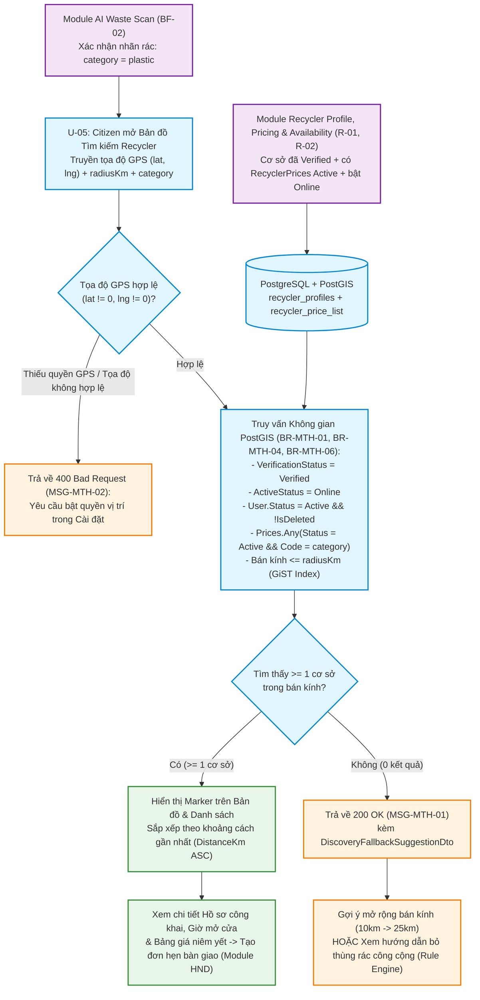
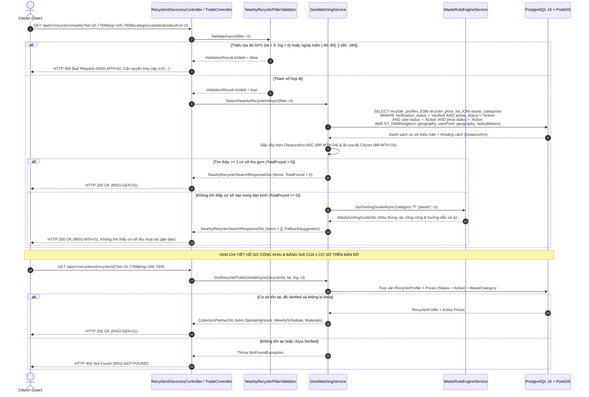

# KẾ HOẠCH THIẾT KẾ & TRIỂN KHAI (IMPLEMENTATION PLAN) - MODULE: LOCATION-BASED RECYCLER DISCOVERY (U-05)

**Dự án:** EcoLink – Intelligent Waste Sorting & Trading Platform  
**Phân hệ:** `MTH` (Tìm kiếm & Kết nối Cơ sở Thu gom theo Vị trí Địa lý)  
**Use Case trọng tâm:**
- **`U-05`**: *Find Nearby Recyclers (GPS)* — Cho phép người dùng đã xác thực (`Citizen`) tìm kiếm các cơ sở thu mua phế liệu đã xác minh (`Verified`) và đang mở cửa (`Online`) trên bản đồ tương tác trong bán kính GPS chỉ định, lọc theo loại rác vừa quét AI (`category`), xem chi tiết bảng giá niêm yết và nhận gợi ý xử lý dự phòng khi xung quanh không có điểm thu mua.

**Nhóm phụ trách:** Hoàng Thắng Nguyễn, Nguyen Thanh Luan (K18 HL), Giang Nguyễn Đức  
**Độ phức tạp / Ưu tiên:** Medium  
**Công nghệ:** .NET 10 Web API, PostgreSQL 16 + PostGIS 3.4 (`NetTopologySuite`), Entity Framework Core, FluentValidation, OpenStreetMap / Leaflet (Frontend)  
**Tài liệu & Module tham chiếu:**
- Đặc tả Quy tắc Nghiệp vụ & Thông điệp: [`business_rule_&_system_message.md`](file:///c:/Projects/EcoLink/intelligent-waste-sorting-trading/documents/business_rule_&_system_message.md) (`BR-MTH-01`, `BR-MTH-04`, `BR-MTH-05`, `BR-MTH-06`, `MSG-MTH-01`, `MSG-MTH-02`)
- Báo cáo Chuẩn hóa Luồng Nghiệp vụ: [`Báo cáo Đánh giá và Chuẩn hóa Luồng Nghiệp vụ Business Flow.md`](file:///c:/Projects/EcoLink/intelligent-waste-sorting-trading/documents/B%C3%A1o%20c%C3%A1o%20%C4%90%C3%A1nh%20gi%C3%A1%20v%C3%A0%20Chu%E1%BA%A9n%20h%C3%B3a%20Lu%E1%BB%93ng%20Nghi%E1%BB%87p%20v%E1%BB%A5%20Business%20Flow.md)
- Quy chuẩn CSDL & PostGIS: [`database_design_and_audit_guidelines.md`](file:///c:/Projects/EcoLink/intelligent-waste-sorting-trading/documents/guideline/database_design_and_audit_guidelines.md) (Mục 3: Xử lý dữ liệu không gian PostGIS)
- Quy chuẩn Kiến trúc: [`clean_architecture_and_coding_guidelines.md`](file:///c:/Projects/EcoLink/intelligent-waste-sorting-trading/documents/guideline/clean_architecture_and_coding_guidelines.md)
- Quy chuẩn API Response: [`api_design_and_response_contract_guidelines.md`](file:///c:/Projects/EcoLink/intelligent-waste-sorting-trading/documents/guideline/api_design_and_response_contract_guidelines.md)

---

## 1. MỤC TIÊU PHẠM VI, RANH GIỚI MODULE & ĐÁNH GIÁ TÍNH KHẢ THI

### 1.1. Phân định Ranh giới giữa 3 Module liên quan đến Recycler
Trong kiến trúc hệ thống EcoLink, vòng đời dữ liệu của một cơ sở thu gom (`Recycler`) được chia tách rõ ràng thành **3 module độc lập**, không chồng chéo code:

| Thứ tự | Tên Module | Use Cases | Trạng thái & Thành phần trong Codebase |
| :---: | :--- | :---: | :--- |
| **Module A**<br>*(Tiền đề 1)* | **Recycler Onboarding & Verification** | `U-17`, `S-04` | **Đã hoàn thành** tại [`RecyclerOnboardingService.cs`](file:///c:/Projects/EcoLink/intelligent-waste-sorting-trading/src/Ecolink.Backend/Ecolink.Infrastructure/Services/RecyclerOnboardingService.cs) & [`RecyclerApplicationsController.cs`](file:///c:/Projects/EcoLink/intelligent-waste-sorting-trading/src/Ecolink.Backend/Ecolink.WebApi/Controllers/RecyclerApplicationsController.cs):<br>`Citizen` nộp hồ sơ kèm tọa độ PostGIS `Point(Lng, Lat)` $\rightarrow$ `Staff` duyệt nâng cấp lên `Recycler` (`VerificationStatus = Verified`). |
| **Module B**<br>*(Tiền đề 2)* | **Recycler Profile, Pricing & Availability** | `R-01`, `R-02` | **Đã hoàn thành** tại [`RecyclerManagementService.cs`](file:///c:/Projects/EcoLink/intelligent-waste-sorting-trading/src/Ecolink.Backend/Ecolink.Infrastructure/Services/RecyclerManagementService.cs) & [`RecyclerController.cs`](file:///c:/Projects/EcoLink/intelligent-waste-sorting-trading/src/Ecolink.Backend/Ecolink.WebApi/Controllers/RecyclerController.cs) (`/api/v1/recycler/*`):<br>`Recycler` cấu hình bảng giá trong bảng `recycler_price_list` ([`RecyclerPrice`](file:///c:/Projects/EcoLink/intelligent-waste-sorting-trading/src/Ecolink.Backend/Ecolink.Domain/Entities/AuthEntities.cs#L144-L165), `Status = Active`) và bật trạng thái `ActiveStatus = Online` kèm lịch làm việc 7 ngày (`WeeklyScheduleJson`). |
| **Module C**<br>*(Module này)* | **Location-Based Recycler Discovery** | **`U-05`** | **Mục tiêu triển khai của Kế hoạch này:**<br>Nâng cấp [`GeoMatchingService.cs`](file:///c:/Projects/EcoLink/intelligent-waste-sorting-trading/src/Ecolink.Backend/Ecolink.Infrastructure/Services/GeoMatchingService.cs) và xây dựng API tìm kiếm không gian PostGIS cho phía `Citizen` trên dữ liệu thật của bảng `recycler_profiles` kết hợp (`JOIN`) `recycler_price_list` và `waste_categories`. |

---

### 1.2. Mục tiêu nghiệp vụ cốt lõi của Module `Location-Based Recycler Discovery` (`U-05`)
1. **Truy vấn bán kính GPS chuẩn PostGIS (`U-05`):** Cho phép người dân (`Citizen`) tìm kiếm các cơ sở thu gom thỏa mãn đồng thời 4 điều kiện của **`BR-MTH-01`**, **`BR-MTH-04`** và **`BR-MTH-06`**:
   - Hồ sơ đã được Staff thẩm định: `VerificationStatus == VerificationStatus.Verified`
   - Cơ sở đang bật trạng thái nhận đơn: `ActiveStatus == RecyclerActiveStatus.Online`
   - Tài khoản chủ cơ sở đang hoạt động: `User.Status == UserStatus.Active && !IsDeleted`
   - Có ít nhất 1 dòng giá đang hiệu lực (`RecyclerPrice.Status == PriceStatus.Active`) khớp với loại rác cần bán (`categoryCode`, nếu có truyền bộ lọc).
2. **Sắp xếp & Bảo mật Quyền riêng tư Vị trí (`BR-MTH-04` & `BR-MTH-05`):**
   - Mặc định sắp xếp kết quả theo khoảng cách gần nhất tăng dần (`DistanceKm ASC`), hỗ trợ tùy chọn sắp xếp theo đơn giá thu mua cao nhất (`PriceDesc`) khi người dùng lọc theo một loại phế liệu cụ thể.
   - Tọa độ GPS (`lat`, `lng`) của người dân chỉ được dùng tạm thời trong bộ nhớ truy vấn để tính khoảng cách `DistanceKm`, **tuyệt đối không lưu vào CSDL và không hiển thị cho Recycler** (`BR-MTH-05`).
3. **Giải quyết Bài toán Phản biện của Hội đồng (Edge Case Thầy Kiên — `0 kết quả` / `MSG-MTH-01`):**
   - Khi không tìm thấy cơ sở thu gom nào trong bán kính (`TotalFound == 0`), hệ thống trả về mã thông điệp `MSG-MTH-01` kèm đối tượng **`DiscoveryFallbackSuggestionDto`** kết nối trực tiếp với [`IWasteRuleEngineService`](file:///c:/Projects/EcoLink/intelligent-waste-sorting-trading/src/Ecolink.Backend/Ecolink.Application/Interfaces/IWasteRuleEngineService.cs) (gợi ý mở rộng bán kính lên `25 km`, hiển thị màu thùng rác công cộng quy chuẩn & các bước xử lý sạch để người dân không bị cụt luồng).

---

### 1.3. Đánh giá mức độ sẵn sàng của Codebase hiện tại (Feasibility Matrix)

| Thành phần kỹ thuật | Độ sẵn sàng | Hiện trạng thực tế trong Source Code |
| :--- | :---: | :--- |
| **1. Bảng Không gian `recycler_profiles` & GiST Index** | **100%** | [`RecyclerProfileConfiguration.cs`](file:///c:/Projects/EcoLink/intelligent-waste-sorting-trading/src/Ecolink.Backend/Ecolink.Infrastructure/Data/Configurations/RecyclerProfileConfiguration.cs#L21-L58) đã cấu hình cột `geom` kiểu `geometry(Point, 4326)` kèm chỉ mục không gian **GiST Index (`gix_recycler_profiles_geom`)**. |
| **2. Bảng Giá Niêm Yết `recycler_price_list` (`R-01`)** | **100%** | [`RecyclerPriceConfiguration.cs`](file:///c:/Projects/EcoLink/intelligent-waste-sorting-trading/src/Ecolink.Backend/Ecolink.Infrastructure/Data/Configurations/RecyclerPriceConfiguration.cs#L10-L46) và [`RecyclerManagementService.cs`](file:///c:/Projects/EcoLink/intelligent-waste-sorting-trading/src/Ecolink.Backend/Ecolink.Infrastructure/Services/RecyclerManagementService.cs) đã quản lý đầy đủ bảng giá `RecyclerPrices` (`PricePerKg`, `MinQuantityKg`, `CollectionConditions`, `Status = Active/Inactive`). |
| **3. Trạng thái Hoạt động & Lịch mở cửa (`R-02`)** | **100%** | [`RecyclerProfile`](file:///c:/Projects/EcoLink/intelligent-waste-sorting-trading/src/Ecolink.Backend/Ecolink.Domain/Entities/AuthEntities.cs#L121-L142) đã có `ActiveStatus` (`Online/Offline`), `OperatingHours`, `BusyReason`, `WeeklyScheduleJson`. |
| **4. Dịch vụ Tìm kiếm Địa lý (`GeoMatchingService`)** | **30%** | [`GeoMatchingService.cs`](file:///c:/Projects/EcoLink/intelligent-waste-sorting-trading/src/Ecolink.Backend/Ecolink.Infrastructure/Services/GeoMatchingService.cs) hiện đang đăng ký `Singleton` và chỉ lọc trên danh sách cứng `_mockPartners` trong RAM, **chưa truy vấn bảng `recycler_profiles` và `recycler_price_list` trong PostgreSQL**. |
| **5. API & Validator chuẩn cho `U-05`** | **40%** | Mới có endpoint sơ khai `GET /api/v1/trade/partners/nearby` trong [`TradeController.cs`](file:///c:/Projects/EcoLink/intelligent-waste-sorting-trading/src/Ecolink.Backend/Ecolink.WebApi/Controllers/TradeController.cs#L28-L38), chưa bọc `ApiResponse<T>`, chưa kiểm tra `MSG-MTH-01` / `MSG-MTH-02`, chưa có API xem chi tiết hồ sơ công khai & bảng giá của vựa trên bản đồ. |

---

### 1.4. Phân tích Giải pháp Công nghệ Không gian: PostGIS + OpenStreetMap vs. Google Maps API

| Tiêu chí đánh giá | PostgreSQL PostGIS 3.4 + OpenStreetMap (Leaflet) | Google Maps Platform (Places / Distance Matrix API) |
| :--- | :--- | :--- |
| **Chi phí vận hành** | **Miễn phí 100% (Open-source):** Không giới hạn số lượt truy vấn bán kính hay hiển thị bản đồ. | Tính phí cao theo mỗi 1,000 requests ($5 – $10 / 1,000 calls cho Distance Matrix), bắt buộc thẻ tín dụng quốc tế. |
| **Hiệu năng lọc kết hợp (`BR-MTH-04`)** | **Cực nhanh (< 5ms):** Lọc đồng thời cả tọa độ không gian (`gix_recycler_profiles_geom`) lẫn điều kiện nghiệp vụ (`VerificationStatus`, `ActiveStatus`, `RecyclerPrices`) trong **1 câu truy vấn SQL duy nhất**. | Phải lấy danh sách cơ sở từ DB rồi gọi HTTP sang Google API để tính khoảng cách $\rightarrow$ Độ trễ mạng cao (200ms – 500ms). |
| **Bảo mật vị trí (`BR-MTH-05`)** | Tọa độ GPS của người dùng được xử lý nội bộ 100% trên Database Server của EcoLink, không gửi ra bên thứ ba. | Tọa độ người dùng phải truyền ra máy chủ bên ngoài. |
| **Đề xuất cho EcoLink** | **Lựa chọn chính thức** (đã tích hợp sẵn image `postgis/postgis:16-3.4-alpine` trong `docker-compose.yml`). | Không sử dụng cho truy vấn bán kính Backend. |

---

## 2. THIẾT KẾ LUỒNG NGHIỆP VỤ & SƠ ĐỒ TUẦN TỰ (BUSINESS FLOW & SEQUENCE DIAGRAMS)

### 2.1. Sơ đồ Liên kết Chuỗi Giá trị (`R-01/R-02` & `BF-02` $\rightarrow$ `U-05` $\rightarrow$ `BF-03`)



---

### 2.2. Sơ đồ Tuần tự (Sequence Diagram) cho `U-05: Find Nearby Recyclers (GPS)`



---

### 2.3. Bảng Đối chiếu Quy tắc Nghiệp vụ & Mã Thông điệp Áp dụng cho `U-05`

| Mã BR / MSG | Phân loại | Nội dung quy định trong tài liệu | Cách thức thực thi trong `GeoMatchingService` & Controller |
| :--- | :---: | :--- | :--- |
| **`BR-MTH-01`** | Business Rule | Recycler phải được Staff phê duyệt trước khi xuất hiện trong tìm kiếm hoặc nhận yêu cầu bàn giao. | Điều kiện lọc bắt buộc `r.VerificationStatus == VerificationStatus.Verified` trong mọi truy vấn bản đồ. |
| **`BR-MTH-03`** | Business Rule | Hồ sơ Recycler chỉ được công khai khi có ít nhất một loại rác chấp nhận, điều kiện thu gom và vị trí hợp lệ. | Đảm bảo bởi `RecyclerManagementService` (`R-01`, `R-02`) và kiểm tra kép `r.Prices.Any(p => p.Status == PriceStatus.Active)` khi tìm kiếm. |
| **`BR-MTH-04`** | Business Rule | Kết quả tìm kiếm chỉ gồm Recycler đã duyệt, đang hoạt động, trong bán kính tìm kiếm và nhận đúng loại rác, mặc định sắp theo khoảng cách. | Kết hợp lọc `Verified` + `Online` + `UserStatus.Active` + `Prices.Any(Active && Code == category)` + bán kính `radiusKm`, sắp xếp mặc định `.OrderBy(x => x.DistanceKm)`. |
| **`BR-MTH-05`** | Business Rule | Tọa độ GPS của người dùng chỉ dùng để tính khoảng cách, không hiển thị cho Recycler. | `lat` và `lng` của `Citizen` chỉ dùng làm biến cục bộ `userLocation` trong câu lệnh `SELECT` để tính `DistanceKm`, không ghi log tọa độ cá nhân hay trả về cho Recycler. |
| **`BR-MTH-06`** | Business Rule | Recycler bị đình chỉ/vô hiệu hóa hoặc chuyển `Offline` bị ẩn khỏi tìm kiếm ngay lập tức. | Lọc `r.ActiveStatus == RecyclerActiveStatus.Online && r.User.Status == UserStatus.Active && !r.IsDeleted`. |
| **`BR-MTH-07`** | Business Rule | Các dòng giá ở trạng thái ngưng nhận mua (`PriceStatus.Inactive`) không xuất hiện khi người dân tìm kiếm. | Chỉ lấy các dòng giá `p.Status == PriceStatus.Active` từ bảng `recycler_price_list`. |
| **`MSG-MTH-01`** | System Message | *Không tìm thấy cơ sở thu mua rác gần bạn.* | Trả về trong `ApiResponse.MessageCode` khi danh sách cơ sở tìm được trong bán kính rỗng (`TotalFound == 0`). |
| **`MSG-MTH-02`** | System Message | *Cần quyền truy cập vị trí để tìm cơ sở thu mua gần bạn. Vui lòng bật trong phần cài đặt.* | Trả về `400 Bad Request` khi thiếu tọa độ (`lat = 0, lng = 0`) hoặc tọa độ nằm ngoài miền hợp lệ `[-90..90]`, `[-180..180]`. |

---

## 3. THIẾT KẾ CHI TIẾT TẦNG APPLICATION (`Ecolink.Application`)

### 3.1. Mở rộng `CollectionPartnerDto` & Định nghĩa DTOs cho `U-05` (`src/Ecolink.Backend/Ecolink.Application/Dtos/RecyclerDiscoveryDtos.cs`)

Liên kết trực tiếp với dữ liệu bảng `recycler_profiles` và `recycler_price_list` từ `Module: Recycler Profile, Pricing & Availability`:

```csharp
namespace Ecolink.Application.Dtos;

/// <summary>
/// Query Request cho Use Case U-05: Tìm kiếm cơ sở thu gom gần vị trí GPS người dùng (BR-MTH-04, BR-MTH-05)
/// </summary>
public class NearbyRecyclerFilterRequest
{
    public double Lat { get; set; }
    public double Lng { get; set; }
    public string? Category { get; set; }         // Mã loại rác từ bước quét AI: plastic, paper, cardboard, metal, glass
    public double RadiusKm { get; set; } = 10.0;  // Bán kính mặc định 10km (cho phép từ 0.5km đến 50km)
    public string? Keyword { get; set; }          // Tìm theo tên cơ sở hoặc địa chỉ
    public string SortBy { get; set; } = "distance"; // "distance" (mặc định theo BR-MTH-04) hoặc "price_desc"
}

/// <summary>
/// Response tổng hợp kết quả tìm kiếm bản đồ (U-05) kèm phương án dự phòng khi không có người mua (MSG-MTH-01)
/// </summary>
public class NearbyRecyclerSearchResponseDto
{
    public int TotalFound { get; set; }
    public double SearchRadiusKm { get; set; }
    public string? FilteredCategory { get; set; }
    public IReadOnlyList<CollectionPartnerDto> Items { get; set; } = Array.Empty<CollectionPartnerDto>();

    /// <summary>
    /// Phương án dự phòng (Fallback) khi TotalFound == 0 (Giải quyết bài toán phản biện của Hội đồng)
    /// </summary>
    public DiscoveryFallbackSuggestionDto? FallbackSuggestion { get; set; }
}

/// <summary>
/// Gợi ý xử lý rác khi xung quanh không có cơ sở thu mua nào hoạt động (MSG-MTH-01)
/// </summary>
public class DiscoveryFallbackSuggestionDto
{
    public double SuggestedExpandedRadiusKm { get; set; } = 25.0;
    public string GuidanceMessage { get; set; } = string.Empty;
    public WasteSortingGuideDto? PublicBinSortingGuide { get; set; }
    public bool AllowCommunityPickupPost { get; set; } = true;
}
```

Cập nhật nhẹ [`CollectionPartnerDto`](file:///c:/Projects/EcoLink/intelligent-waste-sorting-trading/src/Ecolink.Backend/Ecolink.Application/Dtos/TradeDtos.cs#L5-L16) và `AcceptedMaterialDto` trong `TradeDtos.cs` để hiển thị đầy đủ các trường mà `RecyclerManagementService` (`R-01`, `R-02`) đã lưu:
- Bổ sung `OperatingHours`, `Description`, `BusinessPhotoUrl`, `RepresentativeName` vào `CollectionPartnerDto`.
- Bổ sung `CollectionConditions` và `LastUpdatedAt` vào `AcceptedMaterialDto`.

---

### 3.2. Định nghĩa Validator với FluentValidation (`src/Ecolink.Backend/Ecolink.Application/Validators/NearbyRecyclerFilterValidator.cs`)

```csharp
using Ecolink.Application.Dtos;
using FluentValidation;

namespace Ecolink.Application.Validators;

public class NearbyRecyclerFilterValidator : AbstractValidator<NearbyRecyclerFilterRequest>
{
    private static readonly string[] AllowedCategories = { "plastic", "paper", "cardboard", "metal", "glass" };

    public NearbyRecyclerFilterValidator()
    {
        RuleFor(x => x.Lat)
            .InclusiveBetween(-90.0, 90.0)
            .WithMessage("Vĩ độ (Lat) phải nằm trong khoảng từ -90 đến 90.")
            .NotEqual(0)
            .WithMessage("Cần quyền truy cập vị trí để tìm cơ sở thu mua gần bạn. Vui lòng bật trong phần cài đặt (MSG-MTH-02).");

        RuleFor(x => x.Lng)
            .InclusiveBetween(-180.0, 180.0)
            .WithMessage("Kinh độ (Lng) phải nằm trong khoảng từ -180 đến 180.")
            .NotEqual(0)
            .WithMessage("Cần quyền truy cập vị trí để tìm cơ sở thu mua gần bạn. Vui lòng bật trong phần cài đặt (MSG-MTH-02).");

        RuleFor(x => x.RadiusKm)
            .InclusiveBetween(0.5, 50.0)
            .WithMessage("Bán kính tìm kiếm (RadiusKm) phải nằm trong khoảng từ 0.5 km đến 50 km.");

        RuleFor(x => x.Category)
            .Must(c => string.IsNullOrWhiteSpace(c) || AllowedCategories.Contains(c.Trim().ToLowerInvariant()))
            .WithMessage("Danh mục phế liệu lọc chỉ hỗ trợ: plastic, paper, cardboard, metal, glass.");
    }
}
```

---

### 3.3. Mở rộng Interface `IGeoMatchingService` (`src/Ecolink.Backend/Ecolink.Application/Interfaces/IGeoMatchingService.cs`)

```csharp
using Ecolink.Application.Dtos;

namespace Ecolink.Application.Interfaces;

public interface IGeoMatchingService
{
    /// <summary>
    /// [U-05] Tìm kiếm cơ sở thu gom gần vị trí GPS (giữ tương thích với TradeController hiện tại)
    /// </summary>
    Task<IEnumerable<CollectionPartnerDto>> FindNearestPartnersAsync(
        double latitude,
        double longitude,
        string? categoryCode = null,
        double radiusKm = 10.0,
        CancellationToken cancellationToken = default);

    /// <summary>
    /// [U-05] Tìm kiếm cơ sở thu gom chuẩn PostGIS kết hợp bảng RecyclerProfiles + RecyclerPrices
    /// kèm phương án dự phòng (FallbackSuggestion) khi không có cơ sở nào trong bán kính (MSG-MTH-01)
    /// </summary>
    Task<NearbyRecyclerSearchResponseDto> SearchNearbyRecyclersAsync(
        NearbyRecyclerFilterRequest filter,
        CancellationToken cancellationToken = default);

    /// <summary>
    /// [U-05] Xem chi tiết hồ sơ công khai, giờ mở cửa và bảng giá niêm yết của một cơ sở thu gom trên bản đồ
    /// </summary>
    Task<CollectionPartnerDto> GetRecyclerPublicDetailAsync(
        Guid recyclerId,
        double? userLat = null,
        double? userLng = null,
        CancellationToken cancellationToken = default);
}
```

---

## 4. THIẾT KẾ CHI TIẾT TẦNG INFRASTRUCTURE (`Ecolink.Infrastructure`)

### 4.1. Nâng cấp `GeoMatchingService.cs` truy vấn trực tiếp `RecyclerProfiles` & `RecyclerPrices` bằng PostGIS
Đặt tại [`src/Ecolink.Backend/Ecolink.Infrastructure/Services/GeoMatchingService.cs`](file:///c:/Projects/EcoLink/intelligent-waste-sorting-trading/src/Ecolink.Backend/Ecolink.Infrastructure/Services/GeoMatchingService.cs):

- **Kết nối trực tiếp với dữ liệu của `RecyclerManagementService` (`R-01`, `R-02`):**
  - Truy vấn bảng `RecyclerProfiles` (`_db.RecyclerProfiles.AsNoTracking()`), `Include(r => r.User)` và `Include(r => r.Prices.Where(p => p.Status == PriceStatus.Active)).ThenInclude(p => p.WasteCategory)`.
  - Thực thi đúng bộ lọc của **`BR-MTH-01`**, **`BR-MTH-03`**, **`BR-MTH-04`**, **`BR-MTH-06`** và **`BR-MTH-07`**:
    1. `r.VerificationStatus == VerificationStatus.Verified`
    2. `r.ActiveStatus == RecyclerActiveStatus.Online`
    3. `r.User != null && r.User.Status == UserStatus.Active && !r.IsDeleted`
    4. `r.Prices.Any(p => p.Status == PriceStatus.Active && (normalizedCategory == null || p.WasteCategory!.Code == normalizedCategory))`
- **Tính khoảng cách và lọc bán kính không gian:**
  - Tạo điểm không gian `var userPoint = new Point(longitude, latitude) { SRID = 4326 };` (lưu ý chuẩn PostGIS: `X = Longitude`, `Y = Latitude` theo Mục 3.1 của [`database_design_and_audit_guidelines.md`](file:///c:/Projects/EcoLink/intelligent-waste-sorting-trading/documents/guideline/database_design_and_audit_guidelines.md#L97-L111)).
  - Tính khoảng cách thực tế (km) và lọc các cơ sở có `DistanceKm <= radiusKm`, sắp xếp mặc định theo `DistanceKm` tăng dần (`BR-MTH-04`).
- **Đổi vòng đời Dependency Injection:**
  - Trong [`DependencyInjection.cs`](file:///c:/Projects/EcoLink/intelligent-waste-sorting-trading/src/Ecolink.Backend/Ecolink.Infrastructure/DependencyInjection.cs#L46): Đổi từ `services.AddSingleton<IGeoMatchingService, GeoMatchingService>()` sang **`services.AddScoped<IGeoMatchingService, GeoMatchingService>()`** để inject `ApplicationDbContext` an toàn theo chuẩn Clean Architecture.

```csharp
using Ecolink.Application.Dtos;
using Ecolink.Application.Interfaces;
using Ecolink.Domain.Enums;
using Ecolink.Domain.Exceptions;
using Ecolink.Infrastructure.Data;
using Microsoft.EntityFrameworkCore;
using Microsoft.Extensions.Logging;

namespace Ecolink.Infrastructure.Services;

public class GeoMatchingService : IGeoMatchingService
{
    private readonly ApplicationDbContext? _db;
    private readonly IWasteRuleEngineService _ruleEngine;
    private readonly ILogger<GeoMatchingService> _logger;

    public GeoMatchingService(
        IWasteRuleEngineService ruleEngine,
        ILogger<GeoMatchingService> logger,
        ApplicationDbContext? db = null)
    {
        _ruleEngine = ruleEngine;
        _logger = logger;
        _db = db;
    }

    public async Task<IEnumerable<CollectionPartnerDto>> FindNearestPartnersAsync(
        double latitude,
        double longitude,
        string? categoryCode = null,
        double radiusKm = 10.0,
        CancellationToken ct = default)
    {
        var normalizedCategory = string.IsNullOrWhiteSpace(categoryCode)
            ? null
            : categoryCode.Trim().ToLowerInvariant();

        var results = new List<CollectionPartnerDto>();

        // 1. Truy vấn các cơ sở thu gom thực tế từ bảng recycler_profiles + recycler_price_list (R-01, R-02)
        if (_db != null)
        {
            var query = _db.RecyclerProfiles
                .AsNoTracking()
                .Include(r => r.User)
                .Include(r => r.Prices.Where(p => p.Status == PriceStatus.Active))
                    .ThenInclude(p => p.WasteCategory)
                .Where(r => r.VerificationStatus == VerificationStatus.Verified
                            && r.ActiveStatus == RecyclerActiveStatus.Online
                            && r.User != null
                            && r.User.Status == UserStatus.Active
                            && r.Prices.Any(p => p.Status == PriceStatus.Active
                                && (normalizedCategory == null || p.WasteCategory!.Code.ToLower() == normalizedCategory)));

            var dbProfiles = await query.ToListAsync(ct);

            foreach (var profile in dbProfiles)
            {
                var lat = (double)profile.Latitude;
                var lng = (double)profile.Longitude;
                var distanceKm = CalculateDistanceKm(latitude, longitude, lat, lng);

                if (distanceKm <= radiusKm)
                {
                    results.Add(MapProfileToPartnerDto(profile, distanceKm));
                }
            }
        }

        // 2. Sắp xếp mặc định theo khoảng cách gần nhất tăng dần (BR-MTH-04)
        return results.OrderBy(p => p.DistanceKm).ToList();
    }

    public async Task<NearbyRecyclerSearchResponseDto> SearchNearbyRecyclersAsync(
        NearbyRecyclerFilterRequest filter,
        CancellationToken ct = default)
    {
        var partners = (await FindNearestPartnersAsync(
            filter.Lat,
            filter.Lng,
            filter.Category,
            filter.RadiusKm,
            ct)).ToList();

        // Lọc theo từ khóa tên vựa hoặc địa chỉ (nếu có)
        if (!string.IsNullOrWhiteSpace(filter.Keyword))
        {
            var kw = filter.Keyword.Trim().ToLowerInvariant();
            partners = partners
                .Where(p => p.FacilityName.ToLowerInvariant().Contains(kw)
                            || p.Address.ToLowerInvariant().Contains(kw))
                .ToList();
        }

        // Hỗ trợ sắp xếp theo giá cao nhất nếu người dùng chọn sortBy = "price_desc" khi lọc theo loại rác
        if (string.Equals(filter.SortBy, "price_desc", StringComparison.OrdinalIgnoreCase)
            && !string.IsNullOrWhiteSpace(filter.Category))
        {
            var cat = filter.Category.Trim().ToLowerInvariant();
            partners = partners
                .OrderByDescending(p => p.Materials
                    .FirstOrDefault(m => m.CategoryCode.Equals(cat, StringComparison.OrdinalIgnoreCase))?.PricePerKg ?? 0m)
                .ThenBy(p => p.DistanceKm)
                .ToList();
        }

        var response = new NearbyRecyclerSearchResponseDto
        {
            TotalFound = partners.Count,
            SearchRadiusKm = filter.RadiusKm,
            FilteredCategory = filter.Category,
            Items = partners
        };

        // 3. Nếu không tìm thấy cơ sở nào (0 kết quả - MSG-MTH-01):
        // Kích hoạt Phương án Dự phòng 3 tầng kết nối WasteRuleEngineService
        if (partners.Count == 0)
        {
            var categoryCode = !string.IsNullOrWhiteSpace(filter.Category)
                ? filter.Category.Trim().ToLowerInvariant()
                : "plastic";
            var sortingGuide = await _ruleEngine.GetSortingGuideAsync(categoryCode, ct);

            response.FallbackSuggestion = new DiscoveryFallbackSuggestionDto
            {
                SuggestedExpandedRadiusKm = Math.Min(50.0, Math.Round(filter.RadiusKm * 2.5, 1)),
                GuidanceMessage = "Không tìm thấy cơ sở thu mua rác gần bạn trong bán kính hiện tại. Bạn có thể mở rộng bán kính tìm kiếm, hoặc xử lý theo hướng dẫn thùng rác công cộng bên dưới.",
                PublicBinSortingGuide = sortingGuide,
                AllowCommunityPickupPost = true
            };
        }

        return response;
    }
}
```

---

## 5. THIẾT KẾ RESTFUL API ENDPOINTS TẠI TẦNG WEBAPI (`Ecolink.WebApi`)

### 5.1. Phân tách rõ ràng Route giữa `RecyclerController` (`R-01`, `R-02`) và `RecyclersDiscoveryController` (`U-05`)

Để không xung đột với [`RecyclerController.cs`](file:///c:/Projects/EcoLink/intelligent-waste-sorting-trading/src/Ecolink.Backend/Ecolink.WebApi/Controllers/RecyclerController.cs) (`/api/v1/recycler/...` dành riêng cho chủ vựa quản lý hồ sơ, bảng giá `R-01` và trạng thái `R-02`), module `Location-Based Recycler Discovery` (`U-05`) cung cấp các endpoints tìm kiếm công khai cho `Citizen`:

| STT | Phương thức | Đường dẫn URI | Use Case | Phân quyền | Mã thông điệp trả về |
| :---: | :---: | :--- | :---: | :--- | :--- |
| 1 | `GET` | `/api/v1/recyclers/nearby` | **`U-05`** | Public / `[Authorize]` (`Citizen`) | `MSG-GEN-01` / `MSG-MTH-01` / `MSG-MTH-02` |
| 2 | `GET` | `/api/v1/recyclers/{recyclerId:guid}` | **`U-05`** | Public / `[Authorize]` (`Citizen`) | `MSG-GEN-01` / `MSG-NOT-FOUND` |
| 3 | `GET` | `/api/v1/trade/partners/nearby` | **`U-05`** *(Alias)* | Public / `[Authorize]` | Giữ tương thích ngược 100% với [`TradeController.cs`](file:///c:/Projects/EcoLink/intelligent-waste-sorting-trading/src/Ecolink.Backend/Ecolink.WebApi/Controllers/TradeController.cs#L28-L38) |

---

### 5.2. Thiết kế `RecyclersDiscoveryController.cs` (Thin Controller)
Đặt tại `src/Ecolink.Backend/Ecolink.WebApi/Controllers/RecyclersDiscoveryController.cs`:

```csharp
using Ecolink.Application.Common;
using Ecolink.Application.Dtos;
using Ecolink.Application.Interfaces;
using FluentValidation;
using Microsoft.AspNetCore.Mvc;

namespace Ecolink.WebApi.Controllers;

/// <summary>
/// Phân hệ Tìm kiếm Cơ sở Thu gom theo Vị trí Địa lý (Module: Location-Based Recycler Discovery - UC U-05).
/// Truy vấn các cơ sở đã xác minh (Verified) và đang mở cửa (Online) kèm bảng giá niêm yết (RecyclerPrices).
/// </summary>
[ApiController]
[Route("api/v1/recyclers")]
[Produces("application/json")]
public class RecyclersDiscoveryController : ControllerBase
{
    private readonly IGeoMatchingService _geoMatchingService;
    private readonly IValidator<NearbyRecyclerFilterRequest> _nearbyValidator;

    public RecyclersDiscoveryController(
        IGeoMatchingService geoMatchingService,
        IValidator<NearbyRecyclerFilterRequest> nearbyValidator)
    {
        _geoMatchingService = geoMatchingService;
        _nearbyValidator = nearbyValidator;
    }

    /// <summary>
    /// 1. [U-05] Tìm kiếm các Cơ sở thu gom đã xác minh trong bán kính GPS (BR-MTH-04, BR-MTH-05)
    /// </summary>
    [HttpGet("nearby")]
    [ProducesResponseType(typeof(ApiResponse<NearbyRecyclerSearchResponseDto>), StatusCodes.Status200OK)]
    [ProducesResponseType(typeof(ApiResponse<object>), StatusCodes.Status400BadRequest)]
    public async Task<ActionResult<ApiResponse<NearbyRecyclerSearchResponseDto>>> SearchNearby(
        [FromQuery] NearbyRecyclerFilterRequest filter,
        CancellationToken ct)
    {
        var validationResult = await _nearbyValidator.ValidateAsync(filter, ct);
        if (!validationResult.IsValid)
        {
            var errors = validationResult.Errors.Select(e => $"{e.PropertyName}: {e.ErrorMessage}").ToList();
            return BadRequest(ApiResponse<object>.Fail(
                "Cần quyền truy cập vị trí để tìm cơ sở thu mua gần bạn. Vui lòng bật trong phần cài đặt.",
                "MSG-MTH-02",
                errors));
        }

        var result = await _geoMatchingService.SearchNearbyRecyclersAsync(filter, ct);

        if (result.TotalFound == 0)
        {
            return Ok(ApiResponse<NearbyRecyclerSearchResponseDto>.Ok(
                result,
                message: "Không tìm thấy cơ sở thu mua rác gần bạn.",
                messageCode: "MSG-MTH-01"));
        }

        return Ok(ApiResponse<NearbyRecyclerSearchResponseDto>.Ok(
            result,
            message: $"Tìm thấy {result.TotalFound} cơ sở thu mua trong bán kính {result.SearchRadiusKm} km.",
            messageCode: "MSG-GEN-01"));
    }

    /// <summary>
    /// 2. [U-05] Xem thông tin công khai, giờ mở cửa và bảng giá niêm yết của một Cơ sở thu gom cụ thể trên bản đồ
    /// </summary>
    [HttpGet("{recyclerId:guid}")]
    [ProducesResponseType(typeof(ApiResponse<CollectionPartnerDto>), StatusCodes.Status200OK)]
    [ProducesResponseType(typeof(ApiResponse<object>), StatusCodes.Status404NotFound)]
    public async Task<ActionResult<ApiResponse<CollectionPartnerDto>>> GetRecyclerDetail(
        Guid recyclerId,
        [FromQuery] double? lat = null,
        [FromQuery] double? lng = null,
        CancellationToken ct = default)
    {
        var result = await _geoMatchingService.GetRecyclerPublicDetailAsync(recyclerId, lat, lng, ct);
        return Ok(ApiResponse<CollectionPartnerDto>.Ok(
            result,
            message: "Lấy thông tin cơ sở thu mua thành công.",
            messageCode: "MSG-GEN-01"));
    }
}
```

---

## 6. KẾ HOẠCH KIỂM THỬ & MA TRẬN TRUY XUẤT (TEST PLAN & RTM - CHUẨN IEEE 829)

Thiết kế kịch bản kiểm thử cho **`U-05`** theo chuẩn tại [`test_case_specification_guidelines.md`](file:///c:/Projects/EcoLink/intelligent-waste-sorting-trading/documents/guideline/test_case_specification_guidelines.md):

| Test Case ID | Use Case Ref | BR / MSG Ref | Test Objective (Mục tiêu kiểm thử) | Preconditions (Tiền điều kiện) | Test Steps (Các bước thực hiện) | Test Data (Dữ liệu thử nghiệm) | Expected Result (Kết quả kỳ vọng) | Priority |
| :--- | :---: | :--- | :--- | :--- | :--- | :--- | :--- | :---: |
| **`TC-MTH-05-01_P`** | `U-05` | `BR-MTH-04`<br>`MSG-GEN-01` | Tìm kiếm cơ sở thu gom gần vị trí GPS hợp lệ và kiểm tra sắp xếp khoảng cách tăng dần | Có ít nhất 2 cơ sở `Verified` + `Online` có bảng giá `Active` tại TP.HCM. | 1. Gọi `GET /api/v1/recyclers/nearby?lat=10.7769&lng=106.7009&radiusKm=10`. | `lat = 10.7769`, `lng = 106.7009`, `radiusKm = 10` | - HTTP `200 OK`, `messageCode = "MSG-GEN-01"`.<br>- Danh sách `items` chỉ gồm các cơ sở cách $\le 10\text{ km}$, sắp xếp theo `distanceKm` tăng dần (`item[0].distanceKm <= item[1].distanceKm`). | **Critical** |
| **`TC-MTH-05-02_P`** | `U-05` | `BR-MTH-04`<br>`BR-MTH-07` | Tìm kiếm cơ sở thu gom có lọc theo danh mục rác từ bước quét AI (`category = glass`) | Cơ sở 1 nhận `plastic, paper, metal`; Cơ sở 2 nhận `plastic, glass, cardboard` (`PriceStatus.Active`). | 1. Gọi `GET /api/v1/recyclers/nearby?lat=10.7769&lng=106.7009&category=glass&radiusKm=10`. | `category = "glass"` | - HTTP `200 OK`.<br>- Chỉ trả về Cơ sở 2 (có dòng giá `glass` đang `Active`), loại bỏ Cơ sở 1. | **Critical** |
| **`TC-MTH-05-03_P`** | `U-05` | `BR-MTH-04`<br>`MSG-MTH-01` | Trả về `MSG-MTH-01` kèm `FallbackSuggestion` khi không có cơ sở nào trong bán kính | Không có cơ sở nào trong bán kính `1 km` tại tọa độ thử nghiệm. | 1. Gọi `GET /api/v1/recyclers/nearby?lat=21.0285&lng=105.8542&category=plastic&radiusKm=1`. | `lat = 21.0285`, `lng = 105.8542`, `radiusKm = 1` | - HTTP `200 OK`, `messageCode = "MSG-MTH-01"`.<br>- `totalFound = 0`, `items = []`.<br>- `fallbackSuggestion` khác `null`, chứa hướng dẫn thùng rác `publicBinSortingGuide`. | **High** |
| **`TC-MTH-05-04_N`** | `U-05` | `BR-MTH-05`<br>`MSG-MTH-02` | Chặn truy vấn khi người dùng chưa cấp quyền GPS (`lat = 0, lng = 0`) hoặc tọa độ vượt biên | Không có. | 1. Gọi `GET /api/v1/recyclers/nearby?lat=0&lng=0` hoặc `lat=95&lng=106`. | `lat = 0`, `lng = 0` | - HTTP `400 Bad Request`, `messageCode = "MSG-MTH-02"`.<br>- Báo yêu cầu bật quyền truy cập vị trí trong cài đặt. | **High** |
| **`TC-MTH-05-05_B`** | `U-05` | `BR-MTH-04` | Kiểm tra biên bán kính tìm kiếm `radiusKm` (`0.5 km` và `50 km`, ngoài khoảng báo lỗi `400`) | Không có. | 1. Gửi `radiusKm = 0.1` hoặc `radiusKm = 100`. | `radiusKm = 100` | - HTTP `400 Bad Request` do vượt giới hạn bán kính cho phép `[0.5, 50]`. | **Medium** |
| **`TC-MTH-05-06_N`** | `U-05` | `BR-MTH-01`<br>`BR-MTH-06` | Đảm bảo cơ sở chưa duyệt (`Pending`/`Rejected`), đang `Offline` hoặc tài khoản `Suspended` bị ẩn khỏi bản đồ | Có 1 cơ sở `Pending`, 1 cơ sở `Offline` (tắt ở `R-02`) và 1 cơ sở `Suspended` nằm ngay cạnh tọa độ người dùng. | 1. Gọi `GET /api/v1/recyclers/nearby` tại đúng tọa độ của các cơ sở trên. | Tọa độ trùng với cơ sở `Pending` / `Offline` | - Kết quả tuyệt đối không chứa cơ sở đang `Pending`, `Rejected`, `Offline` hoặc `Suspended`. | **Critical** |
| **`TC-MTH-05-07_P`** | `U-05` | `BR-MTH-07` | Kiểm tra tương thích liên module (`R-01` $\rightarrow$ `U-05`): Khi Recycler tắt nhận mua 1 loại rác (`Inactive`), cơ sở không còn xuất hiện khi lọc theo loại rác đó | Cơ sở đang `Online` chuyển dòng giá `metal` sang `Inactive` qua API `PUT /api/v1/recycler/prices/{id}`. | 1. Gọi `GET /api/v1/recyclers/nearby?lat=10.7769&lng=106.7009&category=metal`. | `category = "metal"` | - Cơ sở đó không xuất hiện khi lọc `category=metal`, nhưng vẫn xuất hiện khi lọc `category=plastic` (loại rác còn `Active`). | **High** |
| **`TC-MTH-05-08_P`** | `U-05` | `MSG-GEN-01` | Xem chi tiết hồ sơ công khai và bảng giá niêm yết của một cơ sở thu gom (`GET /api/v1/recyclers/{id}`) | Cơ sở thu gom `Verified` tồn tại trong hệ thống. | 1. Gọi `GET /api/v1/recyclers/{recyclerId}?lat=10.7769&lng=106.7009`. | `recyclerId` hợp lệ | - HTTP `200 OK`, trả về đầy đủ tên vựa, địa chỉ, số điện thoại, giờ mở cửa, khoảng cách `distanceKm` và danh sách `materials` đang `Active`. | **High** |

---

## 7. PHÂN CÔNG NHIỆM VỤ & CHECKLIST TRIỂN KHAI (WORK BREAKDOWN)

### 7.1. Phân công chi tiết cho 3 thành viên trong Task Card (`Module: Location-Based Recycler Discovery`)

| Thành viên | Vai trò chính | Nhiệm vụ cụ thể |
| :--- | :--- | :--- |
| **1. Hoàng Thắng Nguyễn** | **PostGIS Spatial Query & `GeoMatchingService`** | - Nâng cấp [`GeoMatchingService.cs`](file:///c:/Projects/EcoLink/intelligent-waste-sorting-trading/src/Ecolink.Backend/Ecolink.Infrastructure/Services/GeoMatchingService.cs) kết nối `ApplicationDbContext` (truy vấn `RecyclerProfiles` kết hợp `RecyclerPrices` & `WasteCategories` do module `R-01`/`R-02` tạo ra, lọc theo `BR-MTH-01`, `BR-MTH-04`, `BR-MTH-06`, `BR-MTH-07`).<br>- Triển khai `SearchNearbyRecyclersAsync` và `GetRecyclerPublicDetailAsync`, đổi đăng ký DI sang `AddScoped<IGeoMatchingService, GeoMatchingService>()`. |
| **2. Nguyen Thanh Luan (K18 HL)** | **RESTful Controller, DTOs, Validators & Fallback** | - Xây dựng `RecyclerDiscoveryDtos.cs` và `NearbyRecyclerFilterValidator.cs` (FluentValidation kiểm tra tọa độ GPS `MSG-MTH-02`, bán kính `[0.5, 50]`, danh mục rác).<br>- Xây dựng `RecyclersDiscoveryController.cs` (`/api/v1/recyclers/nearby`, `/api/v1/recyclers/{id}`) và tích hợp `DiscoveryFallbackSuggestionDto` kết nối `IWasteRuleEngineService` khi `TotalFound == 0` (`MSG-MTH-01`). |
| **3. Giang Nguyễn Đức** | **UML Diagrams, Unit Test & QA Verification** | - Vẽ Class Diagram và Sequence Diagram cho Module `Location-Based Recycler Discovery` (`U-05`).<br>- Viết Unit Test cho `GeoMatchingService` & `NearbyRecyclerFilterValidator` vào `Report-5.1_Unit Test` và kiểm thử thực tế 8 kịch bản (`TC-MTH-05-01_P` $\rightarrow$ `TC-MTH-05-08_P`) trên Swagger UI. |

---

### 7.2. Lộ trình thực hiện từng bước (Step-by-Step Implementation Checklist)

- [ ] **Bước 1:** Tạo file DTO `src/Ecolink.Backend/Ecolink.Application/Dtos/RecyclerDiscoveryDtos.cs`, mở rộng [`CollectionPartnerDto`](file:///c:/Projects/EcoLink/intelligent-waste-sorting-trading/src/Ecolink.Backend/Ecolink.Application/Dtos/TradeDtos.cs) và cập nhật interface [`IGeoMatchingService.cs`](file:///c:/Projects/EcoLink/intelligent-waste-sorting-trading/src/Ecolink.Backend/Ecolink.Application/Interfaces/IGeoMatchingService.cs).
- [ ] **Bước 2:** Tạo Validator `src/Ecolink.Backend/Ecolink.Application/Validators/NearbyRecyclerFilterValidator.cs` kiểm tra tọa độ GPS (`MSG-MTH-02`), bán kính tìm kiếm và mã loại rác.
- [ ] **Bước 3:** Nâng cấp [`GeoMatchingService.cs`](file:///c:/Projects/EcoLink/intelligent-waste-sorting-trading/src/Ecolink.Backend/Ecolink.Infrastructure/Services/GeoMatchingService.cs) truy vấn bảng `RecyclerProfiles` + `RecyclerPrices` (`PriceStatus.Active`) trong PostgreSQL/PostGIS, thực thi `BR-MTH-01`, `BR-MTH-04`, `BR-MTH-05`, `BR-MTH-06`, `BR-MTH-07` và tích hợp `IWasteRuleEngineService` cho kịch bản dự phòng (`FallbackSuggestion`).
- [ ] **Bước 4:** Cập nhật đăng ký Dependency Injection trong [`DependencyInjection.cs`](file:///c:/Projects/EcoLink/intelligent-waste-sorting-trading/src/Ecolink.Backend/Ecolink.Infrastructure/DependencyInjection.cs) từ `AddSingleton` sang `AddScoped<IGeoMatchingService, GeoMatchingService>()`.
- [ ] **Bước 5:** Tạo `src/Ecolink.Backend/Ecolink.WebApi/Controllers/RecyclersDiscoveryController.cs` (`/api/v1/recyclers/nearby` & `/api/v1/recyclers/{recyclerId:guid}`).
- [ ] **Bước 6:** Viết bộ Unit Test & thực thi 8 Test Cases (`TC-MTH-05-01_P` $\rightarrow$ `TC-MTH-05-08_P`).
