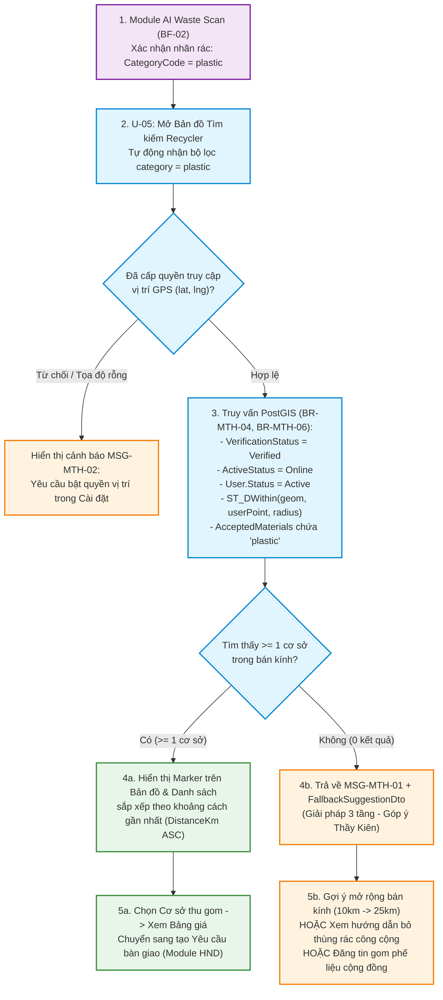
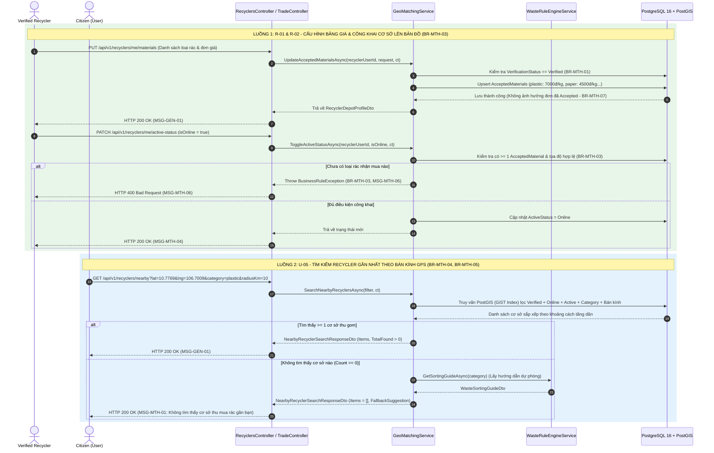

# KẾ HOẠCH THIẾT KẾ & TRIỂN KHAI (IMPLEMENTATION PLAN) - MODULE: LOCATION-BASED RECYCLER DISCOVERY (U-05, R-01 & R-02)

**Dự án:** EcoLink – Intelligent Waste Sorting & Trading Platform  
**Phân hệ:** `MTH` (Hồ sơ Recycler & Kết nối Không gian Địa lý)  
**Use Cases trọng tâm:**
- **`U-05`**: *Find Nearby Recyclers (GPS)* (Người dân tìm kiếm các cơ sở thu mua phế liệu đã xác minh trên bản đồ tương tác trong bán kính GPS chỉ định)
- **`R-01`**: *Manage Depot Profile & Accepted Materials* (Cơ sở thu gom cấu hình danh mục loại rác nhận mua, đơn giá `VNĐ/kg` và khối lượng tối thiểu)
- **`R-02`**: *Toggle Online/Offline Availability Status* (Cơ sở thu gom bật/tắt trạng thái mở cửa nhận đơn trên bản đồ GPS)

**Nhóm phụ trách:** Hoàng Thắng Nguyễn, Nguyen Thanh Luan (K18 HL), Giang Nguyễn Đức  
**Độ phức tạp / Ưu tiên:** Medium  
**Công nghệ:** .NET 10 Web API, PostgreSQL 16 + PostGIS 3.4 (`NetTopologySuite`), Entity Framework Core, FluentValidation, OpenStreetMap / Leaflet (Frontend)  
**Tài liệu tham chiếu:**
- Đặc tả Quy tắc Nghiệp vụ & Thông điệp: [`business_rule_&_system_message.md`](file:///c:/Projects/EcoLink/intelligent-waste-sorting-trading/documents/business_rule_&_system_message.md) (`BR-MTH-01` $\rightarrow$ `BR-MTH-07`, `MSG-MTH-01` $\rightarrow$ `MSG-MTH-06`)
- Báo cáo Chuẩn hóa Luồng Nghiệp vụ: [`Báo cáo Đánh giá và Chuẩn hóa Luồng Nghiệp vụ Business Flow.md`](file:///c:/Projects/EcoLink/intelligent-waste-sorting-trading/documents/B%C3%A1o%20c%C3%A1o%20%C4%90%C3%A1nh%20gi%C3%A1%20v%C3%A0%20Chu%E1%BA%A9n%20h%C3%B3a%20Lu%E1%BB%93ng%20Nghi%E1%BB%87p%20v%E1%BB%A5%20Business%20Flow.md)
- Quy chuẩn CSDL & PostGIS: [`database_design_and_audit_guidelines.md`](file:///c:/Projects/EcoLink/intelligent-waste-sorting-trading/documents/guideline/database_design_and_audit_guidelines.md) (Mục 3: Xử lý dữ liệu không gian PostGIS)
- Quy chuẩn Kiến trúc: [`clean_architecture_and_coding_guidelines.md`](file:///c:/Projects/EcoLink/intelligent-waste-sorting-trading/documents/guideline/clean_architecture_and_coding_guidelines.md)
- Quy chuẩn API Response: [`api_design_and_response_contract_guidelines.md`](file:///c:/Projects/EcoLink/intelligent-waste-sorting-trading/documents/guideline/api_design_and_response_contract_guidelines.md)
- Kế hoạch Module tiền đề: [`recycler_onboarding_and_verification_implementation_plan.md`](file:///c:/Projects/EcoLink/intelligent-waste-sorting-trading/documents/implementation_plan/recycler_onboarding_and_verification_implementation_plan.md) (`U-17` & `S-04`)

---

## 1. MỤC TIÊU PHẠM VI & ĐÁNH GIÁ TÍNH KHẢ THI (SCOPE & FEASIBILITY ASSESSMENT)

### 1.1. Mục tiêu nghiệp vụ cốt lõi
Xây dựng phân hệ **Tìm kiếm & Kết nối Cơ sở Thu gom theo Vị trí Địa lý (`Location-Based Recycler Discovery`)** đóng vai trò là cầu nối trực tiếp giữa **Phân loại rác bằng AI (`CLS`)** và **Giao dịch thu mua phế liệu (`HND`/`NEG`)**:
1. **`U-05` (Find Nearby Recyclers via GPS):** Cho phép người dùng đã xác thực (`Citizen`) tìm kiếm các cơ sở thu gom phế liệu đã được Staff thẩm định (`VerificationStatus = Verified`) và đang mở cửa (`ActiveStatus = Online`) trong bán kính $R\text{ km}$ xung quanh vị trí GPS hiện tại, hỗ trợ lọc theo loại rác vừa quét AI (`categoryCode`), sắp xếp mặc định theo khoảng cách gần nhất (`BR-MTH-04`) và đảm bảo quyền riêng tư vị trí của công dân (`BR-MTH-05`).
2. **`R-01` & `R-02` (Configure Accepted Materials & Publish Depot on Map):** Cho phép đối tác `Recycler` (sau khi được duyệt ở `S-04`) thiết lập bảng giá thu mua theo từng danh mục rác (`AcceptedMaterials`: `PricePerKg`, `MinimumQuantityKg`) và bật trạng thái hiển thị công khai trên bản đồ (`ActiveStatus = Online`) khi đáp ứng đủ điều kiện của **`BR-MTH-03`**.
3. **Giải quyết Bài toán Phản biện của Hội đồng (Edge Case Thầy Kiên):** Khi không tìm thấy cơ sở thu gom nào trong bán kính (`0 kết quả` – `MSG-MTH-01`), hệ thống tự động trả kèm **Gợi ý xử lý dự phòng (`FallbackSuggestionDto`)** từ `WasteRuleEngineService` (hướng dẫn thùng rác công cộng quy chuẩn, gợi ý mở rộng bán kính hoặc đăng tin thu gom cộng đồng) để luồng nghiệp vụ không bao giờ bị đứt gãy.

---

### 1.2. Đánh giá mức độ sẵn sàng của Codebase hiện tại (Feasibility Matrix)
Qua đối chiếu mã nguồn tại `src/Ecolink.Backend`, module có **tính khả thi rất cao (đạt ~60% nền tảng CSDL và thực thể)**:

| Thành phần kỹ thuật | Độ sẵn sàng | Hiện trạng trong Source Code |
| :--- | :---: | :--- |
| **1. Thực thể Không gian & PostGIS** | **95%** | [`RecyclerProfile`](file:///c:/Projects/EcoLink/intelligent-waste-sorting-trading/src/Ecolink.Backend/Ecolink.Domain/Entities/AuthEntities.cs#L11-L33) và [`RecyclerProfileConfiguration.cs`](file:///c:/Projects/EcoLink/intelligent-waste-sorting-trading/src/Ecolink.Backend/Ecolink.Infrastructure/Data/Configurations/RecyclerProfileConfiguration.cs#L21-L55) đã cấu hình cột `geom` kiểu `geometry(Point, 4326)` kèm chỉ mục không gian **GiST Index (`gix_recycler_profiles_geom`)**. |
| **2. Thực thể Danh mục Rác & Vật liệu** | **90%** | Đã có [`WasteCategory`](file:///c:/Projects/EcoLink/intelligent-waste-sorting-trading/src/Ecolink.Backend/Ecolink.Domain/Entities/WasteEntities.cs#L5-L16), [`CollectionPartner`](file:///c:/Projects/EcoLink/intelligent-waste-sorting-trading/src/Ecolink.Backend/Ecolink.Domain/Entities/TradeEntities.cs#L6-L22) và [`AcceptedMaterial`](file:///c:/Projects/EcoLink/intelligent-waste-sorting-trading/src/Ecolink.Backend/Ecolink.Domain/Entities/TradeEntities.cs#L24-L34) (`PricePerKg`, `MinimumQuantityKg`). |
| **3. Quy trình Duyệt Hồ sơ (`U-17` & `S-04`)** | **100%** | [`RecyclerOnboardingService.cs`](file:///c:/Projects/EcoLink/intelligent-waste-sorting-trading/src/Ecolink.Backend/Ecolink.Infrastructure/Services/RecyclerOnboardingService.cs) đã lưu tọa độ `Point(Longitude, Latitude) { SRID = 4326 }` và chuyển trạng thái `VerificationStatus = Verified` khi Staff duyệt. |
| **4. Dịch vụ Tìm kiếm Địa lý (`GeoMatchingService`)** | **35%** | [`GeoMatchingService.cs`](file:///c:/Projects/EcoLink/intelligent-waste-sorting-trading/src/Ecolink.Backend/Ecolink.Infrastructure/Services/GeoMatchingService.cs) hiện đang đăng ký `Singleton` và dùng danh sách cứng `_mockPartners` trong RAM kết hợp tính Haversine bằng C#, **chưa truy vấn bảng `recycler_profiles` bằng PostGIS**. |
| **5. API Cấu hình Bảng giá & Trạng thái (`R-01`, `R-02`)** | **10%** | Chưa có API cho phép `Recycler` thêm/sửa `AcceptedMaterials` và bật/tắt `ActiveStatus = Online/Offline` theo quy tắc `BR-MTH-03`. |

---

### 1.3. Phân tích Khoảng trống kỹ thuật (Technical Gaps) & Giải pháp thiết kế

1. **Chuyển đổi từ tính toán Haversine trên RAM sang Truy vấn Không gian PostGIS (`ST_DWithin`):**
   - Theo Mục 3.1 của [`database_design_and_audit_guidelines.md`](file:///c:/Projects/EcoLink/intelligent-waste-sorting-trading/documents/guideline/database_design_and_audit_guidelines.md#L113-L118), việc tải danh sách cơ sở về RAM rồi tính khoảng cách bằng C# sẽ gây nghẽn cổ chai khi số lượng cơ sở lớn.
   - **Giải pháp:** Đổi vòng đời của `IGeoMatchingService` từ `Singleton` sang **`Scoped`** (theo Mục 3 [`clean_architecture_and_coding_guidelines.md`](file:///c:/Projects/EcoLink/intelligent-waste-sorting-trading/documents/guideline/clean_architecture_and_coding_guidelines.md#L98-L112) để tránh lỗi *Captive Dependency* khi inject `ApplicationDbContext`), sử dụng `NetTopologySuite` thực thi truy vấn không gian trực tiếp dưới PostgreSQL kết hợp dữ liệu seed mặc định trong CSDL.
2. **Đồng bộ hóa giữa `RecyclerProfile` (Module 2) và `CollectionPartner` / `AcceptedMaterial` (Module 4):**
   - Khi một `RecyclerProfile` được Staff phê duyệt ở `S-04` (hoặc khi `Recycler` cấu hình bảng giá ở `R-01`), hệ thống tự động liên kết với bảng `CollectionPartners` và `AcceptedMaterials` thông qua `UserId`.
   - Khi thực hiện tìm kiếm ở `U-05`, hệ thống kiểm tra chặt chẽ chuỗi điều kiện của **`BR-MTH-01`**, **`BR-MTH-03`**, **`BR-MTH-04`** và **`BR-MTH-06`**:
     * `RecyclerProfile.VerificationStatus == VerificationStatus.Verified`
     * `RecyclerProfile.ActiveStatus == RecyclerActiveStatus.Online`
     * `RecyclerProfile.User.Status == UserStatus.Active && !RecyclerProfile.IsDeleted`
     * Có ít nhất 1 `AcceptedMaterial` khớp với `categoryCode` (nếu người dùng lọc theo loại rác).
3. **Bảo vệ Quyền riêng tư Vị trí của Người dân (`BR-MTH-05` & `BR-HND-08`):**
   - Tham số `lat` và `lng` của `Citizen` truyền lên `GET /api/v1/recyclers/nearby` chỉ được sử dụng tạm thời trong phạm vi câu lệnh `SELECT` để tính khoảng cách `DistanceKm`. Hệ thống **không lưu nhật ký tọa độ tìm kiếm của người dùng** và **không bao giờ tiết lộ tọa độ GPS của người dân cho Recycler**.

---

### 1.4. Phân tích Giải pháp Công nghệ Không gian: PostGIS + OpenStreetMap vs. Google Maps API

| Tiêu chí đánh giá | PostgreSQL PostGIS 3.4 + OpenStreetMap (Leaflet) | Google Maps Platform (Places / Distance Matrix API) |
| :--- | :--- | :--- |
| **Chi phí vận hành** | **Miễn phí 100% (Open-source):** Không giới hạn số lượt truy vấn bán kính hay hiển thị bản đồ. | Tính phí cao theo mỗi 1,000 requests ($5 – $10 / 1,000 calls cho Distance Matrix), bắt buộc thẻ tín dụng quốc tế. |
| **Hiệu năng lọc kết hợp (`BR-MTH-04`)** | **Cực nhanh (< 5ms):** Lọc đồng thời cả tọa độ không gian (`gix_recycler_profiles_geom`) lẫn điều kiện nghiệp vụ (`VerificationStatus`, `CategoryCode`, `PricePerKg`) trong **1 câu truy vấn SQL duy nhất**. | Phải lấy danh sách cơ sở từ DB rồi gọi HTTP sang Google API để tính khoảng cách $\rightarrow$ Độ trễ mạng cao (200ms – 500ms). |
| **Bảo mật vị trí (`BR-MTH-05`)** | Tọa độ GPS của người dùng được xử lý nội bộ 100% trên Database Server của EcoLink, không gửi ra bên thứ ba. | Tọa độ người dùng phải truyền ra máy chủ bên ngoài. |
| **Đề xuất cho EcoLink** | **Lựa chọn chính thức** (đã tích hợp sẵn image `postgis/postgis:16-3.4-alpine` trong `docker-compose.yml`). | Không sử dụng cho truy vấn bán kính Backend. |

---

## 2. THIẾT KẾ LUỒNG NGHIỆP VỤ & SƠ ĐỒ TUẦN TỰ (BUSINESS FLOW & SEQUENCE DIAGRAMS)

### 2.1. Sơ đồ Liên kết Chuỗi Giá trị (`BF-02` $\rightarrow$ `U-05` $\rightarrow$ `BF-03`)



---

### 2.2. Sơ đồ Tuần tự (Sequence Diagram) cho `R-01`, `R-02` và `U-05`



---

### 2.3. Bảng Đối chiếu Quy tắc Nghiệp vụ & Mã Thông điệp Áp dụng

| Mã BR / MSG | Phân loại | Nội dung quy định trong tài liệu | Cách thức thực thi trong Code |
| :--- | :---: | :--- | :--- |
| **`BR-MTH-01`** | Business Rule | Recycler phải được Staff phê duyệt trước khi xuất hiện trong tìm kiếm hoặc nhận yêu cầu bàn giao. | Điều kiện lọc bắt buộc `r.VerificationStatus == VerificationStatus.Verified` trong mọi truy vấn tìm kiếm. |
| **`BR-MTH-03`** | Business Rule | Hồ sơ Recycler chỉ được công khai khi có ít nhất một loại rác chấp nhận, điều kiện thu gom và vị trí hợp lệ. | Trong `ToggleActiveStatusAsync`: Nếu `isOnline == true` nhưng `AcceptedMaterials.Count == 0` hoặc `Location == null` $\rightarrow$ ném `BusinessRuleException("BR-MTH-03", "MSG-MTH-06")`. |
| **`BR-MTH-04`** | Business Rule | Kết quả tìm kiếm chỉ gồm Recycler đã duyệt, đang hoạt động, trong bán kính tìm kiếm và nhận đúng loại rác, mặc định sắp theo khoảng cách. | Kết hợp lọc `Verified` + `Online` + `UserStatus.Active` + `AcceptedMaterials.Any(...)` + bán kính `radiusKm`, sắp xếp `.OrderBy(x => x.DistanceKm)`. |
| **`BR-MTH-05`** | Business Rule | Tọa độ GPS của người dùng chỉ dùng để tính khoảng cách, không hiển thị cho Recycler. | `lat` và `lng` của người dân chỉ truyền qua Query String để tính `DistanceKm` tức thời, không lưu vào bảng lịch sử hay gửi cho Recycler. |
| **`BR-MTH-06`** | Business Rule | Recycler bị đình chỉ/vô hiệu hóa bị ẩn khỏi tìm kiếm ngay, nhưng giao dịch đang hoạt động vẫn hiển thị với cả hai bên. | Kiểm tra trạng thái tài khoản chủ sở hữu `r.User.Status == UserStatus.Active && !r.IsDeleted`. |
| **`BR-MTH-07`** | Business Rule | Việc gỡ một danh mục khỏi hồ sơ Recycler không ảnh hưởng đến yêu cầu bàn giao đã được chấp nhận. | Cập nhật bảng `AcceptedMaterials` độc lập với các bản ghi `TradeOrders` đã tạo trước đó. |
| **`MSG-MTH-01`** | System Message | *Không tìm thấy cơ sở thu mua rác gần bạn.* | Trả về trong `ApiResponse.MessageCode` khi danh sách cơ sở tìm được trong bán kính rỗng (`Items.Count == 0`). |
| **`MSG-MTH-02`** | System Message | *Cần quyền truy cập vị trí để tìm cơ sở thu mua gần bạn. Vui lòng bật trong phần cài đặt.* | Trả về `400 Bad Request` khi thiếu tọa độ (`lat = 0, lng = 0`) hoặc tọa độ nằm ngoài miền hợp lệ. |
| **`MSG-MTH-06`** | System Message | *Vui lòng thêm ít nhất một loại rác chấp nhận và một vị trí hợp lệ trước khi công khai.* | Trả về `400 Bad Request` khi Recycler bật `Online` nhưng chưa cấu hình bảng giá phế liệu. |

---

## 3. THIẾT KẾ CHI TIẾT TẦNG APPLICATION (`Ecolink.Application`)

### 3.1. Định nghĩa DTOs (`src/Ecolink.Backend/Ecolink.Application/Dtos/RecyclerDiscoveryDtos.cs`)

Tuân thủ quy ước đặt tên tại Mục 5 của [`clean_architecture_and_coding_guidelines.md`](file:///c:/Projects/EcoLink/intelligent-waste-sorting-trading/documents/guideline/clean_architecture_and_coding_guidelines.md#L130-L143):

```csharp
namespace Ecolink.Application.Dtos;

/// <summary>
/// Query Request cho Use Case U-05: Tìm kiếm cơ sở thu gom gần vị trí GPS người dùng
/// </summary>
public class NearbyRecyclerFilterRequest
{
    public double Lat { get; set; }
    public double Lng { get; set; }
    public string? Category { get; set; }      // Mã loại rác từ bước quét AI: plastic, paper, cardboard, metal, glass
    public double RadiusKm { get; set; } = 10.0; // Bán kính mặc định 10km (cho phép 0.5km -> 50km)
    public string? Keyword { get; set; }       // Tìm theo tên cơ sở hoặc địa chỉ
}

/// <summary>
/// Response tổng hợp kết quả tìm kiếm bản đồ (U-05) kèm phương án dự phòng khi không có người mua
/// </summary>
public class NearbyRecyclerSearchResponseDto
{
    public int TotalFound { get; set; }
    public double SearchRadiusKm { get; set; }
    public string? FilteredCategory { get; set; }
    public IReadOnlyList<CollectionPartnerDto> Items { get; set; } = Array.Empty<CollectionPartnerDto>();

    /// <summary>
    /// Phương án dự phòng (Fallback) khi TotalFound == 0 (Giải quyết bài toán phản biện của Thầy Kiên)
    /// </summary>
    public DiscoveryFallbackSuggestionDto? FallbackSuggestion { get; set; }
}

/// <summary>
/// Gợi ý xử lý rác khi xung quanh không có cơ sở thu mua nào hoạt động
/// </summary>
public class DiscoveryFallbackSuggestionDto
{
    public double SuggestedExpandedRadiusKm { get; set; } = 25.0;
    public string GuidanceMessage { get; set; } = string.Empty;
    public WasteSortingGuideDto? PublicBinSortingGuide { get; set; }
    public bool AllowCommunityPickupPost { get; set; } = true;
}

/// <summary>
/// Request DTO cho Use Case R-01: Cơ sở thu gom cập nhật danh mục phế liệu nhận mua & bảng giá (BR-MTH-03, BR-MTH-07)
/// </summary>
public class UpdateAcceptedMaterialsRequest
{
    public List<AcceptedMaterialInputDto> Materials { get; set; } = new();
}

public class AcceptedMaterialInputDto
{
    public string CategoryCode { get; set; } = string.Empty; // plastic, paper, cardboard, metal, glass
    public decimal PricePerKg { get; set; }                  // Đơn giá VNĐ/kg
    public decimal MinimumQuantityKg { get; set; } = 1.0m;   // Số kg tối thiểu nhận thu gom
}

/// <summary>
/// Request DTO cho Use Case R-02: Bật/Tắt trạng thái hoạt động trên bản đồ GPS (BR-MTH-03)
/// </summary>
public class ToggleRecyclerActiveStatusRequest
{
    public bool IsOnline { get; set; }
}
```

---

### 3.2. Định nghĩa Validators với FluentValidation (`src/Ecolink.Backend/Ecolink.Application/Validators/RecyclerDiscoveryValidators.cs`)

```csharp
using Ecolink.Application.Dtos;
using FluentValidation;

namespace Ecolink.Application.Validators;

public class NearbyRecyclerFilterValidator : AbstractValidator<NearbyRecyclerFilterRequest>
{
    public NearbyRecyclerFilterValidator()
    {
        RuleFor(x => x.Lat)
            .InclusiveBetween(-90.0, 90.0)
            .WithMessage("Vĩ độ (Lat) phải nằm trong khoảng từ -90 đến 90.")
            .NotEqual(0)
            .WithMessage("Cần quyền truy cập vị trí để tìm cơ sở thu mua gần bạn. Vui lòng bật trong phần cài đặt (MSG-MTH-02).");

        RuleFor(x => x.Lng)
            .InclusiveBetween(-180.0, 180.0)
            .WithMessage("Kinh độ (Lng) phải nằm trong khoảng từ -180 đến 180.")
            .NotEqual(0)
            .WithMessage("Cần quyền truy cập vị trí để tìm cơ sở thu mua gần bạn. Vui lòng bật trong phần cài đặt (MSG-MTH-02).");

        RuleFor(x => x.RadiusKm)
            .InclusiveBetween(0.5, 50.0)
            .WithMessage("Bán kính tìm kiếm (RadiusKm) phải từ 0.5 km đến 50 km.");
    }
}

public class UpdateAcceptedMaterialsValidator : AbstractValidator<UpdateAcceptedMaterialsRequest>
{
    private static readonly string[] AllowedCategories = { "plastic", "paper", "cardboard", "metal", "glass" };

    public UpdateAcceptedMaterialsValidator()
    {
        RuleFor(x => x.Materials)
            .NotEmpty()
            .WithMessage("Vui lòng thêm ít nhất một loại rác chấp nhận thu mua (BR-MTH-03).");

        RuleForEach(x => x.Materials).ChildRules(item =>
        {
            item.RuleFor(m => m.CategoryCode)
                .NotEmpty().WithMessage("Mã loại rác không được để trống.")
                .Must(c => AllowedCategories.Contains(c.Trim().ToLowerInvariant()))
                .WithMessage("Mã loại rác chỉ hỗ trợ: plastic, paper, cardboard, metal, glass.");

            item.RuleFor(m => m.PricePerKg)
                .GreaterThan(0).WithMessage("Đơn giá thu mua (PricePerKg) phải lớn hơn 0 VNĐ.");

            item.RuleFor(m => m.MinimumQuantityKg)
                .GreaterThan(0).WithMessage("Khối lượng thu mua tối thiểu (MinimumQuantityKg) phải lớn hơn 0 kg.");
        });
    }
}
```

---

### 3.3. Mở rộng Interface `IGeoMatchingService` (`src/Ecolink.Backend/Ecolink.Application/Interfaces/IGeoMatchingService.cs`)

```csharp
using Ecolink.Application.Dtos;

namespace Ecolink.Application.Interfaces;

public interface IGeoMatchingService
{
    /// <summary>
    /// [U-05] Tìm kiếm cơ sở thu gom gần vị trí GPS (hỗ trợ tương thích ngược với TradeController)
    /// </summary>
    Task<IEnumerable<CollectionPartnerDto>> FindNearestPartnersAsync(
        double latitude,
        double longitude,
        string? categoryCode = null,
        double radiusKm = 10.0,
        CancellationToken cancellationToken = default);

    /// <summary>
    /// [U-05] Tìm kiếm cơ sở thu gom chuẩn PostGIS kèm phương án dự phòng (Fallback) khi không có người mua
    /// </summary>
    Task<NearbyRecyclerSearchResponseDto> SearchNearbyRecyclersAsync(
        NearbyRecyclerFilterRequest filter,
        CancellationToken cancellationToken = default);

    /// <summary>
    /// [U-05] Xem chi tiết hồ sơ công khai và bảng giá của một cơ sở thu gom trên bản đồ
    /// </summary>
    Task<CollectionPartnerDto> GetRecyclerPublicDetailAsync(
        Guid recyclerId,
        double? userLat = null,
        double? userLng = null,
        CancellationToken cancellationToken = default);

    /// <summary>
    /// [R-01] Cơ sở thu gom cập nhật danh mục loại rác nhận mua và bảng giá (BR-MTH-03, BR-MTH-07)
    /// </summary>
    Task<CollectionPartnerDto> UpdateAcceptedMaterialsAsync(
        Guid recyclerUserId,
        UpdateAcceptedMaterialsRequest request,
        CancellationToken cancellationToken = default);

    /// <summary>
    /// [R-02] Cơ sở thu gom bật/tắt trạng thái hiển thị trên bản đồ GPS (BR-MTH-03, MSG-MTH-06)
    /// </summary>
    Task<CollectionPartnerDto> ToggleActiveStatusAsync(
        Guid recyclerUserId,
        bool isOnline,
        CancellationToken cancellationToken = default);
}
```

---

## 4. THIẾT KẾ CHI TIẾT TẦNG INFRASTRUCTURE (`Ecolink.Infrastructure`)

### 4.1. Nâng cấp `GeoMatchingService.cs` tích hợp PostgreSQL + PostGIS & Rule Engine Fallback
Đặt tại `src/Ecolink.Backend/Ecolink.Infrastructure/Services/GeoMatchingService.cs`:

```csharp
using Ecolink.Application.Dtos;
using Ecolink.Application.Interfaces;
using Ecolink.Domain.Entities;
using Ecolink.Domain.Enums;
using Ecolink.Domain.Exceptions;
using Ecolink.Infrastructure.Data;
using Microsoft.EntityFrameworkCore;
using Microsoft.Extensions.Logging;

namespace Ecolink.Infrastructure.Services;

public class GeoMatchingService : IGeoMatchingService
{
    private readonly ApplicationDbContext? _dbContext;
    private readonly IWasteRuleEngineService _ruleEngine;
    private readonly ILogger<GeoMatchingService> _logger;

    public GeoMatchingService(
        IWasteRuleEngineService ruleEngine,
        ILogger<GeoMatchingService> logger,
        ApplicationDbContext? dbContext = null)
    {
        _ruleEngine = ruleEngine;
        _logger = logger;
        _dbContext = dbContext;
    }

    public async Task<NearbyRecyclerSearchResponseDto> SearchNearbyRecyclersAsync(
        NearbyRecyclerFilterRequest filter,
        CancellationToken ct = default)
    {
        var partners = (await FindNearestPartnersAsync(
            filter.Lat,
            filter.Lng,
            filter.Category,
            filter.RadiusKm,
            ct)).ToList();

        if (!string.IsNullOrWhiteSpace(filter.Keyword))
        {
            var kw = filter.Keyword.Trim().ToLowerInvariant();
            partners = partners
                .Where(p => p.FacilityName.ToLowerInvariant().Contains(kw) ||
                            p.Address.ToLowerInvariant().Contains(kw))
                .ToList();
        }

        var response = new NearbyRecyclerSearchResponseDto
        {
            TotalFound = partners.Count,
            SearchRadiusKm = filter.RadiusKm,
            FilteredCategory = filter.Category,
            Items = partners
        };

        // Nếu không tìm thấy cơ sở nào (0 kết quả - MSG-MTH-01):
        // Kích hoạt Phương án Dự phòng 3 tầng (Theo góp ý của Thầy Kiên)
        if (partners.Count == 0)
        {
            var categoryCode = !string.IsNullOrWhiteSpace(filter.Category) ? filter.Category.Trim().ToLowerInvariant() : "plastic";
            var sortingGuide = await _ruleEngine.GetSortingGuideAsync(categoryCode, ct);

            response.FallbackSuggestion = new DiscoveryFallbackSuggestionDto
            {
                SuggestedExpandedRadiusKm = Math.Min(50.0, filter.RadiusKm * 2.5),
                GuidanceMessage = "Chưa có cơ sở thu mua phù hợp trong bán kính hiện tại. Bạn có thể mở rộng bán kính tìm kiếm, bỏ vào thùng rác công cộng theo hướng dẫn bên dưới hoặc đăng tin thu gom cộng đồng để nhận Điểm Mầm Xanh.",
                PublicBinSortingGuide = sortingGuide,
                AllowCommunityPickupPost = true
            };
        }

        return response;
    }
}
```

### 4.2. Thực thi Kiểm tra Quy tắc `BR-MTH-01`, `BR-MTH-03`, `BR-MTH-06` và `BR-MTH-07` khi Cấu hình & Công khai Hồ sơ (`R-01` & `R-02`)

1. **Trong `UpdateAcceptedMaterialsAsync(Guid recyclerUserId, UpdateAcceptedMaterialsRequest request)`:**
   * Kiểm tra `RecyclerProfile` của `recyclerUserId` phải có `VerificationStatus == VerificationStatus.Verified` (`BR-MTH-01`). Nếu đang `Pending` hoặc `Rejected`, ném `BusinessRuleException("BR-MTH-01", "MSG-MTH-03", "Hồ sơ cơ sở phải được Staff phê duyệt trước khi thiết lập bảng giá thu mua.")`.
   * Cập nhật danh sách `AcceptedMaterials` cho cơ sở mà không làm thay đổi các `TradeOrders` đã được tạo hoặc chấp nhận trước đó (`BR-MTH-07`).
2. **Trong `ToggleActiveStatusAsync(Guid recyclerUserId, bool isOnline)`:**
   * Nếu `isOnline == true`:
     * Kiểm tra `VerificationStatus == VerificationStatus.Verified` (`BR-MTH-01`).
     * Kiểm tra cơ sở đã có ít nhất 1 loại rác chấp nhận (`AcceptedMaterials.Any()`) và tọa độ GPS hợp lệ (`Latitude != 0 && Longitude != 0`) theo **`BR-MTH-03`**.
     * Nếu chưa có loại rác nào, ném `BusinessRuleException("BR-MTH-03", "MSG-MTH-06", "Vui lòng thêm ít nhất một loại rác chấp nhận và một vị trí hợp lệ trước khi công khai.")`.
     * Nếu hợp lệ, chuyển `RecyclerProfile.ActiveStatus = RecyclerActiveStatus.Online`.

---

## 5. THIẾT KẾ RESTFUL API ENDPOINTS TẠI TẦNG WEBAPI (`Ecolink.WebApi`)

### 5.1. Bảng Tổng Hợp 5 Endpoints Chuẩn RESTful (`kebab-case`)

| STT | Phương thức | Đường dẫn URI | Use Case | Phân quyền | Mã thông điệp trả về |
| :---: | :---: | :--- | :---: | :--- | :--- |
| 1 | `GET` | `/api/v1/recyclers/nearby` | **`U-05`** | Public / `[Authorize]` (`Citizen`) | `MSG-GEN-01` / `MSG-MTH-01` / `MSG-MTH-02` |
| 2 | `GET` | `/api/v1/recyclers/{recyclerId:guid}` | **`U-05`** | Public / `[Authorize]` (`Citizen`) | `MSG-GEN-01` / `MSG-NOT-FOUND` |
| 3 | `PUT` | `/api/v1/recyclers/me/materials` | **`R-01`** | `[Authorize(Roles = "Recycler,Collector,Admin")]` | `MSG-GEN-01` / `MSG-MTH-03` |
| 4 | `PATCH` | `/api/v1/recyclers/me/active-status` | **`R-02`** | `[Authorize(Roles = "Recycler,Collector,Admin")]` | `MSG-MTH-04` / `MSG-MTH-06` |
| 5 | `GET` | `/api/v1/trade/partners/nearby` | **`U-05`** *(Alias)* | Public / `[Authorize]` | Tương thích ngược với Frontend hiện tại |

---

### 5.2. Thiết kế `RecyclersController.cs` (Thin Controller)
Đặt tại `src/Ecolink.Backend/Ecolink.WebApi/Controllers/RecyclersController.cs`:

```csharp
using System.Security.Claims;
using Ecolink.Application.Common;
using Ecolink.Application.Dtos;
using Ecolink.Application.Interfaces;
using FluentValidation;
using Microsoft.AspNetCore.Authorization;
using Microsoft.AspNetCore.Mvc;

namespace Ecolink.WebApi.Controllers;

/// <summary>
/// Phân hệ Tìm kiếm Cơ sở Thu gom theo Vị trí Địa lý & Quản lý Hồ sơ Thu mua (Module: Location-Based Recycler Discovery - MTH)
/// Hiện thực hóa Use Case U-05 (Find Nearby Recyclers), R-01 (Manage Accepted Materials) và R-02 (Toggle Online Status)
/// </summary>
[ApiController]
[Route("api/v1/recyclers")]
[Produces("application/json")]
public class RecyclersController : ControllerBase
{
    private readonly IGeoMatchingService _geoMatchingService;
    private readonly IValidator<NearbyRecyclerFilterRequest> _nearbyValidator;
    private readonly IValidator<UpdateAcceptedMaterialsRequest> _materialsValidator;

    public RecyclersController(
        IGeoMatchingService geoMatchingService,
        IValidator<NearbyRecyclerFilterRequest> nearbyValidator,
        IValidator<UpdateAcceptedMaterialsRequest> materialsValidator)
    {
        _geoMatchingService = geoMatchingService;
        _nearbyValidator = nearbyValidator;
        _materialsValidator = materialsValidator;
    }

    /// <summary>
    /// 1. [U-05] Tìm kiếm các Cơ sở thu gom đã xác minh trong bán kính GPS (BR-MTH-04, BR-MTH-05)
    /// </summary>
    [HttpGet("nearby")]
    [ProducesResponseType(typeof(ApiResponse<NearbyRecyclerSearchResponseDto>), StatusCodes.Status200OK)]
    [ProducesResponseType(typeof(ApiResponse<object>), StatusCodes.Status400BadRequest)]
    public async Task<ActionResult<ApiResponse<NearbyRecyclerSearchResponseDto>>> SearchNearby(
        [FromQuery] NearbyRecyclerFilterRequest filter,
        CancellationToken ct)
    {
        var validationResult = await _nearbyValidator.ValidateAsync(filter, ct);
        if (!validationResult.IsValid)
        {
            var errors = validationResult.Errors.Select(e => $"{e.PropertyName}: {e.ErrorMessage}").ToList();
            return BadRequest(ApiResponse<object>.Fail(
                "Cần quyền truy cập vị trí hợp lệ để tìm cơ sở thu mua gần bạn. Vui lòng bật trong phần cài đặt.",
                "MSG-MTH-02",
                errors));
        }

        var result = await _geoMatchingService.SearchNearbyRecyclersAsync(filter, ct);

        if (result.TotalFound == 0)
        {
            return Ok(ApiResponse<NearbyRecyclerSearchResponseDto>.Ok(
                result,
                message: "Không tìm thấy cơ sở thu mua rác gần bạn.",
                messageCode: "MSG-MTH-01"));
        }

        return Ok(ApiResponse<NearbyRecyclerSearchResponseDto>.Ok(
            result,
            message: $"Tìm thấy {result.TotalFound} cơ sở thu mua trong bán kính {result.SearchRadiusKm} km.",
            messageCode: "MSG-GEN-01"));
    }

    /// <summary>
    /// 2. [U-05] Xem thông tin công khai và bảng giá thu mua của một Cơ sở cụ thể
    /// </summary>
    [HttpGet("{recyclerId:guid}")]
    [ProducesResponseType(typeof(ApiResponse<CollectionPartnerDto>), StatusCodes.Status200OK)]
    [ProducesResponseType(typeof(ApiResponse<object>), StatusCodes.Status404NotFound)]
    public async Task<ActionResult<ApiResponse<CollectionPartnerDto>>> GetRecyclerDetail(
        Guid recyclerId,
        [FromQuery] double? lat = null,
        [FromQuery] double? lng = null,
        CancellationToken ct = default)
    {
        var result = await _geoMatchingService.GetRecyclerPublicDetailAsync(recyclerId, lat, lng, ct);
        return Ok(ApiResponse<CollectionPartnerDto>.Ok(result, "Lấy thông tin cơ sở thu mua thành công.", "MSG-GEN-01"));
    }

    /// <summary>
    /// 3. [R-01] Cơ sở thu gom cập nhật danh mục loại rác chấp nhận & bảng giá niêm yết (BR-MTH-03, BR-MTH-07)
    /// </summary>
    [HttpPut("me/materials")]
    [Authorize(Roles = "Recycler,Collector,Admin")]
    [ProducesResponseType(typeof(ApiResponse<CollectionPartnerDto>), StatusCodes.Status200OK)]
    [ProducesResponseType(typeof(ApiResponse<object>), StatusCodes.Status400BadRequest)]
    public async Task<ActionResult<ApiResponse<CollectionPartnerDto>>> UpdateMyMaterials(
        [FromBody] UpdateAcceptedMaterialsRequest request,
        CancellationToken ct)
    {
        var validationResult = await _materialsValidator.ValidateAsync(request, ct);
        if (!validationResult.IsValid)
        {
            var errors = validationResult.Errors.Select(e => $"{e.PropertyName}: {e.ErrorMessage}").ToList();
            return BadRequest(ApiResponse<object>.Fail(
                "Vui lòng thêm ít nhất một loại rác chấp nhận và đơn giá hợp lệ.",
                "MSG-MTH-06",
                errors));
        }

        var userId = GetCurrentUserId();
        var result = await _geoMatchingService.UpdateAcceptedMaterialsAsync(userId, request, ct);

        return Ok(ApiResponse<CollectionPartnerDto>.Ok(
            result,
            message: "Cập nhật danh mục phế liệu nhận thu mua thành công.",
            messageCode: "MSG-GEN-01"));
    }

    /// <summary>
    /// 4. [R-02] Cơ sở thu gom bật/tắt trạng thái hiển thị công khai trên bản đồ GPS (BR-MTH-03)
    /// </summary>
    [HttpPatch("me/active-status")]
    [Authorize(Roles = "Recycler,Collector,Admin")]
    [ProducesResponseType(typeof(ApiResponse<CollectionPartnerDto>), StatusCodes.Status200OK)]
    [ProducesResponseType(typeof(ApiResponse<object>), StatusCodes.Status400BadRequest)]
    public async Task<ActionResult<ApiResponse<CollectionPartnerDto>>> ToggleActiveStatus(
        [FromBody] ToggleRecyclerActiveStatusRequest request,
        CancellationToken ct)
    {
        var userId = GetCurrentUserId();
        var result = await _geoMatchingService.ToggleActiveStatusAsync(userId, request.IsOnline, ct);

        var msg = request.IsOnline
            ? "Hồ sơ cơ sở của bạn đã được công khai và hiện hiển thị với người dùng trên bản đồ."
            : "Đã tạm ẩn cơ sở của bạn khỏi bản đồ tìm kiếm.";

        return Ok(ApiResponse<CollectionPartnerDto>.Ok(result, msg, "MSG-MTH-04"));
    }

    private Guid GetCurrentUserId()
    {
        var sub = User.FindFirstValue(ClaimTypes.NameIdentifier) ?? User.FindFirstValue("sub");
        if (!Guid.TryParse(sub, out var userId))
        {
            throw new UnauthorizedAccessException("Không xác định được định danh người dùng từ Token.");
        }
        return userId;
    }
}
```

---

## 6. KẾ HOẠCH KIỂM THỬ & MA TRẬN TRUY XUẤT (TEST PLAN & RTM - CHUẨN IEEE 829)

Thiết kế kịch bản kiểm thử theo chuẩn tại [`test_case_specification_guidelines.md`](file:///c:/Projects/EcoLink/intelligent-waste-sorting-trading/documents/guideline/test_case_specification_guidelines.md):

| Test Case ID | Use Case Ref | BR / MSG Ref | Test Objective (Mục tiêu kiểm thử) | Preconditions (Tiền điều kiện) | Test Steps (Các bước thực hiện) | Test Data (Dữ liệu thử nghiệm) | Expected Result (Kết quả kỳ vọng) | Priority |
| :--- | :---: | :--- | :--- | :--- | :--- | :--- | :--- | :---: |
| **`TC-MTH-05-01_P`** | `U-05` | `BR-MTH-04`<br>`MSG-GEN-01` | Tìm kiếm cơ sở thu gom gần vị trí GPS hợp lệ và kiểm tra sắp xếp khoảng cách tăng dần | Có ít nhất 2 cơ sở `Verified` + `Online` tại TP.HCM. | 1. Gọi `GET /api/v1/recyclers/nearby?lat=10.7769&lng=106.7009&radiusKm=10`. | `lat = 10.7769`, `lng = 106.7009`, `radiusKm = 10` | - HTTP `200 OK`, `messageCode = "MSG-GEN-01"`.<br>- Danh sách `items` chỉ gồm các cơ sở cách $\le 10\text{ km}$, sắp xếp theo `distanceKm` tăng dần (`item[0].distanceKm <= item[1].distanceKm`). | **Critical** |
| **`TC-MTH-05-02_P`** | `U-05` | `BR-MTH-04` | Tìm kiếm cơ sở thu gom có lọc theo danh mục rác từ bước quét AI (`category = glass`) | Cơ sở 1 nhận `plastic, paper, metal`; Cơ sở 2 nhận `plastic, glass, cardboard`. | 1. Gọi `GET /api/v1/recyclers/nearby?lat=10.7769&lng=106.7009&category=glass&radiusKm=10`. | `category = "glass"` | - HTTP `200 OK`.<br>- Chỉ trả về Cơ sở 2 (có nhận thu mua `glass`), loại bỏ Cơ sở 1. | **Critical** |
| **`TC-MTH-05-03_P`** | `U-05` | `BR-MTH-04`<br>`MSG-MTH-01` | Trả về `MSG-MTH-01` kèm `FallbackSuggestion` khi không có cơ sở nào trong bán kính | Không có cơ sở nào tại tọa độ ngoài đảo / vùng xa. | 1. Gọi `GET /api/v1/recyclers/nearby?lat=21.0285&lng=105.8542&category=plastic&radiusKm=2`. | `lat = 21.0285`, `lng = 105.8542`, `radiusKm = 2` | - HTTP `200 OK`, `messageCode = "MSG-MTH-01"`.<br>- `totalFound = 0`, `items = []`.<br>- `fallbackSuggestion` khác `null`, chứa hướng dẫn thùng rác `PublicBinSortingGuide`. | **High** |
| **`TC-MTH-05-04_N`** | `U-05` | `BR-MTH-05`<br>`MSG-MTH-02` | Chặn truy vấn khi người dùng chưa cấp quyền GPS (`lat = 0, lng = 0`) hoặc tọa độ vượt biên | Không có. | 1. Gọi `GET /api/v1/recyclers/nearby?lat=0&lng=0` hoặc `lat=95`. | `lat = 0`, `lng = 0` | - HTTP `400 Bad Request`, `messageCode = "MSG-MTH-02"`.<br>- Báo yêu cầu bật quyền truy cập vị trí. | **High** |
| **`TC-MTH-05-05_B`** | `U-05` | `BR-MTH-04` | Kiểm tra biên bán kính tìm kiếm `radiusKm` (`0.5 km` và `50 km`, ngoài khoảng báo lỗi `400`) | Không có. | 1. Gửi `radiusKm = 0.1` hoặc `radiusKm = 100`. | `radiusKm = 100` | - HTTP `400 Bad Request` do vượt giới hạn bán kính cho phép `[0.5, 50]`. | **Medium** |
| **`TC-MTH-05-06_N`** | `U-05` | `BR-MTH-01`<br>`BR-MTH-06` | Đảm bảo cơ sở chưa duyệt (`Pending`/`Rejected`), đang `Offline` hoặc bị `Suspended` không xuất hiện trên bản đồ | Có 1 cơ sở `Pending` và 1 cơ sở `Suspended` nằm ngay cạnh tọa độ người dùng. | 1. Gọi `GET /api/v1/recyclers/nearby` tại đúng tọa độ của cơ sở `Pending`. | Tọa độ trùng với cơ sở `Pending` | - Kết quả tuyệt đối không chứa cơ sở đang `Pending`, `Rejected`, `Offline` hoặc `Suspended`. | **Critical** |
| **`TC-MTH-05-07_P`** | `R-01` | `BR-MTH-03`<br>`BR-MTH-07` | Recycler đã duyệt cập nhật danh mục loại rác nhận mua và bảng giá thành công | Đăng nhập bằng tài khoản `collector` (`Role = Recycler`, `VerificationStatus = Verified`). | 1. Gọi `PUT /api/v1/recyclers/me/materials` kèm danh sách `plastic` (7,500đ/kg), `metal` (26,000đ/kg). | 2 loại vật liệu hợp lệ | - HTTP `200 OK`, `messageCode = "MSG-GEN-01"`.<br>- Bảng giá mới được lưu và hiển thị ngay khi tìm kiếm `U-05`. | **High** |
| **`TC-MTH-05-08_N`** | `R-02` | `BR-MTH-03`<br>`MSG-MTH-06` | Chặn Recycler bật trạng thái `Online` khi chưa thêm bất kỳ loại rác chấp nhận nào | Hồ sơ `Recycler` đã `Verified` nhưng `AcceptedMaterials` đang rỗng (`0 items`). | 1. Gọi `PATCH /api/v1/recyclers/me/active-status` với `{"isOnline": true}`. | `{"isOnline": true}` | - HTTP `400 Bad Request`, `messageCode = "MSG-MTH-06"`.<br>- Trạng thái vẫn giữ nguyên là `Offline`. | **Critical** |
| **`TC-MTH-05-09_P`** | `R-02` | `BR-MTH-03`<br>`MSG-MTH-04` | Recycler bật/tắt trạng thái `Online` / `Offline` thành công sau khi đã có bảng giá | Hồ sơ `Recycler` đã `Verified` và có $\ge 1$ loại rác trong `AcceptedMaterials`. | 1. Gọi `PATCH /api/v1/recyclers/me/active-status` với `{"isOnline": true}`. | `{"isOnline": true}` | - HTTP `200 OK`, `messageCode = "MSG-MTH-04"`.<br>- Cơ sở lập tức xuất hiện trong kết quả tìm kiếm `U-05`. | **High** |
| **`TC-MTH-05-10_S`** | `R-01` | `BR-AUTH-08` | Chặn tài khoản `Citizen` gọi API cập nhật bảng giá của `Recycler` | Đăng nhập bằng tài khoản `citizen` (`Role = Citizen`). | 1. Gọi `PUT /api/v1/recyclers/me/materials` bằng Token của `citizen`. | Bearer Token `Role = Citizen` | - HTTP `403 Forbidden`. | **High** |

---

## 7. PHÂN CÔNG NHIỆM VỤ & CHECKLIST TRIỂN KHAI (WORK BREAKDOWN)

### 7.1. Phân công chi tiết cho 3 thành viên trong Task Card

| Thành viên | Vai trò chính | Nhiệm vụ cụ thể |
| :--- | :--- | :--- |
| **1. Hoàng Thắng Nguyễn** | **PostGIS Spatial Query & GeoMatchingService** | - Nâng cấp [`GeoMatchingService.cs`](file:///c:/Projects/EcoLink/intelligent-waste-sorting-trading/src/Ecolink.Backend/Ecolink.Infrastructure/Services/GeoMatchingService.cs) kết nối `ApplicationDbContext` (truy vấn không gian PostGIS `ST_DWithin` trên `RecyclerProfiles` & `CollectionPartners`, lọc theo `BR-MTH-01`, `BR-MTH-04`, `BR-MTH-06`).<br>- Triển khai logic `UpdateAcceptedMaterialsAsync` (`R-01`) và `ToggleActiveStatusAsync` (`R-02` – kiểm tra `BR-MTH-03`). |
| **2. Nguyen Thanh Luan (K18 HL)** | **RESTful Controller, DTOs, Validators & Fallback** | - Xây dựng `RecyclerDiscoveryDtos.cs` và `RecyclerDiscoveryValidators.cs` (FluentValidation kiểm tra tọa độ GPS, bán kính, bảng giá).<br>- Xây dựng `RecyclersController.cs` (`/api/v1/recyclers/*`) và tích hợp `DiscoveryFallbackSuggestionDto` kết nối `IWasteRuleEngineService` khi `TotalFound == 0` (`MSG-MTH-01`). |
| **3. Giang Nguyễn Đức** | **UML Diagrams, Unit Test & QA Verification** | - Vẽ Class Diagram và Sequence Diagram cho Module `Location-Based Recycler Discovery` (`U-05`, `R-01`, `R-02`).<br>- Viết Unit Test vào `Report-5.1_Unit Test` và kiểm thử thực tế 10 kịch bản (`TC-MTH-05-01_P` $\rightarrow$ `TC-MTH-05-10_S`) trên Swagger UI. |

---

### 7.2. Lộ trình thực hiện từng bước (Step-by-Step Implementation Checklist)

- [ ] **Bước 1:** Tạo file DTO `src/Ecolink.Backend/Ecolink.Application/Dtos/RecyclerDiscoveryDtos.cs` và mở rộng interface [`IGeoMatchingService.cs`](file:///c:/Projects/EcoLink/intelligent-waste-sorting-trading/src/Ecolink.Backend/Ecolink.Application/Interfaces/IGeoMatchingService.cs).
- [ ] **Bước 2:** Tạo bộ Validator `src/Ecolink.Backend/Ecolink.Application/Validators/RecyclerDiscoveryValidators.cs` kiểm tra tọa độ GPS (`MSG-MTH-02`), bán kính tìm kiếm và danh mục vật liệu (`MSG-MTH-06`).
- [ ] **Bước 3:** Nâng cấp [`GeoMatchingService.cs`](file:///c:/Projects/EcoLink/intelligent-waste-sorting-trading/src/Ecolink.Backend/Ecolink.Infrastructure/Services/GeoMatchingService.cs) tích hợp truy vấn CSDL PostgreSQL + PostGIS, thực thi `BR-MTH-01` $\rightarrow$ `BR-MTH-07` và kết nối `IWasteRuleEngineService` cho kịch bản dự phòng (`FallbackSuggestion`).
- [ ] **Bước 4:** Cập nhật đăng ký Dependency Injection trong [`DependencyInjection.cs`](file:///c:/Projects/EcoLink/intelligent-waste-sorting-trading/src/Ecolink.Backend/Ecolink.Infrastructure/DependencyInjection.cs) (`AddScoped<IGeoMatchingService, GeoMatchingService>()`).
- [ ] **Bước 5:** Tạo `src/Ecolink.Backend/Ecolink.WebApi/Controllers/RecyclersController.cs` và đồng bộ endpoint `/api/v1/trade/partners/nearby` trong [`TradeController.cs`](file:///c:/Projects/EcoLink/intelligent-waste-sorting-trading/src/Ecolink.Backend/Ecolink.WebApi/Controllers/TradeController.cs).
- [ ] **Bước 6:** Viết bộ Unit Test & thực thi 10 Test Cases (`TC-MTH-05-01_P` $\rightarrow$ `TC-MTH-05-10_S`).

