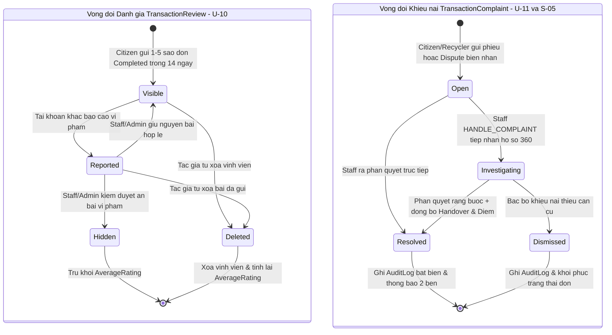
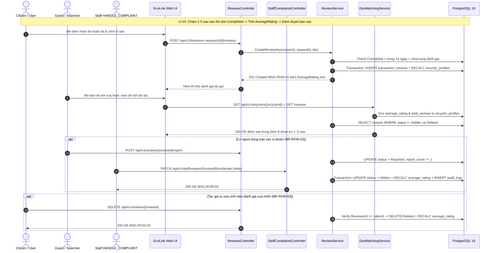
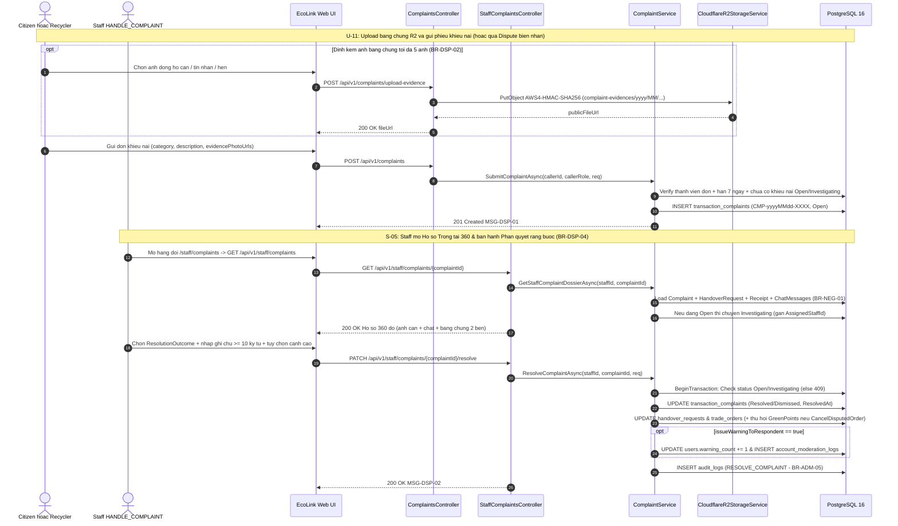
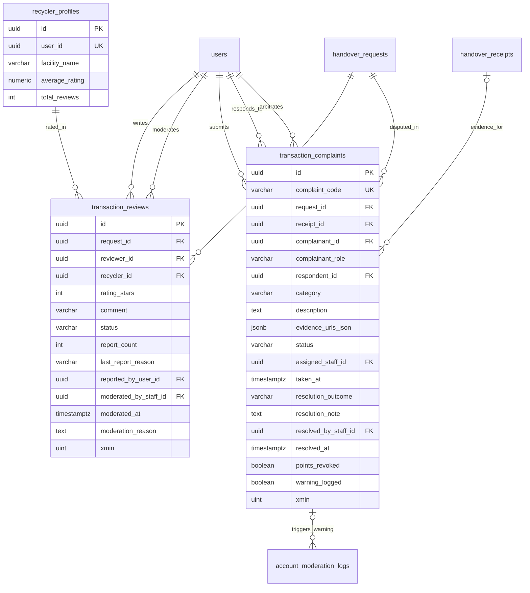

# KẾ HOẠCH THIẾT KẾ & TRIỂN KHAI (IMPLEMENTATION PLAN) - MODULE: RATING, REVIEW & COMPLAINT RESOLUTION (`FE-10` / `M-11`)

**Dự án:** EcoLink – Intelligent Waste Sorting & Trading Platform (`SEP490_G141`)  
**Phân hệ:** `RVW` / `DSP` / `HND` / `ADM` (Phân hệ API `M-11` — Tài liệu & Kiểm thử đánh số `12_`)  
**Mã tính năng (Feature):** `FE-10` (Rating, Review & Complaint Resolution)  
**Use Cases trọng tâm (3 Use Cases + 7 Action Items Notion):**
- **`U-10`**: *Rate Recycler* (Người dân chấm điểm `1–5` sao kèm nhận xét chất lượng cho cơ sở thu gom sau khi bàn giao `Completed`, chỉ được tự xóa vĩnh viễn theo `BR-RVW-03`, không sửa điểm sao sau khi đăng theo `BR-RVW-02`; hỗ trợ cộng đồng báo cáo đánh giá độc hại/spam để Staff/Admin kiểm duyệt ẩn bài và tự động tính lại `AverageRating` của vựa)
- **`U-11`**: *Submit Complaint* (Quy trình khiếu nại **2 chiều** cho cả `Citizen` và `Recycler` khi phát sinh sai lệch cân đo, thanh toán/ép giá, bỏ hẹn `NoShow` hoặc thái độ; hỗ trợ đính kèm tối đa `5` ảnh bằng chứng lên **Cloudflare R2**, khóa tối đa `1` phiếu đang mở mỗi đơn trong hạn `7 ngày` theo `BR-DSP-01`, và hợp nhất với luồng khiếu nại trực tiếp từ biên nhận `HandoverReceiptService.DisputeReceiptAsync`)
- **`S-05`**: *Handle Complaints* (Nhân viên có quyền `HANDLE_COMPLAINT` / `Admin` tiếp nhận hồ sơ `Open -> Investigating`, đối chiếu **Hồ sơ Trọng tài 360°** gồm ảnh minh chứng hai bên + ảnh cân điện tử biên nhận + lịch sử chat thương lượng bất biến theo `BR-NEG-01`/`BR-DSP-06`, ban hành **Phán quyết ràng buộc** theo `BR-DSP-04`, đồng bộ trạng thái đơn, thu hồi `GreenPoints` an toàn `>= 0` khi hủy đảo ngược giao dịch theo `BR-GAM-01`/`BR-GAM-03`, tùy chọn ghi cảnh cáo vi phạm vào `AccountModerationLog` và lưu vết `AuditLog` theo `BR-ADM-05`)

**Độ phức tạp / Ưu tiên:** Medium (Cross-Module Trust Scoring, Bilateral R2 Evidence & Non-Escrow Arbitration)  
**Công nghệ:** .NET 10 Web API, PostgreSQL 16 (`jsonb` + Filtered Partial Unique Index + `xmin` Optimistic Concurrency), Entity Framework Core 10, Cloudflare R2 / Local Fallback Storage (`10 MB`), FluentValidation, React 19 + TypeScript (`ecolink-web`)  
**Tài liệu tham chiếu:**
- Danh mục Tổng thể API: [`00_api_inventory_and_endpoint_statistics.md`](file:///c:/Projects/EcoLink/intelligent-waste-sorting-trading/documents/api%20contact/00_api_inventory_and_endpoint_statistics.md#L334-L353) (`STT 103–114`)
- Quy chuẩn Khung Phản hồi API: [`00_api_overview_and_response_contract.md`](file:///c:/Projects/EcoLink/intelligent-waste-sorting-trading/documents/api%20contact/00_api_overview_and_response_contract.md)
- Thiết kế CSDL gốc (DBML): [`03_collection_trading_module.dbml`](file:///c:/Projects/EcoLink/intelligent-waste-sorting-trading/documents/diagram/database%20design/03_collection_trading_module.dbml#L146-L181)
- Quy chuẩn CSDL & Kiểm toán: [`database_design_and_audit_guidelines.md`](file:///c:/Projects/EcoLink/intelligent-waste-sorting-trading/documents/guideline/database_design_and_audit_guidelines.md)
- Quy tắc Nghiệp vụ & Thông báo: [`business_rule_&_system_message.md`](file:///c:/Projects/EcoLink/intelligent-waste-sorting-trading/documents/business_rule_%26_system_message.md#L113-L151)

---

## 1. MỤC TIÊU PHẠM VI & ĐÁNH GIÁ HIỆN TRẠNG (SCOPE & GAP ANALYSIS)

### 1.1. Kiến trúc Đánh giá Uy tín & Trọng tài Giao dịch Ba bên (Post-Handover Trust & Arbitration Architecture)

Trên nền tảng thu gom phế liệu trực tiếp (không giữ tiền hộ / không escrow theo `BR-DSP-04`), cơ chế đánh giá uy tín và giải quyết tranh chấp đóng vai trò giữ kỷ luật thị trường giữa **Người dân (`Citizen`)**, **Cơ sở thu mua (`Recycler`)** và **Nhân viên vận hành (`Staff`)**. Phân hệ `M-11` (`FE-10`) được thiết kế dựa trên **3 trụ cột kỹ thuật**:

1. **Toàn vẹn Đánh giá `1-Đơn / 1-Review` & Bộ nhớ đệm `O(1)` trên `RecyclerProfile` (`U-10`, `BR-RVW-01`..`03`):**
   * Chỉ chủ đơn của giao dịch bàn giao đã **`HandoverStatus.Completed`** (trong hạn `14 ngày` kể từ `UpdatedAt`/`CompletedAt`) mới được gửi đánh giá `1–5` sao cho cơ sở thu mua đó (`POST /api/v1/handover-requests/{requestId:guid}/reviews` — `STT 103`).
   * **Bất biến đánh giá (`BR-RVW-02`):** Điểm sao và nhận xét không thể chỉnh sửa sau khi đăng; tác giả chỉ có quyền **tự xóa vĩnh viễn** (`DELETE /api/v1/reviews/{reviewId:guid}` — `STT 106`), còn cộng đồng chỉ có quyền báo cáo vi phạm (`STT 107`) để `Staff [HANDLE_COMPLAINT]` hoặc `Admin` kiểm duyệt ẩn bài (`STT 108` — `BR-RVW-03`). Chủ vựa bị đánh giá tuyệt đối không có quyền xóa hay ẩn đánh giá bất lợi hợp lệ.
   * **Tính lại điểm tức thời nguyên tử:** Ngay trong cùng Transaction thêm mới, tự xóa hoặc ẩn/khôi phục đánh giá, hệ thống tính lại chính xác `AverageRating` (`NUMERIC(3,2)`) và `TotalReviews` từ các bài có `Status == ReviewStatus.Visible` (hoặc `Reported` nhưng chưa bị `Hidden`) rồi lưu thẳng vào bảng `recycler_profiles`, giúp API bản đồ PostGIS `GeoMatchingService` đọc ở tốc độ `O(1)`.

2. **Đường ống Khiếu nại 2 Chiều Thống nhất & Chống Trùng ở Mức PostgreSQL (`U-11`, `BR-DSP-01`, `BR-DSP-02`):**
   * Hợp nhất hai điểm phát sinh tranh chấp vốn đang tách rời:
     1. Người dân bấm **"Sai rồi, tôi muốn khiếu nại"** ngay khi đối chiếu biên nhận cân điện tử (`HandoverStatus.AwaitingConfirmation`) tại [`HandoverReceiptService.cs`](file:///c:/Projects/EcoLink/intelligent-waste-sorting-trading/src/Ecolink.Backend/Ecolink.Infrastructure/Services/HandoverReceiptService.cs#L195-L230) → hệ thống đồng thời chuyển đơn sang `Disputed` **và tự động tạo phiếu `TransactionComplaint`** mã `CMP-yyyyMMdd-XXXX` loại `ScaleDiscrepancy`.
     2. Người dân hoặc Chủ vựa chủ động gửi đơn khiếu nại qua `POST /api/v1/complaints` (`STT 110`) đối với đơn `AwaitingConfirmation`, đơn `Completed` (trong `7 ngày`), hoặc sự cố bỏ hẹn `NoShow` (`Accepted` / `Scheduled` / `Cancelled` trong `7 ngày`), kèm tối đa `5` URL ảnh chứng cứ tải qua `POST /api/v1/complaints/upload-evidence` (`STT 109` → Cloudflare R2 thư mục `complaint-evidences`).
   * **Chặn trùng tuyệt đối bằng Filtered Partial Unique Index:** Trong PostgreSQL 16, chỉ mục `uq_transaction_complaints_active_request ON transaction_complaints (request_id) WHERE status IN ('Open', 'Investigating') AND is_deleted = FALSE` đảm bảo dù hai bên gửi khiếu nại đồng thời cùng một tích tắc vẫn chỉ tồn tại **tối đa 1 phiếu khiếu nại đang mở/thụ lý** trên mỗi `HandoverRequest` (`409 Conflict`, `MSG-DSP-04`).

3. **Hồ sơ Trọng tài 360° & Phán quyết Ràng buộc Đa Phân hệ (`S-05`, `BR-DSP-04`, `BR-DSP-06`, `BR-ADM-05`):**
   * Khi `Staff [HANDLE_COMPLAINT]` hoặc `Admin` mở `GET /api/v1/staff/complaints/{complaintId:guid}` (`STT 113`), hệ thống tổng hợp **Hồ sơ Trọng tài 360°** gồm: (a) Tường trình & ảnh R2 của người khiếu nại, (b) Chi tiết yêu cầu bàn giao ban đầu (`Items`, khung giờ chốt, ảnh phế liệu `WastePhotoUrl`), (c) Biên nhận cân điện tử (`TotalWeightKg`, `TotalAmountCash`, `PointsAwarded`, mảng `ScaleProofPhotoUrl`), và (d) **Toàn bộ lịch sử tin nhắn & đề xuất thương lượng bất biến (`ChatMessage` / `NegotiationChat`)** mà chỉ các bên trong đơn và Staff phân xử được xem (`BR-DSP-06`).
   * Khi Staff đóng khiếu nại qua `PATCH /api/v1/staff/complaints/{complaintId:guid}/resolve` (`STT 114`), hệ thống bắt buộc ghi `resolutionOutcome` + `resolutionNote >= 10` ký tự (`BR-DSP-04`) và tự động kích hoạt các hiệu ứng liên phân hệ nguyên tử trong 1 Transaction:
     * Cập nhật trạng thái `HandoverRequest` (`Completed` nếu công nhận biên nhận hoặc `Cancelled` nếu hủy giao dịch tranh chấp; đồng bộ `TradeOrder.Status`).
     * Nếu giao dịch từng cộng điểm nhưng phán quyết đảo ngược/hủy đơn (`CancelDisputedOrder`), tự động **thu hồi `GreenPoints` của Citizen (`>= 0`, `BR-GAM-01` & `BR-GAM-03`)** (và trừ điểm thưởng tích lũy tương ứng trên `UserEcoProfile` trong DB & `GamificationService`).
     * Nếu Staff chọn `issueWarningToRespondent = true`, tự động tăng `User.WarningCount` và ghi bản ghi có liên kết `RelatedComplaintId` vào [`AccountModerationLog`](file:///c:/Projects/EcoLink/intelligent-waste-sorting-trading/src/Ecolink.Backend/Ecolink.Domain/Entities/GovernanceEntities.cs#L35-L51) (`BR-ADM-03`).
     * Chèn tin nhắn hệ thống chốt kết quả trọng tài vào luồng `TradeOrder.Messages` (nếu có) và ghi nhật ký bất biến `RESOLVE_COMPLAINT` vào `audit_logs` (`BR-ADM-05`).

> **Ghi chú ranh giới phạm vi SRS (`FE-10` vs Khảo sát định kỳ):** Các quy tắc `BR-RVW-04` và `BR-RVW-05` trong [`business_rule_&_system_message.md`](file:///c:/Projects/EcoLink/intelligent-waste-sorting-trading/documents/business_rule_%26_system_message.md#L149-L150) áp dụng cho phân hệ **Khảo sát chất lượng định kỳ** (tách riêng trong DBML [`06_survey_feedback_module.dbml`](file:///c:/Projects/EcoLink/intelligent-waste-sorting-trading/documents/diagram/database%20design/06_survey_feedback_module.dbml#L1-L88)), không nằm trong 3 Use Case `U-10`, `U-11`, `S-05` và 12 endpoints `STT 103–114` của module `FE-10` (`M-11`).

---

### 1.2. Đánh giá Mức độ Sẵn sàng của Codebase Hiện tại (Feasibility & Gap Matrix)

| Hạng mục kỹ thuật | Độ sẵn sàng | Hiện trạng thực tế trong Codebase (`Backend` & `Frontend`) | Khoảng trống cần triển khai (Technical Gaps) |
|:---|:---:|:---|:---|
| **1. Cơ sở dữ liệu PostgreSQL 16 (`transaction_reviews`, `transaction_complaints`, `recycler_profiles`)** | **20%** | Đã có thiết kế DBML tham chiếu ở [`03_collection_trading_module.dbml`](file:///c:/Projects/EcoLink/intelligent-waste-sorting-trading/documents/diagram/database%20design/03_collection_trading_module.dbml#L146-L181). Hiện tại `Ecolink.Domain` chưa có entity `TransactionReview` / `TransactionComplaint`; `RecyclerProfile` chưa có cột `average_rating` & `total_reviews`. | Tạo `ReviewAndComplaintEntities.cs`, bổ sung 4 enums trong [`DomainEnums.cs`](file:///c:/Projects/EcoLink/intelligent-waste-sorting-trading/src/Ecolink.Backend/Ecolink.Domain/Enums/DomainEnums.cs), thêm `AverageRating`/`TotalReviews` vào [`AuthEntities.cs`](file:///c:/Projects/EcoLink/intelligent-waste-sorting-trading/src/Ecolink.Backend/Ecolink.Domain/Entities/AuthEntities.cs#L11-L42), cấu hình `ReviewAndComplaintConfigurations.cs` (`xmin`, `jsonb`, Partial Unique Index) & chạy Migration EF Core. |
| **2. Nghiệp vụ Đánh giá Vựa & Kiểm duyệt (`U-10`, `STT 103–108`)** | **15%** | Chưa có Service hay Controller nào cho đánh giá sao. Điểm thuận lợi là `StaffPermissions.HandleComplaint` đã có sẵn tại [`StaffPermissions.cs`](file:///c:/Projects/EcoLink/intelligent-waste-sorting-trading/src/Ecolink.Backend/Ecolink.Domain/Constants/StaffPermissions.cs#L12-L22). | Tạo `IReviewService` / `ReviewService`, FluentValidation validators, `ReviewsController` (`STT 103–107`) và endpoint kiểm duyệt đánh giá (`STT 108`); mở rộng [`CollectionPartnerDto`](file:///c:/Projects/EcoLink/intelligent-waste-sorting-trading/src/Ecolink.Backend/Ecolink.Application/Dtos/TradeAndGamificationDtos.cs#L3-L19) & [`GeoMatchingService.cs`](file:///c:/Projects/EcoLink/intelligent-waste-sorting-trading/src/Ecolink.Backend/Ecolink.Infrastructure/Services/GeoMatchingService.cs) trả `averageRating` & `totalReviews`. |
| **3. Nghiệp vụ Khiếu nại 2 chiều & R2 Evidence (`U-11`, `STT 109–111`)** | **40%** | [`CloudflareR2StorageService.cs`](file:///c:/Projects/EcoLink/intelligent-waste-sorting-trading/src/Ecolink.Backend/Ecolink.Infrastructure/Services/CloudflareR2StorageService.cs#L46-L163) đã hỗ trợ upload S3v4 lên R2. Tuy nhiên [`HandoverReceiptService.DisputeReceiptAsync`](file:///c:/Projects/EcoLink/intelligent-waste-sorting-trading/src/Ecolink.Backend/Ecolink.Infrastructure/Services/HandoverReceiptService.cs#L195-L230) mới chỉ chuyển đơn thành `Disputed`, chưa tạo phiếu khiếu nại chính thức. | Tạo `ComplaintsController` (`STT 109–111`) & `ComplaintService`; nâng cấp `DisputeReceiptAsync` để tự động tạo kèm bản ghi `TransactionComplaint` (`Open`, `ScaleDiscrepancy`) nếu đơn chưa có khiếu nại đang mở. |
| **4. Trọng tài 360°, Thu hồi Điểm & Cảnh cáo (`S-05`, `STT 112–114`)** | **55%** | [`NegotiationChatService.cs`](file:///c:/Projects/EcoLink/intelligent-waste-sorting-trading/src/Ecolink.Backend/Ecolink.Infrastructure/Services/NegotiationChatService.cs#L47-L52) **đã mở sẵn `allowStaffOnDisputed: true`** cho Staff đọc lịch sử chat đơn tranh chấp; [`AccountModerationLog`](file:///c:/Projects/EcoLink/intelligent-waste-sorting-trading/src/Ecolink.Backend/Ecolink.Domain/Entities/GovernanceEntities.cs#L48) đã có sẵn `RelatedComplaintId`; [`AdminAnalyticsService.cs`](file:///c:/Projects/EcoLink/intelligent-waste-sorting-trading/src/Ecolink.Backend/Ecolink.Infrastructure/Services/AdminAnalyticsService.cs#L107-L110) đã đếm `Disputed`. | Tạo `StaffComplaintsController` (`STT 112–114`, `[HasPermission(StaffPermissions.HandleComplaint)]`) tổng hợp Hồ sơ 360° (bằng chứng + biên nhận cân + chat bất biến), thực thi phán quyết, thu hồi điểm `BR-GAM-01` & cảnh cáo `User.WarningCount` + `AuditLog` (`BR-ADM-05`), đồng bộ đếm `openDisputes` trong `AdminAnalyticsService`. |
| **5. Bộ Kiểm thử & Tài liệu (`12_`, `Report-5.1`, `Report-5.2`)** | **0%** *(cho `M-11`)* | Hệ thống hiện có `234` Unit Tests (`11` module) & `204` Integration TCs; API Inventory đang ở `v2.3.0` (`127/184 = 69.0%`). | Bổ sung `22` Unit Tests (`UTC001..UTC022` → tổng `256` TCs, `Report-5.1 v1.9`), `16` Live E2E Tests (`RVW01..RVW16` → tổng `220` TCs, `Report-5.2 v1.4`), tài liệu API `12_`, Class + 3 Sequence `.mmd` và đồng bộ API Inventory lên `v2.4.0` (`139/184 = 75.5%`). |
| **6. Giao diện Frontend (`ecolink-web`)** | **35%** | [`user/Receipt.tsx`](file:///c:/Projects/EcoLink/ecolink-web/src/pages/user/Receipt.tsx#L270-L329) đã có sẵn UI chọn `1–5` sao (nút gửi chưa nối API); [`staff/Complaints.tsx`](file:///c:/Projects/EcoLink/ecolink-web/src/pages/staff/Complaints.tsx) & [`Feedback.tsx`](file:///c:/Projects/EcoLink/ecolink-web/src/pages/Feedback.tsx) đang dùng mock/state cục bộ. | Tạo `src/lib/reviewComplaintApi.ts`; nối thật cho `user/Receipt.tsx`, `Feedback.tsx`, `recycler/Requests.tsx`, `MapPage.tsx`, `Partners.tsx`, `staff/Complaints.tsx` (Hồ sơ Trọng tài 360° + Kiểm duyệt Review bị báo cáo) và `staff/Home.tsx`, **bảo toàn 100% các chuỗi SSR trong [`check.tsx`](file:///c:/Projects/EcoLink/ecolink-web/src/check.tsx) và [`check-routes.tsx`](file:///c:/Projects/EcoLink/ecolink-web/src/check-routes.tsx)**. |

---

## 2. PHÂN TÍCH CHI TIẾT CÁC CHỨC NĂNG / USE CASES, QUY TẮC NGHIỆP VỤ & SƠ ĐỒ LUỒNG

### 2.1. Vòng đời Đánh giá (`ReviewStatus`) & Phiếu Khiếu nại (`ComplaintStatus` + Phán quyết Trọng tài)

| Thành phần / Bảng | Trạng thái (`Status`) | Quy tắc chuyển tiếp & Tác động Liên phân hệ |
|:---|:---|:---|
| **1. Đánh giá Vựa (`transaction_reviews`)** | `Visible` → `Reported` → `Hidden` (hoặc giữ `Visible`)<br>`Visible` / `Reported` → `Deleted` | • Chỉ tạo mới được từ đơn `HandoverStatus.Completed` trong vòng `14 ngày` (`BR-RVW-01`), **không có API sửa sao** (`BR-RVW-02`).<br>• Tác giả gọi `DELETE` chuyển sang `Deleted` vĩnh viễn (`BR-RVW-03`).<br>• Người dùng đã đăng nhập báo cáo vi phạm tăng `ReportCount`, chuyển `Reported`. Staff có quyền `HANDLE_COMPLAINT` hoặc `Admin` gọi `ModerateReview` (`Hide` → `Hidden`, `Restore` → `Visible`) kèm `moderationReason >= 5` ký tự (`BR-RVW-03`). Mọi chuyển đổi thay đổi hiển thị đều **tính lại ngay** `AverageRating` & `TotalReviews` của vựa. |
| **2. Phiếu Khiếu nại (`transaction_complaints`)** | `Open` → `Investigating` → `Resolved` / `Dismissed` | • Tạo bởi `Citizen` hoặc `Recycler` thuộc đơn bàn giao (`BR-DSP-01`) hoặc tự động khi khiếu nại biên nhận (`DisputeReceiptAsync`).<br>• Chỉ tồn tại **tối đa 1 phiếu `Open` / `Investigating` trên 1 `HandoverRequest`**. Nếu có người nhận xử lý hoặc mở hồ sơ cập nhật tiếp nhận, phiếu chuyển sang `Investigating`.<br>• Khi Staff ban hành phán quyết (`STT 114`), phiếu đóng sang `Resolved` (hoặc `Dismissed` nếu bác đơn) và **không thể giải quyết lại lần 2 (`409 Conflict`)**. |

#### Ma trận Phán quyết Trọng tài (`ComplaintResolutionOutcome` — `BR-DSP-04`)

| Mã Phán quyết (`ResolutionOutcome`) | Ý nghĩa Trọng tài (`BR-DSP-04`) | Chuyển trạng thái `HandoverRequest` | Tác động `GreenPoints` (`BR-GAM-01`) | Tùy chọn Cảnh cáo (`AccountModerationLog`) |
|:---|:---|:---|:---|:---|
| **`ConfirmReceiptAsIs`** | Số liệu cân/biên nhận của Recycler hợp lệ; bác bỏ nghi vấn sai lệch | `Disputed` → **`Completed`** *(hoặc giữ nguyên `Completed`)* | Nếu đơn trước đó ở `Disputed` (chưa cộng điểm khi chốt): **Cộng điểm bù chuẩn xác (`Completed`)** nếu chưa từng cấp. | Không bắt buộc (hoặc cảnh cáo người báo sai ác ý nếu chọn). |
| **`CompensateUser`** | Xác nhận Recycler cân thiếu / trả thiếu tiền / tính sai giá — **khuyến nghị ràng buộc** Recycler bồi hoàn phần chênh lệch cho Citizen | Giữ `Completed` *(hoặc chuyển `Disputed` → **`Completed`**)* | Giữ nguyên điểm phần hợp lệ của Citizen; cho phép gắn cờ cảnh cáo Recycler vi phạm. | Thường bật `issueWarningToRespondent = true` nếu lỗi cố ý. |
| **`UpholdComplainant`** | Công nhận khiếu nại hợp lệ về thái độ / trễ hẹn / hành vi không chuẩn mực (giao dịch vẫn giữ kết quả hoặc đã kết thúc trước đó) | Giữ nguyên `Completed` / `Cancelled` | Không thay đổi điểm nếu giao dịch thực tế vẫn diễn ra; ghi khuyến nghị khắc phục. | Cho phép ghi `WARN` đối với bên bị khiếu nại. |
| **`CancelDisputedOrder`** | Giao dịch vô hiệu nghiêm trọng / vắng mặt (`NoShow`) / gian lận bàn giao — hủy bỏ giao dịch tranh chấp | Chuyển sang **`Cancelled`** | **Thu hồi (`Clawback`) `PointsAwarded` trên `UserEcoProfile` nếu đơn từng cộng điểm** (an toàn `CurrentGreenPoints >= 0`, `BR-GAM-01`, `BR-GAM-03`). | Cho phép ghi `WARN` vào `AccountModerationLog` (`RelatedComplaintId`). |
| **`Dismissed`** | Bác bỏ khiếu nại do thiếu bằng chứng hoặc sai sự thật (`ComplaintStatus.Dismissed`) | Nếu đang `Disputed` & đã có `Receipt`: trả về `Completed` (nếu đã confirm) hoặc **`AwaitingConfirmation`** | Không thay đổi nếu chưa hoàn tất. | Không mặc định. |

---

### 2.2. Phân tích Chuyên sâu 3 Use Cases

#### UC 1 — `U-10`: Rate Recycler (*Actors: `Citizen`, `Guest/Public`, `Authenticated`, `Staff/Admin`*)
* **Mục tiêu:** Cho phép công dân chấm `1–5` sao và nhận xét cơ sở thu mua sau giao dịch hoàn tất; công khai điểm uy tín giúp người dân khác chọn vựa minh bạch; chống sửa lén, xóa bất lợi hoặc bình luận độc hại.
* **Tiền điều kiện:** Đơn `HandoverRequest` thuộc về `Citizen` (`request.UserId == currentUserId`), đang ở trạng thái `Completed`, trong vòng `14 ngày` kể từ thời điểm hoàn tất, và chưa từng được `currentUserId` đánh giá (`BR-RVW-01`).
* **Luồng xử lý chính:**
  1. Tại màn hình biên nhận [`user/Receipt.tsx`](file:///c:/Projects/EcoLink/ecolink-web/src/pages/user/Receipt.tsx#L270-L329) ngay sau khi xác nhận hoàn tất (hoặc xem lại đơn `Completed`), công dân chọn `1–5` sao và nhập nhận xét tùy chọn (`<= 1000` ký tự), gọi `POST /api/v1/handover-requests/{requestId:guid}/reviews` (`STT 103`).
  2. Backend kiểm tra quyền sở hữu, trạng thái `Completed`, hạn `14 ngày` và kiểm tra duy nhất `(RequestId, ReviewerId)` → nếu hợp lệ, chèn bản ghi `TransactionReview` (`Status = Visible`), tính lại ngay `RecyclerProfile.AverageRating` & `TotalReviews` và trả `201 Created` (`MSG-RVW-01`).
  3. Mọi người dùng (kể cả Guest) có thể xem danh sách đánh giá kèm phân bố sao `1★..5★` qua `GET /api/v1/recyclers/{recyclerId:guid}/reviews` (`STT 104`) ngay trên bản đồ tìm vựa & trang Đối tác; chính công dân xem lịch sử đã chấm qua `GET /api/v1/reviews/me` (`STT 105`).
  4. **Tự xóa (`STT 106` — `BR-RVW-03`):** Tác giả gọi `DELETE /api/v1/reviews/{reviewId:guid}` → chuyển `Status = Deleted` (không cho phép Recycler được đánh giá xóa bài của Citizen, nếu cố gọi trả `403 Forbidden`), tính lại `AverageRating` và trả `MSG-RVW-03`.
  5. **Báo cáo & Kiểm duyệt (`STT 107–108` — `BR-RVW-03`):** Tài khoản bất kỳ gọi `POST /api/v1/reviews/{reviewId:guid}/report` (`reason >= 5` ký tự) để đánh dấu `Reported`; `Staff [HANDLE_COMPLAINT]` hoặc `Admin` kiểm tra và gọi `PATCH /api/v1/staff/reviews/{reviewId:guid}/moderate` (`Hide` / `Restore` + `moderationReason`), ghi `AuditLog` (`MODERATE_REVIEW`) và tính lại điểm sao trung bình.

#### UC 2 — `U-11`: Submit Complaint (*Actors: `Citizen`, `Recycler`*)
* **Mục tiêu:** Cho phép hai bên giao dịch gửi khiếu nại chính thức kèm ảnh chứng cứ khi phát sinh tranh chấp khối lượng, thanh toán, bỏ hẹn hoặc thái độ, đồng thời theo dõi tiến trình giải quyết minh bạch.
* **Tiền điều kiện:** Người gửi đã đăng nhập và là một trong hai bên của `HandoverRequest` (`UserId` hoặc `RecyclerId`), loại đơn hợp lệ (`AwaitingConfirmation`, `Completed`, `Accepted`, `Scheduled`, hoặc `Cancelled` nếu khiếu nại `NoShow`), trong hạn `7 ngày`, và chưa có phiếu nào ở trạng thái `Open` / `Investigating` trên đơn đó (`BR-DSP-01`).
* **Luồng xử lý chính:**
  1. Nếu cần đính kèm ảnh chứng cứ (ảnh đồng hồ cân, tin nhắn thanh toán, ảnh điểm hẹn trống khi `NoShow`), người gửi gọi `POST /api/v1/complaints/upload-evidence` (`STT 109`, tối đa `10 MB`, `.jpg/.jpeg/.png/.webp/.pdf`) → nhận URL từ **Cloudflare R2** (`complaint-evidences/...`).
  2. Người gửi gọi `POST /api/v1/complaints` (`STT 110`) truyền `handoverRequestId`, `category`, `description >= 15` ký tự và `evidencePhotoUrls` (tối đa `5` URL — `BR-DSP-02`).
  3. Backend xác định `respondentId` là phía đối tác còn lại (`UserId <-> RecyclerId`), kiểm tra điều kiện thời hạn `7 ngày` và chưa có khiếu nại mở (`BR-DSP-01` → trả `409 MSG-DSP-04` nếu trùng, `400 MSG-DSP-03` nếu hết hạn), sinh mã `CMP-yyyyMMdd-XXXX`, lưu `TransactionComplaint` (`Status = Open`), nếu đơn đang `AwaitingConfirmation` hoặc `Completed` theo yêu cầu cân/giá có tranh chấp đang mở thì chuyển trạng thái phù hợp và trả `201 Created` (`MSG-DSP-01`).
  4. Cả bên gửi lẫn bên bị khiếu nại theo dõi tiến độ qua `GET /api/v1/complaints/me` (`STT 111`, hỗ trợ `role=submitted|against|all`) để xem trạng thái và kết quả phán quyết sau khi Staff đóng hồ sơ.

#### UC 3 — `S-05`: Handle Complaints (*Actors: `Staff [HANDLE_COMPLAINT]`, `Admin`*)
* **Mục tiêu:** Cung cấp công cụ Trọng tài toàn diện cho Staff kiểm tra bằng chứng hai phía, ra phán quyết rõ ràng kèm lý do giải trình và bảo toàn dấu vết kiểm toán.
* **Tiền điều kiện:** Tài khoản `Staff` được cấp quyền `HANDLE_COMPLAINT` (`complaint.handle`) hoặc `Admin` (`[HasPermission(StaffPermissions.HandleComplaint)]`).
* **Luồng xử lý chính:**
  1. Staff mở hàng đợi `/staff/complaints` → gọi `GET /api/v1/staff/complaints` (`STT 112`) để lọc theo `status` (`Open|Investigating|Resolved|Dismissed`), `category`, từ khóa (`CMP-...` / tên bên liên quan), xem bộ đếm tồn đọng (`openCount`, `investigatingCount`, `resolvedCount`, `dismissedCount`, `reportedReviewsCount`) và danh sách đánh giá đang bị `Reported`.
  2. Staff chọn 1 khiếu nại → gọi `GET /api/v1/staff/complaints/{complaintId:guid}` (`STT 113`). Nếu phiếu đang `Open` và Staff muốn giữ quyền xử lý (hoặc query `?claim=true`), chuyển sang `Investigating` kèm `AssignedStaffId`. Response trả về **Hồ sơ Trọng tài 360°**: thông tin hai bên, chi tiết đơn & các mặt hàng cân đo, mảng ảnh `ScaleProofPhotoUrl` của biên nhận, mảng ảnh bằng chứng của phiếu khiếu nại và **toàn bộ lịch sử `ChatMessage`** đọc từ [`NegotiationChatService` / DB](file:///c:/Projects/EcoLink/intelligent-waste-sorting-trading/src/Ecolink.Backend/Ecolink.Infrastructure/Services/NegotiationChatService.cs#L47-L52) (`BR-NEG-01`, `BR-DSP-06`).
  3. Staff nhập biên bản phán quyết qua `PATCH /api/v1/staff/complaints/{complaintId:guid}/resolve` (`STT 114`) với `resolutionOutcome`, `resolutionNote >= 10` ký tự, tùy chọn `issueWarningToRespondent` + `warningReason` (`BR-ADM-03`).
  4. Hệ thống thực thi Transaction: kiểm tra chưa đóng (`409 Conflict` nếu đã `Resolved`/`Dismissed`), cập nhật phiếu khiếu nại (`ResolvedAt`, `ResolvedByStaffId`), cập nhật `HandoverRequest.Status` tương ứng, thu hồi điểm `GreenPoints` an toàn nếu đảo ngược giao dịch (`BR-GAM-01`, `BR-GAM-03`), ghi `AccountModerationLog` nếu cảnh cáo, ghi `AuditLog` (`RESOLVE_COMPLAINT`, `BR-ADM-05`), trả `200 OK` (`MSG-DSP-02`).

---

### 2.3. Bảng Truy vết Quy tắc Nghiệp vụ (`BR-*`) & Thông điệp Hệ thống (`MSG-*`)

#### Bảng A — Quy tắc Nghiệp vụ (Business Rules)

| BR-ID | Nguồn quy chuẩn | Nội dung quy tắc thực thi trên `M-11` | Áp dụng cho Endpoint / Service |
|:---|:---|:---|:---|
| **`BR-RVW-01`** | [`business_rule_&_system_message.md`](file:///c:/Projects/EcoLink/intelligent-waste-sorting-trading/documents/business_rule_%26_system_message.md#L146) | Chỉ thành viên (`Citizen`) của đơn đã **`Completed`** mới được đánh giá, mỗi đơn tối đa `1` lần trong vòng **`14 ngày`** kể từ khi hoàn tất. | `STT 103`, `ReviewService` |
| **`BR-RVW-02`** | [`business_rule_&_system_message.md`](file:///c:/Projects/EcoLink/intelligent-waste-sorting-trading/documents/business_rule_%26_system_message.md#L147) | Điểm `ratingStars` (`1..5`) và nhận xét không thể chỉnh sửa sau khi gửi; chỉ có quyền xóa toàn phần. | `ReviewService`, `ReviewsController` |
| **`BR-RVW-03`** | [`business_rule_&_system_message.md`](file:///c:/Projects/EcoLink/intelligent-waste-sorting-trading/documents/business_rule_%26_system_message.md#L148) | Tác giả tự xóa đánh giá của chính mình vĩnh viễn (`403` nếu bên bị đánh giá gọi); `Staff`/`Admin` được quyền **ẩn (`Hidden`) / khôi phục** bài bị báo cáo vi phạm; `AverageRating` của vựa tính lại tức thì. | `STT 106–108`, `ReviewService` |
| **`BR-DSP-01`** | [`business_rule_&_system_message.md`](file:///c:/Projects/EcoLink/intelligent-waste-sorting-trading/documents/business_rule_%26_system_message.md#L117) | Chỉ `Citizen` hoặc `Recycler` tham gia đơn mới được khiếu nại, trong hạn **`7 ngày`** (với đơn đã kết thúc), tối đa **1 khiếu nại đang mở/đang xử lý mỗi đơn** (`Open` / `Investigating`). | `STT 110`, Partial Unique Index |
| **`BR-DSP-02`** | [`business_rule_&_system_message.md`](file:///c:/Projects/EcoLink/intelligent-waste-sorting-trading/documents/business_rule_%26_system_message.md#L118) | Khiếu nại bắt buộc có `category` (phân loại lý do) và `description`; ảnh chứng cứ (`0..5` ảnh R2) là tùy chọn. | `STT 109`, `STT 110`, FluentValidation |
| **`BR-DSP-04`** | [`business_rule_&_system_message.md`](file:///c:/Projects/EcoLink/intelligent-waste-sorting-trading/documents/business_rule_%26_system_message.md#L119) | Chỉ `Staff`/`Admin` được giải quyết khiếu nại; bắt buộc ghi `resolutionOutcome` và `resolutionNote >= 10` ký tự; kết quả là khuyến nghị ràng buộc (không tự chuyển tiền vì thanh toán trực tiếp). | `STT 114`, `ComplaintService` |
| **`BR-DSP-06`** | [`business_rule_&_system_message.md`](file:///c:/Projects/EcoLink/intelligent-waste-sorting-trading/documents/business_rule_%26_system_message.md#L120) | Toàn bộ tin nhắn thương lượng bất biến (`BR-NEG-01`), ảnh bằng chứng và hồ sơ giao dịch trong khiếu nại chỉ 2 bên liên quan và `Staff`/`Admin` thụ lý mới được xem (`403` cho người ngoài). | `STT 111–113`, `ComplaintService` |
| **`BR-GAM-01` & `03`** | [`business_rule_&_system_message.md`](file:///c:/Projects/EcoLink/intelligent-waste-sorting-trading/documents/business_rule_%26_system_message.md#L130-L132) | Khi phán quyết `CancelDisputedOrder` đảo ngược giao dịch đã từng cộng điểm, thu hồi `PointsAwarded` trên `UserEcoProfile` nhưng kẹp cận dưới `>= 0` (không bao giờ âm). | `STT 114`, `ComplaintService` |
| **`BR-ADM-02/03/05`** | [`StaffPermissions.cs`](file:///c:/Projects/EcoLink/intelligent-waste-sorting-trading/src/Ecolink.Backend/Ecolink.Domain/Constants/StaffPermissions.cs#L12-L22) | Áp dụng quyền hạt mịn `[HasPermission("HANDLE_COMPLAINT")]`; ghi cảnh cáo `AccountModerationLog` gắn `RelatedComplaintId`; ghi `AuditLog` cho mọi thao tác kiểm duyệt đánh giá và giải quyết khiếu nại. | `STT 108`, `STT 112–114`, `AuditLogService` |

#### Bảng B — Mã Thông báo Hệ thống (System Messages)

| Mã thông báo | Ngữ cảnh hiển thị | Nội dung chuẩn hóa tiếng Việt |
|:---|:---|:---|
| **`MSG-RVW-01`** | Gửi đánh giá thành công (`STT 103`) | *Cảm ơn bạn đã đánh giá! Điểm uy tín của cơ sở thu mua đã được cập nhật.* |
| **`MSG-RVW-02`** | Chưa hoàn tất bàn giao hoặc quá hạn / trùng đánh giá (`BR-RVW-01`) | *Bạn chỉ có thể đánh giá mỗi đơn giao dịch hoàn tất một lần trong thời hạn quy định.* |
| **`MSG-RVW-03`** | Tự xóa hoặc Staff ẩn đánh giá (`STT 106, 108`) | *Đánh giá đã được cập nhật trạng thái và tính lại điểm sao trung bình của cơ sở.* |
| **`MSG-DSP-01`** | Nộp khiếu nại thành công (`STT 110`) | *Khiếu nại của bạn đã được gửi và đang được xem xét.* |
| **`MSG-DSP-02`** | Staff ra phán quyết đóng khiếu nại (`STT 114`) | *Khiếu nại của bạn đã được giải quyết: {resolutionOutcome}.* |
| **`MSG-DSP-03`** | Quá hạn 7 ngày hoặc trạng thái đơn không cho phép khiếu nại (`BR-DSP-01`) | *Bạn không thể khiếu nại giao dịch này nữa (quá thời hạn 7 ngày hoặc trạng thái không hợp lệ).* |
| **`MSG-DSP-04`** | Đơn đã có phiếu khiếu nại đang mở (`409 Conflict`, `BR-DSP-01`) | *Đã có một khiếu nại đang mở hoặc đang xử lý cho giao dịch này.* |
| **`MSG-ADM-04`** | Không có quyền `HANDLE_COMPLAINT` hoặc truy cập chéo hồ sơ người khác (`403`) | *Bạn không có quyền thực hiện thao tác này.* |

---

### 2.4. Sơ đồ Máy Trạng thái & Sơ đồ Tuần tự (Mermaid Diagrams)

#### 1) Vòng đời Đánh giá (`ReviewStatus`) & Phiếu Khiếu nại (`ComplaintStatus`)


#### 2) Sơ đồ Tuần tự: Đánh giá Cơ sở, Điểm Uy tín Bản đồ & Kiểm duyệt Cộng đồng (`U-10`)


#### 3) Sơ đồ Tuần tự: Khiếu nại 2 chiều & Hồ sơ Trọng tài 360° của Staff (`U-11` & `S-05`)


---

## 3. THIẾT KẾ CƠ SỞ DỮ LIỆU POSTGRESQL 16 CHI TIẾT (DATABASE SCHEMA & DOMAIN ENTITIES)

### 3.1. Sơ đồ Thực thể Liên kết (`erDiagram`)



---

### 3.2. Đặc tả DDL SQL PostgreSQL 16 Chi tiết

#### 1) Mở rộng bảng `recycler_profiles` (Lưu điểm uy tín tính sẵn `BR-RVW-03`)
```sql
ALTER TABLE recycler_profiles
    ADD COLUMN IF NOT EXISTS average_rating NUMERIC(3,2) NOT NULL DEFAULT 0.00,
    ADD COLUMN IF NOT EXISTS total_reviews  INTEGER      NOT NULL DEFAULT 0;
```

#### 2) Bảng `transaction_reviews` (`U-10` — Đánh giá sao & Kiểm duyệt)
```sql
CREATE TABLE transaction_reviews (
    id                      UUID PRIMARY KEY DEFAULT gen_random_uuid(),
    request_id              UUID         NOT NULL,
    reviewer_id             UUID         NOT NULL,
    recycler_id             UUID         NOT NULL,
    rating_stars            INTEGER      NOT NULL,
    comment                 VARCHAR(1000),
    status                  VARCHAR(30)  NOT NULL DEFAULT 'Visible', -- Visible | Reported | Hidden | Deleted
    report_count            INTEGER      NOT NULL DEFAULT 0,
    last_report_reason      VARCHAR(500),
    reported_by_user_id     UUID,
    moderated_by_staff_id   UUID,
    moderated_at            TIMESTAMPTZ,
    moderation_reason       TEXT,

    -- BaseAuditableEntity
    created_at              TIMESTAMPTZ  NOT NULL DEFAULT NOW(),
    created_by              VARCHAR(100) NOT NULL DEFAULT 'System',
    updated_at              TIMESTAMPTZ,
    updated_by              VARCHAR(100),
    is_deleted              BOOLEAN      NOT NULL DEFAULT FALSE,
    deleted_at              TIMESTAMPTZ,

    CONSTRAINT fk_transaction_reviews_request FOREIGN KEY (request_id) REFERENCES handover_requests (id) ON DELETE RESTRICT,
    CONSTRAINT fk_transaction_reviews_reviewer FOREIGN KEY (reviewer_id) REFERENCES users (id) ON DELETE RESTRICT,
    CONSTRAINT fk_transaction_reviews_recycler FOREIGN KEY (recycler_id) REFERENCES recycler_profiles (user_id) ON DELETE RESTRICT,
    CONSTRAINT fk_transaction_reviews_reporter FOREIGN KEY (reported_by_user_id) REFERENCES users (id) ON DELETE SET NULL,
    CONSTRAINT fk_transaction_reviews_moderator FOREIGN KEY (moderated_by_staff_id) REFERENCES users (id) ON DELETE RESTRICT,
    CONSTRAINT uq_transaction_reviews_request_reviewer UNIQUE (request_id, reviewer_id),
    CONSTRAINT chk_transaction_reviews_stars CHECK (rating_stars BETWEEN 1 AND 5)
);

CREATE INDEX idx_transaction_reviews_recycler_status ON transaction_reviews (recycler_id, status, created_at DESC) WHERE is_deleted = FALSE;
CREATE INDEX idx_transaction_reviews_reviewer ON transaction_reviews (reviewer_id, created_at DESC) WHERE is_deleted = FALSE;
```

#### 3) Bảng `transaction_complaints` (`U-11` & `S-05` — Khiếu nại 2 chiều & Trọng tài)
```sql
CREATE TABLE transaction_complaints (
    id                      UUID PRIMARY KEY DEFAULT gen_random_uuid(),
    complaint_code          VARCHAR(32)  NOT NULL,
    request_id              UUID         NOT NULL,
    receipt_id              UUID,
    complainant_id          UUID         NOT NULL,
    complainant_role        VARCHAR(20)  NOT NULL, -- Citizen | Recycler
    respondent_id           UUID         NOT NULL,
    category                VARCHAR(40)  NOT NULL, -- ScaleDiscrepancy | PaymentIssue | NoShow | Misconduct | Other
    description             TEXT         NOT NULL,
    evidence_urls_json      JSONB        NOT NULL DEFAULT '[]'::jsonb,
    status                  VARCHAR(30)  NOT NULL DEFAULT 'Open', -- Open | Investigating | Resolved | Dismissed
    assigned_staff_id       UUID,
    taken_at                TIMESTAMPTZ,
    resolution_outcome      VARCHAR(40), -- ConfirmReceiptAsIs | CompensateUser | UpholdComplainant | CancelDisputedOrder | Dismissed
    resolution_note         TEXT,
    resolved_by_staff_id    UUID,
    resolved_at             TIMESTAMPTZ,
    points_revoked          BOOLEAN      NOT NULL DEFAULT FALSE,
    warning_logged          BOOLEAN      NOT NULL DEFAULT FALSE,

    -- BaseAuditableEntity
    created_at              TIMESTAMPTZ  NOT NULL DEFAULT NOW(),
    created_by              VARCHAR(100) NOT NULL DEFAULT 'System',
    updated_at              TIMESTAMPTZ,
    updated_by              VARCHAR(100),
    is_deleted              BOOLEAN      NOT NULL DEFAULT FALSE,
    deleted_at              TIMESTAMPTZ,

    CONSTRAINT fk_transaction_complaints_request FOREIGN KEY (request_id) REFERENCES handover_requests (id) ON DELETE RESTRICT,
    CONSTRAINT fk_transaction_complaints_receipt FOREIGN KEY (receipt_id) REFERENCES handover_receipts (id) ON DELETE SET NULL,
    CONSTRAINT fk_transaction_complaints_complainant FOREIGN KEY (complainant_id) REFERENCES users (id) ON DELETE RESTRICT,
    CONSTRAINT fk_transaction_complaints_respondent FOREIGN KEY (respondent_id) REFERENCES users (id) ON DELETE RESTRICT,
    CONSTRAINT fk_transaction_complaints_assigned FOREIGN KEY (assigned_staff_id) REFERENCES users (id) ON DELETE SET NULL,
    CONSTRAINT fk_transaction_complaints_resolved_by FOREIGN KEY (resolved_by_staff_id) REFERENCES users (id) ON DELETE RESTRICT,
    CONSTRAINT uq_transaction_complaints_code UNIQUE (complaint_code)
);

-- Chặn tuyệt đối nhiều hơn 1 phiếu đang mở trên cùng 1 đơn (BR-DSP-01)
CREATE UNIQUE INDEX uq_transaction_complaints_active_request
    ON transaction_complaints (request_id)
    WHERE status IN ('Open', 'Investigating') AND is_deleted = FALSE;

CREATE INDEX idx_transaction_complaints_status_created ON transaction_complaints (status, created_at DESC) WHERE is_deleted = FALSE;
CREATE INDEX idx_transaction_complaints_parties ON transaction_complaints (complainant_id, respondent_id, created_at DESC) WHERE is_deleted = FALSE;
```

---

### 3.3. Thiết kế C# Domain Enums & Entities (`Ecolink.Domain`)

#### Bổ sung Enums tại [`src/Ecolink.Backend/Ecolink.Domain/Enums/DomainEnums.cs`](file:///c:/Projects/EcoLink/intelligent-waste-sorting-trading/src/Ecolink.Backend/Ecolink.Domain/Enums/DomainEnums.cs)
```csharp
public enum ReviewStatus
{
    Visible = 1,
    Reported = 2,
    Hidden = 3,
    Deleted = 4
}

public enum ComplaintCategory
{
    ScaleDiscrepancy = 1,
    PaymentIssue = 2,
    NoShow = 3,
    Misconduct = 4,
    Other = 5
}

public enum ComplaintStatus
{
    Open = 1,
    Investigating = 2,
    Resolved = 3,
    Dismissed = 4
}

public enum ComplaintResolutionOutcome
{
    ConfirmReceiptAsIs = 1,
    CompensateUser = 2,
    UpholdComplainant = 3,
    CancelDisputedOrder = 4,
    Dismissed = 5
}
```

#### Tạo mới `ReviewAndComplaintEntities.cs` & Mở rộng [`AuthEntities.cs`](file:///c:/Projects/EcoLink/intelligent-waste-sorting-trading/src/Ecolink.Backend/Ecolink.Domain/Entities/AuthEntities.cs#L11-L42)
* **Mở rộng `RecyclerProfile`:** Thêm `public decimal AverageRating { get; set; } = 0m;` (`precision(3,2)`) và `public int TotalReviews { get; set; } = 0;`.
* **Tạo mới `ReviewAndComplaintEntities.cs` trong `Ecolink.Domain/Entities/`:**
  * `TransactionReview : BaseAuditableEntity` (có `public uint Version { get; private set; }` ánh xạ `UseXminAsConcurrencyToken()`).
  * `TransactionComplaint : BaseAuditableEntity` (có `public uint Version { get; private set; }` ánh xạ `UseXminAsConcurrencyToken()` chống 2 Staff chốt trùng 1 khiếu nại).
* **Cấu hình EF Core tại `ReviewAndComplaintConfigurations.cs`:** Khớp tên bảng/cột `snake_case`, Enum convert `.HasConversion<string>().HasMaxLength(...)`, `jsonb` cho `EvidenceUrlsJson`, `HasQueryFilter(x => !x.IsDeleted)`, Filtered Unique Index `HasFilter(...)`, đăng ký `DbSet<TransactionReview>` & `DbSet<TransactionComplaint>` trong [`ApplicationDbContext.cs`](file:///c:/Projects/EcoLink/intelligent-waste-sorting-trading/src/Ecolink.Backend/Ecolink.Infrastructure/Data/ApplicationDbContext.cs) và thêm `DisableInMemoryXmin` vào [`TestDbContextFactory.cs`](file:///c:/Projects/EcoLink/intelligent-waste-sorting-trading/src/Ecolink.Backend/Ecolink.UnitTests/Common/TestDbContextFactory.cs) cho 2 entity mới.

---

## 4. KIẾN TRÚC TẦNG DỊCH VỤ, BẢO MẬT `[HasPermission]` & LIÊN THÔNG LIÊN PHÂN HỆ

### 4.1. Cấu trúc Services & Validators (`Ecolink.Application` & `Ecolink.Infrastructure`)

| Thành phần | Trách nhiệm cốt lõi |
|:---|:---|
| **`IReviewService`** / **`ReviewService`** | Xử lý `CreateReviewAsync` (`STT 103` — validate `Completed` + hạn `14 ngày` + chặn đánh giá trùng), `GetRecyclerReviewsAsync` (`STT 104` — thống kê phân bố `1..5` sao & phân trang chỉ trả `Visible`/`Reported`), `GetMyReviewsAsync` (`STT 105`), `DeleteMyReviewAsync` (`STT 106` — chỉ chính tác giả, `403` cho đối phương), `ReportAbusiveReviewAsync` (`STT 107`), `ModerateReviewAsync` (`STT 108` — ẩn/khôi phục + `AuditLog`), `GetReportedReviewsForStaffAsync`, và hàm nội bộ `RecalculateRecyclerRatingAsync` tính lại `AverageRating`/`TotalReviews` nguyên tử. |
| **`IComplaintService`** / **`ComplaintService`** | Xử lý `UploadEvidenceAsync` (`STT 109` — kiểm tra `.jpg/.jpeg/.png/.webp/.pdf` `<= 10 MB` qua `IFileStorageService`), `SubmitComplaintAsync` (`STT 110` — xác thực thành viên đơn, hạn `7 ngày`, chặn trùng `Open`/`Investigating`), `CreateReceiptDisputeTicketAsync` (hợp nhất từ `HandoverReceiptService.DisputeReceiptAsync`), `GetMyComplaintsAsync` (`STT 111`), `GetStaffComplaintQueueAsync` (`STT 112`), `GetStaffComplaintDossierAsync` (`STT 113` — gộp Bằng chứng + Biên nhận + Chat bất biến + chuyển `Investigating`), `ResolveComplaintAsync` (`STT 114` — đồng bộ `HandoverRequest`, `TradeOrder`, thu hồi điểm `GreenPoints`, cảnh cáo `AccountModerationLog` và ghi `AuditLog`). |
| **FluentValidation (`ReviewAndComplaintValidators.cs`)** | Gồm `CreateReviewRequestValidator` (`ratingStars` `1..5`, `comment <= 1000`), `ReportReviewRequestValidator` (`reason` `5..500`), `ModerateReviewRequestValidator` (`action` `Hide|Restore`, `moderationReason` `5..500`), `SubmitComplaintRequestValidator` (`description` `15..2000`, `evidencePhotoUrls <= 5`), `ResolveComplaintRequestValidator` (`resolutionOutcome` hợp lệ, `resolutionNote` `10..2000`, nếu `issueWarningToRespondent` & có `warningReason` thì `<= 500`). |

### 4.2. Ma trận Phân quyền RBAC & Dấu vết Kiểm toán (`AuditLogService`)

| Tuyến đường / Controller | Attribute Bảo vệ (`PermissionAuthorization`) | Nhật ký Kiểm toán (`audit_logs`) |
|:---|:---|:---|
| `GET /api/v1/recyclers/{recyclerId:guid}/reviews` | `[AllowAnonymous]` | — |
| `POST /api/v1/handover-requests/{requestId:guid}/reviews`, `GET /reviews/me`, `DELETE /reviews/{reviewId:guid}` | `[Authorize]` (`Citizen` cho tạo/xem của mình; chính tác giả cho xóa) | `CREATE_REVIEW` / `DELETE_OWN_REVIEW` *(tùy chọn)* |
| `POST /api/v1/reviews/{reviewId:guid}/report` | `[Authorize]` (Authenticated) | — |
| `POST /api/v1/complaints/upload-evidence`, `POST /api/v1/complaints`, `GET /api/v1/complaints/me` | `[Authorize]` (`Citizen` / `Recycler` thuộc đơn) | — |
| `StaffComplaintsController` (`STT 108`, `STT 112–114`) | `[Authorize(Roles = "Staff,Admin")]`<br>`[HasPermission(StaffPermissions.HandleComplaint)]` | `MODERATE_REVIEW`<br>`CLAIM_COMPLAINT`<br>`RESOLVE_COMPLAINT` |

### 4.3. Đồng bộ Liên phân hệ (`M-05`, `M-07`, `M-08`, `M-15`)
1. **Biên nhận (`M-07` — [`HandoverReceiptService.cs`](file:///c:/Projects/EcoLink/intelligent-waste-sorting-trading/src/Ecolink.Backend/Ecolink.Infrastructure/Services/HandoverReceiptService.cs#L195-L230)):** Khi `DisputeReceiptAsync` được gọi, ngoài việc chuyển `HandoverRequest.Status = HandoverStatus.Disputed`, tự động gọi `EnsureComplaintFromDispute` để sinh phiếu `TransactionComplaint` (`Category = ScaleDiscrepancy`, `EvidenceUrls = request.EvidencePhotoUrls`) vào hàng đợi `S-05` của Staff.
2. **Tìm kiếm Bản đồ (`M-05` — [`GeoMatchingService.cs`](file:///c:/Projects/EcoLink/intelligent-waste-sorting-trading/src/Ecolink.Backend/Ecolink.Infrastructure/Services/GeoMatchingService.cs)):** Mở rộng [`CollectionPartnerDto`](file:///c:/Projects/EcoLink/intelligent-waste-sorting-trading/src/Ecolink.Backend/Ecolink.Application/Dtos/TradeAndGamificationDtos.cs#L3-L19) thêm `AverageRating` và `TotalReviews`, ánh xạ trực tiếp từ `RecyclerProfile` (cả tìm kiếm nearby lẫn `GetRecyclerPublicDetailAsync`, kèm hỗ trợ tùy chọn `SortBy = "rating_desc"`).
3. **Thương lượng Bất biến (`M-08` — `ChatMessage`):** Hồ sơ 360° truy vấn toàn bộ `ChatMessages` theo `TradeOrder.Note` / `TradeOrderId` liên kết `HandoverRequest` mà không cho phép sửa hoặc xóa (`BR-NEG-01`, `BR-DSP-06`).
4. **Điều hành Admin (`M-15` — [`AdminAnalyticsService.cs`](file:///c:/Projects/EcoLink/intelligent-waste-sorting-trading/src/Ecolink.Backend/Ecolink.Infrastructure/Services/AdminAnalyticsService.cs#L107-L110)):** Đếm `OpenDisputesCount` phản ánh chính xác hợp nhất các phiếu `TransactionComplaints` đang `Open`/`Investigating` hoặc `HandoverRequests` ở trạng thái `Disputed`.

---

## 5. ĐẶC TẢ CHI TIẾT HỢP ĐỒNG API (`12` ENDPOINTS MỚI `STT 103–114`)

### 5.1. Nhóm `ReviewsController` (`U-10` — `STT 103–107`)

#### 1) `[STT 103]` Gửi đánh giá cơ sở thu mua sau giao dịch hoàn tất
* **Endpoint:** `POST /api/v1/handover-requests/{requestId:guid}/reviews` (`[Authorize]`)
* **Request Body (`CreateReviewRequest`):**
  ```json
  {
    "ratingStars": 5,
    "comment": "Cân điện tử chuẩn xác, thanh toán tiền mặt ngay và thu gom đúng giờ."
  }
  ```
* **Response `201 Created` (`MSG-RVW-01`):** Trả `TransactionReviewDto` + `updatedRecyclerAverageRating`, `updatedRecyclerTotalReviews`. Trả `400` nếu đơn chưa `Completed` hoặc quá `14 ngày` (`MSG-RVW-02`), `403` nếu không phải `UserId` của đơn, `409` nếu đã đánh giá đơn này (`BR-RVW-01`).

#### 2) `[STT 104]` Xem danh sách đánh giá công khai & thống kê sao của một vựa
* **Endpoint:** `GET /api/v1/recyclers/{recyclerId:guid}/reviews` (`[AllowAnonymous]`)
* **Query Parameters:** `ratingStars` (`int?` `1..5`), `pageNumber` (`int = 1`), `pageSize` (`int = 10`).
* **Response `200 OK` (`MSG-GEN-01`):** Trả `RecyclerReviewsSummaryDto` (`recyclerId`, `facilityName`, `averageRating`, `totalReviews`, `starDistribution` cho `5★..1★`, và `reviews: PagedResult<TransactionReviewDto>` ẩn thông tin nhạy cảm, chỉ hiển thị tên hiển thị/che họ nếu cần và ẩn các bài `Hidden`/`Deleted`).

#### 3) `[STT 105]` Người dân tra cứu lịch sử đánh giá đã gửi
* **Endpoint:** `GET /api/v1/reviews/me` (`[Authorize]`)
* **Query Parameters:** `pageNumber`, `pageSize`.
* **Response `200 OK` (`MSG-GEN-01`):** `ApiResponse<PagedResult<TransactionReviewDto>>` lọc theo `ReviewerId == currentUserId`.

#### 4) `[STT 106]` Tác giả tự xóa vĩnh viễn bài đánh giá của mình
* **Endpoint:** `DELETE /api/v1/reviews/{reviewId:guid}` (`[Authorize]`)
* **Response `200 OK` (`MSG-RVW-03`):** Chuyển `Status = Deleted`, tính lại `AverageRating` & `TotalReviews` của vựa. Trả `403 Forbidden` nếu `ReviewerId != currentUserId` (kể cả `Recycler` được đánh giá — `BR-RVW-03`); trả `404` nếu không tồn tại hoặc đã xóa.

#### 5) `[STT 107]` Báo cáo đánh giá vi phạm quy chuẩn cộng đồng
* **Endpoint:** `POST /api/v1/reviews/{reviewId:guid}/report` (`[Authorize]`)
* **Request Body (`ReportReviewRequest`):** `{ "reason": "Ngôn từ xúc phạm cá nhân và quảng cáo spam số điện thoại lạ." }`
* **Response `200 OK` (`MSG-GEN-01`):** Ghi nhận `ReportCount += 1`, đặt `Status = Reported` để đưa vào hàng đợi kiểm duyệt của Staff (`BR-RVW-03`).

---

### 5.2. Nhóm `ComplaintsController` (`U-11` — `STT 109–111`)

#### 6) `[STT 109]` Tải ảnh bằng chứng khiếu nại lên Cloudflare R2
* **Endpoint:** `POST /api/v1/complaints/upload-evidence` (`[Authorize]`, `multipart/form-data`: `file`)
* **Response `200 OK` (`MSG-GEN-01`):** Trả `RecyclerDocumentUploadResponseDto` (`fileUrl`, `objectKey`, `contentType`, `sizeBytes`) thông qua `IFileStorageService` với `folderPrefix = "complaint-evidences"`.

#### 7) `[STT 110]` Nộp phiếu khiếu nại giao dịch 2 chiều (`Citizen` / `Recycler`)
* **Endpoint:** `POST /api/v1/complaints` (`[Authorize]`)
* **Request Body (`SubmitComplaintRequest`):**
  ```json
  {
    "handoverRequestId": "b9f21a10-2222-4333-8444-556677889900",
    "category": "ScaleDiscrepancy",
    "description": "Khối lượng thùng carton thực tế trên cân điện tử là 18.5 kg nhưng biên nhận chỉ ghi 14.0 kg.",
    "evidencePhotoUrls": [
      "https://pub-71848fa50a564bf9b27f3607254f44a0.r2.dev/complaint-evidences/2026/11/scale.jpg"
    ]
  }
  ```
* **Response `201 Created` (`MSG-DSP-01`):** Trả `ComplaintDetailDto` (`complaintCode = "CMP-..."`, `status = "Open"`). Trả `400` (`MSG-DSP-03`) nếu quá `7 ngày` hoặc trạng thái đơn không cho khiếu nại; trả `403` nếu không phải `Citizen`/`Recycler` của đơn; trả `409 Conflict` (`MSG-DSP-04`) nếu đơn đang có khiếu nại `Open`/`Investigating`.

#### 8) `[STT 111]` Tra cứu danh sách khiếu nại liên quan đến tài khoản hiện tại
* **Endpoint:** `GET /api/v1/complaints/me` (`[Authorize]`)
* **Query Parameters:** `role` (`all|submitted|against`), `status` (`Open|Investigating|Resolved|Dismissed`), `pageNumber`, `pageSize`.
* **Response `200 OK` (`MSG-GEN-01`):** `ApiResponse<PagedResult<ComplaintSummaryDto>>` cô lập cứng chỉ trả các phiếu mà `currentUserId` là `ComplainantId` hoặc `RespondentId` (`BR-DSP-06`).

---

### 5.3. Nhóm `StaffComplaintsController` (`U-10` Moderation & `S-05` Trọng tài — `STT 108`, `STT 112–114`)

*(Toàn bộ endpoints dưới đây yêu cầu `[Authorize(Roles = "Staff,Admin")]` + `[HasPermission(StaffPermissions.HandleComplaint)]`)*

#### 9) `[STT 108]` Kiểm duyệt ẩn hoặc khôi phục đánh giá bị báo cáo (`BR-RVW-03`)
* **Endpoint:** `PATCH /api/v1/staff/reviews/{reviewId:guid}/moderate`
* **Request Body (`ModerateReviewRequest`):** `{ "action": "Hide", "moderationReason": "Nội dung chứa từ ngữ công kích cá nhân và thông tin ngụy tạo." }` (`Hide | Restore`)
* **Response `200 OK` (`MSG-RVW-03`):** Cập nhật `Status = Hidden | Visible`, tính lại `AverageRating`/`TotalReviews` của vựa và ghi `AuditLog` (`MODERATE_REVIEW`).

#### 10) `[STT 112]` Hàng đợi giải quyết khiếu nại & danh sách đánh giá bị báo cáo
* **Endpoint:** `GET /api/v1/staff/complaints`
* **Query Parameters:** `status`, `category`, `search`, `includeReportedReviews` (`bool = true`), `pageNumber`, `pageSize`.
* **Response `200 OK` (`MSG-GEN-01`):** Trả `StaffComplaintQueueResponseDto` gồm `complaints: PagedResult<ComplaintSummaryDto>`, bộ đếm (`openCount`, `investigatingCount`, `resolvedCount`, `dismissedCount`, `reportedReviewsCount`) và mảng `reportedReviews` để Staff xử lý ngay mà không phát sinh thêm API ngoài inventory.

#### 11) `[STT 113]` Mở Hồ sơ Trọng tài 360° của một phiếu khiếu nại (`BR-DSP-06`)
* **Endpoint:** `GET /api/v1/staff/complaints/{complaintId:guid}?claim=true`
* **Response `200 OK` (`MSG-GEN-01`):** Trả `StaffComplaintDossierDto`: thông tin phiếu khiếu nại, thông tin hai bên (`Complainant` & `Respondent` kèm `WarningCount`), thông tin yêu cầu bàn giao (`HandoverRequestCode`, `Items`), biên nhận số (`ReceiptCode`, `TotalWeightKg`, `TotalAmountCash`, `PointsAwarded`, `ScaleProofPhotoUrls`), ảnh bằng chứng R2 và **danh sách tin nhắn / đề xuất thương lượng bất biến (`NegotiationMessages`)** đọc từ `TradeOrder` liên kết; nếu `claim == true` và phiếu đang `Open` thì chuyển sang `Investigating` và ghi `CLAIM_COMPLAINT`.

#### 12) `[STT 114]` Ghi nhận phán quyết trọng tài chính thức & đóng khiếu nại (`BR-DSP-04`)
* **Endpoint:** `PATCH /api/v1/staff/complaints/{complaintId:guid}/resolve`
* **Request Body (`ResolveComplaintRequest`):**
  ```json
  {
    "resolutionOutcome": "CancelDisputedOrder",
    "resolutionNote": "Đối chiếu ảnh cân thực tế và tin nhắn thương lượng xác nhận cân thiếu nghiêm trọng 30%. Hủy giao dịch và cảnh cáo cơ sở thu mua.",
    "issueWarningToRespondent": true,
    "warningReason": "Vi phạm quy tắc trung thực khi cân đo phế liệu tại điểm thu gom."
  }
  ```
* **Response `200 OK` (`MSG-DSP-02`):** Thực thi phán quyết, đồng bộ `HandoverRequest` + `TradeOrder`, thu hồi điểm (nếu `CancelDisputedOrder`), ghi `AccountModerationLog` (nếu `issueWarningToRespondent`) và ghi `AuditLog` (`RESOLVE_COMPLAINT`); trả `409 Conflict` nếu phiếu đã đóng trước đó.

---

## 6. KẾ HOẠCH ĐỒNG BỘ GIAO DIỆN FRONTEND (`ecolink-web`)

| Tệp / Màn hình (`ecolink-web`) | Hiện trạng cần nâng cấp | Thiết kế đồng bộ & Ràng buộc kiểm thử SSR |
|:---|:---|:---|
| **1. `src/lib/reviewComplaintApi.ts` *(Tạo mới)*** | Chưa có typed client cho 12 endpoints `M-11` (`STT 103–114`). | Định nghĩa DTO TypeScript, `uploadComplaintEvidence`, `createHandoverReview`, `fetchRecyclerReviews`, `fetchMyReviews`, `deleteMyReview`, `reportReview`, `submitComplaint`, `fetchMyComplaints`, `fetchStaffComplaints`, `fetchStaffComplaintDossier`, `resolveStaffComplaint`, `moderateReview` dùng `apiRequest` (Bearer + auto-refresh). |
| **2. [`src/pages/user/Receipt.tsx`](file:///c:/Projects/EcoLink/ecolink-web/src/pages/user/Receipt.tsx)** | Nút `"Gửi đánh giá"` (`line 314`) chưa nối API; nút khiếu nại dùng `window.prompt` chưa đính kèm được ảnh cân. | Nối trực tiếp phần 1–5 sao & nhận xét tới `STT 103`, hiển thị thẻ đánh giá vừa gửi kèm nút tự xóa (`STT 106`, `BR-RVW-03`) và liên kết chuyển nhanh/modal gửi khiếu nại kèm tải ảnh R2 (`STT 109–110`). **Giữ nguyên tiêu đề `"Xác nhận bàn giao rác"`** theo [`check.tsx`](file:///c:/Projects/EcoLink/ecolink-web/src/check.tsx#L115). |
| **3. [`src/pages/Feedback.tsx`](file:///c:/Projects/EcoLink/ecolink-web/src/pages/Feedback.tsx) & [`src/pages/recycler/Requests.tsx`](file:///c:/Projects/EcoLink/ecolink-web/src/pages/recycler/Requests.tsx)** | `Feedback.tsx` sinh mã giả lập cục bộ; `recycler/Requests.tsx` chưa có nút khiếu nại khi Citizen bỏ hẹn `NoShow` hoặc sai cam kết. | Cho phép chọn đơn bàn giao liên quan để gửi khiếu nại giao dịch thật qua `STT 109–110` (hoặc giữ form góp ý chung nếu không chọn đơn) kèm bảng **"Khiếu nại của tôi"** (`STT 111`); thêm thao tác *"Báo sự cố / Khiếu nại"* trên đơn của Recycler để đạt chuẩn khiếu nại 2 chiều `U-11`. **Giữ nguyên `"Khiếu nại và góp ý"` & `"Tiếp nhận yêu cầu bàn giao"`**. |
| **4. [`src/lib/recyclerDiscoveryApi.ts`](file:///c:/Projects/EcoLink/ecolink-web/src/lib/recyclerDiscoveryApi.ts), [`src/pages/MapPage.tsx`](file:///c:/Projects/EcoLink/ecolink-web/src/pages/MapPage.tsx) & [`src/pages/Partners.tsx`](file:///c:/Projects/EcoLink/ecolink-web/src/pages/Partners.tsx)** | Chưa hiển thị `averageRating` ★, `totalReviews` và danh sách nhận xét công khai của từng vựa. | Bổ sung `averageRating` & `totalReviews` lên thẻ cơ sở ở bản đồ/đối tác, kèm ngăn xem chi tiết đánh giá & nút *"Báo cáo vi phạm"* (`STT 104, 107`). **Giữ nguyên `"Cơ sở thu mua gần bạn"` & `"Duy Tân"`**. |
| **5. [`src/pages/staff/Complaints.tsx`](file:///c:/Projects/EcoLink/ecolink-web/src/pages/staff/Complaints.tsx) & [`src/pages/staff/Home.tsx`](file:///c:/Projects/EcoLink/ecolink-web/src/pages/staff/Home.tsx)** | Đang dùng mảng tĩnh `COMPLAINTS`, chưa có Hồ sơ Trọng tài 360° (ảnh cân + chat) và kiểm duyệt đánh giá bị báo cáo. | Kết nối thật tới `STT 108, 112–114` với fallback tĩnh `COMPLAINTS` an toàn SSR: tab **Hàng đợi Khiếu nại (`S-05`)** mở Drawer Hồ sơ 360° (ảnh R2 hai bên + ảnh cân điện tử + dòng thời gian chat bất biến), chọn `ResolutionOutcome`, ghi `resolutionNote >= 10` ký tự, tùy chọn cảnh cáo tài khoản; thêm tab **Đánh giá bị báo cáo (`BR-RVW-03`)** (`Hide` / `Restore`); đồng bộ bộ đếm trên `staff/Home.tsx`. **Giữ nguyên `"Khiếu nại giao dịch"` & `"Việc đang chờ bạn xử lý"`**. |

> [!NOTE]
> Khi hoàn tất Frontend trên `ecolink-web`, cần ghi nhật ký `docs/YYYY-MM-DD.md` và vượt qua đủ 4 cổng kiểm tra: `npm run typecheck`, `npm run check`, `npm run check:routes`, `npm run build`.

---

## 7. KẾ HOẠCH KIỂM THỬ CHUẨN IEEE 829 & LỘ TRÌNH TRIỂN KHAI

### 7.1. Ma trận Truy vết Kịch bản Kiểm thử Trọng tâm (`22` Unit Tests + `16` Integration E2E Tests)

* **Unit Tests (`Module11_ReviewsComplaints` — `22` TCs `UTC001..UTC022`):** Bao phủ `10 Normal`, `8 Abnormal`, `4 Boundary` trên `ReviewService`, `ComplaintService` & FluentValidation (kiểm tra tính toán `AverageRating`, biên hạn `14 ngày` review / `7 ngày` complaint, biên độ dài `description` / `resolutionNote`, thu hồi `GreenPoints` kẹp đáy `>= 0`, cảnh cáo `AccountModerationLog` và AuditLog).
* **Integration Tests (`ReviewsAndComplaintsTests.cs` — `16` TCs `RVW01..RVW16`):** Chạy live HTTP đối với PostgreSQL 16 + `.NET 10 WebApi`:

| Test Case ID | Use Case | BR / MSG Ref | Mục tiêu kiểm thử (Test Objective) | Dữ liệu & Các bước thực hiện | Kết quả kỳ vọng (Expected Result) | Mức ưu tiên |
|:---|:---:|:---|:---|:---|:---|:---:|
| **`TC-RVW-10-01_P`** (`RVW01`) | `U-10` | `BR-RVW-01`<br>`MSG-RVW-01` | Citizen đánh giá `1–5` sao đơn `Completed` & tự cập nhật `AverageRating` | Hoàn tất quy trình đơn bàn giao → Citizen gọi `POST /handover-requests/{id}/reviews` (`5` sao), rồi đọc lại `GET /recyclers/{id}` & `/reviews`. | Trả `201 MSG-RVW-01`; `averageRating = 5.0`, `totalReviews = 1`; xuất hiện trên Public Discovery. | **Critical** |
| **`TC-RVW-10-02_N`** (`RVW02`) | `U-10` | `BR-RVW-01`<br>`MSG-RVW-02` | Chặn đánh giá đơn chưa `Completed` & chặn đánh giá lần 2 cùng đơn | Thử gửi review cho đơn đang `Accepted`/`Pending`, và gửi lại lần 2 cho đơn `Completed` đã đánh giá. | Chưa `Completed` trả `400 MSG-RVW-02`; đánh giá trùng cùng đơn trả `409 Conflict`. | **High** |
| **`TC-RVW-10-03_N`** (`RVW03`) | `U-10` | `BR-RVW-02`<br>`BR-RVW-03` | Đảm bảo bất biến sao & chỉ tác giả được tự xóa bài đánh giá của mình | Gửi `PUT` sửa review (không hỗ trợ sửa); Recycler bị đánh giá gọi `DELETE /reviews/{id}`; Citizen ngoài đơn gọi `DELETE`. | Recycler/người ngoài bị chặn `403 Forbidden`; không cho sửa đổi điểm sao đã đăng. | **High** |
| **`TC-RVW-10-04_P`** (`RVW04`) | `U-10` | `BR-RVW-03`<br>`MSG-RVW-03` | Tác giả tự xóa đánh giá & hệ thống tính lại điểm trung bình tức thì | Citizen gửi 2 review (`5` sao & `3` sao → TB `4.0`), sau đó gọi `DELETE /reviews/{review3SaoId}`. | Trả `200 MSG-RVW-03`; `totalReviews` giảm còn `1`, `averageRating` cập nhật lại thành `5.0`; tra `/reviews/me`. | **High** |
| **`TC-RVW-10-05_S`** (`RVW05`) | `U-10` | `BR-RVW-03`<br>`BR-ADM-05` | Báo cáo bài đánh giá độc hại & Staff ẩn bài làm thay đổi điểm TB | User khác gọi `POST /reviews/{id}/report` → Staff `[HANDLE_COMPLAINT]` gọi `PATCH /staff/reviews/{id}/moderate` (`Hide`). | Đánh giá chuyển `Hidden`, ẩn khỏi `GET /recyclers/{id}/reviews`, điểm `AverageRating` tính lại đúng; ghi `AuditLog`. | **High** |
| **`TC-DSP-11-01_P`** (`RVW06`) | `U-11` | `BR-DSP-02`<br>`MSG-DSP-01` | Upload bằng chứng R2/Local & Citizen nộp phiếu khiếu nại hợp lệ | Citizen gọi `POST /complaints/upload-evidence`, rồi gọi `POST /complaints` (`ScaleDiscrepancy`) trên đơn `Completed`. | Upload trả URL hợp lệ; `POST /complaints` trả `201 MSG-DSP-01` kèm mã `CMP-...` và trạng thái `Open`. | **Critical** |
| **`TC-DSP-11-02_P`** (`RVW07`) | `U-11` | `BR-DSP-01`<br>`BR-DSP-02` | Khiếu nại 2 chiều từ phía `Recycler` (sự cố `NoShow`) | Recycler là bên nhận đơn gọi `POST /complaints` với `category = "NoShow"` trên đơn `Accepted` đã quá giờ hẹn. | Hệ thống chấp nhận cho Recycler mở phiếu với `complainantRole = "Recycler"` & `respondentId = CitizenId`. | **High** |
| **`TC-DSP-11-03_P`** (`RVW08`) | `U-11` | `BR-HND-05`<br>`BR-DSP-01` | Hợp nhất luồng `DisputeReceiptAsync` tự động sinh phiếu vào hàng đợi `S-05` | Ở trạng thái `AwaitingConfirmation`, Citizen gọi `POST /handover-requests/{id}/receipt/dispute` → Staff gọi `GET /staff/complaints`. | Đơn chuyển `Disputed` đồng thời tự sinh `TransactionComplaint` (`ScaleDiscrepancy`, `Open`) trong hàng đợi Staff. | **High** |
| **`TC-DSP-11-04_N`** (`RVW09`) | `U-11` | `BR-DSP-01`<br>`MSG-DSP-04` | Chặn mở 2 khiếu nại đang hoạt động trên cùng một `HandoverRequest` | Cùng đơn đã có phiếu `Open`, phía còn lại hoặc chính bên gửi cố gọi `POST /complaints` thêm lần nữa. | Trả `409 Conflict` với `MSG-DSP-04`; chỉ tồn tại duy nhất 1 khiếu nại active. | **Critical** |
| **`TC-DSP-11-05_N`** (`RVW10`) | `U-11` | `BR-DSP-01`<br>`BR-DSP-06` | Chặn người ngoài xem/tạo khiếu nại & kiểm tra cô lập `/complaints/me` | Citizen C không thuộc đơn thử nộp khiếu nại và thử gọi `/complaints/me`. | Nộp hộ trả `403`; `/complaints/me` của C tuyệt đối không chứa phiếu của A và Recycler B. | **Critical** |
| **`TC-DSP-05-01_S`** (`RVW11`) | `S-05` | `BR-ADM-02`<br>`MSG-ADM-04` | Phân quyền hạt mịn `[HasPermission(HANDLE_COMPLAINT)]` | Citizen, Recycler, Staff chỉ có quyền `REVIEW_AI` gọi `/staff/complaints/*`; so với Staff có quyền `HANDLE_COMPLAINT`. | Tài khoản thiếu quyền bị chặn `403 MSG-ADM-04`; đúng quyền/Admin mới truy cập thành công. | **Critical** |
| **`TC-DSP-05-02_P`** (`RVW12`) | `S-05` | `BR-DSP-06`<br>`BR-NEG-01` | Mở Hồ sơ Trọng tài 360° đối chiếu ảnh cân, bằng chứng R2 & lịch sử chat bất biến | Gửi tin nhắn + proposal trong chat đơn rồi tạo khiếu nại; Staff gọi `GET /staff/complaints/{id}?claim=true`. | Phiếu chuyển `Investigating`; Dossier trả đủ `ScaleProofPhotoUrls`, `EvidenceUrls` và trọn vẹn `NegotiationMessages`. | **Critical** |
| **`TC-DSP-05-03_N`** (`RVW13`) | `S-05` | `BR-DSP-04` | Validation bắt buộc biên bản giải trình `>= 10` ký tự & chặn giải quyết lặp | Staff gọi `/resolve` với `resolutionNote = "OK"`, sau đó giải quyết hợp lệ rồi gọi `/resolve` thêm lần nữa. | Ghi chú ngắn trả `400 Bad Request`; đóng hợp lệ trả `200`; đóng lần 2 trả `409 Conflict`. | **High** |
| **`TC-DSP-05-04_P`** (`RVW14`) | `S-05` | `BR-DSP-04`<br>`BR-GAM-01` | Phán quyết `CancelDisputedOrder` thu hồi `GreenPoints` & ghi cảnh cáo vi phạm | Citizen hoàn tất đơn (+50 pts), mở khiếu nại và Staff chốt `CancelDisputedOrder` + `issueWarningToRespondent = true`. | Đơn thành `Cancelled`, `CurrentGreenPoints` trừ đúng phần đã cấp (kẹp `>= 0`), `Respondent.WarningCount += 1`, ghi `AccountModerationLog` & `AuditLog`. | **Critical** |
| **`TC-DSP-05-05_P`** (`RVW15`) | `S-05` | `BR-DSP-04` | Phán quyết `ConfirmReceiptAsIs` & `Dismissed` khôi phục giao dịch hợp lệ | Với đơn đang `Disputed` từ biên nhận, Staff chốt `ConfirmReceiptAsIs` (sau cân đối chứng). | Phiếu đóng `Resolved`, đơn chuyển về `Completed` (cộng điểm nếu chưa cộng) và ghi `AuditLog`. | **High** |
| **`TC-RVW-05-06_B`** (`RVW16`) | `U-10` / `S-05` | `BR-DSP-02`<br>`BR-ADM-07` | Kiểm tra biên số lượng ảnh chứng cứ (`<= 5`), tìm kiếm bộ lọc & KPI Analytics | Gửi `6` ảnh trong `evidencePhotoUrls` (biên); lọc `/staff/complaints?status=...&category=...`; gọi KPI Admin. | `6` ảnh bị chặn `400`; bộ lọc trả chính xác theo trạng thái/nhóm lỗi; `AdminAnalyticsService` cập nhật `openDisputesCount`. | **Medium** |

---

### 7.2. Lộ trình Triển khai 5 Pha (Step-by-Step Implementation Checklist)

- [x] **Giai đoạn 1 — Domain Entities, PostgreSQL 16 Schema & EF Core Migration:**
  - [x] Bổ sung 4 Enums (`ReviewStatus`, `ComplaintCategory`, `ComplaintStatus`, `ComplaintResolutionOutcome`) vào [`DomainEnums.cs`](file:///c:/Projects/EcoLink/intelligent-waste-sorting-trading/src/Ecolink.Backend/Ecolink.Domain/Enums/DomainEnums.cs).
  - [x] Thêm `AverageRating`, `TotalReviews` vào `RecyclerProfile` trong [`AuthEntities.cs`](file:///c:/Projects/EcoLink/intelligent-waste-sorting-trading/src/Ecolink.Backend/Ecolink.Domain/Entities/AuthEntities.cs) và tạo mới `ReviewAndComplaintEntities.cs` (`TransactionReview`, `TransactionComplaint` kèm `xmin` `Version`).
  - [x] Tạo `ReviewAndComplaintConfigurations.cs` (`snake_case`, `jsonb`, Partial Unique Index `uq_transaction_complaints_active_request`), đăng ký DbSet trong [`ApplicationDbContext.cs`](file:///c:/Projects/EcoLink/intelligent-waste-sorting-trading/src/Ecolink.Backend/Ecolink.Infrastructure/Data/ApplicationDbContext.cs) và thêm `DisableInMemoryXmin` vào [`TestDbContextFactory.cs`](file:///c:/Projects/EcoLink/intelligent-waste-sorting-trading/src/Ecolink.Backend/Ecolink.UnitTests/Common/TestDbContextFactory.cs).
  - [x] Sinh EF Core Migration `AddRatingReviewAndComplaintModule` và áp dụng thành công lên PostgreSQL 16 `ecolink_db`.
- [x] **Giai đoạn 2 — Tầng Application Services, Validators & Liên thông Liên phân hệ:**
  - [x] Tạo `ReviewAndComplaintDtos.cs` (`12` contracts + bổ sung `AverageRating`/`TotalReviews` vào [`CollectionPartnerDto`](file:///c:/Projects/EcoLink/intelligent-waste-sorting-trading/src/Ecolink.Backend/Ecolink.Application/Dtos/TradeAndGamificationDtos.cs)), `IReviewAndComplaintServices.cs` và FluentValidation (`ReviewAndComplaintValidators.cs`).
  - [x] Cài đặt `ReviewService.cs` (ràng buộc `BR-RVW-01..03`, tính lại sao nguyên tử `AverageRating` & `TotalReviews`) và `ComplaintService.cs` (khiếu nại 2 chiều `BR-DSP-01..06`, upload R2 `complaint-evidences`, Hồ sơ Trọng tài 360°, thu hồi `GreenPoints` `BR-GAM-01/03`, cảnh cáo `AccountModerationLog` & `AuditLog`).
  - [x] Cập nhật [`HandoverReceiptService.cs`](file:///c:/Projects/EcoLink/intelligent-waste-sorting-trading/src/Ecolink.Backend/Ecolink.Infrastructure/Services/HandoverReceiptService.cs) (tự động tạo phiếu khiếu nại khi tranh chấp biên nhận), [`GeoMatchingService.cs`](file:///c:/Projects/EcoLink/intelligent-waste-sorting-trading/src/Ecolink.Backend/Ecolink.Infrastructure/Services/GeoMatchingService.cs) (trả điểm sao thật), [`AdminAnalyticsService.cs`](file:///c:/Projects/EcoLink/intelligent-waste-sorting-trading/src/Ecolink.Backend/Ecolink.Infrastructure/Services/AdminAnalyticsService.cs) và [`DependencyInjection.cs`](file:///c:/Projects/EcoLink/intelligent-waste-sorting-trading/src/Ecolink.Backend/Ecolink.Infrastructure/DependencyInjection.cs).
- [x] **Giai đoạn 3 — WebApi Controllers (`12` Endpoints `STT 103–114`) & Master API Inventory:**
  - [x] Tạo mới `ReviewsController.cs` (`STT 103–107`), `ComplaintsController.cs` (`STT 109–111`) và `StaffComplaintsController.cs` (`STT 108`, `STT 112–114` gắn `[HasPermission(StaffPermissions.HandleComplaint)]`).
  - [x] Cập nhật trạng thái `Đã triển khai` trong [`00_api_inventory_and_endpoint_statistics.md`](file:///c:/Projects/EcoLink/intelligent-waste-sorting-trading/documents/api%20contact/00_api_inventory_and_endpoint_statistics.md) (`v2.4.0` — `139/184 = 75.5%`) và [`00_api_overview_and_response_contract.md`](file:///c:/Projects/EcoLink/intelligent-waste-sorting-trading/documents/api%20contact/00_api_overview_and_response_contract.md).
- [x] **Giai đoạn 4 — Bộ Kiểm thử Tự động xUnit (`Unit` & `E2E API`) & Tài liệu Thiết kế (`Class`, `Sequence`, `API Contact`, `Test Docs`):**
  - [x] Viết `22` Unit Tests (`Module11_ReviewsComplaints/ReviewComplaintTests.cs`) & `16` Live HTTP E2E Integration Tests (`EcoLink.ApiTests/ReviewsAndComplaintsTests.cs` bao phủ đủ `RVW01..RVW16`) chạy pass 100%.
  - [x] Xuất bản `12_module_rating_review_complaint_resolution_api.md`, **Class Diagram** (`.mmd`), **Sequence Diagrams + README phân tích**, `12_unit_test_...md`, `12_integration_test_...md` và đồng bộ `Report-5.1` (`v1.9` — `256 TCs`) + `Report-5.2` (`v1.4` — `220 TCs`).
- [x] **Giai đoạn 5 — Đồng bộ Giao diện Frontend (`ecolink-web`):**
  - [x] Tạo `src/lib/reviewComplaintApi.ts`; kết nối API thật lên [`user/Receipt.tsx`](file:///c:/Projects/EcoLink/ecolink-web/src/pages/user/Receipt.tsx), [`Feedback.tsx`](file:///c:/Projects/EcoLink/ecolink-web/src/pages/Feedback.tsx), [`recycler/Requests.tsx`](file:///c:/Projects/EcoLink/ecolink-web/src/pages/recycler/Requests.tsx), [`MapPage.tsx`](file:///c:/Projects/EcoLink/ecolink-web/src/pages/MapPage.tsx), [`Partners.tsx`](file:///c:/Projects/EcoLink/ecolink-web/src/pages/Partners.tsx), [`staff/Complaints.tsx`](file:///c:/Projects/EcoLink/ecolink-web/src/pages/staff/Complaints.tsx) và [`staff/Home.tsx`](file:///c:/Projects/EcoLink/ecolink-web/src/pages/staff/Home.tsx), giữ nguyên toàn bộ chuỗi kiểm định SSR trong [`check.tsx`](file:///c:/Projects/EcoLink/ecolink-web/src/check.tsx) và [`check-routes.tsx`](file:///c:/Projects/EcoLink/ecolink-web/src/check-routes.tsx).
  - [x] Ghi nhật ký thay đổi và chạy đạt đủ 4 cổng kiểm tra Frontend: `npm run typecheck`, `npm run check`, `npm run check:routes`, `npm run build`.
