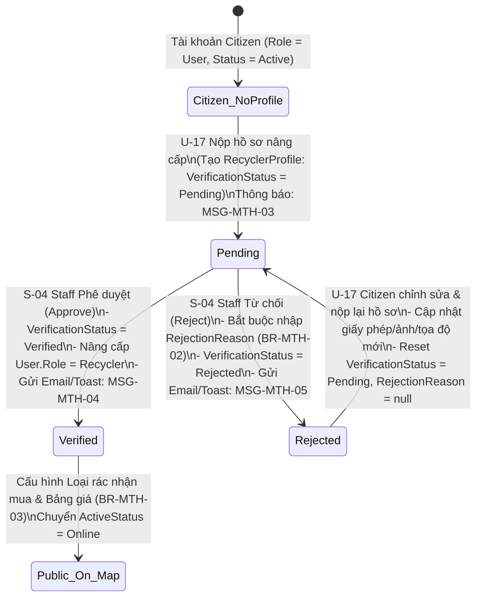
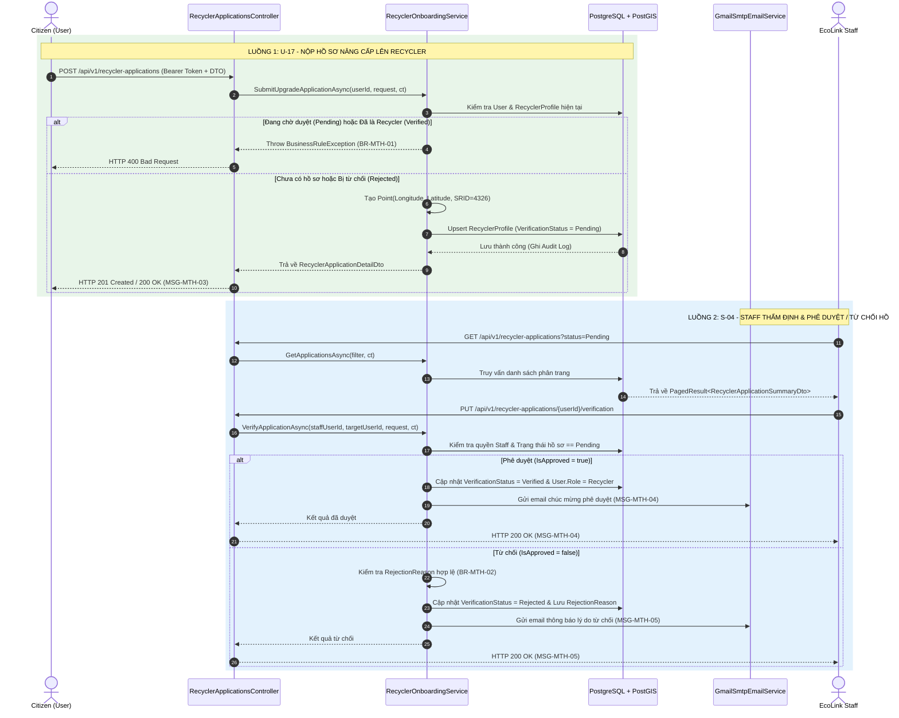

# KẾ HOẠCH THIẾT KẾ & TRIỂN KHAI (IMPLEMENTATION PLAN) - MODULE: RECYCLER ONBOARDING & VERIFICATION (U-17 & S-04)

**Dự án:** EcoLink – Intelligent Waste Sorting & Trading Platform  
**Phân hệ:** `MTH` (Hồ sơ Recycler & Kết nối) & `AUTH` / `ADM` (Nâng cấp vai trò & Kiểm duyệt Back-office)  
**Use Cases trọng tâm:**
- **`U-17`**: *Apply for Recycler Upgrade* (Người dân nộp hồ sơ đăng ký nâng cấp lên Cơ sở thu gom)
- **`S-04`**: *Verify Recycler Application* (Nhân viên Staff thẩm định & phê duyệt/từ chối hồ sơ Cơ sở thu gom)

**Nhóm phụ trách:** Hoàng Thắng Nguyễn, Nguyen Thanh Luan (K18 HL), Giang Nguyễn Đức  
**Độ phức tạp / Ưu tiên:** Medium  
**Công nghệ:** .NET 10 Web API, PostgreSQL 16 + PostGIS 3.4 (NetTopologySuite), Entity Framework Core, FluentValidation, MailKit (Gmail SMTP)  
**Tài liệu tham chiếu:**
- Sơ đồ Swimlane Nghiệp vụ: [`02_recycler_onboarding_and_verification_flow.xml`](file:///c:/Projects/EcoLink/intelligent-waste-sorting-trading/documents/diagram/swimlane%20diagram%20-%20business%20flow/02_recycler_onboarding_and_verification_flow.xml)
- Sơ đồ CSDL: [`01_auth_account_module.dbml`](file:///c:/Projects/EcoLink/intelligent-waste-sorting-trading/documents/diagram/database%20design/01_auth_account_module.dbml)
- Quy chuẩn Kiến trúc: [`clean_architecture_and_coding_guidelines.md`](file:///c:/Projects/EcoLink/intelligent-waste-sorting-trading/documents/guideline/clean_architecture_and_coding_guidelines.md)
- Quy chuẩn CSDL & Audit: [`database_design_and_audit_guidelines.md`](file:///c:/Projects/EcoLink/intelligent-waste-sorting-trading/documents/guideline/database_design_and_audit_guidelines.md)
- Quy chuẩn API Response: [`api_design_and_response_contract_guidelines.md`](file:///c:/Projects/EcoLink/intelligent-waste-sorting-trading/documents/guideline/api_design_and_response_contract_guidelines.md)
- Quy chuẩn Kiểm thử: [`test_case_specification_guidelines.md`](file:///c:/Projects/EcoLink/intelligent-waste-sorting-trading/documents/guideline/test_case_specification_guidelines.md)
- Quy tắc Nghiệp vụ & Thông điệp: [`business_rule_&_system_message.md`](file:///c:/Projects/EcoLink/intelligent-waste-sorting-trading/documents/business_rule_&_system_message.md)
- Báo cáo Chuẩn hóa Luồng Nghiệp vụ: [`Báo cáo Đánh giá và Chuẩn hóa Luồng Nghiệp vụ Business Flow.md`](file:///c:/Projects/EcoLink/intelligent-waste-sorting-trading/documents/B%C3%A1o%20c%C3%A1o%20%C4%90%C3%A1nh%20gi%C3%A1%20v%C3%A0%20Chu%E1%BA%A9n%20h%C3%B3a%20Lu%E1%BB%93ng%20Nghi%E1%BB%87p%20v%E1%BB%A5%20Business%20Flow.md)

---

## 1. MỤC TIÊU PHẠM VI & ĐÁNH GIÁ TÍNH KHẢ THI (SCOPE & FEASIBILITY ASSESSMENT)

### 1.1. Mục tiêu nghiệp vụ cốt lõi
Xây dựng quy trình **Onboarding & eKYB (Electronic Know Your Business)** khép kín nhằm kiểm soát chất lượng, tính hợp pháp và vị trí địa lý của các cơ sở thu mua phế liệu (`Recycler`) trên nền tảng EcoLink:
1. **`U-17` (Apply for Recycler Upgrade):** Cho phép một công dân (`Citizen` đã xác thực) gửi hồ sơ đăng ký kinh doanh (tên vựa phế liệu, người đại diện, địa chỉ, giấy phép pháp lý, ảnh chụp mặt tiền kho bãi và tọa độ GPS) để yêu cầu nâng cấp tài khoản lên vai trò `Recycler`, hoặc nộp lại hồ sơ sau khi chỉnh sửa theo yêu cầu của Staff.
2. **`S-04` (Verify Recycler Application):** Cung cấp công cụ cho nhân viên vận hành (`Staff` có quyền `VERIFY_RECYCLER`) kiểm tra giấy phép, hình ảnh thực tế và tọa độ GPS để **Phê duyệt (`Approve`)** hoặc **Từ chối kèm lý do (`Reject`)**.

---

### 1.2. Đánh giá mức độ sẵn sàng của Codebase hiện tại (Feasibility Matrix)
Qua đối chiếu mã nguồn tại `src/Ecolink.Backend`, module có **tính khả thi rất cao (đạt ~65% hạ tầng nền tảng)**:

| Thành phần kỹ thuật | Độ sẵn sàng | Hiện trạng trong Source Code |
| :--- | :---: | :--- |
| **1. Domain Entities & Enums** | **100%** | Đã có [`User`](file:///c:/Projects/EcoLink/intelligent-waste-sorting-trading/src/Ecolink.Backend/Ecolink.Domain/Entities/User.cs#L10-L44), [`RecyclerProfile`](file:///c:/Projects/EcoLink/intelligent-waste-sorting-trading/src/Ecolink.Backend/Ecolink.Domain/Entities/AuthEntities.cs#L11-L33), [`StaffProfile`](file:///c:/Projects/EcoLink/intelligent-waste-sorting-trading/src/Ecolink.Backend/Ecolink.Domain/Entities/AuthEntities.cs#L38-L49), [`StaffPermissionAssignment`](file:///c:/Projects/EcoLink/intelligent-waste-sorting-trading/src/Ecolink.Backend/Ecolink.Domain/Entities/AuthEntities.cs#L54-L65) và bộ Enum [`VerificationStatus`](file:///c:/Projects/EcoLink/intelligent-waste-sorting-trading/src/Ecolink.Backend/Ecolink.Domain/Enums/DomainEnums.cs#L21-L26) (`Pending`, `Verified`, `Rejected`), [`UserRole`](file:///c:/Projects/EcoLink/intelligent-waste-sorting-trading/src/Ecolink.Backend/Ecolink.Domain/Enums/DomainEnums.cs#L3-L11), [`RecyclerActiveStatus`](file:///c:/Projects/EcoLink/intelligent-waste-sorting-trading/src/Ecolink.Backend/Ecolink.Domain/Enums/DomainEnums.cs#L28-L32). |
| **2. Cấu hình CSDL & PostGIS** | **95%** | [`RecyclerProfileConfiguration.cs`](file:///c:/Projects/EcoLink/intelligent-waste-sorting-trading/src/Ecolink.Backend/Ecolink.Infrastructure/Data/Configurations/RecyclerProfileConfiguration.cs#L7-L60) đã ánh xạ bảng `recycler_profiles`, cột không gian `geom` kiểu `geometry(Point, 4326)` và chỉ mục không gian **GiST Index (`gix_recycler_profiles_geom`)**. |
| **3. Cơ chế Kiểm toán (Audit)** | **100%** | [`AuditableEntityInterceptor.cs`](file:///c:/Projects/EcoLink/intelligent-waste-sorting-trading/src/Ecolink.Backend/Ecolink.Infrastructure/Data/Interceptors/AuditableEntityInterceptor.cs#L13-L66) tự động ghi nhận `created_at`, `created_by`, `updated_at`, `updated_by` đáp ứng quy tắc **`BR-ADM-05`**. |
| **4. Dịch vụ Email & Thông báo** | **90%** | [`GmailSmtpEmailService.cs`](file:///c:/Projects/EcoLink/intelligent-waste-sorting-trading/src/Ecolink.Backend/Ecolink.Infrastructure/Services/GmailSmtpEmailService.cs#L46-L86) đã hỗ trợ `SendEmailAsync` an toàn (không làm gãy luồng nghiệp vụ nếu lỗi SMTP theo **`BR-NTF-06`**). |
| **5. Xử lý Ngoại lệ & API Envelope** | **100%** | [`GlobalExceptionMiddleware.cs`](file:///c:/Projects/EcoLink/intelligent-waste-sorting-trading/src/Ecolink.Backend/Ecolink.WebApi/Middlewares/GlobalExceptionMiddleware.cs#L11-L66) và [`ApiResponse<T>`](file:///c:/Projects/EcoLink/intelligent-waste-sorting-trading/src/Ecolink.Backend/Ecolink.Application/Common/ApiResponse.cs#L7-L36) đã hoạt động chuẩn xác. |
| **6. Logic Nghiệp vụ `U-17` & `S-04`** | **20%** | Hiện mới chỉ có `POST /api/v1/auth/register-recycler` (tạo mới User làm Recycler từ đầu). **Chưa có** API nâng cấp từ tài khoản `Citizen` hiện hữu (`U-17`), **chưa có** luồng nộp lại hồ sơ bị từ chối (`BR-MTH-02`), và **chưa có** bộ API dành cho `Staff` thẩm định (`S-04`). |

---

### 1.3. Phân tích Khoảng trống kỹ thuật (Technical Gaps) & Giải pháp thiết kế

1. **Giải quyết sự khác biệt giữa `register-recycler` (Guest) và `U-17` (Authenticated Citizen Upgrade):**
   - Khi một `Citizen` đang hoạt động (`UserRole.Citizen`, `UserStatus.Active`) nộp đơn nâng cấp ở `U-17`, hệ thống **giữ nguyên `User.Role = Citizen` và `User.Status = Active`** trong suốt thời gian hồ sơ ở trạng thái `VerificationStatus.Pending`. Nhờ đó, người dùng vẫn sử dụng các tính năng quét rác AI và tích điểm bình thường trong lúc chờ duyệt.
   - Chỉ khi Staff bấm **Approve (`S-04`)**, hệ thống mới cập nhật nguyên tử (Atomic Transaction): `RecyclerProfile.VerificationStatus = Verified` **VÀ** `User.Role = UserRole.Recycler`.
2. **Hỗ trợ luồng Nộp lại hồ sơ sau khi bị Từ chối (`Re-application Flow` - `BR-MTH-02`):**
   - Do quan hệ giữa `User` và `RecyclerProfile` là `1-1` (khóa chính của `RecyclerProfile` là `UserId`), khi hồ sơ bị `Rejected`, người dùng gọi lại endpoint `U-17` sẽ thực hiện **cập nhật (Upsert) lại chính bản ghi `RecyclerProfile` đó**: ghi đè thông tin/ảnh mới, đặt lại `VerificationStatus = Pending` và xóa `RejectionReason = null`.
3. **Liên kết sang Bản đồ Tìm kiếm (`BR-MTH-01`, `BR-MTH-03`, `BR-MTH-04`):**
   - Sau khi được duyệt (`VerificationStatus = Verified`), hồ sơ khởi tạo ở trạng thái `ActiveStatus = Offline`. Để xuất hiện trên bản đồ tìm kiếm PostGIS, cơ sở cần cấu hình danh mục rác nhận thu mua (`AcceptedMaterials`) và bật trạng thái `ActiveStatus = Online`.

---

### 1.4. Phân tích Lựa chọn Giải pháp Lưu trữ Chứng từ (`LegalPermitUrl` & `BusinessPhotoUrl`): Cloudflare R2 vs. Cloudinary

Trong Use Case **`U-17`** và **`S-04`**, hệ thống cần lưu trữ **Giấy phép kinh doanh (`LegalPermitUrl`)** và **Ảnh chụp thực tế cơ sở (`BusinessPhotoUrl`)**. Việc chuyển sang sử dụng **Cloudflare R2 Object Storage** thay vì **Cloudinary API** là **hoàn toàn khả thi và tối ưu hơn cho kiến trúc của EcoLink** vì:
- **Đồng bộ 100% với Thiết kế CSDL gốc:** Tại [`01_auth_account_module.dbml`](file:///c:/Projects/EcoLink/intelligent-waste-sorting-trading/documents/diagram/database%20design/01_auth_account_module.dbml#L39), hệ thống đã quy định sử dụng **Cloudflare R2** làm Object Storage chuẩn.
- **Thống nhất hạ tầng với Phân hệ AI (`CLS`):** Dùng chung một R2 Bucket cho cả ảnh đại diện (`AUTH`), giấy phép cơ sở (`MTH`), ảnh rác người dân quét và gói dữ liệu `.zip` / trọng số `.pt` phục vụ Retrain AI (`CLS`).

#### Bảng đối chiếu Điểm mạnh & Điểm yếu: Cloudflare R2 vs. Cloudinary API

| Tiêu chí đánh giá | Cloudflare R2 (Chuẩn AWS S3-Compatible) | Cloudinary API (Media PaaS) |
| :--- | :--- | :--- |
| **Bản chất công nghệ** | **Object Storage chuẩn S3** kết hợp mạng CDN toàn cầu của Cloudflare. | **Digital Asset Management (DAM)** chuyên xử lý và biến đổi ảnh/video. |
| **Điểm mạnh (Pros)** | 1. **Miễn phí 100% băng thông tải ra (Zero Egress Fee):** Không tốn phí khi Staff xem giấy phép (`S-04`), người dân xem ảnh vựa phế liệu hoặc tải gói 500+ ảnh về Retrain AI.<br>2. **Chuẩn công nghiệp S3 (`AWSSDK.S3`):** Không bị phụ thuộc nhà cung cấp (Vendor Lock-in); dễ dàng chuyển đổi sang AWS S3 hoặc MinIO (Docker local) chỉ bằng cách đổi cấu hình.<br>3. **Bảo mật chứng từ nhạy cảm bằng Pre-signed URL:** Dễ dàng cấp link xem tạm thời (hết hạn sau 15 phút) cho Giấy phép kinh doanh hoặc cho phép Frontend upload thẳng lên R2 (Presigned PUT) giảm tải cho Backend.<br>4. **Lưu trữ đa định dạng:** Lưu tốt cả ảnh (`.jpg`, `.png`), giấy phép `.pdf`, gói dữ liệu `.zip` và mô hình AI `.pt`. | 1. **Biến đổi ảnh tự động qua URL (On-the-fly Transformation):** Tự động resize, cắt ảnh, chuyển đổi định dạng WebP/AVIF ngay trên đường dẫn URL mà không cần code xử lý ảnh.<br>2. **Tích hợp nhanh không cần thẻ thanh toán:** Tạo tài khoản có ngay API Key để chạy thử nghiệm. |
| **Điểm yếu (Cons)** | 1. **Không tự động resize/crop ảnh miễn phí trên URL:** Nếu muốn nén ảnh trước khi lưu cần xử lý ở Frontend hoặc dùng thư viện nhẹ ở Backend.<br>2. **Kích hoạt R2 trên Cloudflare Dashboard cần xác thực thẻ thanh toán** (dù gói Free Tier miễn phí 10 GB/tháng và 10 triệu lượt đọc/tháng). | 1. **Giới hạn Credit & Tính phí băng thông gắt gao:** Băng thông xem ảnh và biến đổi ảnh đều trừ vào Credit hàng tháng.<br>2. **Phụ thuộc SDK riêng (`CloudinaryDotNet`):** Khó dùng chung để lưu các tệp lớn phi hình ảnh như mô hình `.pt` hoặc dataset `.zip`. |
| **Đề xuất cho EcoLink** | **Khuyên dùng chính thức** (bám sát DBML, tối ưu chi phí vận hành thực tế và bảo mật hồ sơ eKYB). | Chỉ dùng nếu nhóm muốn demo nhanh phần cắt cúp ảnh mà không có thẻ kích hoạt Cloudflare. |

---

## 2. THIẾT KẾ LUỒNG NGHIỆP VỤ & MÁY TRẠNG THÁI (BUSINESS FLOW & STATE MACHINE)

### 2.1. Sơ đồ Máy trạng thái Hồ sơ (State Machine Diagram)



---

### 2.2. Sơ đồ Tuần tự (Sequence Diagram) cho `U-17` và `S-04`



---

### 2.3. Bảng Đối chiếu Quy tắc Nghiệp vụ & Mã Thông điệp Áp dụng

| Mã BR / MSG | Phân loại | Nội dung quy định trong tài liệu | Cách thức thực thi trong Code |
| :--- | :---: | :--- | :--- |
| **`BR-MTH-01`** | Business Rule | Recycler phải được Staff phê duyệt trước khi xuất hiện trong tìm kiếm hoặc nhận yêu cầu bàn giao. | Hồ sơ mới nộp luôn mang `VerificationStatus = Pending` và `ActiveStatus = Offline`. |
| **`BR-MTH-02`** | Business Rule | Khi từ chối xác minh phải ghi rõ lý do, Recycler có thể nộp lại hồ sơ đã chỉnh sửa. | `VerifyRecyclerApplicationValidator` bắt buộc `RejectionReason` khi `IsApproved == false`. Cho phép nộp lại khi `Status == Rejected`. |
| **`BR-MTH-03`** | Business Rule | Hồ sơ Recycler chỉ được công khai khi có ít nhất một loại rác chấp nhận, điều kiện thu gom và vị trí hợp lệ. | Kiểm tra tọa độ GPS hợp lệ (SRID 4326) và điều hướng sang bước cấu hình bảng giá sau khi duyệt. |
| **`BR-ADM-02`** | Business Rule | Phân tách vai trò: Staff phụ trách xác minh cơ sở thu gom (`VERIFY_RECYCLER`). | Chặn bằng `[Authorize(Roles = "Staff,Admin")]` và kiểm tra quyền `VERIFY_RECYCLER` của Staff. |
| **`BR-ADM-05`** | Business Rule | Mọi thao tác xác minh của Admin/Staff đều được ghi vào nhật ký kiểm toán. | `AuditableEntityInterceptor` tự động lưu `UpdatedBy = staffUserId` và `UpdatedAt = DateTime.UtcNow`. |
| **`MSG-MTH-03`** | System Message | *Hồ sơ cơ sở của bạn đang được xem xét và sẽ xuất hiện trong tìm kiếm sau khi được duyệt.* | Trả về trong `ApiResponse` khi người dùng gửi đơn thành công ở `U-17`. |
| **`MSG-MTH-04`** | System Message | *Hồ sơ cơ sở của bạn đã được duyệt và hiện hiển thị với người dùng.* | Trả về khi Staff `Approve` ở `S-04` và gửi qua Email cho người dùng. |
| **`MSG-MTH-05`** | System Message | *Hồ sơ cơ sở của bạn chưa được duyệt: {reason}. Vui lòng cập nhật và gửi lại.* | Trả về khi Staff `Reject` ở `S-04` và gửi kèm lý do qua Email cho người dùng. |

---

## 3. THIẾT KẾ CHI TIẾT TẦNG APPLICATION (`Ecolink.Application`)

### 3.1. Định nghĩa DTOs (`src/Ecolink.Backend/Ecolink.Application/Dtos/RecyclerOnboardingDtos.cs`)

Tuân thủ quy ước đặt tên tại Mục 5 của [`clean_architecture_and_coding_guidelines.md`](file:///c:/Projects/EcoLink/intelligent-waste-sorting-trading/documents/guideline/clean_architecture_and_coding_guidelines.md#L130-L143):

```csharp
namespace Ecolink.Application.Dtos;

/// <summary>
/// Request DTO cho Use Case U-17: Người dân nộp hoặc nộp lại hồ sơ nâng cấp lên Recycler
/// </summary>
public class ApplyRecyclerUpgradeRequest
{
    public string FacilityName { get; set; } = string.Empty;
    public string RepresentativeName { get; set; } = string.Empty;
    public string BusinessAddress { get; set; } = string.Empty;
    public double Latitude { get; set; }
    public double Longitude { get; set; }
    public string ContactPhone { get; set; } = string.Empty;
    public string? OperatingHours { get; set; } = "08:00 - 18:00";
    public string? Description { get; set; }
    public string LegalPermitUrl { get; set; } = string.Empty;
    public string BusinessPhotoUrl { get; set; } = string.Empty;
}

/// <summary>
/// Request DTO cho Use Case S-04: Staff phê duyệt hoặc từ chối hồ sơ đăng ký Recycler
/// </summary>
public class VerifyRecyclerApplicationRequest
{
    public bool IsApproved { get; set; }
    public string? RejectionReason { get; set; }
}

/// <summary>
/// Query Filter DTO cho danh sách hồ sơ Recycler (chuẩn phân trang mục 4 api_design_and_response_contract_guidelines.md)
/// </summary>
public class RecyclerApplicationFilterRequest
{
    public string? Status { get; set; } // Pending, Verified, Rejected
    public string? Keyword { get; set; } // Tìm theo tên cơ sở, địa chỉ, email, SĐT
    public int PageNumber { get; set; } = 1;
    public int PageSize { get; set; } = 10;
    public string SortBy { get; set; } = "createdAt";
    public string SortOrder { get; set; } = "asc"; // Ưu tiên đơn nộp trước (FIFO)
}

/// <summary>
/// Response DTO hiển thị chi tiết hồ sơ đăng ký Recycler cho cả User (U-17) và Staff (S-04)
/// </summary>
public class RecyclerApplicationDetailDto
{
    public Guid UserId { get; set; }
    public string Username { get; set; } = string.Empty;
    public string Email { get; set; } = string.Empty;
    public string ApplicantFullName { get; set; } = string.Empty;
    public string CurrentRole { get; set; } = string.Empty;

    public string FacilityName { get; set; } = string.Empty;
    public string? RepresentativeName { get; set; }
    public string BusinessAddress { get; set; } = string.Empty;
    public decimal Latitude { get; set; }
    public decimal Longitude { get; set; }
    public string OperatingHours { get; set; } = string.Empty;
    public string ContactPhone { get; set; } = string.Empty;
    public string? Description { get; set; }
    public string? LegalPermitUrl { get; set; }
    public string? BusinessPhotoUrl { get; set; }

    public string VerificationStatus { get; set; } = string.Empty;
    public string ActiveStatus { get; set; } = string.Empty;
    public string? RejectionReason { get; set; }

    public DateTime SubmittedAt { get; set; }
    public DateTime? ReviewedAt { get; set; }
    public string? ReviewedBy { get; set; }
}

/// <summary>
/// Khung dữ liệu phân trang chuẩn
/// </summary>
public class PagedResult<T>
{
    public IReadOnlyList<T> Items { get; set; } = Array.Empty<T>();
    public int PageNumber { get; set; }
    public int PageSize { get; set; }
    public int TotalRecords { get; set; }
    public int TotalPages => (int)Math.Ceiling((double)TotalRecords / PageSize);
    public bool HasPreviousPage => PageNumber > 1;
    public bool HasNextPage => PageNumber < TotalPages;
}
```

---

### 3.2. Định nghĩa Validators với FluentValidation (`src/Ecolink.Backend/Ecolink.Application/Validators/RecyclerOnboardingValidators.cs`)

```csharp
using Ecolink.Application.Dtos;
using FluentValidation;

namespace Ecolink.Application.Validators;

public class ApplyRecyclerUpgradeValidator : AbstractValidator<ApplyRecyclerUpgradeRequest>
{
    public ApplyRecyclerUpgradeValidator()
    {
        RuleFor(x => x.FacilityName)
            .NotEmpty().WithMessage("Tên cơ sở thu mua không được để trống.")
            .MaximumLength(150).WithMessage("Tên cơ sở tối đa 150 ký tự.");

        RuleFor(x => x.RepresentativeName)
            .NotEmpty().WithMessage("Tên người đại diện pháp luật không được để trống.")
            .MaximumLength(100).WithMessage("Tên người đại diện tối đa 100 ký tự.");

        RuleFor(x => x.BusinessAddress)
            .NotEmpty().WithMessage("Địa chỉ cơ sở kinh doanh không được để trống.")
            .MaximumLength(255).WithMessage("Địa chỉ kinh doanh tối đa 255 ký tự.");

        RuleFor(x => x.Latitude)
            .InclusiveBetween(-90.0, 90.0).WithMessage("Vĩ độ (Latitude) phải nằm trong khoảng [-90, 90].")
            .NotEqual(0).WithMessage("Vui lòng chọn tọa độ GPS hợp lệ trên bản đồ.");

        RuleFor(x => x.Longitude)
            .InclusiveBetween(-180.0, 180.0).WithMessage("Kinh độ (Longitude) phải nằm trong khoảng [-180, 180].")
            .NotEqual(0).WithMessage("Vui lòng chọn tọa độ GPS hợp lệ trên bản đồ.");

        RuleFor(x => x.ContactPhone)
            .NotEmpty().WithMessage("Số điện thoại liên hệ thu gom không được để trống.")
            .Matches(@"^(0|\+84)[0-9]{8,10}$").WithMessage("Số điện thoại liên hệ không đúng định dạng Việt Nam.");

        RuleFor(x => x.LegalPermitUrl)
            .NotEmpty().WithMessage("Vui lòng đính kèm hình ảnh Giấy phép kinh doanh / Chứng từ pháp lý.");

        RuleFor(x => x.BusinessPhotoUrl)
            .NotEmpty().WithMessage("Vui lòng đính kèm hình ảnh chụp thực tế mặt tiền cơ sở / kho bãi.");
    }
}

public class VerifyRecyclerApplicationValidator : AbstractValidator<VerifyRecyclerApplicationRequest>
{
    public VerifyRecyclerApplicationValidator()
    {
        // Thực thi quy tắc BR-MTH-02: Từ chối bắt buộc phải ghi rõ lý do
        RuleFor(x => x.RejectionReason)
            .NotEmpty()
            .When(x => !x.IsApproved)
            .WithMessage("Khi từ chối hồ sơ, nhân viên bắt buộc phải ghi rõ lý do từ chối (BR-MTH-02).")
            .MinimumLength(10)
            .When(x => !x.IsApproved)
            .WithMessage("Lý do từ chối phải rõ ràng, tối thiểu 10 ký tự.");
    }
}
```

---

### 3.3. Định nghĩa Interface Dịch vụ (`src/Ecolink.Backend/Ecolink.Application/Interfaces/IRecyclerOnboardingService.cs`)

```csharp
using Ecolink.Application.Dtos;

namespace Ecolink.Application.Interfaces;

public interface IRecyclerOnboardingService
{
    /// <summary>
    /// U-17: Công dân gửi hồ sơ xin nâng cấp lên Recycler (hoặc nộp lại sau khi bị từ chối)
    /// </summary>
    Task<RecyclerApplicationDetailDto> SubmitUpgradeApplicationAsync(
        Guid userId,
        ApplyRecyclerUpgradeRequest request,
        CancellationToken cancellationToken = default);

    /// <summary>
    /// U-17: Công dân xem trạng thái hồ sơ đăng ký Recycler của chính mình
    /// </summary>
    Task<RecyclerApplicationDetailDto> GetMyApplicationAsync(
        Guid userId,
        CancellationToken cancellationToken = default);

    /// <summary>
    /// S-04: Staff lấy danh sách hồ sơ đăng ký Recycler có bộ lọc và phân trang
    /// </summary>
    Task<PagedResult<RecyclerApplicationDetailDto>> GetApplicationsForStaffAsync(
        RecyclerApplicationFilterRequest filter,
        CancellationToken cancellationToken = default);

    /// <summary>
    /// S-04: Staff xem chi tiết một hồ sơ theo UserId
    /// </summary>
    Task<RecyclerApplicationDetailDto> GetApplicationByUserIdAsync(
        Guid targetUserId,
        CancellationToken cancellationToken = default);

    /// <summary>
    /// S-04: Staff phê duyệt (Approve) hoặc từ chối (Reject) hồ sơ đăng ký Recycler
    /// </summary>
    Task<RecyclerApplicationDetailDto> VerifyApplicationAsync(
        Guid staffUserId,
        Guid targetUserId,
        VerifyRecyclerApplicationRequest request,
        CancellationToken cancellationToken = default);
}
```

---

## 4. THIẾT KẾ CHI TIẾT TẦNG INFRASTRUCTURE (`Ecolink.Infrastructure`)

### 4.1. Hiện thực hóa `RecyclerOnboardingService.cs`
Đặt tại `src/Ecolink.Backend/Ecolink.Infrastructure/Services/RecyclerOnboardingService.cs`:

```csharp
using Ecolink.Application.Dtos;
using Ecolink.Application.Interfaces;
using Ecolink.Domain.Entities;
using Ecolink.Domain.Enums;
using Ecolink.Domain.Exceptions;
using Ecolink.Infrastructure.Data;
using Microsoft.EntityFrameworkCore;
using Microsoft.Extensions.Logging;
using NetTopologySuite.Geometries;

namespace Ecolink.Infrastructure.Services;

public class RecyclerOnboardingService : IRecyclerOnboardingService
{
    private readonly ApplicationDbContext _dbContext;
    private readonly IEmailService _emailService;
    private readonly ILogger<RecyclerOnboardingService> _logger;

    public RecyclerOnboardingService(
        ApplicationDbContext dbContext,
        IEmailService emailService,
        ILogger<RecyclerOnboardingService> logger)
    {
        _dbContext = dbContext;
        _emailService = emailService;
        _logger = logger;
    }

    public async Task<RecyclerApplicationDetailDto> SubmitUpgradeApplicationAsync(
        Guid userId,
        ApplyRecyclerUpgradeRequest request,
        CancellationToken ct = default)
    {
        var user = await _dbContext.Users
            .Include(u => u.RecyclerProfile)
            .FirstOrDefaultAsync(u => u.Id == userId, ct);

        if (user == null)
        {
            throw new NotFoundException("Không tìm thấy tài khoản người dùng.");
        }

        if (user.Status == UserStatus.Suspended || user.Status == UserStatus.Locked)
        {
            throw new BusinessRuleException("BR-AUTH-05", "MSG-AUTH-04",
                "Tài khoản đang bị khóa hoặc đình chỉ, không thể gửi yêu cầu nâng cấp.");
        }

        var existingProfile = user.RecyclerProfile;
        if (existingProfile != null)
        {
            if (existingProfile.VerificationStatus == VerificationStatus.Verified)
            {
                throw new BusinessRuleException("BR-MTH-01", "MSG-MTH-04",
                    "Hồ sơ cơ sở của bạn đã được phê duyệt trước đó.");
            }

            if (existingProfile.VerificationStatus == VerificationStatus.Pending)
            {
                throw new BusinessRuleException("BR-MTH-01", "MSG-MTH-03",
                    "Hồ sơ cơ sở của bạn đang trong hàng đợi thẩm định. Vui lòng chờ kết quả từ nhân viên.");
            }
        }

        var locationPoint = new Point(request.Longitude, request.Latitude) { SRID = 4326 };

        if (existingProfile == null)
        {
            // Nộp mới lần đầu
            existingProfile = new RecyclerProfile
            {
                UserId = user.Id,
                User = user,
                FacilityName = request.FacilityName.Trim(),
                RepresentativeName = request.RepresentativeName.Trim(),
                BusinessAddress = request.BusinessAddress.Trim(),
                Latitude = (decimal)request.Latitude,
                Longitude = (decimal)request.Longitude,
                Location = locationPoint,
                OperatingHours = string.IsNullOrWhiteSpace(request.OperatingHours) ? "08:00 - 18:00" : request.OperatingHours.Trim(),
                ContactPhone = request.ContactPhone.Trim(),
                Description = request.Description?.Trim(),
                LegalPermitUrl = request.LegalPermitUrl.Trim(),
                BusinessPhotoUrl = request.BusinessPhotoUrl.Trim(),
                VerificationStatus = VerificationStatus.Pending,
                ActiveStatus = RecyclerActiveStatus.Offline,
                RejectionReason = null,
                CreatedBy = user.Id.ToString()
            };
            _dbContext.RecyclerProfiles.Add(existingProfile);
        }
        else
        {
            // Nộp lại sau khi bị Rejected (Tuân thủ BR-MTH-02)
            existingProfile.FacilityName = request.FacilityName.Trim();
            existingProfile.RepresentativeName = request.RepresentativeName.Trim();
            existingProfile.BusinessAddress = request.BusinessAddress.Trim();
            existingProfile.Latitude = (decimal)request.Latitude;
            existingProfile.Longitude = (decimal)request.Longitude;
            existingProfile.Location = locationPoint;
            existingProfile.OperatingHours = string.IsNullOrWhiteSpace(request.OperatingHours) ? "08:00 - 18:00" : request.OperatingHours.Trim();
            existingProfile.ContactPhone = request.ContactPhone.Trim();
            existingProfile.Description = request.Description?.Trim();
            existingProfile.LegalPermitUrl = request.LegalPermitUrl.Trim();
            existingProfile.BusinessPhotoUrl = request.BusinessPhotoUrl.Trim();
            existingProfile.VerificationStatus = VerificationStatus.Pending;
            existingProfile.RejectionReason = null;
            existingProfile.UpdatedAt = DateTime.UtcNow;
            existingProfile.UpdatedBy = user.Id.ToString();
        }

        await _dbContext.SaveChangesAsync(ct);

        _logger.LogInformation("Người dùng {Username} ({UserId}) đã gửi hồ sơ nâng cấp Recycler cho cơ sở '{Facility}'",
            user.Username, user.Id, existingProfile.FacilityName);

        return MapToDetailDto(user, existingProfile);
    }

    public async Task<RecyclerApplicationDetailDto> GetMyApplicationAsync(Guid userId, CancellationToken ct = default)
    {
        var user = await _dbContext.Users
            .Include(u => u.RecyclerProfile)
            .FirstOrDefaultAsync(u => u.Id == userId, ct);

        if (user == null || user.RecyclerProfile == null)
        {
            throw new NotFoundException("Bạn chưa gửi hồ sơ đăng ký nâng cấp Cơ sở thu gom nào.");
        }

        return MapToDetailDto(user, user.RecyclerProfile);
    }

    public async Task<PagedResult<RecyclerApplicationDetailDto>> GetApplicationsForStaffAsync(
        RecyclerApplicationFilterRequest filter,
        CancellationToken ct = default)
    {
        var query = _dbContext.RecyclerProfiles
            .Include(r => r.User)
            .AsNoTracking()
            .AsQueryable();

        if (!string.IsNullOrWhiteSpace(filter.Status) &&
            Enum.TryParse<VerificationStatus>(filter.Status.Trim(), true, out var parsedStatus))
        {
            query = query.Where(r => r.VerificationStatus == parsedStatus);
        }

        if (!string.IsNullOrWhiteSpace(filter.Keyword))
        {
            var kw = filter.Keyword.Trim().ToLower();
            query = query.Where(r =>
                r.FacilityName.ToLower().Contains(kw) ||
                r.BusinessAddress.ToLower().Contains(kw) ||
                r.ContactPhone.Contains(kw) ||
                r.User.Email.ToLower().Contains(kw) ||
                r.User.FullName.ToLower().Contains(kw));
        }

        var totalRecords = await query.CountAsync(ct);

        query = filter.SortOrder.Equals("desc", StringComparison.OrdinalIgnoreCase)
            ? query.OrderByDescending(r => r.CreatedAt)
            : query.OrderBy(r => r.CreatedAt);

        var pageNumber = Math.Max(1, filter.PageNumber);
        var pageSize = Math.Clamp(filter.PageSize, 1, 100);

        var items = await query
            .Skip((pageNumber - 1) * pageSize)
            .Take(pageSize)
            .ToListAsync(ct);

        return new PagedResult<RecyclerApplicationDetailDto>
        {
            Items = items.Select(r => MapToDetailDto(r.User, r)).ToList(),
            PageNumber = pageNumber,
            PageSize = pageSize,
            TotalRecords = totalRecords
        };
    }

    public async Task<RecyclerApplicationDetailDto> GetApplicationByUserIdAsync(Guid targetUserId, CancellationToken ct = default)
    {
        var profile = await _dbContext.RecyclerProfiles
            .Include(r => r.User)
            .AsNoTracking()
            .FirstOrDefaultAsync(r => r.UserId == targetUserId, ct);

        if (profile == null)
        {
            throw new NotFoundException($"Không tìm thấy hồ sơ đăng ký Recycler của người dùng '{targetUserId}'.");
        }

        return MapToDetailDto(profile.User, profile);
    }

    public async Task<RecyclerApplicationDetailDto> VerifyApplicationAsync(
        Guid staffUserId,
        Guid targetUserId,
        VerifyRecyclerApplicationRequest request,
        CancellationToken ct = default)
    {
        var profile = await _dbContext.RecyclerProfiles
            .Include(r => r.User)
            .FirstOrDefaultAsync(r => r.UserId == targetUserId, ct);

        if (profile == null)
        {
            throw new NotFoundException("Không tìm thấy hồ sơ đăng ký Recycler cần thẩm định.");
        }

        if (profile.VerificationStatus != VerificationStatus.Pending)
        {
            throw new BusinessRuleException("BR-MTH-01", "MSG-GEN-01",
                $"Chỉ có thể thẩm định hồ sơ đang ở trạng thái 'Pending' (Trạng thái hiện tại: '{profile.VerificationStatus}').");
        }

        if (!request.IsApproved && string.IsNullOrWhiteSpace(request.RejectionReason))
        {
            throw new BusinessRuleException("BR-MTH-02", "MSG-MTH-05",
                "Bắt buộc phải nhập lý do từ chối khi không phê duyệt hồ sơ (BR-MTH-02).");
        }

        if (request.IsApproved)
        {
            // Phê duyệt: Chuyển trạng thái hồ sơ -> Verified và nâng cấp Role -> Recycler
            profile.VerificationStatus = VerificationStatus.Verified;
            profile.RejectionReason = null;
            profile.UpdatedAt = DateTime.UtcNow;
            profile.UpdatedBy = staffUserId.ToString();

            profile.User.Role = UserRole.Recycler;
            if (profile.User.Status == UserStatus.PendingVerification)
            {
                profile.User.Status = UserStatus.Active;
            }
            profile.User.UpdatedAt = DateTime.UtcNow;
            profile.User.UpdatedBy = staffUserId.ToString();
        }
        else
        {
            // Từ chối: Lưu lý do từ chối theo BR-MTH-02
            profile.VerificationStatus = VerificationStatus.Rejected;
            profile.RejectionReason = request.RejectionReason!.Trim();
            profile.ActiveStatus = RecyclerActiveStatus.Offline;
            profile.UpdatedAt = DateTime.UtcNow;
            profile.UpdatedBy = staffUserId.ToString();
        }

        await _dbContext.SaveChangesAsync(ct);

        _logger.LogInformation("Staff {StaffId} đã {Decision} hồ sơ Recycler của User {TargetUserId} ({Facility})",
            staffUserId, request.IsApproved ? "APPROVE" : "REJECT", targetUserId, profile.FacilityName);

        // Gửi email thông báo kết quả (BR-NTF-02, BR-NTF-06)
        await SendVerificationNotificationEmailAsync(profile.User, profile, request.IsApproved, ct);

        return MapToDetailDto(profile.User, profile);
    }

    private async Task SendVerificationNotificationEmailAsync(
        User user,
        RecyclerProfile profile,
        bool isApproved,
        CancellationToken ct)
    {
        var subject = isApproved
            ? "[EcoLink] Hồ sơ Cơ sở thu mua của bạn đã được phê duyệt"
            : "[EcoLink] Thông báo kết quả thẩm định hồ sơ Cơ sở thu mua";

        var htmlBody = isApproved
            ? $@"<p>Xin chào <strong>{user.FullName}</strong>,</p>
                 <p>Hồ sơ cơ sở <strong>{profile.FacilityName}</strong> của bạn đã được duyệt và hiện hiển thị với người dùng (MSG-MTH-04).</p>
                 <p>Vui lòng truy cập ứng dụng để cập nhật danh mục phế liệu nhận thu mua và bảng giá niêm yết (BR-MTH-03).</p>"
            : $@"<p>Xin chào <strong>{user.FullName}</strong>,</p>
                 <p>Hồ sơ cơ sở <strong>{profile.FacilityName}</strong> của bạn chưa được duyệt: <strong>{profile.RejectionReason}</strong>. Vui lòng cập nhật và gửi lại (MSG-MTH-05).</p>";

        await _emailService.SendEmailAsync(user.Email, user.FullName, subject, htmlBody, ct);
    }

    private static RecyclerApplicationDetailDto MapToDetailDto(User user, RecyclerProfile profile) =>
        new()
        {
            UserId = user.Id,
            Username = user.Username,
            Email = user.Email,
            ApplicantFullName = user.FullName,
            CurrentRole = user.Role.ToString(),
            FacilityName = profile.FacilityName,
            RepresentativeName = profile.RepresentativeName,
            BusinessAddress = profile.BusinessAddress,
            Latitude = profile.Latitude,
            Longitude = profile.Longitude,
            OperatingHours = profile.OperatingHours,
            ContactPhone = profile.ContactPhone,
            Description = profile.Description,
            LegalPermitUrl = profile.LegalPermitUrl,
            BusinessPhotoUrl = profile.BusinessPhotoUrl,
            VerificationStatus = profile.VerificationStatus.ToString(),
            ActiveStatus = profile.ActiveStatus.ToString(),
            RejectionReason = profile.RejectionReason,
            SubmittedAt = profile.CreatedAt,
            ReviewedAt = profile.UpdatedAt,
            ReviewedBy = profile.UpdatedBy
        };
}
```

---

### 4.2. Thiết kế Dịch vụ Tích hợp Cloudflare R2 (`CloudflareR2StorageService.cs`)

Sử dụng NuGet package chuẩn **`AWSSDK.S3`** kết nối tới Endpoint S3-compatible của Cloudflare R2:

#### 1. Cấu hình trong `appsettings.Development.json`
```json
{
  "CloudflareR2": {
    "AccountId": "f15071b71f995ac69532cf5541f31737",
    "AccessKeyId": "YOUR_R2_ACCESS_KEY_ID",
    "SecretAccessKey": "YOUR_R2_SECRET_ACCESS_KEY",
    "BucketName": "ecolink",
    "PublicUrl": "https://pub-xxxxxxxxxxxx.r2.dev"
  }
}
```

#### 2. Hiện thực hóa `CloudflareR2StorageService.cs`
```csharp
using Amazon.Runtime;
using Amazon.S3;
using Amazon.S3.Model;
using Ecolink.Application.Interfaces;
using Ecolink.Domain.Exceptions;
using Microsoft.Extensions.Configuration;
using Microsoft.Extensions.Logging;

namespace Ecolink.Infrastructure.Services;

public class CloudflareR2StorageService : IFileStorageService
{
    private readonly IAmazonS3 _s3Client;
    private readonly string _bucketName;
    private readonly string _publicUrl;
    private readonly ILogger<CloudflareR2StorageService> _logger;

    public CloudflareR2StorageService(IConfiguration config, ILogger<CloudflareR2StorageService> logger)
    {
        _logger = logger;
        var accountId = config["CloudflareR2:AccountId"];
        var accessKey = config["CloudflareR2:AccessKeyId"];
        var secretKey = config["CloudflareR2:SecretAccessKey"];
        _bucketName = config["CloudflareR2:BucketName"] ?? "ecolink";
        _publicUrl = (config["CloudflareR2:PublicUrl"] ?? string.Empty).TrimEnd('/');

        var credentials = new BasicAWSCredentials(accessKey, secretKey);
        var s3Config = new AmazonS3Config
        {
            ServiceURL = $"https://{accountId}.r2.cloudflarestorage.com",
            ForcePathStyle = true
        };

        _s3Client = new AmazonS3Client(credentials, s3Config);
    }

    public async Task<string> UploadRecyclerDocumentAsync(
        Stream fileStream,
        string originalFileName,
        string contentType,
        string folderPrefix = "recycler-kyb",
        CancellationToken ct = default)
    {
        var ext = Path.GetExtension(originalFileName)?.ToLowerInvariant();
        var allowedExtensions = new[] { ".jpg", ".jpeg", ".png", ".webp", ".pdf" };
        if (string.IsNullOrEmpty(ext) || !allowedExtensions.Contains(ext))
        {
            throw new BusinessRuleException("BR-MTH-01", "MSG-GEN-01",
                "Định dạng chứng từ không hợp lệ. Chỉ hỗ trợ ảnh (.jpg, .png, .webp) hoặc .pdf.");
        }

        var objectKey = $"{folderPrefix}/{DateTime.UtcNow:yyyy/MM}/{Guid.NewGuid():N}{ext}";

        var putRequest = new PutObjectRequest
        {
            BucketName = _bucketName,
            Key = objectKey,
            InputStream = fileStream,
            ContentType = contentType,
            DisablePayloadSigning = true // Bắt buộc đối với Cloudflare R2 khi dùng streaming
        };

        await _s3Client.PutObjectAsync(putRequest, ct);
        _logger.LogInformation("Đã tải chứng từ lên Cloudflare R2 thành công: {ObjectKey}", objectKey);

        return $"{_publicDomainUrl}/{objectKey}";
    }
}
```

---

## 5. THIẾT KẾ RESTFUL API ENDPOINTS TẠI TẦNG WEBAPI (`Ecolink.WebApi`)

### 5.1. Bảng Tổng Hợp 5 Endpoints Chuẩn RESTful (`kebab-case`)

| STT | Phương thức | Đường dẫn URI | Use Case | Phân quyền | Mã thông điệp trả về |
| :---: | :---: | :--- | :---: | :--- | :--- |
| 1 | `POST` | `/api/v1/recycler-applications` | **`U-17`** | `[Authorize]` (Citizen/User) | `MSG-MTH-03` |
| 2 | `GET` | `/api/v1/recycler-applications/me` | **`U-17`** | `[Authorize]` (Citizen/Recycler) | `MSG-GEN-01` |
| 3 | `GET` | `/api/v1/recycler-applications` | **`S-04`** | `[Authorize(Roles = "Staff,Admin")]` | `MSG-GEN-01` |
| 4 | `GET` | `/api/v1/recycler-applications/{userId:guid}` | **`S-04`** | `[Authorize(Roles = "Staff,Admin")]` | `MSG-GEN-01` / `MSG-NOT-FOUND` |
| 5 | `PUT` | `/api/v1/recycler-applications/{userId:guid}/verification` | **`S-04`** | `[Authorize(Roles = "Staff,Admin")]` | `MSG-MTH-04` / `MSG-MTH-05` |

---

### 5.2. Thiết kế `RecyclerApplicationsController.cs` (Thin Controller)
Đặt tại `src/Ecolink.Backend/Ecolink.WebApi/Controllers/RecyclerApplicationsController.cs`:

```csharp
using System.Security.Claims;
using Ecolink.Application.Common;
using Ecolink.Application.Dtos;
using Ecolink.Application.Interfaces;
using FluentValidation;
using Microsoft.AspNetCore.Authorization;
using Microsoft.AspNetCore.Mvc;

namespace Ecolink.WebApi.Controllers;

/// <summary>
/// Phân hệ Đăng ký Nâng cấp & Thẩm định Hồ sơ Cơ sở thu gom (Module: Recycler Onboarding & Verification)
/// Hiện thực hóa Use Case U-17 (Apply for Recycler Upgrade) và S-04 (Verify Recycler Application)
/// </summary>
[ApiController]
[Route("api/v1/recycler-applications")]
[Produces("application/json")]
public class RecyclerApplicationsController : ControllerBase
{
    private readonly IRecyclerOnboardingService _onboardingService;
    private readonly IValidator<ApplyRecyclerUpgradeRequest> _applyValidator;
    private readonly IValidator<VerifyRecyclerApplicationRequest> _verifyValidator;

    public RecyclerApplicationsController(
        IRecyclerOnboardingService onboardingService,
        IValidator<ApplyRecyclerUpgradeRequest> applyValidator,
        IValidator<VerifyRecyclerApplicationRequest> verifyValidator)
    {
        _onboardingService = onboardingService;
        _applyValidator = applyValidator;
        _verifyValidator = verifyValidator;
    }

    /// <summary>
    /// 1. [U-17] Người dân gửi hồ sơ đăng ký nâng cấp lên Cơ sở thu gom (hoặc nộp lại sau khi bị từ chối)
    /// </summary>
    [HttpPost]
    [Authorize]
    [ProducesResponseType(typeof(ApiResponse<RecyclerApplicationDetailDto>), StatusCodes.Status201Created)]
    [ProducesResponseType(typeof(ApiResponse<object>), StatusCodes.Status400BadRequest)]
    public async Task<ActionResult<ApiResponse<RecyclerApplicationDetailDto>>> ApplyForUpgrade(
        [FromBody] ApplyRecyclerUpgradeRequest request,
        CancellationToken ct)
    {
        var validationResult = await _applyValidator.ValidateAsync(request, ct);
        if (!validationResult.IsValid)
        {
            var errors = validationResult.Errors.Select(e => $"{e.PropertyName}: {e.ErrorMessage}").ToList();
            return BadRequest(ApiResponse<object>.Fail("Dữ liệu hồ sơ không hợp lệ.", "MSG-GEN-01", errors));
        }

        var userId = GetCurrentUserId();
        var result = await _onboardingService.SubmitUpgradeApplicationAsync(userId, request, ct);

        return StatusCode(StatusCodes.Status201Created, ApiResponse<RecyclerApplicationDetailDto>.Ok(
            result,
            message: "Hồ sơ cơ sở của bạn đang được xem xét và sẽ xuất hiện trong tìm kiếm sau khi được duyệt.",
            messageCode: "MSG-MTH-03"));
    }

    /// <summary>
    /// 2. [U-17] Người dùng xem trạng thái hồ sơ nâng cấp Recycler của chính mình
    /// </summary>
    [HttpGet("me")]
    [Authorize]
    [ProducesResponseType(typeof(ApiResponse<RecyclerApplicationDetailDto>), StatusCodes.Status200OK)]
    [ProducesResponseType(typeof(ApiResponse<object>), StatusCodes.Status404NotFound)]
    public async Task<ActionResult<ApiResponse<RecyclerApplicationDetailDto>>> GetMyApplication(CancellationToken ct)
    {
        var userId = GetCurrentUserId();
        var result = await _onboardingService.GetMyApplicationAsync(userId, ct);
        return Ok(ApiResponse<RecyclerApplicationDetailDto>.Ok(result, "Lấy thông tin hồ sơ thành công.", "MSG-GEN-01"));
    }

    /// <summary>
    /// 3. [S-04] Staff lấy danh sách hồ sơ đăng ký Recycler (lọc theo trạng thái Pending/Verified/Rejected)
    /// </summary>
    [HttpGet]
    [Authorize(Roles = "Staff,Admin")]
    [ProducesResponseType(typeof(ApiResponse<PagedResult<RecyclerApplicationDetailDto>>), StatusCodes.Status200OK)]
    public async Task<ActionResult<ApiResponse<PagedResult<RecyclerApplicationDetailDto>>>> GetApplications(
        [FromQuery] RecyclerApplicationFilterRequest filter,
        CancellationToken ct)
    {
        var result = await _onboardingService.GetApplicationsForStaffAsync(filter, ct);
        return Ok(ApiResponse<PagedResult<RecyclerApplicationDetailDto>>.Ok(result));
    }

    /// <summary>
    /// 4. [S-04] Staff xem chi tiết giấy phép, ảnh kho bãi và tọa độ GPS của một hồ sơ
    /// </summary>
    [HttpGet("{userId:guid}")]
    [Authorize(Roles = "Staff,Admin")]
    [ProducesResponseType(typeof(ApiResponse<RecyclerApplicationDetailDto>), StatusCodes.Status200OK)]
    [ProducesResponseType(typeof(ApiResponse<object>), StatusCodes.Status404NotFound)]
    public async Task<ActionResult<ApiResponse<RecyclerApplicationDetailDto>>> GetApplicationDetail(
        Guid userId,
        CancellationToken ct)
    {
        var result = await _onboardingService.GetApplicationByUserIdAsync(userId, ct);
        return Ok(ApiResponse<RecyclerApplicationDetailDto>.Ok(result));
    }

    /// <summary>
    /// 5. [S-04] Staff phê duyệt (Approve) hoặc từ chối (Reject kèm lý do) hồ sơ đăng ký Recycler
    /// </summary>
    [HttpPut("{userId:guid}/verification")]
    [Authorize(Roles = "Staff,Admin")]
    [ProducesResponseType(typeof(ApiResponse<RecyclerApplicationDetailDto>), StatusCodes.Status200OK)]
    [ProducesResponseType(typeof(ApiResponse<object>), StatusCodes.Status400BadRequest)]
    public async Task<ActionResult<ApiResponse<RecyclerApplicationDetailDto>>> VerifyApplication(
        Guid userId,
        [FromBody] VerifyRecyclerApplicationRequest request,
        CancellationToken ct)
    {
        var validationResult = await _verifyValidator.ValidateAsync(request, ct);
        if (!validationResult.IsValid)
        {
            var errors = validationResult.Errors.Select(e => $"{e.PropertyName}: {e.ErrorMessage}").ToList();
            return BadRequest(ApiResponse<object>.Fail("Dữ liệu thẩm định không hợp lệ.", "MSG-MTH-05", errors));
        }

        var staffUserId = GetCurrentUserId();
        var result = await _onboardingService.VerifyApplicationAsync(staffUserId, userId, request, ct);

        if (request.IsApproved)
        {
            return Ok(ApiResponse<RecyclerApplicationDetailDto>.Ok(
                result,
                message: "Hồ sơ cơ sở của bạn đã được duyệt và hiện hiển thị với người dùng.",
                messageCode: "MSG-MTH-04"));
        }

        return Ok(ApiResponse<RecyclerApplicationDetailDto>.Ok(
            result,
            message: $"Hồ sơ cơ sở của bạn chưa được duyệt: {result.RejectionReason}. Vui lòng cập nhật và gửi lại.",
            messageCode: "MSG-MTH-05"));
    }

    private Guid GetCurrentUserId()
    {
        var sub = User.FindFirstValue(ClaimTypes.NameIdentifier) ?? User.FindFirstValue("sub");
        if (!Guid.TryParse(sub, out var userId))
        {
            throw new UnauthorizedAccessException("Không xác định được định danh người dùng từ Token.");
        }
        return userId;
    }
}
```

---

## 6. KẾ HOẠCH KIỂM THỬ & MA TRẬN TRUY XUẤT (TEST PLAN & RTM - CHUẨN IEEE 829)

Thiết kế kịch bản kiểm thử theo chuẩn 9 cột tại [`test_case_specification_guidelines.md`](file:///c:/Projects/EcoLink/intelligent-waste-sorting-trading/documents/guideline/test_case_specification_guidelines.md):

| Test Case ID | Use Case Ref | BR / MSG Ref | Test Objective (Mục tiêu kiểm thử) | Preconditions (Tiền điều kiện) | Test Steps (Các bước thực hiện) | Test Data (Dữ liệu thử nghiệm) | Expected Result (Kết quả kỳ vọng) | Priority |
| :--- | :---: | :--- | :--- | :--- | :--- | :--- | :--- | :---: |
| **`TC-MTH-17-01_P`** | `U-17` | `BR-MTH-01`<br>`MSG-MTH-03` | Citizen nộp hồ sơ nâng cấp lên Recycler hợp lệ lần đầu | Tài khoản `citizen` đã đăng nhập, chưa có `RecyclerProfile`. | 1. Gọi `POST /api/v1/recycler-applications` kèm JWT của Citizen.<br>2. Truyền đủ thông tin cơ sở, giấy phép, ảnh và tọa độ GPS. | - `FacilityName`: "Vựa Tái Chế Thủ Đức"<br>- `Latitude`: `10.8494`<br>- `Longitude`: `106.7537`<br>- `LegalPermitUrl`: `"https://.../permit.jpg"` | - HTTP `201 Created`, `messageCode = "MSG-MTH-03"`.<br>- Bảng `recycler_profiles` tạo bản ghi mới với `verification_status = Pending`, cột `geom` lưu `Point(106.7537 10.8494)`. | **Critical** |
| **`TC-MTH-17-02_N`** | `U-17` | `BR-MTH-01`<br>`MSG-MTH-03` | Chặn Citizen nộp trùng đơn khi hồ sơ đang chờ duyệt (`Pending`) | Hồ sơ của `citizen` đang ở trạng thái `Pending`. | 1. Gọi lại `POST /api/v1/recycler-applications` lần thứ 2. | Cùng bộ dữ liệu `TC-MTH-17-01_P` | - HTTP `400 Bad Request`, `messageCode = "MSG-MTH-03"`.<br>- Báo hồ sơ đang trong hàng đợi thẩm định. | **High** |
| **`TC-MTH-17-03_B`** | `U-17` | `BR-MTH-03`<br>`MSG-GEN-01` | Kiểm tra biên tọa độ GPS ngoài phạm vi $[-90, 90]$ và $[-180, 180]$ | Tài khoản `citizen` đã đăng nhập. | 1. Gửi request với `Latitude = 95.5`, `Longitude = 190.0`. | `Latitude = 95.5`, `Longitude = 190.0` | - HTTP `400 Bad Request`, `messageCode = "MSG-GEN-01"`.<br>- Validator trả về lỗi vượt miền giá trị tọa độ. | **Medium** |
| **`TC-MTH-04-01_N`** | `S-04` | `BR-MTH-02`<br>`MSG-MTH-05` | Chặn Staff từ chối hồ sơ nhưng bỏ trống lý do từ chối (`RejectionReason`) | Hồ sơ đang `Pending`. Đăng nhập bằng tài khoản `Staff` / `Admin`. | 1. Gọi `PUT /api/v1/recycler-applications/{userId}/verification`.<br>2. Truyền `isApproved = false`, `rejectionReason = ""`. | `{"isApproved": false, "rejectionReason": ""}` | - HTTP `400 Bad Request`, `messageCode = "MSG-MTH-05"`.<br>- Trạng thái hồ sơ vẫn giữ nguyên là `Pending`. | **Critical** |
| **`TC-MTH-04-02_P`** | `S-04` | `BR-MTH-02`<br>`MSG-MTH-05` | Staff từ chối hồ sơ kèm lý do hợp lệ | Hồ sơ đang `Pending`. Đăng nhập `Staff` / `Admin`. | 1. Gọi `PUT /api/v1/recycler-applications/{userId}/verification` với lý do chi tiết. | `{"isApproved": false, "rejectionReason": "Ảnh giấy phép kinh doanh bị mờ, không đọc được số đăng ký."}` | - HTTP `200 OK`, `messageCode = "MSG-MTH-05"`.<br>- `verification_status` chuyển sang `Rejected`, lưu đúng `rejection_reason`. | **High** |
| **`TC-MTH-17-04_P`** | `U-17` | `BR-MTH-02`<br>`MSG-MTH-03` | Citizen nộp lại hồ sơ (`Re-apply`) sau khi bị `Rejected` | Hồ sơ của `citizen` đang ở trạng thái `Rejected`. | 1. Cập nhật lại `LegalPermitUrl` rõ nét.<br>2. Gọi `POST /api/v1/recycler-applications`. | `LegalPermitUrl = "https://.../permit_clear_v2.jpg"` | - HTTP `201 Created`, `messageCode = "MSG-MTH-03"`.<br>- Bản ghi được cập nhật về `verification_status = Pending` và xóa `rejection_reason = null`. | **Critical** |
| **`TC-MTH-04-03_P`** | `S-04` | `BR-MTH-01`<br>`BR-ADM-05`<br>`MSG-MTH-04` | Staff phê duyệt hồ sơ (`Approve`) và nâng cấp vai trò tài khoản lên `Recycler` | Hồ sơ đang `Pending`. Đăng nhập `Staff` / `Admin`. | 1. Gọi `PUT /api/v1/recycler-applications/{userId}/verification` với `isApproved = true`. | `{"isApproved": true, "rejectionReason": null}` | - HTTP `200 OK`, `messageCode = "MSG-MTH-04"`.<br>- `verification_status = Verified`, `users.role = Recycler`, ghi nhận `updated_by = staffUserId`. | **Critical** |
| **`TC-MTH-04-04_S`** | `S-04` | `BR-AUTH-08`<br>`BR-ADM-02` | Chặn tài khoản `Citizen` cố tình gọi API duyệt hồ sơ của `Staff` | Đăng nhập bằng Token của `citizen` (`Role = Citizen`). | 1. Gọi `PUT /api/v1/recycler-applications/{userId}/verification` bằng Token của Citizen. | Bearer Token `Role = Citizen` | - HTTP `403 Forbidden`.<br>- Middleware Authorization chặn truy cập trái phép. | **High** |

---

## 7. PHÂN CÔNG NHIỆM VỤ & CHECKLIST TRIỂN KHAI (WORK BREAKDOWN)

### 7.1. Phân công chi tiết cho 3 thành viên phụ trách Module

| Thành viên | Vai trò chính | Nhiệm vụ cụ thể |
| :--- | :--- | :--- |
| **1. Hoàng Thắng Nguyễn** | **Backend Service & PostGIS Integration** | - Tạo `IRecyclerOnboardingService` và hiện thực hóa `RecyclerOnboardingService.cs` (luồng `SubmitUpgradeApplicationAsync`, `Re-apply`, `VerifyApplicationAsync`).<br>- Đăng ký DI trong `DependencyInjection.cs` và cập nhật `GeoMatchingService` truy vấn các `RecyclerProfile` đã `Verified`. |
| **2. Nguyen Thanh Luan (K18 HL)** | **API Controller, DTOs, Validators & Email** | - Xây dựng `RecyclerOnboardingDtos.cs` và `RecyclerOnboardingValidators.cs` (FluentValidation).<br>- Xây dựng `RecyclerApplicationsController.cs` với 5 endpoints chuẩn RESTful.<br>- Tích hợp gửi Email thông báo kết quả thẩm định (`MSG-MTH-04`, `MSG-MTH-05`) qua `IEmailService`. |
| **3. Giang Nguyễn Đức** | **Business Flow Diagram, UI/UX & QA Testing** | - Vẽ sơ đồ Swimlane chuẩn hóa cho luồng `Recycler Onboarding & Verification` (`U-17` & `S-04`).<br>- Thực thi 8 kịch bản kiểm thử (`TC-MTH-17-xx` và `TC-MTH-04-xx`) trên Swagger / Postman và cập nhật kết quả vào [`api_test_log.md`](file:///c:/Projects/EcoLink/intelligent-waste-sorting-trading/documents/api_test_log.md). |

---

### 7.2. Lộ trình thực hiện từng bước (Step-by-Step Checklist)

- [x] **Bước 1:** Tạo file DTO [`RecyclerOnboardingDtos.cs`](file:///c:/Projects/EcoLink/intelligent-waste-sorting-trading/src/Ecolink.Backend/Ecolink.Application/Dtos/RecyclerOnboardingDtos.cs) và Interface [`IRecyclerOnboardingService.cs`](file:///c:/Projects/EcoLink/intelligent-waste-sorting-trading/src/Ecolink.Backend/Ecolink.Application/Interfaces/IRecyclerOnboardingService.cs) (kèm `IFileStorageService`) trong tầng `Ecolink.Application`.
- [x] **Bước 2:** Tạo bộ Validator [`RecyclerOnboardingValidators.cs`](file:///c:/Projects/EcoLink/intelligent-waste-sorting-trading/src/Ecolink.Backend/Ecolink.Application/Validators/RecyclerOnboardingValidators.cs) kiểm soát chặt chẽ dữ liệu đầu vào và quy tắc `BR-MTH-02`.
- [x] **Bước 3:** Hiện thực hóa [`CloudflareR2StorageService.cs`](file:///c:/Projects/EcoLink/intelligent-waste-sorting-trading/src/Ecolink.Backend/Ecolink.Infrastructure/Services/CloudflareR2StorageService.cs) (ký chuẩn AWS S3 Signature V4 kết nối thẳng lên bucket `ecolink` trên Cloudflare R2) và [`RecyclerOnboardingService.cs`](file:///c:/Projects/EcoLink/intelligent-waste-sorting-trading/src/Ecolink.Backend/Ecolink.Infrastructure/Services/RecyclerOnboardingService.cs) tại tầng `Ecolink.Infrastructure`.
- [x] **Bước 4:** Đăng ký DI cho `IFileStorageService` và `IRecyclerOnboardingService` trong [`DependencyInjection.cs`](file:///c:/Projects/EcoLink/intelligent-waste-sorting-trading/src/Ecolink.Backend/Ecolink.Infrastructure/DependencyInjection.cs#L52-L54).
- [x] **Bước 5:** Tạo [`RecyclerApplicationsController.cs`](file:///c:/Projects/EcoLink/intelligent-waste-sorting-trading/src/Ecolink.Backend/Ecolink.WebApi/Controllers/RecyclerApplicationsController.cs) tại tầng `Ecolink.WebApi` với 6 endpoints (bao gồm endpoint upload chứng từ lên Cloudflare R2 + 5 endpoints `U-17` & `S-04`).
- [ ] **Bước 6:** Kiểm thử toàn bộ 8 Test Cases (`TC-MTH-17-01_P` $\rightarrow$ `TC-MTH-04-04_S`) trên Swagger UI và ghi nhận kết quả vào [`api_test_log.md`](file:///c:/Projects/EcoLink/intelligent-waste-sorting-trading/documents/api_test_log.md).

