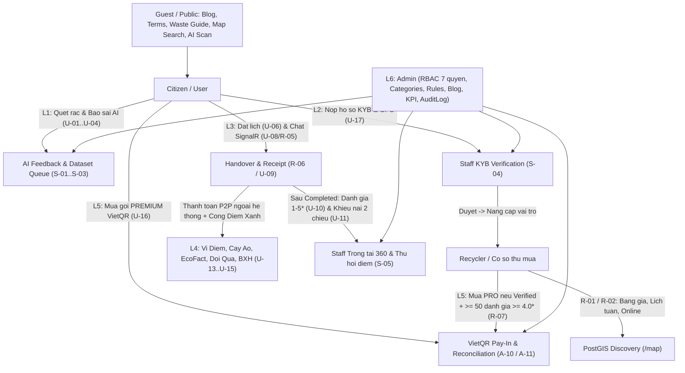

# KẾ HOẠCH RÀ SOÁT LUỒNG NGHIỆP VỤ, ĐỒNG BỘ TÍCH HỢP API – GIAO DIỆN & CHUẨN HÓA DỮ LIỆU SEEDING DEMO HỘI ĐỒNG

**Dự án:** EcoLink – Intelligent Waste Sorting & Trading Platform (`SEP490_G141`)  
**Phạm vi:** Toàn hệ thống — **Core Business Web API (.NET 10)**, **Dedicated AI Vision Service (Python FastAPI / YOLO26)**, **Frontend Web (`ecolink-web` React 19 + TypeScript + Vite)** và **Cơ sở dữ liệu PostgreSQL 16 + PostGIS**  
**Trạng thái:** Đã được xác nhận danh sách lỗi & 6 nhóm Tasks — Sẵn sàng triển khai rà soát theo lộ trình từng Task  
**Tài liệu tham chiếu liên quan:**
- Tổng quan Hợp đồng API & Mã thông báo: [`00_api_overview_and_response_contract.md`](file:///c:/Projects/EcoLink/intelligent-waste-sorting-trading/documents/api%20contact/00_api_overview_and_response_contract.md)
- Kế hoạch Rating, Review & Khiếu nại (`M-11`): [`rating_review_complaint_resolution_implementation_plan.md`](file:///c:/Projects/EcoLink/intelligent-waste-sorting-trading/documents/implementation_plan/rating_review_complaint_resolution_implementation_plan.md)
- Kế hoạch Gói dịch vụ & VietQR (`M-12`): [`in_system_service_packages_vietqr_implementation_plan.md`](file:///c:/Projects/EcoLink/intelligent-waste-sorting-trading/documents/implementation_plan/in_system_service_packages_vietqr_implementation_plan.md)
- Kế hoạch EcoFact, Điểm Xanh & Loại bỏ Payout: [`ecofact_points_complaint_analytics_and_no_payout_plan.md`](file:///c:/Projects/EcoLink/intelligent-waste-sorting-trading/documents/implementation_plan/ecofact_points_complaint_analytics_and_no_payout_plan.md)

---

## 1. TỔNG QUAN 6 LUỒNG NGHIỆP VỤ XUYÊN SUỐT HỆ THỐNG & SƠ ĐỒ LIÊN PHÂN HỆ

Để bảo đảm buổi trình diễn trực tiếp trước Hội đồng diễn ra liền mạch qua cả 5 vai trò (**`Guest`** $\rightarrow$ **`Citizen/User`** $\rightarrow$ **`Recycler`** $\rightarrow$ **`Staff`** $\rightarrow$ **`Admin`**), toàn bộ nghiệp vụ của EcoLink được chốt thống nhất theo **6 luồng khép kín** dưới đây:

1. **Luồng 1 — Nhận diện Rác AI, Hướng dẫn Phân loại & Cải thiện Mô hình (`Guest` / `Citizen` $\rightarrow$ `Staff` $\rightarrow$ `Admin`):**
   - Người dùng quét ảnh rác tại [`Scanner.tsx`](file:///c:/Projects/EcoLink/ecolink-web/src/pages/Scanner.tsx) (`POST /api/v1/waste-scan/analyze` $\rightarrow$ YOLO26 + Rule Engine), hệ thống chặn ảnh ngoài phân phối (`OOD`) và nhóm danh mục đang tạm ngưng (`Inactive`, `BR-SRT-04`), trả hướng dẫn sơ chế và gợi ý điểm thu mua; tra cứu chi tiết tại [`Guidance.tsx`](file:///c:/Projects/EcoLink/ecolink-web/src/pages/Guidance.tsx) và [`Waste.tsx`](file:///c:/Projects/EcoLink/ecolink-web/src/pages/Waste.tsx).
   - Khi AI nhận diện sai, người dùng gửi phản hồi gắn `scanId` (`U-04`) $\rightarrow$ `Staff` (`VERIFY_AI_FEEDBACK` / `CURATE_DATASET`) thẩm định tại [`staff/AiReview.tsx`](file:///c:/Projects/EcoLink/ecolink-web/src/pages/staff/AiReview.tsx) (`S-01`), gán nhãn hộp giới hạn YOLO (`S-02`) và đóng gói tập dữ liệu chuẩn chia tỷ lệ `70/20/10` đồng bộ sang FastAPI tại [`staff/Dataset.tsx`](file:///c:/Projects/EcoLink/ecolink-web/src/pages/staff/Dataset.tsx) (`S-03`).
   - `Admin` quản lý danh mục rác tại [`admin/Categories.tsx`](file:///c:/Projects/EcoLink/ecolink-web/src/pages/admin/Categories.tsx) (`A-05`) và xuất bản quy tắc phân loại tại [`admin/Policy.tsx`](file:///c:/Projects/EcoLink/ecolink-web/src/pages/admin/Policy.tsx) (`A-06`).

2. **Luồng 2 — Tuyển chọn KYB & Vận hành Cơ sở Thu mua (`Citizen` $\rightarrow$ `Staff` $\rightarrow$ `Recycler`):**
   - Công dân tải giấy phép & ảnh cơ sở lên Cloudflare R2 rồi nộp hồ sơ nâng cấp kèm tọa độ GPS tại [`JoinRecycler.tsx`](file:///c:/Projects/EcoLink/ecolink-web/src/pages/JoinRecycler.tsx) (`U-17`).
   - `Staff` có quyền `VERIFY_RECYCLER` phê duyệt hoặc từ chối kèm lý do tại [`staff/Applications.tsx`](file:///c:/Projects/EcoLink/ecolink-web/src/pages/staff/Applications.tsx) (`S-04`).
   - Sau khi được duyệt lên `Recycler`, cơ sở cấu hình bảng giá thu mua (`R-01`) tại [`recycler/Catalog.tsx`](file:///c:/Projects/EcoLink/ecolink-web/src/pages/recycler/Catalog.tsx), lịch hoạt động theo tuần & công tắc `Online/Offline` (`R-02`) tại [`recycler/Home.tsx`](file:///c:/Projects/EcoLink/ecolink-web/src/pages/recycler/Home.tsx) để xuất hiện tức thời trên bản đồ PostGIS [`MapPage.tsx`](file:///c:/Projects/EcoLink/ecolink-web/src/pages/MapPage.tsx) (`U-05`).

3. **Luồng 3 — Đặt lịch Bàn giao, Chat SignalR, Biên nhận số, Đánh giá & Khiếu nại 2 Chiều:**
   - `Citizen` tìm cơ sở trên [`MapPage.tsx`](file:///c:/Projects/EcoLink/ecolink-web/src/pages/MapPage.tsx) $\rightarrow$ Tạo đơn bàn giao tại [`user/Handover.tsx`](file:///c:/Projects/EcoLink/ecolink-web/src/pages/user/Handover.tsx) (`U-06`, ẩn SĐT liên hệ trước khi nhận đơn `BR-HND-08`) hoặc mở hội thoại hỏi giá $\rightarrow$ Hai bên thương lượng giá, khối lượng và khung giờ thời gian thực tại [`Chat.tsx`](file:///c:/Projects/EcoLink/ecolink-web/src/pages/Chat.tsx) (`/hubs/negotiation-chat`, `U-08`/`R-05`).
   - `Recycler` tiếp nhận đơn tại [`recycler/Requests.tsx`](file:///c:/Projects/EcoLink/ecolink-web/src/pages/recycler/Requests.tsx) (`R-03`) $\rightarrow$ Cân thực tế, tải tối đa 5 ảnh đồng hồ cân lên R2 và lập Biên nhận số tại [`recycler/Receipt.tsx`](file:///c:/Projects/EcoLink/ecolink-web/src/pages/recycler/Receipt.tsx) (`R-06`, cảnh báo lệch khối lượng $>20\%$). **Tiền mua phế liệu được hai bên thanh toán trực tiếp ngoài nền tảng (không giữ tiền hộ / không giải ngân PayOS)**.
   - `Citizen` đối chiếu và xác nhận hoàn tất tại [`user/Receipt.tsx`](file:///c:/Projects/EcoLink/ecolink-web/src/pages/user/Receipt.tsx) (`U-09`) $\rightarrow$ Hệ thống cộng Điểm Xanh vào `UserPointWallet` và ghi nhận lịch sử tại [`user/Transactions.tsx`](file:///c:/Projects/EcoLink/ecolink-web/src/pages/user/Transactions.tsx).
   - Sau khi đơn đạt `Completed`: **cả `Citizen` và `Recycler`** đều có quyền gửi khiếu nại lẫn nhau kèm ảnh bằng chứng trong hạn `7 ngày` (`U-11`, tại `Feedback.tsx` / thẻ đơn) để `Staff` phân xử Trọng tài 360°, thu hồi điểm hoặc cảnh cáo tại [`staff/Complaints.tsx`](file:///c:/Projects/EcoLink/ecolink-web/src/pages/staff/Complaints.tsx) (`S-05`); **riêng `Citizen`** được đánh giá `1–5` sao (`U-10`, mỗi đơn tối đa `1` đánh giá đang hoạt động, nếu tự xóa trong `24 giờ` thì được phép gửi lại).

4. **Luồng 4 — Gamification: Điểm danh, Cây ảo, Eco Fact, Đổi quà & Bảng xếp hạng:**
   - Điểm danh ngày múi giờ VN (`U-13`, trần điểm phi giao dịch `BR-GAM-02`), chăm sóc & nâng cấp Cây ảo mở khóa `Eco Fact` theo cấp cây (`U-15`) tại [`EcoFactsPage.tsx`](file:///c:/Projects/EcoLink/ecolink-web/src/pages/EcoFactsPage.tsx) và [`user/Gamification.tsx`](file:///c:/Projects/EcoLink/ecolink-web/src/pages/user/Gamification.tsx), đổi quà vật lý / E-Voucher nguyên tử tại [`Rewards.tsx`](file:///c:/Projects/EcoLink/ecolink-web/src/pages/Rewards.tsx) (`U-14`).
   - `Staff` quản lý Eco Fact tại [`staff/EcoFacts.tsx`](file:///c:/Projects/EcoLink/ecolink-web/src/pages/staff/EcoFacts.tsx) (`S-09`) và nhập kho quà, mã E-Voucher, xác nhận giao quà tại [`staff/Gifts.tsx`](file:///c:/Projects/EcoLink/ecolink-web/src/pages/staff/Gifts.tsx) (`S-10`).
   - `Admin` cấu hình tỷ lệ điểm/cấp cây tại [`admin/Gamification.tsx`](file:///c:/Projects/EcoLink/ecolink-web/src/pages/admin/Gamification.tsx) (`A-07`), mở và tổng kết chu kỳ đua Top tại [`admin/Leaderboard.tsx`](file:///c:/Projects/EcoLink/ecolink-web/src/pages/admin/Leaderboard.tsx) (`A-08`).

5. **Luồng 5 — Gói Dịch vụ Nội bộ & Thanh toán / Đối soát VietQR (`M-12`):**
   - `Citizen` nâng cấp `PREMIUM` (`59.000 đ / 30 ngày`: tắt quảng cáo + `x1.2` điểm điểm danh) tại [`user/Payout.tsx`](file:///c:/Projects/EcoLink/ecolink-web/src/pages/user/Payout.tsx) (`/user/subscription`); `Recycler` xem `PREMIUM` và `PRO` (`1.000.000 đ / 365 ngày`: Tích xanh + Ghim đầu bản đồ, chặn đăng ký nếu chưa đạt `Verified` KYB + `>= 50` đánh giá & trung bình `>= 4.0★`) tại [`recycler/Home.tsx`](file:///c:/Projects/EcoLink/ecolink-web/src/pages/recycler/Home.tsx).
   - Mở mã QR tại [`VietQrCheckoutModal.tsx`](file:///c:/Projects/EcoLink/ecolink-web/src/components/VietQrCheckoutModal.tsx) (hỗ trợ giả lập Webhook cho môi trường demo local) $\rightarrow$ `Admin` cấu hình gói tại [`admin/Fees.tsx`](file:///c:/Projects/EcoLink/ecolink-web/src/pages/admin/Fees.tsx) (`A-10`) và đối soát giao dịch lệch tiền tại [`admin/Reconciliation.tsx`](file:///c:/Projects/EcoLink/ecolink-web/src/pages/admin/Reconciliation.tsx) (`A-11`).

6. **Luồng 6 — Quản trị Nhân sự, Phân quyền Động RBAC, Nội dung, Điều khoản & Kiểm toán (`Staff` / `Admin`):**
   - `Admin` tạo tài khoản `Staff` với `0` quyền mặc định (`BR-ADM-01`) tại [`admin/StaffAccounts.tsx`](file:///c:/Projects/EcoLink/ecolink-web/src/pages/admin/StaffAccounts.tsx) (`A-03`), bật/tắt 7 mã quyền hiệu lực tức thời tại [`admin/Permissions.tsx`](file:///c:/Projects/EcoLink/ecolink-web/src/pages/admin/Permissions.tsx) (`A-04`).
   - `Staff` chấm công ca trực tại [`staff/CheckIn.tsx`](file:///c:/Projects/EcoLink/ecolink-web/src/pages/staff/CheckIn.tsx) (`S-11`), quản lý khóa/vô hiệu hóa tài khoản tại [`staff/Accounts.tsx`](file:///c:/Projects/EcoLink/ecolink-web/src/pages/staff/Accounts.tsx) (`S-06`/`S-07`), soạn/nộp Blog tại [`staff/BlogEditor.tsx`](file:///c:/Projects/EcoLink/ecolink-web/src/pages/staff/BlogEditor.tsx) (`S-08`) để `Admin` duyệt tại [`admin/BlogReview.tsx`](file:///c:/Projects/EcoLink/ecolink-web/src/pages/admin/BlogReview.tsx) (`A-09`).
   - `Admin` quản trị điều khoản nền tảng ([`PlatformPoliciesTab.tsx`](file:///c:/Projects/EcoLink/ecolink-web/src/components/admin/PlatformPoliciesTab.tsx) $\rightarrow$ [`Terms.tsx`](file:///c:/Projects/EcoLink/ecolink-web/src/pages/Terms.tsx)), theo dõi Dashboard KPI thực tế, xuất báo cáo CSV/XLSX che mờ PII (`BR-ADM-06`) và tra cứu `AuditLog` bất biến tại [`admin/Home.tsx`](file:///c:/Projects/EcoLink/ecolink-web/src/pages/admin/Home.tsx) & [`admin/Reports.tsx`](file:///c:/Projects/EcoLink/ecolink-web/src/pages/admin/Reports.tsx) (`A-01`/`A-02`).



---

## 2. KẾT QUẢ KIỂM TOÁN LỖ HỔNG TÍCH HỢP API, LỆCH NGHIỆP VỤ & GIAO DIỆN

### 2.1. Nhóm A — 6 Bẫy Demo Nghiêm trọng (`Critical Demo Blockers`)

| Mã | Vấn đề phát hiện | Vị trí chính xác trong Codebase | Tác động trực tiếp khi Demo Hội đồng |
|:---:|:---|:---|:---|
| **`A1`** | **Lệch vùng địa lý tài khoản Quick-Login `recycler` vs Bản đồ mặc định** | [`AuthForm.tsx`](file:///c:/Projects/EcoLink/ecolink-web/src/components/AuthForm.tsx#L35-L75), [`AuthService.cs#L925-L938`](file:///c:/Projects/EcoLink/intelligent-waste-sorting-trading/src/Ecolink.Backend/Ecolink.Infrastructure/Services/AuthService.cs#L925-L938), [`MapPage.tsx`](file:///c:/Projects/EcoLink/ecolink-web/src/pages/MapPage.tsx), [`user/Handover.tsx`](file:///c:/Projects/EcoLink/ecolink-web/src/pages/user/Handover.tsx) | Nút đăng nhập nhanh `Recycler` vào `recycler` (*Vựa phế liệu EcoGreen*) ở **Bình Thạnh, TP.HCM (`10.7938, 106.7182`)**, trong khi bản đồ và form đặt lịch của `Citizen` mặc định tại **Hòa Lạc, Hà Nội (`21.0124, 105.5253`)**. Khi `Citizen` chọn cơ sở quanh Hòa Lạc đặt lịch rồi chuyển sang `recycler` để nhận đơn, **đơn biến mất hoàn toàn** vì thuộc về `recycler_hl2`. |
| **`A2`** | **Mâu thuẫn kiến trúc thanh toán ở nửa dưới `/user/payout`** | [`user/Payout.tsx#L90-L95`](file:///c:/Projects/EcoLink/ecolink-web/src/pages/user/Payout.tsx#L90-L95), [`#L235-L250`](file:///c:/Projects/EcoLink/ecolink-web/src/pages/user/Payout.tsx#L235-L250), [`#L469-L580`](file:///c:/Projects/EcoLink/ecolink-web/src/pages/user/Payout.tsx#L469-L580), [`user/Transactions.tsx#L13-L18`](file:///c:/Projects/EcoLink/ecolink-web/src/pages/user/Transactions.tsx#L13-L18) | Form *"Tài khoản ngân hàng nhận tiền bán phế liệu"* chỉ `setSaved(true)` trong state RAM (không có API, F5 mất trắng), kèm khung mô tả *"chuyển tiền qua VietQR về EcoLink $\rightarrow$ trừ phí nền tảng $\rightarrow$ PayOS bắn tiền về tài khoản"* — trái hoàn toàn với quy chuẩn không giữ tiền hộ (`BR-DSP-04`) của Backend và `ecofact_points_complaint_analytics_and_no_payout_plan.md`. |
| **`A3`** | **Ô sửa khối lượng giả trên Biên nhận của Citizen (`/user/receipt`)** | [`user/Receipt.tsx#L296-L329`](file:///c:/Projects/EcoLink/ecolink-web/src/pages/user/Receipt.tsx#L296-L329), [`#L569-L586`](file:///c:/Projects/EcoLink/ecolink-web/src/pages/user/Receipt.tsx#L569-L586), [`#L632-L638`](file:///c:/Projects/EcoLink/ecolink-web/src/pages/user/Receipt.tsx#L632-L638) | Giao diện cho Citizen sửa số kg trong `<input type="number">` và ghi *"Số tiền được tính trên khối lượng bạn nhập ở trên"*, nhưng nút xác nhận gọi `confirmHandoverReceipt(h.id)` (`POST .../receipt/confirm`) với **body rỗng**; Backend chốt theo đúng biên nhận gốc của Recycler và bỏ qua số Citizen sửa. |
| **`A4`** | **Ghi đè mất giá thu mua & thiếu đồng bộ danh mục động (`WASTES` tĩnh)** | [`recycler/Catalog.tsx#L22-L47`](file:///c:/Projects/EcoLink/ecolink-web/src/pages/recycler/Catalog.tsx#L22-L47), [`#L88-L102`](file:///c:/Projects/EcoLink/ecolink-web/src/pages/recycler/Catalog.tsx#L88-L102), [`#L153-L166`](file:///c:/Projects/EcoLink/ecolink-web/src/pages/recycler/Catalog.tsx#L153-L166), [`Waste.tsx`](file:///c:/Projects/EcoLink/ecolink-web/src/pages/Waste.tsx), [`user/Handover.tsx`](file:///c:/Projects/EcoLink/ecolink-web/src/pages/user/Handover.tsx) | `Catalog.tsx` gộp cả `pet` & `hdpe` vào mã `"plastic"`, và cả `alu` & `steel` vào `"metal"`. Khi bấm Lưu bảng giá (`PUT /api/v1/recycler/prices`), dòng sau ghi đè giá dòng trước và ép cứng `minQuantityKg: 1`; đồng thời danh mục mới Admin tạo ở `/admin/categories` không hiện trên `/recycler/catalog`, `/waste`, `/user/handover`, `/staff/ai-review`. |
| **`A5`** | **Admin bấm hàng đợi bị đẩy ngược về `/admin` & Bộ lọc ngày cứng che mất Audit Log** | [`admin/Home.tsx#L123-L148`](file:///c:/Projects/EcoLink/ecolink-web/src/pages/admin/Home.tsx#L123-L148), [`App.tsx#L151-L156`](file:///c:/Projects/EcoLink/ecolink-web/src/App.tsx#L151-L156), [`admin/Reports.tsx#L155-L156`](file:///c:/Projects/EcoLink/ecolink-web/src/pages/admin/Reports.tsx#L155-L156), [`#L208-L216`](file:///c:/Projects/EcoLink/ecolink-web/src/pages/admin/Reports.tsx#L208-L216), [`#L428-L473`](file:///c:/Projects/EcoLink/ecolink-web/src/pages/admin/Reports.tsx#L428-L473) | 1) `admin/Home.tsx` gắn 5 liên kết xử lý trỏ sang `/staff/*` (`/staff/ai-review`, `/staff/applications`, `/staff/complaints`, `/staff/dataset`), nhưng `App.tsx` khóa `/staff` với `<RequireRole roles={["staff"]}>` nên Admin bấm vào bị đá văng về `/admin`.<br>2) `admin/Reports.tsx` gán cứng `fromDate = "2026-09-01"`, `toDate = "2026-11-30"` và truyền ngầm vào tab Audit Trail (tab này không hiển thị ô ngày), làm mất toàn bộ `AuditLog` phát sinh ở ngày thực tế ngoài khoảng trên; `actionFilter` chỉ liệt kê 6 action cũ. |
| **`A6`** | **Backend thiếu `[HasPermission(VERIFY_RECYCLER)]` ở `RecyclerApplicationsController`** | [`RecyclerApplicationsController.cs#L122-L165`](file:///c:/Projects/EcoLink/intelligent-waste-sorting-trading/src/Ecolink.Backend/Ecolink.WebApi/Controllers/RecyclerApplicationsController.cs#L122-L165) | Ba endpoint Staff (`GetApplications`, `GetApplicationDetail`, `VerifyApplication`) chỉ gắn `[Authorize(Roles = "Staff,Admin")]` mà thiếu `[HasPermission(StaffPermissions.VerifyRecycler)]`. Staff mới tạo (`0` quyền) hoặc đã bị thu hồi quyền ở `/admin/permissions` vẫn duyệt/từ chối hồ sơ KYB được (`BR-ADM-02`). |

---

### 2.2. Nhóm B — Màn hình / Thành phần Còn Đọc Dữ liệu Mẫu (`@/data/*` / `localStorage`) Khi Đã Đăng nhập Thật

| STT | Thành phần / Màn hình | Vị trí chính xác | Hiện trạng sai lệch cần xử lý |
|:---:|:---|:---|:---|
| **1** | Trợ lý nổi `Assistant` (Staff & Admin) | [`components/admin/Assistant.tsx#L4-L5`](file:///c:/Projects/EcoLink/ecolink-web/src/components/admin/Assistant.tsx#L4-L5), [`#L21-L75`](file:///c:/Projects/EcoLink/ecolink-web/src/components/admin/Assistant.tsx#L21-L75) | 100% hardcode `AI_CASES`, `APPLICATIONS`, `COMPLAINTS`, `DATASET`, `STATS`, `FLOWS` (`1.842.000.000 đ`, `94.6%`, `3 nhân viên`), đối nghịch trực tiếp với số DB thật ngay trên Dashboard. |
| **2** | Tổng quan Nhân viên (`staff/Home.tsx`) | [`staff/Home.tsx#L116`](file:///c:/Projects/EcoLink/ecolink-web/src/pages/staff/Home.tsx#L116) | Hardcode `n: liveAuth ? 0 : STATS.pending.applications` cho hàng *"Hồ sơ đối tác thu mua"*; chưa gọi `fetchStaffApplications`. |
| **3** | Chấm công Nhân viên (`S-11`) | [`staff/CheckIn.tsx#L119-L127`](file:///c:/Projects/EcoLink/ecolink-web/src/pages/staff/CheckIn.tsx#L119-L127), `src/components/CheckIn.tsx#L54-L58` | Nhúng `<CheckIn>` vốn khóa `useLiveApi = false` cho `staff`, đọc/ghi `localStorage["ecolink.checkin"]` dùng chung với `Citizen` và hiển thị điểm mock `50, 75, 100...` lệch với `GET /api/v1/staff/attendance/me`. |
| **4** | Tổng quan Cơ sở thu mua (`recycler/Home.tsx`) | [`recycler/Home.tsx#L123-L125`](file:///c:/Projects/EcoLink/ecolink-web/src/pages/recycler/Home.tsx#L123-L125) | Gán cứng `const payin = liveAuth ? 0 : ...` làm thẻ *"Tiền đã thu gom"* luôn là `0 đ`, đồng thời khối cuối trang đọc `STATS.recyclers` & `STATS.handovers30d` từ `@/data/ops`. |
| **5** | Biểu đồ AI theo lớp trên Dashboard Admin (`A-01`) | [`admin/Home.tsx#L325-L361`](file:///c:/Projects/EcoLink/ecolink-web/src/pages/admin/Home.tsx#L325-L361) | Phần *"Độ chính xác nhận diện theo lớp rác"* luôn lặp qua `DATASET.byClass` cứng (8 lớp giả) thay vì dữ liệu từ `fetchAiDatasetDashboard()`. |
| **6** | Xem trước Dòng tiền & Im lặng nuốt lỗi (`A-02`) | [`admin/Reports.tsx#L200-L224`](file:///c:/Projects/EcoLink/ecolink-web/src/pages/admin/Reports.tsx#L200-L224), [`#L406-L425`](file:///c:/Projects/EcoLink/ecolink-web/src/pages/admin/Reports.tsx#L406-L425) | Bảng *"Xem trước dữ liệu đối soát dòng tiền"* render từ `FLOWS` (`FALLBACK_SHEETS.cashflow`), và `.catch()` trên KPI/Audit Log im lặng không báo lỗi. |
| **7** | Hai cột giả & Số cứng ở Chính sách (`A-05`, `A-06`) | [`admin/Categories.tsx#L32-L51`](file:///c:/Projects/EcoLink/ecolink-web/src/pages/admin/Categories.tsx#L32-L51), [`#L121-L133`](file:///c:/Projects/EcoLink/ecolink-web/src/pages/admin/Categories.tsx#L121-L133), `admin/Policy.tsx#L566` | `Categories.tsx` hiển thị & cho sửa 2 cột `group`/`price` không tồn tại trên Backend nên bấm Lưu bị reset về giá mock; `Policy.tsx` in cứng `{GAMIFICATION.pointsPerKg}` (`10`) thay vì từ `fetchGamificationConfig()`. |
| **8** | Hồ sơ Nội bộ & Sidebar Staff | [`admin/AccountProfile.tsx#L23`](file:///c:/Projects/EcoLink/ecolink-web/src/pages/admin/AccountProfile.tsx#L23), [`#L162-L225`](file:///c:/Projects/EcoLink/ecolink-web/src/pages/admin/AccountProfile.tsx#L162-L225), [`portal.ts#L89-L92`](file:///c:/Projects/EcoLink/ecolink-web/src/data/portal.ts#L89-L92) | Tra bảng `STAFF` mock theo tên để lấy mã NV & quyền giả (`ai`, `kyb`, `dispute`, `blog`), `<Queue>` gọi API Admin `/api/v1/admin/blogs/pending` gây `403` cho Staff, còn mục *"Khác"* của Staff trên sidebar trỏ ra `/account/profile` (layout Citizen). |
| **9** | Fallback ngầm về dữ liệu mẫu khi API lỗi | `recyclerWorkflowApi.ts#L988-L1044`, `staff/Applications.tsx`, `MapPage.tsx#L479-L520`, `Blog.tsx#L259-L278` | `fetchStaffApplications()` bắt mọi lỗi (401/403/500) rồi trả mock `HS-0231` và cho bấm duyệt ghi vào `localStorage`; `MapPage` fallback sang `OFFLINE_PARTNERS` cả khi gặp lỗi HTTP 400/500; `Blog.tsx` hiển thị `METRICS` tĩnh `12.4k`, `350M+`. |
| **10** | Hồ sơ Cá nhân (`area` & Avatar) + Chuông `Navbar` | [`account/Profile.tsx#L30-L32`](file:///c:/Projects/EcoLink/ecolink-web/src/pages/account/Profile.tsx#L30-L32), [`#L173-L179`](file:///c:/Projects/EcoLink/ecolink-web/src/pages/account/Profile.tsx#L173-L179), `Navbar.tsx#L48-L63`, `#L355-L391` | Input *"Khu vực"* chỉ là state cục bộ, bấm Lưu không gửi lên Backend; `Profile` thiếu chỉnh/tải avatar; `Navbar` bỏ qua `session.avatarUrl`, gắn cứng `"Hà Nội"` và chấm xanh chuông thông báo nhấp nháy mãi mà không đếm `unreadCount`. |

---

### 2.3. Nhóm C — Các API Backend Đã Có Sẵn Nhưng Frontend Chưa Nối / Thiếu Giao diện Thao tác

1. **Phân hệ `Recycler`:**
   - `PUT /api/v1/recycler/availability/schedule` (`RecyclerController.cs#L165-L174`): Chưa có API wrapper và giao diện chỉnh **Lịch hoạt động theo tuần (`R-02`)**, cũng như chỉnh sửa mô tả/giờ mở cửa (`PUT /api/v1/recycler/profile`).
   - `GET /api/v1/recycler/transactions` (`RecyclerReceiptController.cs#L119-L142`): Đã có hàm `fetchRecyclerTransactions` trong `recyclerWorkflowApi.ts` nhưng chưa trang nào của Recycler gọi để xem lịch sử giao dịch đã thu gom.
   - `GET /api/v1/recyclers/{id}/reviews`: Chưa có khu vực trong `/recycler` để Chủ vựa theo dõi đánh giá sao/nhận xét từ khách hàng và tiến độ đủ điều kiện `PRO` (`TotalReviews/50` & điểm TB).
   - `POST /api/v1/recycler/handover-requests/{id}/receipt/preview`: Chưa gọi khi Recycler gõ khối lượng cân trên [`recycler/Receipt.tsx`](file:///c:/Projects/EcoLink/ecolink-web/src/pages/recycler/Receipt.tsx) để xem cảnh báo lệch cân từ server.
   - Bỏ lời gọi dư `POST /api/v1/trade/orders/${orderId}/accept` trong `recyclerWorkflowApi.ts` (endpoint không tồn tại ở `TradeController.cs`, gây `404` trên DevTools mỗi lần Recycler nhận đơn); hiển thị rõ banner lý do từ chối KYB trên `recycler/Home.tsx` nếu hồ sơ bị `Rejected`/`Pending`.

2. **Phân hệ `Citizen` & `Public`:**
   - `PUT /api/v1/handover-requests/{id}` (`HandoverRequestController.cs#L53-L62`): Backend hỗ trợ sửa mặt hàng/khối lượng/địa chỉ/ảnh khi đơn `Pending`, nhưng `user/Handover.tsx` hiện chỉ cho đổi khung giờ hẹn.
   - [`user/Transactions.tsx#L157-L167`](file:///c:/Projects/EcoLink/ecolink-web/src/pages/user/Transactions.tsx#L157-L167): Các liên kết *Biên nhận & Đánh giá / Chat / Khiếu nại* trên dòng dữ liệu live bị thiếu `?orderId=...`.
   - `GET /api/v1/gamification/points/ledger`: Đã bọc `fetchPointLedger` trong `gamificationApi.ts` nhưng chưa hiển thị trên [`Rewards.tsx`](file:///c:/Projects/EcoLink/ecolink-web/src/pages/Rewards.tsx) hoặc [`user/Gamification.tsx`](file:///c:/Projects/EcoLink/ecolink-web/src/pages/user/Gamification.tsx).
   - Khách vãng lai vào `/rewards` đang thấy danh sách quà mock dù `GET /api/v1/gamification/gifts` mở `[AllowAnonymous]`.
   - [`user/Gamification.tsx#L63, #L198`](file:///c:/Projects/EcoLink/ecolink-web/src/pages/user/Gamification.tsx#L63): Gọi `fetchMyUnlockedEcoFacts(true)` lấy cả khóa lẫn mở rồi gán `unlockedCount = facts.length`, khiến cả 6 nhánh cây SVG phát sáng từ cấp 1.
   - [`Scanner.tsx`](file:///c:/Projects/EcoLink/ecolink-web/src/pages/Scanner.tsx): Mục *"Lịch sử quét & báo sai AI"* đang bị lồng bên trong kết quả quét thành công không phải OOD nên người dùng mới mở `/scanner` hoặc vừa gặp ca OOD không xem được lịch sử và chưa tự refresh sau khi gửi feedback.
   - [`Partners.tsx#L53-L73, #L228-L303`](file:///c:/Projects/EcoLink/ecolink-web/src/pages/Partners.tsx#L53-L73): Ẩn thanh tìm kiếm/lọc khi có dữ liệu live và quay về `PARTNERS` mock nếu Hòa Lạc không có kết quả; đường dẫn bị ẩn khỏi menu chính.

3. **Phân hệ `Staff` & `Admin`:**
   - **Admin xem Chấm công Nhân viên:** `GET /api/v1/admin/staff/attendance` (`StaffAttendanceController.cs#L112-L124`) & hàm `getAdminStaffAttendance` chưa gắn vào [`admin/StaffAccounts.tsx`](file:///c:/Projects/EcoLink/ecolink-web/src/pages/admin/StaffAccounts.tsx) hoặc tab riêng.
   - **Thông báo Realtime trong Console quản trị:** `AdminShell` chưa có chuông/khay `NotificationsController` (`/hubs/notifications`) dù mục menu ghi *"Hồ sơ và thông báo"*.
   - **RBAC Client-side & 403 Handling:** `AuthService` cần trả danh sách `permissions` trong `UserInfoDto` (`/auth/login`, `/auth/me`) để `AdminShell` khóa/ẩn đúng 7 quyền động (`BR-ADM-02`); đồng thời các trang Staff (`BlogEditor`, `EcoFacts`, `Gifts`, `AiReview`, `Dataset`) và Admin (`StaffAccounts`, `Permissions`) phải hiển thị rõ banner `403` thay vì im lặng nuốt lỗi hay báo giả *"Offline"*.
   - **`staff/AiReview.tsx`:** Chưa gọi `fetchStaffAiFeedbackDetail` (`GET /api/v1/staff/ai-feedback/{reportId}`) để nạp `detectedObjectsSnapshot`, `existingYoloAnnotations`, chưa reset `yoloBoxText` khi đổi mục, và dropdown nhãn đang đọc tĩnh thay vì đồng bộ `fetchWasteCategories()`.
   - **`staff/Gifts.tsx`:** Thiếu form sửa thông tin quà (`PUT /api/v1/staff/gifts/{id}`), ô dán danh sách mã E-Voucher (`codes[]`), xác nhận trước khi hủy đổi quà; giới hạn dung lượng ảnh đang để `10 MB` trong khi Backend (`StaffBlogController.cs`, `StaffGamificationController.cs`) chặn **`5 MB`**.
   - **`admin/Permissions.tsx`, `admin/Leaderboard.tsx`, `staff/EcoFacts.tsx`, `staff/Accounts.tsx`:** Chưa gọi `getPermissionCatalog` / `getStaffPermissions`; thiếu nút Sửa chu kỳ BXH (`PUT .../leaderboard-cycles/{cycleId}`); lọc cấp cây EcoFact mới có `1..6` (Backend cho tới `10`); câu mô tả `BR-ADM-04` trên `staff/Accounts.tsx` mâu thuẫn với nút *"Vô hiệu hoá"* đang bật.

---

### 2.4. Nhóm D — Hiện trạng Cơ sở dữ liệu `ecolink_db` Hiện tại (`47` bảng)

Kết quả kiểm tra trực tiếp trên PostgreSQL `ecolink_db` cho thấy DB đang lẫn dữ liệu test tự động và thiếu dữ liệu ở nhiều phân hệ quan trọng cho buổi Demo:

| Nhóm bảng trong `ecolink_db` | Số bản ghi đo thực tế | Vấn đề tồn tại cần dọn & seed lại |
|:---|---:|:---|
| **Tài khoản & Hồ sơ (`users`, `recycler_profiles`, `staff_profiles`)** | `71` / `32` / `10` | Lẫn ~54 tài khoản rác sinh ra bởi `ApiTests` (như `rvw_staff_*`); `recycler` chính nằm ở TP.HCM lệch khỏi bản đồ Hòa Lạc; chưa có vựa đạt `>= 50` đánh giá để demo gói `PRO`. |
| **Danh mục & Quy tắc (`waste_categories`, `sorting_guidance_rules`)** | `12` / `12` | Có `2` danh mục test `qa_cat_056506`, `qa_cat_d0d272` trạng thái `Inactive` cần làm sạch để còn đúng `10` danh mục chuẩn. |
| **Giao dịch, Biên nhận, Chat & Khiếu nại** | `152` đơn, `64` biên nhận, `339` chat, `10` khiếu nại, `6` review | Dữ liệu tích lũy từ test API tự động (chỉ giữ/tạo mới bộ đơn sạch bằng tiếng Việt, đủ trạng thái `Pending`, `Accepted`, `AwaitingConfirmation`, `Completed`, `Disputed`). |
| **Gamification & Quà tặng (`eco_facts`, `gift_inventory`, `gift_redemptions`, `leaderboard_cycles`, `point_rate_rules`, `daily_checkin_logs`)** | **`0` trên tất cả 6 bảng** | Hoàn toàn trống — demo Đổi quà, Cây ảo mở Eco Fact, Bảng xếp hạng và Cấu hình tỷ lệ điểm sẽ không có dữ liệu. |
| **Chấm công, VietQR & AI Dataset (`staff_attendances`, `service_orders`, `user_subscriptions`, `payment_webhook_logs`, `ai_dataset_versions`)** | **`0` trên tất cả 5 bảng** (`ai_scan_histories = 4`, `ai_feedback_logs = 5`) | Chưa có lịch sử ca trực cho `Staff`/`Admin`, chưa có đơn/gói VietQR & giao dịch lệch tiền (`Underpaid`) cho màn hình đối soát `A-11`, chưa có phiên bản Dataset mẫu (`S-03`). |
| **Blog & Chính sách (`blog_posts`, `platform_policy_sections`, `service_packages`)** | `6` / `5` / `3` | Đã chuẩn (tiếp tục giữ đồng bộ trong bộ seed tổng thể). |

---

## 3. LỘ TRÌNH TRIỂN KHAI CHI TIẾT (`TASK 1` $\rightarrow$ `TASK 6`)

### Task 1 — Xử lý Phân quyền RBAC, Điều hướng Console & Quy tắc Biên nhận Cốt lõi
- **Mục tiêu:** Chặn dứt điểm lỗi điều hướng văng trang Admin, lỗ hổng quyền `VERIFY_RECYCLER`, bộ lọc ngày che mất Audit Log và bẫy sửa kg trên biên nhận Citizen.
- **Thay đổi dự kiến:**
  1. **Backend:**
     - [`RecyclerApplicationsController.cs`](file:///c:/Projects/EcoLink/intelligent-waste-sorting-trading/src/Ecolink.Backend/Ecolink.WebApi/Controllers/RecyclerApplicationsController.cs#L122-L165): Bổ sung `[HasPermission(StaffPermissions.VerifyRecycler)]` cho `GetApplications`, `GetApplicationDetail` và `VerifyApplication`.
     - [`AuthDtos.cs`](file:///c:/Projects/EcoLink/intelligent-waste-sorting-trading/src/Ecolink.Backend/Ecolink.Application/Dtos/AuthDtos.cs) & [`AuthService.cs`](file:///c:/Projects/EcoLink/intelligent-waste-sorting-trading/src/Ecolink.Backend/Ecolink.Infrastructure/Services/AuthService.cs): Bổ sung mảng `Permissions` (`List<string>`) vào `UserInfoDto` (lấy từ `StaffPermissionAssignments` khi `Role == Staff`) để FE đọc từ `/auth/login` & `/auth/me`.
  2. **Frontend:**
     - [`App.tsx`](file:///c:/Projects/EcoLink/ecolink-web/src/App.tsx#L151-L170) & [`Shell.tsx`](file:///c:/Projects/EcoLink/ecolink-web/src/components/admin/Shell.tsx): Cho phép `<RequireRole roles={["staff", "admin"]}>` tại các màn hình tác vụ dùng chung từ Dashboard Admin (`/staff/ai-review`, `/staff/dataset`, `/staff/applications`, `/staff/complaints`); lọc/khóa menu trái theo danh sách `session.permissions` với tài khoản `Staff` (`BR-ADM-02`).
     - [`src/data/portal.ts`](file:///c:/Projects/EcoLink/ecolink-web/src/data/portal.ts#L89-L92): Đổi mục *"Khác"* của `staff` từ `/account/profile` & `/account/password` sang `/staff/account` & `/staff/account/password`.
     - [`admin/Reports.tsx`](file:///c:/Projects/EcoLink/ecolink-web/src/pages/admin/Reports.tsx#L155-L156): Khởi tạo `fromDate`/`toDate` động theo ngày hiện tại (`toDate = hôm nay`, `fromDate = 30 ngày trước`), thêm ô chọn `Từ ngày / Đến ngày` ngay trong tab *Audit Trail* (mặc định không giới hạn ngày hẹp khi mới mở tab để hiện mọi log mới nhất) và bổ sung đầy đủ các action vào `actionFilter`.
     - [`user/Receipt.tsx`](file:///c:/Projects/EcoLink/ecolink-web/src/pages/user/Receipt.tsx#L569-L586): Chuyển ô *"Người thu gom cân"* sang chế độ **chỉ đọc (`readOnly` / hiển thị số tĩnh)** đúng nghiệp vụ chốt biên nhận `POST .../receipt/confirm`, đổi ghi chú hướng dẫn bấm *"Sai rồi, tôi muốn khiếu nại"* nếu có chênh lệch cân.
     - [`user/Transactions.tsx`](file:///c:/Projects/EcoLink/ecolink-web/src/pages/user/Transactions.tsx#L157-L167) & [`recyclerWorkflowApi.ts`](file:///c:/Projects/EcoLink/ecolink-web/src/lib/recyclerWorkflowApi.ts): Gắn `?orderId=${item.requestId}` vào các link *Biên nhận / Chat / Khiếu nại*; bỏ lời gọi thử gây `404` `POST /api/v1/trade/orders/${orderId}/accept`.
- **Tiêu chí nghiệm thu:** Staff mất quyền `VERIFY_RECYCLER` gọi API KYB nhận `403` và bị ẩn menu tương ứng; Admin bấm 5 link trên Dashboard mở đúng trang không bị đá về `/admin`; tab Audit Log hiển thị tức thì các log vừa thực hiện trong ngày hôm nay.

### Task 2 — Chuẩn hóa `/user/payout` (Bỏ Payout Giả) & Đồng bộ Danh mục Rác Động Toàn Hệ thống
- **Mục tiêu:** Loại bỏ hoàn toàn mẫu thuẫn *"giải ngân PayOS"* theo `ecofact_points_complaint_analytics_and_no_payout_plan.md` và sửa lỗi mất giá/ẩn danh mục trên bảng giá & tra cứu.
- **Thay đổi dự kiến:**
  1. **Gỡ bỏ form STK ngân hàng giả & câu chữ Payout:** Trên [`user/Payout.tsx`](file:///c:/Projects/EcoLink/ecolink-web/src/pages/user/Payout.tsx#L469-L580), [`user/Transactions.tsx`](file:///c:/Projects/EcoLink/ecolink-web/src/pages/user/Transactions.tsx#L13-L18), [`portal.ts`](file:///c:/Projects/EcoLink/ecolink-web/src/data/portal.ts#L26-L27) và [`check.tsx` / `check-routes.tsx`](file:///c:/Projects/EcoLink/ecolink-web/src/check.tsx) (nếu liên quan), loại bỏ form nhập số tài khoản ngân hàng không lưu DB + hộp *"PayOS bắn tiền về tài khoản / trừ phí nền tảng 8%"*; thay bằng hướng dẫn thanh toán P2P trực tiếp kèm chuyển trang gọn sang **Gói dịch vụ `Basic / Premium` & Hóa đơn VietQR (`U-16`)** và **Lịch sử biên nhận (`U-09`)**.
  2. **Bảng giá & Danh mục Rác Động:**
     - [`recycler/Catalog.tsx`](file:///c:/Projects/EcoLink/ecolink-web/src/pages/recycler/Catalog.tsx): Render các dòng trực tiếp từ `WasteCategories` (`isRecyclable == true` & `Status == "Active"`) trả về từ Backend, mỗi dòng tương ứng `1` `wasteCategoryId` (xóa ánh xạ gộp trùng `pet`/`hdpe` và `alu`/`steel`), giữ nguyên & cho chỉnh cả `minQuantityKg` và `collectionConditions` khi gọi `saveRecyclerPrices`.
     - [`Waste.tsx`](file:///c:/Projects/EcoLink/ecolink-web/src/pages/Waste.tsx), [`user/Handover.tsx`](file:///c:/Projects/EcoLink/ecolink-web/src/pages/user/Handover.tsx) và [`staff/AiReview.tsx`](file:///c:/Projects/EcoLink/ecolink-web/src/pages/staff/AiReview.tsx): Bổ sung đồng bộ danh mục động từ `fetchWasteCategories()` để mọi danh mục mới Admin tạo trong `/admin/categories` đều hiển thị và chọn được.
     - [`admin/Categories.tsx`](file:///c:/Projects/EcoLink/ecolink-web/src/pages/admin/Categories.tsx): Gỡ 2 cột giả `group` & `price` không có trên Backend `UpdateWasteCategoryRequest` để tránh người dùng sửa xong bị mất trắng khi bấm Lưu.
- **Tiêu chí nghiệm thu:** Khi Admin thêm 1 danh mục mới (tái chế, `Active`), danh mục này hiện ngay trên `/waste`, `/recycler/catalog`, `/user/handover` và dropdown gán nhãn `/staff/ai-review`; Recycler lưu giá cho `plastic`, `paper`, `metal`, `cardboard`, `glass` không bị ghi đè hay reset `minQuantityKg`.

### Task 3 — Dọn Sạch Dữ liệu Mẫu (`@/data/*` / `localStorage`) Còn Sót & Nối API Thật Cho Dashboard / Trợ lý
- **Mục tiêu:** Đảm bảo 100% số liệu hiển thị khi đăng nhập thật khớp với PostgreSQL, không rơi âm thầm về dữ liệu giả khi gặp lỗi API.
- **Thay đổi dự kiến:**
  1. [`components/admin/Assistant.tsx`](file:///c:/Projects/EcoLink/ecolink-web/src/components/admin/Assistant.tsx): Kết nối trực tiếp tới `getAdminKpiSummary()`, `fetchAiDatasetDashboard()`, `getAdminStaffList()` / `fetchStaffAiFeedbackQueue()` (chỉ dùng fallback tĩnh khi ở SSR smoke test / ngoại tuyến) để Trợ lý nổi trả lời đúng số liệu thật của DB.
  2. [`staff/Home.tsx`](file:///c:/Projects/EcoLink/ecolink-web/src/pages/staff/Home.tsx#L116): Gọi `fetchStaffApplications({ status: "Pending", pageSize: 1 })` (có guard theo quyền nếu là Staff) để hiển thị đúng số hồ sơ KYB đang chờ.
  3. [`staff/CheckIn.tsx`](file:///c:/Projects/EcoLink/ecolink-web/src/pages/staff/CheckIn.tsx): Thay widget `<CheckIn>` dùng `localStorage` của Citizen bằng **lưới lịch chuyên cần 7 ngày / theo tháng đọc trực tiếp từ `recentRecords` của `getMyAttendance()`**, đồng bộ với nút Bắt đầu ca / Chốt ca thật (`S-11`).
  4. [`recycler/Home.tsx`](file:///c:/Projects/EcoLink/ecolink-web/src/pages/recycler/Home.tsx#L123-L125): Gọi `fetchRecyclerTransactions()` lấy tổng tiền thu gom & số đơn hoàn tất thật thay thế `payin = 0` và khối số giả `STATS`.
  5. [`admin/Home.tsx`](file:///c:/Projects/EcoLink/ecolink-web/src/pages/admin/Home.tsx#L325-L361), [`admin/Reports.tsx`](file:///c:/Projects/EcoLink/ecolink-web/src/pages/admin/Reports.tsx#L406-L425), [`admin/Policy.tsx`](file:///c:/Projects/EcoLink/ecolink-web/src/pages/admin/Policy.tsx#L566): Nối biểu đồ độ chính xác từng lớp từ `fetchAiDatasetDashboard()`, bảng xem trước dòng tiền từ `getAdminReconciliationLedger()`, và `defaultPointsPerKg` từ `fetchGamificationConfig()`, đồng thời hiển thị banner `role="alert"` thay vì nuốt lỗi.
  6. [`admin/AccountProfile.tsx`](file:///c:/Projects/EcoLink/ecolink-web/src/pages/admin/AccountProfile.tsx): Xóa tra cứu `STAFF` mock; đọc `username`, `role`, `status`, `permissions` từ `session`/`/auth/me` (chỉ hiển thị nhãn quyền tiếng Việt từ `getPermissionCatalog()`), và dùng đúng `fetchStaffBlogs({ status: "Pending_Approval" })` khi vai trò là `staff`.
  7. [`recyclerWorkflowApi.ts`](file:///c:/Projects/EcoLink/ecolink-web/src/lib/recyclerWorkflowApi.ts#L988-L1044), [`staff/Applications.tsx`](file:///c:/Projects/EcoLink/ecolink-web/src/pages/staff/Applications.tsx), [`MapPage.tsx`](file:///c:/Projects/EcoLink/ecolink-web/src/pages/MapPage.tsx#L479-L520), [`account/Profile.tsx`](file:///c:/Projects/EcoLink/ecolink-web/src/pages/account/Profile.tsx), [`Navbar.tsx`](file:///c:/Projects/EcoLink/ecolink-web/src/components/Navbar.tsx): Chỉ fallback dữ liệu mẫu khi `!hasLiveBackendAuth() && isSsrSmokeTest()` hoặc lỗi mất mạng (`err.isNetworkError`), luôn báo rõ lỗi `400/403/500`; gỡ input *"Khu vực"* không lưu trên `account/Profile.tsx` (hoặc đồng bộ trường có lưu), hiển thị `avatarUrl` thật và đếm `unreadCount` thật cho chuông thông báo `Navbar`.
- **Tiêu chí nghiệm thu:** Khi đã đăng nhập trên trình duyệt thật, không còn màn hình nào tự hiện số liệu từ `data/ops.ts`, `data/cashflow.ts` hay `localStorage["ecolink.checkin"]`.

### Task 4 — Bổ sung các Giao diện Còn Thiếu Cho API Backend Đã Có Sẵn
- **Mục tiêu:** Đắp đầy các nút bấm/màn hình cho những API Backend đã hoàn thiện để có thể thao tác trọn vẹn bằng UI trước Hội đồng.
- **Thay đổi dự kiến theo từng vai trò:**
  1. **Recycler (`R-01`, `R-02`, `R-06`, Đánh giá & Giao dịch):**
     - [`recycler/Home.tsx`](file:///c:/Projects/EcoLink/ecolink-web/src/pages/recycler/Home.tsx): Thêm khối **Cài đặt lịch hoạt động theo tuần (`PUT /api/v1/recycler/availability/schedule`)** + cập nhật mô tả/giờ mở cửa (`PUT /api/v1/recycler/profile`), hiển thị **Đánh giá từ khách hàng (`GET /api/v1/recyclers/{id}/reviews`)** + danh sách **Giao dịch thu gom hoàn tất (`GET /api/v1/recycler/transactions`)**, và banner trạng thái KYB kèm đường dẫn sang `/join-recycler` nếu chưa `Verified`.
     - [`recycler/Receipt.tsx`](file:///c:/Projects/EcoLink/ecolink-web/src/pages/recycler/Receipt.tsx): Gọi thêm `POST /api/v1/recycler/handover-requests/{id}/receipt/preview` khi nhập số cân thực tế để hiển thị cảnh báo lệch $>20\%$ ngay trước khi phát hành biên nhận.
  2. **Citizen & Public:**
     - [`user/Handover.tsx`](file:///c:/Projects/EcoLink/ecolink-web/src/pages/user/Handover.tsx): Cho phép chỉnh sửa danh sách vật liệu, khối lượng ước tính và địa chỉ lấy hàng khi đơn còn `Pending` qua `PUT /api/v1/handover-requests/{id}`.
     - [`Rewards.tsx`](file:///c:/Projects/EcoLink/ecolink-web/src/pages/Rewards.tsx) & [`user/Gamification.tsx`](file:///c:/Projects/EcoLink/ecolink-web/src/pages/user/Gamification.tsx): Mở tải kho quà thật (`fetchAvailableGifts`) cho cả khách vãng lai; bổ sung bảng **Lịch sử biến động Điểm Xanh (`fetchPointLedger`)**; sửa nhánh cây SVG trên `user/Gamification.tsx` chỉ phát sáng đúng số Eco Fact thực sự đã mở (`!f.isLocked` hoặc `f.unlockTreeLevel <= tree.level`).
     - [`Scanner.tsx`](file:///c:/Projects/EcoLink/ecolink-web/src/pages/Scanner.tsx): Đưa *"Lịch sử quét & báo sai AI của tôi"* ra ngoài điều kiện `!activeResult.isOod` để người dùng xem được ngay khi mở trang và tự động làm mới danh sách sau khi gửi phản hồi báo sai.
     - [`Partners.tsx`](file:///c:/Projects/EcoLink/ecolink-web/src/pages/Partners.tsx): Luôn giữ thanh tìm kiếm & bộ lọc khi hiển thị đối tác thật từ Backend; thêm điều hướng từ Footer/Navbar nếu cần cho buổi demo.
  3. **Staff & Admin:**
     - [`admin/StaffAccounts.tsx`](file:///c:/Projects/EcoLink/ecolink-web/src/pages/admin/StaffAccounts.tsx): Bổ sung tab/khối **Nhật ký Chấm công & Bàn giao ca của Nhân viên** gọi `getAdminStaffAttendance()` (`GET /api/v1/admin/staff/attendance`) kèm lọc theo tháng/năm/nhân viên.
     - [`Shell.tsx`](file:///c:/Projects/EcoLink/ecolink-web/src/components/admin/Shell.tsx): Gắn biểu tượng chuông + popover **Thông báo hệ thống (`NotificationsController` + SignalR)** cho `Staff`/`Admin`.
     - [`staff/AiReview.tsx`](file:///c:/Projects/EcoLink/ecolink-web/src/pages/staff/AiReview.tsx): Gọi `fetchStaffAiFeedbackDetail(id)` khi chọn mục phản hồi để nạp bounding box gốc và reset `yoloBoxText` khi chuyển mục.
     - [`staff/Gifts.tsx`](file:///c:/Projects/EcoLink/ecolink-web/src/pages/staff/Gifts.tsx): Bổ sung modal/form **Sửa đầy đủ thông tin quà (`PUT /api/v1/staff/gifts/{id}`)**, **Nhập danh sách mã E-Voucher thực tế (`codes[]`)**, hộp thoại xác nhận trước khi hủy đơn đổi quà, và đồng bộ giới hạn ảnh lên **`5 MB`** (trên cả `staff/Gifts.tsx` và `staff/BlogEditor.tsx`).
     - [`admin/Permissions.tsx`](file:///c:/Projects/EcoLink/ecolink-web/src/pages/admin/Permissions.tsx), [`admin/Leaderboard.tsx`](file:///c:/Projects/EcoLink/ecolink-web/src/pages/admin/Leaderboard.tsx), [`staff/EcoFacts.tsx`](file:///c:/Projects/EcoLink/ecolink-web/src/pages/staff/EcoFacts.tsx), [`staff/Accounts.tsx`](file:///c:/Projects/EcoLink/ecolink-web/src/pages/staff/Accounts.tsx): Đồng bộ `getPermissionCatalog()`, thêm nút **Sửa chu kỳ (`PUT .../leaderboard-cycles/{cycleId}`)**, mở lọc cấp cây `1..10`, sửa câu mô tả `BR-ADM-04` đúng theo hành vi Backend.
- **Tiêu chí nghiệm thu:** Không còn API cốt lõi nào của Recycler/Staff/Admin bị bỏ rơi không có nút thao tác trên giao diện khi demo.

### Task 5 — Đồng bộ Tài khoản Demo + Xây dựng Bộ Seeding Dữ liệu Chuẩn Hội đồng & Làm sạch `ecolink_db`
- **Mục tiêu:** Làm sạch toàn bộ dữ liệu rác từ `ApiTests`, thống nhất vùng địa lý Demo về **Hòa Lạc, Hà Nội**, và tạo một bộ seeding idempotent đầy đủ tất cả 47 bảng cho buổi bảo vệ.
- **Chi tiết bộ dữ liệu chuẩn xem tại Mục 4 bên dưới.**
- **Triển khai kỹ thuật:**
  1. Cập nhật [`AuthService.EnsureDemoUsersAsync`](file:///c:/Projects/EcoLink/intelligent-waste-sorting-trading/src/Ecolink.Backend/Ecolink.Infrastructure/Services/AuthService.cs#L855-L1064) (và/hoặc lớp `DemoDataSeeder` idempotent chuyên dụng gọi được khi chạy lệnh seed hoặc endpoint demo):
     - Chuyển tọa độ mặc định của tài khoản `recycler` (*Vựa phế liệu EcoGreen*) về khu vực **Hòa Lạc, Hà Nội** (`Latitude = 21.0138m`, `Longitude = 105.5256m`, Địa chỉ: *Số 18 Đại lộ Thăng Long, Khu CNC Hòa Lạc, Thạch Thất, Hà Nội*) để `citizen` mở `/map` thấy ngay `EcoGreen`.
     - Bổ sung tài khoản đối chứng thứ hai `recycler_pro` (*Cơ sở Tái chế Xanh Hòa Lạc Pro*) có sẵn **`52` đánh giá `4.8★`** và **hồ sơ KYB `Verified`**, cho phép demo đăng ký & kích hoạt gói `PRO` ngay trước Hội đồng.
     - Cập nhật [`AuthForm.tsx`](file:///c:/Projects/EcoLink/ecolink-web/src/components/AuthForm.tsx) bổ sung nút đăng nhập nhanh `Recycler Pro (52★)` (hoặc ghi rõ thông tin đăng nhập nhanh) để chuyển đổi tài khoản Demo chỉ bằng 1 click.
  2. Reset sạch `ecolink_db` (xóa 54 user test `rvw_staff_*`, 2 danh mục `qa_cat_*`, dữ liệu test cũ), chạy lại Migration + kích hoạt toàn bộ bộ seed chuẩn ở Mục 4.

### Task 6 — Kiểm thử Tổng thể Hệ thống & Hoàn thiện Kịch bản Demo Bảo vệ
- **Kiểm thử bắt buộc sau khi hoàn tất Task 1 $\rightarrow$ Task 5:**
  1. Backend Unit Tests: `dotnet test Ecolink.UnitTests.csproj -m:1 /p:UseSharedCompilation=false` (`100% Passed`, `0 Failed`, cập nhật unit test cho `RecyclerApplicationsController` RBAC, `UserInfoDto.Permissions`, `DemoDataSeeder`).
  2. Backend Integration Tests: Khởi chạy `Ecolink.AiService` (`:8000`) + `Ecolink.WebApi` (`:5000`) kiểm chứng `EcoLink.ApiTests` (sau đó reset/re-seed sạch DB để không lưu lại rác test!).
  3. Frontend Build & SSR Checks: `npm run build` (`tsc --noEmit && vite build`), `npm run check`, `npm run check:routes` đều thoát mã `0`.
  4. Kiểm thử thủ công E2E theo Kịch bản 15 phút (Mục 5).

---

## 4. ĐẶC TẢ BỘ DỮ LIỆU SEEDING CHUẨN HỘI ĐỒNG (`DEMO DATA BLUEPRINT`)

### 4.1. Danh sách Tài khoản Demo Chuẩn (Cùng Tâm Địa lý Hòa Lạc – Hà Nội)

| STT | Username | Mật khẩu | Vai trò (`Role`) | Mục đích Demo trước Hội đồng |
|:---:|:---|:---|:---|:---|
| 1 | `citizen` | `citizen123` | `User` (`Citizen`) | Tài khoản chính của Người dân (`250` điểm xanh, Cây cấp 2, có đơn `Pending`, `AwaitingConfirmation`, `Completed`, `Disputed`, `Gói Basic` — có thể mua nâng cấp `PREMIUM` `59.000 đ`). |
| 2 | `citizen_vip` | `citizen123` | `User` (`Citizen`) | Công dân đang sở hữu **Gói `PREMIUM`** (đã tắt banner quảng cáo, hệ số điểm danh `x1.2`, xếp Top đầu BXH Tuần). |
| 3 | `recycler` | `recycler123` | `Recycler` (`Verified`, `Online`) | *Vựa phế liệu EcoGreen Hòa Lạc* (`21.0138, 105.5256`, **`4` đánh giá `4.5★`**) — Dùng demo nhận đơn từ `citizen`, lập biên nhận cân, khiếu nại ngược và **chứng minh bị khóa nút đăng ký gói `PRO` do chưa đủ 50 đánh giá (`4/50`)**. |
| 4 | `recycler_pro` | `recycler123` | `Recycler` (`Verified`, `Online`) | *Cơ sở Tái chế Xanh Hòa Lạc Pro* (`21.0165, 105.5282`, **`52` đánh giá, TB `4.8★`**) — Dùng demo **đủ cả 4 tiêu chí để bấm mua & kích hoạt gói `PRO` (`1.000.000 đ`) qua VietQR, lên Tích xanh & Ghim #1 trên bản đồ**. |
| 5 | `recycler_hl1..hl4` | `recycler123` | `Recycler` (`Verified`, `Online`) | 4 cơ sở thu mua quanh Thạch Hòa / Bình Yên / Phú Cát / Ngã tư Hòa Lạc tạo mật độ bản đồ phong phú khi lọc theo bán kính & loại rác. |
| 6 | `applicant_hoalacxanh`, `applicant_minhkhai`, `applicant_anhtuan` | `citizen123` | `Recycler` (`Pending`) | 3 hồ sơ KYB đang chờ `Staff` thẩm định Duyệt / Từ chối tại `/staff/applications` (`S-04`). |
| 7 | `staff` | `staff123` | `Staff` (`NV-001`) | Nhân viên vận hành đầy đủ **7 mã quyền** RBAC — xử lý toàn bộ nghiệp vụ Staff (`S-01..S-11`). |
| 8 | `staff_support` | `staff123` | `Staff` (`NV-002`) | Nhân viên chỉ được cấp **`2` quyền** (`complaint.handle`, `account.manage`) — Dùng **demo kiểm chứng `BR-ADM-02` (ẩn menu & chặn `403` khi mở trang không được phân quyền)**. |
| 9 | `admin` | `admin123` | `Admin` | Quản trị viên toàn quyền (`A-01..A-11`). |

### 4.2. Quy hoạch Số lượng Dữ liệu Nghiệp vụ Cho Toàn bộ Phân hệ

| Phân hệ / Bảng dữ liệu | Dữ liệu Seeding Chuẩn Demo | Trạng thái & Điểm nhấn trình diễn |
|:---|:---|:---|
| **Danh mục & Quy tắc (`waste_categories`, `sorting_guidance_rules`)** | `10` danh mục chuẩn (`plastic`, `paper`, `metal`, `cardboard`, `glass`, `clothes`, `shoes`, `biological`, `battery`, `trash`) + `10` bộ quy tắc hướng dẫn tương ứng. | Tất cả ở `Active`, phân tách rõ `5` nhóm thương mại (`IsRecyclable = true`) và `5` nhóm hướng dẫn xử lý (`IsRecyclable = false`), đồng bộ 100% với AI Service. |
| **Bảng giá vựa (`recycler_price_list`)** | Mỗi cơ sở Hòa Lạc (`recycler`, `recycler_pro`, `recycler_hl1..4`) có đủ `4–5` mức giá cạnh tranh + `MinQuantityKg` + điều kiện thu mua rõ ràng. | Hỗ trợ lọc giá tốt nhất, tìm theo loại vật liệu trên `/map` và `/user/handover`. |
| **Đơn bàn giao, Chat & Biên nhận (`handover_requests`, `chat_messages`, `handover_receipts`)** | Tối thiểu `5` đơn mẫu rõ ràng giữa `citizen` / `citizen_vip` và `recycler` / `recycler_pro`: `1 Pending` (demo sửa/hủy/chat/nhận đơn), `1 Accepted` (demo lập biên nhận cân), `1 AwaitingConfirmation` (có sẵn ảnh đồng hồ cân, chờ Citizen xác nhận cộng điểm), `2 Completed` + các đơn lịch sử của `recycler_pro` (tổng `52` đơn hoàn tất tạo nền tảng thật cho `52` đánh giá). | Mỗi đơn `Pending`/`Accepted` có sẵn `3–5` tin nhắn thương lượng & đề xuất giá/giờ mẫu trong `chat_messages`. |
| **Đánh giá & Khiếu nại (`transaction_reviews`, `transaction_complaints`)** | `52` đánh giá thật cho `recycler_pro` (`TB ~4.8★`), `4` đánh giá cho `recycler` (`TB 4.5★`), **`1` đánh giá bị `Reported`** chờ Staff kiểm duyệt ẩn/giữ; **`3` khiếu nại mẫu** (`1 Open` Citizen khiếu nại thiếu cân có ảnh, `1 Investigating` Recycler khiếu nại khách `NoShow`, `1 Resolved` có lịch sử giải quyết mẫu). | Đảm bảo cả trang `/partners`, `/map`, `/feedback`, `/staff/complaints` đều có dữ liệu sống ngay khi mở. |
| **Gamification (`eco_facts`, `gift_inventory`, `gift_redemptions`, `point_rate_rules`, `leaderboard_cycles`, `daily_checkin_logs`)** | • `10` thẻ `EcoFact` (Cấp `1` đến `4`, URL nguồn chính thống `unep.org`, `epa.gov`, `vanban.chinhphu.vn`).<br>• `6` món quà (`4` vật lý dùng ảnh `/assets/rewards/*.jpg`: Túi canvas, Bộ kit ươm cây, Máy ép lon, Hộp bình thủy tinh; `2` E-Voucher kèm `10` mã sẵn trong kho).<br>• `2` đơn đổi quà (`1 Pending` chờ Staff xác nhận giao quà, `1 Delivered`).<br>• `1` chu kỳ `LeaderboardCycle` Tuần đang `Active` với bảng xếp hạng thật của `citizen`, `citizen_vip`, `recycler`.<br>• Cấu hình `PointRateRules` cho 5 loại phế liệu tái chế + log điểm danh chuỗi `3` ngày cho `citizen`. | Demo ngay được Điểm danh ngày, Tưới/Bón phân/Nâng cấp cây mở khóa `Eco Fact`, Đổi E-Voucher trừ kho nguyên tử và Staff giao quà. |
| **AI & Dataset (`ai_scan_histories`, `ai_feedback_logs`, `ai_dataset_items`, `ai_dataset_versions`)** | `5` lịch sử quét ảnh mẫu (`plastic`, `cardboard`, `metal`, `OOD`); `3` báo cáo AI đoán sai `Pending` chờ Staff thẩm định (`S-01`); `6` mẫu trong Dataset chuẩn chia `70/20/10` + `1` phiên bản `v1.0.0` (`Ready`). | Staff vào `/staff/ai-review` & `/staff/dataset` có sẵn ảnh & bounding box để gán nhãn và xuất ZIP ngay. |
| **Gói dịch vụ & VietQR (`service_orders`, `user_subscriptions`, `payment_webhook_logs`)** | `1` đơn `Paid` + gói `PREMIUM` đang hiệu lực cho `citizen_vip`; `1` đơn `Paid` + `PRO` cũ đã hết hạn (hoặc đang dùng) cho vựa Hòa Lạc khác; **`1` đơn chuyển khoản thiếu (`Underpaid`)** nằm sẵn trong hàng đợi Đối soát (`A-11`). | Admin mở `/admin/reconciliation` thấy ngay giao dịch lệch tiền để thực hiện đối soát thủ công hoặc hoàn dư. |
| **Nội dung, Chấm công & Kiểm toán (`blog_posts`, `platform_policy_sections`, `staff_attendances`, `audit_logs`)** | `6` bài Blog (`4 Approved`, `1 Pending_Approval`, `1 Draft`); `5` mục điều khoản `/terms`; `5` ngày chấm công ca trực gần nhất cho `staff` & `staff_support`; `6–8` dòng `AuditLog` nghiệp vụ mẫu ban đầu sạch sẽ. | Đầy đủ dữ liệu chấm công cho cả `staff` (`S-11`) và màn hình xem chấm công của `admin`. |

---

## 5. KẾ HOẠCH KIỂM THỬ TỰ ĐỘNG & KỊCH BẢN DEMO 15 PHÚT TRƯỚC HỘI ĐỒNG

### 5.1. Ma trận Lệnh Kiểm thử Tự động (Sau khi Triển khai Code)
1. **Backend Unit Tests:**
   ```powershell
   dotnet test "c:\Projects\EcoLink\intelligent-waste-sorting-trading\src\Ecolink.Backend\Ecolink.UnitTests\Ecolink.UnitTests.csproj" --no-restore -m:1 /p:UseSharedCompilation=false
   ```
2. **Backend Integration Tests (Chạy kèm AI Service `:8000` & WebApi `:5000`, sau đó dọn sạch rác test và chạy lại seed chuẩn):**
   ```powershell
   dotnet test "c:\Projects\EcoLink\intelligent-waste-sorting-trading\src\Ecolink.Backend\EcoLink.ApiTests\EcoLink.ApiTests.csproj" --no-build --no-restore -m:1
   ```
3. **Frontend TypeScript Check, Production Build & SSR Route Smoke Tests:**
   ```powershell
   npm run build; if ($LASTEXITCODE -eq 0) { npm run check }; if ($LASTEXITCODE -eq 0) { npm run check:routes }
   ```

### 5.2. Kịch bản Demo Liền mạch 15 Phút Trước Hội đồng
1. **Phút 0–3 (`Guest` & `Citizen` — AI & Phân loại):** Mở `/blog` & `/scanner` -> Quét ảnh chai nhựa -> Xem hướng dẫn sơ chế & nút báo sai AI (`U-04`) -> Chuyển sang thử 1 vật thể không thuộc danh mục tái chế để minh họa chặn `OOD` + tắt thử 1 danh mục trên Admin (`BR-SRT-04`).
2. **Phút 3–6 (`Citizen` — Bản đồ PostGIS, Đặt lịch & Chat SignalR):** Mở `/map` quanh Hòa Lạc -> Thấy `recycler_pro` có Tích xanh đứng đầu -> Chọn `recycler` (*EcoGreen Hòa Lạc*) -> Mở Chat thương lượng giá/khối lượng -> Tạo đơn hẹn (`U-06`), chỉ rõ tính năng ẩn SĐT trước khi duyệt (`BR-HND-08`).
3. **Phút 6–9 (`Recycler` — Tiếp nhận, Cân đo Biên nhận số & Gói `PRO`):** Đăng nhập nhanh `recycler` -> Nhận đơn (`R-03`) -> Xem màn hình `Gói PRO bị khóa` do mới có `4/50` đánh giá -> Đổi sang `recycler_pro` (`52` đánh giá `4.8★`) để demo mua `PRO` qua VietQR (`Simulated Exact`) -> Quay lại `recycler` lập biên nhận cân & tải ảnh đồng hồ cân (`R-06`).
4. **Phút 9–11 (`Citizen` — Xác nhận Biên nhận, Cộng Điểm, Cây ảo, Đổi quà & Đánh giá):** Đăng nhập `citizen` -> Xác nhận biên nhận (`+Điểm Xanh` tự nhảy số trên header) -> Chấm `5★` (`U-10`) -> Mở `/ecofacts` & `/rewards` tưới/nâng cấp cây mở `Eco Fact` & đổi 1 mã E-Voucher (`U-14`).
5. **Phút 11–13 (`Staff` — Chấm công, Duyệt KYB, Gán nhãn AI, Trọng tài Khiếu nại & Giao quà):** Chấm công `S-11` -> Duyệt `1` hồ sơ KYB `S-04` -> Gán nhãn bounding box YOLO `S-01/S-02` -> Mở Hồ sơ Trọng tài 360° xử lý khiếu nại `S-05` -> Thử đăng nhập `staff_support` minh họa chặn `403` RBAC (`BR-ADM-02`).
6. **Phút 13–15 (`Admin` — Phân quyền, Duyệt Blog, Đối soát VietQR, Báo cáo & Audit Log):** Cấp/thu hồi quyền tại `/admin/permissions` -> Duyệt bài Blog từ Staff tại `/admin/blog` -> Xử lý đơn `Underpaid` tại `/admin/reconciliation` -> Mở `/admin` xem KPI thực tế, xuất báo cáo CSV che mờ PII (`BR-ADM-06`) và kiểm tra `AuditLog` bất biến vừa sinh trong ngày (`BR-ADM-05`).
