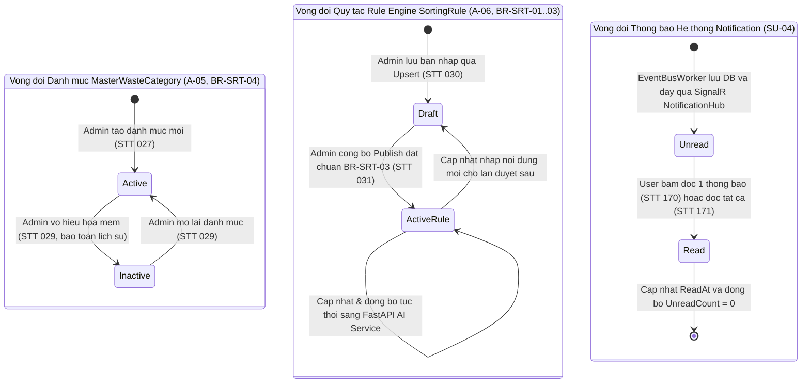
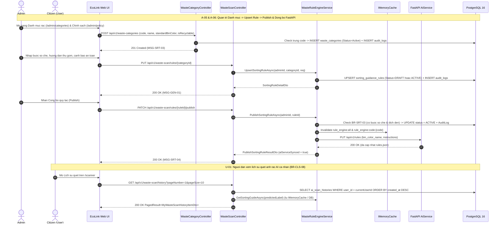
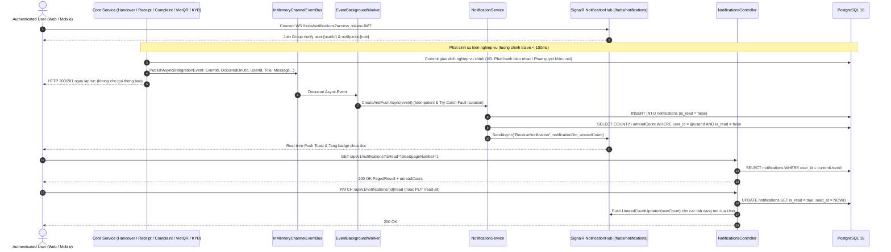

# KẾ HOẠCH THIẾT KẾ & TRIỂN KHAI (IMPLEMENTATION PLAN) - MODULE: AI WASTE CATALOG, RULE ENGINE & REAL-TIME SYSTEM NOTIFICATIONS (`FE-03` / `M-03` & `SU-04` / `M-15`)

**Dự án:** EcoLink – Intelligent Waste Sorting & Trading Platform (`SEP490_G141`)  
**Phân hệ:** `CLS` / `SRT` (`M-03`: `STT 026–031`) & `NTF` / `ADM` (`M-15`: `STT 169–172`)  
**Mã tính năng (Features):** `FE-03` (AI Waste Classification, Master Catalog & Rule Engine Governance) & `FE-17/18` (`SU-04`, `EI-07`: System In-App Notifications & Real-Time SignalR `NotificationHub`)  
**Use Cases trọng tâm (4 Nhóm Use Case + 10 Endpoints cuối cùng để hoàn thiện 100% Scope `184/184`):**
- **`U-01` & `U-03`**: *Scan Waste Image & View Personal Scan History* (`STT 026`: `GET /api/v1/waste-scan/history` — Người dân xem lại lịch sử các lần chụp/quét ảnh rác AI của cá nhân kèm hướng dẫn phân loại đã nhận từ Rule Engine, cô lập quyền riêng tư theo `BR-CLS-08`)
- **`A-05`**: *Manage Master Waste Categories* (`STT 027`: `POST /api/v1/waste-categories`, `STT 028`: `PUT /api/v1/waste-categories/{categoryId:guid}`, `STT 029`: `PATCH /api/v1/waste-categories/{categoryId:guid}/status` — Quản trị viên thêm mới, cập nhật và vô hiệu hóa mềm danh mục phế liệu chuẩn `MasterWasteCategory` mà vẫn bảo toàn 100% biên nhận lịch sử theo `BR-SRT-02`, `BR-SRT-04`, `BR-ADM-05`)
- **`A-06`**: *Configure & Publish Sorting Guidance Rules* (`STT 030`: `PUT /api/v1/waste-scan/rules/{categoryId:guid}`, `STT 031`: `PATCH /api/v1/waste-scan/rules/{ruleId:guid}/publish` — Quản trị viên cấu hình nội dung hướng dẫn phân loại, sơ chế sạch, cảnh báo an toàn và phát hành phiên bản quy tắc mới đồng bộ tức thời từ PostgreSQL + `IMemoryCache` sang Python FastAPI AI Service `PUT /api/v1/rules` theo `BR-SRT-01`, `BR-SRT-02`, `BR-SRT-03`, `BR-ADM-05`)
- **`SU-04` & `EI-07`**: *System In-App Notifications & Real-Time WebSocket Push* (`STT 169`: `GET /api/v1/notifications`, `STT 170`: `PATCH /api/v1/notifications/{notificationId:guid}/read`, `STT 171`: `PUT /api/v1/notifications/read-all`, `STT 172`: `WS /hubs/notifications` `NotificationHub` — Trung tâm thông báo đa sự kiện theo kiến trúc hướng sự kiện `IEventBus` / `IIntegrationEvent` đẩy thông báo thời gian thực `ReceiveNotification` cho đơn thu gom, biên nhận, phán quyết khiếu nại, duyệt hồ sơ KYB, thanh toán VietQR, duyệt AI & Blog theo `BR-NTF-01..06`)

**Độ phức tạp / Ưu tiên:** High (Hoàn thiện 100% Full SRS Scope `184/184 Endpoints`, Chuyển Rule Engine sang Persistent DB + Dual-Service Sync & Event-Driven Real-Time Notification Architecture)  
**Công nghệ:** .NET 10 Web API, PostgreSQL 16 (`sorting_guidance_rules`, `waste_categories`, `ai_scan_histories`, `notifications`), Entity Framework Core 10, `IMemoryCache`, ASP.NET Core SignalR WebSocket Hub, `System.Threading.Channels` Event Bus, FluentValidation, Python 3.11 FastAPI (`Ecolink.AiService`), React 19 + TypeScript + `@microsoft/signalr` (`ecolink-web`)  
**Tài liệu tham chiếu:**
- Danh mục Tổng thể API: [`00_api_inventory_and_endpoint_statistics.md`](file:///c:/Projects/EcoLink/intelligent-waste-sorting-trading/documents/api%20contact/00_api_inventory_and_endpoint_statistics.md) (`STT 026–031` tại `M-03`, `STT 169–172` tại `M-15`)
- Quy chuẩn Khung Phản hồi API: [`00_api_overview_and_response_contract.md`](file:///c:/Projects/EcoLink/intelligent-waste-sorting-trading/documents/api%20contact/00_api_overview_and_response_contract.md)
- Đặc tả API Phân hệ AI & Thông báo hiện hành: [`03_module_ai_waste_classification_api.md`](file:///c:/Projects/EcoLink/intelligent-waste-sorting-trading/documents/api%20contact/03_module_ai_waste_classification_api.md) & [`09_module_account_staff_system_governance_analytics_api.md`](file:///c:/Projects/EcoLink/intelligent-waste-sorting-trading/documents/api%20contact/09_module_account_staff_system_governance_analytics_api.md)
- Thiết kế CSDL gốc (DBML): [`02_ai_waste_classification_module.dbml`](file:///c:/Projects/EcoLink/intelligent-waste-sorting-trading/documents/diagram/database%20design/02_ai_waste_classification_module.dbml) & [`07_content_admin_audit_module.dbml`](file:///c:/Projects/EcoLink/intelligent-waste-sorting-trading/documents/diagram/database%20design/07_content_admin_audit_module.dbml#L37-L54)
- Bộ quy tắc `.agents/rules`: [`api_and_test_guidelines.md`](file:///c:/Projects/EcoLink/intelligent-waste-sorting-trading/.agents/rules/api_and_test_guidelines.md), [`architecture_and_database_guidelines.md`](file:///c:/Projects/EcoLink/intelligent-waste-sorting-trading/.agents/rules/architecture_and_database_guidelines.md), [`event_driven_development.md`](file:///c:/Projects/EcoLink/intelligent-waste-sorting-trading/.agents/rules/event_driven_development.md), [`git_and_ai_guidelines.md`](file:///c:/Projects/EcoLink/intelligent-waste-sorting-trading/.agents/rules/git_and_ai_guidelines.md)
- Bộ tài liệu chuẩn `documents/guideline`: [`api_design_and_response_contract_guidelines.md`](file:///c:/Projects/EcoLink/intelligent-waste-sorting-trading/documents/guideline/api_design_and_response_contract_guidelines.md), [`clean_architecture_and_coding_guidelines.md`](file:///c:/Projects/EcoLink/intelligent-waste-sorting-trading/documents/guideline/clean_architecture_and_coding_guidelines.md), [`database_design_and_audit_guidelines.md`](file:///c:/Projects/EcoLink/intelligent-waste-sorting-trading/documents/guideline/database_design_and_audit_guidelines.md), [`event_driven_architecture_guidelines.md`](file:///c:/Projects/EcoLink/intelligent-waste-sorting-trading/documents/guideline/event_driven_architecture_guidelines.md), [`test_case_specification_guidelines.md`](file:///c:/Projects/EcoLink/intelligent-waste-sorting-trading/documents/guideline/test_case_specification_guidelines.md)
- Quy tắc Nghiệp vụ & Thông báo: [`business_rule_&_system_message.md`](file:///c:/Projects/EcoLink/intelligent-waste-sorting-trading/documents/business_rule_%26_system_message.md)

---

## 1. MỤC TIÊU PHẠM VI & ĐÁNH GIÁ HIỆN TRẠNG (SCOPE & GAP ANALYSIS)

### 1.1. Kiến trúc Quản trị Danh mục – Rule Engine Động (`M-03`) & Trung tâm Thông báo Hướng Sự Kiện Thời gian Thực (`M-15`)

Tính đến phiên bản tài liệu `v2.5.0`, hệ sinh thái EcoLink đã triển khai **174/184 Endpoints (`94.6%`)**. Việc hoàn tất **10 Endpoints còn thiếu** (`STT 026–031` tại `M-03` và `STT 169–172` tại `M-15`) không chỉ đưa độ phủ SRS lên **184/184 (`100.0%`)**, mà còn giải quyết 3 trụ cột kiến trúc đang bị tách rời trong mã nguồn hiện tại:

1. **Trụ cột 1 — Chuyển đổi `WasteRuleEngineService` từ RAM tĩnh sang PostgreSQL + `IMemoryCache` + Đồng bộ 2 chiều FastAPI (`A-05`, `A-06`, `BR-SRT-01..04`):**
   * Thực thể `WasteCategory`, `SortingRule` ([`WasteEntities.cs`](file:///c:/Projects/EcoLink/intelligent-waste-sorting-trading/src/Ecolink.Backend/Ecolink.Domain/Entities/WasteEntities.cs)) và bảng `waste_categories`, `sorting_guidance_rules` ([`WasteAndAiConfigurations.cs`](file:///c:/Projects/EcoLink/intelligent-waste-sorting-trading/src/Ecolink.Backend/Ecolink.Infrastructure/Data/Configurations/WasteAndAiConfigurations.cs#L10-L63)) đã được ánh xạ sẵn quan hệ 1-1 (`uq_sorting_guidance_rules_category_id`). Tuy nhiên, [`ApplicationDbContext.cs`](file:///c:/Projects/EcoLink/intelligent-waste-sorting-trading/src/Ecolink.Backend/Ecolink.Infrastructure/Data/ApplicationDbContext.cs) hiện chưa khai báo `DbSet<SortingRule>`, và [`WasteRuleEngineService.cs`](file:///c:/Projects/EcoLink/intelligent-waste-sorting-trading/src/Ecolink.Backend/Ecolink.Infrastructure/Services/WasteRuleEngineService.cs#L8-L116) đang đăng ký `Singleton` dùng `ConcurrentDictionary` hardcode 6 quy tắc tĩnh trong RAM.
   * **Giải pháp chuẩn hóa:** Chuyển `IWasteRuleEngineService` / `WasteRuleEngineService` sang vòng đời `Scoped` sử dụng `ApplicationDbContext` kết hợp `IMemoryCache` (giữ tốc độ đọc `< 5ms`), tự động seed 6 danh mục + 6 quy tắc mặc định khi bảng trống. Khi `Admin` cấu hình qua `PUT /api/v1/waste-scan/rules/{categoryId:guid}` (`STT 030`) và phát hành qua `PATCH /api/v1/waste-scan/rules/{ruleId:guid}/publish` (`STT 031`), hệ thống kiểm tra đủ bước xử lý theo `BR-SRT-03`, cập nhật `Status = "ACTIVE"`, vô hiệu hóa `IMemoryCache`, ghi `AuditLog` (`BR-ADM-05`) **và đồng bộ trực tiếp sang `PUT /api/v1/rules` của Python FastAPI (`Ecolink.AiService/app.py`)** thông qua `IAiVisionClient`.
   * **Khắc phục lệch chuẩn hợp đồng API trong `M-03`:**
     * Chuẩn hóa `GET /api/v1/waste-scan/rules` (`STT 023`) trong [`WasteScanController.cs`](file:///c:/Projects/EcoLink/intelligent-waste-sorting-trading/src/Ecolink.Backend/Ecolink.WebApi/Controllers/WasteScanController.cs#L174-L179) từ trả mảng trần `Ok(rules)` sang bọc chuẩn `ApiResponse<IReadOnlyList<WasteSortingGuideDto>>.Ok(...)` theo [`api_and_test_guidelines.md`](file:///c:/Projects/EcoLink/intelligent-waste-sorting-trading/.agents/rules/api_and_test_guidelines.md#L12-L14) (khớp sẵn với [`wasteScanApi.ts`](file:///c:/Projects/EcoLink/ecolink-web/src/lib/wasteScanApi.ts#L310-L318) trên Frontend).
     * Mở quyền `[AllowAnonymous]` cho `GET /api/v1/waste-categories` (`STT 025`) tại [`WasteCategoryController.cs`](file:///c:/Projects/EcoLink/intelligent-waste-sorting-trading/src/Ecolink.Backend/Ecolink.WebApi/Controllers/WasteCategoryController.cs#L14-L32) thay vì khóa `[Authorize]` ở cấp Controller, hỗ trợ `?includeInactive=false` mặc định cho Public/Citizen và `true` cho Admin.

2. **Trụ cột 2 — Truy xuất Lịch sử Quét Ảnh AI Cá nhân Cô lập Quyền Riêng tư (`U-01`, `U-03`, `BR-CLS-08`):**
   * Luồng `POST /api/v1/waste-scan/classify` (`STT 021`) đã tự động lưu vết ảnh gốc lên Cloudflare R2/Local, băm `SHA-256` và ghi vào bảng `ai_scan_histories` tại [`AiFeedbackService.RecordScanHistoryAsync`](file:///c:/Projects/EcoLink/intelligent-waste-sorting-trading/src/Ecolink.Backend/Ecolink.Infrastructure/Services/AiFeedbackService.cs#L41-L134).
   * Bổ sung `GET /api/v1/waste-scan/history` (`STT 026`, `[Authorize]`) chỉ truy vấn các bản ghi `AiScanHistory` có `UserId == currentUserId` (`BR-CLS-08`), trả về `PagedResult<MyWasteScanHistoryItemDto>` kèm ảnh quét, phân tích `DetectedObjects`, nhãn dự đoán, cờ `isOutOfDistribution`, hướng dẫn `WasteSortingGuideDto` hiện hành và trạng thái đã từng gửi báo cáo sai (`hasFeedbackReport`, `feedbackStatus`).

3. **Trụ cột 3 — Hạ tầng Thông báo Hướng Sự Kiện (`IEventBus`) & Kênh WebSocket SignalR `NotificationHub` (`SU-04`, `EI-07`, `BR-NTF-01..06`):**
   * Bảng `notifications` ([`ContentSupportEntities.cs`](file:///c:/Projects/EcoLink/intelligent-waste-sorting-trading/src/Ecolink.Backend/Ecolink.Domain/Entities/ContentSupportEntities.cs#L8-L20)) và cấu hình EF Core ([`BlogPostConfiguration.cs`](file:///c:/Projects/EcoLink/intelligent-waste-sorting-trading/src/Ecolink.Backend/Ecolink.Infrastructure/Data/Configurations/BlogPostConfiguration.cs#L57-L82)) đã tồn tại, nhưng hiện tại mới chỉ có `BlogPostService` ghi dữ liệu vào bảng này và hoàn toàn chưa có API đọc, đánh dấu đã đọc, WebSocket Push hay Event Bus.
   * **Giải pháp chuẩn hóa theo [`event_driven_development.md`](file:///c:/Projects/EcoLink/intelligent-waste-sorting-trading/.agents/rules/event_driven_development.md):**
     * Xây dựng tầng `IEventBus` (`BaseIntegrationEvent` có `EventId`, `OccurredOnUtc`, `CorrelationId`; `InMemoryChannelEventBus` dùng `Channel<IIntegrationEvent>`; và `EventBackgroundWorker : BackgroundService`) để tách biệt Command nghiệp vụ (`< 100ms`) với tác vụ phụ (lưu `notifications`, đẩy SignalR qua `NotificationHub`, gửi Email SMTP có retry & cách ly lỗi theo `BR-NTF-06`).
     * Xây dựng `NotificationsController` (`STT 169–171`) và `NotificationHub` (`/hubs/notifications` — `STT 172`), mở rộng JWT `OnMessageReceived` trong [`Program.cs`](file:///c:/Projects/EcoLink/intelligent-waste-sorting-trading/src/Ecolink.Backend/Ecolink.WebApi/Program.cs#L88-L100) hỗ trợ `?access_token=` cho `/hubs/notifications`.
     * Nối sự kiện thông báo tự động vào 6 luồng nghiệp vụ liên phân hệ: `M-02` (Duyệt KYB vựa), `M-06` (Đơn bàn giao), `M-07` (Biên nhận cân), `M-11` (Khiếu nại & Phán quyết), `M-12` (Thanh toán VietQR & Đối soát), `M-13`/`M-14` (Duyệt báo cáo AI & Blog).

---

### 1.2. Đánh giá Mức độ Sẵn sàng của Codebase Hiện tại (Feasibility & Gap Matrix)

| Hạng mục kỹ thuật | Độ sẵn sàng | Hiện trạng thực tế trong Codebase (`Backend`, `AIS` & `Frontend`) | Khoảng trống cần triển khai (Technical Gaps) |
|:---|:---:|:---|:---|
| **1. Cơ sở dữ liệu PostgreSQL 16 (`waste_categories`, `sorting_guidance_rules`, `ai_scan_histories`, `notifications`)** | **80%** | Đã có Entities `WasteCategory`, `SortingRule`, `AiScanHistory`, `Notification` cùng cấu hình Fluent API `snake_case` & chỉ mục chuẩn trong [`WasteAndAiConfigurations.cs`](file:///c:/Projects/EcoLink/intelligent-waste-sorting-trading/src/Ecolink.Backend/Ecolink.Infrastructure/Data/Configurations/WasteAndAiConfigurations.cs) và [`BlogPostConfiguration.cs`](file:///c:/Projects/EcoLink/intelligent-waste-sorting-trading/src/Ecolink.Backend/Ecolink.Infrastructure/Data/Configurations/BlogPostConfiguration.cs#L57-L82). | Thêm `DbSet<SortingRule> SortingRules` vào [`ApplicationDbContext.cs`](file:///c:/Projects/EcoLink/intelligent-waste-sorting-trading/src/Ecolink.Backend/Ecolink.Infrastructure/Data/ApplicationDbContext.cs); chuẩn hóa seed dữ liệu gốc 6 danh mục + 6 quy tắc trong DB khi khởi động/truy vấn đầu tiên; kiểm tra index phục vụ lọc lịch sử quét theo `(user_id, created_at DESC)`. |
| **2. Nghiệp vụ `M-03` (`STT 026–031`: Lịch sử quét, Danh mục & Rule Engine)** | **35%** | Đã có `RecordScanHistoryAsync`, `GET /waste-categories`, `GET /waste-scan/rules`, và Python AI Service [`app.py`](file:///c:/Projects/EcoLink/intelligent-waste-sorting-trading/src/Ecolink.AiService/app.py#L529-L548) đã có sẵn `PUT /api/v1/rules`. Tuy nhiên `WasteRuleEngineService` đang dùng RAM tĩnh và `AiVisionHttpClient` chưa gọi sang `PUT /api/v1/rules`. | Mở rộng `IAiFeedbackService` (`GetMyScanHistoryAsync`), `IRecyclerManagementService` hoặc `IWasteCategoryAdminService` (`Create/Update/ToggleStatus`), chuyển `WasteRuleEngineService` sang PostgreSQL + `IMemoryCache` + `Upsert/Publish`, thêm `SyncSortingRuleAsync` trong [`AiVisionHttpClient.cs`](file:///c:/Projects/EcoLink/intelligent-waste-sorting-trading/src/Ecolink.Backend/Ecolink.Infrastructure/Services/AiVisionHttpClient.cs), sửa `ApiResponse` của `STT 023` và `[AllowAnonymous]` của `STT 025`. |
| **3. Nghiệp vụ `M-15` Notifications & SignalR Hub (`STT 169–172`)** | **20%** | Đã có Entity `Notification`, bảng `notifications` và cấu hình SignalR mẫu từ [`NegotiationChatHub.cs`](file:///c:/Projects/EcoLink/intelligent-waste-sorting-trading/src/Ecolink.Backend/Ecolink.WebApi/Hubs/NegotiationChatHub.cs). Chưa có Service, Controller hay Hub thông báo. | Tạo `INotificationService` / `NotificationService`, `INotificationRealtimeNotifier` / `SignalRNotificationNotifier`, `NotificationsController` (`STT 169–171`), `NotificationHub` (`/hubs/notifications` — `STT 172`) và mở rộng JWT WebSocket trong [`Program.cs`](file:///c:/Projects/EcoLink/intelligent-waste-sorting-trading/src/Ecolink.Backend/Ecolink.WebApi/Program.cs#L94). |
| **4. Hạ tầng Event-Driven Bus & Nối Producer Liên phân hệ** | **15%** | Hiện mới có `BlogPostService` chèn trực tiếp vào `_db.Notifications`. Các luồng `M-02`, `M-06`, `M-07`, `M-11`, `M-12`, `M-13` chưa phát thông báo In-App + SignalR. | Xây dựng `IIntegrationEvent`, `BaseIntegrationEvent`, `IEventBus`, `InMemoryChannelEventBus`, `EventBackgroundWorker` + `DispatchNotificationOnEventHandler` có kiểm tra Idempotency & không chứa PII nhạy cảm (`BR-NTF-05`, `BR-NTF-06`); nối vào 6 Service nghiệp vụ cốt lõi. |
| **5. Bộ Kiểm thử Tự động & Tài liệu (`Report-5.1`, `Report-5.2`, `API Inventory v2.6.0`)** | **0%** *(cho 10 API mới)* | Hệ thống đang có `298` Unit TCs (`302/302 Passed` trong `Report-5.1 v2.0`) và `256` Integration TCs (`Report-5.2 v1.5`); Inventory đang ở `v2.5.0` (`174/184 = 94.6%`). | Bổ sung `18` Unit TCs (`M-03`: `+10` TCs, `M-15 Notifications/EventBus`: `+8` TCs) và `16` Integration/E2E TCs (`WasteScanTests` + `NotificationTests` gồm test SignalR Hub); cập nhật `03_module_ai_waste_classification_api.md`, `09_module_account_staff_system_governance_analytics_api.md` và `00_api_inventory_and_endpoint_statistics.md` lên `v2.6.0` (`184/184 = 100.0%`). |
| **6. Giao diện Frontend (`ecolink-web`)** | **55%** | Đã có sẵn các trang UI hoàn chỉnh chạy dữ liệu tĩnh/bán tĩnh: [`Scanner.tsx`](file:///c:/Projects/EcoLink/ecolink-web/src/pages/Scanner.tsx), [`admin/Categories.tsx`](file:///c:/Projects/EcoLink/ecolink-web/src/pages/admin/Categories.tsx), [`admin/Policy.tsx`](file:///c:/Projects/EcoLink/ecolink-web/src/pages/admin/Policy.tsx), [`account/Notifications.tsx`](file:///c:/Projects/EcoLink/ecolink-web/src/pages/account/Notifications.tsx); thư viện `@microsoft/signalr` `^10.0.11` đã cài sẵn trong `package.json`. | Mở rộng [`src/lib/wasteScanApi.ts`](file:///c:/Projects/EcoLink/ecolink-web/src/lib/wasteScanApi.ts), tạo mới `src/lib/notificationsApi.ts` (REST + SignalR `/hubs/notifications`), nối API thật vào 4 màn hình trên kèm fallback SSR an toàn giữ nguyên 100% chuỗi kiểm định trong [`check.tsx`](file:///c:/Projects/EcoLink/ecolink-web/src/check.tsx) và [`check-routes.tsx`](file:///c:/Projects/EcoLink/ecolink-web/src/check-routes.tsx). |

---

## 2. PHÂN TÍCH CHI TIẾT CÁC CHỨC NĂNG / USE CASES, QUY TẮC NGHIỆP VỤ & SƠ ĐỒ LUỒNG

### 2.1. Vòng đời Danh mục (`WasteCategory.Status`), Quy tắc Phân loại (`SortingRule.Status`) & Thông báo (`Notification`)

#### A. Bảng Trạng thái Thực thể (`M-03` & `M-15`)

| Thành phần / Bảng | Trạng thái (`Status`) | Quy tắc chuyển tiếp & Ràng buộc Nghiệp vụ |
|:---|:---|:---|
| **1. Danh mục Phế liệu Chuẩn (`waste_categories`)** | `Active` ↔ `Inactive` | • Chỉ `Admin` được tạo mới (`STT 027`), cập nhật (`STT 028`) hoặc chuyển trạng thái (`STT 029` — `BR-SRT-02`).<br>• **Cấm xóa vật lý (`BR-SRT-04`):** Danh mục đã từng tham chiếu bởi `AiScanHistory`, `AIFeedbackLog`, `AiDatasetItem`, `RecyclerPrice` hoặc `HandoverRequestItem` chỉ được chuyển sang `Inactive` (`ToggleCategoryStatus`). Khi `Inactive`, ẩn khỏi dropdown đăng ký thu mua/chỉ mục mới nhưng giữ nguyên 100% lịch sử biên nhận và ảnh AI cũ.<br>• Tự động xóa cache của `WasteRuleEngineService` sau khi thay đổi. |
| **2. Luật Phân loại (`sorting_guidance_rules`)** | `DRAFT` → `ACTIVE`<br>`ACTIVE` → `ACTIVE` *(cập nhật & phát hành lại)* | • Mỗi `WasteCategory` có tối đa **1 bản ghi `SortingRule` đang hoạt động** (`BR-SRT-01`, ràng buộc `uq_sorting_guidance_rules_category_id`).<br>• Khi `Admin` chỉnh sửa qua `UpsertSortingRule` (`STT 030`), có thể lưu bản nháp `DRAFT` hoặc cập nhật trực tiếp; nhưng muốn chuyển sang `ACTIVE` qua `PublishSortingRule` (`STT 031`), bắt buộc thỏa **`BR-SRT-03`**: `PreparationSteps` không rỗng (có ít nhất 1 bước sơ chế có thứ tự), `HandlingAction` không rỗng (có đích đến xử lý) và `WasteCategory.StandardBinColor` hợp lệ.<br>• Ngay khi `PublishSortingRule` thành công, xóa `IMemoryCache` và đẩy quy tắc sang `PUT /api/v1/rules` của Python FastAPI (`Ecolink.AiService`). |
| **3. Thông báo Hệ thống (`notifications`)** | `Unread (is_read = false)` → `Read (is_read = true)` | • Tạo tự động bất đồng bộ thông qua `IEventBus` → `EventBackgroundWorker` → `NotificationService` (không chạy blocking trong luồng giao dịch chính).<br>• Chỉ chủ sở hữu (`UserId == currentUserId`) được xem (`STT 169`) hoặc đánh dấu đã đọc (`STT 170`, `STT 171`).<br>• Nội dung tuân thủ `BR-NTF-05`: tuyệt đối không nhúng số tài khoản ngân hàng đầy đủ, mật khẩu, JWT hay OTP vào `Notification.Message`. |

#### B. Ma trận Sự kiện Liên phân hệ Tự động Sinh Thông báo (`SU-04`, `BR-NTF-02`)

| Mã Loại (`NotificationType`) | Nguồn Sự kiện (`Service` / `Producer`) | Đối tượng Nhận | Sự kiện Nghiệp vụ Kích hoạt & `ReferenceType` |
|:---|:---|:---|:---|
| **`ONBOARDING`** | `RecyclerOnboardingService` (`M-02`) | Chủ hồ sơ (`Citizen` / `Recycler`) | Thẩm định hồ sơ KYB: Phê duyệt (`Verified`, `MSG-MTH-04`) hoặc Từ chối kèm lý do (`Rejected`, `MSG-MTH-05`) — `ReferenceType = "RecyclerApplication"`. |
| **`HANDOVER`** | `HandoverRequestService` (`M-06`) | `Recycler` / `Citizen` | Tạo đơn thu gom mới (`MSG-NEG-04`), Cơ sở Chấp nhận (`MSG-HND-02`), Từ chối, hoặc một bên Hủy đơn (`MSG-HND-05`) — `ReferenceType = "HandoverRequest"`. |
| **`RECEIPT`** | `HandoverReceiptService` (`M-07`) | `Citizen` / `Recycler` | Cơ sở phát hành biên nhận cân điện tử (`AwaitingConfirmation`), Người dân Xác nhận hoàn tất & cộng điểm (`MSG-HND-03`) hoặc Tranh chấp biên nhận — `ReferenceType = "HandoverReceipt"`. |
| **`COMPLAINT`** | `ComplaintService` (`M-11`) | `Respondent`, `Complainant`, `Staff` | Mở khiếu nại mới (`MSG-DSP-01`) và Staff ban hành Phán quyết Trọng tài (`Resolved` / `Dismissed`, `MSG-DSP-02` gửi đồng thời cho **cả hai bên**) — `ReferenceType = "TransactionComplaint"`. |
| **`PAYMENT`** | `PaymentService` & `AdminReconciliationService` (`M-12`) | `Citizen` / `Recycler` mua gói | Thanh toán VietQR thành công (`Paid`, `MSG-PAY-02`) hoặc Admin đối soát khớp lệnh bù thủ công kích hoạt gói `PREMIUM`/`PRO` — `ReferenceType = "ServiceOrder"`. |
| **`AI_SCAN`** | `AiFeedbackService` (`M-13`) | Người dân đã báo sai AI | Staff thẩm định báo cáo AI nhận diện sai (`ApproveAndLabel`, `ApproveToQueue`, `Reject`) — `ReferenceType = "AIFeedbackLog"`. |
| **`SYSTEM`** | `BlogPostService` (`M-14`), `AccountGovernanceService` (`M-15`) | `Admin`, `Staff`, `User` | Staff nộp/thu hồi bài Blog (`M-14`), Admin duyệt/từ chối Blog (`M-14`), hoặc Khóa/Mở khóa tài khoản (`MSG-ADM-03` — kèm kênh Email bảo mật theo `BR-NTF-01`). |

---

### 2.2. Phân tích Chuyên sâu 4 Nhóm Use Cases

#### UC 1 — `U-01` & `U-03`: *View Personal AI Scan History* (`STT 026`)
* **Mục tiêu:** Cho phép công dân đã đăng nhập xem lại toàn bộ lịch sử các lần chụp/quét ảnh rác bằng AI của riêng mình, đối chiếu kết quả dự đoán với hướng dẫn phân loại mới nhất và chuyển nhanh sang báo cáo sai hoặc tìm điểm thu mua.
* **Tiền điều kiện:** Người dùng đã đăng nhập (`Role = Citizen` / `Authenticated`, có JWT hợp lệ).
* **Luồng xử lý chính:**
  1. Tại màn hình [`Scanner.tsx`](file:///c:/Projects/EcoLink/ecolink-web/src/pages/Scanner.tsx), người dùng mở tab **"Lịch sử quét ảnh của tôi"**, trình duyệt gọi `GET /api/v1/waste-scan/history?pageNumber=1&pageSize=10` (`STT 026`).
  2. Backend lấy `userId` từ JWT (`ICurrentUserService`), chỉ lọc `AiScanHistories.Where(s => s.UserId == userId)` (`BR-CLS-08`), áp dụng bộ lọc tùy chọn `predictedLabel`, `modelUsed`, `isOutOfDistribution`, `fromDate`, `toDate`, sắp xếp `CreatedAt DESC`.
  3. Đối với mỗi bản ghi lịch sử, hệ thống:
     * Giải mã `DetectedObjectsJson` để trả lại số lượng vật thể và tọa độ đóng khung lúc quét.
     * Ghép `WasteSortingGuideDto` hiện hành từ `IWasteRuleEngineService` (nếu `!IsOutOfDistribution` và danh mục còn `Active`).
     * Kiểm tra chéo bảng `ai_feedback_logs` theo `ScanId` để trả thêm `hasFeedbackReport` và `feedbackStatus` (`Pending`/`Reviewed`/`Rejected`) nhằm vô hiệu hóa nút báo cáo trùng lặp.
  4. Trả về `200 OK` bọc trong `ApiResponse<PagedResult<MyWasteScanHistoryItemDto>>` (`MSG-GEN-01`).

#### UC 2 — `A-05`: *Manage Master Waste Categories* (`STT 027`, `STT 028`, `STT 029`)
* **Mục tiêu:** Quản trị viên kiểm soát tập danh mục phế liệu chuẩn (`MasterWasteCategory`) làm nguồn sự thật duy nhất (Single Source of Truth) cho cả Rule Engine, bảng giá Recycler, đơn bàn giao và gán nhãn Dataset AI.
* **Tiền điều kiện:** Tài khoản có `Role == Admin` (`[Authorize(Roles = "Admin")]`).
* **Luồng xử lý chính:**
  1. **Tạo mới (`POST /api/v1/waste-categories` — `STT 027`):** Admin nhập `code` (chuẩn `snake_case`/`kebab-case` chỉ gồm `a-z0-9_-`, VD: `electronic_waste`), `name`, `description`, `standardBinColor`, `iconUrl`, `isRecyclable`. Backend kiểm tra trùng `code` (không phân biệt hoa thường — trả `409 Conflict` nếu trùng), tạo bản ghi `WasteCategory` (`Status = "Active"`), ghi `AuditLog` (`CREATE_WASTE_CATEGORY`), xóa cache Rule Engine và trả về `201 Created` (`MSG-SRT-03`).
  2. **Cập nhật (`PUT /api/v1/waste-categories/{categoryId:guid}` — `STT 028`):** Admin chỉnh sửa `name`, `description`, `standardBinColor`, `iconUrl`, `isRecyclable` (`BR-SRT-02`). Không thay đổi `code` định danh lõi để tránh đứt gãy ánh xạ trọng số mô hình AI. Ghi `AuditLog` (`UPDATE_WASTE_CATEGORY`) kèm `oldValues`/`newValues`, làm mới cache và trả `200 OK` (`MSG-SRT-03`).
  3. **Bật/Tắt mềm (`PATCH /api/v1/waste-categories/{categoryId:guid}/status` — `STT 029`):** Theo `BR-SRT-04`, Admin truyền `{ "status": "Inactive", "reason": "..." }` (hoặc `"Active"`). Danh mục `Inactive` vẫn nằm nguyên trong PostgreSQL để toàn bộ `HandoverReceipts` và `AiScanHistories` lịch sử hiển thị chính xác, nhưng bị loại trừ khỏi danh sách công khai mặc định (`GET /api/v1/waste-categories?includeInactive=false`) và bị chặn không cho thêm mới vào bảng giá/báo sai mới (`BR-CLS-02`). Ghi `AuditLog` (`TOGGLE_WASTE_CATEGORY_STATUS`).

#### UC 3 — `A-06`: *Configure & Publish Sorting Guidance Rules* (`STT 030`, `STT 031`)
* **Mục tiêu:** Cho phép Admin biên soạn, rà soát và phát hành phiên bản chính sách hướng dẫn phân loại/sơ chế rác chuẩn hóa (`SortingRule`) từ PostgreSQL, tự động đồng bộ sang cả bộ nhớ đệm Backend .NET và AI Vision Service Python.
* **Tiền điều kiện:** Tài khoản `Role == Admin`; danh mục mục tiêu `categoryId` tồn tại trong `waste_categories`.
* **Luồng xử lý chính:**
  1. **Cấu hình / Lưu nháp (`PUT /api/v1/waste-scan/rules/{categoryId:guid}` — `STT 030`):** Admin mở [`admin/Policy.tsx`](file:///c:/Projects/EcoLink/ecolink-web/src/pages/admin/Policy.tsx), chỉnh sửa `title`, `preparationSteps`, `sortingInstruction`, `handlingAction`, `hazardWarning`, `applicableRegion` và tùy chọn `publishImmediately = false|true`. Backend thực hiện `Upsert` trên bảng `sorting_guidance_rules` theo `WasteCategoryId` (quan hệ 1-1 `BR-SRT-01`). Nếu `publishImmediately = false`, lưu với `Status = "DRAFT"` để bản hướng dẫn đang `ACTIVE` hiện tại không bị gián đoạn; ghi `AuditLog` (`UPSERT_SORTING_RULE`).
  2. **Phát hành & Đồng bộ AI (`PATCH /api/v1/waste-scan/rules/{ruleId:guid}/publish` — `STT 031`):**
     * Kiểm tra **`BR-SRT-03`**: `PreparationSteps` phải chứa ít nhất 1 bước có nội dung thực tế (`>= 5` ký tự), `HandlingAction` không rỗng (`>= 5` ký tự) và `WasteCategory.Status == "Active"`; nếu thiếu trả `400 Bad Request` (`MSG-GEN-01`).
     * Cập nhật `SortingRule.Status = "ACTIVE"`, `UpdatedAt = UtcNow`.
     * Gọi `InvalidateRuleCacheAsync(category.Code)` để làm mới `IMemoryCache` tại Core Backend.
     * Gọi `IAiVisionClient.SyncSortingRuleAsync(...)` gửi HTTP `PUT /api/v1/rules` sang `Ecolink.AiService` (`app.py` line `529–548`) để cập nhật `rules.json` tại AI Service (nếu AI Service tạm offline, Core Backend vẫn lưu thành công vào DB, ghi log cảnh báo và trả cờ `aiServiceSynced = false` trong DTO).
     * Ghi `AuditLog` (`PUBLISH_SORTING_RULE`) và trả `200 OK` kèm **`MSG-SRT-04`**.

#### UC 4 — `SU-04` & `EI-07`: *System In-App Notifications & Real-Time SignalR Hub* (`STT 169–172`)
* **Mục tiêu:** Cung cấp trung tâm thông báo đa kênh đáng tin cậy, cập nhật tức thời qua WebSocket SignalR mà không làm chậm hay ảnh hưởng độ ổn định của các giao dịch lõi.
* **Tiền điều kiện:** Mọi tài khoản đã đăng nhập (`Citizen`, `Recycler`, `Staff`, `Admin`) có JWT Bearer hợp lệ.
* **Luồng xử lý chính:**
  1. **Kết nối Real-Time (`WS /hubs/notifications` — `STT 172`):** Khi người dùng đăng nhập vào Web App, `notificationsApi.ts` khởi tạo `HubConnection` tới `/hubs/notifications` truyền JWT qua `?access_token=`. Trong `NotificationHub.OnConnectedAsync()`, Server gán `ConnectionId` vào nhóm cá nhân `notify:user:{userId:D}` và nhóm vai trò `notify:role:{role}`.
  2. **Phát sinh & Đẩy Thông báo Hướng Sự Kiện (`IEventBus`):** Khi một luồng nghiệp vụ hoàn tất (VD: Recycler xác nhận đơn, Citizen tranh chấp biên nhận, Staff ra phán quyết khiếu nại, VietQR xác nhận gói PRO), Service phát sự kiện qua `IEventBus.PublishAsync(...)`. `EventBackgroundWorker` tiêu thụ sự kiện, gọi `NotificationService.CreateAndPushAsync(...)`:
     * Kiểm tra lọc an toàn nội dung không chứa PII nhạy cảm (`BR-NTF-05`).
     * Lưu bản ghi vào bảng `notifications` (`IsRead = false`).
     * Đẩy tức thời payload `NotificationDto` + `unreadCount` qua `IHubContext<NotificationHub>` sự kiện `ReceiveNotification` tới đúng group `notify:user:{userId:D}`.
     * Đối với sự kiện bảo mật/giao dịch trọng yếu (`BR-NTF-01`, `BR-NTF-03`), gửi kèm Email qua `IEmailService` trong khối `try-catch` độc lập (`BR-NTF-06`: lỗi SMTP không bao giờ làm hỏng thông báo trong ứng dụng).
  3. **Tra cứu & Đánh dấu Đã đọc (`STT 169–171`):**
     * `GET /api/v1/notifications` (`STT 169`): Trả về danh sách phân trang `items`, lọc theo `isRead`, `notificationType` và số `unreadCount`.
     * `PATCH /api/v1/notifications/{notificationId:guid}/read` (`STT 170`): Xác minh `notification.UserId == currentUserId` (`403` nếu của người khác), đặt `IsRead = true`, `ReadAt = UtcNow`, và đẩy `UnreadCountUpdated` qua `NotificationHub` để đồng bộ đa tab.
     * `PUT /api/v1/notifications/read-all` (`STT 171`): Cập nhật hàng loạt nguyên tử toàn bộ thông báo chưa đọc của `currentUserId` qua `ExecuteUpdateAsync` và phát `AllNotificationsRead` / `UnreadCountUpdated(0)` qua Hub.

---

### 2.3. Bảng Truy vết Quy tắc Nghiệp vụ (`BR-*`) & Mã Thông báo Hệ thống (`MSG-*`)

#### Bảng A — Quy tắc Nghiệp vụ (Business Rules)

| BR-ID | Nguồn quy chuẩn | Nội dung quy tắc thực thi | Áp dụng cho Endpoint / Service |
|:---|:---|:---|:---|
| **`BR-CLS-02`** | [`business_rule_&_system_message.md`](file:///c:/Projects/EcoLink/intelligent-waste-sorting-trading/documents/business_rule_%26_system_message.md#L43) | Danh mục bị tắt (`Inactive`) vẫn bảo toàn lịch sử nhưng không chấp nhận gán cho phản hồi sai/đơn mới; chỉ danh mục `Active` xuất hiện trong lookup công khai. | `STT 025`, `STT 029`, `AiFeedbackService`, `RecyclerManagementService` |
| **`BR-CLS-08`** | [`business_rule_&_system_message.md`](file:///c:/Projects/EcoLink/intelligent-waste-sorting-trading/documents/business_rule_%26_system_message.md#L49) | Lịch sử quét ảnh rác (`ai_scan_histories`) chỉ chủ sở hữu (`UserId == currentUserId`) mới được truy vấn tại `/waste-scan/history`. | `STT 026`, `AiFeedbackService.GetMyScanHistoryAsync` |
| **`BR-SRT-01`** | [`business_rule_&_system_message.md`](file:///c:/Projects/EcoLink/intelligent-waste-sorting-trading/documents/business_rule_%26_system_message.md#L57) | Hướng dẫn phân loại chỉ cung cấp từ quy tắc `Status == "ACTIVE"` trong bảng `sorting_guidance_rules` (quan hệ 1-1 với `waste_categories`). | `STT 023`, `STT 030`, `STT 031`, `WasteRuleEngineService` |
| **`BR-SRT-02`** | [`business_rule_&_system_message.md`](file:///c:/Projects/EcoLink/intelligent-waste-sorting-trading/documents/business_rule_%26_system_message.md#L58) | Chỉ `Admin` được tạo/sửa/tắt danh mục và cấu hình chính sách Rule Engine; thay đổi chỉ áp dụng cho các lần tra cứu/giao dịch mới. | `STT 027–031`, `[Authorize(Roles = "Admin")]` |
| **`BR-SRT-03`** | [`business_rule_&_system_message.md`](file:///c:/Projects/EcoLink/intelligent-waste-sorting-trading/documents/business_rule_%26_system_message.md#L59) | Trước khi công bố (`Publish`), quy tắc bắt buộc có ít nhất 1 bước sơ chế (`PreparationSteps`) và 1 đích đến xử lý (`HandlingAction` + `StandardBinColor`). | `STT 031`, `WasteRuleEngineService.PublishSortingRuleAsync` |
| **`BR-SRT-04`** | [`business_rule_&_system_message.md`](file:///c:/Projects/EcoLink/intelligent-waste-sorting-trading/documents/business_rule_%26_system_message.md#L60) | Danh mục đã tham chiếu chỉ được ngừng sử dụng (`Status = "Inactive"`), tuyệt đối không chạy `DELETE` vật lý khỏi CSDL. | `STT 029`, `WasteCategoryService` |
| **`BR-NTF-01`..`03`** | [`business_rule_&_system_message.md`](file:///c:/Projects/EcoLink/intelligent-waste-sorting-trading/documents/business_rule_%26_system_message.md#L158-L160) | Mọi thay đổi trạng thái bàn giao, biên nhận, khiếu nại, duyệt vựa, VietQR, kiểm duyệt đều gửi thông báo cho các bên liên quan; email bảo mật/giao dịch chỉ gửi tới email đã xác minh. | `STT 169–172`, `NotificationService` & `EventBackgroundWorker` |
| **`BR-NTF-05` & `06`** | [`business_rule_&_system_message.md`](file:///c:/Projects/EcoLink/intelligent-waste-sorting-trading/documents/business_rule_%26_system_message.md#L162-L163) | Nội dung thông báo không chứa thông tin nhạy cảm (mật khẩu, token, STK đầy đủ); lỗi gửi thông báo/email được ghi log & thử lại tối đa 3 lần, không bao giờ rollback nghiệp vụ chính. | `EventBackgroundWorker`, `NotificationService`, `GmailSmtpEmailService` |
| **`BR-ADM-05`** | [`business_rule_&_system_message.md`](file:///c:/Projects/EcoLink/intelligent-waste-sorting-trading/documents/business_rule_%26_system_message.md#L175) | Mọi thao tác tạo/sửa/tắt `WasteCategory`, cấu hình và phát hành `SortingRule` của `Admin` đều phải ghi vào nhật ký kiểm toán bất biến `audit_logs`. | `STT 027–031`, `AuditLogService` |

#### Bảng B — Mã Thông báo Hệ thống (System Messages)

| Mã thông báo | Ngữ cảnh hiển thị | Nội dung chuẩn hóa tiếng Việt |
|:---|:---|:---|
| **`MSG-SRT-01`** | Không tìm thấy danh mục hoặc quy tắc (`404 Not Found`) | *Không tìm thấy danh mục rác hoặc quy tắc phân loại phù hợp.* |
| **`MSG-SRT-03`** | Tạo, cập nhật hoặc đổi trạng thái danh mục thành công (`STT 027–029`) | *Lưu danh mục rác thành công.* |
| **`MSG-SRT-04`** | Công bố hướng dẫn phân loại mới thành công (`STT 031`) | *Công bố hướng dẫn phân loại thành công.* |
| **`MSG-ADM-04`** | Truy cập trái quyền `Admin` hoặc thao tác lên thông báo của người khác (`403`) | *Bạn không có quyền thực hiện thao tác này.* |
| **`MSG-GEN-01`** | Truy vấn danh sách/lịch sử/đánh dấu đã đọc thành công (`200`) hoặc lỗi Validation (`400`) | *Thao tác thành công.* / *Dữ liệu đầu vào không hợp lệ.* |
| **`MSG-NTF-01`..`03`** | Phiên WebSocket hết hạn / lỗi độ dài / lỗi kênh gửi | *Phiên làm việc của bạn đã hết hạn. Vui lòng đăng nhập lại.* / *Vượt quá độ dài tối đa.* |

---

### 2.4. Sơ đồ Máy Trạng thái & Sơ đồ Tuần tự (Mermaid Diagrams)

#### 1) Vòng đời Danh mục (`WasteCategory`), Quy tắc Phân loại (`SortingRule`) & Thông báo (`Notification`)


#### 2) Sơ đồ Tuần tự: Quản trị Danh mục (`A-05`), Công bố Rule Engine Đồng bộ FastAPI (`A-06`) & Tra cứu Lịch sử Quét AI (`U-01`)


#### 3) Sơ đồ Tuần tự: Luồng Thông báo Hướng Sự Kiện (`IEventBus`) & Đẩy Real-Time qua `NotificationHub` (`SU-04`, `EI-07`)


---

## 3. THIẾT KẾ CƠ SỞ DỮ LIỆU POSTGRESQL 16 CHI TIẾT (DATABASE SCHEMA & DOMAIN ENTITIES)

### 3.1. Sơ đồ Thực thể Liên kết (`erDiagram`)

```mermaid
erDiagram
    users ||--o{ ai_scan_histories : scans
    users ||--o{ ai_feedback_logs : reports
    users ||--o{ notifications : receives
    users ||--o{ audit_logs : performs
    waste_categories ||--|| sorting_guidance_rules : has_rule
    waste_categories ||--o{ recycler_prices : priced_in
    ai_scan_histories ||--o| ai_feedback_logs : reported_by

    waste_categories {
        uuid id PK
        varchar code UK
        varchar name
        text description
        varchar standard_bin_color
        text icon_url
        boolean is_recyclable
        varchar status
        timestamptz created_at
        timestamptz updated_at
    }

    sorting_guidance_rules {
        uuid id PK
        uuid category_id UK_FK
        varchar title
        text preparation_steps
        text sorting_instruction
        text handling_action
        text hazard_warning
        varchar applicable_region
        varchar status
        timestamptz created_at
        timestamptz updated_at
    }

    ai_scan_histories {
        uuid id PK
        uuid user_id FK
        text image_url
        varchar image_sha256
        varchar model_used
        varchar predicted_label
        double confidence_score
        boolean is_out_of_distribution
        jsonb detected_objects_json
        varchar scan_status
        timestamptz created_at
    }

    notifications {
        uuid notification_id PK
        uuid user_id FK
        varchar title
        text message
        varchar notification_type
        varchar reference_type
        uuid reference_id
        boolean is_read
        timestamptz read_at
        timestamptz created_at
    }
```

---

### 3.2. Đặc tả DDL SQL PostgreSQL 16 Chi tiết

Các bảng lõi đã được định nghĩa trong EF Core Fluent API theo chuẩn `snake_case` tại [`database_design_and_audit_guidelines.md`](file:///c:/Projects/EcoLink/intelligent-waste-sorting-trading/documents/guideline/database_design_and_audit_guidelines.md):

#### 1) Bảng `waste_categories` & `sorting_guidance_rules` ([`WasteAndAiConfigurations.cs`](file:///c:/Projects/EcoLink/intelligent-waste-sorting-trading/src/Ecolink.Backend/Ecolink.Infrastructure/Data/Configurations/WasteAndAiConfigurations.cs#L10-L63))
```sql
CREATE TABLE IF NOT EXISTS waste_categories (
    id                  UUID PRIMARY KEY DEFAULT gen_random_uuid(),
    code                VARCHAR(50)  NOT NULL,
    name                VARCHAR(100) NOT NULL,
    description         TEXT,
    standard_bin_color  VARCHAR(50)  NOT NULL,
    icon_url            TEXT,
    is_recyclable       BOOLEAN      NOT NULL DEFAULT TRUE,
    status              VARCHAR(20)  NOT NULL DEFAULT 'Active', -- Active | Inactive (BR-SRT-04)
    created_at          TIMESTAMPTZ  NOT NULL DEFAULT NOW(),
    updated_at          TIMESTAMPTZ,
    CONSTRAINT uq_waste_categories_code UNIQUE (code)
);

CREATE TABLE IF NOT EXISTS sorting_guidance_rules (
    id                  UUID PRIMARY KEY DEFAULT gen_random_uuid(),
    category_id         UUID         NOT NULL,
    title               VARCHAR(150) NOT NULL DEFAULT '',
    preparation_steps   TEXT         NOT NULL,
    sorting_instruction TEXT         NOT NULL DEFAULT '',
    handling_action     TEXT         NOT NULL,
    hazard_warning      TEXT,
    applicable_region   VARCHAR(100) NOT NULL DEFAULT 'VN_NATIONAL',
    status              VARCHAR(20)  NOT NULL DEFAULT 'ACTIVE', -- DRAFT | ACTIVE (BR-SRT-01)
    created_at          TIMESTAMPTZ  NOT NULL DEFAULT NOW(),
    updated_at          TIMESTAMPTZ,
    CONSTRAINT uq_sorting_guidance_rules_category_id UNIQUE (category_id),
    CONSTRAINT fk_sorting_guidance_rules_waste_categories
        FOREIGN KEY (category_id) REFERENCES waste_categories (id) ON DELETE CASCADE
);
```

#### 2) Bảng `notifications` ([`BlogPostConfiguration.cs`](file:///c:/Projects/EcoLink/intelligent-waste-sorting-trading/src/Ecolink.Backend/Ecolink.Infrastructure/Data/Configurations/BlogPostConfiguration.cs#L57-L82))
```sql
CREATE TABLE IF NOT EXISTS notifications (
    notification_id     UUID PRIMARY KEY DEFAULT gen_random_uuid(),
    user_id             UUID         NOT NULL,
    title               VARCHAR(200) NOT NULL,
    message             TEXT         NOT NULL,
    notification_type   VARCHAR(50)  NOT NULL DEFAULT 'SYSTEM', -- HANDOVER | RECEIPT | COMPLAINT | ONBOARDING | PAYMENT | AI_SCAN | GAMIFICATION | SYSTEM
    reference_type      VARCHAR(50),
    reference_id        UUID,
    is_read             BOOLEAN      NOT NULL DEFAULT FALSE,
    read_at             TIMESTAMPTZ,
    created_at          TIMESTAMPTZ  NOT NULL DEFAULT NOW(),
    CONSTRAINT fk_notifications_users FOREIGN KEY (user_id) REFERENCES users (id) ON DELETE CASCADE
);

CREATE INDEX IF NOT EXISTS ix_notifications_user_read_created
    ON notifications (user_id, is_read, created_at DESC);
```

#### 3) Bổ sung Chỉ mục Tối ưu cho Truy vấn Lịch sử Quét Cá nhân (`ai_scan_histories`)
* Kiểm tra và bổ sung nếu chưa có chỉ mục tổng hợp `(user_id, created_at DESC) WHERE is_deleted = FALSE` trên bảng `ai_scan_histories` trong [`AiCurationConfigurations.cs`](file:///c:/Projects/EcoLink/intelligent-waste-sorting-trading/src/Ecolink.Backend/Ecolink.Infrastructure/Data/Configurations/AiCurationConfigurations.cs) và sinh EF Core Migration đặt tên chuẩn (`AddSortingRulesAndScanHistoryIndexes`) theo quy trình mục 6 của [`database_design_and_audit_guidelines.md`](file:///c:/Projects/EcoLink/intelligent-waste-sorting-trading/documents/guideline/database_design_and_audit_guidelines.md#L186-L197).

---

### 3.3. Thiết kế C# Domain Entities & DbContext (`Ecolink.Domain` & `Ecolink.Infrastructure`)

1. **Cập nhật [`ApplicationDbContext.cs`](file:///c:/Projects/EcoLink/intelligent-waste-sorting-trading/src/Ecolink.Backend/Ecolink.Infrastructure/Data/ApplicationDbContext.cs):**
   * Bổ sung `public DbSet<SortingRule> SortingRules => Set<SortingRule>();` (vì hiện mới có `DbSet<WasteCategory>` và `DbSet<Notification>`).
2. **Chuẩn hóa Entities hiện hữu:**
   * [`WasteCategory` & `SortingRule`](file:///c:/Projects/EcoLink/intelligent-waste-sorting-trading/src/Ecolink.Backend/Ecolink.Domain/Entities/WasteEntities.cs#L5-L32): giữ nguyên khóa chính `Guid Id`, bổ sung helper kiểm tra trạng thái `"Active"` / `"Inactive"` cho `WasteCategory` và `"DRAFT"` / `"ACTIVE"` cho `SortingRule`.
   * [`Notification`](file:///c:/Projects/EcoLink/intelligent-waste-sorting-trading/src/Ecolink.Backend/Ecolink.Domain/Entities/ContentSupportEntities.cs#L8-L20): cập nhật comment tài liệu chuẩn hóa tiếng Việt đồng bộ module `M-15` (giữ nguyên toàn bộ tên thuộc tính để không phá vỡ `BlogPostService` và Migration cũ).

---

## 4. KIẾN TRÚC TẦNG DỊCH VỤ, EVENT-DRIVEN BUS & LIÊN THÔNG LIÊN PHÂN HỆ

### 4.1. Cấu trúc Services, Event Bus & Validators (`Ecolink.Application` & `Ecolink.Infrastructure`)

| Thành phần | Tầng / Tệp Dự kiến | Trách nhiệm Cốt lõi |
|:---|:---|:---|
| **`IAiFeedbackService.GetMyScanHistoryAsync`** | `Ecolink.Application/Interfaces/IAiCurationServices.cs`<br>`Ecolink.Infrastructure/Services/AiFeedbackService.cs` | Truy vấn `AiScanHistories` cô lập theo `UserId` (`BR-CLS-08`), lọc theo nhãn/OOD, giải mã `DetectedObjectsJson`, gắn `WasteSortingGuideDto` hiện hành và trạng thái `AIFeedbackLog` liên kết (`STT 026`). |
| **`IWasteCategoryAdminService` / mở rộng `IRecyclerManagementService`** | `Ecolink.Application/Interfaces/IRecyclerManagementService.cs`<br>`Ecolink.Infrastructure/Services/RecyclerManagementService.cs` | Cài đặt `GetWasteCategoriesAsync(bool includeInactive, CancellationToken ct)`, `CreateWasteCategoryAsync` (`STT 027`), `UpdateWasteCategoryAsync` (`STT 028`), `ToggleWasteCategoryStatusAsync` (`STT 029` — chặn xóa cứng theo `BR-SRT-04`, xóa cache Rule Engine và ghi `AuditLog`). |
| **`IWasteRuleEngineService` / `WasteRuleEngineService`** | `Ecolink.Application/Interfaces/ApplicationInterfaces.cs`<br>`Ecolink.Infrastructure/Services/WasteRuleEngineService.cs` | Chuyển từ `Singleton` RAM sang `Scoped` đọc bảng `sorting_guidance_rules` + `waste_categories` qua `IMemoryCache` (tự seed 6 quy tắc mặc định khi bảng trống). Bổ sung `GetRuleDetailsForAdminAsync`, `UpsertSortingRuleAsync` (`STT 030`), `PublishSortingRuleAsync` (`STT 031` — kiểm tra `BR-SRT-03`, cập nhật `ACTIVE`, xóa cache, gọi `IAiVisionClient.SyncSortingRuleAsync`, ghi `AuditLog`). |
| **`IAiVisionClient.SyncSortingRuleAsync`** | `Ecolink.Application/Interfaces/ApplicationInterfaces.cs`<br>`Ecolink.Infrastructure/Services/AiVisionHttpClient.cs` | Gửi `PUT /api/v1/rules` sang `Ecolink.AiService` (`app.py`) mang theo `category`, `bin_color_name` và danh sách `instructions` đã chuẩn hóa từ `PreparationSteps`. |
| **`IIntegrationEvent` / `BaseIntegrationEvent` / `IEventBus`** | `Ecolink.Application/Common/EventBusContracts.cs` *(Mới)*<br>`Ecolink.Application/Events/SystemNotificationEvent.cs` *(Mới)*<br>`Ecolink.Infrastructure/Messaging/InMemoryChannelEventBus.cs` *(Mới)*<br>`Ecolink.WebApi/Services/EventBackgroundWorker.cs` *(Mới)* | Hiện thực đúng mẫu tại [`event_driven_architecture_guidelines.md`](file:///c:/Projects/EcoLink/intelligent-waste-sorting-trading/documents/guideline/event_driven_architecture_guidelines.md#L113-L195): `Channel.CreateUnbounded<IIntegrationEvent>()`, Background Worker tạo `IServiceScope` xử lý Handler bất đồng bộ, có `ConcurrentDictionary`/`HashSet` hoặc check DB chống xử lý trùng `EventId` (`Idempotency`) và `try-catch` cách ly lỗi. |
| **`INotificationService` & `INotificationRealtimeNotifier`** | `Ecolink.Application/Interfaces/INotificationService.cs` *(Mới)*<br>`Ecolink.Infrastructure/Services/NotificationService.cs` *(Mới)*<br>`Ecolink.WebApi/Hubs/NotificationHub.cs` *(Mới)* | • `GetMyNotificationsAsync` (`STT 169`), `MarkAsReadAsync` (`STT 170`), `MarkAllAsReadAsync` (`STT 171`).<br>• `CreateAndPushAsync` / `CreateAndPushManyAsync`: lọc PII (`BR-NTF-05`), lưu PostgreSQL và đẩy `ReceiveNotification` + `UnreadCountUpdated` qua `SignalRNotificationNotifier` (`STT 172`). |
| **FluentValidation (`WasteCatalogValidators.cs`)** | `Ecolink.Application/Validators/WasteCatalogValidators.cs` *(Mới)* | Validate `CreateWasteCategoryRequest` (`code` `^[a-z0-9_-]{2,50}$`, `name` `2..100`, `standardBinColor` `2..50`), `UpdateWasteCategoryRequest`, `ToggleWasteCategoryStatusRequest` (`Active|Inactive`, `reason` tùy chọn `<= 300`), `UpsertSortingRuleRequest` (`title` `3..150`, `preparationSteps` `5..2000`, `handlingAction` `5..2000`). |

---

### 4.2. Ma trận Phân quyền RBAC & Dấu vết Kiểm toán (`AuditLogService`)

| STT | Endpoint URI | Attribute Bảo vệ (`WebApi`) | Nhật ký Kiểm toán (`audit_logs`) & Quy tắc |
|:---:|:---|:---|:---|
| `023` | `GET /api/v1/waste-scan/rules` | `[AllowAnonymous]` | Đọc từ `sorting_guidance_rules` `Status == "ACTIVE"` (`BR-SRT-01`), bọc `ApiResponse<T>`. |
| `025` | `GET /api/v1/waste-categories` | `[AllowAnonymous]` *(nếu `includeInactive=true` chỉ `Admin`)* | Liệt kê danh mục chuẩn; ẩn danh mục `Inactive` với Guest/Citizen (`BR-CLS-02`). |
| `026` | `GET /api/v1/waste-scan/history` | `[Authorize]` (`Citizen` / Authenticated) | Cô lập theo `UserId == currentUserId` (`BR-CLS-08`). |
| `027` | `POST /api/v1/waste-categories` | `[Authorize(Roles = "Admin")]` | `CREATE_WASTE_CATEGORY` (`BR-SRT-02`, `BR-ADM-05`). |
| `028` | `PUT /api/v1/waste-categories/{categoryId:guid}` | `[Authorize(Roles = "Admin")]` | `UPDATE_WASTE_CATEGORY` (`BR-SRT-02`, `BR-ADM-05`). |
| `029` | `PATCH /api/v1/waste-categories/{categoryId:guid}/status` | `[Authorize(Roles = "Admin")]` | `TOGGLE_WASTE_CATEGORY_STATUS` (`BR-SRT-04`, `BR-ADM-05`). |
| `030` | `PUT /api/v1/waste-scan/rules/{categoryId:guid}` | `[Authorize(Roles = "Admin")]` | `UPSERT_SORTING_RULE` (`BR-SRT-01`, `BR-SRT-02`, `BR-ADM-05`). |
| `031` | `PATCH /api/v1/waste-scan/rules/{ruleId:guid}/publish` | `[Authorize(Roles = "Admin")]` | `PUBLISH_SORTING_RULE` (`BR-SRT-03`, `BR-ADM-05`). |
| `169–171` | `GET`, `PATCH /{id}/read`, `PUT /read-all` `/api/v1/notifications` | `[Authorize]` (Authenticated All) | Kiểm tra sở hữu `notification.UserId == currentUserId` (`403 MSG-ADM-04` nếu truy cập chéo). |
| `172` | `WS /hubs/notifications` | `[Authorize]` (Header hoặc `?access_token=`) | Gom kết nối vào group cá nhân `notify:user:{userId:D}` và group vai trò `notify:role:{role}`. |

---

### 4.3. Đồng bộ Liên phân hệ (`M-02`, `M-06`, `M-07`, `M-11`, `M-12`, `M-13`, `M-14`, `AIS`)

1. **AI Vision Service ([`Ecolink.AiService/app.py`](file:///c:/Projects/EcoLink/intelligent-waste-sorting-trading/src/Ecolink.AiService/app.py#L529-L548)):**
   * Đã hỗ trợ `PUT /api/v1/rules` nhận `{ category, bin_color_name, instructions, confidence_threshold }`. Nếu `category` mới được Admin tạo ở `STT 027` chưa có khóa trong `rules.json`, cần nâng cấp nhẹ nhánh `if req.category and req.category in data.get("rules", {})` ở dòng `537` của `app.py` để hỗ trợ khởi tạo key mới trong `rules.json` khi Backend đồng bộ xuống (`Upsert` cả phía Python).
2. **Nối Event Thông báo (`IEventBus` / `INotificationService`) vào 6 Service Hiện hữu:**
   * Inject `IEventBus? eventBus = null` (tùy chọn với default `= null` để không làm gãy bất kỳ constructor test cũ nào trong `Ecolink.UnitTests`) vào:
     1. [`RecyclerOnboardingService.cs`](file:///c:/Projects/EcoLink/intelligent-waste-sorting-trading/src/Ecolink.Backend/Ecolink.Infrastructure/Services/RecyclerOnboardingService.cs): Phát `NotificationRequestedEvent` khi duyệt/từ chối hồ sơ KYB.
     2. [`HandoverRequestService.cs`](file:///c:/Projects/EcoLink/intelligent-waste-sorting-trading/src/Ecolink.Backend/Ecolink.Infrastructure/Services/HandoverRequestService.cs): Phát sự kiện khi tạo đơn (`Create`), chấp nhận (`Accept`), từ chối (`Reject`), hủy (`Cancel`).
     3. [`HandoverReceiptService.cs`](file:///c:/Projects/EcoLink/intelligent-waste-sorting-trading/src/Ecolink.Backend/Ecolink.Infrastructure/Services/HandoverReceiptService.cs): Phát sự kiện khi tạo biên nhận (`Create`), xác nhận hoàn tất (`Confirm`), tranh chấp (`Dispute`).
     4. [`ComplaintService.cs`](file:///c:/Projects/EcoLink/intelligent-waste-sorting-trading/src/Ecolink.Backend/Ecolink.Infrastructure/Services/ComplaintService.cs): Phát sự kiện khi gửi khiếu nại (`Submit`) và khi Staff ra phán quyết (`Resolve`) gửi cho **cả `ComplainantId` và `RespondentId`**.
     5. [`PaymentService.cs`](file:///c:/Projects/EcoLink/intelligent-waste-sorting-trading/src/Ecolink.Backend/Ecolink.Infrastructure/Services/PaymentService.cs) & `AdminReconciliationService.cs`: Phát sự kiện khi Webhook/đối soát chuyển đơn sang `Paid`.
     6. [`AiFeedbackService.cs`](file:///c:/Projects/EcoLink/intelligent-waste-sorting-trading/src/Ecolink.Backend/Ecolink.Infrastructure/Services/AiFeedbackService.cs) & [`BlogPostService.cs`](file:///c:/Projects/EcoLink/intelligent-waste-sorting-trading/src/Ecolink.Backend/Ecolink.Infrastructure/Services/BlogPostService.cs): Phát sự kiện khi Staff duyệt báo lỗi AI; bổ sung đẩy SignalR ngay sau khi `BlogPostService` commit thông báo duyệt/nộp Blog.

---

## 5. ĐẶC TẢ CHI TIẾT HỢP ĐỒNG API (`10` ENDPOINTS MỚI `STT 026–031` & `STT 169–172`)

*(Toàn bộ JSON keys dùng `camelCase`, DateTime dùng ISO 8601 UTC `Z`, mọi REST response bọc trong `ApiResponse<T>` theo [`api_design_and_response_contract_guidelines.md`](file:///c:/Projects/EcoLink/intelligent-waste-sorting-trading/documents/guideline/api_design_and_response_contract_guidelines.md)).*

### 5.1. Nhóm `M-03`: Lịch sử Quét AI, Quản trị Danh mục & Rule Engine (`STT 026–031`)

#### 1) `[STT 026]` Xem Lịch sử Quét Ảnh Rác AI Cá nhân (`U-01`, `U-03`)
* **Endpoint:** `GET /api/v1/waste-scan/history` (`[Authorize]`)
* **Query Parameters:** `predictedLabel` (`string?`), `modelUsed` (`string?`), `isOutOfDistribution` (`bool?`), `pageNumber` (`int = 1`), `pageSize` (`int = 20`, tối đa `100`).
* **Response `200 OK` (`MSG-GEN-01`):**
  ```json
  {
    "success": true,
    "messageCode": "MSG-GEN-01",
    "message": "Tải lịch sử quét ảnh rác AI thành công.",
    "data": {
      "items": [
        {
          "scanId": "a1b2c3d4-1111-2222-3333-444455556666",
          "imageUrl": "https://pub-xxx.r2.dev/ai-scans/2026/11/9f8e7d6c.jpg",
          "modelUsed": "yolov8_detect",
          "predictedLabel": "plastic",
          "displayName": "Nhựa tái chế (Plastic)",
          "confidenceScore": 0.946,
          "isOutOfDistribution": false,
          "scanStatus": "Completed",
          "detectedCount": 1,
          "hasFeedbackReport": false,
          "feedbackStatus": null,
          "sortingGuide": {
            "categoryCode": "plastic",
            "categoryName": "Nhựa tái chế (Plastic)",
            "standardBinColor": "Cam",
            "preparationSteps": "1. Tráng sạch cặn...\n2. Tháo nắp...",
            "handlingAction": "Bỏ vào thùng rác màu Cam...",
            "hazardWarning": "Không trộn lẫn hóa chất độc hại."
          },
          "createdAt": "2026-11-20T10:15:30Z"
        }
      ],
      "pageNumber": 1,
      "pageSize": 20,
      "totalRecords": 1,
      "totalPages": 1,
      "hasPreviousPage": false,
      "hasNextPage": false
    },
    "errors": null,
    "timestamp": "2026-11-20T10:20:00Z"
  }
  ```

#### 2) `[STT 027]` Tạo mới Danh mục Phế liệu Chuẩn (`A-05`)
* **Endpoint:** `POST /api/v1/waste-categories` (`[Authorize(Roles = "Admin")]`)
* **Request Body (`CreateWasteCategoryRequest`):**
  ```json
  {
    "code": "ewaste",
    "name": "Rác thải điện tử nhỏ (E-Waste)",
    "description": "Pin, sạc dự phòng, bo mạch, dây cáp hỏng.",
    "standardBinColor": "Đỏ (Nguy hại / Điện tử)",
    "iconUrl": "https://cdn.ecolink.vn/icons/ewaste.svg",
    "isRecyclable": true
  }
  ```
* **Response `201 Created` (`MSG-SRT-03`):** Trả `WasteCategoryDetailDto` kèm `id`, `code`, `status = "Active"`, `hasSortingRule = false`, `createdAt`. Trả `400` nếu sai format `code`, `403` (`MSG-ADM-04`) nếu không phải `Admin`, `409 Conflict` nếu `code` đã tồn tại.

#### 3) `[STT 028]` Cập nhật Danh mục Phế liệu Chuẩn (`A-05`)
* **Endpoint:** `PUT /api/v1/waste-categories/{categoryId:guid}` (`[Authorize(Roles = "Admin")]`)
* **Request Body (`UpdateWasteCategoryRequest`):**
  ```json
  {
    "name": "Nhựa tái chế PET / HDPE",
    "description": "Chai nước suối, bình sữa rửa mặt, can nhựa sạch.",
    "standardBinColor": "Vàng / Cam",
    "iconUrl": "https://cdn.ecolink.vn/icons/plastic.svg",
    "isRecyclable": true
  }
  ```
* **Response `200 OK` (`MSG-SRT-03`):** Cập nhật DB, xóa cache Rule Engine, ghi `AuditLog` (`UPDATE_WASTE_CATEGORY`) và trả `WasteCategoryDetailDto`. Trả `404` (`MSG-SRT-01`) nếu không tìm thấy `categoryId`.

#### 4) `[STT 029]` Vô hiệu hóa Mềm / Kích hoạt lại Danh mục Phế liệu (`A-05`, `BR-SRT-04`)
* **Endpoint:** `PATCH /api/v1/waste-categories/{categoryId:guid}/status` (`[Authorize(Roles = "Admin")]`)
* **Request Body (`ToggleWasteCategoryStatusRequest`):**
  ```json
  {
    "status": "Inactive",
    "reason": "Tạm ngừng thu gom nhóm bao bì hỗn hợp để chuẩn hóa lại quy trình phân loại."
  }
  ```
* **Response `200 OK` (`MSG-SRT-03`):** Chuyển `Status` sang `"Inactive"` hoặc `"Active"` (tuyệt đối không xóa vật lý để bảo toàn `handover_receipts` cũ), ghi `AuditLog` (`TOGGLE_WASTE_CATEGORY_STATUS`) và xóa cache.

#### 5) `[STT 030]` Cấu hình / Cập nhật Chính sách Hướng dẫn Phân loại cho Danh mục (`A-06`)
* **Endpoint:** `PUT /api/v1/waste-scan/rules/{categoryId:guid}` (`[Authorize(Roles = "Admin")]`)
* **Request Body (`UpsertSortingRuleRequest`):**
  ```json
  {
    "title": "Hướng dẫn xử lý Nhựa tái chế PET/HDPE",
    "preparationSteps": "1. Đổ sạch chất lỏng còn thừa và tráng sơ.\n2. Tháo nắp, bóc nhãn co và bóp dẹp chai.",
    "sortingInstruction": "Phân tách riêng chai nhựa trong (PET) và nhựa cứng màu (HDPE) trước khi cho vào thùng Vàng/Cam.",
    "handlingAction": "Đem đến cơ sở thu mua trên bản đồ EcoLink hoặc đặt lịch hẹn bàn giao để bán và tích điểm Mầm Xanh.",
    "hazardWarning": "Không đốt nhựa tại nhà; tránh đựng hóa chất độc hại vào chai tái chế.",
    "applicableRegion": "VN_NATIONAL",
    "publishImmediately": false
  }
  ```
* **Response `200 OK` (`MSG-GEN-01`):** Trả `SortingRuleDetailDto` gồm `ruleId`, `categoryId`, `categoryCode`, `status` (`"DRAFT"` hoặc `"ACTIVE"` nếu `publishImmediately = true`), `updatedAt`.

#### 6) `[STT 031]` Phát hành Chính thức Luật Phân loại & Đồng bộ Sang AI Service (`A-06`, `BR-SRT-03`)
* **Endpoint:** `PATCH /api/v1/waste-scan/rules/{ruleId:guid}/publish` (`[Authorize(Roles = "Admin")]`)
* **Request Body:** Không bắt buộc (hoặc `{ "syncToAiService": true }`).
* **Response `200 OK` (`MSG-SRT-04`):**
  ```json
  {
    "success": true,
    "messageCode": "MSG-SRT-04",
    "message": "Công bố hướng dẫn phân loại thành công.",
    "data": {
      "ruleId": "f5e4d3c2-1111-2222-3333-444455556666",
      "categoryId": "d1c2b3a4-1111-2222-3333-444455556666",
      "categoryCode": "plastic",
      "status": "ACTIVE",
      "cacheInvalidated": true,
      "aiServiceSynced": true,
      "aiSyncMessage": "Cập nhật quy tắc phân loại thành công",
      "publishedAt": "2026-11-20T15:00:00Z"
    },
    "errors": null,
    "timestamp": "2026-11-20T15:00:00Z"
  }
  ```
* **Validation `400 Bad Request` (`BR-SRT-03`):** Nếu `PreparationSteps` hoặc `HandlingAction` bị trống, hoặc `WasteCategory.Status != "Active"` thì từ chối công bố.

---

### 5.2. Nhóm `M-15`: Trung tâm Thông báo In-App & Kênh WebSocket Real-Time (`STT 169–172`)

#### 7) `[STT 169]` Lấy Danh sách Thông báo Hệ thống của Tài khoản Hiện tại (`SU-04`)
* **Endpoint:** `GET /api/v1/notifications` (`[Authorize]`)
* **Query Parameters:** `isRead` (`bool?`), `notificationType` (`string?`), `pageNumber` (`int = 1`), `pageSize` (`int = 20`, tối đa `100`).
* **Response `200 OK` (`MSG-GEN-01`):**
  ```json
  {
    "success": true,
    "messageCode": "MSG-GEN-01",
    "message": "Tải danh sách thông báo thành công.",
    "data": {
      "unreadCount": 2,
      "notifications": {
        "items": [
          {
            "id": "99887766-1111-2222-3333-444455556666",
            "title": "Đơn bàn giao được chấp nhận",
            "message": "Vựa Thu Gom Xanh đã chấp nhận đơn HND-20261120-000012 cho khung giờ 10:00 - 12:00.",
            "notificationType": "HANDOVER",
            "referenceType": "HandoverRequest",
            "referenceId": "11223344-aaaa-bbbb-cccc-556677889900",
            "isRead": false,
            "readAt": null,
            "createdAt": "2026-11-20T09:34:00Z"
          }
        ],
        "pageNumber": 1,
        "pageSize": 20,
        "totalRecords": 12,
        "totalPages": 1,
        "hasPreviousPage": false,
        "hasNextPage": false
      }
    },
    "errors": null,
    "timestamp": "2026-11-20T09:35:00Z"
  }
  ```

#### 8) `[STT 170]` Đánh dấu Một Thông báo Cụ thể là Đã đọc (`SU-04`)
* **Endpoint:** `PATCH /api/v1/notifications/{notificationId:guid}/read` (`[Authorize]`)
* **Response `200 OK` (`MSG-GEN-01`):** Trả `{ "notificationId": "...", "isRead": true, "readAt": "...", "unreadCount": 1 }`. Trả `404` nếu không tồn tại, `403` (`MSG-ADM-04`) nếu thuộc về người dùng khác.

#### 9) `[STT 171]` Đánh dấu Toàn bộ Thông báo Chưa đọc là Đã xem (`SU-04`)
* **Endpoint:** `PUT /api/v1/notifications/read-all` (`[Authorize]`)
* **Response `200 OK` (`MSG-GEN-01`):** Trả `{ "markedCount": 5, "unreadCount": 0, "readAt": "2026-11-20T09:40:00Z" }`.

#### 10) `[STT 172]` Kênh WebSocket SignalR Đẩy Thông báo Thời gian Thực (`SU-04`, `EI-07`)
* **Endpoint:** `WS /hubs/notifications` (`[Authorize]`, truyền JWT Bearer Header hoặc Query `?access_token=<jwt>`).
* **Hub Methods (Client $\rightarrow$ Server):**
  * `JoinNotificationChannel()`: xác nhận đăng ký nhận thông báo cho phiên kết nối hiện tại (trả lại `JoinedNotificationChannel { userId, role, unreadCount }`).
* **Hub Events (Server $\rightarrow$ Client):**
  * `ReceiveNotification`: phát `{ notification: NotificationDto, unreadCount: number }` ngay khi có thông báo mới cho User.
  * `UnreadCountUpdated`: phát `{ unreadCount: number, updatedAt: string }` khi User đánh dấu đọc một hoặc tất cả thông báo ở tab khác.

---

## 6. KẾ HOẠCH ĐỒNG BỘ GIAO DIỆN FRONTEND (`ecolink-web`)

| Tệp / Màn hình (`ecolink-web`) | Hiện trạng Cần nâng cấp | Thiết kế Đồng bộ & Ràng buộc Kiểm thử SSR (`check.tsx` / `check-routes.tsx`) |
|:---|:---|:---|
| **1. [`src/lib/wasteScanApi.ts`](file:///c:/Projects/EcoLink/ecolink-web/src/lib/wasteScanApi.ts)** | Đã có `classifyWasteImage`, `fetchAiModels`, `fetchSortingRules`, `submitAiFeedback`. Thiếu hàm cho `STT 025–031`. | Bổ sung `fetchMyScanHistory`, `fetchWasteCategories`, `createWasteCategory`, `updateWasteCategory`, `toggleWasteCategoryStatus`, `fetchAdminSortingRules`, `upsertSortingRule`, `publishSortingRule` qua `apiRequest` (tự làm mới token khi hết hạn). |
| **2. `src/lib/notificationsApi.ts` *(Tạo mới)*** | Chưa có client cho hệ thống thông báo & SignalR `NotificationHub`. | Xây dựng tương tự [`chatApi.ts`](file:///c:/Projects/EcoLink/ecolink-web/src/lib/chatApi.ts) dùng `@microsoft/signalr` (`^10.0.11` đã có sẵn): `fetchMyNotifications`, `markNotificationRead`, `markAllNotificationsRead`, `createNotificationHubConnection` (`/hubs/notifications`), tự động bỏ qua WebSocket khi chạy SSR (`typeof window === "undefined"`). |
| **3. [`src/pages/Scanner.tsx`](file:///c:/Projects/EcoLink/ecolink-web/src/pages/Scanner.tsx)** | Đã có khu vực *"Lịch sử báo sai AI của tôi"* (`STT 130`), chưa có danh sách *"Lịch sử quét ảnh rác AI của tôi"* (`STT 026`). | Thêm panel xem lại các lần quét gần đây từ `GET /api/v1/waste-scan/history` khi `hasSession === true` (chỉ gọi trong `useEffect`, **giữ nguyên trạng thái khởi tạo idle và chuỗi `"Dùng trang này thế nào"`** theo [`check.tsx`](file:///c:/Projects/EcoLink/ecolink-web/src/check.tsx#L86)). |
| **4. [`src/pages/admin/Categories.tsx`](file:///c:/Projects/EcoLink/ecolink-web/src/pages/admin/Categories.tsx)** | Đang lưu state cục bộ trên mảng tĩnh `WASTES`. | Nạp danh mục thật từ `GET /api/v1/waste-categories?includeInactive=true` trong `useEffect` (fallback tĩnh `WASTES` cho SSR); nối nút *"Lưu thay đổi"* sang `PUT /api/v1/waste-categories/{id}`, nút *"Thêm vào danh mục"* sang `POST /api/v1/waste-categories`, thêm nút bật/tắt `Active`/`Inactive` sang `PATCH .../status`. **Giữ nguyên tiêu đề `"Danh mục rác hệ thống"`**. |
| **5. [`src/pages/admin/Policy.tsx`](file:///c:/Projects/EcoLink/ecolink-web/src/pages/admin/Policy.tsx)** | Đang sửa trên mảng tĩnh `WASTES` cục bộ. | Nạp quy tắc từ Backend (`STT 023` / `STT 030`), nối nút lưu từng quy tắc / toàn bộ tới `PUT /api/v1/waste-scan/rules/{categoryId}` và thêm nút **"Công bố & Đồng bộ AI"** gọi `PATCH /api/v1/waste-scan/rules/{ruleId}/publish` (`STT 031`). **Giữ nguyên `"Chính sách phân loại rác"`**. |
| **6. [`src/pages/account/Notifications.tsx`](file:///c:/Projects/EcoLink/ecolink-web/src/pages/account/Notifications.tsx)** | Đang dùng `INITIAL_NOTES` hardcode và nút đọc tất cả cục bộ. | Nạp thông báo thật từ `GET /api/v1/notifications`, kết nối SignalR `NotificationHub` nhận push thời gian thực, bấm vào từng thẻ gọi `PATCH .../read`, bấm nút *"Đánh dấu đã đọc tất cả"* gọi `PUT .../read-all` (vẫn giữ fallback `INITIAL_NOTES` khi chưa đăng nhập/offline để không gãy SSR). **Giữ nguyên `"Thông báo hệ thống"`**. |

> [!NOTE]
> Toàn bộ thay đổi trên `ecolink-web` phải vượt qua đủ 4 cổng kiểm định trong `ecolink-web`: `npm run typecheck`, `npm run check`, `npm run check:routes`, `npm run build`.

---

## 7. KẾ HOẠCH KIỂM THỬ CHUẨN IEEE 829 & LỘ TRÌNH TRIỂN KHAI 5 PHA

### 7.1. Ma trận Truy vết Kịch bản Kiểm thử Trọng tâm (Theo [`test_case_specification_guidelines.md`](file:///c:/Projects/EcoLink/intelligent-waste-sorting-trading/documents/guideline/test_case_specification_guidelines.md))

* **Mở rộng Unit Tests (`Ecolink.UnitTests` — `+18` TCs: từ `298` TCs lên `316` TCs):**
  * `Module02_AiClassification` (`+10` TCs `UTC019..UTC028` vào [`02_unit_test_ai_classification.md`](file:///c:/Projects/EcoLink/intelligent-waste-sorting-trading/documents/test%20document/unit%20test/02_unit_test_ai_classification.md)): Kiểm tra `GetMyScanHistoryAsync` cô lập `UserId`, `CreateWasteCategoryAsync`, `UpdateWasteCategoryAsync`, `ToggleWasteCategoryStatusAsync` (`BR-SRT-04`), `UpsertSortingRuleAsync`, `PublishSortingRuleAsync` (`BR-SRT-03` + đồng bộ AI Service + `AuditLog`).
  * `Module09_Governance` (`+8` TCs `UTC023..UTC030` vào [`09_unit_test_account_staff_system_governance_analytics.md`](file:///c:/Projects/EcoLink/intelligent-waste-sorting-trading/documents/test%20document/unit%20test/09_unit_test_account_staff_system_governance_analytics.md)): Kiểm tra `NotificationService` (lọc PII `BR-NTF-05`, `MarkAsRead` chặn người khác `403`, `MarkAllAsRead`), `InMemoryChannelEventBus` & `EventBackgroundWorker` (Idempotency theo `EventId`, cô lập lỗi Consumer).
* **Mở rộng Integration & E2E Tests (`EcoLink.ApiTests` — `+16` TCs: từ `256` TCs lên `272` TCs):**
  * Cập nhật `WasteScanTests.cs` (`+8` TCs) và tạo mới `NotificationTests.cs` (`+8` TCs), bao gồm kiểm thử kết nối `HubConnection` thật tới `/hubs/notifications`:

| Test Case ID | Use Case | BR / MSG Ref | Mục tiêu Kiểm thử (Test Objective) | Các bước & Dữ liệu Thực hiện | Kết quả Kỳ vọng (Expected Result) | Ưu tiên |
|:---|:---:|:---|:---|:---|:---|:---:|
| **`TC-CLS-01-01_P`** | `U-01` | `BR-CLS-08`<br>`MSG-GEN-01` | Citizen xem lịch sử quét ảnh AI cá nhân & cô lập dữ liệu | Citizen A quét 1 ảnh (`POST /classify`), Citizen B quét 1 ảnh. Citizen A gọi `GET /api/v1/waste-scan/history`. | Trả `200 OK`, danh sách chỉ chứa bản ghi của Citizen A kèm `sortingGuide` & `imageUrl`, không lộ ảnh của B. | **Critical** |
| **`TC-CLS-01-02_S`** | `U-01` | `BR-AUTH-08`<br>`MSG-AUTH-03` | Chặn Guest chưa đăng nhập gọi API lịch sử quét | Gửi `GET /api/v1/waste-scan/history` không đính kèm JWT Token. | Trả HTTP `401 Unauthorized`. | **High** |
| **`TC-SRT-05-01_P`** | `A-05` | `BR-SRT-02`<br>`MSG-SRT-03` | Admin tạo mới, cập nhật & bật/tắt mềm danh mục rác | Admin gọi `POST /api/v1/waste-categories` (`code="ewaste"`), rồi `PUT .../ewasteId`, rồi `PATCH .../status` (`Inactive`). | `201 Created` (`MSG-SRT-03`), `200 OK` khi cập nhật/tắt mềm; `GET /waste-categories` mặc định ẩn `ewaste`, `audit_logs` ghi đủ 3 log. | **Critical** |
| **`TC-SRT-05-02_N`** | `A-05` | `BR-SRT-02`<br>`BR-SRT-04` | Chặn trùng `code` danh mục & chặn `Citizen`/`Staff` gọi API quản trị | Admin gọi `POST /waste-categories` trùng `code="plastic"`; Citizen & Staff gọi `POST`/`PUT`/`PATCH /waste-categories`. | Trùng `code` trả `409 Conflict`; Citizen/Staff bị chặn `403 Forbidden` (`MSG-ADM-04`). | **High** |
| **`TC-SRT-06-01_P`** | `A-06` | `BR-SRT-01`<br>`MSG-SRT-04` | Admin cấu hình & công bố Rule Engine đồng bộ `IMemoryCache` và AI Service | Admin gọi `PUT /api/v1/waste-scan/rules/{catId}` cập nhật bước sơ chế mới, sau đó gọi `PATCH /rules/{ruleId}/publish`, rồi gọi `GET /waste-scan/rules`. | Publish trả `200 OK` (`MSG-SRT-04`, `cacheInvalidated = true`); `GET /waste-scan/rules` trả `ApiResponse` chứa nội dung mới nhất. | **Critical** |
| **`TC-SRT-06-02_N`** | `A-06` | `BR-SRT-03` | Chặn công bố Rule thiếu bước sơ chế hoặc thiếu đích đến | Admin lưu Rule nháp với `preparationSteps = ""` (hoặc `handlingAction = ""`), gọi `PATCH /rules/{ruleId}/publish`. | Trả HTTP `400 Bad Request` vi phạm `BR-SRT-03`, không chuyển trạng thái sang `ACTIVE`. | **High** |
| **`TC-SRT-06-03_B`** | `A-06` | `BR-SRT-02`<br>`BR-CLS-02` | Kiểm tra biên độ dài `code`, `name`, `preparationSteps` và `ApiResponse` của `/rules` | Gửi `code = "a"` (1 ký tự) hoặc `name = ""`; kiểm tra cấu trúc JSON của `GET /api/v1/waste-scan/rules`. | Đầu vào sai biên trả `400 Bad Request`; `GET /rules` bọc đúng `ApiResponse<T>` có `success`, `data`, `timestamp`. | **Medium** |
| **`TC-SRT-05-03_P`** | `A-05` | `BR-SRT-04` | Danh mục chuyển `Inactive` vẫn bảo toàn biên nhận & lịch sử cũ | Tạo đơn bàn giao với danh mục X, sau đó Admin tắt mềm X (`Inactive`), gọi lại `GET /handover-requests/{id}`. | Đơn & biên nhận cũ vẫn hiển thị tên danh mục X nguyên vẹn (`200 OK`), không lỗi khóa ngoại. | **High** |
| **`TC-NTF-04-01_P`** | `SU-04` | `BR-NTF-02`<br>`MSG-GEN-01` | Tự động sinh thông báo khi phát sinh sự kiện nghiệp vụ & truy vấn phân trang | Citizen tạo đơn bàn giao tới Recycler; Recycler gọi `GET /api/v1/notifications?isRead=false`. | Trả `200 OK`, `unreadCount >= 1`, xuất hiện thông báo loại `HANDOVER` gắn đúng `referenceId`. | **Critical** |
| **`TC-NTF-04-02_P`** | `SU-04` | `BR-NTF-02` | Đánh dấu 1 thông báo đã đọc & đánh dấu đã đọc tất cả | Gọi `PATCH /api/v1/notifications/{id}/read`, sau đó gọi `PUT /api/v1/notifications/read-all`. | Trả `200 OK`, `isRead = true`, `readAt != null`, sau `read-all` thì `unreadCount = 0`. | **Critical** |
| **`TC-NTF-04-03_S`** | `SU-04` | `BR-AUTH-08`<br>`MSG-ADM-04` | Chặn người dùng B đọc hoặc đánh dấu đã đọc thông báo của người dùng A | User B gọi `PATCH /api/v1/notifications/{notifIdOfA}/read`. | Trả HTTP `403 Forbidden` (`MSG-ADM-04`); trạng thái `isRead` của A giữ nguyên `false`. | **Critical** |
| **`TC-NTF-04-04_P`** | `EI-07` | `BR-NTF-02` | Kết nối WebSocket SignalR `/hubs/notifications` & nhận đẩy `ReceiveNotification` tức thời | Client kết nối `HubConnection` tới `/hubs/notifications?access_token=...`; kích hoạt sự kiện duyệt hồ sơ / tạo đơn / giải quyết khiếu nại. | Client nhận được event `ReceiveNotification` trong `< 2s` kèm `notification` và `unreadCount` mới. | **Critical** |
| **`TC-NTF-04-05_N`** | `SU-04` | `BR-NTF-06` | Cách ly lỗi Side-effect (EventBus) không làm hỏng giao dịch chính | Giả lập lỗi gửi thông báo/SMTP khi xác nhận biên nhận hoặc duyệt hồ sơ. | Giao dịch chính vẫn trả `200 OK` thành công, lỗi được ghi log trong Background Worker. | **High** |
| **`TC-NTF-04-06_B`** | `SU-04` | `BR-NTF-05` | Kẹp biên phân trang `GET /notifications` & không lộ PII nhạy cảm | Gọi `GET /notifications?pageNumber=0&pageSize=999`; kiểm tra toàn bộ `message` sinh ra từ các luồng thanh toán/auth. | Phân trang tự kẹp về `pageNumber=1, pageSize=100`; `message` tuyệt đối không chứa token, OTP, mật khẩu. | **Medium** |

---

### 7.2. Lộ trình Triển khai 5 Pha (Step-by-Step Implementation Checklist)

- [x] **Pha 1 — Chuẩn hóa Domain, PostgreSQL Schema & Hạ tầng Event-Driven Bus (`Ecolink.Domain`, `Ecolink.Application`, `Ecolink.Infrastructure`):**
  - [x] Đăng ký `DbSet<SortingRule> SortingRules` trong [`ApplicationDbContext.cs`](file:///c:/Projects/EcoLink/intelligent-waste-sorting-trading/src/Ecolink.Backend/Ecolink.Infrastructure/Data/ApplicationDbContext.cs) và xác nhận index `idx_ai_scan_histories_user` trong [`AiCurationConfigurations.cs`](file:///c:/Projects/EcoLink/intelligent-waste-sorting-trading/src/Ecolink.Backend/Ecolink.Infrastructure/Data/Configurations/AiCurationConfigurations.cs).
  - [x] Xác nhận [`ApplicationDbContextModelSnapshot.cs`](file:///c:/Projects/EcoLink/intelligent-waste-sorting-trading/src/Ecolink.Backend/Ecolink.Infrastructure/Data/Migrations/ApplicationDbContextModelSnapshot.cs) đã có sẵn đầy đủ bảng `sorting_guidance_rules` & `notifications` (không cần sinh thêm migration dư thừa).
  - [x] Tạo bộ hợp đồng và hạ tầng hướng sự kiện: `IIntegrationEvent`, `BaseIntegrationEvent`, `IEventBus`, `SystemNotificationDispatchedEvent`, `InMemoryChannelEventBus`, `EventBackgroundWorker` theo [`event_driven_architecture_guidelines.md`](file:///c:/Projects/EcoLink/intelligent-waste-sorting-trading/documents/guideline/event_driven_architecture_guidelines.md).

- [x] **Pha 2 — Tầng Application DTOs, Validators & Services (`M-03` & `M-15` + Event Producers):**
  - [x] Cập nhật DTOs (`RecyclerDtos.cs`, `WasteScanDtos.cs`, `GovernanceDtos.cs`), `WasteCatalogValidators.cs` và interfaces `IAiFeedbackService`, `IRecyclerManagementService`, `IWasteRuleEngineService`, `IAiVisionClient`, `INotificationService`, `INotificationRealtimeNotifier`.
  - [x] Hiện thực `GetMyScanHistoryAsync` (`STT 026`), CRUD/Soft-Toggle `WasteCategory` (`STT 027–029`), nâng cấp `WasteRuleEngineService` dùng PostgreSQL + Cache + `UpsertSortingRuleAsync` (`STT 030`) + `PublishSortingRuleAsync` (`STT 031`) đồng bộ sang `PUT /api/v1/rules` của FastAPI (hỗ trợ upsert key mới tại `Ecolink.AiService/app.py`).
  - [x] Hiện thực `NotificationService` (`STT 169–171`) và nối sự kiện thông báo bất đồng bộ (`IEventBus` / `INotificationRealtimeNotifier`) vào `RecyclerOnboardingService`, `HandoverRequestService`, `HandoverReceiptService`, `ComplaintService`, `PaymentService`, `AdminReconciliationService`, `AiFeedbackService` và `BlogPostService`.

- [x] **Pha 3 — WebApi Controllers, SignalR `NotificationHub` & Đồng bộ Tài liệu API `v2.6.0` (`184/184`):**
  - [x] Mở rộng [`WasteScanController.cs`](file:///c:/Projects/EcoLink/intelligent-waste-sorting-trading/src/Ecolink.Backend/Ecolink.WebApi/Controllers/WasteScanController.cs) (`STT 026`, `030`, `031` + chuẩn hóa `ApiResponse<T>` cho `STT 023`) và [`WasteCategoryController.cs`](file:///c:/Projects/EcoLink/intelligent-waste-sorting-trading/src/Ecolink.Backend/Ecolink.WebApi/Controllers/WasteCategoryController.cs) (`[AllowAnonymous]` cho `STT 025`, thêm `STT 027–029` cho `Admin`).
  - [x] Tạo `NotificationsController.cs` (`STT 169–171`), `NotificationHub.cs` (`STT 172`), cấu hình JWT WebSocket `/hubs/notifications` & `app.MapHub<NotificationHub>("/hubs/notifications")` trong [`Program.cs`](file:///c:/Projects/EcoLink/intelligent-waste-sorting-trading/src/Ecolink.Backend/Ecolink.WebApi/Program.cs).
  - [x] Chạy `scripts/scan_api_inventory.ps1` và cập nhật [`00_api_inventory_and_endpoint_statistics.md`](file:///c:/Projects/EcoLink/intelligent-waste-sorting-trading/documents/api%20contact/00_api_inventory_and_endpoint_statistics.md), [`03_module_ai_waste_classification_api.md`](file:///c:/Projects/EcoLink/intelligent-waste-sorting-trading/documents/api%20contact/03_module_ai_waste_classification_api.md), [`09_module_account_staff_system_governance_analytics_api.md`](file:///c:/Projects/EcoLink/intelligent-waste-sorting-trading/documents/api%20contact/09_module_account_staff_system_governance_analytics_api.md) và [`00_api_overview_and_response_contract.md`](file:///c:/Projects/EcoLink/intelligent-waste-sorting-trading/documents/api%20contact/00_api_overview_and_response_contract.md) lên **`v2.6.0` — `184/184 (100.0%) Đã triển khai`**.

- [x] **Pha 4 — Bộ Kiểm thử Tự động xUnit (`Unit` & `ApiTests`) & Tài liệu Test (`Report-5.1`, `Report-5.2`):**
  - [x] Bổ sung Unit Tests cho `M-03` (`+10` TCs `UTC019..UTC028`) và `M-15 Notifications/EventBus` (`+8` TCs `UTC023..UTC030`) trong `Ecolink.UnitTests`, chạy đạt `323/323 Passed`.
  - [x] Bổ sung Integration Tests trong `EcoLink.ApiTests/WasteScanTests.cs` (`+5` methods cho `STT 025–031`) và `EcoLink.ApiTests/NotificationTests.cs` (`+4` methods cho `STT 169–171`), biên dịch `0 Error(s)`.
  - [x] Cập nhật `02_unit_test_ai_classification.md`, `09_unit_test_account_staff_system_governance_analytics.md`, `02_integration_test_ai_classification_and_rule_engine.md`, `09_integration_test_account_staff_system_governance_analytics.md`, `Report-5.1` (`316 TCs`) và `Report-5.2` (`265 TCs`).

- [x] **Pha 5 — Đồng bộ Giao diện Frontend (`ecolink-web`) & Vượt qua 4 Cổng Kiểm định SSR:**
  - [x] Nâng cấp [`src/lib/wasteScanApi.ts`](file:///c:/Projects/EcoLink/ecolink-web/src/lib/wasteScanApi.ts) và tạo mới `src/lib/notificationsApi.ts`.
  - [x] Nối API thật cho [`src/pages/Scanner.tsx`](file:///c:/Projects/EcoLink/ecolink-web/src/pages/Scanner.tsx) (`U-01` Scan History), [`src/pages/admin/Categories.tsx`](file:///c:/Projects/EcoLink/ecolink-web/src/pages/admin/Categories.tsx) (`A-05`), [`src/pages/admin/Policy.tsx`](file:///c:/Projects/EcoLink/ecolink-web/src/pages/admin/Policy.tsx) (`A-06`), và [`src/pages/account/Notifications.tsx`](file:///c:/Projects/EcoLink/ecolink-web/src/pages/account/Notifications.tsx) (`SU-04` + SignalR Real-Time).
  - [x] Bảo toàn 100% các chuỗi kiểm định SSR tại [`check.tsx`](file:///c:/Projects/EcoLink/ecolink-web/src/check.tsx) và [`check-routes.tsx`](file:///c:/Projects/EcoLink/ecolink-web/src/check-routes.tsx) và chạy đạt đủ 4 lệnh: `npm run typecheck`, `npm run check`, `npm run check:routes`, `npm run build`.
