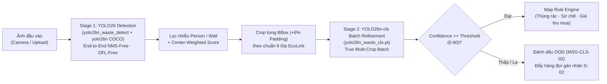

# Kế Hoạch Chuyển Đổi YOLOv8 Nano Sang YOLO26 & Tái Cấu Trúc Kiến Trúc AI Tập Trung Vào YOLO26

> **Phạm vi:** Toàn diện từ **Huấn luyện mô hình (`train.py`, `evaluate_models.py`, `.gitignore`)**, **AI Microservice (`src/Ecolink.AiService`)**, **Core Backend (`.NET 10`)**, đến **Frontend (`ecolink-web`)**.  
> **Nền tảng sẵn có:** Thư viện `ultralytics==8.4.153` trong `venv` đã tích hợp sẵn kiến trúc `yolo26.yaml` (Object Detection) và `yolo26-cls.yaml` (Classification).  
> **Chuẩn tuân thủ:** [`ai_service_and_benchmark_guidelines.md`](file:///c:/Projects/EcoLink/intelligent-waste-sorting-trading/documents/guideline/ai_service_and_benchmark_guidelines.md), [`clean_architecture_and_coding_guidelines.md`](file:///c:/Projects/EcoLink/intelligent-waste-sorting-trading/documents/guideline/clean_architecture_and_coding_guidelines.md), và [`git_and_ai_guidelines.md`](file:///c:/Projects/EcoLink/intelligent-waste-sorting-trading/.agents/rules/git_and_ai_guidelines.md).  
> **Trạng thái:** Kế hoạch kỹ thuật chờ phê duyệt trước khi chỉnh sửa mã nguồn & huấn luyện lại trọng số.

---

## 1. Tổng Quan & Mục Tiêu Chiến Lược

### 1.1. Tại sao chuyển sang kiến trúc tập trung vào YOLO26?
Hiện tại, [`model_manager.py`](file:///c:/Projects/EcoLink/intelligent-waste-sorting-trading/src/Ecolink.AiService/model_manager.py) đang phân mảnh trên 2 framework khác nhau trong cùng một luồng suy luận mặc định:
1. Gọi **YOLOv8 Waste Detection** (`yolov8n_waste_detect.pt` — NMS truyền thống + Distribution Focal Loss / DFL).
2. Gọi tiếp bộ dò phụ trợ **YOLOv8 COCO** (`yolov8n.pt`) để bắt chai lọ cầm tay và lọc nhiễu người.
3. Cắt từng BBox đưa qua **EfficientNet-B0 (`torchvision`)** rồi kích hoạt thêm **MobileNetV3-Small (`torchvision`)** làm trọng tài khi độ tự tin `< 0.78`.

Hệ quả thực tế (ghi nhận ngay trong [`data/stats.json`](file:///c:/Projects/EcoLink/intelligent-waste-sorting-trading/data/stats.json)): mỗi lượt quét trên CPU phải chạy tuần tự qua 3–4 mạng thần kinh (~80 MB trọng số), đẩy thời gian xử lý lên **`990 – 1.060 ms/ảnh`** và làm phức tạp vòng lặp retrain (vì phải bảo trì 2 script huấn luyện tách rời [`train.py`](file:///c:/Projects/EcoLink/intelligent-waste-sorting-trading/train.py) và [`train_torch_models.py`](file:///c:/Projects/EcoLink/intelligent-waste-sorting-trading/train_torch_models.py)).

### 1.2. Mục tiêu kiến trúc mới (YOLO26-Centric Unified Architecture)
1. **Thay thế hoàn toàn lõi YOLOv8 Nano sang YOLO26 Nano (`yolo26n`):**
   - Dùng cơ chế **Native End-to-End Inference (NMS-Free Dual-Head)** và **loại bỏ Distribution Focal Loss (DFL)** của Ultralytics YOLO26 giúp đầu ra gọn nhẹ, suy luận CPU nhanh hơn đáng kể (~35–43%) và phát hiện vật thể nhỏ/trong suốt chính xác hơn.
2. **Tập trung kiến trúc suy luận mặc định về 100% YOLO26 Two-Stage Engine:**
   - **Stage 1 (`yolo26_detect`):** `yolo26n_waste_detect.pt` + bộ dò phụ trợ COCO `yolo26n.pt` + thuật toán **Center-Weighted Score** ưu tiên vật thể cầm trên tay trước camera + **6% BBox padding**.
   - **Stage 2 (`yolo26n_cls`):** `yolo26n_waste_cls.pt` (fine-tune từ `yolo26n-cls.pt` trên `data/trashnet_split` gồm 6 lớp chuẩn EcoLink) chạy **True Batch Inference** 1 lượt cho mọi BBox cắt ra thay vì gọi nối tiếp Torchvision + vòng lặp nhiều model.
3. **Giữ tương thích ngược tuyệt đối (`Zero Breaking Changes`):**
   - Duy trì bảng ánh xạ `MODEL_ALIASES` (`"yolov8_detect" -> "yolo26_detect"`, `"yolov8n" -> "yolo26n_cls"`, `"yolo26" -> "yolo26_detect"`).
   - Bảo toàn dữ liệu lịch sử trong PostgreSQL (`AiScanHistory`, `AIFeedbackLog`) và không làm hỏng 329+ Unit Tests / API Tests hiện có.
   - Giữ nhánh tùy chọn (`mobilenet_v3`, `efficientnet_b0`) ở chế độ chỉ nạp theo yêu cầu tường minh (hoặc benchmark đối chiếu).

---

## 2. So Sánh Kiến Trúc Cũ (YOLOv8 Hybrid) vs. Kiến Trúc Mới (Unified YOLO26)

| Tiêu chí | Kiến trúc hiện tại (`YOLOv8 + Torchvision Ensemble`) | Kiến trúc mục tiêu (`Unified YOLO26 Two-Stage`) |
| :--- | :--- | :--- |
| **Model ID mặc định** | `yolov8_detect` | **`yolo26_detect`** (giữ alias `yolov8_detect`) |
| **Bộ dò đa vật thể (Stage 1)** | `yolov8n_waste_detect.pt` + `yolov8n.pt` (NMS + DFL) | **`yolo26n_waste_detect.pt`** + **`yolo26n.pt`** (End-to-End NMS-Free, DFL-Free) |
| **Bộ phân loại tinh (Stage 2)** | `efficientnet_b0_best.pth` + trọng tài `mobilenet_v3_best.pth` | **`yolo26n_waste_cls.pt`** (huấn luyện từ `yolo26n-cls.pt`, batch YOLO26 thuần nhất) |
| **Truyền Batch Stage-2** | Gọi PyTorch `torch.stack` riêng biệt hoặc vòng lặp từng ảnh với YOLO | **Unified Ultralytics Batch (`clf(crops, verbose=False)`)** trên cùng runtime |
| **Trọng số nạp mặc định** | 4 files (~77 MB tổng) | **2–3 files YOLO26 (~9–15 MB tổng)** |
| **Độ trễ CPU mục tiêu** | ~990 – 1.060 ms/ảnh | **~150 – 350 ms/ảnh** (đạt chuẩn `< 600 ms` mục tiêu khuyến nghị) |
| **Pipeline Active Learning (`S-02`)** | Duy trì 2 pipeline train (`train.py` & `train_torch_models.py`) | **1 pipeline YOLO26 thống nhất** cho cả Detect và Classify |

### Sơ đồ Kiến trúc Unified YOLO26 Two-Stage Pipeline



---

## 3. Kế Hoạch Triển Khai Chi Tiết Theo 4 Giai Đoạn

### Giai đoạn 1: Huấn luyện Trọng số YOLO26 & Cập nhật Hạ tầng Python
1. **Khóa phiên bản Ultralytics hỗ trợ YOLO26:**
   - Cập nhật [`requirements.txt`](file:///c:/Projects/EcoLink/intelligent-waste-sorting-trading/requirements.txt) và [`src/Ecolink.AiService/requirements.txt`](file:///c:/Projects/EcoLink/intelligent-waste-sorting-trading/src/Ecolink.AiService/requirements.txt): nâng ràng buộc từ `ultralytics>=8.1.0` lên **`ultralytics>=8.4.0`** để build Docker ([`Dockerfile`](file:///c:/Projects/EcoLink/intelligent-waste-sorting-trading/src/Ecolink.AiService/Dockerfile)) không bao giờ kéo nhầm bản cũ thiếu `yolo26.yaml` / `yolo26-cls.yaml`.
2. **Nâng cấp Pipeline Huấn luyện ([`train.py`](file:///c:/Projects/EcoLink/intelligent-waste-sorting-trading/train.py)):**
   - Đổi base classification model từ `YOLO("yolov8n-cls.pt")` sang **`YOLO("yolo26n-cls.pt")`**.
   - Cấu hình tham số huấn luyện tối ưu trên `data/trashnet_split` (6 nhóm rác chuẩn EcoLink):
     - `epochs=25`, `imgsz=224`, `batch=16`, `optimizer="AdamW"`, `lr0=0.001`, `project="runs/classify"`, `name="waste_yolo26n_cls"`.
   - Sau khi train xong, tự động copy `runs/classify/waste_yolo26n_cls/weights/best.pt` vào đúng 2 vị trí theo quy ước đặt tên mục 6 của [`ai_service_and_benchmark_guidelines.md`](file:///c:/Projects/EcoLink/intelligent-waste-sorting-trading/documents/guideline/ai_service_and_benchmark_guidelines.md):
     - `src/Ecolink.AiService/models/yolo26n_waste_cls.pt`
     - `models/yolo26n_waste_cls.pt`
   - Bổ sung nhánh/tham số CLI `--task detect` (hoặc hàm chuẩn hóa tải `yolo26n.pt` vào `models/yolo26n.pt` và huấn luyện/fine-tune `yolo26n_waste_detect.pt` khi nạp dataset từ `curated_datasets/*/manifest.json` do Backend gửi sang).
3. **Cập nhật [`.gitignore`](file:///c:/Projects/EcoLink/intelligent-waste-sorting-trading/.gitignore):**
   - Bổ sung ngoại lệ để Git cho phép lưu trữ trọng số chính thức của YOLO26 (vẫn giữ `runs/` và file `.pt` thử nghiệm ở ngoài danh sách track):
     - `!models/yolo26n.pt`
     - `!models/yolo26n_waste_cls.pt`
     - `!models/yolo26n_waste_detect.pt`
     - `!src/Ecolink.AiService/models/yolo26n.pt`
     - `!src/Ecolink.AiService/models/yolo26n_waste_cls.pt`
     - `!src/Ecolink.AiService/models/yolo26n_waste_detect.pt`
4. **Cập nhật Script Benchmark ([`evaluate_models.py`](file:///c:/Projects/EcoLink/intelligent-waste-sorting-trading/evaluate_models.py)):**
   - Hỗ trợ đánh giá **`YOLO26n-cls`** (`yolo26n_waste_cls.pt`) song song với `YOLOv8n-cls` (`best.pt`), `MobileNetV3-Small`, và `EfficientNet-B0` trên tập Validation `508` ảnh để xuất bảng so sánh Latency (ms) + Top-1 Accuracy (%) cho báo cáo khóa luận.

---

### Giai đoạn 2: Tái Cấu Trúc `Ecolink.AiService` Tập Trung Vào YOLO26

#### File trọng tâm: [`src/Ecolink.AiService/model_manager.py`](file:///c:/Projects/EcoLink/intelligent-waste-sorting-trading/src/Ecolink.AiService/model_manager.py) (và đồng bộ sang `model_manager.py` ở root nếu giữ bản demo)
1. **Định nghĩa Model Registry mới tập trung vào YOLO26:**
   - Đặt hằng số:
     ```python
     DEFAULT_MODEL_ID = "yolo26_detect"
     MODEL_ALIASES = {
         "yolov8_detect": "yolo26_detect",
         "yolo26": "yolo26_detect",
         "yolov8n": "yolo26n_cls",
         "yolo26n": "yolo26n_cls",
     }
     ```
   - Hàm `resolve_model_id(self, model_id: Optional[str]) -> str` chuyển đổi mọi alias cũ/mới về đúng key chuẩn trong `self.registry` (mặc định trả về `"yolo26_detect"`).
   - Cập nhật `self.registry`:
     - **`yolo26_detect` (Primary Default):** *"YOLO26 Waste Object Detection (End-to-End NMS-Free)"* — file `yolo26n_waste_detect.pt` (tự fallback sang `yolov8n_waste_detect.pt` nếu chưa có trọng số detect YOLO26 custom, hoặc kết hợp `yolo26n.pt` COCO), type `"yolo_detect"`, family `"YOLO26 End-to-End NMS-Free (Two-Stage)"`.
     - **`yolo26n_cls` (Primary Stage-2 Classifier & Edge Stream):** *"YOLO26 Nano Classification"* — file `yolo26n_waste_cls.pt` (fallback `best.pt`), type `"yolo"`, family `"YOLO26-cls (Ultralytics)"`.
     - **`efficientnet_b0` và `mobilenet_v3`:** Giữ trong registry ở nhóm **Legacy / Benchmark Comparison** (`is_legacy: True`), không tự động nạp vào RAM khi chạy pipeline mặc định trừ khi client chỉ định tường minh.
2. **Nâng cấp Bộ dò vật chứa COCO (`_get_coco_detector`):**
   - Ưu tiên tìm & nạp **`yolo26n.pt`** (tại `models_dir / "yolo26n.pt"`), fallback an toàn sang `yolov8n.pt` nếu chưa tải `yolo26n.pt` xuống đĩa.
3. **Tái cấu trúc Two-Stage Engine tập trung hoàn toàn vào YOLO26 (`_extract_multi_object_candidates`, `_classify_crops_batch`, `predict`, `detect_objects`):**
   - Trong `predict()`:
     - Đổi `stage2_id = "yolo26n_cls"` làm bộ phân loại mặc định cho chế độ `yolo26_detect` (thay vì `"efficientnet_b0"`).
     - Gọi `_extract_multi_object_candidates(pil_image, stage2_classifier_id="yolo26n_cls", ...)` với cờ bật/tắt `use_legacy_mobilenet_consensus = False` mặc định (không còn chạy chồng Torchvision + MobileNetV3 mỗi lần quét).
   - Trong `_classify_crops_batch(crops, classifier_id)`:
     - Với `info["type"] == "yolo"`, truyền trực tiếp nguyên danh sách `clf(crops, verbose=False)` vào YOLO26 để chạy **True Batch Inference** thay cho vòng lặp `for crop in crops`, giảm overhead gọi Python trên CPU khi có nhiều vật thể trong ảnh.
   - Cơ chế hợp nhất Stage-1 + Stage-2 tập trung YOLO26:
     - Kết hợp độ tự tin từ `yolo26_detect` (End-to-End NMS-Free) và phân phối xác suất 6 lớp của `yolo26n_cls` (tỉ trọng 60/40 cho nhóm vật thể độ tự tin trung bình, giữ nguyên quy tắc `coco_container_assisted` cho chai thủy tinh/nhựa trong suốt cầm tay và ngưỡng OOD `< 0.60`).

#### File API Gateway Python: [`src/Ecolink.AiService/app.py`](file:///c:/Projects/EcoLink/intelligent-waste-sorting-trading/src/Ecolink.AiService/app.py)
- Đổi `default_model` trong `/health`, `GET /api/v1/models`, `POST /api/v1/classify`, và `POST /api/v1/classify/batch` từ `"yolov8_detect"` / `"yolov8n"` sang **`"yolo26_detect"`** và **`"yolo26n_cls"`**.
- Cho phép `classify_waste_image` và `classify_waste_batch` nhận cả ID mới (`yolo26_detect`, `yolo26n_cls`, `yolo26n`) lẫn alias cũ (`yolov8_detect`, `yolov8n`) thông qua `model_manager.resolve_model_id(model)` để không từ chối request từ các bản client cũ.
- Trả về metadata chuẩn `model_used` với tên mô hình YOLO26 mới (giữ nguyên cấu trúc JSON `AiScanResponse` / `WasteDetectionResponse`).

---

### Giai đoạn 3: Đồng Bộ Core Backend (`.NET 10`)

1. **[`WasteScanController.cs`](file:///c:/Projects/EcoLink/intelligent-waste-sorting-trading/src/Ecolink.Backend/Ecolink.WebApi/Controllers/WasteScanController.cs):**
   - Cập nhật tham số mặc định của `ClassifyImage`:
     `[FromForm] string? model = "yolo26_detect"`.
   - Cập nhật mảng `validModels` (dòng 66) hỗ trợ cả bộ YOLO26 mới và tương thích ngược alias cũ:
     `var validModels = new[] { "yolo26_detect", "yolo26n_cls", "yolo26n", "yolo26", "yolov8_detect", "mobilenet_v3", "efficientnet_b0", "yolov8n" };`.
   - Cập nhật fallback danh sách mô hình tại `GetAvailableModels` (dòng 163–171) đặt `default_model = "yolo26_detect"` và liệt kê `yolo26_detect`, `yolo26n_cls` lên đầu danh sách.
2. **[`ApplicationInterfaces.cs`](file:///c:/Projects/EcoLink/intelligent-waste-sorting-trading/src/Ecolink.Backend/Ecolink.Application/Interfaces/ApplicationInterfaces.cs) & [`AiVisionHttpClient.cs`](file:///c:/Projects/EcoLink/intelligent-waste-sorting-trading/src/Ecolink.Backend/Ecolink.Infrastructure/Services/AiVisionHttpClient.cs):**
   - Đổi giá trị tham số mặc định `string? model = "yolo26_detect"` trong `IAiVisionClient.ClassifyWasteImageAsync` và `AiVisionHttpClient.ClassifyWasteImageAsync`.
3. **[`AiFeedbackService.cs`](file:///c:/Projects/EcoLink/intelligent-waste-sorting-trading/src/Ecolink.Backend/Ecolink.Infrastructure/Services/AiFeedbackService.cs):**
   - Cập nhật fallback `ModelUsed` mặc định khi AI Service không trả tên model (dòng 103 & 192) sang `"yolo26_detect"`.
   - Không tạo migration thay đổi `HasDefaultValue("yolov8_detect")` ở lịch sử migration cũ để giữ lịch sử DB ổn định; các bản ghi quét mới từ runtime sẽ ghi nhận `"yolo26_detect"`.

---

### Giai đoạn 4: Đồng Bộ Frontend (`ecolink-web`) & Tài Liệu

1. **[`src/lib/wasteScanApi.ts`](file:///c:/Projects/EcoLink/ecolink-web/src/lib/wasteScanApi.ts):**
   - Mở rộng `AiModelId`:
     `"yolo26_detect" | "yolo26n_cls" | "yolov8_detect" | "mobilenet_v3" | "efficientnet_b0" | "yolov8n"`.
   - Cập nhật `DEFAULT_AI_MODELS` với `yolo26_detect` là mô hình mặc định hàng đầu (*"YOLO26 Detection (End-to-End NMS-Free - Khuyên dùng)"*), đồng thời cập nhật `default_model: "yolo26_detect"` trong `classifyWasteImage` và fallback `fetchAiModels`.
2. **[`src/pages/Scanner.tsx`](file:///c:/Projects/EcoLink/ecolink-web/src/pages/Scanner.tsx):**
   - Đổi `classifyWasteImage(targetFile, "yolo26_detect", controller.signal)` tại dòng 465 khi gọi API phân tích ảnh thật.
3. **Cập nhật tài liệu chuẩn:**
   - Cập nhật [`ai_service_and_benchmark_guidelines.md`](file:///c:/Projects/EcoLink/intelligent-waste-sorting-trading/documents/guideline/ai_service_and_benchmark_guidelines.md) và [`documents/ai report/Báo cáo tổng kết quá trình huấn luyện.md`](file:///c:/Projects/EcoLink/intelligent-waste-sorting-trading/documents/ai%20report/B%C3%A1o%20c%C3%A1o%20t%E1%BB%95ng%20k%E1%BA%BFt%20qu%C3%A1%20tr%C3%ACnh%20hu%E1%BA%A5n%20luy%E1%BB%87n.md) với số liệu benchmark thực tế sau khi huấn luyện & đánh giá xong YOLO26.

---

## 4. Kế Hoạch Kiểm Thử & Nghiệm Thu (Verification Plan)

1. **Huấn luyện & Benchmark mô hình (`venv`):**
   - Chạy `.\venv\Scripts\python.exe train.py` tạo `yolo26n_waste_cls.pt`.
   - Chạy `.\venv\Scripts\python.exe evaluate_models.py` kiểm tra `YOLO26n-cls` đạt:
     - Top-1 Accuracy $\ge 90\%$ trên tập Val 508 ảnh TrashNet.
     - CPU Latency giảm rõ rệt so với kiến trúc cũ (`< 600 ms/ảnh` cho toàn pipeline End-to-End).
2. **Kiểm thử API Python AI Service:**
   - `GET /health` và `GET /api/v1/models` trả về `default_model: "yolo26_detect"` và trạng thái `is_ready: true`.
   - `POST /api/v1/classify` (với `model=yolo26_detect`, `model=yolo26n_cls`, và alias ngược `model=yolov8_detect`) trên các ảnh mẫu trong `data test/` (`Chai nhựa.jpg`, `Chai nhựa lỗi Carton.jpg`, `Chai nhựa lỗi Thủy tinh.jpg`) + ảnh OOD (bàn phím / cốc gốm).
3. **Kiểm thử Backend (`.NET 10`):**
   - Bổ sung Unit Test vào `AiClassificationUnitTests.cs` kiểm tra `WasteScanController.ClassifyImage` với `model = "yolo26_detect"` và alias `"yolov8_detect"`.
   - Chạy `dotnet build Ecolink.WebApi.csproj` và `dotnet test Ecolink.UnitTests.csproj` đảm bảo toàn bộ **329+ test cases PASS 100%**.
4. **Kiểm thử Frontend (`ecolink-web`):**
   - Chạy `npm run typecheck`, `npm run check`, `npm run check:routes`, và `npm run build` đảm bảo `0` lỗi build/SSR.
